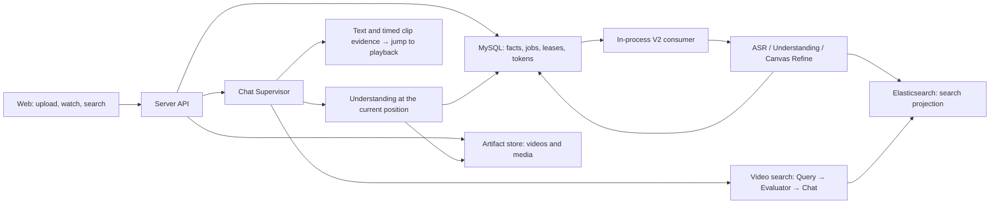

<p align="center">
  
</p>

<h1 align="center">Seekino</h1>

<p align="center"><strong>Parse a video once. Find, jump and ask inside it like text, forever after.</strong></p>
<p align="center">A personal video library: natural-language and image search, clip-level answers, and every result traced back to the original timestamp.</p>

<p align="center">
  English · <a href="README.md">简体中文</a>
</p>

<p align="center">
  <a href="#1-highlights">Highlights</a> ·
  <a href="#2-technical-architecture">Architecture</a> ·
  <a href="#3-deployment">Deployment</a> ·
  <a href="#api-integration">API &amp; MCP</a> ·
  <a href="#references">References</a>
</p>

## 1. Highlights

- **Can't sit through the slides?** A 116-minute course is daunting, and you don't know which part holds the knowledge you actually need. Even at 3× speed that is still 30+ minutes of watching.
- **Editing footage is hard to keep track of** *(direction, in progress)*. Every edit, you ask the agent to parse the same reference clip or animation source again. You still hunt down most character art yourself. And the motion-effect and animation references you already analysed are gone the next time you need them.

**Seekino parses a video once, then lets you locate and reuse it again and again.** You can jump around a video the way you skim text, and hand "what I'm watching right now" to the agent the way you would paste a paragraph.

- **Courses:** ask one sentence and land on the point you want in about a dozen seconds, with no speed-watching.
- **Editing:** each piece of footage is parsed once and reused many times, so it grows into your own editing library.

Seekino's job is precise positioning: it recalls the exact clip, with its source video and time range, so you can check it against the original.

<p align="center">
  
</p>

### 1.1. Retrieval support

| You want to… | What Seekino does | Status |
| --- | --- | --- |
| Find an iconic anime scene you can't place any more | Describe your vague impression, or attach a screenshot, and get the episode and second. | Text ✅ · still image in chat ✅ · GIF ⏳ |
| Study a course without screenshotting it | Ask while watching. The question carries the current video and playback position, so the AI knows where you are and what confused you. | ✅ |
| Get a "crash route" through a course for your own goal | Give your question. The AI browses the series overview and the video outline, then plans which sections to watch and in what order. | ✅ |
| Pull editing material without scrubbing by hand | Seekino exposes an MCP server. Claude Code, Codex or any MCP client can fetch clips for a brief; you give a vague impression and review the picks. | ✅ read-only: `list_series`, `retrieve`, `read_evidence` |
| Reuse what you learned from past editing references | Store motion-effect analyses as reusable style references that an MCP client can recall and update, so editing experience compounds. | ⏳ planned |

### 1.2. Parsing support

| You want to… | What Seekino does | Status |
| --- | --- | --- |
| Make a long video searchable without babysitting it | Upload once. Seekino transcribes the whole video, cuts it into fixed 60 s chunks, parses them in parallel, and you can track progress and retry failed tasks. | ✅ |
| Keep a 2-hour course affordable | Pick the model per stage (Kimi, Doubao, DeepSeek, Codex…) in one `config.yaml`; every model call records tokens and estimated cost. | ✅ |
| Not lose sentences that cross a chunk boundary | Adjacent chunks are re-read together in a sliding Refine window that fills dropped lines, removes duplicates and stitches cross-boundary dialogue. | ✅ |
| Know who is speaking | Whole-video speaker grouping, series background notes and optional voiceprints feed speaker attribution; unknown speakers stay unnamed rather than guessed. | ✅ |
| Get the shape of the video, not just its moments | After parsing, a separate Summarize pass writes a chaptered video outline and a series overview that chat can browse. | ✅ |
| Spend less on footage that needs less | A parse-type hook picks one of three parse modes, course, script (剧本类影视作品) or clip, each with its own frame rate and model budget; you can override it. | ⏳ planned |

<details>
<summary>Screenshots (2026-10-25, local build, real footage)</summary>

**Organize your footage.** Manage videos by series and check upload, analysis and search availability. Add background notes to help the analysis understand characters and content.


**Describe a scene and retrieve matching clips.** Expand a result to preview the clip, see why it was selected and check its original timestamps. Quote a clip to ask a follow-up question.


**Return to the original and check the context.** The player and Q&A panel sit side by side. Questions carry the current video and playback position, and video timestamps in answers are clickable.


</details>

**How to use it today.** A hosted sample library (admins upload, visitors watch, search and ask) is being prepared; there is no public URL yet. You can self-host a personal library now; see [Deployment](#3-deployment). Analysis, retrieval and answers can be wrong, so check them against the original footage. Known issues are in the [issue list](docs/dev/problems.md) (in Chinese).

## 2. Technical architecture

Seekino has two audiences. Casual users should be able to try public Q&A on a lightweight cloud server; heavy users should be able to self-host their own video knowledge base. To serve both, Seekino is built as three stages, parsing, retrieval and Q&A, that meet only through two stores: MySQL holds business facts, tasks and versions; Elasticsearch holds the derived search projection.

<p align="center">
  
</p>

<details>
<summary>Model stack and product loop</summary>


</details>

All figures are editable in one draw.io file: [docs/architecture/seekino-figures.drawio](docs/architecture/seekino-figures.drawio) (12 tabs). Numbers marked **TODO** have not been measured on the current build.

### 2.1. Parsing

**Transcription.** The whole video is transcribed once before any chunk is parsed. WhisperX (local, with word-level alignment) is the default, and it can be replaced with an ASR API, such as Doubao, through `models.transcription`.

**Parallel parsing on fixed chunks.** To work across many scenarios and many model APIs while staying affordable, Seekino cuts every video on a fixed 60 s grid (integer milliseconds, left-closed right-open) and runs Understanding on the chunks in parallel (10 at a time by default). Each chunk sees its frames, ±3 s of visual context and the transcript lines that fall inside it.

<p align="center">
  
</p>

Fixed chunks cost something: a single chunk loses its neighbours' context, and a cut can fall mid-sentence or mid-action. Two passes repair this:

- **Sliding-window Refine.** Each window re-reads three adjacent chunks together (a 117-chunk course has 115 windows). It fills dropped lines, removes duplicated dialogue and stitches sentences across the boundary.
- **Tail summary.** After parsing, an independent Summarize pass reads the whole timeline and writes the chaptered video outline and the series overview.

<p align="center">
  
</p>

**Measured per-chunk Understanding.** Same course (*Let's build GPT*, 116 min 20 s, 117 chunks), 3 FPS, max height 720. Values are medians of successful attempts; failed and cancelled attempts are reported separately in the linked evidence.

| Model (setting) | Time per 1-min chunk, p50 | First token, p50 | Input tokens / chunk | Est. cost / chunk | Evidence |
| --- | ---: | ---: | ---: | ---: | --- |
| Kimi k3.1-pro (default effort) | 320.2 s (n=14) | 43.4 s (n=10) | ≈244 k (198 frames) | TODO | [trace](docs/report/server/kimi-parse-trace-20261101.md) |
| Kimi k3.1-pro (low) | 105.5 s (n=18) | TODO | ≈244 k | TODO | [devlog 11-02](docs/dev/devlog.md) |
| DeepSeek Flash (reasoning off) | 31.8 s (n=117) | TODO | TODO | ≈¥0.22 (partial usage) | [audit](docs/report/gateway/deepseek-flash-chunk-audit-20261103.md) |
| Doubao Seed 2.1 Pro | TODO | TODO | TODO | TODO | TODO |

**Why parallel instead of serial.** With a fixed grid and a bounded worker pool, wall time grows with *chunks ÷ concurrency*, not with the model's speed on the whole video. A slow model makes each chunk slower, but a long video no longer turns into one long serial wait. Whole-course wall time on the current build: TODO.

**Challenge: concurrent Refine windows.** Neighbouring windows share chunks, so two windows can edit the same chunk at once. We went through three designs:

1. **Pessimistic, tool-driven.** The model edited the timeline through fine-grained Canvas read/write tools, so the host could control every write. On the same three chunks this took 8 model requests, 593.7 s and 314,671 input tokens; most of the time went into planning tool calls, not into fixing content.
2. **One JSON per window.** The model gets the full window and returns one complete JSON: 1 request, 247.0 s, 11,307 input tokens, with the same 45 events and 16 dialogue lines (n=1 paired run). Without tools, though, windows built on stale snapshots: in one full-course run 49 commits were rejected as conflicts after the model had already finished generating, and failed attempts took 57% of all Refine attempt time.
3. **Optimistic and non-blocking (current).** Windows run without locks. When the first overlapping window commits, the host immediately interrupts the other windows that share a chunk, keeps their latest candidate, and sends a new message: *chunk N was updated; here is the new window JSON*. The model continues from the new snapshot instead of failing a commit and starting over. In local HTTP/SSE tests, an interrupted request now exits in about 1 ms instead of hanging until its deadline. Real-model time and token savings: TODO.

This frees the agent from an endless fail-and-retry tool loop. Current models are capable enough to support the optimistic view; in our runs, DeepSeek Flash with reasoning off is the one that still returns unreliable output.

**Gate.** Without Canvas tools, nothing stops a model from breaking the JSON structure, so every Refine output passes a JSON gate before it can commit. Ordering problems the host can fix deterministically (for example, unsorted times) are fixed without another model call. Anything else goes back to the model with its own last output and the exact failing field, for example `members.0.content: …`, and an instruction to fix only that. Membership, time ranges, task lease and content version are still checked by the server at commit time, so the stored result is always well-formed and legal.

<p align="center">
  
</p>

### 2.2. Building retrieval

**What one vector represents.** The retrieval unit is the **Event** (one action, shot or line inside a chunk), not the 60 s chunk: a one-minute chunk encoded as a single vector dilutes a short target line. Each Event is indexed on three channels so text and image queries can both reach it:

| Channel | Built from | Serves |
| --- | --- | --- |
| Lexical | Event text and dialogue (Elasticsearch BM25) | exact quotes, names, terms |
| Semantic | Text embeddings of the description and dialogue, per language and role | paraphrased, vague descriptions |
| Vision | Frame embeddings (`doubao-embedding-vision`, 1024-d) | visual descriptions and image queries |

The channels are fused with **weighted reciprocal-rank fusion**, with weights adapted to the query, then reranked (falling back to the fused order if reranking fails). Every hit is verified against the stored Timeline of its parse task and content version before it is returned: a vector match is a candidate, not a fact.

**TODO: max-rank guard.** Fixed-weight RRF can push a hit that one channel ranked #1 (say, an exact quote found by lexical search) out of the final top 10 once the weights are applied. The planned fix keeps each channel's top hit in the result, i.e. it takes the maximum over channels (‖·‖∞) rather than only the weighted sum, so a strong single-channel match is never filtered out at the end. Not implemented yet.

<p align="center">
  
</p>

**Two ways to retrieve.**

- **Top-down.** For broad intent, such as *"I want to build a GPT; which points should I master?"*, the agent first reads the series overview and the video outline, plans the answer at the macro level, then opens only the chunks it needs and cites specific Events as evidence.
- **Bottom-up.** For a specific moment, such as a line, a shot or an action, the agent retrieves Events directly, then reads the surrounding chunk to answer with context.

The agent chooses between them per question; a course question about structure starts top-down, a quote or scene search starts bottom-up.

### 2.3. Retrieval Q&A

**Route before you search.** In chat, the same words can be a new search or just feedback on the last answer. Once per turn, before the main agent runs, a query hook decides:

1. **Route.** Jev-1.14 (via OpenRouter, 3 s timeout) labels the message *respond*, *retrieve* or *mixed*.
2. **Rewrite.** For *retrieve* or *mixed*, DeepSeek Flash (`models.query_rewriter`, reasoning off, 4 s timeout) writes only the search part as a clean `retrieval_query`, keeping quoted lines verbatim and never guessing names or episodes.
3. **Append.** A fixed per-turn note is appended to the unchanged user text.

The whole hook has an 8 s budget; any timeout, provider error or invalid output falls back to the raw message, so it can only help. It is on by default and needs `OPENROUTER_JEV_API_KEY`; rewriting can be switched off on its own.

<p align="center">
  
</p>

**Answer with clips, not claims.** The chat Supervisor plans the turn and calls tools:

- `query_video` delegates the search to a video-search agent, which retrieves Events, browses outlines and inspects frames.
- `get_series_overview` and `get_video_outline` read the course structure (top-down).
- `understand_current_video` answers from the video you are watching, around your playback position.
- `search_web` supplies background the footage doesn't contain.
- `submit_video_item` attaches a playable clip card.

Cards snap to sentence and Event boundaries and appear inline under the text that cites them. Answers stream token by token, with the model's reasoning in a collapsed panel; if no first token arrives within 15 s, the client reconnects with backoff, up to 3 times.

**Effect.** Turn latency, strict pass rate and token cost of the router A/B are in Fig. 7(c) and Fig. 11; all values are TODO on the current build.

<details>
<summary>Problems we hit, measured effect, and what is still unmeasured</summary>


</details>

## API integration

The web interface and external tools use the same service APIs. Your tools can connect to these capabilities:

| Integration | Existing endpoints |
| --- | --- |
| Upload videos and start analysis | `POST /api/uploads/create` → `PUT /api/uploads/segments/upload` → `POST /api/uploads/complete` |
| Track analysis tasks | `GET /api/jobs/video-parse/get`, `GET /api/jobs/video-parse/events` |
| Retrieve footage | `POST /api/search`, returning source clips, time ranges and evidence. |
| Find footage through Agent chat | `/api/agent/conversations/*` and `/api/agent/messages/*`, with ongoing conversations and streamed answers. |
| Let an external agent fetch clips (MCP) | Streamable HTTP at `/mcp` (local auth mode), tools `list_series`, `retrieve`, `read_evidence`. |

After starting the service, inspect requests and responses in the [OpenAPI docs](http://127.0.0.1:9621/docs). See [Server](server/README.md) for integration details. The current scope field is `tenantId`. Video time fields use integer milliseconds relative to the original video, including fields that retain legacy `*Seconds` names; follow the current contract when integrating.

## Creative experiments

A separate experiment has already connected retrieval, clip preparation and HyperFrames composition into an offline HTML short video. See the [short-video experiment workflow](.agents/skills/seekino-short-video/SKILL.md). It explores reusing retrieved footage; check its scripts and configuration against the current API before using them.


## 3. Deployment

Self-hosting is the way to run Seekino today; a cloud Docker deployment for the public demo is in progress.


The recommended first install runs **Web, API, video processing, MySQL and Elasticsearch in Docker**, with **DeepAgents** and API models by default. Local mode needs no application login.

Install Docker Desktop, or Docker Engine with a current Compose plugin. On Windows, select **WSL2 / Linux containers**; the commands also work in PowerShell. Python, Node.js, ffmpeg and the model SDKs are included in the images.

From the repository root:

```bash
cp deploy/docker/env.example .env.docker
```

Fill in `ARK_API_KEY` and `DEEPSEEK_API_KEY` in `.env.docker`, and confirm your accounts can access the models selected in `config.yaml`. Keep an existing environment file instead of overwriting it. Then start everything:

```bash
docker compose --env-file .env.docker up --build -d --wait
```

Initialization checks the configuration and creates the business tables, DeepAgents checkpoints and search indexes before starting the API and Web. Existing databases still require the documented upgrade procedure.

- Web: <http://127.0.0.1:5173>
- API docs: <http://127.0.0.1:5173/docs>
- Health: <http://127.0.0.1:5173/healthz>; the API is also published on port `9621`.

Kimi and Codex remain optional through the existing source/model/harness fields in **the same `config.yaml`**. No extra provider YAML is required. Kimi uses `KIMI_API_KEY`; Codex uses the bundled SDK runtime and a persistent container login. See the [Docker setup guide](deploy/local-setup.md) for these steps, custom ports and configuration updates.

The `app_data` volume stores media, logs, the effective model configuration and Codex credentials; MySQL and ES have separate volumes. The model YAML is imported only on first launch, preserving changes saved by the Settings page. `stop` and `down` retain volumes; `down -v` deletes them.

```bash
docker compose --env-file .env.docker ps
docker compose --env-file .env.docker logs -f api
docker compose --env-file .env.docker stop
```

Full container startup and Windows validation are still pending; see the guide for the checks completed. After startup, upload a short video, wait for parsing, retrieve a clip and ask two follow-up questions. A healthy HTTP endpoint does not validate the model pipeline. Remote model calls send the relevant media or text to the configured provider and may incur charges.

### Host development (optional)

<details>
<summary>Run API and Web on the host, with Docker databases</summary>

#### 1. Prepare the environment and configuration

You need Python **3.12** (`>=3.12,<3.13`), `uv`, Node.js **24+**, npm, ffmpeg and ffprobe. Storage uses MySQL **8.4** and Elasticsearch **8.19.x**. Bring your own, or use the repository's Compose file (ES is pinned to 8.19.22).

Copy the environment file the first time. If `.env.local` already exists, edit it instead:

```bash
cp .env.example .env.local
uv sync --locked
npm --prefix web ci
```

Fill in model credentials and local connection details in `.env.local`. The default configuration uses these sources:

| Model role | Default source | What you need |
| --- | --- | --- |
| Chat Supervisor, transcription, frame understanding, OCR and summaries | Ark | Set `ARK_API_KEY`. No local weights are required by the default configuration. |
| Video search agent | DeepSeek, with an Ark fallback | Set both API keys. |
| Embeddings | Ark | Set `ARK_API_KEY`. |
| Reranking, text fallback when vision fails | DeepSeek | Set `DEEPSEEK_API_KEY`. |

Adjust the [model configuration](docs/model-config.md) to the models or endpoints you have. The default `supervisor_harness: deepagents` uses an API source. To select Codex, change the harness and Supervisor binding together. Kimi uses the existing OpenAI-compatible adapter and `kimi` profile.

| Where | What |
| --- | --- |
| `config.yaml` | `model_sources` connections; model choices for chat, transcription, vision, embedding and rerank under `models`; global chat parameters under `agent_runtime`. |
| `.env.local` | API keys, personal endpoint overrides, database/ES/HTTP/identity settings. Never committed to Git. |
| `web/.env.local` (optional) | `VITE_API_BASE_URL` and `VITE_TENANT_ID` for a standalone web build. Defaults to the same-origin proxy and the local tenant. |

When running by hand, exported shell variables with the same name take priority over `uv --env-file`. Use the same configuration in both terminals.

#### 2. Prepare MySQL and Elasticsearch

With Docker Compose:

```bash
docker compose --env-file .env.local up -d --wait mysql elasticsearch
```

On first start, Compose creates the default development database `seekino_development`, and database ports are only published on `127.0.0.1`. The server, web app and ffmpeg still run on the host. If you use an existing MySQL, create the database and account named in `SEEKINO_DATABASE_URL` first; `init-db` only creates tables, not the database.

Then initialise or verify the current schema and ES index:

```bash
uv run --no-sync --env-file .env.local -- python -m server.cli init-db
uv run --no-sync --env-file .env.local -- python -m server.cli init-es-index
```

Both commands can be re-run, but they do not migrate old databases or rebuild incompatible indexes automatically. Old identity fields, time units or index contracts raise an upgrade error; see "Upgrading an existing database" under Architecture and deployment below.

#### 3. Start the API and the web app

Terminal 1:

```bash
uv run --no-sync --env-file .env.local -- python -m server.main
```

Terminal 2:

```bash
uv run --no-sync --env-file .env.local -- npm --prefix web run dev -- --host 127.0.0.1 --port 5173 --strictPort
```

- Web: <http://127.0.0.1:5173>
- API docs: <http://127.0.0.1:9621/docs>
- Consumer status: <http://127.0.0.1:9621/healthz>

`python -m server.api` forwards to the official `server.main` entry point. The API process already includes the V2 consumer, so no separate worker is needed. Stop each hand-started process with Ctrl-C. Stop the databases with `docker compose --env-file .env.local stop mysql elasticsearch`; their volumes are kept.

The Vite proxy reads `SEEKINO_HTTP_HOST` / `SEEKINO_HTTP_PORT` from the same environment. To use a custom web port, change `--port` above and `SEEKINO_ALLOWED_ORIGINS`. Changing `SEEKINO_WEB_PORT` alone does not change the port of a hand-started Vite.

#### Optional: local launcher

The repository includes a launcher for starting installed native MySQL and Elasticsearch when needed, reusing the API/web processes and managing them:

```bash
./start.sh
./start.sh status
./start.sh stop
```

The launcher defaults to the checked-out `main` worktree and its `.env.local`. Use `./start.sh --branch dev` (and `--branch dev status` / `--branch dev stop`) for an existing dev worktree. `start` uses current local files, including uncommitted changes, without pulling or switching branches. Managed API/Web processes are refreshed when their source directory, file contents, or configuration changes; unchanged processes are reused, and unknown port owners are rejected. MySQL/ES are not stopped by this refresh.

The launcher checks the API library and the web proxy against the current `tenantId` contract, using the local tenant configured in `SEEKINO_LOCAL_TENANT_ID`. It reuses listening MySQL/Elasticsearch instances or starts installed native binaries, then validates schemas, checkpoints and indices. `stop` only stops processes the launcher manages. It does not stop a hand-started API/web or the Compose databases.

To run entirely without Docker, follow the [native local setup](deploy/README.md#可选全原生本机开发) (in Chinese) to install MySQL and Elasticsearch and configure their executable paths. Use the same launcher commands above; `stop` also stops native databases started by the launcher.

Native database data defaults to `data/mysql/` and `data/elasticsearch/`; launcher logs and PID records go to `outputs/local-services/`. Persistent media goes to `assets/library/` by default, configurable with `SEEKINO_ARTIFACT_ROOT`. Existing media roots are not moved automatically; preserve their environment directories and back them up together with MySQL. An existing MySQL/ES is reused as configured, and old business schemas are never migrated automatically. For native binary paths, legacy data protection, Docker and port details, see the [development deployment notes](deploy/README.md) (in Chinese).

</details>

## Architecture and deployment

<details>
<summary>System architecture and module responsibilities</summary>



| Module | Responsibility |
| --- | --- |
| `gateway/` | Model protocols, authentication, call control and usage events. Connects to Ark, OpenAI-compatible APIs, the Codex app-server, the Claude SDK and more. |
| `engine/` | Domain algorithms: video event conversion, time and content validation, index projection, retrieval fusion. |
| `agent/` | LangGraph and agent programs, the Context Canvas, video understanding/refinement, and the Supervisor's tool decisions. |
| `server/` | Identity and resource permissions, uploads, MySQL persistence, leases and recovery, media preparation, ES writes, HTTP and CLI. |
| `web/` | The React frontend, connected to the real API. When the API is unavailable it shows errors or empty states. |

A full parse runs basic understanding over fixed chunks, while sliding intervals are refined separately and drive indexing. The model reads evidence and edits local content through the **Context Canvas**; the program keeps the full state and assembles the committed result. Refine checks member versions and content fingerprints, so a local edit can't drop events it didn't mention. An optional prefix provides cross-chunk context and is off by default.

The Supervisor can answer directly, search the web, call video search, or understand the current and neighbouring chunks at the frozen playback position. Even before a video is fully indexed, basic evidence can be fetched on demand. The Supervisor decides which calls to make; response time depends on the models and the execution budget.

Retrieval tools return source evidence directly; additional context is read by chunk ID and cursor. The Jev classifier and local 8B query rewrite remain in the pre-processing path.

The production service only accepts **V2 + MySQL + Elasticsearch**. The consumer runs in the same server process as the API, job and recovery state live in MySQL, and ES is a search projection. Gateway, Engine and Agent need no separate processes. Local mode needs no Redis or external message queue. Parse V1, Qdrant, and the old offline import entrypoints have been removed.

Video durations, event/chunk boundaries, playback positions and frame times are all **integer milliseconds** from the start of the original video. Existing fields such as `durationSeconds`, `startSeconds`, `endSeconds`, `atSeconds` and `positionSeconds` keep their old names, but their values are not seconds. The browser player converts to seconds at its boundary. Absolute times are Unix epoch milliseconds. Chunk durations and timeouts in the parse config are still in seconds.

</details>

<details>
<summary>Models and runtime parameters</summary>

`model_sources` describes protocol adapters, authentication and providers. `models` defines each model and its source. The app currently uses the `supervisor`, `agent`, `transcription`, `vision`, `vision_fallback`, `embedding` and `rerank` roles. Parameters such as vector dimensions and video sampling rate live in `models.embedding`. By default, Refine reuses the fixed Understanding model.

The top-level `supervisor_harness` chooses between the Codex and Deep Agents execution styles, and `models.supervisor` binds the Supervisor model on its own. `models.agent` still picks the model for video-search subtasks. By default the Supervisor uses DeepAgents with Ark, and frame understanding also uses Ark. Whether other models receive raw images depends on each model's `supports_vision_input` and its adapter. Switching sources never switches the embedding model automatically.

The gateway supports OpenAI-compatible APIs, Ark, a local Codex login, the Claude SDK and more; each model role and harness has its own capability requirements. Restart the server after changing a source, model or harness. It will not silently switch execution style when the config doesn't match.

`agent_runtime` parameters saved from the Settings page are written to the server's `config.yaml`. The next new message uses the new values; an answer already in progress keeps the parameters it started with. `maximum_concurrent_kicks`, model connections and other startup settings need a server restart. Runtime parameters set explicitly in YAML override the matching `SEEKINO_AGENT_*` environment fallbacks.

The Model Usage page reads MySQL `model_usage`. It covers V2 parsing/indexing and assistant calls, and shows only recorded tokens and known subtotals. Failed records may be missing, and unknown usage is never counted as zero. It does not calculate cost or enforce hard token quotas. The production bootstrap **does not wire up the Langfuse writer/reader**, so setting `tracing.enabled` to true does not turn on server tracing; the standalone module and config fields are still kept.

For source configuration see [model configuration](docs/model-config.md) and [gateway agent sources](gateway/README.md#chat-agent-模型来源). For how usage is counted, see [model token usage](docs/parse-model-usage.md).

</details>

<details>
<summary>Local and cloud identity</summary>

The default `SEEKINO_AUTH_MODE=local` uses `local-user` / `local-default`, with no login on your own machine.

`cloud` mode also needs a signing secret, Redis, SMTP and same-origin HTTPS. Redis stores verification-code digests, rate limits and concurrency leases; MySQL stores users, tenants and resource ownership. You can start the optional development Redis from Compose:

```bash
docker compose --env-file .env.local --profile cloud-auth up -d --wait redis
```

Guests can only read content that is public and ready, and their conversations are isolated per guest. After logging in with an email code, a user gets a personal tenant and can switch between personal and public content. Library management and global settings are controlled by server permissions; public read access never grants platform write access.

Cloud mode limits request counts and concurrency. Guests share a per-IP request budget; local mode has no request quota. These limits are separate from token statistics. A production reverse proxy must forward the HTTPS scheme and client address correctly. See [.env.example](.env.example) for the settings and the [user/tenant handoff notes](docs/report/server/user-tenant-handoff-20261010.md) for identity details and migration.

Business HTTP scoping fields now use **`tenantId`**. Some older docs still show `workspaceId` examples; follow the current OpenAPI and DTOs.

</details>

<details>
<summary>Upgrading an existing database</summary>

Development, test and production use separate databases and ES indexes. Development database names end with `_dev` / `_development`, and test names end with `_test`. ES index names must include the matching `dev` / `development` / `test` component, and production indexes must not include these components. SQLite is only for isolated tests.

`init-db` verifies the current schema; it does not migrate historical databases. Check your existing structure against the [identity migration](docs/migrations/20261010_user_tenant_identity.sql), the [media milliseconds migration](docs/migrations/20261008_video_timeline_milliseconds.sql) and the [server notes](server/README.md). To copy an old ES index to tenant fields, use `python -m scripts.migrate_tenant_index --help`. Run it as planned once the relevant writes have stopped. It does not recompute embeddings or overwrite the old index.

</details>

## Development and verification

Common checks:

```bash
uv run --no-sync python -m pytest -m "not live_agent"
npm --prefix web run typecheck
npm --prefix web test
npm --prefix web run build
```

Browser tests run against a production build preview. Build first and install Playwright Chromium, then run:

```bash
npm --prefix web exec -- playwright install chromium
npm --prefix web run test:e2e
```

Real integration tests need separate `SEEKINO_TEST_DATABASE_URL`, `SEEKINO_TEST_ELASTICSEARCH_URL` and `SEEKINO_TEST_AUTH_REDIS_URL`. Tests against real models must be enabled explicitly and may cost money with your provider. Known issues and pending acceptance checks are recorded in the [issue list](docs/dev/problems.md).

Passing unit tests, builds, isolated SQL/ES tests and mocked-API browser tests is not the same as a full acceptance run with real models. Semantic quality, cold-start latency of on-demand understanding, real SMTP and full browser end-to-end runs each need separate acceptance. A successful `/healthz` only means the consumer is running.

## Repository and docs

```text
seekino/
├── config.yaml / .env.example   # Model defaults and environment template
├── gateway/                    # Model protocols and source adapters
├── engine/                     # parsev2, rag and shared media utilities
├── agent/                      # Chat, realtime understanding, parsing and the Context Canvas
├── server/                     # HTTP/CLI, persistence and reliable execution
├── web/                        # React + TypeScript + Vite frontend
├── scripts/                    # Local launcher and controlled migration tools
├── tests/ / evals/              # Automated tests, manual diagnostics and evaluations
├── deploy/ / compose.yaml      # Local infrastructure and deployment notes
├── assets/                     # Logo, screenshots and architecture diagrams
├── docs/                       # Contracts, designs, migrations and check logs
└── outputs/                    # Local media, logs and run artifacts, not in Git
```

The repository root is the runtime boundary. Python modules are managed together by `pyproject.toml` / `uv.lock` with `package=false`; the layers are not published as separate packages.

Most module docs below are written in Chinese.

- [Design document index](docs/design/README.md) · [Documentation conventions](docs/README.md)
- [Benchmark index](evals/benchmark/README.md): query capabilities, chat behavior, retrieval quality and intent routing.
- [Parse V2 Agent](agent/video_parse_v2/README.md) · [Context Canvas](docs/design/02-agent-harness/context-canvas-design.md)
- [Current-position understanding](agent/chat/realtime_understanding/runtime.py) · [Server](server/README.md)
- [Web](web/README.md) · [Gateway](gateway/README.md) · [Engine](engine/README.md)
- [Model configuration](docs/model-config.md) · [Model token usage](docs/parse-model-usage.md) · [User/tenant](docs/report/server/user-tenant-handoff-20261010.md)
- [Development deployment](deploy/README.md) · [Issue list](docs/dev/problems.md)

## References

These are key sources consulted during the project's research and design. The papers include directions still under investigation; listing them does not imply a complete implementation.

### Papers and research

| Paper | Area of interest |
| --- | --- |
| [OmniScript](https://arxiv.org/abs/2604.11102) | Structured scripts from long videos, scene and event hierarchies, and temporal grounding of characters and dialogue. |
| [ScreenWriter](https://arxiv.org/abs/2410.19809) | Automatic screenplay generation, scene organization, speaker attribution and movie summaries. |
| [TransNet V2](https://arxiv.org/abs/2008.04838) | Shot boundaries and transitions. |
| [ShotBench / ShotQA / ShotVL](https://arxiv.org/abs/2506.21356) | Understanding and evaluating shot scale, composition, lighting, camera movement and other cinematography dimensions. |
| [CameraBench — Towards Understanding Camera Motions in Any Video](https://arxiv.org/abs/2504.15376) | Camera motion taxonomy, understanding and evaluation. |
| [VideoRAG](https://arxiv.org/abs/2502.01549) | Multimodal retrieval-augmented generation over long videos and across videos. |
| [RAPTOR](https://arxiv.org/abs/2401.18059) | Hierarchical summaries and retrieval at multiple levels of detail. |
| [QVHighlights](https://arxiv.org/abs/2107.09609) | Query-based temporal localization and highlight selection evaluation. |
| [VISTA — LLM Agents Are Latent Context Managers](https://arxiv.org/abs/2606.30005) | Visible context state, on-demand archiving and recovery of complete content. |
| [ACM — Agentic Context Management for Long Horizon Tasks](https://arxiv.org/abs/2607.23809) | Context editing, offloading and on-demand retrieval in long tasks. |

### Engineering practice

- [Anthropic — Writing effective tools for agents — with agents](https://www.anthropic.com/research/writing-tools-for-agents): applied to the project's Agent tool design, including clear tool responsibilities, on-demand context reads, pagination and actionable error feedback. See the project's [Canvas tool design research](docs/research/2026-10-22-canvas-agent-tool-design.md) (in Chinese).
