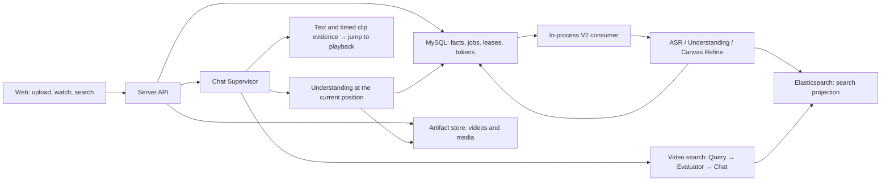

<p align="center">
  
</p>

<h1 align="center">Seekino</h1>

<p align="center"><strong>Ask while you watch. Find that moment in a video with one sentence.</strong></p>

<p align="center">
  English · <a href="README.md">简体中文</a>
</p>

<p align="center">
  <a href="#screenshots">Screenshots</a> ·
  <a href="#in-practice">In practice</a> ·
  <a href="#what-it-does">What it does</a> ·
  <a href="#meet-kino">Meet Kino</a> ·
  <a href="#quick-start">Quick start</a> ·
  <a href="#repository-and-docs">Developer docs</a>
</p>

Seekino (formerly AniVAG) is a self-hosted assistant for watching and searching video. Import your own video series, describe a scene, action or relationship you remember, and get the matching clips back. While watching, open the side panel to ask about the current frame or the line just spoken, then follow the answer back to the original footage to check it.

It is currently used for **Q&A while watching the MyGO anime, cross-episode search for memorable scenes, and collecting material for fan edits**. Continuing where you left off, picking episodes, chatting, previewing clips and checking evidence all happen in one web interface.

## Screenshots

These screenshots were taken on **2026-10-15** from Seekino running locally, with real videos and existing conversations. The interface uses a teal visual style with light and dark themes; dark mode is shown below.

### Ask about whatever you are watching

The player and the "Chat while watching" side panel sit side by side. Questions carry the current episode and paused position, and video timestamps in the answer are clickable. Characters, dialogue and plot explanations can all be checked against the original footage.


### From one description to a playable clip

Search for a scene across episodes from the chat. Expand a result to play the clip, see why it was chosen, the raw evidence and the surrounding context. You can also jump back to the full episode, or quote the clip in a follow-up question.


<details>
<summary>More screens: continue watching and episode selection</summary>

### Back to where the story stopped

The watch home page shows recently watched series with their video frames, keeps the episode and playback position, and resumes with one click.


### Browse series and pick an episode

Browse series and episode lists, then start an episode or continue where you left off. Admins can also see the character and background notes the model uses when parsing.


</details>

## In practice

### While watching: who is this, and what is happening?

Pause MyGO episode 1 at **10:38** and ask "What are they doing? Who are these people?". The conversation centres on Sakiko and Anon in the music room. The answer uses the current frame and nearby dialogue to explain who the characters are and what they are discussing, and it tells apart the people in the paused frame from the speaker off screen. The watch screenshot above shows this exact conversation.

### Find performances across episodes by the feeling you want

Actual question: "**Which performances in MyGO are the most hype? Recommend 3 and explain why.**"

The answer gave three performances with different emphases, each with a reason and a playable clip:

| Position in the original | What this answer highlighted |
| --- | --- |
| Episode 10 · 20:01–20:54 | Playing together in tears; the characters answering each other emotionally. |
| Episode 12 · 09:00–09:50 | Live energy from the instruments, stage movement and the audience. |
| Episode 12 · 15:00–15:59 | Members smiling as they play, moving forward together. |

The search screenshot above shows these three clips. The timestamps match the local video files. The reasons are the assistant's interpretation of the content, so open the original to judge for yourself.

### From search results to short-video material

One creative experiment used the theme "Haruhikage": three clips found in MyGO episodes 2 and 3 were packaged with their original timestamps, selection reasons and subtitles, then laid out with HyperFrames as a **1080 × 1920 offline HTML short video**. This ran through a separate packaging workflow; see the [short-video workflow](.agents/skills/anivag-short-video/SKILL.md). Check its scripts and config against the current API before using them.

## What it does

| What you want to do | What Seekino offers |
| --- | --- |
| Find a scene you remember | Natural-language search across episodes. Choose the series scope per question, keep asking follow-ups, or quote a clip you already found. |
| Ask while watching | Full-episode playback, resume, playback speed and in-page full screen. The side chat sends the current episode and position with each question. |
| Check what an answer is based on | See the episode, time range, selection reason, raw evidence and context; play the clip or jump back to the full episode. |
| Manage your own videos | Create series, maintain background notes and reference images, upload many files in resumable chunks with pause and resume. Track parsing progress, errors and the available recovery actions. |

There are also light and dark themes, model token usage statistics, and entry points for local data, a remote personal library and public content. Whether you can manage data, upload or change settings depends on the server and your permissions.

Media, business data and indexes stay in your own environment, and you choose the model providers in your own config. When you use remote models, the relevant audio, video, frames or text are sent to the provider you configured.

The project is still in development. Search results give the time range of a chunk or a reviewed event, and on-demand understanding of the current frame can also sample original frames near the paused position. Always check answers and clips against the original. Known issues and planned work are recorded in the [issue list](docs/dev/problems.md) (in Chinese).

## Meet Kino

Kino is the little pixel whale shark who lives in the chat. Kino isn't decoration: it shows what the assistant is doing. It perches on top of the newest answer bubble. It runs back and forth while searching for clips, stares at a question mark while checking evidence, and walks under three dots while writing the answer. When an answer lands it does a happy double hop (or gets a startled "!" and a sweat drop if something failed), then curls up and falls asleep on that bubble. Ask the next question and Kino wakes up, leaps down from where it slept, lands on the new bubble and gets back to work.


On an empty chat, Kino idles and watches you. Hover over it and it turns to look at you. Poke it and it jumps or cheers; poke it five times in a row and it gets startled. Leave the page alone for a while and Kino lies down and falls asleep, and it gets up again as soon as you come back.

Kino is a small state machine, not an AI model. It is drawn pixel by pixel from code, with no image files, and it respects your reduced-motion setting. Developer notes are in [web/src/shared/kino/README.md](web/src/shared/kino/README.md).

## How to use it

1. In the Library, create an anime series and fill in the description, spoken language and character/plot background. Background notes accept Markdown, JSON and reference images.
2. Upload videos and follow transfer progress in the upload panel. To resume after a page refresh, select the original file again. Retry a failed parse from the Parse Tasks page.
3. Open "Parse Tasks" from the account menu (top right) to see the full indexing status. Whether retry, re-parse and delete are available depends on the server's current capabilities and version.
4. Pick an episode on the watch home page and open "Chat while watching" to ask about the current frame, characters or the line just spoken. Interacting pauses the video and freezes the current video and position for the question.
5. Click the search entry at the top, or press `⌘ K` / `Ctrl K`, choose a series and ask across episodes. Click a clip in the answer to check the original, see the evidence and context, then quote the clip to keep asking.
6. Open "Model Usage" from the account menu to see recorded tokens. With permission you can open "Settings"; in debug display mode you can adjust runtime parameters for later messages.

## Quick start

Run all commands from the repository root. These steps are for a local development setup. The default `local` mode needs no login.

### 1. Prepare the environment and configuration

You need Python **3.12** (`>=3.12,<3.13`), `uv`, Node.js **24+**, npm, ffmpeg and ffprobe. Storage uses MySQL **8.4** and Elasticsearch **8.19.x**. Bring your own, or use the repository's Compose file (ES is pinned to 8.19.22).

Copy the environment file the first time. If `.env.local` already exists, edit it instead:

```bash
cp .env.example .env.local
uv sync --locked
npm --prefix web ci
```

Fill in model credentials and local connection details in `.env.local`. The default configuration uses these sources:

| Model role | Default source | What you need |
| --- | --- | --- |
| Chat Supervisor, frame understanding | Local Codex | The current OS user is logged in to Codex. The executable can be set in the source config. |
| Speech transcription, embeddings | Ark | Set `ARK_API_KEY`. |
| Video search agent, reranking | DeepSeek | Set `DEEPSEEK_API_KEY`. |

Adjust the [model configuration](docs/model-config.md) to the models or endpoints you have. The default `supervisor_harness: codex` needs the matching Codex source. If you switch to API models, change the harness and the Supervisor binding together.

| Where | What |
| --- | --- |
| `config.yaml` | `model_sources` connections; model choices for chat, transcription, vision, embedding and rerank under `models`; global chat parameters under `agent_runtime`. |
| `.env.local` | API keys, personal endpoint overrides, database/ES/HTTP/identity settings. Never committed to Git. |
| `web/.env.local` (optional) | `VITE_API_BASE_URL` and `VITE_TENANT_ID` for a standalone web build. Defaults to the same-origin proxy and the local tenant. |

When running by hand, exported shell variables with the same name take priority over `uv --env-file`. Use the same configuration in both terminals.

### 2. Prepare MySQL and Elasticsearch

With Docker Compose:

```bash
docker compose --env-file .env.local up -d --wait mysql elasticsearch
```

On first start, Compose creates the default development database `anivag_development`, and database ports are only published on `127.0.0.1`. The server, web app and ffmpeg still run on the host. If you use an existing MySQL, create the database and account named in `ANIVAG_DATABASE_URL` first; `init-db` only creates tables, not the database.

Then initialise or verify the current schema and ES index:

```bash
uv run --no-sync --env-file .env.local -- python -m server.cli init-db
uv run --no-sync --env-file .env.local -- python -m server.cli init-es-index
```

Both commands can be re-run, but they do not migrate old databases or rebuild incompatible indexes automatically. Old identity fields, time units or index contracts raise an upgrade error; see "Upgrading an existing database" under Architecture and deployment below.

### 3. Start the API and the web app

Terminal 1:

```bash
uv run --no-sync --env-file .env.local -- python -m server.main
```

Terminal 2:

```bash
uv run --no-sync --env-file .env.local -- npm --prefix web run dev -- --host 127.0.0.1 --port 5173 --strictPort
```

- Web: <http://127.0.0.1:5173>
- API docs: <http://127.0.0.1:9621/docs>
- Consumer status: <http://127.0.0.1:9621/healthz>

`python -m server.api` forwards to the official `server.main` entry point. The API process already includes the V2 consumer, so no separate worker is needed. Stop each hand-started process with Ctrl-C. Stop the Compose databases with `docker compose stop`; their volumes are kept.

The Vite proxy reads `ANIVAG_HTTP_HOST` / `ANIVAG_HTTP_PORT` from the same environment. To use a custom web port, change `--port` above and `ANIVAG_ALLOWED_ORIGINS`. Changing `ANIVAG_WEB_PORT` alone does not change the port of a hand-started Vite.

### Optional: local launcher

The repository includes a launcher for lazily starting local MySQL, reusing the API/web processes and managing them:

```bash
./start.sh
./start.sh status
./start.sh stop
```

The launcher checks the API library and the web proxy against the current `tenantId` contract, using the local tenant configured in `ANIVAG_LOCAL_TENANT_ID`. Elasticsearch must be reachable before you start: the script verifies the cluster and index but does not start ES. `stop` only stops processes the launcher manages. It does not stop a hand-started API/web or the Compose databases.

Launcher data and logs go to `outputs/local-services/`. Media goes to `outputs/server/artifacts/` by default, configurable with `ANIVAG_ARTIFACT_ROOT`. An existing MySQL/ES is reused as configured, and old schemas are never altered automatically. For Docker and port details, see the [development deployment notes](deploy/README.md) (in Chinese).

## Architecture and deployment

<details>
<summary>System architecture and module responsibilities</summary>



| Module | Responsibility |
| --- | --- |
| `gateway/` | Model protocols, authentication, call control and usage events. Connects to Ark, OpenAI-compatible APIs, the Codex app-server, the Claude SDK and more. |
| `engine/` | Domain algorithms: video event conversion, time and content validation, index projection, retrieval fusion. |
| `agent/` | LangGraph and agent programs, the Context Canvas, video understanding/refinement, and the Supervisor's tool decisions. |
| `server/` | Identity and resource permissions, uploads, MySQL persistence, leases and recovery, media preparation, ES writes, HTTP and CLI. |
| `web/` | The React frontend, connected to the real API. When the API is unavailable it shows errors or empty states. |

A full parse runs basic understanding over fixed chunks, while sliding intervals are refined separately and drive indexing. The model reads evidence and edits local content through the **Context Canvas**; the program keeps the full state and assembles the committed result. Refine checks member versions and content fingerprints, so a local edit can't drop events it didn't mention. An optional prefix provides cross-chunk context and is off by default.

The Supervisor can answer directly, search the web, call video search, or understand the current and neighbouring chunks at the frozen playback position. Even before a video is fully indexed, basic evidence can be fetched on demand. The Supervisor decides which calls to make; response time depends on the models and the execution budget.

The production service only accepts **V2 + MySQL + Elasticsearch**. The consumer runs in the same server process as the API, job and recovery state live in MySQL, and ES is a search projection. Gateway, Engine and Agent need no separate processes. Local mode needs no Redis or external message queue. The frozen Parse V1/Qdrant path is kept only for historical reference and offline diagnostics; see the [Engine notes](engine/README.md).

Video durations, event/chunk boundaries, playback positions and frame times are all **integer milliseconds** from the start of the original video. Existing fields such as `durationSeconds`, `startSeconds`, `endSeconds`, `atSeconds` and `positionSeconds` keep their old names, but their values are not seconds. The browser player converts to seconds at its boundary. Absolute times are Unix epoch milliseconds. Chunk durations and timeouts in the parse config are still in seconds.

</details>

<details>
<summary>Models and runtime parameters</summary>

`model_sources` describes protocol adapters, authentication and providers. `models` defines each model and its source. The app currently uses the `supervisor`, `agent`, `transcription`, `vision`, `vision_fallback`, `embedding` and `rerank` roles. Parameters such as vector dimensions and video sampling rate live in `models.embedding`. By default, Refine reuses the fixed Understanding model.

The top-level `supervisor_harness` chooses between the Codex and Deep Agents execution styles, and `models.supervisor` binds the Supervisor model on its own. `models.agent` still picks the model for video-search subtasks. By default the Supervisor and frame understanding use Codex with vision input enabled explicitly. Whether other models receive raw images depends on each model's `supports_vision_input` and its adapter. Switching sources never switches the embedding model automatically.

The gateway supports OpenAI-compatible APIs, Ark, a local Codex login, the Claude SDK and more; each model role and harness has its own capability requirements. Restart the server after changing a source, model or harness. It will not silently switch execution style when the config doesn't match.

`agent_runtime` parameters saved from the Settings page are written to the server's `config.yaml`. The next new message uses the new values; an answer already in progress keeps the parameters it started with. `maximum_concurrent_kicks`, model connections and other startup settings need a server restart. Runtime parameters set explicitly in YAML override the matching `ANIVAG_AGENT_*` environment fallbacks.

The Model Usage page reads MySQL `model_usage`. It covers V2 parsing/indexing and assistant calls, and shows only recorded tokens and known subtotals. Failed records may be missing, and unknown usage is never counted as zero. It does not calculate cost or enforce hard token quotas. The production bootstrap **does not wire up the Langfuse writer/reader**, so setting `tracing.enabled` to true does not turn on server tracing; the standalone module and config fields are still kept.

For source configuration see [model configuration](docs/model-config.md) and [gateway agent sources](gateway/README.md#chat-agent-模型来源). For how usage is counted, see [model token usage](docs/parse-model-usage.md).

</details>

<details>
<summary>Local and cloud identity</summary>

The default `ANIVAG_AUTH_MODE=local` uses `local-user` / `local-default`, with no login on your own machine.

`cloud` mode also needs a signing secret, Redis, SMTP and same-origin HTTPS. Redis stores verification-code digests, rate limits and concurrency leases; MySQL stores users, tenants and resource ownership. You can start the optional development Redis from Compose:

```bash
docker compose --env-file .env.local --profile cloud-auth up -d --wait redis
```

Guests can only read content that is public and ready, and their conversations are isolated per guest. After logging in with an email code, a user gets a personal tenant and can switch between personal and public content. Library management and global settings are controlled by server permissions; public read access never grants platform write access.

Cloud mode limits request counts and concurrency. Guests share a per-IP request budget; local mode has no request quota. These limits are separate from token statistics. A production reverse proxy must forward the HTTPS scheme and client address correctly. See [.env.example](.env.example) for the settings and the [user/tenant handoff notes](server/report_docs/user-tenant-handoff-20261010.md) for identity details and migration.

Business HTTP scoping fields now use **`tenantId`**. Some older docs still show `workspaceId` examples; follow the current OpenAPI and DTOs.

</details>

<details>
<summary>Upgrading an existing database</summary>

Development, test and production use separate databases and ES indexes. Development database names end with `_dev` / `_development`, and test names end with `_test`. ES index names must include the matching `dev` / `development` / `test` component, and production indexes must not include these components. SQLite is only for isolated tests.

`init-db` verifies the current schema; it does not migrate historical databases. Check your existing structure against the [identity migration](docs/migrations/20261010_user_tenant_identity.sql), the [media milliseconds migration](docs/migrations/20261008_video_timeline_milliseconds.sql) and the [server notes](server/README.md). To copy an old ES index to tenant fields, use `python -m scripts.migrate_tenant_index --help`. Run it as planned once the relevant writes have stopped. It does not recompute embeddings or overwrite the old index.

</details>

## Development and verification

Common checks:

```bash
uv run --no-sync python -m pytest -m "not live_agent"
npm --prefix web run typecheck
npm --prefix web test
npm --prefix web run build
```

Browser tests run against a production build preview. Build first and install Playwright Chromium, then run:

```bash
npm --prefix web exec -- playwright install chromium
npm --prefix web run test:e2e
```

Real integration tests need separate `ANIVAG_TEST_DATABASE_URL`, `ANIVAG_TEST_ELASTICSEARCH_URL` and `ANIVAG_TEST_AUTH_REDIS_URL`. Tests against real models must be enabled explicitly and may cost money with your provider. Known issues and pending acceptance checks are recorded in the [issue list](docs/dev/problems.md).

Passing unit tests, builds, isolated SQL/ES tests and mocked-API browser tests is not the same as a full acceptance run with real models. Semantic quality, cold-start latency of on-demand understanding, real SMTP and full browser end-to-end runs each need separate acceptance. A successful `/healthz` only means the consumer is running.

## Repository and docs

```text
anivag/
├── config.yaml / .env.example   # Model defaults and environment template
├── gateway/                    # Model protocols and source adapters
├── engine/                     # parsev2, rag and the frozen parsev1
├── agent/                      # Chat, realtime understanding, parsing and the Context Canvas
├── server/                     # HTTP/CLI, persistence and reliable execution
├── web/                        # React + TypeScript + Vite frontend (Kino lives in web/src/shared/kino)
├── scripts/                    # Local launcher and controlled migration tools
├── tests/ / evals/              # Automated tests, manual diagnostics and evaluations
├── deploy/ / compose.yaml      # Local infrastructure and deployment notes
├── assets/                     # Logo, Kino sheet, screenshots and architecture diagrams
├── docs/                       # Contracts, designs, migrations and check logs
└── outputs/                    # Local media, logs and run artifacts, not in Git
```

The repository root is the runtime boundary. Python modules are managed together by `pyproject.toml` / `uv.lock` with `package=false`; the layers are not published as separate packages.

Most module docs below are written in Chinese.

- [Parse V2 Agent](agent/video_parse_v2/README.md) · [Context Canvas](agent/design/utils_context_canvas.md)
- [Current-position understanding](agent/chat/realtime_understanding/runtime.py) · [Server](server/README.md)
- [Web](web/README.md) · [Kino](web/src/shared/kino/README.md) · [Gateway](gateway/README.md) · [Engine](engine/README.md)
- [Model configuration](docs/model-config.md) · [Model token usage](docs/parse-model-usage.md) · [User/tenant](server/report_docs/user-tenant-handoff-20261010.md)
- [Development deployment](deploy/README.md) · [Issue list](docs/dev/problems.md)
