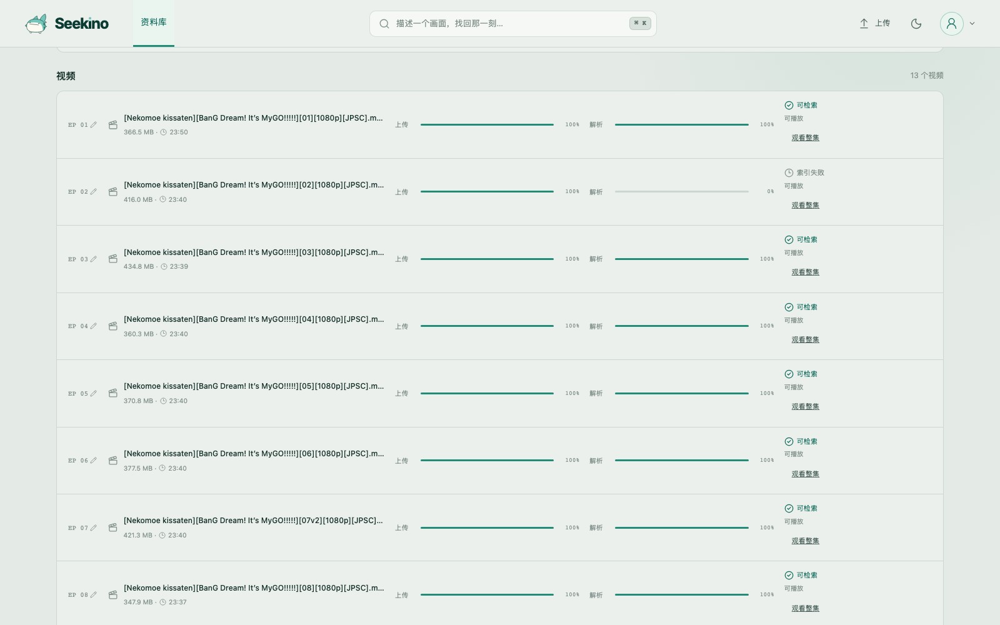
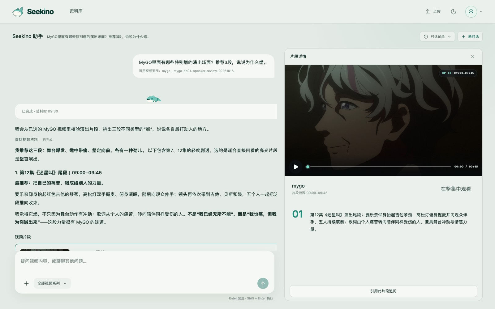
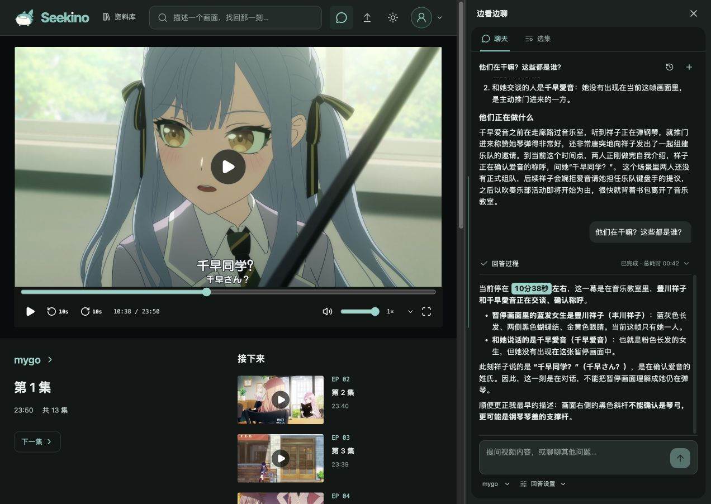
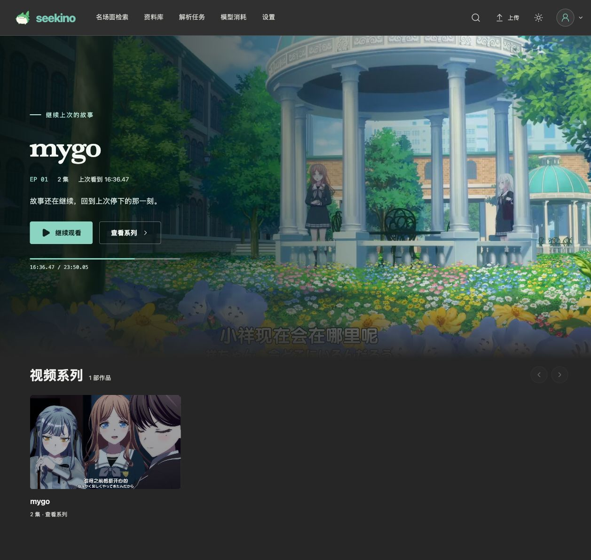
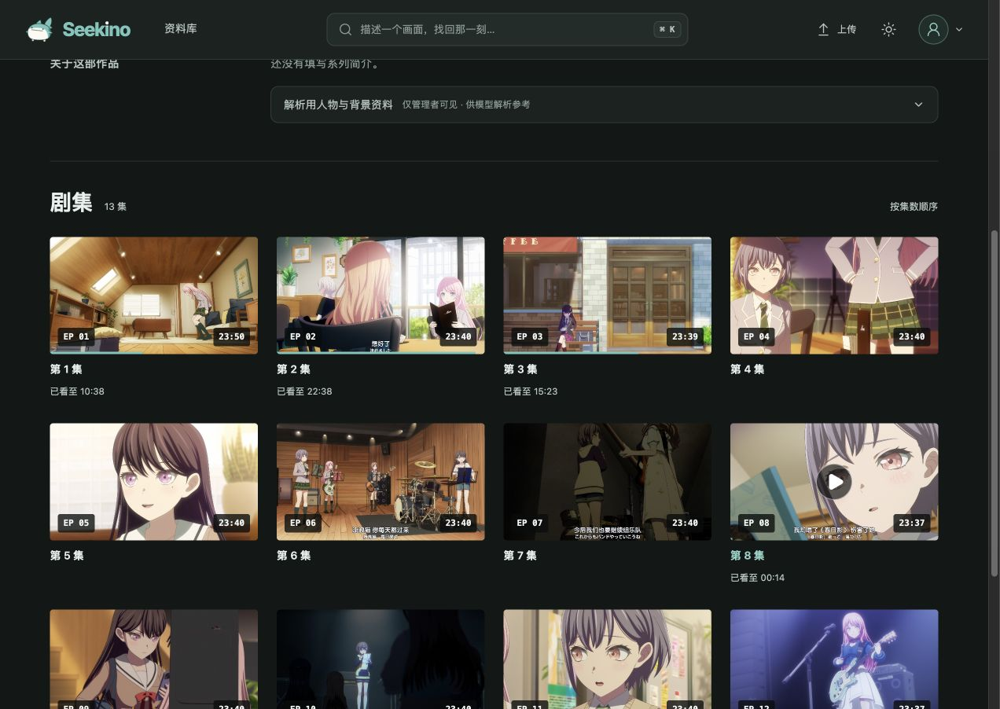
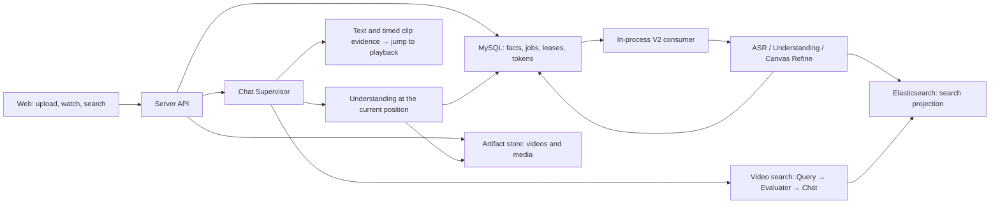

<p align="center">
  
</p>

<h1 align="center">Seekino</h1>

<p align="center"><strong>A personal video library for everyone.</strong></p>
<p align="center">Analyze your videos, find footage in natural language, and trace every clip back to the original.</p>

<p align="center">
  English · <a href="README.md">简体中文</a>
</p>

<p align="center">
  <a href="#under-construction">Under construction</a> ·
  <a href="#what-it-does">What it does</a> ·
  <a href="#screenshots">Screenshots</a> ·
  <a href="#how-to-use-it">How to use it</a> ·
  <a href="#api-integration">API integration</a> ·
  <a href="#quick-start">Quick start</a> ·
  <a href="#references">References</a>
</p>

Seekino (formerly Seekino) turns your videos into a searchable footage library. Import videos, analyze visuals and dialogue, describe what you need, and retrieve clips with timestamps that lead back to the original. Video analysis and retrieval are also available through APIs for your own tools and workflows.

## Under construction

Import, analysis, retrieval and viewing Q&A are available today. We are continuing work on:

1. **Sandbox integration**: connect the platform's Agent to creative workflows, using retrieved footage for reference edits.
2. **An MCP interface**: let external agents such as Codex and Claude Code search the footage library for material.
3. **Video analysis improvements**: improve content understanding and structured analysis, while reducing processing time and cost.
4. **Retrieval improvements**: improve footage matching, temporal localization and context linking.
5. **Configurability and ease of use**: improve model configuration, deployment and the everyday experience.

**Feedback and discussion are welcome. If you are interested, join us in building Seekino!**

## What it does

| Capability | What you can do |
| --- | --- |
| Organize and analyze footage | Group videos into series, add character and background notes, and analyze visuals, dialogue and events to build a searchable index. |
| Retrieve clips in natural language | Describe a scene, action, line or relationship. Search across videos in selected series and keep asking follow-up questions. |
| Preview and verify | See the source video, time range, selection reason and context. Play the retrieved clip or jump back to the full video. |
| Ask while watching | Open the side panel to ask about the current frame, characters or nearby dialogue. |
| Connect your own tools | Use HTTP APIs for uploads, analysis tasks, retrieval and Agent conversations. |

For example, ask the MyGO library: "**Which performances are the most hype? Recommend 3 and explain why.**" The answer provides clips with sources, timestamps and reasons, so you can check the original footage and decide whether it fits your edit. The demo below uses MyGO anime footage; results on other kinds of video still need to be evaluated with your own material.

## Screenshots

These screenshots were taken on **2026-10-25** from Seekino running locally, using real videos, existing analysis results and conversation records. They show the current web interface; the hosted demo is not live yet.

### Organize your footage

Manage videos by series and check upload, analysis and search availability. Add background notes to help the analysis understand characters and content.



### Describe a scene and retrieve matching clips

Search across videos in natural language. Expand a result to preview the clip, see why it was selected and check its original timestamps. Quote a clip to ask a follow-up question.



### Return to the original and check the context

The player and Q&A panel sit side by side. Questions carry the current video and playback position, and video timestamps in answers are clickable.



<details>
<summary>More screens: browse footage and choose an episode</summary>

The viewing home page provides series and playback entry points, with support for resuming where you left off.



The series page lists videos in episode order so you can choose the original footage to inspect.



</details>

## How to use it

**A hosted sample library is being prepared for release.** Admins will upload and maintain pre-analyzed footage, while visitors can watch, search and ask questions. There is no public demo URL yet.

**You can currently self-host a personal library.** See [Quick start](#quick-start) for setup. The basic workflow is:

1. Create a video series as a collection. Add a description, spoken language, background notes and reference images as needed.
2. Upload videos and track indexing in Parse Tasks. Chunked uploads support pause and resume; failed analysis tasks show errors and available retry actions.
3. Describe the footage you want in search, or play a video and ask in the side panel. Follow clips in the answer back to the original video to verify them.

Management and upload permissions depend on the deployment mode and your identity. Self-hosting requires storage, a database and model configuration. When using remote models, the relevant audio, video, frames or text are sent to the configured provider and may incur API charges.

## API integration

The web interface and external tools use the same service APIs. Your tools can connect to these capabilities:

| Integration | Existing endpoints |
| --- | --- |
| Upload videos and start analysis | `POST /api/uploads/create` → `PUT /api/uploads/segments/upload` → `POST /api/uploads/complete` |
| Track analysis tasks | `GET /api/jobs/video-parse/get`, `GET /api/jobs/video-parse/events` |
| Retrieve footage | `POST /api/search`, returning source clips, time ranges and evidence. |
| Find footage through Agent chat | `/api/agent/conversations/*` and `/api/agent/messages/*`, with ongoing conversations and streamed answers. |

After starting the service, inspect requests and responses in the [OpenAPI docs](http://127.0.0.1:9621/docs). See [Server](server/README.md) for integration details. The current scope field is `tenantId`. Video time fields use integer milliseconds relative to the original video, including fields that retain legacy `*Seconds` names; follow the current contract when integrating.

## Creative experiments

A separate experiment has already connected retrieval, clip preparation and HyperFrames composition into an offline HTML short video. See the [short-video experiment workflow](.agents/skills/seekino-short-video/SKILL.md). It explores reusing retrieved footage; check its scripts and configuration against the current API before using them.

The project is still evolving. Analysis, retrieval and answers can be inaccurate, so check them against the original footage. Known issues and planned work are listed in the [issue list](docs/dev/problems.md) (in Chinese).

## Quick start

The recommended first install runs **Web, API, video processing, MySQL and Elasticsearch in Docker**, with **DeepAgents** and API models by default. Local mode needs no application login.

Install Docker Desktop, or Docker Engine with a current Compose plugin. On Windows, select **WSL2 / Linux containers**; the commands also work in PowerShell. Python, Node.js, ffmpeg and the model SDKs are included in the images.

From the repository root:

```bash
cp deploy/docker/env.example .env.docker
```

Fill in `ARK_API_KEY` and `DEEPSEEK_API_KEY` in `.env.docker`, and confirm your accounts can access the models selected in `config.yaml`. Keep an existing environment file instead of overwriting it. Then start everything:

```bash
docker compose --env-file .env.docker up --build -d --wait
```

Initialization checks the configuration and creates the business tables, DeepAgents checkpoints and search indexes before starting the API and Web. Existing databases still require the documented upgrade procedure.

- Web: <http://127.0.0.1:5173>
- API docs: <http://127.0.0.1:5173/docs>
- Health: <http://127.0.0.1:5173/healthz>; the API is also published on port `9621`.

Kimi and Codex remain optional through the existing source/model/harness fields in **the same `config.yaml`**. No extra provider YAML is required. Kimi uses `KIMI_API_KEY`; Codex uses the bundled SDK runtime and a persistent container login. See the [Docker setup guide](deploy/local-setup.md) for these steps, custom ports and configuration updates.

The `app_data` volume stores media, logs, the effective model configuration and Codex credentials; MySQL and ES have separate volumes. The model YAML is imported only on first launch, preserving changes saved by the Settings page. `stop` and `down` retain volumes; `down -v` deletes them.

```bash
docker compose --env-file .env.docker ps
docker compose --env-file .env.docker logs -f api
docker compose --env-file .env.docker stop
```

Full container startup and Windows validation are still pending; see the guide for the checks completed. After startup, upload a short video, wait for parsing, retrieve a clip and ask two follow-up questions. A healthy HTTP endpoint does not validate the model pipeline. Remote model calls send the relevant media or text to the configured provider and may incur charges.

### Host development (optional)

<details>
<summary>Run API and Web on the host, with Docker databases</summary>

#### 1. Prepare the environment and configuration

You need Python **3.12** (`>=3.12,<3.13`), `uv`, Node.js **24+**, npm, ffmpeg and ffprobe. Storage uses MySQL **8.4** and Elasticsearch **8.19.x**. Bring your own, or use the repository's Compose file (ES is pinned to 8.19.22).

Copy the environment file the first time. If `.env.local` already exists, edit it instead:

```bash
cp .env.example .env.local
uv sync --locked
npm --prefix web ci
```

Fill in model credentials and local connection details in `.env.local`. The default configuration uses these sources:

| Model role | Default source | What you need |
| --- | --- | --- |
| Chat Supervisor, transcription, frame understanding, OCR and summaries | Ark | Set `ARK_API_KEY`. No local weights are required by the default configuration. |
| Video search agent | DeepSeek, with an Ark fallback | Set both API keys. |
| Embeddings | Ark | Set `ARK_API_KEY`. |
| Reranking, text fallback when vision fails | DeepSeek | Set `DEEPSEEK_API_KEY`. |

Adjust the [model configuration](docs/model-config.md) to the models or endpoints you have. The default `supervisor_harness: deepagents` uses an API source. To select Codex, change the harness and Supervisor binding together. Kimi uses the existing OpenAI-compatible adapter and `kimi` profile.

| Where | What |
| --- | --- |
| `config.yaml` | `model_sources` connections; model choices for chat, transcription, vision, embedding and rerank under `models`; global chat parameters under `agent_runtime`. |
| `.env.local` | API keys, personal endpoint overrides, database/ES/HTTP/identity settings. Never committed to Git. |
| `web/.env.local` (optional) | `VITE_API_BASE_URL` and `VITE_TENANT_ID` for a standalone web build. Defaults to the same-origin proxy and the local tenant. |

When running by hand, exported shell variables with the same name take priority over `uv --env-file`. Use the same configuration in both terminals.

#### 2. Prepare MySQL and Elasticsearch

With Docker Compose:

```bash
docker compose --env-file .env.local up -d --wait mysql elasticsearch
```

On first start, Compose creates the default development database `seekino_development`, and database ports are only published on `127.0.0.1`. The server, web app and ffmpeg still run on the host. If you use an existing MySQL, create the database and account named in `SEEKINO_DATABASE_URL` first; `init-db` only creates tables, not the database.

Then initialise or verify the current schema and ES index:

```bash
uv run --no-sync --env-file .env.local -- python -m server.cli init-db
uv run --no-sync --env-file .env.local -- python -m server.cli init-es-index
```

Both commands can be re-run, but they do not migrate old databases or rebuild incompatible indexes automatically. Old identity fields, time units or index contracts raise an upgrade error; see "Upgrading an existing database" under Architecture and deployment below.

#### 3. Start the API and the web app

Terminal 1:

```bash
uv run --no-sync --env-file .env.local -- python -m server.main
```

Terminal 2:

```bash
uv run --no-sync --env-file .env.local -- npm --prefix web run dev -- --host 127.0.0.1 --port 5173 --strictPort
```

- Web: <http://127.0.0.1:5173>
- API docs: <http://127.0.0.1:9621/docs>
- Consumer status: <http://127.0.0.1:9621/healthz>

`python -m server.api` forwards to the official `server.main` entry point. The API process already includes the V2 consumer, so no separate worker is needed. Stop each hand-started process with Ctrl-C. Stop the databases with `docker compose --env-file .env.local stop mysql elasticsearch`; their volumes are kept.

The Vite proxy reads `SEEKINO_HTTP_HOST` / `SEEKINO_HTTP_PORT` from the same environment. To use a custom web port, change `--port` above and `SEEKINO_ALLOWED_ORIGINS`. Changing `SEEKINO_WEB_PORT` alone does not change the port of a hand-started Vite.

#### Optional: local launcher

The repository includes a launcher for lazily starting local MySQL, reusing the API/web processes and managing them:

```bash
./start.sh
./start.sh status
./start.sh stop
```

The launcher defaults to the checked-out `main` worktree and its `.env.local`. Use `./start.sh --branch dev` (and `--branch dev status` / `--branch dev stop`) for an existing dev worktree. `start` uses current local files, including uncommitted changes, without pulling or switching branches. Managed API/Web processes are refreshed when their source directory, file contents, or configuration changes; unchanged processes are reused, and unknown port owners are rejected. MySQL/ES are not stopped by this refresh.

The launcher checks the API library and the web proxy against the current `tenantId` contract, using the local tenant configured in `SEEKINO_LOCAL_TENANT_ID`. Elasticsearch must be reachable before you start: the script verifies the cluster and index but does not start ES. `stop` only stops processes the launcher manages. It does not stop a hand-started API/web or the Compose databases.

Launcher data and logs go to `outputs/local-services/`. Media goes to `outputs/server/artifacts/` by default, configurable with `SEEKINO_ARTIFACT_ROOT`. An existing MySQL/ES is reused as configured, and old schemas are never altered automatically. For Docker and port details, see the [development deployment notes](deploy/README.md) (in Chinese).

</details>

## Architecture and deployment

<details>
<summary>System architecture and module responsibilities</summary>



| Module | Responsibility |
| --- | --- |
| `gateway/` | Model protocols, authentication, call control and usage events. Connects to Ark, OpenAI-compatible APIs, the Codex app-server, the Claude SDK and more. |
| `engine/` | Domain algorithms: video event conversion, time and content validation, index projection, retrieval fusion. |
| `agent/` | LangGraph and agent programs, the Context Canvas, video understanding/refinement, and the Supervisor's tool decisions. |
| `server/` | Identity and resource permissions, uploads, MySQL persistence, leases and recovery, media preparation, ES writes, HTTP and CLI. |
| `web/` | The React frontend, connected to the real API. When the API is unavailable it shows errors or empty states. |

A full parse runs basic understanding over fixed chunks, while sliding intervals are refined separately and drive indexing. The model reads evidence and edits local content through the **Context Canvas**; the program keeps the full state and assembles the committed result. Refine checks member versions and content fingerprints, so a local edit can't drop events it didn't mention. An optional prefix provides cross-chunk context and is off by default.

The Supervisor can answer directly, search the web, call video search, or understand the current and neighbouring chunks at the frozen playback position. Even before a video is fully indexed, basic evidence can be fetched on demand. The Supervisor decides which calls to make; response time depends on the models and the execution budget.

Retrieval tools return source evidence directly; additional context is read by chunk ID and cursor. The Jev classifier and local 8B query rewrite remain in the pre-processing path.

The production service only accepts **V2 + MySQL + Elasticsearch**. The consumer runs in the same server process as the API, job and recovery state live in MySQL, and ES is a search projection. Gateway, Engine and Agent need no separate processes. Local mode needs no Redis or external message queue. Parse V1, Qdrant, and the old offline import entrypoints have been removed.

Video durations, event/chunk boundaries, playback positions and frame times are all **integer milliseconds** from the start of the original video. Existing fields such as `durationSeconds`, `startSeconds`, `endSeconds`, `atSeconds` and `positionSeconds` keep their old names, but their values are not seconds. The browser player converts to seconds at its boundary. Absolute times are Unix epoch milliseconds. Chunk durations and timeouts in the parse config are still in seconds.

</details>

<details>
<summary>Models and runtime parameters</summary>

`model_sources` describes protocol adapters, authentication and providers. `models` defines each model and its source. The app currently uses the `supervisor`, `agent`, `transcription`, `vision`, `vision_fallback`, `embedding` and `rerank` roles. Parameters such as vector dimensions and video sampling rate live in `models.embedding`. By default, Refine reuses the fixed Understanding model.

The top-level `supervisor_harness` chooses between the Codex and Deep Agents execution styles, and `models.supervisor` binds the Supervisor model on its own. `models.agent` still picks the model for video-search subtasks. By default the Supervisor uses DeepAgents with Ark, and frame understanding also uses Ark. Whether other models receive raw images depends on each model's `supports_vision_input` and its adapter. Switching sources never switches the embedding model automatically.

The gateway supports OpenAI-compatible APIs, Ark, a local Codex login, the Claude SDK and more; each model role and harness has its own capability requirements. Restart the server after changing a source, model or harness. It will not silently switch execution style when the config doesn't match.

`agent_runtime` parameters saved from the Settings page are written to the server's `config.yaml`. The next new message uses the new values; an answer already in progress keeps the parameters it started with. `maximum_concurrent_kicks`, model connections and other startup settings need a server restart. Runtime parameters set explicitly in YAML override the matching `SEEKINO_AGENT_*` environment fallbacks.

The Model Usage page reads MySQL `model_usage`. It covers V2 parsing/indexing and assistant calls, and shows only recorded tokens and known subtotals. Failed records may be missing, and unknown usage is never counted as zero. It does not calculate cost or enforce hard token quotas. The production bootstrap **does not wire up the Langfuse writer/reader**, so setting `tracing.enabled` to true does not turn on server tracing; the standalone module and config fields are still kept.

For source configuration see [model configuration](docs/model-config.md) and [gateway agent sources](gateway/README.md#chat-agent-模型来源). For how usage is counted, see [model token usage](docs/parse-model-usage.md).

</details>

<details>
<summary>Local and cloud identity</summary>

The default `SEEKINO_AUTH_MODE=local` uses `local-user` / `local-default`, with no login on your own machine.

`cloud` mode also needs a signing secret, Redis, SMTP and same-origin HTTPS. Redis stores verification-code digests, rate limits and concurrency leases; MySQL stores users, tenants and resource ownership. You can start the optional development Redis from Compose:

```bash
docker compose --env-file .env.local --profile cloud-auth up -d --wait redis
```

Guests can only read content that is public and ready, and their conversations are isolated per guest. After logging in with an email code, a user gets a personal tenant and can switch between personal and public content. Library management and global settings are controlled by server permissions; public read access never grants platform write access.

Cloud mode limits request counts and concurrency. Guests share a per-IP request budget; local mode has no request quota. These limits are separate from token statistics. A production reverse proxy must forward the HTTPS scheme and client address correctly. See [.env.example](.env.example) for the settings and the [user/tenant handoff notes](server/report_docs/user-tenant-handoff-20261010.md) for identity details and migration.

Business HTTP scoping fields now use **`tenantId`**. Some older docs still show `workspaceId` examples; follow the current OpenAPI and DTOs.

</details>

<details>
<summary>Upgrading an existing database</summary>

Development, test and production use separate databases and ES indexes. Development database names end with `_dev` / `_development`, and test names end with `_test`. ES index names must include the matching `dev` / `development` / `test` component, and production indexes must not include these components. SQLite is only for isolated tests.

`init-db` verifies the current schema; it does not migrate historical databases. Check your existing structure against the [identity migration](docs/migrations/20261010_user_tenant_identity.sql), the [media milliseconds migration](docs/migrations/20261008_video_timeline_milliseconds.sql) and the [server notes](server/README.md). To copy an old ES index to tenant fields, use `python -m scripts.migrate_tenant_index --help`. Run it as planned once the relevant writes have stopped. It does not recompute embeddings or overwrite the old index.

</details>

## Development and verification

Common checks:

```bash
uv run --no-sync python -m pytest -m "not live_agent"
npm --prefix web run typecheck
npm --prefix web test
npm --prefix web run build
```

Browser tests run against a production build preview. Build first and install Playwright Chromium, then run:

```bash
npm --prefix web exec -- playwright install chromium
npm --prefix web run test:e2e
```

Real integration tests need separate `SEEKINO_TEST_DATABASE_URL`, `SEEKINO_TEST_ELASTICSEARCH_URL` and `SEEKINO_TEST_AUTH_REDIS_URL`. Tests against real models must be enabled explicitly and may cost money with your provider. Known issues and pending acceptance checks are recorded in the [issue list](docs/dev/problems.md).

Passing unit tests, builds, isolated SQL/ES tests and mocked-API browser tests is not the same as a full acceptance run with real models. Semantic quality, cold-start latency of on-demand understanding, real SMTP and full browser end-to-end runs each need separate acceptance. A successful `/healthz` only means the consumer is running.

## Repository and docs

```text
seekino/
├── config.yaml / .env.example   # Model defaults and environment template
├── gateway/                    # Model protocols and source adapters
├── engine/                     # parsev2, rag and shared media utilities
├── agent/                      # Chat, realtime understanding, parsing and the Context Canvas
├── server/                     # HTTP/CLI, persistence and reliable execution
├── web/                        # React + TypeScript + Vite frontend
├── scripts/                    # Local launcher and controlled migration tools
├── tests/ / evals/              # Automated tests, manual diagnostics and evaluations
├── deploy/ / compose.yaml      # Local infrastructure and deployment notes
├── assets/                     # Logo, screenshots and architecture diagrams
├── docs/                       # Contracts, designs, migrations and check logs
└── outputs/                    # Local media, logs and run artifacts, not in Git
```

The repository root is the runtime boundary. Python modules are managed together by `pyproject.toml` / `uv.lock` with `package=false`; the layers are not published as separate packages.

Most module docs below are written in Chinese.

- [Design document index](docs/design/README.md) · [Documentation conventions](docs/README.md)
- [Benchmark index](evals/benchmark/README.md): query capabilities, chat behavior, retrieval quality and intent routing.
- [Parse V2 Agent](agent/video_parse_v2/README.md) · [Context Canvas](docs/design/context-canvas-design.md)
- [Current-position understanding](agent/chat/realtime_understanding/runtime.py) · [Server](server/README.md)
- [Web](web/README.md) · [Gateway](gateway/README.md) · [Engine](engine/README.md)
- [Model configuration](docs/model-config.md) · [Model token usage](docs/parse-model-usage.md) · [User/tenant](server/report_docs/user-tenant-handoff-20261010.md)
- [Development deployment](deploy/README.md) · [Issue list](docs/dev/problems.md)

## References

These are key sources consulted during the project's research and design. The papers include directions still under investigation; listing them does not imply a complete implementation.

### Papers and research

| Paper | Area of interest |
| --- | --- |
| [OmniScript](https://arxiv.org/abs/2604.11102) | Structured scripts from long videos, scene and event hierarchies, and temporal grounding of characters and dialogue. |
| [ScreenWriter](https://arxiv.org/abs/2410.19809) | Automatic screenplay generation, scene organization, speaker attribution and movie summaries. |
| [TransNet V2](https://arxiv.org/abs/2008.04838) | Shot boundaries and transitions. |
| [ShotBench / ShotQA / ShotVL](https://arxiv.org/abs/2506.21356) | Understanding and evaluating shot scale, composition, lighting, camera movement and other cinematography dimensions. |
| [CameraBench — Towards Understanding Camera Motions in Any Video](https://arxiv.org/abs/2504.15376) | Camera motion taxonomy, understanding and evaluation. |
| [VideoRAG](https://arxiv.org/abs/2502.01549) | Multimodal retrieval-augmented generation over long videos and across videos. |
| [RAPTOR](https://arxiv.org/abs/2401.18059) | Hierarchical summaries and retrieval at multiple levels of detail. |
| [QVHighlights](https://arxiv.org/abs/2107.09609) | Query-based temporal localization and highlight selection evaluation. |
| [VISTA — LLM Agents Are Latent Context Managers](https://arxiv.org/abs/2606.30005) | Visible context state, on-demand archiving and recovery of complete content. |
| [ACM — Agentic Context Management for Long Horizon Tasks](https://arxiv.org/abs/2607.23809) | Context editing, offloading and on-demand retrieval in long tasks. |

### Engineering practice

- [Anthropic — Writing effective tools for agents — with agents](https://www.anthropic.com/research/writing-tools-for-agents): applied to the project's Agent tool design, including clear tool responsibilities, on-demand context reads, pagination and actionable error feedback. See the project's [Canvas tool design research](docs/research/2026-10-22-canvas-agent-tool-design.md) (in Chinese).
