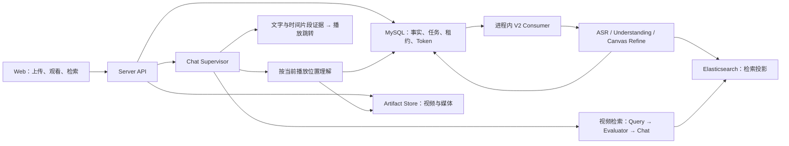

<p align="center">
  
</p>

<h1 align="center">Seekino</h1>

<p align="center">
  <strong>把散落的视频，变成能说清出处的素材库。</strong><br />
  用一句自然语言找到画面、动作或台词，再回到原片核对每一个片段。
</p>

<p align="center">
  <a href="README.en.md">English</a> · <strong>简体中文</strong>
</p>

<p align="center">
  <a href="#为什么是-seekino">为什么是 Seekino</a> ·
  <a href="#实机效果">实机效果</a> ·
  <a href="#快速开始">快速开始</a> ·
  <a href="#交给-ai-部署">交给 AI 部署</a> ·
  <a href="#api-接入">API</a>
</p>

<p align="center">
  <a href="pyproject.toml"></a>
  <a href="web/package.json"></a>
  
</p>

> 记得“那个镜头”，却想不起它在哪一集、哪一秒？Seekino 会解析视频的画面、对白与事件，把你描述的需求变成**可播放、可定位、可继续追问的片段结果**。

## 为什么是 Seekino

**🔎 找素材，不再靠文件名和记忆**<br />
描述“雨夜里的争吵”“特别燃的演出”或一句台词，跨视频寻找相关片段。

**⏱️ 每个结果，都能回到原片**<br />
同时给出来源视频、时间范围和选择理由；点开片段核对上下文，不把答案当黑盒。

**💬 找到之后，还能继续问**<br />
引用片段追问，或在播放时围绕当前画面、人物和附近对白提问。

**🔌 既能自己用，也能接进工具链**<br />
通过 HTTP API 使用上传、解析、检索和 Agent 对话，让素材库进入自己的工作流。

## 实机效果

<p align="center">
  
</p>

<p align="center"><sub>自然语言跨视频找素材，结果附带来源、时间范围与选择理由。</sub></p>

例如，在 MyGO 素材库中提问：

> **有哪些特别燃的演出场面？推荐 3 段，说说为什么燃。**

Seekino 返回候选片段与推荐理由，再由你打开原片判断是否适合创作。演示使用动画素材；其他视频类型的效果需要结合自己的素材验证。

<details>
<summary><strong>查看更多界面：素材管理、观看问答与选集</strong></summary>
<br />

**整理自己的视频素材**<br />
按系列管理视频，查看上传、解析与可检索状态，并补充人物和背景资料。


**回到原片，边看边核对**<br />
播放器与问答侧栏并排展示，回答中的视频时间可以点击跳转。


**按系列浏览与选集**<br />
从观看首页进入系列，或继续上次观看。


</details>

## 使用流程

| 步骤 | 你要做什么 | Seekino 会做什么 |
| --- | --- | --- |
| **1. 建库** | 创建系列，按需补充简介、背景资料与参考图片 | 按系列组织你的素材 |
| **2. 解析** | 上传视频，在「解析任务」中查看进度 | 分析画面、对白与事件，建立检索索引 |
| **3. 使用** | 描述想找的素材，或播放视频并打开侧栏提问 | 返回片段、证据与时间定位，支持继续追问 |

分片上传支持暂停与续传；解析失败时可查看错误并执行可用的重试操作。

## 快速开始

**当前可自托管，在线样例库尚未开放。** 首次安装推荐 **Docker 全栈 + API 模型**：Web、API、视频解析、MySQL 和 Elasticsearch 一起启动，默认使用 **DeepAgents**，不需要准备本地模型权重。

### 1. 准备环境

- Docker Desktop，或 Docker Engine + 当前版本的 Compose 插件。
- Windows 使用 Docker Desktop 的 **WSL2 / Linux containers**；启动命令可以在 PowerShell 中执行。

Python、Node.js、ffmpeg 和模型 SDK 已放进镜像，宿主机无需另装。完整容器启动和 Windows 实机验收尚待完成，当前验证范围见[本地配置指南](deploy/local-setup.md)。

### 2. 获取代码并填写密钥

```bash
git clone https://github.com/owariband/Seekino.git
cd Seekino

cp deploy/docker/env.example .env.docker
```

在 `.env.docker` 中填写两项；已有文件时直接编辑，不要覆盖：

```dotenv
ARK_API_KEY=你的火山方舟密钥
DEEPSEEK_API_KEY=你的DeepSeek密钥
```

仓库 `config.yaml` 默认使用 Ark 处理 Supervisor、音视频理解与向量，DeepSeek 处理检索 Agent、重排和文本回退。请确认账号已开通所配置的模型，或按[模型配置文档](docs/model-config.md) 替换为自己的模型 / Endpoint。

**可选 Kimi / Codex：** 继续修改同一份 `config.yaml` 的现有 source、model 和 harness；不需要新增 provider YAML。Kimi 填写 `KIMI_API_KEY`，Codex 使用镜像内已有的 SDK runtime 登录。具体步骤见[本地配置指南](deploy/local-setup.md)。

> **隐私与费用：** 使用远程模型时，相关音视频、帧或文本会发送给配置的供应商，并可能产生调用费用。

### 3. 一条命令启动

```bash
docker compose --env-file .env.docker up --build -d --wait
```

首次启动会检查配置、初始化业务表、DeepAgents checkpoint 和检索索引，再启动 API 与 Web。已有旧库仍需按版本升级，不会自动重建数据。

- **Web：** <http://127.0.0.1:5173>
- **API 文档：** <http://127.0.0.1:5173/docs>
- **运行状态：** <http://127.0.0.1:5173/healthz>（API 也可通过 `9621` 直连）

首次验收建议：**创建系列 → 上传一个短视频 → 等待解析完成 → 检索片段 → 回到原片 → 连续追问两轮**。`/healthz` 正常不代表模型链路已经验收。

```bash
docker compose --env-file .env.docker ps
docker compose --env-file .env.docker logs -f api
docker compose --env-file .env.docker stop
```

视频、日志、有效模型配置和 Codex 登录保存在 `app_data` 卷，数据库另有独立卷；`stop` / `down` 保留这些数据，`down -v` 会删除。模型 YAML 只在第一次导入，后续改配置的导入步骤、端口冲突和备份说明见[本地配置指南](deploy/local-setup.md)。

### 宿主机开发（可选）

<details>
<summary><strong>在宿主机运行 API / Web，使用 Docker 数据库</strong></summary>
<br />

本路线需要 Python **3.12**、`uv`、Node.js **24+**、npm、ffmpeg / ffprobe。macOS、Linux 使用下面的 shell 命令；Windows 开发建议在 WSL2 中执行。首次复制环境文件后，先填好模型密钥，再执行其余步骤；已有 `.env.local` 时保留原文件：

```bash
cp .env.example .env.local
# 编辑 .env.local，填写模型密钥后继续
uv sync --locked
npm --prefix web ci
docker compose --env-file .env.local up -d --wait mysql elasticsearch
uv run --no-sync --env-file .env.local -- python -m server.cli init-db
uv run --no-sync --env-file .env.local -- python -m server.cli init-es-index

# 使用已检出的 dev 工作区
./start.sh --branch dev
./start.sh --branch dev status
./start.sh --branch dev stop
```

手动前台调试时，分别在两个终端运行：

```bash
uv run --no-sync --env-file .env.local -- python -m server.main
```

```bash
uv run --no-sync --env-file .env.local -- npm --prefix web run dev -- --host 127.0.0.1 --port 5173 --strictPort
```

main 工作区使用 `./start.sh`、`./start.sh status`、`./start.sh stop`。启动器只管理宿主机进程；停止数据库使用 `docker compose --env-file .env.local stop mysql elasticsearch`。更多端口、日志和旧环境恢复说明见[开发部署说明](deploy/README.md)。

</details>

## 交给 AI 部署

把下面这段直接发给能操作当前仓库的 AI；模型凭据仍由你自己填写：

```text
请在当前 Seekino 仓库完成本地部署。先阅读 README.md 和 deploy/local-setup.md，
采用“Docker 全栈 + 默认 DeepAgents / API 模型”路线，使用 .env.docker，按文档顺序执行。
不要修改业务代码，不要删除或重建已有数据库、Elasticsearch 索引和 outputs/。
需要我填写 API Key、选择模型或处理端口冲突时，先停下来告诉我。
完成后检查 Web、/healthz 和 /docs，并给出上传一个短视频后的验收步骤。
```

## API 接入

Web 界面与外部工具使用同一套服务接口：

| 接入目标 | 现有接口 |
| --- | --- |
| 上传并触发解析 | `POST /api/uploads/create` → `PUT /api/uploads/segments/upload` → `POST /api/uploads/complete` |
| 跟踪解析任务 | `GET /api/jobs/video-parse/get`、`GET /api/jobs/video-parse/events` |
| 检索素材 | `POST /api/search`，返回片段来源、时间范围与证据 |
| Agent 对话 | `/api/agent/conversations/*`、`/api/agent/messages/*`，支持持续对话与流式回答 |

启动后查看 [OpenAPI 文档](http://127.0.0.1:9621/docs)，接入说明见 [Server](server/README.md)。当前范围字段使用 `tenantId`；视频时间采用相对原片起点的整数毫秒，部分字段仍保留 `*Seconds` 旧名。

## 当前状态

**已可用：** 素材入库、解析、自然语言检索、片段回看、观看问答与 HTTP API。

**继续建设中：**

- Sandbox 创作工作流与参考剪辑
- 面向 Codex、Claude Code 等外部 Agent 的 MCP 接口
- 更高质量、更低成本的视频解析与检索
- 更简单的模型配置和部署体验

项目仍在迭代，解析、检索与回答可能存在偏差，请结合原片核对。欢迎反馈，也欢迎一起建设。已知问题见 [问题清单](docs/dev/problems.md)。

<details>
<summary><strong>技术架构：Context Canvas、检索与服务模块</strong></summary>
<br />



| 模块 | 职责 |
| --- | --- |
| `gateway/` | 模型协议、认证、调用控制与来源适配 |
| `engine/` | 视频事件转换、时间与内容校验、索引投影与召回融合 |
| `agent/` | Agent、Context Canvas、视频理解与 Supervisor 工具决策 |
| `server/` | 身份权限、上传、持久化、任务恢复、媒体与 HTTP / CLI |
| `web/` | React 前端，连接真实 API |

完整解析使用固定 Chunk 进行基础理解，滑动 Interval 独立精修并推进索引。模型通过 **Context Canvas** 读取证据、修改局部内容，程序保留完整状态并组装提交结果；Refine 校验成员版本与内容指纹，避免局部修改丢弃未提及事件。

Supervisor 可以直接回答、搜索网页、调用视频检索，或按冻结的播放位置理解当前及相邻 Chunk。检索结果直接带来源证据，需要更多上下文时可按片段 ID 和游标续读。

正式服务使用 **V2 + MySQL + Elasticsearch**，Consumer 与 API 在同一 Server 进程运行；local 模式无需 Redis 或外部消息队列。更多设计见 [Parse V2 Agent](agent/video_parse_v2/README.md) 与 [Context Canvas](docs/design/context-canvas-design.md)。

</details>

<details>
<summary><strong>进阶配置：模型、cloud 身份与已有数据库升级</strong></summary>
<br />

**模型配置**<br />
`model_sources` 定义协议、认证与 Provider，`models` 绑定对话、转写、视觉、embedding 与 rerank 等角色。`supervisor_harness` 选择 Codex 或 Deep Agents；来源、模型或 harness 修改后需重启 Server。已有素材库不要随意更换 embedding 模型、来源或维度。详见 [模型配置](docs/model-config.md)。

**local 与 cloud 身份**<br />
默认 `ANIVAG_AUTH_MODE=local`，本机无需登录。`cloud` 模式额外需要签名秘密、Redis、SMTP 和同源 HTTPS；游客、登录用户与公开内容按服务端权限隔离。详见 [用户 / Tenant 交接说明](server/report_docs/user-tenant-handoff-20261010.md)。

**已有数据库升级**<br />
`init-db` 与 `init-es-index` 可重复执行，但不自动迁移旧库或重建不兼容索引。升级前阅读 [Server 说明](server/README.md)，并核对 [身份迁移](docs/migrations/20261010_user_tenant_identity.sql) 与 [媒体毫秒迁移](docs/migrations/20261008_video_timeline_milliseconds.sql)。

**数据与恢复**<br />
`outputs/` 可能包含实际媒体、配置、日志和实验工作区，不要整体视为缓存。日常停止不要使用 `docker compose down -v`。换机或恢复前阅读 [本机资产与换机恢复](deploy/README.md#local-assets)。

</details>

<details>
<summary><strong>开发、验证与仓库结构</strong></summary>
<br />

```bash
uv run --no-sync python -m pytest -m "not live_agent"
npm --prefix web run typecheck
npm --prefix web test
npm --prefix web run build
```

浏览器用例先构建并安装 Playwright Chromium：

```bash
npm --prefix web exec -- playwright install chromium
npm --prefix web run test:e2e
```

真实集成需要独立的测试数据库、ES 与 Redis；真实模型测试还需显式启用，可能产生供应商费用。单测、构建和模拟 API 验证不等同于完整真实模型验收。

```text
Seekino/
├── gateway/       # 模型协议与来源适配
├── engine/        # Parse V2、RAG 与共享媒体能力
├── agent/         # Chat、实时理解、解析与 Context Canvas
├── server/        # HTTP / CLI、持久化与可靠执行
├── web/           # React + TypeScript + Vite
├── deploy/        # 本地基础设施与部署说明
├── tests/         # 自动化测试
├── evals/         # 检索、对话与意图路由评测
└── docs/          # 契约、设计、迁移与研究记录
```

</details>

## 文档入口

- **部署与配置：** [本地配置指南](deploy/local-setup.md) · [开发部署](deploy/README.md) · [模型配置](docs/model-config.md)
- **产品与开发：** [Server](server/README.md) · [Web](web/README.md) · [设计文档](docs/design/README.md) · [问题清单](docs/dev/problems.md)
- **质量与实验：** [Benchmark](evals/benchmark/README.md) · [短片创作实验](.agents/skills/anivag-short-video/SKILL.md)

<details>
<summary><strong>References：相关论文与工程实践</strong></summary>
<br />

这些资料用于项目调研与设计；论文条目包含仍在研究的方向，不表示已经完整复现。

| 资料 | 参考方向 |
| --- | --- |
| [OmniScript](https://arxiv.org/abs/2604.11102) | 长视频结构化剧本、场景与事件层级、人物和对白定位 |
| [ScreenWriter](https://arxiv.org/abs/2410.19809) | 自动剧本、场景组织、说话人归属与电影摘要 |
| [TransNet V2](https://arxiv.org/abs/2008.04838) | 镜头边界与转场检测 |
| [ShotBench / ShotQA / ShotVL](https://arxiv.org/abs/2506.21356) | 景别、构图、光线与运镜理解 |
| [CameraBench](https://arxiv.org/abs/2504.15376) | 相机运动分类、理解与评测 |
| [VideoRAG](https://arxiv.org/abs/2502.01549) | 长视频与跨视频的多模态检索增强生成 |
| [RAPTOR](https://arxiv.org/abs/2401.18059) | 层次化摘要与多粒度检索 |
| [QVHighlights](https://arxiv.org/abs/2107.09609) | 自然语言片段定位与高光选择 |
| [VISTA](https://arxiv.org/abs/2606.30005) | 可见上下文状态、按需归档与恢复 |
| [ACM](https://arxiv.org/abs/2607.23809) | 长任务中的上下文编辑、卸载与取回 |
| [Writing effective tools for agents](https://www.anthropic.com/research/writing-tools-for-agents) | 工具职责、按需上下文、分页与可纠正错误反馈 |

</details>
