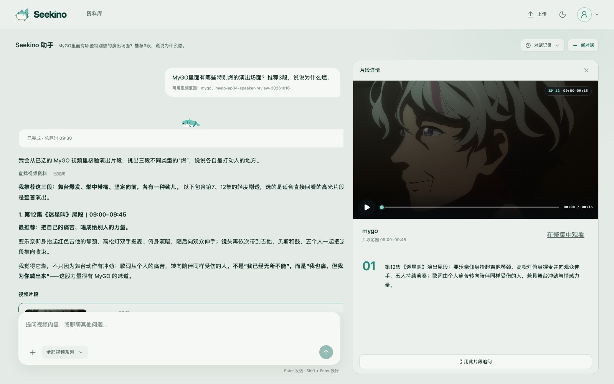
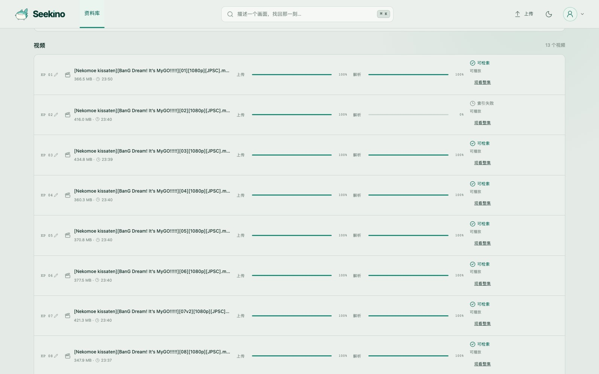
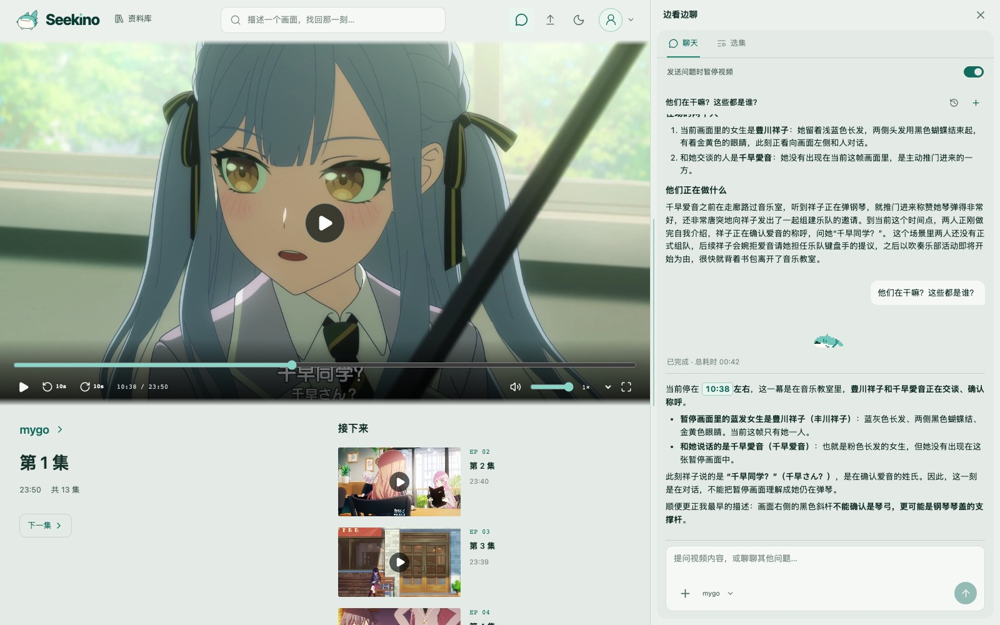

<div align="center">
  <a href="https://seekino.hypn0s.cloud">
    
  </a>
</div>

<h1 align="center">Seekino</h1>

<p align="center">
  <strong>视频里的 Ctrl+F</strong><br />
  像搜文字一样搜画面：一句话跳到那一秒，结果可回原片核对。
</p>

<p align="center">
  <a href="README.en.md"></a>
  
</p>

<p align="center">
  <a href="https://seekino.hypn0s.cloud"></a>
  <a href="LICENSE"></a>
  
  
</p>

<h4 align="center">
  <a href="https://seekino.hypn0s.cloud">Cloud</a> |
  <a href="https://seekino.hypn0s.cloud/docs">Document</a> |
  <a href="#-roadmap">Roadmap</a> |
  <a href="https://github.com/owariband/Seekino/issues">Issues</a>
</h4>

<!-- 演示视频：把 mp4 拖进任意 issue/PR 评论框，拿到 user-attachments 链接后替换下面的 src -->
<p align="center">
  <video src="https://github.com/user-attachments/assets/REPLACE_WITH_YOUR_DEMO" width="920" autoplay loop muted playsinline></video>
</p>

<p align="center"><sub>输入一句话 → 召回片段 → 直接跳到原片那一秒</sub></p>

<details open>
<summary><b>📕 目录</b></summary>

- 💡 [它解决什么](#-它解决什么)
- 🎮 [怎么用](#-怎么用)
- 🧩 [功能](#-功能)
- 🔥 [近期更新](#-近期更新)
- 🎉 [关注项目](#-关注项目)
- 🚀 [快速开始](#-快速开始)
- 🔌 [接口](#-接口)
- 📜 [Roadmap](#-roadmap)
- 📚 [文档](#-文档)
- 🙌 [致谢](#-致谢)

</details>

---

## 💡 它解决什么

> **41 小时的课，你要的只是其中一段。** 想找「梯度下降是怎么讲的」，现在得倍速看半小时；Seekino 让你一句话跳到那一秒。

| 你的处境 | Seekino 怎么做 |
| --- | --- |
| 记得画面，不记得在哪 | 描述个大概，或直接传一张图，几秒内定位到那一秒 |
| 想边看边问 | 播放器旁的助手知道你看到哪儿，不用截图、不用复述上下文 |
| 只想知道值不值得看 | 先给你视频大纲和系列概览，再决定深入哪一段 |
| 剪辑素材反复解析 | 一次解析、反复取用，还能交给 Claude Code 自动选片 |

每个结果都带**原片与时间范围**，随时能回去核对——不是「看起来像」，是「就是这里」。

<p align="center">
  
</p>

<details>
<summary>更多截图（2026-10-25 实机运行）</summary>





</details>

## 🎮 怎么用

| 我想 | 去哪里 | 门槛 |
| --- | --- | --- |
| 直接看效果 | **[Seekino Cloud](https://seekino.hypn0s.cloud)** | 无需安装，打开即用 |
| 在自己的电脑上处理素材 | [Docker 一条命令](#-快速开始) | Docker + 2 个模型 API Key，约 15 分钟 |
| 接进自己的 Agent / 剪辑流程 | [接口](#-接口) | 已部署的实例 + 支持 MCP 的客户端 |

## 🧩 功能

### 找回那一刻

- **一句话定位**：说出记得的画面、台词或人物关系，不用记得是哪一集、哪一秒。
- **按图找图**：传一张截图，在视频里找相似画面。
- **要路线也给**：问「这门课该按什么顺序看」，先出大纲和学习路线，再往下深入。
- **可核对**：每个片段都带集数与时间范围，点开就回到原片。

### 边看边问

- 助手知道你正看到哪儿，直接问「这里没懂」，不用截图、不用复述前情。
- 回答边生成边出字，推理过程折叠，想看的片段就挂在句子下面，点开回原片。
- 追问可以连续进行，上下文不会断。

### 解析与管理

- **一次解析，反复取用**：解析完成的素材进个人素材库，之后随时检索、复用。
- **长视频不用守着**：后台解析，进度和失败原因都可见，失败可重试。
- **先看结构再深入**：解析完自动生成视频大纲与系列概览。
- **认得出谁在说话**：结合整片声纹与背景资料判断说话人，证据不够就留空，不乱猜。
- **花钱心里有数**：每个阶段都能换模型，每次调用都记录 token 与预计花费。

### 交给 Agent

- 提供 **MCP** 接口，Claude Code 一类的客户端可以直接来取片段。
- 11 个工具覆盖选片、风格参考与系列共享模板，另附剪辑 Skill。
- 你只需要给个模糊印象，剩下的筛选交给它，最后你来 review。

## 🔥 近期更新

- 2026-11-12 单集内的**画面查找**与智能纠错，播放器支持快捷键
- 2026-11-12 移动端导航重做，剧集列表更紧凑
- 2026-11-11 剪辑 MCP 支持**共享系列模板库**与创作 Skill
- 2026-11-11 视频内文本查找
- 2026-11-11 面向剪辑 Agent 的 **Cloud MCP 原生接入**

<sub>完整变更见 [已关闭的 Issue](https://github.com/owariband/Seekino/issues?q=is%3Aissue+is%3Aclosed)。</sub>

## 🎉 关注项目

⭐️ 点击右上角的 **Star**，可以收到最新发布的实时通知。

<sub>项目还在早期，每个 Star 都算数。</sub>

## 🚀 快速开始

### 方式一：在线体验

打开 <https://seekino.hypn0s.cloud> ，公开系列已经解析好，可以直接搜。剪辑相关的 MCP 接入见 [Cloud MCP 说明](https://seekino.hypn0s.cloud/docs/agents)。

### 方式二：Docker 全栈自建

需要 Docker Desktop（或 Docker Engine + 当前版本的 Compose 插件），Windows 用 WSL2 / Linux containers。Python、Node.js、ffmpeg 和模型 SDK 都在镜像里，宿主机不用另装。

```bash
git clone --depth 1 --single-branch --branch main https://github.com/owariband/Seekino.git
cd Seekino

cp deploy/docker/env.example .env.docker
```

在 `.env.docker` 里填两个密钥；已有文件时直接编辑，不要覆盖：

```dotenv
ARK_API_KEY=你的火山方舟密钥
DEEPSEEK_API_KEY=你的DeepSeek密钥
```

> 默认用 Ark 做对话、音视频理解与向量，DeepSeek 做检索 Agent 与重排。也可以换成 Kimi、Codex 或其他模型，配置方法见[本地配置指南](deploy/local-setup.md)。
>
> **隐私与费用：** 使用远程模型时，相关音视频、帧或文本会发送给配置的供应商，并可能产生调用费用。

然后一条命令启动：

```bash
docker compose --env-file .env.docker up --build -d --wait
```

- **Web：** <http://127.0.0.1:5173>
- **API 文档：** <http://127.0.0.1:5173/api/docs>
- **运行状态：** <http://127.0.0.1:5173/healthz>

首次启动会初始化数据表与检索索引。建议的验收路径：**创建系列 → 上传一个短视频 → 等解析完成 → 检索片段 → 回到原片 → 连续追问两轮**。`/healthz` 正常不代表模型链路已经验收。

```bash
docker compose --env-file .env.docker ps
docker compose --env-file .env.docker logs -f api
docker compose --env-file .env.docker stop
```

视频、日志和模型配置保存在 `app_data` 卷里，`stop` / `down` 都不会删；`down -v` 会删。更细的端口冲突、备份和恢复见[本地配置指南](deploy/local-setup.md)。

### 交给 AI 部署

把下面这段直接发给能操作当前仓库的 AI；模型凭据仍由你自己填写：

```text
请在当前 Seekino 仓库完成本地部署。先阅读 README.md 和 deploy/local-setup.md，
采用“Docker 全栈 + 默认 DeepAgents / API 模型”路线，使用 .env.docker，按文档顺序执行。
不要修改业务代码，不要删除或重建已有数据库、Elasticsearch 索引和 outputs/。
需要我填写 API Key、选择模型或处理端口冲突时，先停下来告诉我。
完成后检查 Web、/healthz 和 /api/docs，并给出上传一个短视频后的验收步骤。
```

## 🔌 接口

界面和外部工具用的是同一套服务：HTTP API 负责上传、解析任务、检索与对话，`/mcp` 提供 Streamable HTTP 的 MCP 接口，交给支持 MCP 的客户端直接取片段。

启动后看 [OpenAPI 文档](http://127.0.0.1:9621/api/docs)，接入说明见 [Server](server/README.md)。

## 📜 Roadmap

- [ ] 按内容类型自动选择解析方式（课程 / 影视 / 剪辑素材），控制成本
- [ ] GIF 输入（目前支持文本与静态图片）
- [ ] 剪辑素材库的复用闭环：保存动效代码、来源与反馈
- [ ] 公开更多性能与成本指标
- [ ] 版本化发布，补齐 Windows 实机验收

## 📚 文档

- [项目介绍](docs/README.md) · [本地配置指南](deploy/local-setup.md) · [部署与备份](deploy/README.md)
- [HTTP 与 MCP 接口](server/README.md) · [Web](web/README.md)

## 🙌 致谢

[video-shotcraft](https://github.com/Vincentwei1021/video-shotcraft) 为剪辑 Agent 提供镜头配方和制作方法。

[motion-showreel](https://github.com/ConardLi/garden-skills/tree/2b9a89340b70f632d31c0f1c69fce94a7912423e/skills/motion-showreel) 为代码动画与分层合成提供参考和制作脚本。

这两个上游项目都很值得点 Star。

## 🤝 反馈与联系

- **想搜却搜不到**：直接开 [Issue](https://github.com/owariband/Seekino/issues)，附上视频来源和你想找的那一幕——具体例子比任何反馈都有用。
- **想聊实现、聊合作、或把它接进自己的项目**：也欢迎开 Issue 或 [Discussion](https://github.com/owariband/Seekino/discussions)。
- **想参与开发**：Roadmap 里带 `good first issue` 的条目适合上手。

<sub>代码以 Apache-2.0 授权；Seekino 名称与 Logo 不随代码授权，见 [TRADEMARK.md](TRADEMARK.md)。</sub>
