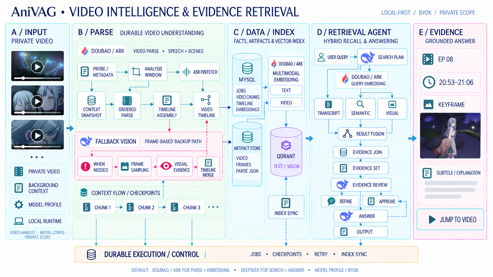

# anivag

anivag 是一个面向事件级视频检索与时间证据定位的多模态视频理解产品。M1 以动画名场面为首个落地场景：用户导入若干集动画视频后，可以用自然语言查询梗、动作、人物关系或情绪变化，并获得可跳转的集数、时间戳与关键帧证据。

## 一张图看懂 anivag

从私有视频到有据可查的回答：anivag 在后台解析语音、画面与时间线，建立可检索的多模态索引，再把自然语言问题对应到具体片段。

[](diagrams/anivag-open-source-architecture.png)

*点击图片查看完整架构图。*

- **本地优先，私有范围**：视频、解析产物和索引留在自己的运行环境，模型连接由自己的配置管理。
- **一次解析，多路检索**：语音文本、场景与关键帧汇入时间线，支持文本、语义和视觉证据召回。
- **答案能回到原片**：结果附带集数、时间段与关键帧，方便核对并跳转到对应视频位置。

仓库根目录就是 anivag 的工程边界，不再额外套 `packages/`、`src/` 或
`anivag_*` 分发包。`server/`、`engine/`、`gateway/` 是产品内部模块命名空间，
不是三个需要独立发布的 Python 包，也不通过 `__init__.py` 批量暴露实现。

## M1 边界

- Anime-first：课程视频只作为未来迁移验证，不改变产品定位。
- Video-only：用户不需要上传外挂字幕文件。
- 语音、镜头与关键帧进入查询前的异步建库链路；生产 Parse 由 Server LangGraph 编排独立的 ASR、视频理解与 Embedding Agent。烧录字幕 OCR 暂不阻塞第一版。
- 在线查询融合语音文本、视觉与角色事件候选，返回时间证据。
- V1 使用 MySQL 持久化 Queue + anivag Server 进程内 Consumer；RocketMQ 不是单用户 MVP 的前置依赖。

## 生产 Parse Graph

生产业务数据按以下阶段串行推进；ASR 节点内部可以按配置并发处理多个待解析窗口：

```text
准备窗口与媒体 → ASR Agent → VideoUnderstandingAgent → EmbeddingAgent → MySQL 业务事实 → Qdrant 索引
```

Agent 之间不直接调用，只通过 Graph State 交接显式 DTO。provider、model 与
tier 只决定运行配置和 provenance，不代表 Agent 拓扑；内容审核 fallback 复用 Graph
传入的同一份 Transcript，不会补跑 ASR。

当前 LangGraph 不配置 checkpointer 或节点 retry。失败重试仍由 ParseJobConsumer 与
MySQL Queue 管理，MySQL Checkpoint、Artifact 和 Lease/Fencing 才是恢复真相；Graph
State 只覆盖当前一次执行。

## 快速开始

仓库根目录是运行配置的唯一入口：`config.yaml` 保存可提交的模型默认值和全局 Chat Agent 运行参数，`config/model-pricing.yaml` 保存 Parse 模型人民币单价，`.env.local` 保存 API Key 和个人 Endpoint，不进入 Git。Chat Agent 参数位于 `config.yaml` 的 `agent_runtime` 节，也可从前端「设置」页编辑。YAML 中显式填写的值优先于同名 `ANIVAG_AGENT_*` 环境变量；缺失字段沿用环境变量或程序默认值。

模型连接配置拆成两层：`model_sources` 描述协议 Adapter、用量 Provider 和
认证方式，`models` 分别选择 Agent、ASR、画面理解及视觉降级模型；向量配置保持原样。
旧的 `agent_model`、`video_parser.*_model` 等配置仍然兼容。
DS + 第三方 ASR、第三方视觉接口和迁移规则见 [`docs/model-config.md`](docs/model-config.md)。
DeepSeek 是 `adapter: openai` 下的 `profile: deepseek`；Codex 使用 app-server，Claude
使用 Agent SDK。可复制的 source 示例及认证说明见
[`gateway/README.md`](gateway/README.md#chat-agent-模型来源)。角色模型环境变量覆盖仍然有效，
fallback 的来源与模型都在 YAML 中显式配置。

设置页保存和手工编辑 `agent_runtime` 后，超时、上下文预算、检索及工具输出上限等参数由下一条新消息使用；进行中的回答继续使用开始时的参数。`maximum_concurrent_kicks` 保存后需要重启 Server，设置页会区分保存值和当前生效值。模型连接、数据库等启动配置仍需重启；配置错误会在读取或保存时报告。设置页通过 Server API 修改本机的 `config.yaml`，浏览器不会直接访问服务器文件。

```bash
cp .env.example .env.local
# 编辑 .env.local，按所选 provider 填写需要的 API Key 和个人 ep-* Endpoint。

uv sync
uv run --env-file .env.local python -m gateway.cli --help
```

视频解析命令见 [`engine/README.md`](engine/README.md)，模型调用与跨模态向量
冒烟见 [`gateway/README.md`](gateway/README.md)，业务事实与索引同步命令见
[`server/README.md`](server/README.md)。所有命令都从仓库根目录运行。

本地验证时，可直接懒启动 MySQL、原生 Qdrant、anivag Server（API + 进程内
ParseJobConsumer）和 Web：

```bash
./start.sh          # 已运行的服务直接复用，只启动缺少的进程
./start.sh status   # 查看服务监听，以及 API / ParseJobConsumer readiness
./start.sh stop     # 只停止本脚本启动的进程，保留数据
```

默认 Web 为 `http://127.0.0.1:5173`，API 文档为 `http://127.0.0.1:9621/docs`。
脚本读取根目录 `.env.local`；模型 API Key 以该文件为准，其它显式环境配置会保留。缺少数据库配置时，默认连接
`root` / 空密码的 `127.0.0.1:3306/anivag_development` 和
`http://127.0.0.1:6333` 的 `anivag_video_chunks_development` 集合。
首次自建 MySQL 使用该 root 账号；复用已有认证实例时，在 `.env.local` 配置其数据库账号。

需要本机已有 `uv`、Node、npm、MySQL 8、Qdrant 和 ffmpeg / ffprobe。
脚本会在缺少 `.venv` / Web 依赖时执行 `uv sync` / `npm ci`。
可通过 `ANIVAG_MYSQLD_BIN` / `ANIVAG_QDRANT_BIN` 指定二进制；也会查找 Homebrew
MySQL 8.4 和 `~/.local/bin/qdrant`。Gateway / Engine 由 anivag Server 进程内调用，
无需额外进程。

自建数据、PID 与日志保存在 `outputs/local-services/`，媒体仍使用
`ANIVAG_ARTIFACT_ROOT`（默认 `outputs/server/artifacts`）。启动会创建缺失的开发库 / 表 /
Qdrant 集合，并校验现有 Schema；旧 Schema 会报错，需要按迁移说明处理。
不清空数据、不自动 ALTER 旧表。启动失败后已启动的进程会保留，可查看日志、重试或运行 stop。

可在 `.env.local` 修改 `ANIVAG_HTTP_PORT`、`ANIVAG_WEB_PORT`、数据库 URL 端口和
Qdrant URL 端口；自建 Qdrant 的 gRPC 端口由 `ANIVAG_QDRANT_GRPC_PORT` 指定（默认 6334）。
Vite 代理会跟随 API 端口。此脚本仅用于 localhost development 环境。
修改 `config.yaml` 中可即时生效的 `agent_runtime` 参数后，新消息直接使用新值；
`maximum_concurrent_kicks`、模型/解析配置及其他启动配置修改后，先运行
`./start.sh stop` 再启动。脚本会检查需要重启的配置摘要，防止复用旧配置。

## 仓库结构

```text
anivag/
├── pyproject.toml                    # 统一依赖与测试配置；package = false
├── uv.lock                           # 全仓唯一依赖锁
├── config.yaml                       # 可提交的模型默认配置
├── config/model-pricing.yaml          # Parse 模型计价属性与价格版本，人民币
├── server/                           # 工程编排、事实源、持久化与外部接口
├── engine/                           # VideoChunk 解析与检索算法
├── gateway/                          # 模型供应商调用与数据归一化
├── tests/                            # 按 server/engine/gateway/evals 分区的测试
├── evals/                            # 算法评测工具、数据集与报告
├── outputs/                          # 本地运行产物，不进入 Git
├── deploy/                           # 本地基础设施与部署配置
├── assets/                           # 本地样例素材与领域参考
└── docs/                             # 方案、决策与开发记录
```

这里列的是当前已经存在的目录，不代表最终系统只有这些文件。Server 已包含 HTTP API、
MySQL DB Queue、进程内 ParseJobConsumer 和环境隔离的本地 Artifact Store；Web 层独立推进。
Artifact Store
只负责媒体与其他二进制产物，Embedding 的 durable source 仍是 MySQL，不因引入
Artifact Store 自动外置。完整目标结构与阶段记录维护在
`docs/design/technical_solution copy.mdv.document.working.md`。

## 运行入口

根 `pyproject.toml` 只负责依赖和工具配置，没有构建系统、分发包入口或全量公共 API。
当前运行和调试使用以下显式模块入口：

```bash
uv run python -m engine.parse.cli --help
uv run python -m evals.recall.cli --help
uv run python -m gateway.cli --help
uv run python -m server.cli --help
uv run python -m server.api
uv run python -m server.mq --once
```

`server.api` 是唯一常驻 Backend PSM；`server.mq --once` 只用于领取至多一个到期任务的
诊断，不是需要与 API 并行启动的常驻服务。

## 上游归属

前端请求与公开返回模型见 [UI DTO / VO 契约](docs/api-ui-views.md)，包含逐消息 Series 范围、分页 / SSE、媒体读取与旧数据库迁移说明。

解析任务的模型 Token、视频与职责归属、人民币预估费用及查询接口见 [Parse 模型消耗统计](docs/parse-model-usage.md)。任务页展开“模型消耗”查看；价格配置变更只影响后续调用。
