<p align="center">
  
</p>

<h1 align="center">Seekino</h1>

<p align="center">
  <strong>视频只解析一次，之后像读文字一样定位、跳转和追问。</strong><br />
  个人视频素材库：自然语言与图片检索、片段级回答，每个结果都能回到原片时间点。
</p>

<p align="center">
  <a href="README.en.md">English</a> · <strong>简体中文</strong>
</p>

<p align="center">
  <a href="#1-我们-seekino-的亮点">亮点</a> ·
  <a href="#2-技术架构">技术架构</a> ·
  <a href="#3-部署">部署</a> ·
  <a href="#api-接入">API 与 MCP</a> ·
  <a href="#文档入口">文档</a>
</p>

<p align="center">
  <a href="pyproject.toml"></a>
  <a href="web/package.json"></a>
  
</p>

## 1. 我们 Seekino 的亮点

> **看 PPT 看不进去？** 课程视频 116 min 望而却步，不知道里面哪些“知识”是自己想要的；想 3 倍速地找，总共也要 30+ min！
>
> **视频剪辑素材难以管理？** 每次都要让 Agent 重新解析同一个参考片段和动画来源，人物立绘大部分还得自己定位提供，解析参考过的动效和动画视频也留不下来。`TODO`

**一次视频解析，反复多次定位利用。** 视频也可以像文本阅读一样随意跳转，也能像文本阅读一样，随手把“当前看的”交给 Agent 询问。

- **课程定位：** 一句话，十几秒找到你想要的重点，无需传统倍速观看
- **剪辑素材：** 一个素材，一次解析反复复用，搭建你个人的视频剪辑素材库

Seekino 提供灵活的视频定位能力，为你召回需要的片段，并带上来源视频与时间范围，随时回到原片核对。

<p align="center">
  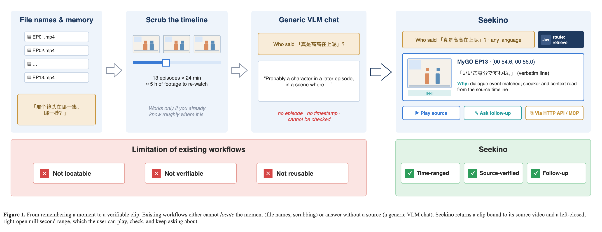
</p>

### 1.1. 召回支持

- **动画名场面找不到了？**——上传图片，或说出自己的模糊印象，秒级帮你定位
- **想学习课程，但不想截图？**——观看的同时支持问答，AI 懂你看到了哪里、有什么困惑
- **需要专属的“视频课程速成路线”？**——给出你的问题，AI “浏览”视频大纲结构，为你深度定制学习路线
- **剪辑需要素材，懒得手动翻？**——提供 MCP，你的 Claude Code 自动帮你找到目标片段，你只需给出模糊印象，再 review
- **剪辑需要参考，过去的参考结果却无法复用？**——深度存储历史动效解析结果，支持 MCP “更新自己的剪辑参考经验”，让剪辑经验简单地复利、复用 `TODO`

### 1.2. 解析支持

- **长视频解析要守着等？**——上传一次，整片转写后切块并行解析；进度在解析任务里一目了然，失败可重试，解析完就能搜
- **长课程解析太贵？**——每个阶段都能换模型（Kimi、豆包、DeepSeek……），每次调用都记录 token 和预计花费，花多少钱心里有数
- **一句话被切成两半？**——滑动窗口 Refine 把相邻 Chunk 放在一起复读，补漏句、去重复、接上跨块的句子
- **分不清谁在说话？**——整片说话人分组，结合系列背景资料和声纹认出说话人；证据不够就留空，不乱猜
- **只想先知道这个视频讲了什么？**——解析后自动生成视频大纲和系列概览，先看结构，再挑重点深入
- **课程、影视剧、剪辑素材都按一种方式解析，太浪费？**——自动识别解析类型，按类型控制成本，也支持自定义 `TODO`

<details>
<summary>实机截图（2026-10-25，本机运行，真实素材）</summary>


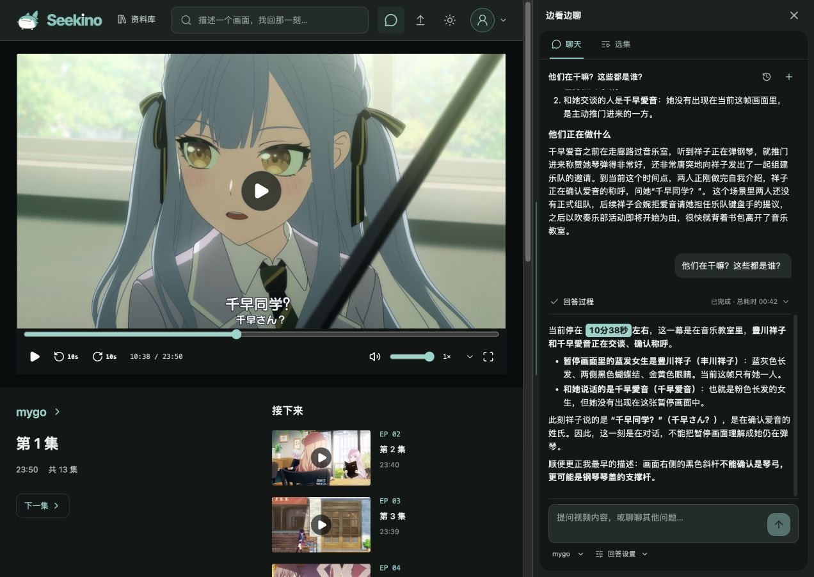

</details>

## 2. 技术架构

为了既能在云服务器上搭起轻量用户可体验的公开问答，又能让重度用户自建个人视频知识库，Seekino 从解析构建、召回和问答三个环节搭建了下述系统结构：

<p align="center">
  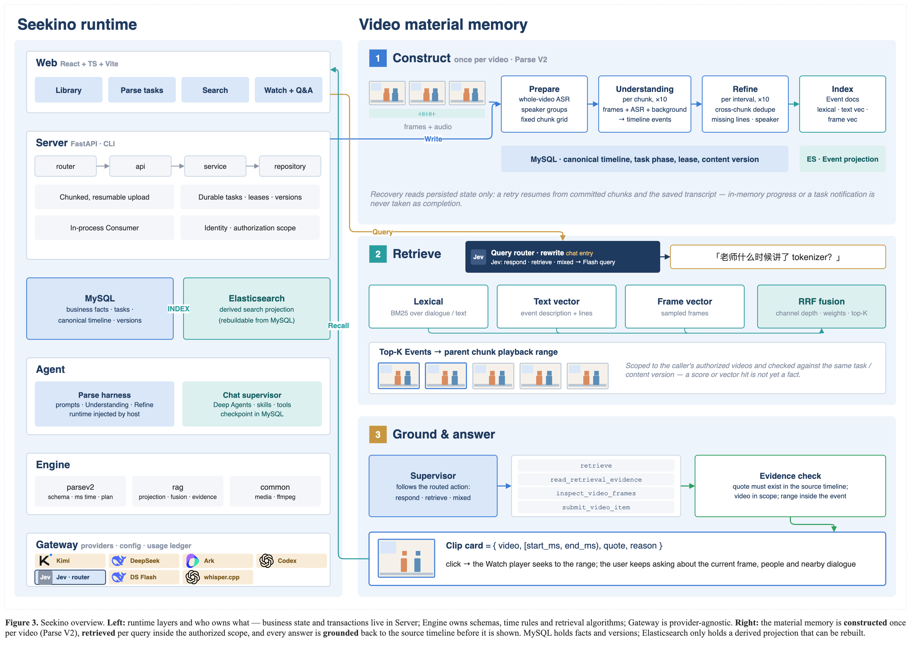
</p>

<sub>全部架构图可在 [docs/architecture/seekino-figures.drawio](docs/architecture/seekino-figures.drawio) 中编辑（12 个标签页）；标为 `TODO` 的内容尚未实现或尚未在当前版本实测。</sub>

### 2.1. 解析

**ASR。** 解析层默认使用 WhisperX 进行 ASR，也可以替换为 ASR API。

**并行解析。** 为了兼容多种场景和多种模型 API，并让所有用户都负担得起，Seekino 采用固定 60s 分块的并行解析（默认 10 路并发）；同时引入自动识别解析类型的 hook，路由到三类解析方式，分别控制成本（用户也可自定义）：course（课程）、script（剧本类影视作品）、clip（剪辑）。`TODO：解析类型 hook`

<p align="center">
  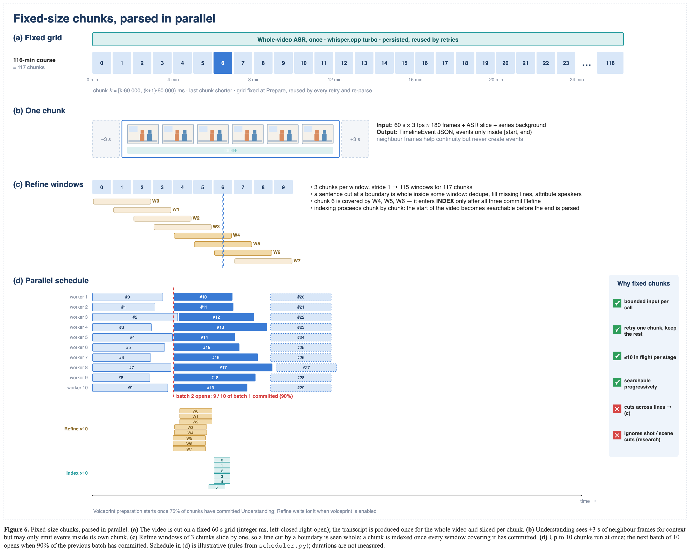
</p>

**补上分块的代价。** 并行让单 Chunk 理解时缺少上下邻近的 context，固定分块也会带来切断句子、动作等一系列难题。我们用两步来解决：

- **滑动窗口 Refine：** 相邻 3 个 Chunk 为一个窗口一起复读，补漏句、去重复、接上跨块的对白
- **尾 Summary：** 解析完成后通读整条时间线，生成视频大纲与系列概览

<p align="center">
  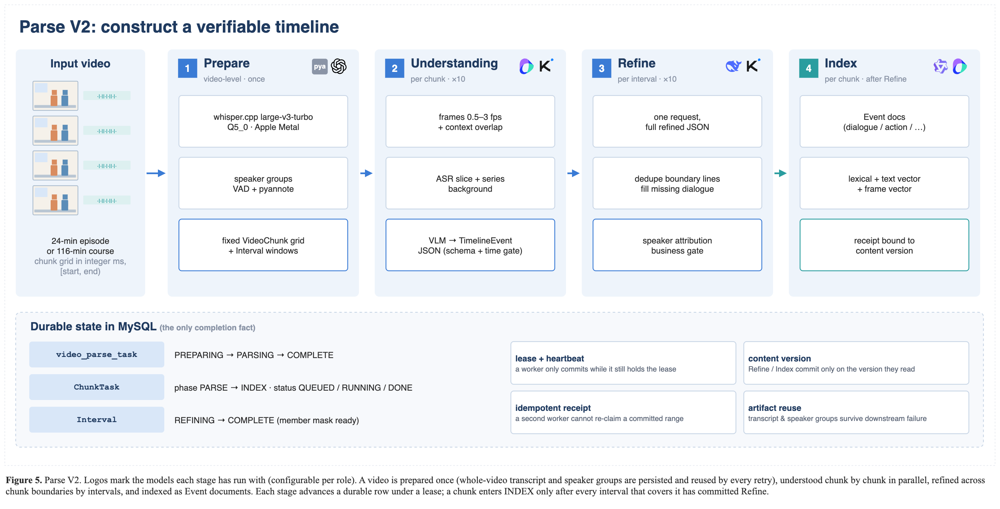
</p>

**效果。** 课程 *Let's build GPT*（116 min，117 个 Chunk），3 FPS（最大高度 720）下单个 1 min Chunk 的 Understanding，取成功执行的中位数：

| 模型 | FTT | TT | 输入 token / Chunk | 预计花费 / Chunk |
| --- | ---: | ---: | ---: | ---: |
| Kimi k3.1-pro | 43.4 s | 320.2 s | ≈244k | `TODO` |
| Kimi k3.1-pro（low） | `TODO` | 105.5 s | ≈244k | `TODO` |
| 豆包 Seed 2.1 Pro | `TODO` | `TODO` | `TODO` | `TODO` |
| DeepSeek Flash（non-thinking） | `TODO` | 31.8 s | `TODO` | ≈¥0.22 |

<sub>FTT：首 token 时间；TT：单 Chunk 总耗时。DeepSeek 费用来自不完整的用量记录。来源：[Kimi trace](docs/report/server/kimi-parse-trace-20261101.md) · [DeepSeek Flash 审计](docs/report/gateway/deepseek-flash-chunk-audit-20261103.md) · [devlog](docs/dev/devlog.md)</sub>

**为什么并行。** 不管用什么模型，一个长视频的时间消耗都能得到控制：耗时随“Chunk 数 ÷ 并发数”增长，而不是随整片串行增长。

**挑战：Refine 的并发冲突治理。** 相邻窗口共享 Chunk，难免同时修改同一段内容。我们从悲观的加锁、用 tool 强硬控制 Agent 的输出，转向乐观的不阻塞控制：最先一个重叠窗口提交后，立刻 interrupt 其他窗口，并 send 一轮新 msg：

> 窗口 [12, 14] 共享的 Chunk 13 已更新，新版本的 window json 为：{…}

Agent 从 tool 使用的无限失败重试 pipeline 中“自由”出来，耗时和 token 消耗都降了下来：

- 同样 3 个 Chunk：Canvas tool 方式 8 次请求、593.7 s、314,671 input tokens；直接 JSON 1 次请求、247.0 s、11,307 input tokens，结果同为 45 个事件、16 条对白
- 乐观控制之前，一次整课运行有 49 次提交在生成完之后才因冲突被拒，失败尝试占全部 Refine 耗时的 57%；现在被 interrupt 的请求约 1 ms 退出（本地 SSE 测试）
- 乐观控制在真实模型上的整课耗时与 token 节省：`TODO`

现在的模型能力足以支持乐观看待，目前只有 DS Flash non-thinking 出现过输出不可靠的情况。

**门禁。** 没有了 Canvas tool 的约束，Agent 也不能破坏 JSON 结构。为此我们引入 JSON gate，校验输出是否符合 JSON 与 Schema；不符合时返回 guide msg，并附上它自己上一版的完整输出，只让它改出错的地方：

> `members.0.content` 字段错误：xxx，please fix it

时间未排序这类能确定修复的问题由程序直接修，不再调用模型，保证最终结构正确、合法。

<p align="center">
  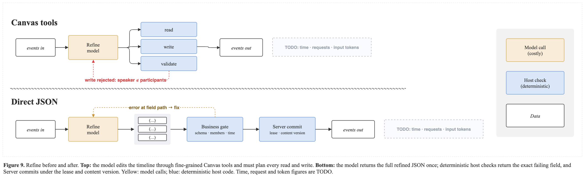
</p>

### 2.2. 构建召回

**为多模态输入设计向量。** 为了支持 gif、jpg、text 等多模态内容输入，我们对存储的向量做了专门设计：召回单位从 1 min Chunk 改为 Event（一个动作、镜头或一句对白），避免一分钟压成一个向量后短台词被稀释；每个 Event 分词法（BM25）、语义（文本向量）、视觉（画面帧向量）三个通道存储。`TODO：gif 输入，目前支持文本与静态图片`

**用 ||L<sub>∞</sub>|| 保住强命中。** 普通的加权 RRF 融合使用固定权重，可能让某个通道本该命中的 hit 1 在加权后掉到前 10 开外。取各通道的最大值，可以防止这样的结果在最后被筛掉，保证召回的可靠性。`TODO：尚未采纳，当前为按查询自适应权重的加权 RRF，必须补上`

**命中不等于事实。** 召回结果返回前，会按对应的解析任务和内容版本回源核对时间线：向量命中只是候选，核对过才是事实。

<p align="center">
  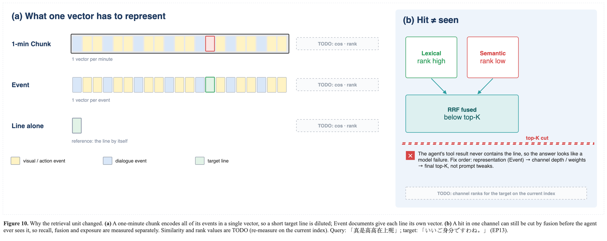
</p>

**从上而下与从下而上。** 召回有两种常见的方式：

- **从上而下：** 先判断视频 outline，结合用户的模糊意图，例如“我想要做一个 GPT，哪些是我最应该关注掌握的点？”，从宏观上规划如何帮到用户，再通过 outline 选择性深入 Chunk，寻找具体 Event 作为佐证
- **从下而上：** 直接定位到 Event，再回到 Chunk 结合上下文，更充分地回答

Agent 会按问题自己选择：问整体、问路线时从上而下，找台词、找画面时从下而上。

### 2.3. 召回问答

**先分清要不要搜。** 同样一句话，可能是要搜，也可能只是在回应上一轮。每轮问答进入 Supervisor 之前，会先经过一层 query router 和 rewriter：

- **路由：** Jev-1.14 判断当前消息是 respond（直接回应）、retrieve（检索）还是 mixed（两者都有），3 s 超时
- **改写：** retrieve / mixed 时，DeepSeek Flash 只写出要搜的那部分 `retrieval_query`，原话逐字保留，不猜人名、集数和剧情，4 s 超时
- **兜底：** 总预算 8 s，超时、报错或输出不合法都回退到原始消息，只会帮忙，不会挡路

<p align="center">
  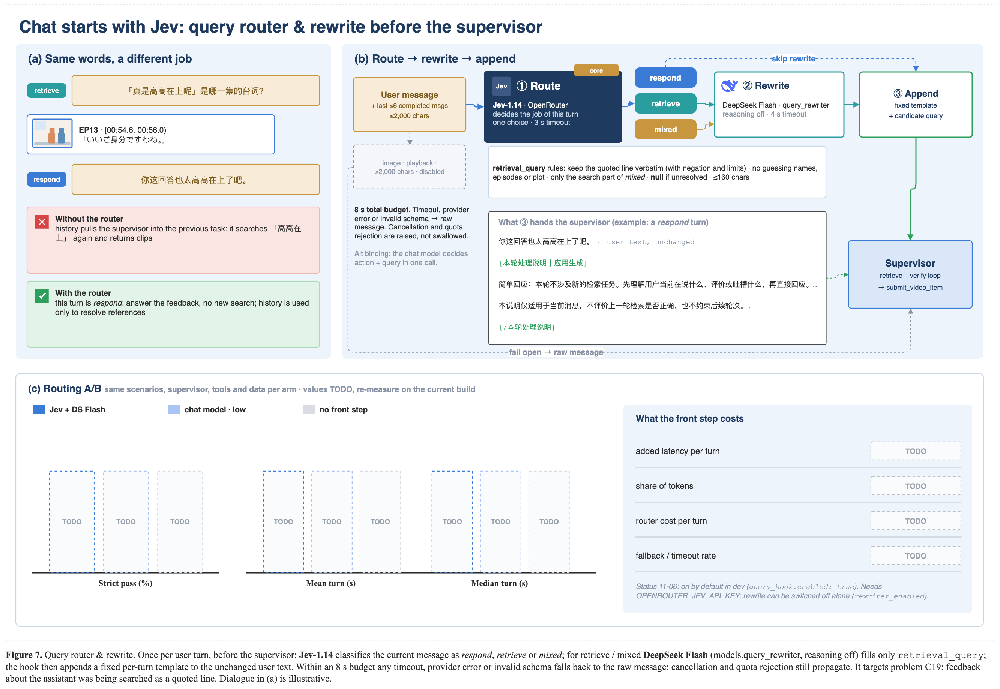
</p>

**用片段回答。** Supervisor 按需调用工具：委托视频检索 Agent 召回 Event、阅读视频大纲和系列概览、按当前播放位置理解正在看的画面、联网补充背景。最后，片段以可播放的卡片放在引用它的文字下方，对齐到句子和 Event 边界，点开就能回到原片核对。

**流式输出。** 回答边生成边输出，推理过程折叠展示；首个 token 15 s 未到就自动退避重连，最多 3 次。

**效果。** router 前后的单轮耗时、通过率与 token 成本：`TODO`

<details>
<summary>遇到的问题、效果与待测指标</summary>

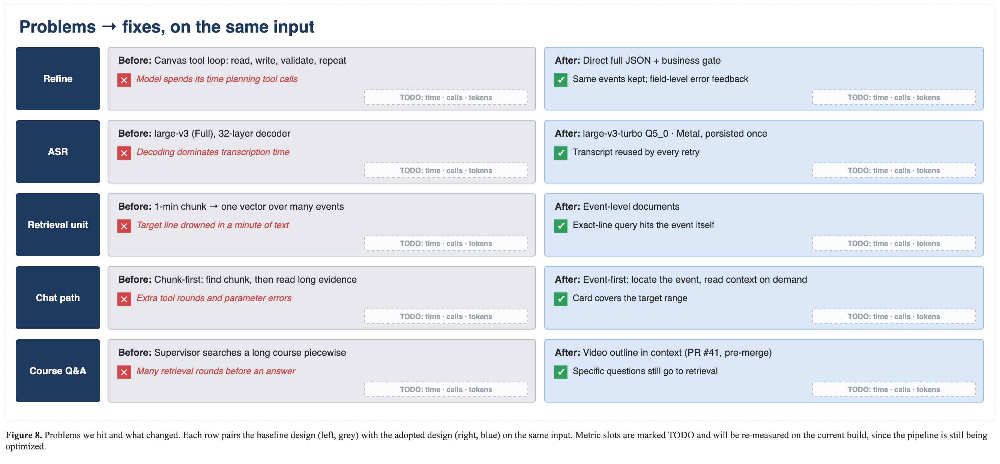

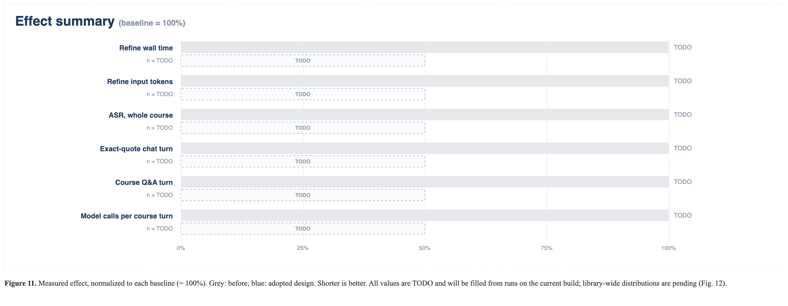

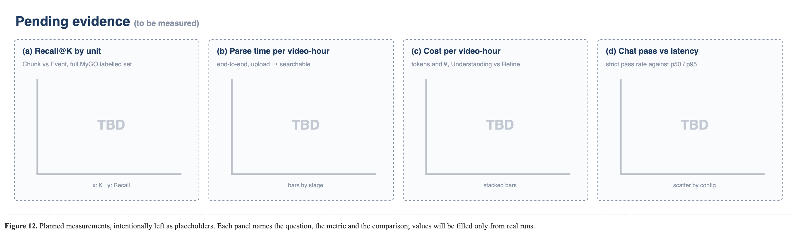

</details>

## 3. 部署

**当前可自托管，在线样例库尚未开放。** 首次安装推荐 **Docker 全栈 + API 模型**：Web、API、视频解析、MySQL 和 Elasticsearch 一起启动，默认使用 **DeepAgents**，不需要准备本地模型权重。

### 1. 准备环境

- Docker Desktop，或 Docker Engine + 当前版本的 Compose 插件。
- Windows 使用 Docker Desktop 的 **WSL2 / Linux containers**；启动命令可以在 PowerShell 中执行。

Python、Node.js、ffmpeg 和模型 SDK 已放进镜像，宿主机无需另装。完整容器启动和 Windows 实机验收尚待完成，当前验证范围见[本地配置指南](deploy/local-setup.md)。

### 2. 获取代码并填写密钥

```bash
git clone https://github.com/owariband/Seekino.git
cd Seekino

cp deploy/docker/env.example .env.docker
```

在 `.env.docker` 中填写两项；已有文件时直接编辑，不要覆盖：

```dotenv
ARK_API_KEY=你的火山方舟密钥
DEEPSEEK_API_KEY=你的DeepSeek密钥
```

仓库 `config.yaml` 默认使用 Ark 处理 Supervisor、音视频理解与向量，DeepSeek 处理检索 Agent、重排和文本回退。请确认账号已开通所配置的模型，或按[模型配置文档](docs/model-config.md) 替换为自己的模型 / Endpoint。

**可选 Kimi / Codex：** 继续修改同一份 `config.yaml` 的现有 source、model 和 harness；不需要新增 provider YAML。Kimi 填写 `KIMI_API_KEY`，Codex 使用镜像内已有的 SDK runtime 登录。具体步骤见[本地配置指南](deploy/local-setup.md)。

> **隐私与费用：** 使用远程模型时，相关音视频、帧或文本会发送给配置的供应商，并可能产生调用费用。

### 3. 一条命令启动

```bash
docker compose --env-file .env.docker up --build -d --wait
```

首次启动会检查配置、初始化业务表、DeepAgents checkpoint 和检索索引，再启动 API 与 Web。已有旧库仍需按版本升级，不会自动重建数据。

- **Web：** <http://127.0.0.1:5173>
- **API 文档：** <http://127.0.0.1:5173/docs>
- **运行状态：** <http://127.0.0.1:5173/healthz>（API 也可通过 `9621` 直连）

首次验收建议：**创建系列 → 上传一个短视频 → 等待解析完成 → 检索片段 → 回到原片 → 连续追问两轮**。`/healthz` 正常不代表模型链路已经验收。

```bash
docker compose --env-file .env.docker ps
docker compose --env-file .env.docker logs -f api
docker compose --env-file .env.docker stop
```

视频、日志、有效模型配置和 Codex 登录保存在 `app_data` 卷，数据库另有独立卷；`stop` / `down` 保留这些数据，`down -v` 会删除。模型 YAML 只在第一次导入，后续改配置的导入步骤、端口冲突和备份说明见[本地配置指南](deploy/local-setup.md)。

### 宿主机开发（可选）

<details>
<summary><strong>在宿主机运行 API / Web，使用 Docker 数据库</strong></summary>
<br />

本路线需要 Python **3.12**、`uv`、Node.js **24+**、npm、ffmpeg / ffprobe。macOS、Linux 使用下面的 shell 命令；Windows 开发建议在 WSL2 中执行。首次复制环境文件后，先填好模型密钥，再执行其余步骤；已有 `.env.local` 时保留原文件：

```bash
cp .env.example .env.local
# 编辑 .env.local，填写模型密钥后继续
uv sync --locked
npm --prefix web ci
docker compose --env-file .env.local up -d --wait mysql elasticsearch
uv run --no-sync --env-file .env.local -- python -m server.cli init-db
uv run --no-sync --env-file .env.local -- python -m server.cli init-es-index

# 使用已检出的 dev 工作区
./start.sh --branch dev
./start.sh --branch dev status
./start.sh --branch dev stop
```

手动前台调试时，分别在两个终端运行：

```bash
uv run --no-sync --env-file .env.local -- python -m server.main
```

```bash
uv run --no-sync --env-file .env.local -- npm --prefix web run dev -- --host 127.0.0.1 --port 5173 --strictPort
```

main 工作区使用 `./start.sh`、`./start.sh status`、`./start.sh stop`。启动器只管理宿主机进程；本路线的 Docker 数据库使用 `docker compose --env-file .env.local stop mysql elasticsearch` 停止。更多端口、日志和旧环境恢复说明见[开发部署说明](deploy/README.md)。

不使用 Docker 时，按[全原生本机开发](deploy/README.md#可选全原生本机开发)安装并配置 MySQL、Elasticsearch，使用同一组 `start.sh` 命令。启动器复用已监听的数据库，或启动配置的原生程序；`stop` 只停止它管理的进程，包括由它启动的原生 MySQL 和 ES。数据库默认保存到 `data/mysql/`、`data/elasticsearch/`，媒体默认保存到 `assets/library/`，旧数据不会自动迁移。

</details>

## 交给 AI 部署

把下面这段直接发给能操作当前仓库的 AI；模型凭据仍由你自己填写：

```text
请在当前 Seekino 仓库完成本地部署。先阅读 README.md 和 deploy/local-setup.md，
采用“Docker 全栈 + 默认 DeepAgents / API 模型”路线，使用 .env.docker，按文档顺序执行。
不要修改业务代码，不要删除或重建已有数据库、Elasticsearch 索引和 outputs/。
需要我填写 API Key、选择模型或处理端口冲突时，先停下来告诉我。
完成后检查 Web、/healthz 和 /docs，并给出上传一个短视频后的验收步骤。
```

## API 接入

Web 界面与外部工具使用同一套服务接口：

| 接入目标 | 现有接口 |
| --- | --- |
| 上传并触发解析 | `POST /api/uploads/create` → `PUT /api/uploads/segments/upload` → `POST /api/uploads/complete` |
| 跟踪解析任务 | `GET /api/jobs/video-parse/get`、`GET /api/jobs/video-parse/events` |
| 检索素材 | `POST /api/search`，返回片段来源、时间范围与证据 |
| Agent 对话 | `/api/agent/conversations/*`、`/api/agent/messages/*`，支持持续对话与流式回答 |
| 外部 Agent 取素材（MCP） | `/mcp`（Streamable HTTP，仅 local 身份模式），工具 `list_series`、`retrieve`、`read_evidence` |

启动后查看 [OpenAPI 文档](http://127.0.0.1:9621/docs)，接入说明见 [Server](server/README.md)。当前范围字段使用 `tenantId`；视频时间采用相对原片起点的整数毫秒，部分字段仍保留 `*Seconds` 旧名。

## 进阶与开发

<details>
<summary><strong>进阶配置：模型、cloud 身份与已有数据库升级</strong></summary>
<br />

**模型配置**<br />
`model_sources` 定义协议、认证与 Provider，`models` 绑定对话、转写、视觉、embedding 与 rerank 等角色。`supervisor_harness` 选择 Codex 或 Deep Agents；来源、模型或 harness 修改后需重启 Server。已有素材库不要随意更换 embedding 模型、来源或维度。详见 [模型配置](docs/model-config.md)。

**local 与 cloud 身份**<br />
默认 `SEEKINO_AUTH_MODE=local`，本机无需登录。`cloud` 模式额外需要签名秘密、Redis、SMTP 和同源 HTTPS；游客、登录用户与公开内容按服务端权限隔离。详见 [用户 / Tenant 交接说明](docs/report/server/user-tenant-handoff-20261010.md)。

**已有数据库升级**<br />
`init-db` 与 `init-es-index` 可重复执行，但不自动迁移旧库或重建不兼容索引。升级前阅读 [Server 说明](server/README.md)，并核对 [身份迁移](docs/migrations/20261010_user_tenant_identity.sql) 与 [媒体毫秒迁移](docs/migrations/20261008_video_timeline_milliseconds.sql)。

**数据与恢复**<br />
`outputs/` 可能包含实际媒体、配置、日志和实验工作区，不要整体视为缓存。日常停止不要使用 `docker compose down -v`。换机或恢复前阅读 [本机资产与换机恢复](deploy/README.md#local-assets)。

</details>

<details>
<summary><strong>开发、验证与仓库结构</strong></summary>
<br />

```bash
uv run --no-sync python -m pytest -m "not live_agent"
npm --prefix web run typecheck
npm --prefix web test
npm --prefix web run build
```

浏览器用例先构建并安装 Playwright Chromium：

```bash
npm --prefix web exec -- playwright install chromium
npm --prefix web run test:e2e
```

真实集成需要独立的测试数据库、ES 与 Redis；真实模型测试还需显式启用，可能产生供应商费用。单测、构建和模拟 API 验证不等同于完整真实模型验收。

```text
Seekino/
├── gateway/       # 模型协议与来源适配
├── engine/        # Parse V2、RAG 与共享媒体能力
├── agent/         # Chat、实时理解、解析与 Context Canvas
├── server/        # HTTP / CLI、持久化与可靠执行
├── web/           # React + TypeScript + Vite
├── deploy/        # 本地基础设施与部署说明
├── tests/         # 自动化测试
├── evals/         # 检索、对话与意图路由评测
└── docs/          # 契约、设计、迁移与研究记录
```

</details>

## 文档入口

- **部署与配置：** [本地配置指南](deploy/local-setup.md) · [开发部署](deploy/README.md) · [模型配置](docs/model-config.md)
- **产品与开发：** [Server](server/README.md) · [Web](web/README.md) · [设计文档](docs/design/README.md) · [管理工作台](docs/dev/workbench.html) · [问题分析](docs/dev/problems.md)
- **质量与实验：** [Benchmark](evals/benchmark/README.md) · [短片创作实验](.agents/skills/seekino-short-video/SKILL.md)

<details>
<summary><strong>References：相关论文与工程实践</strong></summary>
<br />

这些资料用于项目调研与设计；论文条目包含仍在研究的方向，不表示已经完整复现。

| 资料 | 参考方向 |
| --- | --- |
| [OmniScript](https://arxiv.org/abs/2604.11102) | 长视频结构化剧本、场景与事件层级、人物和对白定位 |
| [ScreenWriter](https://arxiv.org/abs/2410.19809) | 自动剧本、场景组织、说话人归属与电影摘要 |
| [TransNet V2](https://arxiv.org/abs/2008.04838) | 镜头边界与转场检测 |
| [ShotBench / ShotQA / ShotVL](https://arxiv.org/abs/2506.21356) | 景别、构图、光线与运镜理解 |
| [CameraBench](https://arxiv.org/abs/2504.15376) | 相机运动分类、理解与评测 |
| [VideoRAG](https://arxiv.org/abs/2502.01549) | 长视频与跨视频的多模态检索增强生成 |
| [RAPTOR](https://arxiv.org/abs/2401.18059) | 层次化摘要与多粒度检索 |
| [QVHighlights](https://arxiv.org/abs/2107.09609) | 自然语言片段定位与高光选择 |
| [VISTA](https://arxiv.org/abs/2606.30005) | 可见上下文状态、按需归档与恢复 |
| [ACM](https://arxiv.org/abs/2607.23809) | 长任务中的上下文编辑、卸载与取回 |
| [Writing effective tools for agents](https://www.anthropic.com/research/writing-tools-for-agents) | 工具职责、按需上下文、分页与可纠正错误反馈 |

</details>
