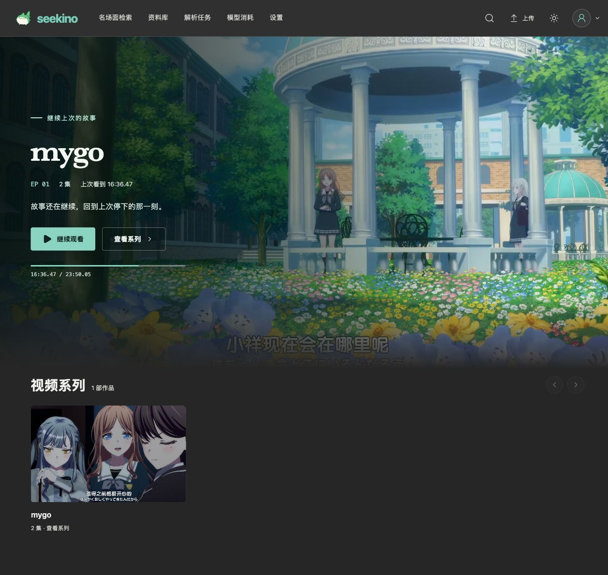
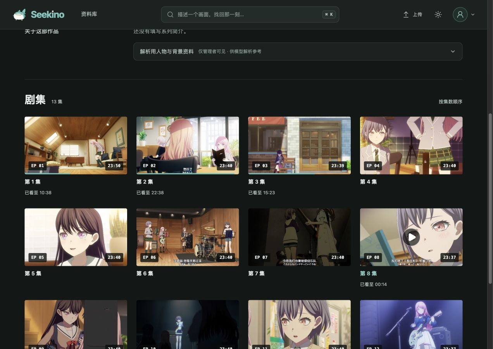
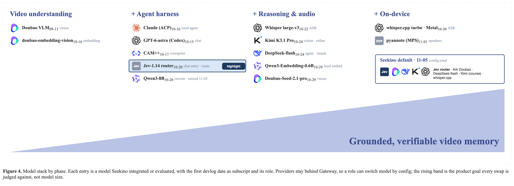
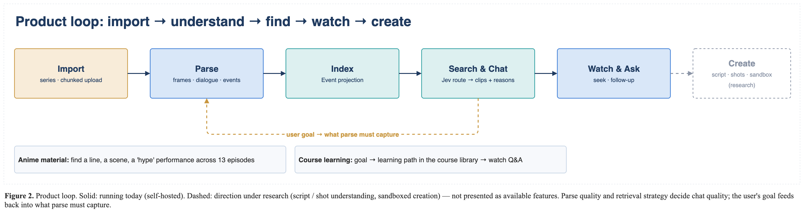

<p align="center">
  
</p>

<h1 align="center">Seekino</h1>

<p align="center">
  <strong>视频只解析一次，之后像读文字一样定位、跳转和追问。</strong><br />
  个人视频素材库：自然语言与图片检索、片段级回答，每个结果都能回到原片时间点。
</p>

<p align="center">
  <a href="README.en.md">English</a> · <strong>简体中文</strong>
</p>

<p align="center">
  <a href="#1-亮点">亮点</a> ·
  <a href="#2-技术架构">技术架构</a> ·
  <a href="#3-部署">部署</a> ·
  <a href="#api-接入">API 与 MCP</a> ·
  <a href="#文档入口">文档</a>
</p>

<p align="center">
  <a href="pyproject.toml"></a>
  <a href="web/package.json"></a>
  
</p>

## 1. 亮点

- **PPT 看不下去？** 一节 116 分钟的课程让人望而却步，你也不知道里面哪段“知识”才是自己要的；就算 3 倍速找，总共也要 30 多分钟。
- **剪辑素材难管理**（方向，建设中）：每次都要让 Agent 把同一段参考片、动画源重新解析一遍？大部分角色素材还得自己去找、自己提供？解析过的动效、动画参考视频，下次想用却留不下来？

**Seekino 让视频只解析一次，之后反复定位、反复使用。** 视频也能像读文字一样随意跳转；你正在看的画面，也能像一段文字一样随手交给 Agent 去问。

- **课程定位：** 一句话，十几秒内找到你要的重点，不用传统倍速看。
- **剪辑素材：** 一份素材解析一次、反复复用，逐步沉淀成你个人的剪辑素材库。

Seekino 提供灵活的视频定位能力，帮你召回需要的片段，并附上来源视频与时间范围，方便回到原片核对。

<p align="center">
  
</p>

### 1.1. 检索支持

| 你想要… | Seekino 怎么做 | 状态 |
| --- | --- | --- |
| 找回想不起出处的经典番剧名场面 | 上传截图，或描述你模糊的印象，秒级定位到哪一集、哪一秒。 | 文字 ✅ · 对话内静态图片 ✅ · GIF ⏳ |
| 学课程，但不想一张张截图 | 边看边问。提问会带上当前视频和播放位置，AI 知道你看到了哪里、卡在哪里。 | ✅ |
| 定制专属的“课程速通路线” | 给出你的问题，AI 浏览系列概览和视频大纲，规划该看哪些章节、按什么顺序看。 | ✅ |
| 剪辑要素材，却懒得手动翻 | 提供 MCP 服务，Claude Code、Codex 等 MCP 客户端按需求自动取片段；你只需要给出模糊印象，再做审核。 | ✅ 只读：`list_series`、`retrieve`、`read_evidence` |
| 剪辑需要参考，过往参考结果却无法复用 | 深度保存历史动效解析结果，作为可召回的风格参考；通过 MCP 让 Agent“更新自己的剪辑参考经验”，让剪辑经验可以简单地积累和复用。 | ⏳ 规划中 |

### 1.2. 解析支持

| 你想要… | Seekino 怎么做 | 状态 |
| --- | --- | --- |
| 长视频变得可检索，又不用一直盯着 | 上传一次即可。Seekino 先整片转写，再按固定 60 秒切块并行解析；可在解析任务中查看进度、重试失败任务。 | ✅ |
| 两小时的课程也解析得起 | 在同一份 `config.yaml` 中按阶段选择模型（Kimi、豆包、DeepSeek、Codex…）；每次模型调用都记录 token 与预估费用。 | ✅ |
| 跨 Chunk 边界的句子不丢 | 相邻 Chunk 在滑动 Refine 窗口中一起复读：补回漏句、去掉重复对白、拼接跨界句子。 | ✅ |
| 知道是谁在说话 | 整片说话人分组、系列背景资料和可选声纹共同支撑说话人归属；证据不足时保持未命名，不去猜。 | ✅ |
| 不只看到瞬间，还要看到整体结构 | 解析完成后，独立的 Summarize 阶段生成分章节的视频大纲和系列概览，供对话浏览。 | ✅ |
| 不同素材按需花钱 | 解析类型识别 Hook 自动路由到三种解析模式：课程、剧本类影视作品、剪辑，各自控制帧率与模型预算；也支持用户自定义。 | ⏳ 规划中 |

<details>
<summary>实机截图（2026-10-25，本机运行，真实素材）</summary>

**整理素材。** 按系列管理视频，查看上传、解析与检索可用状态；补充背景资料，帮助解析理解人物与内容。


**描述画面，召回片段。** 展开结果即可预览片段、查看选择理由和原片时间；引用片段可以继续追问。


**回到原片核对上下文。** 播放器与问答侧栏并排；提问带上当前视频与播放位置，回答中的时间点可以点击跳转。






</details>

**现在怎么用。** 在线样例库（管理员上传，访客观看、检索、提问）正在准备，暂无公开地址；当前可自托管个人素材库，见[部署](#3-部署)。解析、检索与回答可能存在偏差，请结合原片核对；已知问题见[问题清单](docs/dev/problems.md)。

## 2. 技术架构

为了既能在轻量云服务器上提供普通用户可体验的公共问答，又能让重度用户自建个人视频知识库，Seekino 从解析构建、检索到问答搭建了如下系统结构：三个阶段只通过两处存储相接，MySQL 保存业务事实、任务与版本，Elasticsearch 保存派生的检索投影。

<p align="center">
  
</p>

<details>
<summary>模型栈与产品闭环</summary>





</details>

全部图可在同一个 draw.io 文件中编辑：[docs/architecture/seekino-figures.drawio](docs/architecture/seekino-figures.drawio)（12 个标签页）。标为 **TODO** 的数字尚未在当前版本实测。

### 2.1. 解析

**转写。** 解析层默认使用 WhisperX（本机运行，带词级对齐）做 ASR，也可以通过 `models.transcription` 替换为 ASR API（如豆包）。整片只转写一次，之后再解析各个 Chunk。

**固定切块与并行解析。** 为了兼容多种场景、多种模型 API，并让所有用户都用得起，Seekino 把每个视频按固定 60 秒网格切块（整数毫秒，左闭右开），各 Chunk 的 Understanding 并行执行（默认 10 路）。每个 Chunk 读取自己的画面、前后各 3 秒视觉上下文，以及落在其中的转写对白。

<p align="center">
  
</p>

固定切块也带来代价：单 Chunk 理解时丢失相邻上下文，切点可能正好落在一句话或一个动作中间。为此我们引入两步修复：

- **滑动窗口 Refine。** 每个窗口把相邻三个 Chunk 放在一起复读（117 个 Chunk 的课程共 115 个窗口），补回漏句、去除重复对白、拼接跨边界的句子。
- **尾部总结。** 解析完成后，独立的 Summarize 阶段通读整条时间线，生成分章节的视频大纲和系列概览。

<p align="center">
  
</p>

**单 Chunk 理解实测。** 同一课程（*Let's build GPT*，116 分 20 秒，117 个 Chunk），3 FPS，最大高度 720。数值为成功执行的中位数；失败与取消的尝试在对应证据中单列。

| 模型（设置） | 每 1 分钟 Chunk 耗时 p50 | 首 token p50 | 每 Chunk 输入 token | 每 Chunk 预估费用 | 证据 |
| --- | ---: | ---: | ---: | ---: | --- |
| Kimi k3.1-pro（默认推理档位） | 320.2 s（n=14） | 43.4 s（n=10） | ≈244 k（198 帧） | TODO | [trace](docs/report/server/kimi-parse-trace-20261101.md) |
| Kimi k3.1-pro（low） | 105.5 s（n=18） | TODO | ≈244 k | TODO | [devlog 11-02](docs/dev/devlog.md) |
| DeepSeek Flash（关闭推理） | 31.8 s（n=117） | TODO | TODO | ≈¥0.22（用量不完整） | [审计](docs/report/gateway/deepseek-flash-chunk-audit-20261103.md) |
| 豆包 Seed 2.1 Pro | TODO | TODO | TODO | TODO | TODO |

**并行相比纯串行的优势。** 固定网格加有界并发后，墙钟时间随“Chunk 数 ÷ 并发数”增长，而不是随模型处理整片的速度增长。慢模型会让单个 Chunk 变慢，但长视频不再变成一条漫长的串行等待：无论用哪个模型，长视频的耗时都可控。当前版本整课墙钟时间：TODO。

**挑战：Refine 并发冲突的治理。** 相邻窗口共享 Chunk，两个窗口可能同时修改同一个 Chunk。我们先后经历了三种设计：

1. **悲观、工具驱动。** 模型通过细粒度的 Canvas 读写工具修改时间线，宿主借此控制每一次写入。在同样三个 Chunk 上需要 8 次模型请求、593.7 秒、314,671 input tokens，时间主要花在规划工具调用，而不是修正内容。
2. **每个窗口一份 JSON。** 模型拿到完整窗口，直接返回一份完整 JSON：1 次请求、247.0 秒、11,307 input tokens，最终同样是 45 个事件、16 条对白（单次配对实验）。但去掉工具后，窗口会基于旧快照生成：一次整课运行中，49 次提交在模型已经生成完毕后才因冲突被拒，失败尝试占全部 Refine 尝试时间的 57%。
3. **乐观、非阻塞（当前）。** 窗口不加锁并行运行。第一个重叠窗口提交后，立即中断共享 Chunk 的其他窗口，保留它们最近的候选，并发送一轮新消息：*Chunk N 已更新，新版窗口 JSON 为：…*。模型从新快照继续，而不是提交失败后从头再来。本地 HTTP/SSE 测试中，被中断的请求约 1 毫秒内退出，此前要一直等到期限。真实模型下的耗时与 token 节省：TODO。

这让 Agent 从工具调用无限失败重试的流水线中“解放”出来。当前模型能力已足以支撑乐观视角；在我们的运行中，仍会给出不可靠输出的只有关闭推理的 DeepSeek Flash。

**门禁。** 没有 Canvas 工具约束后，模型可能破坏 JSON 结构，因此每份 Refine 输出提交前都要经过 JSON 门禁。宿主能确定性修复的问题（例如时间未排序）直接修复，不再额外调用模型；其他错误连同模型自己上一份输出和具体出错字段（例如 `members.0.content: …`）一起返回，要求只修这一处。成员、时间范围、任务租约与内容版本仍由 Server 在提交时校验，保证最终结构正确、合法。

<p align="center">
  
</p>

### 2.2. 构建检索

**一个向量代表什么。** 检索单位是 **Event**（Chunk 内的一个动作、镜头或一句对白），而不是 60 秒 Chunk：把一分钟压成一个向量，会稀释简短的目标台词。为了支持多模态内容输入，每个 Event 在三个通道上建索引，文字与图片查询都能命中：

| 通道 | 由什么构建 | 适用 |
| --- | --- | --- |
| 词法 | Event 文本与对白（Elasticsearch BM25） | 原话、人名、术语 |
| 语义 | 描述与对白的文本向量，按语言与角色区分 | 换种说法、模糊描述 |
| 视觉 | 画面帧向量（`doubao-embedding-vision`，1024 维） | 画面描述与图片查询 |

三个通道用**加权 RRF（倒数排名融合）**合并，权重随查询自适应，再经重排（重排失败时回退到融合顺序）。每个命中返回前都会按对应解析任务与内容版本回源核对时间线：向量命中只是候选，不是事实。

**TODO：最大排名保护。** 固定权重的 RRF 可能在加权后把某个通道排第 1 的命中（例如词法检索找到的原话）挤出最终前 10。计划中的修复对各通道取最大值（‖·‖∞），而不只看加权和，保证某一通道的强命中不会在最后被过滤掉。尚未实现。

<p align="center">
  
</p>

**两种检索方式。**

- **自顶向下。** 面对宽泛意图，例如“我想搭一个 GPT，应该重点掌握哪些点？”，Agent 先读系列概览和视频大纲，在宏观上规划怎么帮你，再有选择地通过大纲深入 Chunk，找到具体 Event 作为证据。
- **自底向上。** 面对具体瞬间（一句台词、一个镜头、一个动作），Agent 直接定位 Event，再回到所在 Chunk，结合上下文更完整地回答。

Agent 按问题选择方式：问课程结构从上往下，找原话或画面从下往上。

### 2.3. 检索问答

**先路由，再检索。** 在对话中，同样的话可能是一次新检索，也可能只是对上一轮回答的反馈。每轮对话在主 Agent 运行前，由 Query Hook 先做判断：

1. **路由。** Jev-1.14（经 OpenRouter，3 秒超时）把消息标为 *respond*、*retrieve* 或 *mixed*。
2. **改写。** 对 *retrieve* / *mixed*，DeepSeek Flash（`models.query_rewriter`，关闭推理，4 秒超时）只写出检索部分的 `retrieval_query`：原话保持逐字，不猜人名、集数和剧情。
3. **追加。** 在原样保留的用户文本后附加一段固定的本轮说明。

整个 Hook 有 8 秒总预算，任何超时、供应商错误或非法输出都回退到原始消息，所以它只会帮忙、不会挡路。默认开启，需要 `OPENROUTER_JEV_API_KEY`；改写可以单独关闭。

<p align="center">
  
</p>

**用片段回答，而不是用断言回答。** 对话 Supervisor 规划本轮并调用工具：

- `query_video` 把检索委托给视频检索 Agent，由它召回 Event、浏览大纲、查看画面帧。
- `get_series_overview` 和 `get_video_outline` 读取课程结构（自顶向下）。
- `understand_current_video` 根据你正在看的视频和播放位置回答。
- `search_web` 补充素材里没有的背景。
- `submit_video_item` 附上可播放的片段卡片。

片段卡片对齐到句子与 Event 边界，并内嵌在引用它的文字下方。回答逐字流式输出，模型的推理过程折叠展示；若 15 秒内未收到首个 token，客户端退避重连，最多 3 次。

**效果。** 路由 A/B 的单轮耗时、严格通过率与 token 成本见 Fig. 7(c) 与 Fig. 11；当前版本均为 TODO。

<details>
<summary>遇到的问题、实测效果与尚未测量的指标</summary>


</details>

## 3. 部署

**当前可自托管，在线样例库尚未开放。** 首次安装推荐 **Docker 全栈 + API 模型**：Web、API、视频解析、MySQL 和 Elasticsearch 一起启动，默认使用 **DeepAgents**，不需要准备本地模型权重。

### 1. 准备环境

- Docker Desktop，或 Docker Engine + 当前版本的 Compose 插件。
- Windows 使用 Docker Desktop 的 **WSL2 / Linux containers**；启动命令可以在 PowerShell 中执行。

Python、Node.js、ffmpeg 和模型 SDK 已放进镜像，宿主机无需另装。完整容器启动和 Windows 实机验收尚待完成，当前验证范围见[本地配置指南](deploy/local-setup.md)。

### 2. 获取代码并填写密钥

```bash
git clone https://github.com/owariband/Seekino.git
cd Seekino

cp deploy/docker/env.example .env.docker
```

在 `.env.docker` 中填写两项；已有文件时直接编辑，不要覆盖：

```dotenv
ARK_API_KEY=你的火山方舟密钥
DEEPSEEK_API_KEY=你的DeepSeek密钥
```

仓库 `config.yaml` 默认使用 Ark 处理 Supervisor、音视频理解与向量，DeepSeek 处理检索 Agent、重排和文本回退。请确认账号已开通所配置的模型，或按[模型配置文档](docs/model-config.md) 替换为自己的模型 / Endpoint。

**可选 Kimi / Codex：** 继续修改同一份 `config.yaml` 的现有 source、model 和 harness；不需要新增 provider YAML。Kimi 填写 `KIMI_API_KEY`，Codex 使用镜像内已有的 SDK runtime 登录。具体步骤见[本地配置指南](deploy/local-setup.md)。

> **隐私与费用：** 使用远程模型时，相关音视频、帧或文本会发送给配置的供应商，并可能产生调用费用。

### 3. 一条命令启动

```bash
docker compose --env-file .env.docker up --build -d --wait
```

首次启动会检查配置、初始化业务表、DeepAgents checkpoint 和检索索引，再启动 API 与 Web。已有旧库仍需按版本升级，不会自动重建数据。

- **Web：** <http://127.0.0.1:5173>
- **API 文档：** <http://127.0.0.1:5173/docs>
- **运行状态：** <http://127.0.0.1:5173/healthz>（API 也可通过 `9621` 直连）

首次验收建议：**创建系列 → 上传一个短视频 → 等待解析完成 → 检索片段 → 回到原片 → 连续追问两轮**。`/healthz` 正常不代表模型链路已经验收。

```bash
docker compose --env-file .env.docker ps
docker compose --env-file .env.docker logs -f api
docker compose --env-file .env.docker stop
```

视频、日志、有效模型配置和 Codex 登录保存在 `app_data` 卷，数据库另有独立卷；`stop` / `down` 保留这些数据，`down -v` 会删除。模型 YAML 只在第一次导入，后续改配置的导入步骤、端口冲突和备份说明见[本地配置指南](deploy/local-setup.md)。

### 宿主机开发（可选）

<details>
<summary><strong>在宿主机运行 API / Web，使用 Docker 数据库</strong></summary>
<br />

本路线需要 Python **3.12**、`uv`、Node.js **24+**、npm、ffmpeg / ffprobe。macOS、Linux 使用下面的 shell 命令；Windows 开发建议在 WSL2 中执行。首次复制环境文件后，先填好模型密钥，再执行其余步骤；已有 `.env.local` 时保留原文件：

```bash
cp .env.example .env.local
# 编辑 .env.local，填写模型密钥后继续
uv sync --locked
npm --prefix web ci
docker compose --env-file .env.local up -d --wait mysql elasticsearch
uv run --no-sync --env-file .env.local -- python -m server.cli init-db
uv run --no-sync --env-file .env.local -- python -m server.cli init-es-index

# 使用已检出的 dev 工作区
./start.sh --branch dev
./start.sh --branch dev status
./start.sh --branch dev stop
```

手动前台调试时，分别在两个终端运行：

```bash
uv run --no-sync --env-file .env.local -- python -m server.main
```

```bash
uv run --no-sync --env-file .env.local -- npm --prefix web run dev -- --host 127.0.0.1 --port 5173 --strictPort
```

main 工作区使用 `./start.sh`、`./start.sh status`、`./start.sh stop`。启动器只管理宿主机进程；本路线的 Docker 数据库使用 `docker compose --env-file .env.local stop mysql elasticsearch` 停止。更多端口、日志和旧环境恢复说明见[开发部署说明](deploy/README.md)。

不使用 Docker 时，按[全原生本机开发](deploy/README.md#可选全原生本机开发)安装并配置 MySQL、Elasticsearch，使用同一组 `start.sh` 命令。启动器复用已监听的数据库，或启动配置的原生程序；`stop` 只停止它管理的进程，包括由它启动的原生 MySQL 和 ES。数据库默认保存到 `data/mysql/`、`data/elasticsearch/`，媒体默认保存到 `assets/library/`，旧数据不会自动迁移。

</details>

## 交给 AI 部署

把下面这段直接发给能操作当前仓库的 AI；模型凭据仍由你自己填写：

```text
请在当前 Seekino 仓库完成本地部署。先阅读 README.md 和 deploy/local-setup.md，
采用“Docker 全栈 + 默认 DeepAgents / API 模型”路线，使用 .env.docker，按文档顺序执行。
不要修改业务代码，不要删除或重建已有数据库、Elasticsearch 索引和 outputs/。
需要我填写 API Key、选择模型或处理端口冲突时，先停下来告诉我。
完成后检查 Web、/healthz 和 /docs，并给出上传一个短视频后的验收步骤。
```

## API 接入

Web 界面与外部工具使用同一套服务接口：

| 接入目标 | 现有接口 |
| --- | --- |
| 上传并触发解析 | `POST /api/uploads/create` → `PUT /api/uploads/segments/upload` → `POST /api/uploads/complete` |
| 跟踪解析任务 | `GET /api/jobs/video-parse/get`、`GET /api/jobs/video-parse/events` |
| 检索素材 | `POST /api/search`，返回片段来源、时间范围与证据 |
| Agent 对话 | `/api/agent/conversations/*`、`/api/agent/messages/*`，支持持续对话与流式回答 |
| 外部 Agent 取素材（MCP） | `/mcp`（Streamable HTTP，仅 local 身份模式），工具 `list_series`、`retrieve`、`read_evidence` |

启动后查看 [OpenAPI 文档](http://127.0.0.1:9621/docs)，接入说明见 [Server](server/README.md)。当前范围字段使用 `tenantId`；视频时间采用相对原片起点的整数毫秒，部分字段仍保留 `*Seconds` 旧名。

## 进阶与开发

<details>
<summary><strong>进阶配置：模型、cloud 身份与已有数据库升级</strong></summary>
<br />

**模型配置**<br />
`model_sources` 定义协议、认证与 Provider，`models` 绑定对话、转写、视觉、embedding 与 rerank 等角色。`supervisor_harness` 选择 Codex 或 Deep Agents；来源、模型或 harness 修改后需重启 Server。已有素材库不要随意更换 embedding 模型、来源或维度。详见 [模型配置](docs/model-config.md)。

**local 与 cloud 身份**<br />
默认 `SEEKINO_AUTH_MODE=local`，本机无需登录。`cloud` 模式额外需要签名秘密、Redis、SMTP 和同源 HTTPS；游客、登录用户与公开内容按服务端权限隔离。详见 [用户 / Tenant 交接说明](docs/report/server/user-tenant-handoff-20261010.md)。

**已有数据库升级**<br />
`init-db` 与 `init-es-index` 可重复执行，但不自动迁移旧库或重建不兼容索引。升级前阅读 [Server 说明](server/README.md)，并核对 [身份迁移](docs/migrations/20261010_user_tenant_identity.sql) 与 [媒体毫秒迁移](docs/migrations/20261008_video_timeline_milliseconds.sql)。

**数据与恢复**<br />
`outputs/` 可能包含实际媒体、配置、日志和实验工作区，不要整体视为缓存。日常停止不要使用 `docker compose down -v`。换机或恢复前阅读 [本机资产与换机恢复](deploy/README.md#local-assets)。

</details>

<details>
<summary><strong>开发、验证与仓库结构</strong></summary>
<br />

```bash
uv run --no-sync python -m pytest -m "not live_agent"
npm --prefix web run typecheck
npm --prefix web test
npm --prefix web run build
```

浏览器用例先构建并安装 Playwright Chromium：

```bash
npm --prefix web exec -- playwright install chromium
npm --prefix web run test:e2e
```

真实集成需要独立的测试数据库、ES 与 Redis；真实模型测试还需显式启用，可能产生供应商费用。单测、构建和模拟 API 验证不等同于完整真实模型验收。

```text
Seekino/
├── gateway/       # 模型协议与来源适配
├── engine/        # Parse V2、RAG 与共享媒体能力
├── agent/         # Chat、实时理解、解析与 Context Canvas
├── server/        # HTTP / CLI、持久化与可靠执行
├── web/           # React + TypeScript + Vite
├── deploy/        # 本地基础设施与部署说明
├── tests/         # 自动化测试
├── evals/         # 检索、对话与意图路由评测
└── docs/          # 契约、设计、迁移与研究记录
```

</details>

## 文档入口

- **部署与配置：** [本地配置指南](deploy/local-setup.md) · [开发部署](deploy/README.md) · [模型配置](docs/model-config.md)
- **产品与开发：** [Server](server/README.md) · [Web](web/README.md) · [设计文档](docs/design/README.md) · [问题清单](docs/dev/problems.md)
- **质量与实验：** [Benchmark](evals/benchmark/README.md) · [短片创作实验](.agents/skills/seekino-short-video/SKILL.md)

<details>
<summary><strong>References：相关论文与工程实践</strong></summary>
<br />

这些资料用于项目调研与设计；论文条目包含仍在研究的方向，不表示已经完整复现。

| 资料 | 参考方向 |
| --- | --- |
| [OmniScript](https://arxiv.org/abs/2604.11102) | 长视频结构化剧本、场景与事件层级、人物和对白定位 |
| [ScreenWriter](https://arxiv.org/abs/2410.19809) | 自动剧本、场景组织、说话人归属与电影摘要 |
| [TransNet V2](https://arxiv.org/abs/2008.04838) | 镜头边界与转场检测 |
| [ShotBench / ShotQA / ShotVL](https://arxiv.org/abs/2506.21356) | 景别、构图、光线与运镜理解 |
| [CameraBench](https://arxiv.org/abs/2504.15376) | 相机运动分类、理解与评测 |
| [VideoRAG](https://arxiv.org/abs/2502.01549) | 长视频与跨视频的多模态检索增强生成 |
| [RAPTOR](https://arxiv.org/abs/2401.18059) | 层次化摘要与多粒度检索 |
| [QVHighlights](https://arxiv.org/abs/2107.09609) | 自然语言片段定位与高光选择 |
| [VISTA](https://arxiv.org/abs/2606.30005) | 可见上下文状态、按需归档与恢复 |
| [ACM](https://arxiv.org/abs/2607.23809) | 长任务中的上下文编辑、卸载与取回 |
| [Writing effective tools for agents](https://www.anthropic.com/research/writing-tools-for-agents) | 工具职责、按需上下文、分页与可纠正错误反馈 |

</details>
