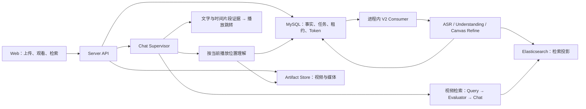

<p align="center">
  
</p>

<h1 align="center">Seekino</h1>

<p align="center"><strong>人人可用的个人视频素材库。</strong></p>
<p align="center">解析视频，用自然语言找回素材，让每个片段都能回到原片核对。</p>

<p align="center">
  <a href="README.en.md">English</a> · 简体中文
</p>

<p align="center">
  <a href="#仍在建设中">仍在建设中</a> ·
  <a href="#能做什么">能做什么</a> ·
  <a href="#实机截图">实机截图</a> ·
  <a href="#使用方式">使用方式</a> ·
  <a href="#接口接入">接口接入</a> ·
  <a href="#快速开始">快速开始</a> ·
  <a href="#references">References</a>
</p>

Seekino（原 AniVAG）把自己的视频整理成可搜索、可回看的素材库：导入视频，解析画面与对白，用一句描述召回相关片段，再沿时间戳回到原片确认。解析与检索召回能力也支持通过 API 接入自己的工具和工作流。

## 仍在建设中

目前已支持素材入库、解析、检索和观看问答。接下来继续建设：

1. **Sandbox 接入**：让平台内 Agent 接入创作工作流，利用召回素材进行参考剪辑。
2. **开放 MCP**：让 Codex、Claude Code 等外部 Agent 使用素材库寻找素材。
3. **解析策略优化**：提升内容理解与结构化解析质量，优化解析耗时和成本。
4. **召回策略优化**：改善素材匹配、片段定位与上下文关联。
5. **可配置性与易用性建设**：完善模型配置、部署流程和日常使用体验。

**欢迎大家反馈交流，有兴趣的话可以加入一起建设！**

## 能做什么

| 能力 | 你可以做的事 |
| --- | --- |
| 素材入库与解析 | 按系列组织视频，补充人物与背景资料，上传后解析画面、对白与事件，建立可检索索引。 |
| 自然语言召回 | 描述画面、动作、台词或人物关系，在选定系列中跨视频寻找片段，并继续追问。 |
| 回看与核对 | 查看来源视频、时间范围、选择理由和上下文，播放命中片段或跳回完整原片。 |
| 观看问答 | 播放视频时打开侧栏，围绕当前画面、人物和附近对白提问。 |
| 接入自己的工具 | 通过 HTTP API 接入上传解析、任务状态、检索召回与 Agent 对话。 |

例如，在 MyGO 素材库里提问「**有哪些特别燃的演出场面？推荐 3 段，说说为什么燃。**」，可以得到带来源、时间范围和推荐理由的片段，再打开原片判断是否适合自己的创作。下面的演示使用 MyGO 动画素材；其他视频类型的效果仍需结合自己的素材验证。

## 实机截图

以下截图于 **2026-10-25** 取自本机运行的 Seekino，展示真实视频、已有解析结果与对话记录。截图为当前 Web 界面，不代表云端体验已上线。

### 整理自己的视频素材

在资料库中按系列管理视频，查看上传、解析与可检索状态；也可以补充背景资料，帮助解析时理解人物与内容。


### 描述要找的画面，召回相关片段

用自然语言跨视频检索，展开结果即可预览片段、查看选择理由与原片时间，也可以引用片段继续追问。


### 回到原片，边看边核对

播放器与问答侧栏并排展示。提问携带当前视频与播放位置，回答中的视频时间可以点击跳转。


<details>
<summary>更多界面：浏览素材与选集</summary>

观看首页提供视频系列与播放入口，也支持继续上次观看。


系列页按集数浏览视频，选择需要查看的原片。


</details>

## 使用方式

**云端样例库正在准备发布。** 首发由管理员上传和维护已解析素材，用户可观看、检索和问答。在线入口尚未开放。

**目前可以自托管个人素材库**，安装步骤见[快速开始](#快速开始)。基本流程是：

1. 创建视频系列作为素材集合，按需填写简介、语音语言、背景资料与参考图片。
2. 上传视频，在「解析任务」中查看建库进度。分片上传支持暂停与续传，解析失败时可查看错误并使用可用的重试操作。
3. 在检索页描述需要的素材，或先选集播放、打开侧栏提问；从回答中的片段回到原视频核对。

资料管理与上传权限由部署模式和当前身份决定。自托管需要准备数据库、模型配置与媒体存储；解析和问答使用远程模型时，相应音视频、帧或文本会发送到配置的供应商，并可能产生调用费用。

## 接口接入

Web 界面与外部工具使用同一套服务接口。已有工具可以接入以下能力：

| 接入目标 | 现有接口 |
| --- | --- |
| 上传视频并触发解析 | `POST /api/uploads/create` → `PUT /api/uploads/segments/upload` → `POST /api/uploads/complete` |
| 跟踪解析任务 | `GET /api/jobs/video-parse/get`、`GET /api/jobs/video-parse/events` |
| 检索召回素材 | `POST /api/search`，返回片段来源、时间范围与证据。 |
| 通过 Agent 对话找素材 | `/api/agent/conversations/*` 与 `/api/agent/messages/*`，支持持续对话与流式回答。 |

启动服务后，在 [OpenAPI 文档](http://127.0.0.1:9621/docs)查看请求与响应，接入说明见 [Server](server/README.md)。当前范围字段使用 `tenantId`；视频时间字段采用相对原片起点的整数毫秒，部分字段仍保留 `*Seconds` 旧名，接入时需按当前合同处理。

## 创作实验

此前已通过独立工作流完成过「召回素材 → 整理片段 → HyperFrames 编排离线 HTML 短片」的实验，可参考[短片创作实验工作流](.agents/skills/anivag-short-video/SKILL.md)。这份实验用于验证素材复用方向；相关脚本与配置需按当前接口核对后使用。

项目仍在迭代，解析、检索与回答可能存在偏差，请结合原片核对。已知问题与后续计划见[问题清单](docs/dev/problems.md)。

## 快速开始

以下命令均从仓库根目录运行，适用于本机开发环境。默认 local 模式无需登录。
首次试用可按[本地配置指南：API 模型 + Docker 数据库](deploy/local-setup.md)配置；其中提供不依赖本地权重的 Kimi / Ark 示例、checkpoint 初始化与常见问题。

### 1. 准备环境与配置

需要 Python **3.12**（`>=3.12,<3.13`）、`uv`、Node.js **24+**、npm、ffmpeg 和 ffprobe。数据库使用 MySQL **8.4** 与 Elasticsearch **8.19.x**；可自行准备，也可使用仓库 Compose（ES 固定为 8.19.22）。

首次配置时复制环境文件；已有 `.env.local` 时直接编辑原文件：

```bash
cp .env.example .env.local
uv sync --locked
npm --prefix web ci
```

在 `.env.local` 填写模型凭据及本机连接信息。当前默认配置使用以下来源：

| 模型角色 | 默认来源 | 准备事项 |
| --- | --- | --- |
| 对话 Supervisor、视频检索 Agent、画面理解 | 本机 Codex | 当前系统用户已完成 Codex 登录；可通过来源配置指定可执行文件。 |
| 语音转写 | 本机 Whisper 服务 | 准备模型文件与兼容音频接口，或按模型配置替换为自己的转写服务。 |
| 向量表示 | Ark | 配置 `ARK_API_KEY`。 |
| 重排、视觉失败时的文本回退 | DeepSeek | 配置 `DEEPSEEK_API_KEY`。 |

可以按自己的可用模型或 Endpoint 调整 [模型配置](docs/model-config.md)。默认 `supervisor_harness: codex` 要求对应的 Codex 来源；切换为 API 模型时，需要一并调整 harness 与 Supervisor 绑定。

| 配置位置 | 内容 |
| --- | --- |
| `config.yaml` | `model_sources` 连接来源、`models` 中的对话、转写、视觉、embedding 与 rerank 模型选择，`agent_runtime` 全局 Chat 参数。 |
| `.env.local` | API Key、个人 Endpoint 覆盖、数据库/ES/HTTP/身份等环境配置；不进入 Git。 |
| `web/.env.local`（可选） | 独立 Web 的 `VITE_API_BASE_URL` 与 `VITE_TENANT_ID`；默认使用同源代理和本地 Tenant。 |

手动运行时，已 export 的同名 shell 环境变量优先于 `uv --env-file`；两个终端应使用一致配置。

### 2. 准备 MySQL 与 Elasticsearch

使用 Docker Compose 时：

```bash
docker compose --env-file .env.local up -d --wait mysql elasticsearch
```

Compose 首次初始化会创建默认开发库 `anivag_development`，数据库端口只发布到 `127.0.0.1`。Server、Web 与 ffmpeg 仍在宿主机运行。使用已有 MySQL 时，先准备 `ANIVAG_DATABASE_URL` 指定的库及账号权限；`init-db` 只初始化表，不创建数据库。

然后初始化或校验当前 Schema 与 ES 索引：

```bash
uv run --no-sync --env-file .env.local -- python -m server.cli init-db
uv run --no-sync --env-file .env.local -- python -m server.cli init-es-index
```

这两个入口可以重复执行，但不自动迁移旧库或重建不兼容索引。遇到旧身份、时间单位或索引合同会报升级错误；升级步骤见下方「架构与部署」中的已有数据库升级说明。

### 3. 分别启动 API 与 Web

终端一：

```bash
uv run --no-sync --env-file .env.local -- python -m server.main
```

终端二：

```bash
uv run --no-sync --env-file .env.local -- npm --prefix web run dev -- --host 127.0.0.1 --port 5173 --strictPort
```

- Web：<http://127.0.0.1:5173>
- API 文档：<http://127.0.0.1:9621/docs>
- Consumer 状态：<http://127.0.0.1:9621/healthz>

`python -m server.api` 兼容转交正式 `server.main` 入口。API 已包含 V2 Consumer，运行时不用额外启动 Worker。手动启动的两个进程分别按 Ctrl-C 停止；Compose 数据库用 `docker compose stop` 停止，持久卷保留。

Vite 代理读取同一环境中的 `ANIVAG_HTTP_HOST` / `ANIVAG_HTTP_PORT`。自定义 Web 端口时，调整上述 `--port` 和 `ANIVAG_ALLOWED_ORIGINS`；手动 Vite 不会只因修改 `ANIVAG_WEB_PORT` 而改变端口。

### 可选：本机启动器

本机启动器默认使用已检出 `main` 分支的工作区，也支持通过 `--branch` 选择已有工作区；入口先转入所选工作区，再加载其 `.env.local`：

```bash
./start.sh
./start.sh status
./start.sh stop

# 当前 dev 工作区
./start.sh --branch dev
./start.sh --branch dev status
./start.sh --branch dev stop
```

`start` 使用所选工作区的当前文件（包含未提交改动），不自动拉取远端或切换分支。启动器会根据源码目录、文件内容和配置更新自己管理的 API/Web，未变化则复用；旧版进程记录也会更新。未知进程占用端口时会报错。此更新不停止 MySQL/ES；已有冻结 worktree 中的旧版脚本不会自动获得该行为，请使用主目录入口。

首次使用 DeepAgents 必须先执行上面的 `server.cli init-db`，初始化 checkpoint 表；启动器自身的业务表初始化不能替代这一步。

启动器按当前 `tenantId` 契约检查 API 资料库及 Web 代理，使用 `ANIVAG_LOCAL_TENANT_ID` 配置的本地 Tenant。启动前需准备可达的 Elasticsearch；脚本会校验集群与索引，不启动 ES。`stop` 只停止启动器管理的进程，不会停止手动启动的 API/Web 或 Compose 数据库。

启动器自建数据与日志在 `outputs/local-services/`；媒体默认在 `outputs/server/artifacts/`，可通过 `ANIVAG_ARTIFACT_ROOT` 修改。已有 MySQL/ES 会按配置复用，旧 Schema 不自动 ALTER。Docker 和端口配置详情见 [开发部署说明](deploy/README.md)。

换机、恢复环境或整理大目录前，先读 [本机资产与换机恢复](deploy/README.md#local-assets)。`outputs/` 被 Git 忽略，但可能包含实际生效的模型配置、业务媒体、训练成果和有未提交改动的实验工作区；不能把它整体视为可丢弃缓存。

## 架构与部署

<details>
<summary>系统架构与模块职责</summary>



| 模块 | 职责 |
| --- | --- |
| `gateway/` | 模型协议、认证、调用控制与用量事件；连接 Ark、OpenAI 兼容接口、Codex app-server、Claude SDK 等来源。 |
| `engine/` | 视频事件转换、时间与内容校验、索引投影、召回融合等领域算法。 |
| `agent/` | LangGraph 与 Agent 程序、Context Canvas、视频理解/精修，以及 Supervisor 的工具决策。 |
| `server/` | 身份与资源权限、上传、MySQL 持久化、租约与恢复、媒体准备、ES 写入和 HTTP/CLI。 |
| `web/` | 正式 React 前端，连接真实 API；API 不可用时显示错误或空态。 |

完整解析使用固定 Chunk 进行基础理解，滑动 Interval 独立精修并推进索引。模型通过 **Context Canvas** 读取证据、修改局部内容，程序保留完整状态并组装提交结果；Refine 校验成员版本与内容指纹，避免局部修改丢弃未提及事件。可选 Prefix 提供跨片段上下文，当前默认关闭。

Supervisor 可以直接回答、搜索网页、调用视频检索，或按冻结的播放位置理解当前及相邻 Chunk。当前视频尚未完整建库时，也可按需取得基础证据；调用由 Supervisor 决定，响应时间受模型与执行预算影响。

检索工具直接返回来源证据；需要更多上下文时按片段 ID 和游标续读。Jev 分类与本地 8B 改写前置链保留。

正式服务只接受 **V2 + MySQL + Elasticsearch**。Consumer 与 API 在同一 Server 进程运行，任务与恢复事实保存在 MySQL，ES 是检索投影。Gateway、Engine 和 Agent 无需单独启动；local 模式无需 Redis 或外部消息队列。Parse V1、Qdrant 和旧离线导入入口已删除。

视频时长、事件/Chunk 边界、播放位置及帧时间统一为相对原片起点的**整数毫秒**。现有 `durationSeconds`、`startSeconds`、`endSeconds`、`atSeconds`、`positionSeconds` 等字段保留旧名，值不能按秒解释；浏览器播放接口处转换为秒。绝对时间使用 Unix epoch 毫秒，解析配置的分块时长与超时仍以秒为单位。

</details>

<details>
<summary>模型与运行参数</summary>

`model_sources` 描述协议 Adapter、认证与 Provider；`models` 定义模型及其来源，当前业务使用 `supervisor`、`agent`、`transcription`、`vision`、`vision_fallback`、`embedding` 和 `rerank` 等引用。向量维度、视频采样率等参数位于 `models.embedding`。当前默认 Refine 复用固定 Understanding 模型。

顶层 `supervisor_harness` 选择 Codex 或 Deep Agents 执行方式，`models.supervisor` 单独绑定 Supervisor 模型；`models.agent` 继续为视频检索子任务选择模型。仓库默认 Supervisor 与画面理解使用 Codex，且显式启用视觉输入；其他模型是否接收原图按各自的 `supports_vision_input` 和适配器能力配置。来源切换不会自动更换 embedding。

Gateway 支持 OpenAI 兼容接口、Ark、Codex 本机登录和 Claude SDK 等来源，具体模型角色与 harness 各有能力要求。来源、模型或 harness 修改后需重启 Server，不会因配置不匹配而自动切换执行方式。

设置页保存的 `agent_runtime` 参数写入服务器 `config.yaml`，下一条新消息使用新值，正在执行的回答保留开始时的参数。`maximum_concurrent_kicks`、模型连接和其他启动配置需重启 Server。YAML 中显式的运行参数优先于对应 `ANIVAG_AGENT_*` 环境回退。

模型消耗页面读取 MySQL `model_usage`，覆盖 V2 解析/index 与助手调用，只展示已记录 Token 和已知小计；记录失败可能缺失，未知用量不当作零。它不计算费用，也不提供 Token 硬额度结算。正式 bootstrap **不装配 Langfuse writer/reader**，当前把 `tracing.enabled` 改为 true 也不会自行启用 Server tracing；独立模块与配置字段仍保留。

来源配置见 [模型配置](docs/model-config.md) 和 [Gateway Agent 来源](gateway/README.md#chat-agent-模型来源)，统计口径见 [模型 Token 用量](docs/parse-model-usage.md)。

</details>

<details>
<summary>local 与 cloud 身份</summary>

默认 `ANIVAG_AUTH_MODE=local` 使用 `local-user` / `local-default`，本机无需登录。

`cloud` 模式另外需要签名秘密、Redis、SMTP 和同源 HTTPS。Redis 保存验证码摘要、限流与并发租约，MySQL 保存 User、Tenant 和资源归属。可启动 Compose 的可选开发 Redis：

```bash
docker compose --env-file .env.local --profile cloud-auth up -d --wait redis
```

游客只能读取允许公开且就绪的内容，对话按本人隔离；邮箱验证码登录后拥有个人 Tenant，可切换个人资料与公开内容。资料管理和全局设置按服务端权限控制，公开读取不授予平台写权限。

cloud 配置请求次数与并发限制；游客共享 IP 请求预算，local 免请求次数额度。这些限制与 Token 统计是不同口径。生产反代需正确传递 HTTPS scheme 与客户端地址；配置项见 [.env.example](.env.example)，身份说明与迁移见 [用户/Tenant 交接说明](server/report_docs/user-tenant-handoff-20261010.md)。

当前业务 HTTP 范围字段使用 **`tenantId`**。部分旧文档仍有 `workspaceId` 示例，接入应以当前 OpenAPI 和 DTO 为准。

</details>

<details>
<summary>已有数据库升级</summary>

开发、测试和生产使用独立数据库与 ES 索引。数据库开发名以 `_dev` / `_development` 结尾，测试名以 `_test` 结尾；ES 索引名需带对应的 `dev` / `development` / `test` 组件，正式索引禁止这些组件。SQLite 只用于隔离测试。

`init-db` 校验当前 Schema，不能代替历史库迁移。按现有结构核对 [身份迁移](docs/migrations/20261010_user_tenant_identity.sql)、[媒体毫秒迁移](docs/migrations/20261008_video_timeline_milliseconds.sql) 及 [Server 说明](server/README.md)。ES 旧索引的 Tenant 复制工具为 `python -m scripts.migrate_tenant_index --help`，需要在相应写入停止后按计划执行，不自动重算 embedding 或覆盖旧索引。

</details>

## 开发与验证

常用检查：

```bash
uv run --no-sync python -m pytest -m "not live_agent"
npm --prefix web run typecheck
npm --prefix web test
npm --prefix web run build
```

浏览器用例使用生产构建预览；先 build，并安装 Playwright Chromium，再执行：

```bash
npm --prefix web exec -- playwright install chromium
npm --prefix web run test:e2e
```

真实集成需配置独立的 `ANIVAG_TEST_DATABASE_URL`、`ANIVAG_TEST_ELASTICSEARCH_URL`、`ANIVAG_TEST_AUTH_REDIS_URL`；真实模型测试需要额外显式启用，可能产生供应商消耗。已知问题与待验收项见 [问题清单](docs/dev/problems.md)。

已有单测、构建、隔离 SQL/ES 与模拟 API 浏览器验证不等同于当前完整真实模型验收。语义质量、按需理解冷启动延迟、真实 SMTP 和完整浏览器联调仍需分别验收；`/healthz` 成功只说明 Consumer 运行状态。

## 仓库与文档入口

```text
anivag/
├── config.yaml / .env.example   # 模型默认值与环境配置模板
├── gateway/                    # 模型协议与来源适配
├── engine/                     # parsev2、rag 与共享媒体能力
├── agent/                      # Chat、实时理解、Parse 与 Context Canvas
├── server/                     # HTTP/CLI、持久化与可靠执行
├── web/                        # 正式 React + TypeScript + Vite 前端
├── scripts/                    # 本地启动与受控迁移工具
├── tests/ / evals/              # 自动化测试、手动诊断与评测
├── deploy/ / compose.yaml      # 本地基础设施与部署说明
├── assets/                     # Logo、实机截图与架构图
├── docs/                       # 契约、设计、迁移与检查记录
└── outputs/                    # 本地媒体、日志与运行产物，不进入 Git
```

仓库根是运行边界，Python 内部模块统一由 `pyproject.toml` / `uv.lock` 管理，`package=false`；不单独发布各层分发包。

- [设计文档分类索引](docs/design/README.md) · [文档维护约定](docs/README.md)
- [Benchmark 索引](evals/benchmark/README.md)：查询能力覆盖、对话理解与应变、检索质量、意图路由。
- [Parse V2 Agent](agent/video_parse_v2/README.md) · [Context Canvas](docs/design/context-canvas-design.md)
- [当前播放位置理解实现](agent/chat/realtime_understanding/runtime.py) · [Server](server/README.md)
- [Web](web/README.md) · [Gateway](gateway/README.md) · [Engine](engine/README.md)
- [模型配置](docs/model-config.md) · [模型 Token 用量](docs/parse-model-usage.md) · [用户/Tenant](server/report_docs/user-tenant-handoff-20261010.md)
- [开发部署](deploy/README.md) · [问题清单](docs/dev/problems.md)

## 设备迁移快照

2026-10-23 的主工作区与实验代码入口见 [迁移索引](docs/migration/20261023/README.md)。dev 保存主工作区快照，各 EP04 实验保存在索引列出的独立分支。

## References

以下是项目调研与设计时参考的主要资料。论文条目包含仍在研究的方向，不表示已经完整复现。

### 论文与研究

| 论文 | 参考方向 |
| --- | --- |
| [OmniScript](https://arxiv.org/abs/2604.11102) | 长视频转结构化剧本，场景与事件层级、人物和对白的时间定位。 |
| [ScreenWriter](https://arxiv.org/abs/2410.19809) | 自动剧本生成、场景组织、说话人归属与电影摘要。 |
| [TransNet V2](https://arxiv.org/abs/2008.04838) | 镜头边界与转场检测。 |
| [ShotBench / ShotQA / ShotVL](https://arxiv.org/abs/2506.21356) | 景别、构图、光线、运镜等电影摄影维度的理解与评测。 |
| [CameraBench — Towards Understanding Camera Motions in Any Video](https://arxiv.org/abs/2504.15376) | 相机运动的分类、理解与评测。 |
| [VideoRAG](https://arxiv.org/abs/2502.01549) | 长视频与跨视频的多模态检索增强生成。 |
| [RAPTOR](https://arxiv.org/abs/2401.18059) | 层次化摘要与多粒度检索。 |
| [QVHighlights](https://arxiv.org/abs/2107.09609) | 自然语言查询驱动的片段定位与高光选择评测。 |
| [VISTA — LLM Agents Are Latent Context Managers](https://arxiv.org/abs/2606.30005) | 可见的上下文状态、按需归档与完整内容恢复。 |
| [ACM — Agentic Context Management for Long Horizon Tasks](https://arxiv.org/abs/2607.23809) | 长任务中的上下文编辑、卸载与按需取回。 |

### 工程实践

- [Anthropic — Writing effective tools for agents — with agents](https://www.anthropic.com/research/writing-tools-for-agents)：已用于项目的 Agent 工具设计，包括清晰的工具职责、按需读取上下文、分页与可纠正的错误反馈。项目中的研究与应用记录见 [Canvas 工具设计研究](docs/research/2026-10-22-canvas-agent-tool-design.md)。
