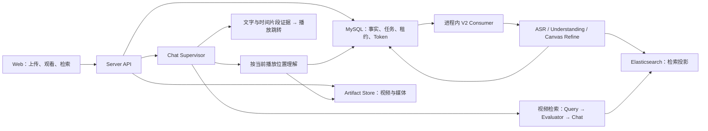

# anivag

anivag 是面向事件级视频检索、观看问答与时间证据定位的多模态视频理解产品。动画名场面是首个应用场景：导入若干集视频后，可以用自然语言查找动作、人物关系或情绪变化，也可以在观看时询问当前画面和刚才的对白，再跳回原片核对。

媒体、业务事实和索引保存在自己的运行环境，模型来源由自己的配置管理。使用远程模型时，相应音视频、帧或文本会发送到配置的供应商。

本文按 **2026-10-10 的当前工作区**整理。项目仍在开发中，已确认问题和验证范围见 [项目检查记录](docs/dev/check_log.md)。

## 当前能力

| 入口 | 功能 |
| --- | --- |
| 视频观看 | 选择系列与集数、继续上次观看、整集播放器、倍速与网页全屏；侧栏 Chat 携带当前集和暂停位置，回答中的视频片段可跳回原片。 |
| 名场面检索 | 跨集自然语言检索、持续对话、逐次选择检索系列；查看时间片段、选择理由、原始证据和前后语境，并引用片段追问。 |
| 资料库与上传 | 创建系列，填写简介、原文语音语言和背景资料；上传参考图片与视频，编辑集数；分片上传支持多文件并行、暂停和续传。 |
| 解析任务 | 查看 V2 阶段、进度、错误与持久检查点；按服务端允许的状态重试、重新解析或删除整集上传及其解析/索引产物。 |
| 模型消耗 | 按模型、系列或任务/Chat 查看 MySQL 中已记录的输入、输出、缓存与推理 Token，保留缺失、未知和截断提示。 |
| 设置与身份 | 日/夜主题、API 连接信息和全局 Agent 运行参数；local 本地身份，或 cloud 游客、邮箱登录、个人资料与公开内容。 |

普通检索提供 Chunk 或经审核事件的时间范围证据；当前画面的按需理解还可以抽取暂停位置附近的原视频帧。两者的定位精度与验证范围不同，不能把所有检索结果都当作已经完成帧级精确定位。

## 当前架构



| 模块 | 职责 |
| --- | --- |
| `gateway/` | 模型协议、认证、调用控制与用量事件；连接 Ark、OpenAI 兼容接口、Codex app-server、Claude SDK 等来源。 |
| `engine/` | 视频事件转换、时间与内容校验、索引投影、召回融合等领域算法。 |
| `agent/` | LangGraph 与 Agent 程序、Context Canvas、视频理解/精修，以及 Supervisor 的工具决策。 |
| `server/` | 身份与资源权限、上传、MySQL 持久化、租约与恢复、媒体准备、ES 写入和 HTTP/CLI。 |
| `web/` | 正式 React 前端，连接真实 API；API 不可用时显示错误或空态。 |

完整解析使用固定 Chunk 进行基础理解，滑动 Interval 独立精修并推进索引。模型通过 **Context Canvas** 读取证据、修改局部内容，程序保留完整状态并组装提交结果；Refine 校验成员版本与内容指纹，避免局部修改丢弃未提及事件。可选 Prefix 提供跨片段上下文，当前默认关闭。

Supervisor 可以直接回答、搜索网页、调用视频检索，或按冻结的播放位置理解当前及相邻 Chunk。当前视频尚未完整建库时，也可按需取得基础证据；调用由 Supervisor 决定，响应时间受模型与执行预算影响。

正式服务只接受 **V2 + MySQL + Elasticsearch**。Consumer 与 API 在同一 Server 进程运行，任务与恢复事实保存在 MySQL，ES 是检索投影。Gateway、Engine 和 Agent 无需单独启动；local 模式无需 Redis 或外部消息队列。冻结的 Parse V1/Qdrant 链只供历史参考和离线诊断，见 [Engine 说明](engine/README.md)。

## 快速开始

以下命令均从仓库根目录运行，适用于 localhost development。

### 1. 准备环境与配置

需要 Python **3.12**（`>=3.12,<3.13`）、`uv`、Node.js **24+**、npm、ffmpeg 和 ffprobe。数据库使用 MySQL **8.4** 与 Elasticsearch **8.19.x**；可自行准备，也可使用仓库 Compose（ES 固定为 8.19.22）。

首次配置时复制环境文件；已有 `.env.local` 时直接编辑原文件：

```bash
cp .env.example .env.local
uv sync --locked
npm --prefix web ci
```

在 `.env.local` 填写模型凭据及本机连接信息。仓库默认 Agent 使用 DeepSeek，ASR/画面理解与 embedding 使用 Ark，因此默认需要 `DEEPSEEK_API_KEY` 和 `ARK_API_KEY`；按自己的可用模型或 Endpoint 调整配置。

| 配置位置 | 内容 |
| --- | --- |
| `config.yaml` | `model_sources` 连接来源、`models` 角色选择、`multimodal_embedding` 向量配置、`agent_runtime` 全局 Chat 参数。 |
| `.env.local` | API Key、个人 Endpoint 覆盖、数据库/ES/HTTP/身份等环境配置；不进入 Git。 |
| `web/.env.local`（可选） | 独立 Web 的 `VITE_API_BASE_URL` 与 `VITE_TENANT_ID`；默认使用同源代理和本地 Tenant。 |

手动运行时，已 export 的同名 shell 环境变量优先于 `uv --env-file`；两个终端应使用一致配置。

### 2. 准备 MySQL 与 Elasticsearch

使用 Docker Compose 时：

```bash
docker compose --env-file .env.local up -d --wait mysql elasticsearch
```

Compose 首次初始化会创建默认开发库 `anivag_development`，数据库端口只发布到 `127.0.0.1`。Server、Web 与 ffmpeg 仍在宿主机运行。使用已有 MySQL 时，先准备 `ANIVAG_DATABASE_URL` 指定的库及账号权限；`init-db` 只初始化表，不创建数据库。

然后初始化或校验当前 Schema 与 ES 索引：

```bash
uv run --no-sync --env-file .env.local -- python -m server.cli init-db
uv run --no-sync --env-file .env.local -- python -m server.cli init-es-index
```

这两个入口可以重复执行，但不自动迁移旧库或重建不兼容索引。遇到旧身份、时间单位或索引合同会报升级错误；升级步骤见下文。

### 3. 分别启动 API 与 Web

终端一：

```bash
uv run --no-sync --env-file .env.local -- python -m server.main
```

终端二：

```bash
uv run --no-sync --env-file .env.local -- npm --prefix web run dev -- --host 127.0.0.1 --port 5173 --strictPort
```

- Web：<http://127.0.0.1:5173>
- API 文档：<http://127.0.0.1:9621/docs>
- Consumer 状态：<http://127.0.0.1:9621/healthz>

`python -m server.api` 兼容转交正式 `server.main` 入口。API 已包含 V2 Consumer，运行时不用额外启动 Worker。手动启动的两个进程分别按 Ctrl-C 停止；Compose 数据库用 `docker compose stop` 停止，持久卷保留。

Vite 代理读取同一环境中的 `ANIVAG_HTTP_HOST` / `ANIVAG_HTTP_PORT`。自定义 Web 端口时，调整上述 `--port` 和 `ANIVAG_ALLOWED_ORIGINS`；手动 Vite 不会只因修改 `ANIVAG_WEB_PORT` 而改变端口。

### 一键启动器的当前状态

仓库保留本机 MySQL 懒启动、API/Web 复用与进程管理入口：

```bash
./start.sh
./start.sh status
./start.sh stop
```

**当前启动器仍用旧 `workspaceId` 参数检查资料库，会在 API 就绪后退出，见 [CHK-022](docs/dev/check_log.md)。修复前使用上面的手动启动步骤。** `stop` 只停止启动器管理的进程，不会停止手动启动的 API/Web 或 Compose 数据库。

启动器自建数据与日志在 `outputs/local-services/`；媒体默认在 `outputs/server/artifacts/`，可通过 `ANIVAG_ARTIFACT_ROOT` 修改。已有 MySQL/ES 会按配置复用，旧 Schema 不自动 ALTER。Docker 和端口配置详情见 [开发部署说明](deploy/README.md)。

## 使用流程

1. 在「资料库」创建动画系列，填写简介、语音语言与人物/剧情背景；背景支持 Markdown、JSON 和参考图片。
2. 上传视频，在上传面板查看传输进度。刷新后续传应重新选择原文件；解析失败后的重试使用「解析任务」页入口。
3. 在「解析任务」查看完整建库状态。重试、重新解析、删除是否可用，以服务端当前能力和版本为准。
4. 在「视频观看」选集播放，打开 Chat 询问当前画面、人物或刚才的对白。交互会暂停视频，并随问题冻结当前视频与播放位置。
5. 在「名场面检索」选择系列跨集提问，点击答案中的视频片段核对原片；可查看证据与前后语境，再引用片段追问。
6. 在「模型消耗」查看已记录 Token，在「设置」调整后续消息的运行参数。

视频时长、事件/Chunk 边界、播放位置及帧时间统一为相对原片起点的**整数毫秒**。现有 `durationSeconds`、`startSeconds`、`endSeconds`、`atSeconds`、`positionSeconds` 等字段保留旧名，值不能按秒解释；浏览器播放接口处转换为秒。绝对时间使用 Unix epoch 毫秒，解析配置的分块时长与超时仍以秒为单位。

## 模型与运行参数

`model_sources` 描述协议 Adapter、认证与 Provider；`models` 选择 `agent`、`transcription`、`vision`、`vision_fallback`。向量模型独立放在 `multimodal_embedding`。当前默认 Refine 复用固定 Understanding 模型。

Agent 可使用 OpenAI 兼容接口、Ark、Codex 本机登录或 Claude SDK；ASR/视觉来源按各自支持的协议配置。更换 Agent 来源不会自动更换 Ark embedding。原图输入由 `models.agent.supports_vision_input` 显式启用，默认关闭；默认文字模型使用画面观察文本。

设置页保存的 `agent_runtime` 参数写入服务器 `config.yaml`，下一条新消息使用新值，正在执行的回答保留开始时的参数。`maximum_concurrent_kicks`、模型连接和其他启动配置需重启 Server。YAML 中显式的运行参数优先于对应 `ANIVAG_AGENT_*` 环境回退。

模型消耗页面读取 MySQL `model_usage`，覆盖 V2 解析/index 与助手调用，只展示已记录 Token 和已知小计；记录失败可能缺失，未知用量不当作零。它不计算费用，也不提供 Token 硬额度结算。正式 bootstrap **不装配 Langfuse writer/reader**，当前把 `tracing.enabled` 改为 true 也不会自行启用 Server tracing；独立模块与配置字段仍保留。

来源配置见 [模型配置](docs/model-config.md) 和 [Gateway Agent 来源](gateway/README.md#chat-agent-模型来源)，统计口径见 [模型 Token 用量](docs/parse-model-usage.md)。

## local 与 cloud 身份

默认 `ANIVAG_AUTH_MODE=local` 使用 `local-user` / `local-default`，本机无需登录。

`cloud` 模式另外需要签名秘密、Redis、SMTP 和同源 HTTPS。Redis 保存验证码摘要、限流与并发租约，MySQL 保存 User、Tenant 和资源归属。可启动 Compose 的可选开发 Redis：

```bash
docker compose --env-file .env.local --profile cloud-auth up -d --wait redis
```

游客只能读取允许公开且就绪的内容，对话按本人隔离；邮箱验证码登录后拥有个人 Tenant，可切换个人资料与公开内容。资料管理和全局设置按服务端权限控制，公开读取不授予平台写权限。

cloud 配置请求次数与并发限制；游客共享 IP 请求预算，local 免请求次数额度。这些限制与 Token 统计是不同口径。生产反代需正确传递 HTTPS scheme 与客户端地址；配置项见 [.env.example](.env.example)，身份说明与迁移见 [用户/Tenant 交接说明](server/report_docs/user-tenant-handoff-20261010.md)。

当前业务 HTTP 范围字段使用 **`tenantId`**。部分旧文档仍有 `workspaceId` 示例，接入应以当前 OpenAPI 和 DTO 为准。

## 已有数据库升级

开发、测试和生产使用独立数据库与 ES 索引。数据库开发名以 `_dev` / `_development` 结尾，测试名以 `_test` 结尾；ES 索引名需带对应的 `dev` / `development` / `test` 组件，正式索引禁止这些组件。SQLite 只用于隔离测试。

`init-db` 校验当前 Schema，不能代替历史库迁移。按现有结构核对 [身份迁移](docs/migrations/20261010_user_tenant_identity.sql)、[媒体毫秒迁移](docs/migrations/20261008_video_timeline_milliseconds.sql) 及 [Server 说明](server/README.md)。ES 旧索引的 Tenant 复制工具为 `python -m scripts.migrate_tenant_index --help`，需要在相应写入停止后按计划执行，不自动重算 embedding 或覆盖旧索引。

## 开发与验证

常用检查：

```bash
uv run --no-sync python -m pytest -m "not live_agent"
npm --prefix web run typecheck
npm --prefix web test
npm --prefix web run build
```

浏览器用例使用生产构建预览；先 build，并安装 Playwright Chromium，再执行：

```bash
npm --prefix web exec -- playwright install chromium
npm --prefix web run test:e2e
```

真实集成需配置独立的 `ANIVAG_TEST_DATABASE_URL`、`ANIVAG_TEST_ELASTICSEARCH_URL`、`ANIVAG_TEST_AUTH_REDIS_URL`；真实模型测试需要额外显式启用，可能产生供应商消耗。当前部分回归 fixture 已落后于生产合同，失败原因及实际执行结果见 [检查记录](docs/dev/check_log.md)。

已有单测、构建、隔离 SQL/ES 与模拟 API 浏览器验证不等同于当前完整真实模型验收。语义质量、按需理解冷启动延迟、真实 SMTP 和完整浏览器联调仍需分别验收；`/healthz` 成功只说明 Consumer 运行状态。

## 仓库与文档入口

```text
anivag/
├── config.yaml / .env.example   # 模型默认值与环境配置模板
├── gateway/                    # 模型协议与来源适配
├── engine/                     # parsev2、rag 与冻结 parsev1
├── agent/                      # Chat、实时理解、Parse 与 Context Canvas
├── server/                     # HTTP/CLI、持久化与可靠执行
├── web/                        # 正式 React + TypeScript + Vite 前端
├── scripts/                    # 本地启动与受控迁移工具
├── tests/ / evals/              # 自动化测试、手动诊断与评测
├── deploy/ / compose.yaml      # 本地基础设施与部署说明
├── docs/                       # 契约、设计、迁移与检查记录
└── outputs/                    # 本地媒体、日志与运行产物，不进入 Git
```

仓库根是运行边界，Python 内部模块统一由 `pyproject.toml` / `uv.lock` 管理，`package=false`；不单独发布各层分发包。

- [Parse V2 Agent](agent/video_parse_v2/README.md) · [Context Canvas](agent/design/utils_context_canvas.md)
- [当前播放位置理解实现](agent/chat/realtime_understanding/runtime.py) · [Server](server/README.md)
- [Web](web/README.md) · [Gateway](gateway/README.md) · [Engine](engine/README.md)
- [模型配置](docs/model-config.md) · [模型 Token 用量](docs/parse-model-usage.md) · [用户/Tenant](server/report_docs/user-tenant-handoff-20261010.md)
- [开发部署](deploy/README.md) · [项目检查记录](docs/dev/check_log.md)
