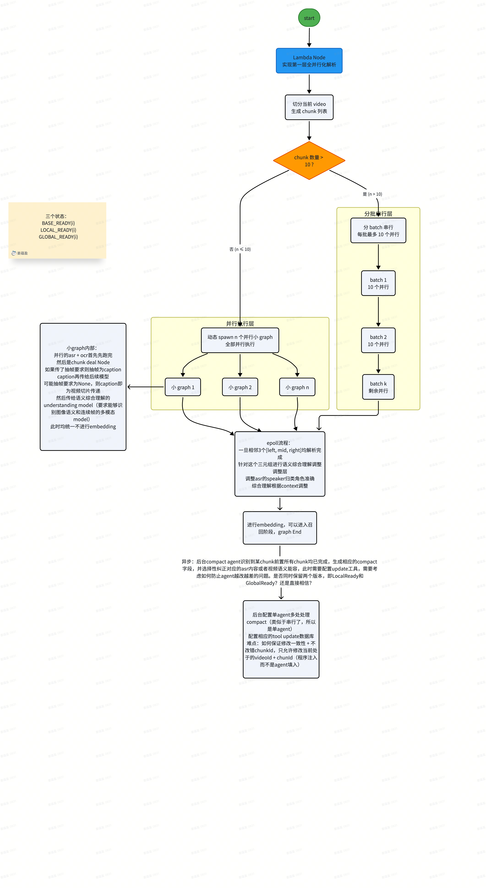
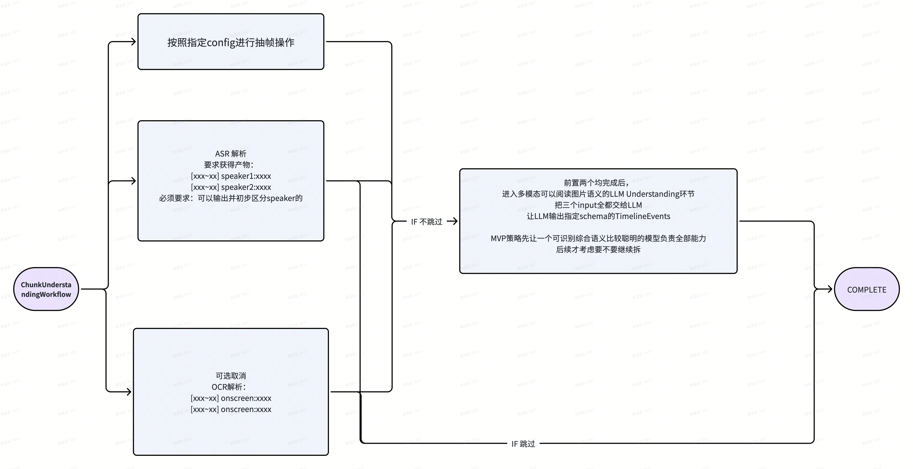

> **当前解析任务设计基线：2026-10-14，已确认、待实现。**
> 本次修订采用 `ChunkTask + phase + status`：现有 Chunk 任务合并承担 Parse 与 Index，
> Interval 任务只承担跨 Chunk 的 Refine；不新增 `ChunkIndexTask` / `chunk_index_task` 表。
> 服务级 Video 并发 3、每 Video 的 Parse / Refine / Index 各 10，由配置及 MySQL 原子领取保证。
> 后续任务模型、调度与恢复以本文件修订后的合同为准，取代旧版“Interval 承担索引”及独立 Index 表提案；
> 历史流程图、交接和 `docs/design/refactor_2.md` 中冲突的同类条目不再作为实现依据。
> 本次仅更新设计文档，不表示 ORM、Worker、接口或数据库迁移已经完成。
> Prefix 是否纳入首次 COMPLETE 的等待条件仍待确认，见 1.8；不能将建议写成已批准的行为。

> **Event 投影最终合同（2026-10-17）**：以 [Sub-Chunk / Event TRD](../../../server/design/sub-chunk-trd.md) 为准。保留 Chunk 的完整有序 Timeline，不新增 Event / Frame SQL 表或 Frame Index；全部覆盖 Refine 提交后，由既有 Chunk INDEX 派生独立 Event ES 的词法、文本向量及抽帧视觉向量，不增加 Agent 写库回调、任务或队列。有效 Event 目标首次 INDEX 冻结在 VideoParseTask.detail，不改变 ParseConfig；完成需核验同版 Chunk/Event，含空集合与存量回填。

一整个agent for：一个video解析
要求：engine提供内部schema
不管engine怎么换策略，我们同一套agent harness都可以被复用填写同样的schema内容

# 零、宏观设计架构
整体：parseAgent（就被叫做这个）
内部是一整套harness system

由langgraph实现的一个graph
Graph 是 Agent 内部的执行程序，RunState 才是状态。现有 Chat 也是这样：没有公开的 ChatGraph，只有 Runtime 内部的私有 _graph。
agent/chat/video_search/runtime.py:119

上图保留为原始讨论素材；固定数字、旧事件及调度位置不作为执行合同，以本文件当前主链和源码为准。

有一个必须执行的前置`VideoParsePrepare`
node 执行的操作：
1. 读取 Video 已持久化且固定的 `VideoChunk` 拓扑；首次 Prepare 尚未生成时，按照 Video 的固定 Chunk 生成合同仅持久化顺序和 `[start_seconds, end_seconds)` 边界，后续解析任务复用同一批 `VideoChunk`
Chunk 媒体不持久化；Worker 执行任务时从 `video.original_source_uri` 解析原视频，通过 FFmpeg 将所需 Chunk / AnalysisWindow 生成到当前 Task / Lease 隔离的临时目录，本次任务的媒体消费结束后清理，失败重试时重新生成
临时路径不进入 DB、Checkpoint 或 RunState；正常完成、取消和 Lease 丢失时主动清理，进程强杀或断电留下的过期目录由 Worker 启动和周期 Reaper 在确认 Lease 失效后清理
持久化 Chunk / Interval 拓扑，供 Repository 成果事务及 DB Queue 后续扫描使用
根据 input config 中的 `chunk_duration` 和 `interval_duration`，动态计算区间所需的 Chunk 数量 `interval_size`
2. Prepare 完成后进入 ChunkScheduler；Interval readiness 由成果事务维护，DB Queue 扫描并原子领取

随后进入`ChunkScheduler`
3. 根据切片结果划分出batch，batch之间几乎强串行
4. 通过一定指数避让stream式对各个chunk依次并行执行 understanding（第一层单chunk解析）
随后进入`ChunkUnderstandingWorkflow`
Understanding 可读取原 Chunk 前后各 `visual_input.context_overlap_seconds` 秒的视觉上下文，首尾裁剪到原视频边界；
ASR 音视频、OCR、Canvas 写入及最终索引仍限定原 Chunk。额外画面只辅助理解，不创建相邻 Chunk 的重复事件。
5. 当前 batch 至少 90% 已提交 Understanding 成果时，开启下一 batch 的 stream 式 understanding，不等待索引

声纹功能开启时，已提交 Understanding 的 Chunk 数达到 `ceil(chunk_count × 0.75)`，
Video 协调器便调用独立的 `VoiceprintAgent`；不等待全部 Chunk，剩余 Understanding 继续按原队列规则执行。
本次准备固定当时全部已提交成果，不再按 sequence 截取最前面的固定数量 Chunk，
从中读取人物和台词，优先跨可用来源的前、中、后区域和不同 Chunk 分散取样；完成工具校验严格多数覆盖及不足目标人物的原因，
提交 `detail.voiceprint.ready=true` 后放行 Refine。单人物采集不足目标不额外阻塞就绪，不能为凑数等待后续 Chunk。
声纹关闭时保留原有流程；90% 批次开放条件与 75% 声纹启动条件互不替代。

然后由 DB Queue 扫描持久化 Interval 就绪状态：
成员基础成果齐全、尚未提交 Refine，且声纹功能关闭或当前任务 `detail.voiceprint.ready=true` 的区间，
由 Worker 原子领取后调用 Agent 纠偏，增加 context 优化逻辑
Interval 的 Refine 成果提交后进入 `COMPLETE`，不再承担索引状态。
对每个成员 Chunk，等所有包含它的 Interval 都已提交 Refine 后，将同一 ChunkTask 推进到
`phase=INDEX, status=QUEUED`，再领取并执行 Event 派生持久化、embedding 与 Chunk/Event ES 索引。
单 Chunk 的 `ChunkUnderstandingWorkflow` 仍在基础解析成果提交后结束；后续 Index 由同一任务行的下一阶段执行。

然后最后异步的后台`PrefixContextAgent`：
对于当前chunk， if其前置的所有chunk全部被解析成功，参照v1逻辑维护其compact字段内容维护其前置背景，并可以根据compact context来修改相应的asr或者别的信息微调，然后相关内容需要重新embd

## 0.1 必须要考虑的风险

由于并发带来了效率，也带来了可能的大量成本浪费——当进程在任何时候异常中断时，我们都应该主动尝试对每一个model api调用尝试强制中断，防止大量并行调用浪费token和金钱，同时得不到我们系统的统计
用户的钱会莫名其妙的消失还trace不到（没错我的钱会这样！好好给我节约啊！）
因此这样的全局LLM api调用需要加一个切片，来用一个全局单例统一管理并可以执行中断
这个是引入并发的代价

## 0.2 Harness input config

整体 Harness 接收统一的 input config，创建任务时将本次实际采用的配置固定保存到 `video_parse_task.parse_config`。
Prepare、Scheduler、Workflow、宿主 Worker 和后台 Agent 均从该配置快照读取所需参数，重试与恢复复用同一份配置。

配置范围包括：

- `chunk_duration`、`interval_duration`：分别为 Chunk 时长和预期 Interval 时长，单位为秒。
- `batch_max_size`、分发间隔：控制 Chunk 批次开放与启动间隔，不充当阶段并发上限。
- `execution.parse_concurrency / refine_concurrency / index_concurrency`：每 Video 三个阶段分别限流，当前目标各为 10。
- 抽帧策略、OCR 开关、compact 开关。
- 重试次数、退避和调用预算。

模型连接及调用参数复用上游已有配置，由应用装配模型调用器后注入 Harness，具体见 1.9.4。

`chunk_duration` 用于首次建立 Video 的固定 Chunk 拓扑；已有拓扑时校验配置兼容性，后续解析继续复用原拓扑。

## 0.3 已确认的主链与索引放行（2026-10-14；2026-10-17 补充声纹准备及 Event 投影）

以下记录目标执行合同；真实 Worker、数据库及模型接线仍需实现。

~~~text
VideoParsePrepare：固定拓扑与配置，建立 ChunkTask / Interval 子任务
  → ChunkScheduler：按已提交理解成果开放批次；达到本批 90% 后开放下一批
  → Chunk PARSE：保存基础成果 + 初始 scope + Interval ready_mask + REFINE/WAITING，同事务提交
  → VoiceprintAgent（声纹开启时）：至少 75% Chunk 已提交理解后准备参考，剩余 PARSE 并行继续
       固定当时全部已提交来源快照 → 分散取样与工具登记 → 严格多数 speaker 覆盖校验 → 提交 ready=true → 唤醒
  → Interval Refine：自身成员基础就绪，且声纹关闭或当前 task 的 ready=true
      内容修改 + scope 并集 + Interval 成果 + Interval COMPLETE，同事务提交
      同事务检查本窗口全部成员，将全部关联 Refine 已完成的 Chunk 推进到 INDEX/QUEUED
  → Chunk INDEX：领取同一 ChunkTask，读取当前有效内容及版本 → Chunk / Event Projection
      校验租约并绑定/读取 task.detail 冻结的 Event 目标 → 抽临时帧 / 编码复用 → Chunk / Event ES
  → 核验来源版本、预期 Event 集合及查询可见性，记录发布版本，Chunk INDEX/COMPLETE
  → Video 汇总
~~~

索引按每个 Chunk 的关联区间放行，不等待整集解析完成。新版 Interval 的 `COMPLETE` 仅表示 Refine 成果已提交，
所以等待全部关联 Interval COMPLETE 不再包含等待索引，不形成循环依赖。
成果保存与 Chunk 阶段推进必须在同一事务内完成；通知仅用于加速唤醒，数据库扫描独立保证恢复。
等待依赖不计失败、不消耗重试次数，也不占 Chunk 执行租约。区间、`scope` 和短窗口规则见下方
[Interval 区间、scope 与索引放行](#interval-区间scope-与索引放行)。

## 0.4 并发容量的唯一执行机制

| 层级 | 配置归属及当前目标 | 原子领取时统计的执行对象 |
| --- | --- | --- |
| Video | 服务级 `video_concurrency=3`，不写入每个 Video 快照 | `detail._worker_runtime_v2.capacity_acquired=true` 的 VideoParseTask |
| 单 Video Parse | 快照 `execution.parse_concurrency=10` | Chunk `phase=PARSE, status=RUNNING` |
| 单 Video Refine | 快照 `execution.refine_concurrency=10` | Interval `status=REFINING` |
| 单 Video Index | 快照 `execution.index_concurrency=10` | Chunk `phase=INDEX, status=RUNNING` |

- 使用现有 MySQL、任务租约与短事务，不引入 Redis 限流 key。内存仅保存执行句柄、通知及可重建的轮转游标。
- 不新增调度槽位列或槽位编号。父任务在既有 `detail._worker_runtime_v2.capacity_acquired` 保存是否已取得 Video 容量的布尔值。
  跨父任务准入共用一个短 MySQL 命名锁，持锁期间读取最新占用数、检查服务配置上限、写入容量标记及领取租约，
  事务提交后才释放命名锁。所有准入入口共用同一锁和规则；容量标记就是已取得的容量，不是第二道派发许可。
  不在代码或 SQL CHECK 中写死 3，命名锁和事务均不覆盖模型调用。
- 领取子任务先锁父任务行，按一致锁顺序检查候选、依赖、阶段容量并写入租约；所有领取入口使用同一规则。
  活跃数量使用锁内最新状态，失效执行权经回收后才释放名额，不能在事务外 count 后无条件 update。
  数据库锁不覆盖模型调用；不同阶段分别计数，Parse 满额不阻止就绪的 Refine 或 Index。
- 恢复已取得容量的任务和未完成成果优先于接纳新 Video；父协调器失联时沿用原容量标记，不能先清标记再遗漏仍持租约的子任务。
  完成或失败收口后移除容量标记；只等待外部依赖且无在途执行时可释放容量，依赖满足后按持久化状态重新准入。
  下调容量时等待现有占用数降至新上限以下再接纳新 Video，不强行取消有效执行。
- 已准入 Video 和阶段轮转获取执行机会，不使用固定的 Parse 优先返回规则使后续阶段长期饥饿。
- Agent 定义唯一的业务就绪、顺序与完成规则；Server Queue 负责事务、行锁、领取、租约及持久化，不复制业务算法。
- 长时间模型/媒体执行与数据库控制、心跳使用隔离的执行通道，保持调用上下文传播；执行容量跟随配置。
  移除 ASR 参数对整个 Consumer 或整个 Video 模型调用的错误限制，不能再引入隐藏的共享 4 路瓶颈。
  模型管理器的取消、租约、用量和累计调用预算继续保留；供应商配额如需限流，应使用明确的独立来源配置。

上限限制的是被系统授予执行权的任务数，不保证依赖不足时始终跑满，也不承诺失联后远端供应商立即停止计算。

# 一、聚焦架构
## 1.1 `PrepareVideoParse`

input args：
`input config`（包含 `chunk_duration`、`interval_duration` 等）
`seriesId + videoId`
获取到相应的video后进行chunk的生成，每一个chunk有自己的Id，按照顺序生成，chunk的综合唯一标识id即为拼接结果

1. 根据 `videoId` 读取固定的 `VideoChunk` 拓扑；首次 Prepare 尚未生成时，按照 Video 的固定 Chunk 生成合同仅持久化顺序和时间边界
不持久化 Chunk / AnalysisWindow 媒体；Worker 按 Task / Lease 从原视频生成隔离的临时输入，并在本次任务的媒体消费结束后清理
持久化 Chunk / Interval 拓扑，供 Repository 成果事务及 DB Queue 后续扫描使用
根据 input config 中的 `chunk_duration` 和 `interval_duration`，动态计算区间所需的 Chunk 数量 `interval_size`
2. Prepare 完成后进入 ChunkScheduler；Interval readiness 由成果事务维护，DB Queue 扫描并原子领取

Interval 从起点 Chunk 开始取连续的 `interval_size` 个 Chunk；例如 Chunk 为 20 秒、Interval 为 60 秒时，每个区间需要 3 个 Chunk。
以 Chunk 序号表示区间时，`s = start_sequence_no`，`e = s + chunk_count`，成员满足
`s <= sequence_no < e`，即半开区间 `[s, e)`；`e` 由已有字段计算，不新增持久化字段。
设本视频有 `n` 个 Chunk；`n >= interval_size` 时，窗口起点为 `0` 到 `n - interval_size`，
只建立完整滑窗，首尾 Chunk 均被覆盖，不另加尾部短窗。
`0 < n < interval_size` 时建立唯一缩短区间 `[0,n)`，照常执行 Refine 和索引。
Prepare 持久化各区间的起点和实际成员数量，Repository 据此定位成员及其 mask 位；
准备恢复与重试使用同一规划规则，不能把短视频视为零 Interval 并直接判定完成。

Interval 的成员关系和 `ready_mask` 由数据库保存，不另建 Agent 内存状态表。
DB Queue 扫描满 mask 的 Interval，在领取事务中重新检查 readiness、父任务和租约，
声纹开启时还须满足当前任务 `detail.voiceprint.ready=true`；未满足则保持 WAITING、不占执行槽或失败预算。
Worker 领取成功后调用 Refine，重复扫描不能重复提交。
这里的 bitmap 只表示成员基础解析就绪，与供 Agent 读取的 `scope` 分开。

`output`:
chunk_list

## 1.2 `ChunkScheduler`

根据固定 `chunk_list` 和快照 `batch_max_size` 划分批次，按已提交理解成果的 90% 门槛开放下一批。
队列、执行阶段和恢复点均保存在数据库；不要求额外内存 hashmap 或派发许可才能恢复任务。
`execution.parse_concurrency` 控制该 Video 的理解并发，`dispatch_interval_seconds` 控制启动间隔；
批次大小与执行并发不再混用。具体原子领取机制见 0.4，调度规则见 1.7。

## 1.3 db queue的选型
每一个chunk和interval需要设置相应的db table，原因在于并发解析一次中断可能有十几个checkpoint需要恢复
并且并行并发前提下谁最先开始根本就不重要，所以我们更需要的是select xxx where status=$our_target_status 的item继续放进worker作为task继续处理

但是chunk和interval一个table就够了吗？
还是对于chunkId额外存储分成两个table，一个用于持久化解析结果，另一个用于标识解析任务state？
或者如果我们要拆表，以后还可以进行refactor？

不，考虑语义的拆分，我们应该分成两个table——一个负责任务时的state流转，另一个负责最终成果的存储
两个table：
chunk_task（由现有 chunk_parse_task 原位演进）
——> chunk_parse_content

ChunkTask 负责 Parse 与 Index 的阶段、执行状态和恢复；content 保存当前有效解析成果及可复用的 embedding checkpoint。
每次针对一个 Video 发起的解析由 `video_parse_task` 记录，其 `id` 即本次解析的任务 ID。
Chunk、Interval 任务通过现有 `video_task_id` 关联 `video_parse_task.id`；Chunk 任务负责理解和索引，
Interval 任务只负责跨 Chunk 的 Refine，主任务汇总完成情况。
视频本身由 `video_parse_task.video_id` 关联。
因为一个video后续可能可以重新解析，是按照新添加任务的方式，还是旧有video_parse_task重新再执行一次的语义方式？（失败重试：继续同一个 video_parse_task_id，复用已完成成果。
用户重新解析、修改解析配置：新建 video_parse_task，增加 version。）

## 1.3.1 相关db model设计确定

### `video`

复用现有 `video` 表保存视频基础信息，每次解析通过 `video_parse_task.video_id` 关联同一个视频。
以下为 V2 重构目标：以 [`VideoRecord`](../../../server/model/video.py) 的现有字段为基础，
移除 `upload_sequence`，统一使用 `episode_order` 表示作品中的实际集数。
上传状态由上传任务维护；Chunk 任务维护理解及索引，Interval 任务维护 Refine，
`video_parse_task.status` 汇总整集状态，不要求维护解析百分比。

~~~text
id                     VARCHAR(36)    NOT NULL  PK
series_id              VARCHAR(36)    NOT NULL  所属 Series
episode_order          INT            NOT NULL  实际集数，由文件名识别，允许用户修正
filename      VARCHAR(1024)  NOT NULL  上传时的原始文件名
source_uri    LONGTEXT       NOT NULL  持久化原视频地址，Worker 据此生成临时媒体
inference_proxy_uri    LONGTEXT       NULL      推理代理视频地址，沿用现有可空字段
content_hash           VARCHAR(64)    NOT NULL  原视频内容 SHA-256
total_bytes            BIGINT         NOT NULL  原视频大小，单位字节
duration_seconds       BIGINT         NOT NULL  原视频时长，单位秒
created_at             BIGINT         NOT NULL  Unix 毫秒时间戳
updated_at             BIGINT         NOT NULL  Unix 毫秒时间戳

FK (series_id)
  -> series(id)
  ON DELETE CASCADE

UNIQUE (series_id, episode_order)
UNIQUE (series_id, content_hash)

CHECK (episode_order > 0)
CHECK (total_bytes >= 0)
CHECK (duration_seconds > 0)

INDEX (series_id)
~~~

集序的确定与重构约定：

- 创建上传会话前，以 `original_filename` 和 Series 名称为输入，交给 Agent 快速识别集数。
  明确识别到正整数时直接采用；无法确定时返回空结果，由用户填写后再创建会话。
  确定的 `episode_order` 从上传会话传递到最终的 `video` 记录。
- 同一 Series 内的集序必须唯一；识别结果冲突时要求核对或修正，不再通过 `next_order`
  自动递增集数。同一次上传的重试复用已确定的集数，避免重复调用 Agent。
- 用户可以修改集序，修改时继续校验正整数和同 Series 内的唯一性。
  需要按视频顺序调度或展示时，统一使用 `episode_order`。
- 现有实现仍包含 `upload_sequence`；后续落地时，上传会话、Video 写入、接口字段和队列排序
  对它的依赖需一并调整。这里记录目标字段设计，实际模型与数据库迁移另行实施。

`created_at`、`updated_at` 沿用现有模型的字段名和毫秒类型。

### 上传任务（`upload_session`）

现有上传任务由 [`UploadSessionRecord`](../../../server/model/upload.py) 承担，表名为 `upload_session`，
上传状态由其 `status` 维护。V2 为上传任务增加以下扩展字段：

~~~text
detail                 JSON           NULL      任务扩展数据，可选 progress 表示上传进度
~~~

`detail.progress` 为可选整数，范围为 0～100，由上传任务根据已确认上传的字节数更新。
例如 `{"progress": 60}` 表示已上传 60%；缺省表示未提供进度。
该值仅用于展示，上传任务是否完成以 `status` 为准。

上传会话只在既有 `parse_config` 保存一份有效 V2 配置，用于上传完成时创建解析任务；
删除与它重复的 `video_parse_config` 列。请求边界兼容旧字段别名，但同时传两套配置时拒绝。
旧 Server profile 只在接纳入口转换一次，不能丢失直接 V2 请求中的 OCR、Refine、Prefix 等配置。
新上传只创建 V2 任务；历史 V1 任务保持可读和可清理，不再保留新建 V1 的分支。

### `video_chunk`

~~~text
id                              VARCHAR(36)    NOT NULL  PK
video_id                        VARCHAR(36)    NOT NULL
sequence_no                     INT            NOT NULL
start_seconds                   BIGINT         NOT NULL
end_seconds                     BIGINT         NOT NULL
create_time                     TIMESTAMP(3)   NOT NULL  DEFAULT CURRENT_TIMESTAMP(3)
update_time                     TIMESTAMP(3)   NOT NULL  DEFAULT CURRENT_TIMESTAMP(3) ON UPDATE CURRENT_TIMESTAMP(3)

FK (video_id)
  -> video(id)
  ON DELETE CASCADE

UNIQUE (video_id, sequence_no)

CHECK (sequence_no >= 0)
CHECK (start_seconds >= 0 AND end_seconds > start_seconds)
~~~

### `video_parse_task`

~~~text
id              VARCHAR(36)   NOT NULL  PK
video_id                  VARCHAR(36)   NOT NULL
status                     VARCHAR(16)   NOT NULL
start_time                 TIMESTAMP         NULL
finish_time               TIMESTAMP         NULL
parse_config             JSON          NOT NULL
chunk_count                INT           NOT NULL
version                INT           NOT NULL
last_error                  JSON      NULL
create_time                 TIMESTAMP         NOT NULL
update_time                TIMESTAMP         NOT NULL
is_test  TINYINT(1)         NOT NULL        是否测试
is_deleted        TINYINT(1)     NOT NULL       软删除标记
detail        JSON       NOT NULL      产品域扩展数据

FK (video_id)
  -> video(id)
  ON DELETE CASCADE

UNIQUE (video_id, version)

CHECK (chunk_count > 0)
CHECK (version > 0)
CHECK (status IN ('PENDING', 'PREPARING', 'PARSING', 'INDEXING', 'COMPLETE', 'PARSING_FAILED', 'INDEXING_FAILED'))

INDEX (video_id, status, version)
~~~

主任务以 `status` 表达阶段及结果，不维护百分比 `progress`，也不要求填写 `detail.progress`。
上述为业务字段草图；现有父任务租约字段继续保留，`attempt_count` 仅作接管/执行次数观测，不作为恢复准入或失败预算。
既有 `detail._worker_runtime_v2` 保存 `capacity_acquired` 布尔容量标记和 `prepare_failures` 非负整数失败计数；
不为这两项新增列、槽位编号、唯一约束或 CHECK。Prepare 只有真实失败才增加 `prepare_failures`，父协调器单纯接管不消耗该预算。

**声纹数据归属（2026-10-17 已接入，语义准确率单独验收）：** `video_parse_task.detail.voiceprint` 保存
`ready: bool = false` 和 `voiceprintList: list[CharacterVoiceprint] = []`，与 `detail._worker_runtime_v2` 并列。
外层解析任务已关联 video，声纹对象及人物条目不重复保存 `video_id`、`video_parse_task_id`。
本视频全部 Chunk 共用本轮参考集合，不按 series 共享，首版不自动跨 video 复用。
每个人物条目保存 `speaker`、`model`、`references` 和 `confidence`；`model` 记录实际模型及 encoder revision，
不能只记录可变的配置别名。`confidence` 是 Agent 对参考人物归属的主观评估，可为空，
不代表经过校准的概率或声音相似度，也不能单独作为可靠参考的准入依据。
`references` 是该人物的原音频参考片段列表：每项保存 `chunk_id`、`start_ms`、`end_ms`、
该片段的 192 维 `vector`、来源内容版本、事件指纹、PCM SHA-256、时长及确认依据。时间采用视频内绝对毫秒。
每段向量与其来源绑定，比较时逐项排除目标自身、重叠音频及重复音频后，再汇总人物候选；
不以单个人物平均向量替代这些片段记录。
同一人物可追加多个独立台词参考。首版以每人 6 条为默认采集目标，唯一数值来源为
`server/constants/parse.py` 的 `VOICEPRINT_REFS_PER_SPEAKER`；宿主通过工具返回 `target_refs_count`，
Agent 不另写目标数。人物归属可靠、单人有效发声和清晰边界优先，再尽量丰富场景、台词和说话状态，
先查看各人物出现的 Chunk 及 sequence_no，在其可用来源中轮流选择时间相隔较远的前、中、后段，
优先每个不同 Chunk 取一条，再从同一 Chunk 补充独立台词；人物未出现的区域不强求覆盖。
不设置情绪配额，也不使用低质量样本补数。不设置每人登记数量硬上限，
既有工具调用和时间预算内允许追加有价值的独立参考；来源不足或预算接近耗尽可说明缺额后收口。
`ready` 对应本轮 `voiceprint_prepared` 语义，不再另存 `detail.voiceprint_prepared`。
Agent 通过完成工具控制就绪：宿主检查当前父任务执行保护、来源有效性、严格多数 speaker 覆盖率及缺额说明，
在同一事务内提交参考集合及 `ready=true`，
只有提交成功才对外就绪，之后再唤醒调度器；模型文本声明完成不会改变就绪状态。
本轮 speaker 名单为空时，零参考可正常完成为 `voiceprintList=[]`、`ready=true`；名单非空时必须达到下述多数门槛。
新解析任务初始化为 false，不能继承旧任务的标记或参考。
登记工具逐条写入当前任务的 `voiceprintList`，准备期间保持 `ready=false`，不另存 runtime 暂存参考副本。
Refine 只读取 `ready=true` 的参考集合；新尝试在父租约保护下重建未完成的集合。
声纹功能开启时 Refine 准入为 `interval_ready && detail.voiceprint.ready`；关闭时沿用原准入条件。

VoiceprintAgent 是现有 Video 协调器调用的异步准备阶段，不是独立领取的任务，没有自己的租约。
不建立独立声纹任务状态机、租约或 Worker；宿主复用父任务的执行保护、取消、超时和模型用量记录。
正式声纹只存于 `detail.voiceprint`；父协调器的 `detail._worker_runtime_v2.voiceprint_preparation`
仅记录当前尝试的 `active`、父 `lease_version/worker_id`、固定 `source_chunk_ids/speaker_list` 和有限 `failures`。
这些是当前尝试的恢复事实，不保存向量或另一份声纹成果，不引入声纹专属租约。
有限重试与重启恢复属于父任务协调职责，不能仅靠 `ready=false` 或进程内状态实现。
接入时须在本准备阶段范围内补齐父任务 `PARSING` 期间的有限失败与中断恢复：实际执行异常、超时及执行中断
按持久化预算退避，耗尽后进入既有失败收口；正常等待和正常取消不计业务失败，成功后的唤醒异常不计准备失败。
`retry_video()` 已补齐 `PARSING` 且声纹未就绪时真实异常的有限预算，包含首次准备事务失败、尚未写入 active 的情况。
过期回收和延后释放仅对 active 准备计失败；普通等待不计失败。正常取消先清 active，不扣预算；
超时但原生调用尚未退出时保留既有执行槽，真实退出后释放并计一次失败，不提前关闭编码器或删除在用音频。
准备事务使用现有 run_blocking 追踪；取消若先于事务绑定，真实退出回调会再次 stop，先清 active 再由 Consumer 释放，防止正常取消误扣失败。
人工 retry 重置本准备预算；已提交 `ready=true` 的准备工作恢复时直接跳过，不能因后续模型文本或唤醒异常重做。

<!-- 首版 balance：按 Agent 提供的 speaker 名称登记参考，不实现同一人物不同名字的实体归一、
别名合并或额外身份判断调用，以控制实现范围与模型成本。接受同一人物分成多个姓名候选、
参考被拆散及候选差异变小的代价，证据不足时保留未知。
来源登记幂等，以及目标自身、重叠音频和重复音频的自我比对排除仍须保留；这些约束不承担姓名归一。
登记实现旁已保留此取舍说明。 -->

**准备来源、工具与完成门槛（2026-10-17 已接入）：**

- 声纹开启时，ChunkScheduler 观察到 `understanding_committed_count >= ceil(chunk_count × 0.75)` 即进入准备。
  统计已提交理解成果，不以领取数、RUNNING 或全流程 COMPLETE 代替。Scheduler 与 Repository 共用门槛计算，
  固定本次准备开始时全部已提交成果，快照可以超过门槛数量；同执行恢复按原来源集合校验完整性，
  后续新增 Understanding 不扩大本轮名单，也不重复触发准备或整轮 Refine；全视频完成仍须全部理解及后续阶段完成。
  固定范围以单次准备尝试为单位；失败重试重建未完成集合时，清理未发布参考并从当时已提交成果重新绑定一份来源/名单快照，
  不混用不同尝试的分母和参考，且不重置父任务的有限失败预算。
- `get_speaker_list()` 由宿主绑定当前 task 和来源快照，无须 Agent 传 video ID。
  程序遍历这些 Chunk 的 timeline，仅提取 `event_type="DIALOGUE"` 且 speaker 非 null、非空白的记录，
  按现有人名去重，返回 `speaker_list_size`、最少登记人数、各人物出现的 chunk 引用，及每人的
  `refs_count`、`target_refs_count`、`references=[{source_ref,start_ms,end_ms}]`。参考数只计当前有效独立来源，
  已登记来源摘要不向 Agent 暴露向量；`source_ref` 复用 `chunk_id:event_fingerprint`，可与 sources 台词对应。
  persons、participants、visible_persons 中仅被提及或出镜的人物不计入名单，不在此做别名归一。
- 读取 Chunk content 时不连带加载 detail 中的索引向量；一次扫描建立人物到 Chunk 的索引，
  复杂度为 `O(timeline_event_count)`，额外空间为人物数与人物-Chunk 关系数，不引入 ES、缓存服务或新表。

VoiceprintAgent 使用以下五个工具，复用已有工具适配层，不修改 Canvas 框架。
提取与比较首版复用已接入 Gateway 的 CAM++ CPU 路径，同轮调用复用编码器实例，不另建推理服务或扩展 Ollama。

| 工具 | 输入与宿主职责 | 结果 |
| --- | --- | --- |
| `get_speaker_list` | 无 video/task 参数；程序聚合本轮固定来源名单及登记情况 | 人物、出现的 chunk、每人 `refs_count/target_refs_count`、已登记来源/区间、`speaker_list_size`、有效登记人数及门槛 |
| `get_context_canvas` | 来源引用、集合及分页/范围；只读 sources/members/evidence/background | 具体台词、人物/ASR 证据；登记回执返回参考元数据，名单工具返回覆盖情况，不向模型返回向量 |
| `register_voiceprint` | source_ref、speaker、start_ms/end_ms、selection_basis、confidence，可选 replace_source_ref；宿主预检授权子区间、独立来源和全人物区间交叉，随后临时截取 16k mono PCM16 并调用 Gateway；新 embedding 成功后事务内追加或替换单条 | 同人可超过采集目标；显式替换允许同来源改为更准确子区间，失败不先删旧条；回执登记进度及来源，不返回向量；拒绝以 `message/retry_hint` 指导重选，清理临时音频，不接收 Agent 路径或向量 |
| `unregister_voiceprint` | source_ref；宿主在当前未 ready 的任务内事务撤销单条，重复撤销幂等 | 返回撤销结果及更新后的进度；不改 timeline、不改人物标签，不新增声纹运行时副本 |
| `finish_voiceprint_preparation` | 完成请求及 `skip_reasons`；同事务读取当前参考，重验来源、组内声音一致性、覆盖率和缺额原因，再提交 ready | 显著异常返回 ready=false、可疑来源/区间、candidate_mean 和修正提示；不能用 skip_reasons 跳过仍存在的异常，不静默删除或改标签 |

登记的区间使用绝对毫秒半开区间 `[start_ms,end_ms)`，与本轮任一人物已登记参考满足
`new_start < old_end && old_start < new_end` 即交叉，拒绝登记；首尾相接允许。
精确重复请求返回已有登记、`added=false`，不重复截音、提取或增加计数；同一 `source_ref` 的其他子区间
即使互不重叠也不视为独立 case，提示换另一条台词；显式 replace_source_ref 才允许替换旧条，事务检查排除被替换条后仍须满足其余去重规则。
不同 Chunk 优先，同 Chunk 的不同独立台词仍可登记。替换与幂等单条撤销只允许在 ready 前执行，ready 后参考保持静态。
不同来源若截取后的 PCM SHA-256 完全相同，最终登记也拒绝，避免重复音频占用独立样本名额；不引入额外声学查重。
重叠、来源复用属于可修正工具反馈，消耗工具调用预算但不计准备执行失败；
宿主沿用现有反馈通道给出冲突来源/区间及重新选择独立、非重叠台词的提示，不新增异常恢复框架。

定义 `registered_speaker_count` 为名单内至少有一段当前有效参考的人物去重数，
不是参考片段数或 voiceprintList 原始长度；重复登记、空 references、失效来源及名单外名字都不能增加覆盖数。
完成条件为：

~~~python
ready_allowed = (
    (speaker_list_size == 0 or registered_speaker_count * 2 > speaker_list_size)
    and not missing_reason_speakers
    and not suspect_references
)
# 人数门禁在非空名单下等价于 registered_speaker_count > speaker_list_size * 0.5
# 非空名单最少登记人数为 speaker_list_size // 2 + 1；6 人需 4 人，11 人需 6 人；空名单为 0。
~~~

这是严格 `>`，不是 `>=`，也不是登记人数大于整份 `speaker_list_size`。
允许跳过 NPC 或没有合格参考的人物，不创建空声纹占位。名单内所有有效独立参考数不足目标的人物
（包括零参考）都须提供非空 `skip_reasons`，说明可靠来源不足或本阶段预算接近耗尽等真实原因；
原因缺失则返回 `missing_reason_speakers`、当前 `reference_counts`、目标和提示，不提交 ready。
原因齐全、无组内显著异常且具参考人物严格过半即可完成，不要求所有人物都达到 6 条；空名单无缺额，可零参考完成。
没有可靠替代时可显式撤销可疑条并提供缺额原因，但原因不能绕过仍登记的显著异常。
缺额说明随工具结果返回，不另建运行时成果副本；说明本身不证明全部来源已穷尽，不增加额外审计流程。
名单非空且覆盖率不超过 50% 时不能提前完成；Agent 可继续登记或按有限阶段预算进入既有失败收口。
此多数门槛取代此前“无论名单是否非空，零参考处理完即可 ready”的约定；不要求覆盖全部人物。
Agent 达到多数覆盖后仍应在固定来源和预算内补充多参考，并在预算耗尽前主动收口；
模型、截音、数据库错误及实际预算耗尽仍属执行失败，不得以“无法收够目标”吞掉。

完成前的一致性检查只读取当前任务已存向量，按同 speaker/model/revision 分组，排除自身、重叠及重复 PCM。
逐条计算当前参考与同组其余参考的 cosine 均值 candidate_mean，排除当前参考自身。
实验默认至少 5 条独立参考，仅以 candidate_mean <= 0.50 阻止本次完成，不再使用 core_mean 或 gap 条件；
数值唯一来源为 `server/constants/parse.py`。少样本不阻止原有收口，不强制每组剔除最低，不自动改姓名。
返回来源/区间、candidate_mean 和修正提示，不持久化矩阵或 runtime 缓存，不调用 Gateway；反馈消耗原有限工具预算。
低均值请求复核，不能直接证明人物归属错误。这是异常提示规则，非概率或经泛化校准的身份准确率；
整组错名、多条错标成团仍可能通过，不能承诺全片识别正确。

Refine 另装配 `compare_speaker(start_ms, end_ms)`，不受视觉模型能力开关限制。
宿主绑定当前视频、任务及 Refine 读取范围，与本次 ready 集合中模型版本相容的参考比较；
排除目标自身、重叠区间和重复 PCM，返回候选 speaker、余弦相似度、候选差异、参考来源及必要的时长/质量信息。
相似度不是概率；工具不改 timeline，Refine 对 null 或有姓名但冲突的台词通过现有 Canvas 判断和修改，证据不足保留 null。
约定：准备成功后，登记的声源 speaker 与音频区间视为正确的静态成果。
Refine 读取和提交均不再对照可变 timeline 重验来源；后续文本、speaker 或时间编辑不使参考失效，
也不因此触发 Refine 重算。不自动改旧参考姓名、不重置 ready 或触发整轮后台纠正；比较引用只用于诊断。

实现接线沿用 Refine 范本：Server 感知持久化进度并调度，Agent 提供被调用的业务入口。
这些入口统一命名为 `ParseAgent.InvokeVideoParse`、`ChunkUnderstandingWorkflow.InvokeUnderstanding`、
`IntervalRefine.InvokeRefine`、`PrefixContextAgent.InvokePrefix` 和 `VoiceprintAgent.InvokeVoiceprint`；
内部 Prepare/Scheduler 的 `run`、Server Service 入口及工具 snake_case 不改名，不增加事件总线或 Agent 事件状态表。
主 Graph 为 `load → prepare（按持久化阶段跳转）→ schedule_chunks → voiceprint → wait_for_completion`。
Callback 只唤醒；Refine 的数据库原子领取同时复核 Interval ready mask 与当前任务声纹 ready。

配置默认关闭：`parse_config.voiceprint` 缺省/null 时走原流程；开启须提供
`voiceprint={max_tool_calls,execution_timeout_seconds}`、`models.voiceprint` 生成模型与
`models.speaker_embedding={source,model,request_timeout_seconds}`。
新增可空配置字段在关闭时省略序列化，保留历史请求幂等指纹；开启后冻结在本次任务中。
Voiceprint 阶段显式执行 `execution.max_model_calls` 上限，五个工具共用有限调用预算，
复用既有 Gateway 模型调用准入、用量和取消记录；不把本阶段的硬预算改动推广到其他解析阶段。
本轮不因每人采集目标增加全局预算或改写历史任务配置；旧参考成果结构和现有归一化质心比较保持兼容。
Engine 的 `engine/parsev2/voiceprint.py` 只定义成果 Schema 和结构校验；模型推理由 Gateway 执行，
路径、截音和事务由 Server 执行，Agent 只负责参考选择及工具调用。192 维参考保存在任务 JSON，无新增表或 ES 声纹索引。

本轮索引代次保存在既有 `parse_config.indexing.index_generation` 冻结快照，不新增 `target_index_generation` 列。
任务接受后 generation 保持不变，普通 retry、索引重建和 Prefix 更新不能改变；更换索引合同通过新解析版本明确接纳。
`PARSING` 期间允许 ChunkTask 索引已满足“全部关联 Interval 提交 Refine”条件的有效 Chunk；主任务 `INDEXING`
表示必需解析均完成，仅剩索引工作。
`COMPLETE` 表示本次要求的解析和索引均已完成；具体完成条件及失败重试入口见下方状态机。
每次解析的配置、版本和错误记录也由该任务承担；`last_error` 保存失败步骤及具体原因，
重试读取各子任务的失败状态决定恢复点，主任务汇总状态不替代子任务状态，也不依赖解析错误文本。

### `chunk_task`（现有 `chunk_parse_task` 原位演进）

逻辑模型使用 `ChunkTask`；物理表同步改名时使用明确的表重命名迁移，保留原 ID 和所有成果/成员引用。
以下任务 Schema 使用现有短外键名；公共创建、更新时间字段沿用项目 `BaseModel`，不借此次迁移改变其类型。
`phase` 对应本次讨论中的枚举 progress，表示处理环节，不是百分比；QUEUE 归属于 status，不再设置重复的 phase=0。

~~~text
id                 VARCHAR(36)   NOT NULL  PK
video_task_id      VARCHAR(36)   NOT NULL
chunk_id           VARCHAR(36)   NOT NULL
phase              SMALLINT      NOT NULL  1=PARSE, 2=REFINE, 3=INDEX
status             VARCHAR(16)   NOT NULL
next_execute_time  TIMESTAMP     NOT NULL
retry_count        INT           NOT NULL  DEFAULT 0，当前阶段/目标的失败次数
lease_owner        VARCHAR(128)  NULL
lease_version      INT           NOT NULL  DEFAULT 0
lease_expire_time  TIMESTAMP     NULL
indexed_content_version INT      NULL      已确认发布的内容版本
start_time         TIMESTAMP     NULL      本次执行领取时间，每次取得新租约时更新
finish_time        TIMESTAMP     NULL
last_error         JSON          NULL
detail             JSON          NULL

FK (video_task_id)
  -> video_parse_task(id)
  ON DELETE CASCADE

FK (chunk_id)
  -> video_chunk(id)
  ON DELETE CASCADE

UNIQUE (video_task_id, chunk_id)
UNIQUE (id, video_task_id)  -- 供 Interval 现有同父任务复合外键使用

CHECK (
  (phase = 1 AND status IN ('QUEUED', 'RUNNING', 'FAILED')) OR
  (phase = 2 AND status = 'WAITING') OR
  (phase = 3 AND status IN ('QUEUED', 'RUNNING', 'COMPLETE', 'FAILED'))
)
CHECK (retry_count >= 0)
CHECK (lease_version >= 0)
CHECK (
  (status = 'RUNNING' AND lease_owner IS NOT NULL
    AND lease_expire_time IS NOT NULL AND start_time IS NOT NULL)
  OR
  (status <> 'RUNNING' AND lease_owner IS NULL
    AND lease_expire_time IS NULL)
)
CHECK (
  indexed_content_version IS NULL OR indexed_content_version > 0
)

INDEX (phase, status, next_execute_time)
INDEX (status, lease_expire_time)
INDEX (video_task_id, phase, status)
~~~

`video_task_id` 在合并后的 ChunkTask 中仍是必要的解析轮次归属：同一 `VideoChunk` 会被多个解析版本复用，
仅从 `chunk_id` 关联到 Video 无法确定本轮解析。原独立 Index 表通过 `chunk_task_id` 可推导父任务的问题，
随取消该表而消失；不在这里另加一个指向自身的 `chunk_task_id`。
发布内容版本只在 ES 精确版本核验且可检索后记录，不替代成果表维护的当前内容版本。
Chunk 不重复保存 `indexed_generation`；其 generation 从不可变的父任务配置快照推导。
`COMPLETE` 还必须在事务中验证发布版本与当前内容及父目标 generation 一致，不能仅靠非空字段判断。
执行期限由本次 `start_time` 加冻结的阶段时长推导，领取和心跳均把 `lease_expire_time` 限制在该期限内；
期限仍可传入 Lease DTO 供执行器使用，不新增数据库 `execution_deadline` 列。

### `chunk_parse_content`

~~~text
id                 VARCHAR(36)   NOT NULL  PK
chunk_task_id       VARCHAR(36)  NOT NULL  FK
content    JSON         NULL          基础成果及后续 Refine / Prefix 更新后的当前有效正文
version                INT           NOT NULL
create_time           TIMESTAMP       NOT NULL
update_time           TIMESTAMP       NOT NULL
detail    JSON        NULL        里面存一点额外信息，例如相关模型配置，还有一开始识别出来的原始信息etc

FK (chunk_task_id)
  -> chunk_task(id)
  ON DELETE CASCADE

UNIQUE (chunk_task_id)
CHECK (version > 0)
~~~

`detail.scope` 保存有序、去重的 Chunk 序号列表，初始为 `[sequence_no]`；Refine 提交时原子合并
当前窗口成员，用于提示 Agent 已参考的局部范围。仅 `scope` 扩大不递增检索内容版本，也不触发重算或重索引。

2026-10-17 补充：`content.timeline` 保持完整有序的权威事实，不迁出到 Event 表。
Event ES 是按当前版本派生的检索投影；不新增 Event / Frame SQL 表，其来源、身份、时间和字段合同统一见
[Event 最终 TRD §2](../../../server/design/sub-chunk-trd.md#2-event-index-schema)。Parse 模型不生成持久化 ID。

### `interval_parse_task`

~~~text
id                 VARCHAR(36)   NOT NULL  PK
chunk_task_id      VARCHAR(36)   NOT NULL  最左侧成员锚点
video_task_id      VARCHAR(36)   NOT NULL
chunk_task_ids     JSON          NOT NULL  按顺序保存本窗口成员
start_sequence_no  INT           NOT NULL
chunk_count        INT           NOT NULL
ready_mask         BIGINT        NOT NULL  DEFAULT 0
status             VARCHAR(16)   NOT NULL
next_execute_time     TIMESTAMP     NOT NULL
retry_count        INT           NOT NULL  DEFAULT 0
lease_owner        VARCHAR(128)  NULL
lease_version      INT           NOT NULL  DEFAULT 0
lease_expire_time  TIMESTAMP     NULL
start_time         TIMESTAMP     NULL      本次 Refine 领取时间，每次取得新租约时更新
finish_time        TIMESTAMP     NULL
last_error         JSON          NULL

FK (video_task_id)
  -> video_parse_task(id)
  ON DELETE CASCADE

FK (chunk_task_id, video_task_id)
  -> chunk_task(id, video_task_id)
  ON DELETE CASCADE

UNIQUE (video_task_id, start_sequence_no)

CHECK (start_sequence_no >= 0)
CHECK (chunk_count BETWEEN 1 AND 63)
CHECK (ready_mask >= 0 AND (ready_mask >> chunk_count) = 0)
CHECK (status IN ('WAITING', 'REFINING', 'COMPLETE', 'PARSING_FAILED'))
CHECK (retry_count >= 0)
CHECK (lease_version >= 0)
CHECK (
  (status = 'REFINING' AND lease_owner IS NOT NULL
    AND lease_expire_time IS NOT NULL AND start_time IS NOT NULL)
  OR
  (status IN ('WAITING', 'COMPLETE', 'PARSING_FAILED')
    AND lease_owner IS NULL AND lease_expire_time IS NULL)
)

INDEX (status, next_execute_time)
INDEX (status, lease_expire_time)
INDEX (video_task_id, status, start_sequence_no)
~~~

### `interval_parse_content`

~~~text
interval_parse_task_id  VARCHAR(36)  NOT NULL  PK
content                 JSON         NOT NULL
create_time             TIMESTAMP   NOT NULL
update_time             TIMESTAMP     NOT NULL
detail                  JSON         NULL

FK (interval_parse_task_id)
  -> interval_parse_task(id)
  ON DELETE CASCADE
~~~

### 索引持久化边界

2026-10-14 确认：Parse 与 Index 复用同一 ChunkTask；Interval 仅保留 Refine。
本条取代旧版 Interval INDEXING 方案及新增独立 ChunkIndexTask 表的提案。

- 不新增独立 Index 任务表、Index 内容表或发布状态表，也不增加另一套派发许可。
- `chunk_parse_content` 保存当前有效成果及可复用的 embedding checkpoint；`interval_parse_content` 保存窗口 Refine 成果。
  Index 从当前正文及版本生成表示，不用旧窗口的历史产物覆盖后续修正。
- ChunkTask 以 `phase/status` 保存 Index 恢复点，以 `indexed_content_version` 记录最后确认发布的正文版本；
  索引代次复用父任务 `parse_config.indexing.index_generation`，不在子任务重复保存。
  embedding 缓存存在不等于 ES 发布成功，不增加“已向量化”“已写 ES”等并行布尔状态。
- ES 沿用稳定文档 ID 和 external version 防止旧版本覆盖新版本；DB 提交同时校验阶段、租约及内容/目标版本。
  ES 已成功但响应或数据库完成标记丢失时，先核验精确文档及查询可见性，再补记完成。
- 父任务在 `parse_config.indexing.index_generation` 保存本轮代次；模型、视觉输入及 sparse 开关等实际索引配置在接受任务时冻结。
  必要的契约指纹用于识别部署后编码规则漂移；普通 retry 不能隐式使用新的模型或索引规则冒充原代次。
- 对外检索仍以当前选定的 Video 解析任务 COMPLETE 为开放条件，索引与事实回查匹配同一任务及内容版本。
  本次没有恢复“重建期间旧版持续可检索/整版原子切换”，也没有批准局部提前开放检索。
- Index 继续复用现有宿主执行器、Engine 投影、embedding 和 ES 能力，不新增 LLM Agent。
  用量记录可沿用 Chunk 执行身份，通过阶段及租约版本区分 Parse/Index；历史 Interval 索引记录保留。

2026-10-17 Event 最终补充：继续不新增 Event / Frame SQL 表或 Frame Index；Event ES 从正式 Timeline 派生。
首次 INDEX 在父任务 detail 冻结 Event 目标；不改变 ParseConfig、不另建 Event 版本。Index 复用既有 receipt/checkpoint 证明
来源版本及预期 Event 集合完整，零条也需核验；Chunk ES 已就绪不能短路跳过 Event。
Prefix 改写正文后沿同一 INDEX 重建，Event/ES 失败只恢复 Index。旧 COMPLETE 任务的受控回填、
目标合同兼容及防旧 Worker 清理规则见 [Event 最终 TRD §3、§4](../../../server/design/sub-chunk-trd.md#4-index-发布与恢复)。

### 解析任务状态机

以下为当前目标合同，仍需后续实现与迁移；状态不能仅凭 `last_error` 是否为空判断。

~~~text
ChunkTask
PARSE / QUEUED → PARSE / RUNNING → REFINE / WAITING
                    ↓                    ↓ 全部覆盖 Interval 已提交 Refine
               PARSE / FAILED       INDEX / QUEUED → INDEX / RUNNING → INDEX / COMPLETE
                                                          ↓
                                                     INDEX / FAILED

同阶段可重试错误：RUNNING → QUEUED，设置 next_execute_time；耗尽才 FAILED。
手动 retry：FAILED → 同一 phase 的 QUEUED，重新给予有限预算。
内容更新或仅重建索引：满足解析依赖后，同一任务回到 INDEX / QUEUED。
~~~

| 阶段/状态 | 持久化含义与租约 |
| --- | --- |
| PARSE / QUEUED、RUNNING、FAILED | 理解等待、执行或失败；只有 RUNNING 持 Chunk 租约 |
| REFINE / WAITING | 理解成果已提交，等待全部覆盖窗口完成；Chunk 不持租约，实际 Refine 租约在 Interval 上 |
| INDEX / QUEUED、RUNNING、FAILED | 理解和 Refine 成果保留；索引等待、执行或失败；只有 RUNNING 持 Chunk 租约 |
| INDEX / COMPLETE | 对应当前内容及目标 generation 的索引已核验可检索 |

同一 Chunk 的 Parse 与 Index 不会同时执行，串行复用一套 lease、retry_count、next_execute_time 和 last_error。
不同 Chunk 可以同时处于 Parse 和 Index；Refine 按 Interval 独立计数，不能把 REFINE/WAITING 的 Chunk 数当作 Refine 并发数。

~~~text
IntervalParseTask
WAITING → REFINING → COMPLETE
             ↓
        PARSING_FAILED

可重试错误：REFINING → WAITING；手动 retry：PARSING_FAILED → WAITING。
~~~

Interval COMPLETE 只证明 Refine 成果已提交；Index 失败或内容重新索引不改变它的完成状态。
重叠窗口有各自的输入快照、成果、租约和重试次数；一个 Chunk 的 phase 不能代替这些独立执行身份。

#### Interval 区间、scope 与索引放行

1. **区间规划**：成员范围为 `[s,e)`；`n >= interval_size` 建立完整滑窗，`0 < n < interval_size` 建立唯一短窗。
   全部成员共同参与 Refine，不定义中心 Chunk，不改变现有窗口算法。
2. **理解提交**：同事务保存基础成果、初始 `scope=[sequence_no]`、关联 Interval ready_mask，
   将 Chunk 改为 REFINE/WAITING 并释放理解租约。工作流返回成功不等于 ChunkTask 全流程 COMPLETE。
3. **独立 Refine**：自身成员理解成果齐全，且声纹功能关闭或当前任务 ready=true 才可领取，
   不等待它们索引完成；保留重叠窗口并发，校验基准版本、内容指纹和有效租约，声纹按已准备的静态成果使用。
   提交时以输入原文 Base、最新正文 Current、本轮结果 Proposed 三方合并不同 event 的独立修改。
   本轮未修改的内容保留 Current；双方相同结果直接接受；同一 event 的不同结果按原快照冲突机制重新读取。
   双方 timeline 均变化且结果不同时，只允许唯一且有序一致的 `(event_type, start_seconds, end_seconds)` 锚点对应；
   无法对应的新增、拆并、重排、时间／类型变化及重复锚点保守冲突。persons 按整列表合并，不做 event 内字段合并。
   普通上下文变化不再一概触发重算，这是降低重复生成的取舍，不保证模型读取依赖的语义串行一致性。
4. **Refine 提交事务**：按统一锁顺序保存窗口结果、允许的内容修改、scope 并集及 Interval COMPLETE。
   Base 必须与输入指纹一致；未升版正文漂移与旧租约仍拒绝，不复核声纹来源。先独立校验 Proposed，
   再校验合并结果；仅并发组合不合法时返回快照冲突。全部成员候选验证通过后才写入，冲突不得部分提交。
   正文实际变化时递增内容版本；仅 scope 扩大不递增检索内容版本，也不触发重算。
5. **同事务推进 Chunk**：检查本窗口全部成员，不仅检查正文有变化的成员。
   对同一解析任务下每个 Chunk，所有覆盖它的 Interval 均 COMPLETE 且有有效成果时，推进至 INDEX/QUEUED。
   scope 不能代替依赖检查；成果与阶段推进不能分成两个独立提交。
6. **Index 提交**：读取当前有效正文及版本，复用输入/契约相容的 embedding，发布 ES 后核验精确版本及可见性。
   CAS 同时核对 phase、status、lease_version、内容版本及父目标 generation，才写发布版本并置 COMPLETE。
7. **扫描与补偿**：提交后可通知加速；DB Queue 依据持久化状态继续领取，周期扫描可补齐应推进的阶段及父状态。
   等待依赖不持 Chunk 执行租约、不扣失败预算，不增加另一个 bitmap 或 callback 状态机。

例如仅有 `[0,3)` 和 `[1,4)` 两窗时，C0 等前窗、C3 等后窗，C1/C2 等两窗均提交 Refine。
它们各自就绪即可索引，不必等待整集解析，也不会由两个 Interval 重复承载同一个 Chunk 的索引任务。

#### 理解已提交与全流程 COMPLETE 必须分开

- 批次 90% 门槛、Interval ready_mask 重建、实时理解读取及 Prefix 输入，应判断已提交的有效理解成果。
  不得把这些位置的旧 Chunk COMPLETE 判断机械保留为新的 INDEX/COMPLETE。
- 检索开放、索引完成数、父任务最终成功，需要核验最新版本的 Index 完成，不能统一替换成“已理解”。
- 理解成果已经提交后，即使 Index 已领取下一份租约，原理解执行也不能被心跳/计时误判为失败。
  使用成果中的阶段提交凭证或既有执行记录确认成功；凭证与成果同事务保存，不单凭任务当前状态和旧 lease_version 比较。
- 必须覆盖跨批死锁回归：前批等待跨批 Refine，跨批 Refine 等后批理解时，后批应按前批理解完成率开放，不能再等待前批 Index。

#### Video 汇总与失败收口

父任务是一个 Video 的一轮解析版本，不是 Series 或 Chunk；状态不是整集串行执行屏障。

| 主任务状态 | 含义 |
| --- | --- |
| PENDING | 已排队，等待服务容量和执行时间 |
| PREPARING | 幂等准备固定拓扑、配置及子任务 |
| PARSING | 尚有理解或必需 Refine 未完成；其他就绪 Chunk 可以同时索引 |
| INDEXING | 理解与必需 Refine 已提交，仅剩 Chunk 的索引工作 |
| COMPLETE | 预期子任务完整，所有必需 Refine 完成，所有 Chunk 的最新内容/目标代次已索引 |
| PARSING_FAILED | 准备、理解或必需 Refine 失败，且本次在途执行已收口 |
| INDEXING_FAILED | 存在 Chunk 的 Index 失败、无更高优先级的解析失败，且本次在途执行已收口；允许仍有未执行的解析工作 |

不能以“查到的任务都完成”代替核验预期拓扑完整。Prefix 的首次完成屏障仍待定，当前按 1.8 保留后台语义。

沿用 2026-10-06 的统一失败收口规则：子任务耗尽重试后先持久化失败意图，停止新 Chunk/Refine/Index 领取，
已领取执行完成有效提交或取消/回收后再发布父失败终态并释放容量。
这取代旧文中“Index 失败仍继续领取其他 Chunk”的冲突描述；已经提交的其他成果保留。
仅 expiry 到期不算收口，须完成执行权回收；父协调器失联时，Queue 独立维护事务仍能汇总并释放容量。
Prefix 的独立后台生命周期沿用既有约定，不能反转已经发布的失败意图。
多类失败并存时，父任务优先汇总 PARSING_FAILED，具体恢复点仍由各子任务阶段及成果决定。
尚未执行的解析工作不等于解析失败。Index 失败触发收口后，即使后续 Chunk 尚未理解，仍可汇总 INDEXING_FAILED；
手动 retry 后按剩余工作重新汇总，必要时回到 PARSING，而不是强制留在 INDEXING。

#### 失败、重试及内容更新

| 情况 | 身份、阶段和预算 |
| --- | --- |
| 同阶段自动重试 | 保留 phase 和已提交成果，当前 retry_count 增加，按快照退避；耗尽后 FAILED |
| 正常停机 | 停止领取，经模型管理器取消并等待实际执行退出后释放租约；不扣普通失败预算 |
| 进程异常退出 | 租约回收后恢复未完成单元；被遗弃的子执行使用有限失败预算，父协调器单纯接管不扣业务预算 |
| 成功进入新阶段 | Chunk Parse 与 Index 串行复用 retry_count，新执行阶段从零开始；lease_version 始终递增 |
| 手动 retry | 同一解析版本，仅失败阶段获得新一轮有限预算；Index 失败不退回 Parse，失败 Refine 恢复对应 Interval |
| 完整 reparse | 新建 VideoParseTask 版本及对应 ChunkTask，旧成果和任务身份保留 |

普通启动、同目标重复扫描、过期回收不得清零失败预算。手动 retry 不隐式替换模型/视觉输入快照，
保留已提交成果、相容 embedding、Prefix 已完成位置和累计调用用量；不能只改 FAILED 状态而保留耗尽的阶段重试计数。
Prepare 使用 `detail._worker_runtime_v2.prepare_failures` 保存真实失败计数，不新增专用列；
父 `attempt_count` 只作观测，不能让多次协调接管耗尽解析预算。
Queue 根据冻结配置和真实失败数计算并保存退避，返回实际结果给 Consumer 日志；
Consumer 不再用服务级参数重复计算等待时间。实时请求中的 Prepare 失败也经过同一预算入口，
显式失败意图参与父任务收口；正常取消只释放执行租约，不增加业务失败次数。
尚未正式接纳的 realtime-only Prepare 在失败等待、取消或租约过期后保留 PREPARING 及预算、退避，
无其它在途执行时释放 Video 容量；不能依赖下一次实时请求来释放空闲容量。

手动 retry 请求拟复用父 lease_version 作为 expectedLeaseVersion 条件，与 expectedJobVersion 一起在事务中校验并递增，
防止迟到的重复请求再次重置预算；不新增 retry_round 列。接口需前后端同步，旧客户端缺少条件时返回明确校验提示。

每次领取将 `start_time` 更新为本次执行的开始时间，由该时间加冻结的阶段配置时长推导截止时间；
心跳不得修改本次 `start_time`，续租到期时间不能超过该截止时间，不持久化额外的 `execution_deadline` 列。
超时后撤销执行权、请求取消并有限重试；
不能仅取消 asyncio 包装任务就视作底层模型线程已经退出。

Prefix 更新检索正文或显式重建索引时，保持理解和 Refine 成果；满足依赖的同一 Chunk 回到 INDEX/QUEUED。
正文版本变化、旧索引完成状态失效、执行权撤销及重新排队在同一事务中完成；新目标获得有限 Index 预算。
旧发布版本可以留作历史记录，但不证明新目标完成；同目标重复维护不得反复重置预算。
父状态随当前成果重新汇总；需要索引的父任务若已释放容量，重新走正常容量准入。
仅 scope/compact 元数据变化不触发重索引。

DB 与 ES 不共享事务：复用稳定文档 ID、外部版本、embedding checkpoint 和精确发布核验恢复。
已落盘成果不重做；远端调用成功但结果尚未落盘即进程退出时，不能承诺完全没有重复调用或费用。

## 1.4 异常中断恢复与 checkpoint

恢复依据任务行的 phase/status、成果版本、next_execute_time 和租约，不依赖内存许可或 last_error 是否为空。
Chunk 在 PARSE 阶段失败就恢复理解，在 INDEX 阶段失败就恢复索引；REFINE/WAITING 的 Chunk 不重做理解，
继续推进其未完成 Interval。已提交成果保留，父协调器和子任务都能从持久化状态独立接管。
索引成功但 DB 确认丢失时，先核验精确 ES 版本与可检索性，补记完成，不退回理解或 Refine。

## 1.5 `ChunkUnderstandingWorkflow`

上图保留为原始分支讨论素材；提交边界以本节为准，图中的工作流完成不等于任务行全流程 COMPLETE。
Engine 提供结果 Schema 及校验，Agent 将有效成果交给宿主 `commit_chunk_result(execution, result)`。
Understanding Prompt 明示实际视觉输入范围与原 Chunk 可写范围：原生视频局部 0 秒对应实际视觉起点，抽帧时间已是绝对毫秒。
额外上下文不能替代声音身份确认；ASR 声组可能混人，证据不足、冲突或低置信度的人物归属应保留 `speaker=null`，不勉强填名。
Server 在同一事务校验理解租约，保存正文、初始 scope、阶段提交凭证及关联 Interval ready_mask，
将 ChunkTask 从 PARSE/RUNNING 改为 REFINE/WAITING 并释放租约。
不传入 mask callback、不另开事务更新就绪信息；提交后的通知可加速调度，数据库扫描可独立恢复。

## 1.6 Interval 领取与调度

Server Queue 扫描 WAITING 且成员理解成果就绪的 Interval，在领取事务中按 Agent 的统一业务规则
重新检查依赖、父任务容量、Refine 独立并发数、已提交成果和租约；声纹开启时先检查当前 task 的 ready=true，
不满足则不领取、不占 Refine 槽、不扣失败预算，继续保持 WAITING；Worker 在事务外执行 Refine。
成员 scope 提供已参考范围；重叠窗口分别持有自己的执行身份，提交核对 Base 版本/指纹并在锁内进行 event 粒度三方合并，
不能用迟到的完整 timeline 覆盖最新正文。真实编辑冲突仍刷新快照，声纹来源编辑不触发刷新，不改变失败重试计数语义。

Refine 提交将窗口成果、正文更新、scope 并集、Interval COMPLETE 及就绪成员的 INDEX/QUEUED 推进放在同一事务。
必须检查窗口全部成员，不能漏掉“内容未变化但最后一个依赖刚完成”的 Chunk。
Index Worker 领取 ChunkTask，不再领取 Interval 的索引阶段。等待其他窗口提交不持 Chunk 执行租约、不扣失败预算。
Prefix 保留自己的后台租约及 cursor，见 1.8。

## 1.7 `ChunkScheduler`

负责一轮 Video 解析中理解任务的批次开放与顺序，规则由 Agent 提供一份，Server 在原子领取中消费。

1. **初始化与恢复**：按固定拓扑幂等创建 PARSE/QUEUED；恢复读取 DB，不重建内存许可。
   已提交的有效理解成果计入 ready_count，即使对应 Chunk 正在 Index 或 Index 失败，也不能从理解就绪数扣除。
2. **批次推进**：按快照 batch_max_size 分批，本批理解成果达到实际数量的 90% 后开放下一批。
   已开放批次的遗留理解工作继续调度；门槛不等待 Refine 或 ES，防止跨批依赖死锁。
3. **独立容量**：理解活跃数由 execution.parse_concurrency 限制，覆盖全部已开放批次；
   batch_max_size 不再兼任并发上限。Refine 与 Index 使用各自配置和计数，ASR 不限制整个 Consumer。
4. **原子领取**：按序选择 PARSE/QUEUED 且执行时间到期的任务，在统一领取事务中确认批次、间隔、容量及父状态，
   设置 RUNNING 与租约后执行。排队完成后不需要 dispatch_requested 或另一道批准。
5. **状态维护**：内存计数仅可作缓存，容量判断来自数据库锁内状态；重复通知不能增加执行名额。
   定期扫描、状态变更及到期时间均能推进工作，多个已准入 Video 和阶段有公平执行机会。
6. **观察器返回与停止**：声纹关闭时仍等全部理解提交；开启时至少 75% Chunk 已提交理解，
   观察器即可返回并由 Video 协调器调用 VoiceprintAgent，再进入 wait_for_completion。
   返回不停止剩余 Understanding 的队列领取，原 90% 批次开放仍继续；ready 已提交的恢复执行幂等跳过准备。
   失败收口按上方统一规则停止新领取；取消、超时和租约丢失通过统一模型管理器撤销执行。

## 1.8 `PrefixContextAgent`

**仍待确认的产品取舍**：是否让开启 compact 的 Video 在首次 COMPLETE 前等待 Prefix 及其修改后的索引完成。
2026-10-14 的合表设计没有批准这一行为变更；在另行确认前，保留下面的后台语义。
Prefix 尚未执行不阻塞首次完成，与 Prefix 已提交新正文后必须重新索引，是两件不同的事。

可选的后台 Agent，维护两类前置综述，并通过 Tool 按需微调当前目标记录；结果 Schema 和可修改字段由 Engine 提供。
是否启用由 input config 控制，主解析的完成判断不等待该 Agent。
前置集、综述等依赖缺失或后台执行失败时，先记录任务标识及原因日志并保留处理位置，不影响主解析完成。

- `series_prefix_compact`：同一 Series 中，当前集之前各集的综述背景，同一集内复用。
- `video_prefix_compact`：当前 Video 中，当前 Chunk 之前各 Chunk 的综述，随处理位置向前推进。

Server Consumer 通过 `run_next_prefix()` 调用 Repository 的持久化扫描与领取；Agent 只运行已领取的目标。

1. **触发**：Consumer 周期扫描持久化前置条件及游标，在受限后台槽位中领取工作。
   readiness 与独立租约由 Repository 领取事务检查，模型调用在事务外由后台 Worker 执行，不经过 Agent 回调。

2. **跨集就绪**：固定本轮使用的前序集及其 `video_parse_task_id`；这些任务的解析成果已完整提交
   （主任务处于 `INDEXING`、`INDEXING_FAILED` 或 `COMPLETE`），且前序综述已保存后，
   当前集的 `series_prefix_compact` 才可用。索引失败不阻塞已有解析成果作为跨集背景。首集使用空背景。

3. **本集就绪**：每个视频解析任务的后台处理记录持久化 `next_chunk_sequence_no`，初始为 0，表示下一个待处理 Chunk。
   该位置之前的 Chunk 已完成后台处理且 compact 已保存；目标 Chunk 的全部关联 Interval 已提交 Refine、
   所需上下文已就绪后才能执行。`0 < n < interval_size` 时使用唯一 `[0,n)` 短窗，仍需等待其 Refine 提交。
   关联 Interval 均为新版 `COMPLETE` 且 Refine 成果有效，才表示依赖已提交；不必等待 Chunk 的 Index 成功。
   首个 Chunk 使用空的 `video_prefix_compact`。

4. **升序执行**：同一 Series 的后台处理链按 `(episode_order, sequence_no)` 串行推进，始终检查最左侧尚未处理的位置。
   前置未就绪时停在原位；同时就绪时先处理最小者，不跳过缺口。不同 Series 可以并行。

5. **领取与恢复**：后台执行使用独立的持久化租约，Worker 原子领取后在事务外调用 Agent。
   保存时校验租约及目标内容版本，在同一事务中保存 compact、可选修正结果并推进处理位置；
   影响检索的内容更新递增版本，在同一事务将目标 ChunkTask 恢复为 `INDEX/QUEUED`、清除 `finish_time`、
   撤销旧 Index 执行权并为新目标初始化有限预算；现有发布版本不再能证明新正文已完成索引。
   仅更新 compact 元数据不重索引，保存 detail 时保留并合并现有 scope；理解及 Interval Refine 成果保持有效。
   同事务重新汇总父状态并设置待执行时间；已释放容量的父任务重新参与正常容量调度，不能只发通知而留存不可领取的工作。
   有失败意图时保留该意图，不由后台写入绕过手动 retry。提交后通知可加速，重复扫描不能重复领取或重置预算。
   失败时记录日志并保留原位置，后续重试遵循本次配置并保持写回幂等。

6. **继续推进**：当前 Chunk 处理成功后，将其内容纳入供后续 Chunk 使用的本集综述，`next_chunk_sequence_no` 加 1；后续 Consumer 扫描检查下一个目标。
   本集全部 Chunk 处理结束后保存供后续集使用的跨集综述；本集解析成果也已完整提交时，后续集才满足跨集前置条件，状态条件同上。

## 1.9 Harness input

以下为按当前流程整理的 MVP 输入字段设计。配置沿用现有 [`ParseConfig`](../../../server/config/parse_profile.py) 按阶段组织的方式，
模型依赖由应用层根据已有配置装配后传入；这里记录 V2 目标，不代表现有类型已实现这些字段。

### 1.9.1 任务入口

| 字段 | 类型 | 用途 |
| --- | --- | --- |
| `series_id` | string | 所属 Series；创建任务时校验 Video 归属 |
| `video_id` | string | 本次解析的 Video；据此读取原视频地址、时长和固定 Chunk 拓扑 |
| `parse_config` | object | 本次 Harness 的配置，具体字段见下文 |

创建任务时由服务端生成 `video_parse_task_id`，将实际采用的配置保存为 `video_parse_task.parse_config`。
Worker 执行或恢复已有任务时以 `video_parse_task_id` 为入口，读取该任务固定的 Video 和配置。
调用方未显式填写的配置由服务端默认配置补齐，保存后各阶段复用同一份快照。
默认配置由启动装配层显式注入；Worker 和下游服务不自行加载默认配置掩盖缺失依赖。
旧上传或请求中的 `indexing.index_generation` 可以缺省，读取及序列化不凭空补值；
新任务接纳前由服务端绑定当前索引代次，显式提供不同代次或超出 ES 版本范围时拒绝。
已接纳任务必须包含有效的冻结代次，retry 与恢复保留它；不带覆盖的完整 reparse 继承其他配置，
使用当前服务代次创建新解析版本。该值表示索引发布合同，不新增数据库列。

### 1.9.2 切片、区间和调度配置

以下字段路径均相对于 `parse_config`。

| 字段 | 类型 / 约束 | 消费位置与作用 |
| --- | --- | --- |
| `chunk_duration` | int，> 0，秒 | Prepare 首次生成固定 Chunk 拓扑；已有拓扑时校验兼容性 |
| `interval_duration` | int，> 0，秒 | Prepare 与 `chunk_duration` 一起计算 `interval_size` |
| `batch_max_size` | int，> 0 | Scheduler 每批容量，仅用于批次开放与顺序，不限制执行并发 |
| `dispatch_interval_seconds` | number，>= 0，秒 | Scheduler 相邻 Chunk 的分发间隔，0 表示容量允许时立即分发 |

`interval_size` 为派生值；建议按 `ceil(interval_duration / chunk_duration)` 取能覆盖预期时长的 Chunk 数量，
并校验结果在当前 bitmap 支持的 1～63 范围内。总 Chunk 数 `0 < n < interval_size` 时创建唯一 `[0,n)`，
其 `chunk_count = n`，`ready_mask` 也按实际成员数判定就绪；完整滑窗末尾不另加短窗。
图中的每批 10 个、相邻 3 个 Chunk 都由上述配置决定，不能与服务 Video 并发 3、阶段并发 10 混淆。
下一批的开放条件沿用 1.7 的 90% 理解成果就绪规则。

### 1.9.3 Chunk 输入媒体和流程开关

| 字段 | 类型 / 约束 | 消费位置与作用 |
| --- | --- | --- |
| `visual_input.mode` | `ordered_frames` / `video` | Understanding 接收扩展视觉范围的有序帧或临时视频，ASR 使用原 Chunk |
| `visual_input.fps` | number，> 0 | 有序帧模式的采样频率；视频模式由适配器映射到模型的视频采样参数 |
| `visual_input.max_frames_per_chunk` | int，> 0 | 每个临时输入窗口的抽帧数量上限，控制图片输入规模 |
| `visual_input.max_height` | int，> 0，像素 | 临时媒体的高度上限，保持宽高比 |
| `visual_input.context_overlap_seconds` | int，≥ 0，秒 | 新任务冻结已有服务配置，默认前后各 3 秒；历史快照缺省为 0，序列化仍省略 0 |
| `ocr_enabled` | bool，建议默认 false | 是否启动 OCR 分支；关闭时汇合节点无需等待 OCR |
| `understanding_enabled` | bool，默认 true | 对应图中的 Understanding 执行 / 跳过分支 |

MVP 抽帧在实际视觉窗口内均匀采样，仍受原帧数上限约束；扩范围不会自动增加帧数，核心画面采样可能稍稀疏。
极短核心若未命中任何视觉采样点，在预算内替换一帧为可用核心画面的中点，避免上下文占满输入。
OCR 只用原 Chunk 的采样，视觉范围相同则复用；不同才另抽核心帧，避免极短尾 Chunk 没有 OCR 帧。临时媒体统一在原租约目录清理。
ASR 保持必经分支；宿主归一为 Engine 的 `ASRResult`，包含绝对整数毫秒、文本和可空匿名 `speaker_id`，不匹配人物名；`mode=none` 返回空 transcript。
OCR 使用 Engine 的 `OCRResult`，Prompt 由 Agent 提供；媒体准备、模型请求和结果解析由宿主执行。
Understanding 等待当前启用的输入分支就绪，将媒体、ASR 和可选 OCR 结果交给模型，使用 Engine 注入的结果 Schema。
关闭 Understanding 时由 Engine 将 ASR/OCR 观测构造成同一 `VideoParseResult`，再执行相同的时间范围校验；
配置不兼容时在开始模型调用前拒绝，执行失败不能自行改成跳过。

### 1.9.4 模型依赖注入

模型选择复用已有 Gateway / 服务端配置：`source` 是 `model_sources` 中的来源名，`model` 是具体模型名。
应用装配层读取这些配置及超时、输出上限，构造模型调用器后传给 Harness。现有 Chat 的
[`AgentRuntime`](../../../agent/chat/video_search/runtime.py) 已采用这种模型实例注入方式。

以下是运行时装配参数，与调用方填写的 `parse_config` 分开：

| 参数 | 用途与默认关系 |
| --- | --- |
| `asr_model` | 已装配的 ASR 调用器 |
| `ocr_model` | 已装配的 OCR 调用器；开启 OCR 时需要 |
| `understanding_model` | 已装配的多模态综合理解调用器，供单 Chunk 理解及默认的 Interval Refine 使用 |
| `refine_model` | 可选；省略时直接复用 `understanding_model` 及其调用参数 |
| `prefix_context_model` | 已装配的后台 Agent 模型调用器；开启 compact 时需要 |

Refine 默认和单 Chunk Understanding 使用同一套模型、超时及输出上限；各自的提示词、输入范围和结果 Schema 按阶段构造。
`understanding_enabled = false` 只跳过单 Chunk 的 Understanding；若 Refine 仍使用默认模型，仍需注入 `understanding_model`。
所有调用继续经过统一模型调用管理器。上游负责固定本次采用的有效模型配置，恢复时据此重新装配；
模型实例只通过运行时参数传递，配置快照的记录由上游负责，Harness 输入不再重复展开 `source`、`model` 等连接和调用参数。

### 1.9.5 后台 compact 配置

| 字段 | 类型 / 约束 | 作用 |
| --- | --- | --- |
| `compact_enabled` | bool，建议默认 false | 是否启用整个后台 PrefixContextAgent |
| `prefix_context.series_compact_max_chars` | int，> 0 | 跨集 `series_prefix_compact` 的长度预算 |
| `prefix_context.video_compact_max_chars` | int，> 0 | 本集 `video_prefix_compact` 的长度预算 |
| `prefix_context.max_tool_calls` | int，>= 0 | 每次处理一个 Chunk 的工具调用上限，避免后台 Agent 无界循环 |

两类 compact 的内容及前序任务集合由系统读取并维护。前置缺失或执行失败按 1.8 记录日志，不影响主解析完成。
Tool 的可写记录由程序绑定，字段约束由 Engine 提供。

### 1.9.6 重试、并发和调用预算

服务配置 `video_concurrency` 为正整数，当前目标值 3；不存入每个 Video 的快照，也不由子任务各自决定。
下面 execution 字段属于本轮 parse_config；默认值由上游配置模块定义一次，Server API 统一校验普通配置、直接 V2 配置和 reparse 入口。
下游消费有效快照，不能静默截断、替换或重新写死数值。

| 字段 | 类型 / 约束 | 作用 |
| --- | --- | --- |
| `execution.parse_concurrency` | int，> 0，当前目标 10 | 单 Video 的 Chunk Parse 执行上限 |
| `execution.refine_concurrency` | int，> 0，当前目标 10 | 单 Video 的 Interval Refine 执行上限 |
| `execution.index_concurrency` | int，> 0，当前目标 10 | 单 Video 的 Chunk Index 执行上限 |
| `execution.max_retry_count` | int，>= 0 | 当前执行阶段/目标允许的重试次数，0 表示只执行首次尝试 |
| `execution.retry_initial_delay_seconds` | number，> 0 | 可重试失败后的初始等待时间 |
| `execution.retry_max_delay_seconds` | number，>= 初始等待时间 | 指数退避的等待上限，由 Worker 写入 `next_execute_time` |
| `execution.max_model_calls` | int，> 0 | 本次解析及其后台处理累计允许的模型请求数量，失败请求和重试也计入 |

Parse、Refine、Index 的执行时长分别由上游 `execution.parse_execution_timeout_seconds`、
`execution.refine_execution_timeout_seconds`、`execution.index_execution_timeout_seconds` 配置提供，默认值只在配置层定义一次。
每次领取更新既有 `start_time`，以其加阶段时长得到截止时间，Lease DTO 可携带推导结果供执行器使用；不新增截止时间数据库列。
不能在 Worker 内另设隐藏超时。期限和重试次数必须有限，心跳不能延长本次执行期限。

旧快照中的 `execution.max_concurrent_model_calls` 需有明确兼容转换，移除其从 ASR 参数派生并限制整条解析链的语义。
不得继续把旧 4 路限制叠加在新阶段配置下；供应商级配额与任务级并发分别归属、分别说明。
一个 Chunk 内可能同时调用 ASR、OCR，子任务并发数不等于 API 请求数。
模型调用管理器继续检查有效执行权和累计预算，记录用量并响应取消；自动恢复不重置 retry_count 或累计调用额度。
手动 retry、成功阶段推进和新内容目标仅按状态机约定重新给予阶段失败预算，不抹去历史用量。
后台调用计入同一任务预算，后台预算不足时记录日志并停止本次后台执行，不改变已完成的主解析状态。

### 1.9.7 Engine 注入与系统计算项

- Engine 在运行时提供 Understanding / Refine 的输出 Schema、结果校验和 Tool 更新约束；Harness 按这些合同执行。
  Schema 类型和校验函数通过应用装配注入，不作为调用方填写的自由 JSON 字段。
- DB、Worker、全局模型调用管理器和临时媒体管理由应用装配；Repository 原子提交就绪事实，DB Queue 与后台扫描负责领取和恢复。
- `interval_size`、`chunk_list`、Interval 成员、ready mask、活跃计数、处理游标和任务状态均由系统计算或从 DB 恢复。
- 原视频地址从 `video` 读取；临时媒体路径只在当前 Task / Lease 生命周期内使用。

# 二、既有任务迁移与验收（2026-10-14）

## 2.1 迁移合同

仅更新文档不执行迁移。实施时保留已有 Chunk 主键、内容引用和 Interval 成员关系，
原位增加 phase/发布版本等字段、调整状态约束及查询索引，物理表改名时核验全部外键。
`chunk_parse_content` 可保留现有物理表名，不为命名一致性复制成果或生成新身份。
已有 MyGO 库不能使用要求 V2 表为空的旧初始化脚本。

| 旧状态与成果 | 新模型映射 |
| --- | --- |
| Chunk QUEUED、无理解成果 | PARSE / QUEUED |
| Chunk UNDERSTANDING、未提交成果 | PARSE / RUNNING；旧执行停止后按租约回收 |
| Chunk FAILED、未提交理解成果 | PARSE / FAILED |
| Chunk 已有有效理解成果，但覆盖 Refine 未齐 | REFINE / WAITING |
| 理解及覆盖 Refine 已齐、索引尚未证实完成 | INDEX / QUEUED；若属于明确失败范围，保留 INDEX / FAILED |
| 当前正文版本及目标 generation 的 ES 文档已验证可见 | INDEX / COMPLETE，并记录发布版本 |
| Interval INDEXING / INDEXING_FAILED / COMPLETE，且 Refine 成果存在 | Interval COMPLETE；旧索引职责转到相关 Chunk |

状态声称已完成却缺少成果时列为迁移差异，不伪造成功。历史 Index 失败需按成员记录和实际发布结果确定范围，
不得把迁移当作对所有 FAILED 的隐式 retry；中断中的任务按租约和成果继续，终态失败保留显式重试入口。
旧 Interval retry_count 混合了 Refine/Index，无法准确拆分的历史保留审计记录；新阶段预算仅初始化一次，重复迁移不能清零。
旧配置按明确规则一次性转换，保留配置来源；模型/索引契约无法确认时报告差异，不直接用当前默认值伪装原快照。
旧 Worker 排空后，迁移移除 `detail._worker_runtime_v2.capacity_acquired` 标记，恢复时按统一准入重新取得容量。
若数据库曾应用含 `scheduler_slot`、`prepare_retry_count` 的中间 Schema，dry-run 必须列出旧约束及列的移除计划；
先将 Prepare 失败计数保存在 `detail._worker_runtime_v2.prepare_failures`，再移除旧列。两处既有计数冲突时报告差异，
不能猜测或归零；原迁移审计标记、已完成成果及各子阶段预算保留，重复迁移不得再次初始化。
中间 Schema 的 `target_index_generation` 先迁入冻结 `parse_config.indexing.index_generation`，已有快照、旧列和历史清单不一致时阻断，
再移除该父列、子任务 `indexed_generation` 和 Chunk/Interval 的 `execution_deadline` 列。
已带迁移审计标记的任务只转换必要的配置与 detail，不重置子任务预算或历史 `start_time`；遗留执行租约必须先回收。
旧状态机任务按前述规则回收执行权后迁移，恢复后的下一次领取设置新的本次执行开始时间。

上传迁移优先保留旧 `video_parse_config` 中实际采用的完整 V2 快照，并写入唯一的 `parse_config`；
两列都为 V2 且冲突时阻断。仅有旧 Server profile 时明确转换，配置缺口不能用当前默认填平。
已完成上传的代次只与 `initial_task_id` 指向的原始任务核对；未创建任务的历史上传允许代次缺省，
首次完成上传时再绑定当前服务代次。上传状态、版本、幂等 fingerprint、分片、令牌和期限均保留。
先提交行转换再删除旧列，DDL 前后中断均可重复运行；仍有活动完成令牌时禁止迁移。

切换顺序：dry-run 清点与备份 → 停止旧 Worker 和上传服务写入 → 取消/排空/回收旧租约及上传完成操作 → Schema 与幂等回填 → 核验 → 启动新服务。
新旧状态机不能混跑。迁移过程不删除已提交理解、Refine 和相容 embedding；恢复已有进度优先于接纳新 Video。
任务页分别统计理解成果、Refine 成果和当前 Index 完成数：24 个 Chunk、22 个 Interval 对应 24/22/24，Index 分母不再是 Interval 数。
理解/Refine 的解析进度与 Index 进度权重可沿用现有口径，但不得继续用 indexedIntervals 字段装载 Chunk 数而误导调用方。

## 2.2 必须通过的验收

1. 两个 Consumer 竞争领取时，全服务最多 3 个 Video；单 Video 的 Parse/Refine/Index 分别最多 10，容量检查与领取原子完成。
2. 一个阶段满额时，其他就绪阶段仍可执行；重启恢复容量标记与任务，不丢许可、不因固定优先级长期停住。
3. 在 Parse、Refine 事务提交前后、Index 发布前后分别中断；保留已提交成果，阶段与成果不存在半提交。
4. 前批理解已完成、跨批 Refine 等后批输入时，后批仍能开放；Index 失败不使已有理解成果对实时读取不可用。
5. ES 成功但响应/DB 完成标记丢失时，核验后补记完成；有效 embedding 不重复生成，旧 Worker 不能覆盖新版本。
6. Chunk 从 Parse 进入 Index 并获得新租约后，之前理解执行的成功确认、计时与用量不被误判成失败。
7. 心跳继续但执行不返回时，期限到达可撤销、取消并有限重试；长调用不能饿死数据库控制/心跳通道。
8. 手动 retry 仅重置失败阶段预算，重复旧请求不能再次重置；reparse 新建解析版本，与旧版本隔离。
9. Prefix 更新正文后，只重排同一 Chunk 的 Index；不重复 Refine，不依赖内存通知，也不绕过已有失败意图。
10. 子任务已完成而父协调器退出时，独立维护仍能汇总并释放容量；迁移重复执行不重复初始化预算或改变已有成果。
    Understanding 视觉 overlap 验收另核对：首尾裁剪、ASR 输入及偏移不变、OCR 核心采样、原生视频实际起点、fallback 绝对帧时间、
    上下文越界写入拒绝、异常/取消清理，以及历史快照缺省行为；该功能不代表已修复 Chunk 内部 47–49 秒的混合接话。
11. 声纹开启时，偶数、奇数和单 Chunk 均按 `ceil(chunk_count × 0.75)` 启动；24 个 Chunk 的门槛为 18。
    首次冻结全部已提交来源（可多于门槛），同执行恢复不因来源数超过门槛报错，后续提交不扩容；剩余理解继续执行且原 90% 批次规则不变。
12. get_speaker_list 仅统计固定来源快照内 DIALOGUE 的非空 speaker，跨 Chunk 去重、返回出现位置；后续新人物不改变本轮分母。
13. 非空名单在覆盖恰好 50% 时拒绝 finish，严格超过才成功；重复片段不增加人数、无效参考不计数，空名单可零参考成功。
14. ready 提交前不可领取 Refine，部分登记不可当正式参考；提交失败不置 ready，旧父任务执行及跨 video/task 来源不可登记或完成。
15. 重启、阶段超时和执行中断受有限预算约束；正常取消/等待不计失败，成功后通知丢失可扫描恢复，临时音频正常/异常/取消后清理。
16. 比较排除自身、重叠及重复音频；准备后的声源标签和区间按静态成果使用，timeline 编辑不改变参考或阻止提交。真实短音频验证模型/来源可追溯，
    代码接通与人物识别准确率分开验收，不宣称已正确识别爽世，不自动重解析既有 13 集。
17. 同人可登记超过目标数，查询和回执提供有效计数及来源/区间且不返回向量；精确重复幂等，
    同来源再切片、跨人物区间交叉均不新增参考，预检拒绝不调用编码器，半开区间相接允许；持久化原子复核防并发穿透。
18. 严格多数覆盖后，任一不足目标人物（含零参考）缺少非空原因仍不可 ready；返回缺原因名单及进度，
    补足原因后允许少于 6 条正常完成，空名单零参考正常完成。可修正反馈计工具调用、不计执行失败；真实异常保留有限失败语义。
19. 组内显著异常阻止 ready 且不能由缺额原因绕过；全组一致、少样本和 ready 后恢复不强制重查或删最低。
    替换须新向量成功后原子提交，失败保留旧条；同来源精确子区间可显式替换，单条撤销幂等，旧租约/跨任务及 ready 后修改拒绝。
    本轮 Repository/Worker/Agent/Queue/框架相关回归 463 项通过（23.56 秒），实际函数回放原 v9 的 25 条向量返回灯 47.6 秒、立希 487.1 秒、祥子 293.9 秒三条可疑参考。
    真实 MySQL 并发、实际 Agent 重选及全片准确率仍未验收；回放不是泛化准确率，本轮未重启、迁移或重解析。

2026-10-17 多参考修复验证：Repository/Worker/Agent/Queue/框架相关回归 408 项通过；
新增真实 MySQL 区间及上限竞争 2 例仅完成收集，因缺少专用测试库未执行；后续移除硬上限时，
原上限竞争用例改为验证独立参考可并发登记超过采集目标，区间交叉竞争用例保留。
随后按用户授权重启服务并关闭 Prefix/Compact 复测第四集 v5：24/24 Understanding、22/22 Refine、24/24当前版本索引，整集COMPLETE；
实际Agent采集5人各5条，目标47500–48800ms从高松灯改成长崎爽世，声音比较及ES写回已核验。
此为已知目标和端到端链路验收，含同场景近邻参考，不代表全片人物准确率；完整报告见B12及本地实验目录。

同日 v8 在静态声纹契约和强制 null 提示下复测，Prefix/Compact 关闭，24/22/24 流程完成，墙钟30:08.913；
5人各5条参考在ready后不变，无声纹来源失效拒绝。目标仍被ASR合入35.6–48.6秒长段，Understanding及最终ES错归千早爱音，
没有覆盖目标的成功声音比较记录，人物识别验收失败。与v7生成模型不同，不作单因素耗时或准确率结论；证据见B12及本地v8实验报告。

2026-10-17 声纹接线验证：Agent/Repository/Queue/Worker/Upload/Gateway 540 项、配置/媒体 338 项通过。
真实 EP04 音频通过当前宿主和 Gateway 提取 16 条前半集参考及 1 条目标，实际模型/revision/PCM 指纹可追溯，临时音频已清理；
目标候选爽世 0.82694462、灯 0.51958897，差值 0.30735565。此项是工具链 smoke，未运行真实准备生成 Agent 或 Refine 写回。
详细来源、协议、证据边界见 `docs/dev/problems.md` B12；测试不替代下述真实 MySQL 竞争和服务验收。

锁竞争与容量用真实 MySQL 集成测试验证，不能以单线程或 SQLite 测试替代。
先在隔离数据中验证 EP07/08/09 的迁移和恢复，再做真实服务验收；本次记录不宣称这些测试已通过。
