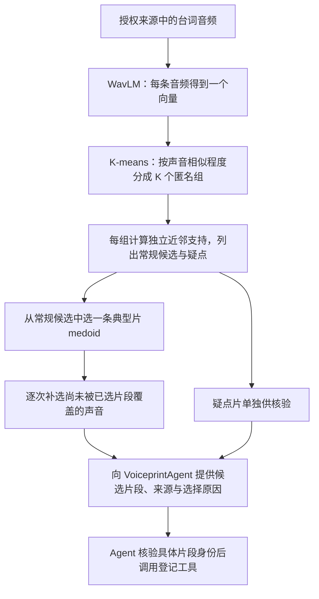

# 声纹与原子台词 TRD

## 2026-10-21 连续话轮提示已部署，v21 验收进行中

当前运行副本为 `outputs/worktrees/ep04-continuous-turn-20261021`，基于实际部署 `322db8e` 并整合此前工具、1 秒预填、gap 仅展示与 Refine 审核收据。API 9621 已按用户授权重启，PID `60613`；标准 API 已提交隔离 EP04 v21：`7c34f471-b7b0-47b7-9c76-31c80cece0dd`。尚无最终效果结论。下方旧轮次中的“未部署”描述对应当时状态，以本节为当前状态；B0 编码前准入、Refine 姓名只读仍未实现。

本轮针对 v20 把 35.5–48.8s 拆成六条的问题调整提示：原子台词指单一人物的连续话轮，可包含多句和普通停顿，不应按标点、语义小句或语气变化碎切。跨原 ASR cue 合并前必须按提示调用 `analyze_speaker_consistency` 检查整个拟合并范围，读取完整 evidence_ref；逐 cue 的宿主预扫不覆盖连接处。已存在可疑候选时先局部重新 ASR，结合实际媒体决定保持或拆分，不受候选影响的同人发言保持完整。`scan_count` 只是支持候选的扫描数，不是应生成的台词数；复核范围和峰值不是精确切点。

这里的“通过检查”没有新增认证字段或 Canvas 硬门禁。`analysis_status=completed` 仅表示计算结束，空候选／少窗／支持不足不能证明单人；需要结合支持缺口的位置，不能因长段天然边缘配对不足否决整个范围。工具不可用或关键连接处支持不足时保留有依据的既有边界，不补造工具结论。未改变 1s／400ms 无 VAD 矩阵规则、CAM++ 或 B0 评分算法。

本次标准 API Consumer 执行当前服务配置（Understanding `gpt-6-luna/high`）；部署配置仅排除 clean322 不消费的 `query_hook`，没有部署主工作区未迁移的 metadata 等功能。模型、ASR 输出和参考池可与 v20 改变，因此不作 prompt 单因素归因。新增只读观察记录真实模型输入／工具调用、Understanding 提交、原 B0 artifact、Refine 实际预填输入及提交结果。验收优先检查爱音前半连续段、爽世后半独立句及两条固定人物真值，再报告覆盖与反复改名；不把 COMPLETE、非 null 比例或 top1 一致率当全片准确率。当前执行证据见 [B12](../../../docs/dev/problems.md#b12asr-匿名说话人分组不准refine-看帧后仍未纠正目标归属) 与 [本轮目录](../../../outputs/verification/ep04-continuous-turn-rerun-20261021)。

## 2026-10-21 当前接入与后续目标：Understanding 复核拆分，Prepare 归因，Refine 保留归因并合并

**状态：隔离 worktree 已接入两个 Understanding 工具、宿主 ASR cue 自动扫描、自由拆分／时间校正及证据提交；默认使用无 VAD 的 CAM++ 1s／400ms 基线。当前分析是 advisory，不是拆分授权或完成门禁。B0 编码前准入、Refine 归因只读与受限跨 Chunk 合并尚未实现。未重启或部署，不能认为 API 已加载本轮代码。**

本节区分当前实现与后续目标。Understanding 已解除“必须照搬完整 ASR cue”和创建后台词时间只读限制，可在 Chunk 内根据现有证据拆分、改时；不要求先命中声学候选、调用工具或精确匹配原／局部 ASR。Refine 当前仍保留既有改名、置 null、改时和声音证据失效规则，下面的“继承归因并受限合并”属于后续目标。最新人工更正见第 8 节：第 12 条正确提示立希→爱音，第 11 条为同人语气变化误报。历史实现、参数和实验原文保留。

本设计已按用户要求同步回主工作区 `agent/video_parse_v2/design/voiceprint-trd.md`，隔离工作副本位于 `outputs/worktrees/ep04-segmentation-20261020` 同名路径。两处内容一致，历史原文完整保留。`**/design/` 被 Git 忽略，该 TRD 仍不随 PR 推送。可追踪的决策与证据入口是 [problems.md B12](../../../docs/dev/problems.md#b12asr-匿名说话人分组不准refine-看帧后仍未纠正目标归属)。

### 2026-10-21 gap 仅展示：取消预填与 Refine 的分差门槛

用户要求取消 gap 门槛，只列出数据供判断。新生成 artifact 的 `accept_gap=null`、`conflict_gap=null` 表示分差只作描述；小 gap、零 gap、单候选无 gap 都不单独阻止 ACCEPT。继续要求有效候选、时长至少 1000ms、top1 至少 3 个独立 cue、非歌曲／重叠。候选 cosine、gap、引用数和原 Understanding 姓名保留可见；这些值不是校准置信度或概率，ACCEPT 也不代表已认证人物身份。

实现复用原 Runtime 参数传递、分档与 Canvas 预填路径，不增加模型、Worker、字段或调度框架。双 null 关闭 gap 分档；两项均为数值则按历史 artifact 的冻结规则复现，单项 null 拒绝。历史存储结果不改写，B0 v4 的评分及参考池清理算法未变，策略由冻结参数完整区分。`label_min_margin` 是标签离群判断的独立指标，本次未改。

Refine prompt 移除 0.05 领先要求，明确 gap 小／零／缺失不能单独支持恢复旧姓名或置 null。必审事件有候选时，弃权需要 `decision=null`、`evidence_type=contradiction` 和具体理由。`keep` 仅保留具名 Understanding 姓名；原姓名为 null 时不能用 keep 绕过弃权检查。具体证据支持的改名、弃权和改时能力继续保留，Refine 归因只读仍未实现。

**离线验证：** 固定 v20 的 378 条评分、371 个样本和 24 份首次 Understanding，真实 Runtime 与 Canvas 重放旧策略完全一致；只取消 gap 后，ACCEPT 及实际预填均 127→248，新增 121 条全部实际预填。47.5–48.8s 爽世句由 Under 爱音变为声纹默认爽世（0.773058，gap 0.056029）；293.3–295.8s 爱音句由 Under 睦变为声纹默认爱音（0.822999，gap 0.134204）。候选、评分、引用及排除规则不变，没有音频重编码、模型调用或数据库写入。

相关四组回归最终 **894 passed、0 failed**，1 条第三方弃用警告；覆盖缺失／零／低 gap、负相似度、其余准入条件、真实预填、旧参数复现与弃权检查。

该结果仅证明初始预填行为，不能写作最终归因 2/2、全片错误率下降或新增 ACCEPT 均正确。未重跑全集、未部署 API、未提交推送。具体逐行结果与验证边界见[离线实测](../../../outputs/verification/ep04-gap-advisory-20261021/replay.md)和[改动记录](../../../outputs/verification/ep04-gap-advisory-20261021/change-report.md)。下方为历史策略与实验记录，以本节描述当前 gap 策略。

### 2026-10-21 预填时长调整与 v20 终态

按用户要求，当前隔离工作副本的 ACCEPT 最短时长改为 **1000ms**；gap≥0.15、至少 3 条独立 cue、非歌曲／重叠等条件保持，NO_VOICE 仍为时长<1000ms。B0 长段编码窗仍 1500ms，Understanding 扫描仍 1s／400ms。下文历史 1500ms 条件保留，以本条作为当前更新；未修改 Refine 权限或 prompt，API 未部署。

三组回归 **640 passed**。冻结 v19 的 338 条评分、引用与原 Under 输入，真实 Canvas 对照显示 ACCEPT 118→155；旧爽世句可从爱音预填为爽世。实际全集 v20 `e442375b-06c0-486b-9afc-0108a996b46a` 已完成 24/24 Chunk、22/22 Refine，50 分 24 秒。127 条 ACCEPT 均观察到真实预填，最终全部保留 top1，包括 33 条原本不足 1.5 秒的台词；不认证这 127 个身份都正确。40 组输入／输出、22 个提交窗口的对应均完整。

固定两句仍正确 **1/2**：本轮爽世句 47.5–48.8s，top1 爽世 0.773058、gap 0.056029，未达 0.15，因此实际输入仍爱音，Refine 置 null；爱音句 293.3–295.8s，top1 爱音 0.822999、gap 0.134204，实际未预填，三个窗口都采用 voice_top1 后最终正确。新运行重新生成了目标区间和参考池：不能把固定输入可预填与新全集未预填混为同一条件，更不能继续把后者归为时长不足。

#11 保留一条爱音，#12 为立希→爱音→爱音；整集 null 91/378（24.1%，v19 15.4%）。244 条正式决定覆盖 22 窗口，83 条重复写入 cue 中 12 条标签变化，共 13 次转换；不能认证整体错误率／稳定率改善。Under 自动分析 378 个原 ASR 唯一区间，14 候选，12 条成功局部 ASR 回执；工具执行与身份、原子性准确率仍需区分。

运行源码与 v19 仅预填时长常量一行变化，模型配置、encoder 与其他 B0 参数一致。**外围非目标不变检查失败**：另一个视频在期间新增 v2 解析，触发者未知；管线 COMPLETE 与 runner 退出 1 均保留，没有改动或停止该任务。未重启、迁移或部署。完整结果及边界见[验收报告](../../../outputs/verification/ep04-prefill-1s-rerun-20261021/report.md)、[真实输入／输出审计](../../../outputs/verification/ep04-prefill-1s-rerun-20261021/attribution-audit.json)和[固定输入对照](../../../outputs/verification/ep04-prefill-1s-rerun-20261021/frozen-input-comparison.md)。

### 2026-10-21 全集 v19 实测：候选改进，最后归因仍有缺口

已按当前服务配置完成固定 EP04 全集重跑，task `04960abe-fa62-4806-919e-df3f28ac6040`，24/24 Chunk 与 22/22 Refine 全部完成。两句固定真值从 v18 的 0/2 正确变成 1/2：47.4–48.6s 爽世句、293.2–295.6s 爱音句的 B0 top1 分别正确为爽世（0.773138，gap 0.188161）、爱音（0.785129，gap 0.103957）。两条 Under 姓名仍错且 B0 均 CONFLICT；当前仅 ACCEPT 预填，因此后续还要处理错名。Refine 对前者使用“48 秒可见爱音说字幕”的理由 keep 爱音，对后者三个覆盖窗口均采纳爱音 top1。结论是爽世错名被保留，不是正确预填值被覆盖。

#11 最终保留一条爱音；#12 最终为立希→爱音，但本轮 ASR 已先拆为两 cue，四处重点均未局部重 ASR，不能作为新工具主动拆分的独立证明。全片343个有效原ASR唯一区间自动检查，18个候选均low_support，9条局部重ASR成功；未认证单人纯度/重叠准确率。无VAD规则、完整CAM++ encoder revision、B0方法与参数均不变。

最终338条DIALOGUE中52条未归属（15.4%，v18为141/263=53.6%），只能表示标签覆盖。171条Refine收据覆盖60条cue，57条重复写入中9条标签变化（6 null→具名、2具名→另一人物、1具名→null）；v18历史仅4/22窗口，不能比较比例宣称稳定性提升。当前仍未实现“Refine归因只读”。本轮gpt-5.6-luna/high与v18 gpt-6-luna/low不同，ASR和引用池重建，不能将整体效果独归因于矩阵工具。

5个Refine窗口各一次调用次数上限重试后成功。运行固定代码快照并复用现有服务，未部署/重启API或迁移；代码仍在工作副本。后续需先形成Prepare可采纳归因/未决结果，再落实Refine继承与受限合并；不能直接锁住当前Under错名。详细证据：[简洁HTML](../../../outputs/verification/ep04-full-rerun-20261021/report.html)、[验收报告](../../../outputs/verification/ep04-full-rerun-20261021/report.md)。

### 0. 引入两个工具的背景与意图（2026-10-20）

**为什么需要在 Understanding 增加检查。** EP04 的问题暴露了声纹归因的上游前提：一条 ASR cue／DIALOGUE 的音频可能已经包含多个人。爽世目标句在 v15／v18 的原 ASR 中被并入 13.3／13.2 秒长段；爱音目标句在 v17／v18 的 ASR 原本分别只有 1.4／2.3 秒，却被 Understanding 扩为 7.2／11.4 秒。对这些混人区间整体编码，再选一个人物，不能表达区间内每个话轮的归属。此前参考错名和 Refine 决策问题仍成立，但单独修正它们无法解决这个输入前提。

`7ea879b` 的完整 ASR cue 区间锁阻止了 Understanding 二次扩大台词；它无法拆开原 ASR 已经合并的人声。本轮已把 Chunk 内的 ASR 复核、拆分和边界校正交回 Understanding，解除旧时间锁并更新 prompt，保留 Chunk 授权写范围与批次原子性。来源证据负责可追溯，不是必须满足候选／局部 ASR 才能写入的授权条件；代码接通仍不等于真实音频已纠正。

**工具要帮助完成什么。** 在声纹准备前，找出值得重新检查的台词范围，让 Understanding 利用原 ASR、局部重 ASR 和音视频上下文确认单人话轮。首轮需要的是“这段可能混人，值得复核”的范围级提示，不要求检测器给出精确切点、人数或人物名。CAM++ 的 1 秒窗／400 ms 步长自相似矩阵用于发现前后持续的声学差异；具体算法和支持不足语义见第 3 节。

两个工具各承担一个动作，已由统一的 `agent/video_parse_v2/tools.py` 定义 schema 与阶段集合，由宿主绑定执行：

- `analyze_speaker_consistency`：分析片段内的声纹一致性，展开扫描证据，说明哪些范围可疑、依据和缺口是什么。宿主先扫描并登记各 ASR cue 的结果，确保检查不依赖 Agent 恰好主动调用工具。
- `transcribe_segment`：按复核需要对局部真实音视频重新 ASR，产生可追溯的新证据，帮助 Understanding 拆分和校正台词；不直接改写原始 ASR，也不把重新转写成功视作已经拆干净。

Understanding 应结合可疑项、媒体和上下文复核：确认同人则保留，确认换人则拆分；人物不明可以保留 `speaker=null`，但这不认证音频为干净单人。候选带和峰值只用于引导复核，不能直接作为落库切点。宿主持久化原观察、工具证据与最终事件的时间来源映射；当前没有另设“已知候选必须逐项处理后才能完成”的程序门禁，具体证据与权限边界见第 4 节。

**为什么已有证据支持接入复核。** 第 12 条（1201.7–1208.5s）原记录整段为爱音，离线算法先提示异常，随后用户回听确认开头是立希、后续是爱音；这验证了发现原记录错误的价值，尚不是工具自动完成修复。第 11 条（738.7–744.7s）则经用户确认全程爱音，存在截断和明显语气变化，属于误报。两条都为 `low_support`，因此这类提示要交给 Understanding 复核，既不能全部丢弃，也不能一律拆分。人工更正及样本限制见第 8 节。

**首轮接入方案默认不启用 VAD 窗口过滤。** 现有离线对照中，50% 预测语音占比过滤没有去掉第 11 条误报，却使部分已知混人范围失去足够配对依据。因此先保留未加 VAD 的基线，把同人语气、停顿等引起的声学变化留给复核处理；可选 mask 保留为实验能力。不加这层过滤仅指不按预测语音占比屏蔽窗口，第 3 节的自身／重叠／重复 PCM 配对排除，以及 B0 的目标自身、同 cue、重叠、重复 PCM 等排除规则继续保留。

**与后续归因的关系（目标，尚未接入）。** Understanding 交付可确认的原子台词后，计划让 B0 在收集／编码参考与目标前检查准入，再计算归因或保留未决；Refine 的目标职责是继承归因、检查跨 Chunk 续句和受限合并。这样使声纹比较建立在单人音频上，也减少混人片段污染参考池。分段干净不保证 top1 必然正确；无候选也不认证为单人，当前矩阵算法没有独立检测同时发声的能力。

**接入验收与实施状态。** 验收关注是否帮助纠正已合并台词、同人误报能否保留为同人，以及已知混人是否漏检；不以 `COMPLETE`、标签一致率或两个案例推算整体准确率。当前已完成工具与 Understanding 链路的代码接入、回归及 v19 全集实测（见本节上方记录），两句纠正 1/2，完整归因闭环尚未通过。B0 准入及 Refine 权限调整仍待后续实施。本轮沿用既有模型、记账与任务执行，不改变 B0 参数或 encoder，不增加 Worker／任务状态／调度框架。

### 1. 交付职责：当前 Understanding 与后续归因目标

```text
原始 ASR（只读来源）
  → Understanding：程序扫描声学变化 → 复核可疑区间／局部重 ASR → 拆分并检查原子台词
  → voiceprintPrepare / B0（后续）：编码前检查准入，给出归因或明确未决
  → Refine（后续）：继承上游归因，检查跨 Chunk 衔接／受限合并
```

- Understanding 对 Chunk 内台词拆分负责；“原子”指当前 Chunk 授权范围内可确认的单人话轮片段，不等于一个标点句。跨 Chunk 未完部分保留来源，由 Refine 衔接，Understanding 不越界补齐。原始 ASR 行可能已混人，不能用一行对应一个 DIALOGUE 来认证。
- 当前：原 ASR 的内容／时间不可改，新局部 ASR 作为另一份只读证据；Understanding 可根据可用媒体／上下文在 Chunk 授权写范围内校正、拆分和改时，不要求精确对应原 cue、局部 cue 或候选，也不要求必须先调用工具。只读前后文范围不扩大写权限。
- 当前：模型应复核混人嫌疑、台词残余与重叠；程序保留原文、工具证据和时间来源映射，但不据候选处理状态拒绝写入或完成。`speaker=null` 仅表示姓名不确定，不表示音频已证明单人；无候选／无工具／流程完成同样不构成认证。
- 后续目标（未实现）：B0 的参考和目标均在收集／编码前检查分段证据。无法证明符合本轮准入要求的音频不进入具名参考池；已知混人不能整体编码后选一个人物来代替拆分。原始 cue 关系仍须保留，拆出的子段不能靠新 ID 绕过 B0 的同 cue 排除。
- 后续目标（未实现）：对 DIALOGUE，Refine 的姓名继承上游交付值，不允许通过 set、patch、`voice_decision`、置 null、重建事件或切换类型绕过。发现上游异常可报告，不能就地换人。干净分段使 top1 更有意义；cosine／gap 本身仍不是身份正确概率。
- 后续目标（未实现）：合并只能连接有依据的跨 Chunk 同人续句，保留原子来源和各自归因。`null == null` 不证明同人；A→B→A 不能合成覆盖中间 B 的连续 A 音频。合并后的新范围不能冒用某一旧原子段的分数；保留分段证据，实际重新评分时按新音频重新计算。

### 2. 当前实现与后续目标的差距

| 位置 | 本轮已实现的当前行为 | 后续边界 |
| --- | --- | --- |
| `tools.py` | 集中 Parse 工具 schema 与阶段集合，宿主注入执行；新增两个 Understanding 工具 | 保留框架 `CanvasCompletion`、Refine 既有审核门禁与 Prefix 零工具预算分支 |
| Canvas／Understanding prompt | Chunk 内允许创建、拆分及创建后改时；不设候选、局部 ASR 或 exact-cue 写入门槛 | Prefix 仍锁台词区间；Chunk 边界、原子批次和 Refine 声音证据失效保持 |
| `server/service/video_parse.py::_understanding_audio_tools` | 冻结 encoder 存在时预扫合法原 ASR cue；共享原 PCM、lazy encoder 与向量缓存，按冻结 ASR mode 绑定局部转写 | 当前是 advisory；不认证单人、人数、重叠或姓名，不按候选覆盖拒绝完成 |
| `understanding/workflow.py`／`understanding_evidence` | 原观察、独立只读工具记录及最终事件→ASR cue 时间映射提交到 `detail.evidence` | 时间匹配不认证文字／声学身份，缺来源也不阻写 |
| `_collect_voiceprint_scores` | 仍对 Understanding DIALOGUE 的全范围编码 | 编码前的参考／目标准入尚未实现 |
| B0 `classify_voiceprint_result` / Canvas `_apply_voiceprint` | 原排名／分档与 `prefill + ACCEPT` 路径不变 | 在 Refine 前明确可采纳归因和未决结果尚未实现，不能锁旧姓名冒充声纹最终归因 |
| Refine Canvas、prompt、提交 | 仍可改名、置 null、改范围，保留既有审核门禁 | 继承上游归因和受限跨 Chunk 合并尚未实现 |
| `merge_refinement_content` | 仍为并发更新的三方合并 | 不是合并两条台词的工具；消费源事件／去重／证据继承尚待定义 |

本轮没有修改 B0 分档、阈值、参考算法或 encoder，也没有把后续归因合同提前作为 Understanding 写入门禁。

### 3. 算法：按时间寻找相似度矩阵的块变化

工具回答“哪里值得重新听／重新转写”，不预设人数，不做 K-means 或密度聚类，也不输出人物姓名。

**输入与计算。** 使用原音频，固定当前 CAM++ 192 维 encoder，1 秒窗口、400 ms 步长，按时间原序计算全量 cosine 矩阵。窗口保存绝对毫秒范围、PCM 摘要和 encoder revision。首轮沿用完整规则窗，不补零；没有被窗口覆盖的残余明确返回，不当作已分析。

**扫描位置。** 实现按第二个及后续每个窗口的起点扫描 `t`，本轮间隔为 400 ms。左侧取 `end_ms <= t` 的最近至多 6 窗，右侧取 `start_ms >= t` 的最近至多 6 窗。跨过 `t` 的窗口不参加这次左右统计；6 窗是本轮固定参数，尚未证明为最优尺度。分别计算：

```text
L = 左侧内部有效窗对 cosine 的中位数
R = 右侧内部有效窗对 cosine 的中位数
C = 左右两侧有效窗对 cosine 的中位数
contrast = min(L, R) - C
```

“有效窗对”排除自身、共享 PCM 的时间重叠和完全相同的 PCM。当前规则网格相邻窗共享 600 ms，间隔两格仍共享 200 ms，至少间隔三格才不重叠；实现按实际起止时间判断，不写死索引规则。对同一 cue 内部做变化分析是有意的，不把 B0 的“同 cue 参考排除”误套到这里。有效窗对仍可能复用某一窗口，配对数量不能冒充独立样本数。

矩阵图片展示完整 cosine，包括对角线和重叠窗；上述排除只作用于算法的统计支持。内部窗对只计一次，左右跨侧窗对逐一计算。图上对角线附近的深色天然受到重叠影响，不能把它直接当成同人的独立证据。

**逐扫描点的实际触发规则。** 下面参数是 `run-v1` 开始前冻结的实验设置，不是生产已校准阈值：

| 条件 | 计算与结果 |
| --- | --- |
| 左内部、右内部、跨侧各有至少 3 个有效窗对 | `min(L, R) - C >= 0.10` 时记为完整支持扫描点 `block_change` |
| 仅一侧内部少于 3 对，另一侧内部和跨侧均至少 3 对 | 用有支持一侧的内部中位数减去 `C`；差值 `>= 0.15` 时记为 `low_support` |
| 两侧内部都不足，或跨侧不足 3 对 | 记录支持不足，不产生候选，也不认证为单人 |
| 配对充足但反差不足 | 本扫描点不触发，保留原始统计供检查 |

例如左侧已充分支持、右侧只有短尾时，计算 `edge_contrast = L - C`。短开头对称计算 `R - C`。只有 1～3 个右窗时，没有不重叠的右侧内部窗对，`R`／完整 `contrast` 为缺失；不能填 0。该分支也覆盖重复 PCM 等原因造成的单侧支持不足，不只限于物理片尾。它说明短侧与有支持的一侧存在差异，不能证明短侧自身形成一个稳定说话人。

当前实现只要求**相对反差**，没有另设“内部 cosine 必须大于某个绝对值”的条件，也不将分数换算成置信度。因而同人语气、音素、静音或背景变化仍可能触发，需要普通台词对照验证。

**把扫描点合并为复核候选。**

1. 时间上连续触发的扫描点合成一组；遇到任意未触发点即断开，不跨空档补连。
2. 一组中至少有 2 个 `block_change` 扫描点，最终才标为 `block_change`；否则统一标为 `low_support`，包括只出现一次的完整支持点。这是时间持续性检查，不是独立样本投票。
3. 完整支持组只在其 `block_change` 点中选最高峰；低支持点不能成为完整支持组的高分峰。低支持组在所有触发点中选峰。相同分数取较早位置。
4. 复核范围是首个触发点向前、末个触发点向后各扩半个窗长，并裁到输入边界。本轮为各 500 ms；这是复核带，不是准确切分点或统计置信区间。
5. 返回全部扫描的 `L/R/C`、配对数、反差、缺失原因、候选类别与范围，以及窗口未覆盖的音频。没有候选仅表示本规则未触发。

```text
matrix = 所有归一化向量两两 cosine
for t in 第二个及后续窗口起点:
    left  = 最近至多 6 个 end <= t 的窗口
    right = 最近至多 6 个 start >= t 的窗口
    L, R, C = 排除自身／时间重叠／相同 PCM 后的三组中位数
    if 三组各有至少 3 对:
        当 min(L, R) - C >= 0.10，标记 block_change
    elif 跨侧及恰好一侧内部有至少 3 对:
        当有支持侧内部中位数 - C >= 0.15，标记 low_support
    else:
        保留支持不足
合并连续触发点；按支持类别选峰，返回复核带
```

**Foote 对照与本算法的区别。** 原论文用自相似矩阵与正负棋盘核做相关：同侧象限为正、跨侧为负，再以 Gaussian 权重强调局部。实现保留这条对照曲线：左右各 6 窗构成 12×12 核，`sigma=3` 窗、核绝对值之和归一为 1，只计算完整邻域；它使用未掩码矩阵，包含自身和共享音频。没有按每条音频的最大值把曲线强制归一到 1。

**当前候选由上面的中位数规则触发，不由 Foote 曲线触发。** CAM++ 特征、配对排除、`min(L,R)-C`、短侧分支和连续点合并都是本地算法选择，不能称为原论文的完整复现，不能据原论文对本任务作说话人准确率保证。实现代码为 `engine/parsev2/speaker_change.py`。当前宿主与离线回放共同读取 `server/constants/parse.py` 的 `SPEAKER_CONSISTENCY_WINDOW_MS`／`HOP_MS`／`PARAMETERS`；主设置为 1s／400ms、左右至多 6 窗、至少 3 对、0.10／0.15 反差，不启用 VAD。`evals/speaker/speaker_change.py` 另保留运行前声明的敏感性设置。

**A→B→A 与重叠。** 实现逐位置扫描，可输出多个局部变化候选，不强制全段切成两部分。当前没有实现全局匿名身份对齐或“末尾回到 A”的判断；矩阵前后重新相似只供观察。一个窗口的单个 embedding 不能确认同时发声；本工具对重叠没有独立检测结论。已有 pyannote 结果只能作为旁路证据，阴性不能排除重叠；最终验收仍必须包括同时发声样本。

**目前的证据边界。** v15／v18 的 31×31 矩阵已验证数值，末窗与前文非重叠窗口的 cosine 中位数为 0.2353／0.2614，前文内部中位数为 0.4970／0.5085，支持继续试验变化候选。它不证明自动边界已正确：此前要求较充分左右支持的试算中，最高反差出现在约 43.4／43.3 秒，并未自动定位目标换人。因此不能现在就选全局最高峰切音频。当前规则窗尚未覆盖的 v15 300 ms／v18 200 ms 尾音也必须保留。

### 4. 当前工具、权限与证据提交（2026-10-21）

两个工具由 `agent/video_parse_v2/tools.py` 集中定义，宿主使用冻结任务配置绑定，不新增 Gateway 模型 enum：

| 动作 | 输入 | 当前返回与消费 |
| --- | --- | --- |
| `analyze_speaker_consistency` | 当前 Chunk 内绝对整数毫秒 `start_ms`／`end_ms`；无需候选引用 | 可疑范围、候选峰统计、配对支持／不足原因、未覆盖音频和只读证据引用；不直接改 Canvas |
| `transcribe_segment` | 当前 Chunk 内绝对整数毫秒 `start_ms`／`end_ms`；无需候选或 cue 精确匹配 | 新局部 ASR、冻结 binding 与媒体摘要及只读证据引用；不覆写原 ASR 或事件 |

**自动扫描与可用性。** `models.speaker_embedding` 存在时，宿主在 Understanding 模型调用前逐条扫描时间有效且位于当前 Chunk 内的原 ASR cue，并把结果引用／摘要放入 prompt。没有 encoder 则不绑定该工具、不伪造分析。冻结 `models.asr.mode != none` 时绑定局部重 ASR；二者独立可用，不要求启用声纹准备才能使用。Understanding 关闭的原生 observation-conversion 旁路不执行这轮 Agent 工具链，也不因此获得单人认证。

每次 Understanding 执行内共用原始 16kHz／mono／PCM16、lazy encoder 和以实际 PCM SHA 为键的向量缓存；同范围分析可复用结果。规则窗长／步长和反差参数读取唯一的 `server/constants/parse.py`，调用时不传 VAD mask。自身、重叠、重复 PCM 只在配对统计中排除，不删除原时间或音频。未覆盖尾部明确返回，窗口／配对不足明确保留，均不能解释为确认单人。

恒定 PCM 属于当前 encoder 不可编码的输入。此时整个请求明确返回 `analysis_status=unavailable`，列出 `unencodable_windows` 与原因；不删窗拼接、不计算稀疏矩阵、不把失败冒充无换人。其他真实模型、媒体、取消或预算故障继续走现有失败路径；候选为空也始终不认证单人。该处理不是 VAD 或能量阈值过滤。

局部重 ASR 复用冻结 ASR binding、模型记账、取消／预算和临时媒体生命周期。按 transport 的 `input_mode` 选择原音频或真实裁切 MP4，不能把 WAV 直接传给视频模型。局部时间只转换一次为绝对毫秒；遗留字段 `start_seconds/end_seconds` 在规范化后实际为绝对毫秒，勿二次乘 1000。`speaker_id` 只属于本次局部转写，不能按标签字符串跨原 ASR 或多次工具调用对齐身份。

**编辑和完成权限。** Understanding 可根据现有音视频／上下文自由拆分、校正台词时间，原 cue、新 cue 和检测候选均不是写入授权门槛。使用既有 `patch_event`／`set_event` 与 `add_event` 原子批次表达拆分，不增加操作或状态机。原始观察只读，Chunk 边界仍校验，失败批次整体不生效；Prefix 时间锁、Refine 既有归因审核与声音证据失效逻辑保留。当前没有强制调用工具、必须命中候选或逐项解决候选后才允许 `CanvasCompletion` 的程序检查。模型按 prompt 复核证据，但 `COMPLETE` 不证明台词已拆净或归因正确。

**持久化语义。** 宿主以独立不可覆写引用登记 `{member_ref, kind, start_ms, end_ms, ...}`，`kind` 为 `speaker_consistency` 或 `local_asr`，后者含 `asr.transcript`。`understanding_evidence(member_ref)` 导出原 ASR／OCR／media、本 member 的完整 `tool_evidence`，以及需要时的 `dialogue_provenance`；workflow 沿用原提交入口保存到 `detail.evidence`，不增加数据库字段。

时间来源记录最终事件的 `position`／fingerprint（不含宿主提交时可能补入的 `speaker_source`），关联原／局部 ASR cue 的引用、索引与 fingerprint，关系为 `exact`、`subrange` 或 `overlap`。标记 `basis=temporal_overlap_only`、`content_verified=false`：仅表示时间关系，不证明文字来自该 cue、没有漏字或声学身份相同；无对应来源仍允许写入。没有新工具证据且全为原 cue 精确区间的旧结果保留原 evidence 形状。后续 B0 是否准入仍需独立实现，不能直接把 provenance 当成资格认证。

### 5. 当前接入范围与后续验收

```text
AniVAG/
├── agent/video_parse_v2/
│   ├── tools.py                    # Parse 工具 schema 与阶段集合，含两个新工具
│   ├── voiceprint.py               # 保留准备编排，工具定义移至 tools.py
│   ├── timelineEvent_canvas.py     # 解除 Under 时间锁，导出只读证据与时间来源
│   ├── prompts.py                  # advisory 用途、自由拆改和能力限制
│   └── understanding/workflow.py   # 提交完整 evidence，沿用原事务入口
├── engine/parsev2/speaker_change.py # 纯数值变化候选；不负责模型、姓名或重叠
├── server/
│   ├── constants/parse.py          # 宿主／回放共享 1s／400ms 与扫描参数
│   └── service/video_parse.py      # 预扫、PCM／向量缓存、局部 ASR 和生命周期
└── evals/speaker/speaker_change.py # 冻结证据回放并读取共享参数
```

本轮 10 组回归合计 **1319 passed、0 failed**，1 条第三方弃用警告，33.54 秒：engine/parsev2 280、Agent 366、新声学工具运行时 9、媒体 56、voiceprint 115、Worker 220、Queue 131、Repository 125、artifact 12、model_calls 5。它们验证工具绑定、权限、来源提交、算法语义和既有流程，不包含真实 Agent 拆分／重 ASR／人物归因验收，不能代替真实声学准确率。逐组实际运行与后续真实样本证据见 [problems.md B12](../../../docs/dev/problems.md#b12asr-匿名说话人分组不准refine-看帧后仍未纠正目标归属)。未重启、部署、迁移、重解析、commit、push 或合并 PR。

**2026-10-21 真实工具路径回放：** 已用真实原 MP4、当前 `Runtime._understanding_audio_tools` 和 CAM++ 跑完原 12 条／231 窗，PCM 摘要及每窗向量与冻结基线完全相同（最大逐分量差 0），旧算法字段逐项一致；24 次显式重复工具调用没有新增编码，所有 encoder／临时媒体已关闭清理。第 11 条误报与第 12 条正确提示均保留；混人范围触发 6/7、其余对照候选 1/5，非独立测试集准确率。13.828 秒总墙钟包含媒体处理，不作纯推理性能结论。离线绑定使用既有范围 cue，没有重新生成台词，也没有验证真实 Understanding 是否采用建议并正确拆分。详细协议、代码／原片摘要、逐条结果见 [回放报告](../../../outputs/verification/ep04-understanding-tools-20261021/report.md)。

后续仍需：

1. 在原失败长段与人工确认对照上验收 Under 是否实际修复台词，而非只拿到候选或局部 ASR；分别检查漏检、同人误报、短应答、残余、A→B→A 及同时发声。CAM++ 差异候选没有独立重叠能力，不能宣布整体分段已解决。
2. 在 B0 收集／编码前落实参考和目标准入，保留目标自身、同 cue、重叠、重复 PCM 和 encoder 排除。当前 Under 工具没有阻止未净化片段进入参考池，不能以晚期 Refine 可选工具代替这道防线。
3. 明确 Prepare 最终归因／未决交接，再落实 Refine 姓名继承与受限跨 Chunk 同人续句合并，包括源事件消费、去重和证据继承。当前 Refine 权限未收紧。
4. 分段后在固定 CAM++／B0 池比较人物排名，分别报告分段与归因，不以标签一致率、自动接受数量或流程完成替代人物验收。

以下第 6～8 节保留 2026-10-20 离线实验时间点的状态与数值；其中“工具未注册／流程未接入”等为当时记录，当前代码接入状态以上述第 0～5 节为准。历史正文 marker 之后原字节保持不变。

### 6. 首批实现与离线结论（2026-10-20）

> 本节保留初次选样分组和实验记录。原先选为普通对照的第 12 条已被用户确认混人；当前分类和更正统计见第 8 节，不能继续把它计为误报。

**结论：矩阵变化可以发现部分混人嫌疑，当前不足以可靠判定单人／多人。可继续验证其作为 Understanding 重 ASR 提醒的价值，不能把“无候选”当作干净音频准入证明，也不能据此自动切分。**

- 已实现 `engine/parsev2/speaker_change.py` 与 `evals/speaker/speaker_change.py`；代码仍在 `outputs/worktrees/ep04-segmentation-20261020`，未同步生产源码或部署。保留 [Foote 原论文](https://ccrma.stanford.edu/workshops/mir2009/references/Foote_00.pdf) 的 Gaussian checkerboard 相关公式作为对照；CAM++ 特征、kernel L1 归一、masked median 与短侧支持分支均明确标为本地选择／扩展，未冒称原论文验证了动画说话人准确率。
- 主设置在跑新增对照前冻结：1s 窗／400ms 步长、左右最多 6 窗、每侧及跨侧至少 3 个有效窗对；完整两侧反差门槛 0.10、短侧门槛 0.15。Foote 对照核为 12×12、sigma=3 窗，只计算完整覆盖，不按每段最大值强制归一成 1。这些是本轮探索参数，未变更 B0 阈值。
- 使用 16 个 EP04 输入、244 窗。复用旧 v15／v18 爽世 62 窗，新编码 182 窗，另做 14 次首窗重复，逐分量差均 0。六条普通长台词在编码前按冻结 v12 artifact 和人物／时序选择，均 6–10s；原 PCM 与 artifact 摘要一致。用户反馈“除了那两个有问题的，其他基本都是对的”作为普通对照依据，未扩大为完整逐段边界或全片只有两错的真值。
- 主设置初始记录：6 个历史混人范围中 **5 个触发复核**；其中用户所圈两条约 13s 爽世场景长段均触发末尾差异。原选为普通对照的 6 条中有 **2 条触发**，后续已确认第 12 条正确提示混人、第 11 条为误报。短 v17 爽世输入未触发；v18 爱音虽在其他位置触发，目标句附近未给出候选，不能把“任意位置触发”算成目标换人定位正确。
- 短 v12 输入及原两条短对照均没有候选，但窗口数不足以提供完整支持，不能将这 4 条计作“已证明单人”。6 个历史输入是两个场景的多个重叠版本，5/6 是本批触发数量，不能当作独立测试集的换人准确率。

| 短侧反差门槛（初次选样分组，其他参数相同） | 历史混人输入触发 | 原选普通对照触发（含后来确认混人的第 12 条） |
| --- | --- | --- |
| 0.10（较宽松） | 5/6 | 4/6 |
| 0.15（主设置） | 5/6 | 2/6 |
| 0.20（较严格） | 4/6 | 1/6 |

这些设置在实验开始前一并记录；没有根据结果换成“最好看”的主参数。当前出现漏检与额外复核的取舍，未证明仅调一条门槛就能稳定分开。

- 验证：新增 **49 个测试**，含真实使用尺度的 1s／400ms 合成 A→B、A→B→A、短尾、异常窗、时间／PCM 排除、范围及支持类别；完整 `tests/engine/parsev2` **267 passed、0 failed**。合成向量验证规则，不替代真实音频有效性。独立实现从原向量复算 228 个主扫描、96 组敏感性结果、103 个 Foote 点全部一致，最大数值差 `5.5511e-16`。Review 发现的“低支持尾峰被升级成完整支持峰”已在首次实测前修正并加回归。
- 证据根目录为隔离 worktree 下的 `outputs/verification/ep04-speaker-change-20261020/`：`selection.json`、`manifest.json`、`verification.json`；`run-v1/` 内有预先写入的 `protocol.json`、`results.json`、`independent-audit.json`、`overview.png` 和逐段 PNG。样本／参数／代码摘要保留，可完整复算；不以 CSV 或复杂 HTML 作为用户主交付。
- **[12 条矩阵报告](../../../outputs/verification/ep04-speaker-change-20261020/matrices-12.html)：** 主工作区与隔离副本均保存于 `outputs/verification/ep04-speaker-change-20261020/matrices-12.html`。保留原 12 条顺序和数值，不计入 4 条支持不足的短输入；人工更正后为 7 个混人范围与 5 个剩余对照候选，第 12 条标为正确提示、第 11 条标为误报。每条展示完整矩阵及原音频，统一色标，内嵌资源可离线打开。报告复用 `run-v1/results.json`，不重新编码、不改参数、不重跑模型；更正的是样本分类和解释，不把范围级触发算成精确边界定位。
- **未验收部分：** 同时发声检测、真实 A→B→A 音频、人审精确边界，以及局部重 ASR 能否实际修复混人。两个 Understanding Agent 工具尚未注册，B0 前资格检查与 Refine 归因只读也未接入。未重启、部署、迁移、重解析、commit、push 或合并 PR。

### 7. 低语音窗口过滤对照（2026-10-20）

用户指出停顿可能使窗口缺少有效人声。现已在隔离 worktree 给纯数值算法增加可选 `window_mask`，并完成同一批 12 条输入的离线 VAD 对照；默认未传 mask 时行为保持不变，尚未接入 Understanding 或 B0。

**过滤位置与时间合同。** 原始音频、原时间轴、1s／400ms 窗口、全部扫描点和每侧最近至多 6 个原窗口均保留；mask 只让低语音窗口退出有效配对统计，不删除音频后拼接、不跨停顿生成新窗口，也不以更远窗口回填。完整矩阵和 Foote 对照保留原值。新增 `ignored_window_indices` 显示退出统计的窗口；`uncovered` 仍只指原规则窗未覆盖的音频，不把被过滤窗口混成未编码残余。被过滤窗口可能含短语音，仍属待处理内容，不能当作已确认无人声。

**VAD 与固定实验参数。** 复用已下载的 `pyannote/segmentation-3.0` 和[官方 VoiceActivityDetection 用法](https://huggingface.co/pyannote/segmentation-3.0#voice-activity-detection)，不下载新权重、不变 CAM++。`min_duration_on/off=0`，官方 powerset VAD 固定 onset/offset=0.5。先在完整输入上提取预测语音区间、裁到真实 PCM 边界，再按交集长度计算每个窗口的语音占比。主设置至少 50% 语音才参加统计，敏感性设置 25%／75% 在运行前一并冻结；反差门槛 0.10／0.15 不变。VAD 分数和范围尚无本批人工标注验证，不是无人声真值。

| 最低预测语音占比（按最新人工更正重分组） | 混人范围触发（含第 12 条） | 其余对照候选触发 |
| --- | --- | --- |
| 不过滤 | 6/7 | 1/5 |
| 25% | 6/7 | 1/5 |
| 50%（主设置） | 4/7 | 1/5 |
| 75% | 3/7 | 0/5 |

**人工更正后只有第 11 条属于已确认误报；第 12 条是正确的混人提示。** 第 11 条 738.7–744.7s 的 13 窗预测语音占比为 57.8125%–100%；第 12 条 1201.7–1208.5s 的 15 窗为 96.9%–100%。50% 设置均未过滤任何窗，前者误报保留、后者正确提示也保留。第 11 条用户已确认全程爱音，并指出截断及语气变化，不能继续按“两个停顿误报”解释。两条全部窗口 RMS 都高于 −32 dBFS；这些能量／VAD 数值本身不替代人工判断。

两条约 13s 爽世场景输入各过滤 2 窗后，原末尾 `low_support` 候选仍存在。v17／v18 爱音输入在 50% 设置下失去候选，主要因为原候选位置的跨侧有效窗对变为 0、内部支持不足，而不是测出了更小的同人反差；必须记为缺少判断依据，不能记成过滤成功或单人确认。75% 设置少触发一条普通样本的同时，也进一步减少历史场景提示，不能据此选择“最好看”的门槛。

**验收与证据。** 231 个冻结 CAM++ 向量不变，未重新编码；无 mask 的 12 条结果与 `run-v1` 逐项一致，有 mask 时矩阵、Foote 和扫描时间仍一致。新增 13 个 mask 语义测试，完整 engine 回归 **280 passed、0 failed**；合成静音与 A→静音→B 测试只保护配对规则，不证明真实 VAD 有效性。新增实验脚本在 worktree 的 `outputs/verification/ep04-speaker-change-20261020/vad_mask_experiment.py`，证据在 `vad-mask-v1/`。初次因 NPZ 键名误写中断，保留原 protocol；修正读取 `embeddings` 后按同样参数完整运行，未弱化验证。

主工作区的 [VAD 过滤对照图](../../../outputs/verification/ep04-speaker-change-20261020/vad-mask-comparison.png) 与 [简短实验记录](../../../outputs/verification/ep04-speaker-change-20261020/vad-mask-report.md) 保留本轮结论；隔离副本保留同名入口。12 条矩阵 HTML 的人工标记和结论已更正，原评分、向量和参数不变，旧报告另存。当前可选 mask 作为输入质量保护继续保留，但不将这组实验作为生产启用 50% 过滤的依据。未重启、部署、重 ASR、重解析、迁移、commit、push 或合并 PR。

### 8. 人工回听更正：算法发现原记录中的混人错误（2026-10-20）

用户明确确认：

| 报告样本 | 人工确认 | 当前判定 |
| --- | --- | --- |
| 第 12 条：1201.7–1208.5s（20:01.7–20:08.5） | 开头是立希（taki），后续爱音；用户确认“程序是对的” | 正确的范围级复核提示；移出单人对照 |
| 第 11 条：738.7–744.7s（12:18.7–12:24.7） | 全程爱音；片段被截断，爱音语气变化较大 | 同人声音变化下的误报，保留为反例 |

**第 12 条提供了算法用于纠错的实际正例。** 该输入原 artifact 把整段标成爱音，最初依赖泛化反馈误列为普通单人对照；算法在此次人工纠正之前已经独立触发 `low_support` 提示，用户回听确认存在立希→爱音。因此 `low_support` 不能直接丢弃：短侧支持不足既可能是真换人（第 12 条），也可能是同人变化（第 11 条）。

用途维持为 Understanding 的复核触发器：扫描可疑 cue → 读取证据／局部重 ASR → 确认是否拆分并检查原子台词。此例支持其纠错价值，未把原实现升级成自动人物判断、自动拆分或已完成工具接入。第 11 条的截断／语气变化是用户说明的发生条件；尚未通过补全上下文的独立实验分离两者影响。

重新分组后：未加 VAD 时 **7 个混人范围有 6 个触发**，其余 **5 个对照候选有 1 个触发**（第 11 条）。50% VAD 为 **4/7、1/5**；25% 为 **6/7、1/5**；75% 为 **3/7、0/5**。第 12 条在所有设置下均触发，不再计为误报。剩余 4 条普通候选仍只有一般反馈，不冒称逐条已确认单人；历史范围有场景重复，也不将上述比值当独立泛化准确率。具体换人时刻／重叠没有新增精确标注。

人工证据独立写入 `outputs/verification/ep04-speaker-change-20261020/human-feedback-20261020.json`，原 manifest、`run-v1/results.json`、`vad-mask-v1/results.json` 均保持原字节；报告应用这份更正重新解释已有分数，不调参、不重跑 encoder／VAD／ASR。纠正前报告在 worktree 证据目录的 `before-human-correction/`。main 原目录与隔离副本同步维护 TRD 和报告入口。

---

## 历史正文（保留原文；以下“当前实现”指当时状态）

当前遇到的问题：
voiceprintAgent挑的注册样本本身可能有误需要refine改正的
问题在于如何修正？
然后尝试用过内部组比对，发现仍然可能误判
计算拿去和外部其他成员的声纹比对，也可能因为有更高分者误判

考虑以下角度优化：
1. 数据源角度，让声音质量更高（？很难说怎么做）
2. k 聚簇算法；对于所有音频提前聚簇来提取高置信度的声纹样本，而不是让agent猜的形式去填写，因为understanding可能会出现assert&claim的现象
3. 寻找更优更高质量模型：对于当前模型对人的声音区分度可能支持不够理想，尝试换一个更强大更有区分度的模型

# gpt

## 当前实现：B0 准备、分档审核与可选预填（更新于 2026-10-19）

以下为用户在离线比较后确认的生产接入合同，取代下一节早期的 75% 启动／VoiceprintAgent 选源方案。K-means、WavLM、medoid 等仍属于后续实验，不接入本次生产路径。

- 已复用 `engine/parsev2/voiceprint_matching.py` 中离线 B0：逐目标排除自身、同 ASR cue、重叠区间、相同 PCM 与不兼容 encoder；重复 PCM 去重、冲突姓名弃权；人物质心裁掉 floor(20% × count) 最远引用后重算。只剩一个引用的人物仍保留；输出 top3 不同人物与 cosine gap。
- 所有 Understanding chunk 终态后准备，永久失败 chunk 不提供来源并写入失败清单。90% 批次阈值保留，B0 模式把永久失败计为终态，避免批次无法开放。失败 chunk 仍保留原有整任务失败语义：准备结果 ready 或准备重试耗尽后，原聚合逻辑发布失败，不引入部分成功状态。
- 使用任务冻结 CAM++，192 维 L2 向量。首次准备绑定 encoder 名称／revision，重试不可替换。小于 400 ms 的逐句结果保留，候选为空、gap=null、reason=audio_too_short，不调用 encoder。超过 30 s 的长句沿用离线 1.5 s 窗口向量归一化均值规则，不换模型。
- 完整结果先发布为按任务命名、checksum 校验的不可变 artifact，来源、评分与 lease 校验通过后，在同一事务中提交 `task.detail.voiceprint` 的小型 manifest 与 `ready=true`。manifest 只有 ready、method_version、model、parameters、line_count、sample_count、checksum、location；samples 和 lines 均不写入 detail。候选只存 reference_ids，共享 samples 保存向量一次且不含 text_variants；Refine evidence 和 compare_speaker 按引用 ID 提供不含向量的来源索引。失败、取消、超时不发布部分 ready 结果；已发布但事务失败的完整 artifact 不会被 manifest 引用，重试有界，Video 删除清理其命名空间。
- `voiceprint_mode=off|flag|prefill`，默认 off；off 保持旧行为及历史序列化。B0 模式只要求冻结 speaker embedding 配置，不要求生成模型。可复用已有 voiceprint timeout；未配置时使用已有 parse execution timeout。
- ACCEPT：gap≥0.15、时长≥1500 ms、top1 裁剪后≥3 个独立 cue、非歌曲／重叠。ACCEPT 与原标签不同另记 conflict=true，仍有预填资格。中 gap（0.05≤gap<0.15）且不同标签为 CONFLICT；高 gap 但因时长、歌曲、重叠或独立参考数未满足 ACCEPT 时，不同标签也进入 CONFLICT，并保留失败条件作为 review_reason（例如 1.2 秒、gap=0.30）；相同标签保留 band=null。gap<0.05 或时长<1000 ms 优先为 NO_VOICE；单候选／无候选不接受。阈值统一放在 `server/constants/parse.py`，尚待标注后校准。
- flag 不改 speaker；prefill 仅把 ACCEPT top1 填入工作 Canvas，保留先前 `refine_edit`。原始 snapshot、提交 base 和 `_initial` 不变，最终提交继续复用现有事件／字段三方合并。显式 null、候选外人物与默认未修改均有测试覆盖。
- `member_evidence` 在实际 Canvas／prompt 构建前注入；prompt 列出 CONFLICT 和 ACCEPT-disagreement，并要求审核全部预填项。事件使用本轮 fresh event_ref 绑定；保留 Understanding 姓名、原始排名、分数与来源。Refine 改音频区间后旧证据失效，并清除未明确接受的旧默认值；只改文本不会失效。不因修改参考文本或 speaker 重跑全轮。
- 最终 DIALOGUE 保存 `speaker_source=understanding|voice_default|refine_edit`，包括 null。SetEvent／PatchEvent 仅在 speaker 值实际变化时记为 refine_edit，同名／同 null 的文本编辑保留已有来源。新增事件以此前 speaker=null 判断，新增姓名为 refine_edit，新增 null 为 understanding。保留 `compare_speaker`，使用同一 B0 与冻结参数；任意复查区间可能跨多个已编辑事件，因此不返回 band／conflict／review_reason，避免用 label=null 制造冲突。工具返回摘要和 evidence 引用，完整来源通过既有分页通道读取，避免超过 32 KB 限制。

实际验证与限制：

- 已有离线结果见 [比较报告](../../../outputs/verification/speaker-algo-20261018/report.md)：B0 标签一致性 241/298（80.87%），自动接受集合 102/339，已命名接受样本一致性 94/101（93.07%）。标签一致性只是 consistency proxy，不是身份准确率。
- 对既有 COMPLETE 任务 `0f681291-4f52-4254-a3be-91c1ee835c3c` 只读查询提交时间：24 个 chunk，第 18 个提交为 1792253964909 ms，最后提交为 1792254114864 ms，新增 gate 等待 **149955 ms**（约 2 分 30 秒）。这不是新生产 B0 总耗时。结果另存 gate、计算耗时与 ready 相对旧 75% 时刻的差值；该轮未重解析；2026-10-19 的生产路径实测见下。
- 首轮集成回归（review 前）：`tests/engine/parsev2` + `tests/agent/video_parse_v2` **270 passed**；Server 的 worker、voiceprint、queue、repository、Refine frames **472 passed**，合计 **742 passed**。覆盖纯 B0、分档、模式、提交、来源、失效、取消、终态及合并行为。
- 本次 review 修复回归：Server 的 `test_video_parse_worker.py`、`test_video_parse_voiceprint.py`、`test_video_parse_queue.py`、`test_video_parse_repository.py`、`test_artifact_storage.py` **491 passed**；context-canvas、Agent voiceprint、纯 matching **148 passed**；另新增“真实 artifact 发布 → manifest 事务提交 → Refine 读取同一内容”端到端用例 **1 passed**，合计 **640 项通过**。新增覆盖 artifact 内容／任务／模型／计数完整性、checksum 与事务失败、引用来源共享池、文本 SetEvent 来源保持、高 gap 失败条件冲突，以及 compare 不输出伪冲突。`git diff --check` 通过。
- EP04 存储测量：[测量数据](../../../outputs/verification/speaker-algo-20261018/b0-storage-review.json)。使用该任务现有缓存的 339 句、335 条有效 CAM++ 向量离线重放，候选分数／排名／gap 完全一致。canonical UTF-8 JSON：manifest **876 B**，artifact **5820991 B（约 5.55 MiB）**；保留数据库中其他 detail 字段、仅替换 voiceprint 分支后，完整 detail **99028 B（约 96.7 KiB）**，其中其他 detail 序列化为 98138 B。按修复前生产字段重放的旧 inline detail 为 45359685 B，字段口径与先前约 27 MB 的估计不同。历史数据库仍是原有任务（实际 detail 246992 B），本次没有回写该任务、重新编码、重解析或执行迁移。完整准备数据只写入 verification 的测量 artifact。
- 本次保留“全终态后准备并记录失败清单，再发布整任务失败”的现有策略。代价是已知失败的任务仍会消耗一次有界的音频准备／评分时间；收益是保留完整诊断结果，不再改动已经验过的调度和失败清单合同。立即失败是可选的资源节省策略，本次没有实施。
- 综合运行时两次遇到旧 `test_worker_runs_real_agent_repository_and_stage_commits` 记账断言（4 条 ModelUsage 中 used_call_ids 缺少两条 index 记录），单独重跑和最终 Server 组通过。临时只读基线探针恢复 HEAD 的 `_aggregate_video_task` 后，30 次中 28 次通过、2 次出现同类记账／active reservation 断言；证据在 `/private/tmp/anivag-accounting-baseline-cehe1bpg/result.json`。具体覆盖写入事务未定位，SQLite 并发丢失更新是推测，不是已证明根因；本次未修改无关记账实现。
- 歌曲使用已提交事件描述标记，重叠使用 DIALOGUE 区间；不是新声学歌曲或多人检测器，不硬编码 EP04 时间段。旧离线目标 gap≈0.0816；本次 v12 使用新的 Understanding 结果，实际效果如下，不将标签一致性视为准确率。
- 2026-10-19，经用户授权重启 API 并测试隔离 EP04：v12 `cc57cf42-4c69-427d-b6a0-e9523f22bc8e` 已 COMPLETE，24/24 Understanding、22/22 Refine、24/24 Index 完成。[实测报告](../../../outputs/verification/speaker-b0-integration-20261019/actual-test-summary.md)及 [JSON](../../../outputs/verification/speaker-b0-integration-20261019/actual-test-summary.json)。317 条 DIALOGUE、315 条有效向量，2 条不足 400 ms 保留空候选；36 项工程检查通过。最终 speaker_source 为 understanding 206、voice_default 93、refine_edit 18。所有目标区间未变化，因此本轮没有实际覆盖区间失效分支，该分支仍仅有单测证据。
- 实测存储：最终 task.detail 为 122049 数据库字节，canonical voiceprint manifest 为 909 B，artifact 为 5202615 B。逐句复算全部排名、分差、分档与排除规则一致。ACCEPT 98、CONFLICT 38、NO_VOICE 95、其余 86；标签一致性 208/277（75.09%），ACCEPT 已命名集合 89/97（91.75%），均不是身份准确率，也不能与旧 339 句数据直接比较。
- 实测时序：等待全部 Understanding 相对旧 75% 门槛多 156581 ms；最终成功计算 31486 ms，准备开始到 ready 31550 ms，首个 Refine 在 ready 后 1717 ms 启动。总墙钟 28 分 8.994 秒含两次失败和恢复；ready 相对旧 75% 的 637109 ms 不能当作固有算法开销。
- 本轮首先发现启动命令中的 PYTHONPATH 覆盖了已有官方 3D-Speaker 路径，修正进程环境后通过权重／源码指纹校验；随后发现 B0 ready 事务持有父任务行锁时，check_active 又在另一连接续租同一行而自锁。修复仅将事务内回调改为已有本地取消检查，Repository 同事务租约校验及取消回滚保留。修复后相关回归 606 passed，独立 hypnos-review 无新发现。两次均通过现有 retry 接口恢复同一 v12，保留全部 Understanding；失败提交没有发布 ready。
- 两个用户确认的经典目标实际结果为 **1/2 正确**：47.4–48.7 秒「祥ちゃんも悪くない。」由千早爱音改为长崎爽世，source=refine_edit，B0 gap=0.062722、CONFLICT；293.5–296.0 秒「長崎そよちゃんと…」正确人物为千早爱音，B0 top1=千早爱音 0.791594、top2=要乐奈 0.727901、gap=0.063694、CONFLICT，但最终仍为丰川祥子，source=understanding。第二句是声音 top1 正确而 Refine 漏纠错，人物效果尚未全部验收。两个独立真值的历史来源见 [研究记录](../../../engine/design/多模态理解解析研究.md#1-当前卡点与实现边界)。
- 运行中 Refine 有 254 次完成的 speaker_embedding 操作，但本地 Codex 诊断未保存完整工具参数，不能据此证明每条证据均被审核。后续需针对第二个经典案例检查 CONFLICT 审核行为，并统计漏纠错；本轮不改阈值、不直接覆盖最终姓名。
- 本设计目录被 Git 忽略。本地维护不等于纳入版本控制；截至本次测试未 commit、push 或执行迁移。重启及 EP04 测试已在用户授权后执行。

## 历史方案：程序预填，Refine 纠错，统一提交

> 本节保留早期讨论记录，时序和预填条件以本文件上方「当前实现：B0」为准。

### 整体时序

```text
各 Chunk 执行 ASR、Understanding
    → 已提交 Understanding 数达到 ceil(chunk_count × 3/4)
    → VoiceprintAgent 选择、确认并登记人物参考
    → 准备结果成功提交，voiceprint.ready=true
    → 各 Interval 满足原有就绪条件后领取 Refine
    → 宿主逐句计算声音候选并预填本轮 Canvas 草稿
    → Refine 判断默认选择，修改例外或设为 null
    → 正常 complete 后导出 Canvas，走现有事件／字段合并事务
```

剩余 Understanding 继续并行执行，原 90% 批次开放规则不变。后续完成的 Chunk 在进入所属 Interval Refine 时同样获得逐句比较，不新增“等整集评分完成”的门禁。
这里的逐句计算发生在该 Interval 的 Refine 模型调用前；不依赖模型主动调用工具才产生声音证据。
匿名向量技术上可以在 ASR 后提前提取，但本次最小方案不为提前计算扩展调度；人物声库仍依赖已提交 Understanding 的授权来源。
声库按 video 隔离，ready 属于当前解析任务；功能关闭时保持旧流程。本方案不改变准备完成条件、失败预算和取消／恢复约定。

### 程序输出什么，Agent 可以改什么

| 内容 | 提供者／可写性 | 语义 |
| --- | --- | --- |
| 声学 top1、top2、各自 similarity、margin | 宿主计算，保存在只读 evidence | 原始声音排名；`margin = top1.similarity - top2.similarity` |
| src 与比较口径 | 宿主提供，保存在只读 evidence | 目标 event_ref、start_ms/end_ms、原 Understanding speaker；评分方法、模型及版本；每个候选的有效参考数量、来源 chunk、时间和来源版本 |
| 最终选择 | 复用可编辑 Canvas `event.speaker` | 默认声学 top1；Agent 可换姓名或明确设为 null |

相似度和分差不是身份概率，不输出未经校准的“80% 置信度”。生产首版复用现有按人物归一化质心的 cosine 评分；离线实验中的逐条均值与质心结果不得混用成同一排名。
只有一个候选时，top2 和 margin 为 null；没有合格候选时不制造 top1，保留原 Canvas speaker 交给 Refine 判断。
top1／top2 是优先展示结果，不限制合法人物只有这两人；Refine 可以根据依据选择其他人物，包括尚无声纹参考的人物。
来源必须可追溯，比较继续排除目标自身、来源重叠、重复 PCM 和不匹配的模型版本，复用现有 `compare_speaker` 规则。

### 默认选择与纠错

宿主在原始 Canvas 建立后，将可用声学 top1 写入**工作草稿**的 speaker，同时保留原 Understanding speaker 和声音证据供核对：

- Agent 不修改 speaker：本轮成功 complete 时视为接受默认选择，无需逐句再调用确认工具。
- Agent 修改 speaker：以修改后的人物为最终选择，简短纠正依据保留在执行 trace 中，不覆盖原始声学证据。
- Agent 明确写入 null：表示无法确认；最终导出不能把 null 当作“未修改”而重新填入 top1。

例如，声音排名为“乐奈、爽世”，Refine 若有可靠场景与上下文依据选择爽世，只改草稿 `speaker=长崎爽世`。原始声音 top1 仍是乐奈，分数和分差保持原样；不把乐奈的分数挂到爽世名下。
场景是否有人物参与可作为证据，单帧未拍到人物不能单独排除画外音。声音与上下文仍不能确定归属时允许 null。
Refine 的提示必须明确：所有程序预填项都属于本轮审核范围。不修改即接受是减少写操作的策略；模型漏看错误默认值时，该错误仍会保留，不能把“未修改”统计成人工核验通过。
`compare_speaker` 继续保留给 Refine 按需复查。只改 text 不会因此作废声音证据；若改变目标音频区间，旧分数只代表旧区间，应重新比较或明确放弃旧证据，不能把旧默认值机械套到新片段。

### 最小接入与验收边界

沿用 `IntervalRefine.InvokeRefine` 和宿主能力，不新增全片合并阶段、Worker、任务状态或另一套人物选择 schema：

1. 宿主读取当前任务正式声库后，在 Refine 模型调用前逐句复用 `_compare_speaker()`；结果按当前 Canvas event_ref 注入只读 evidence，并预填允许写入范围内的 DIALOGUE 草稿。
2. Agent 继续使用现有 `patch_event` 修改 speaker；原始快照、提交 base 和 Canvas `_initial` 保持不变，确保程序预填也是待提交修改。
3. 只有本轮正常 `complete:true` 后，才调用 `canvas.interval_result()` 并进入现有 `commit_interval_refinement()` 事务。失败、超时或取消不提交未完成草稿；并发修改继续走现有事件／字段三方合并，不在提交后批量覆盖数据库 speaker。

实现验收至少覆盖：不修改时默认 speaker 能持久化；改姓名及明确 null 能保留；无候选不伪造结果；原始评分与最终选择分别可追溯；时间区间调整不误用旧比较；取消／失败不提交；并发提交不覆盖独立修改；后续完成的 Chunk 同样获得比较。
识别效果另验：记录错误默认值被 Refine 纠正、保留或拒绝为 null 的数量，以及正确默认值被误改的数量。流程接通和 complete 不等于人物身份正确率已经通过验收。

## 声纹候选收集算法：先分组，再挑片，最后确认人物

> 2026-10-18：本节是待验证的算法方案，用于说明程序究竟怎么算；不代表已接入生产 VoiceprintAgent。
> 已在隔离实验中实现局部支持筛选、medoid、差异选样，并实际调用现有 VoiceprintAgent；[实验报告](../../../engine/experiment/speaker-clustering/20261018-mygo-ep04-voiceprint-agent/report.md)及[候选试听](../../../engine/experiment/speaker-clustering/20261018-mygo-ep04-voiceprint-agent/report.html)。生产未接入，人物覆盖及参考身份质量尚未通过验收。
> 本节不修改[主 TRD](trd.md)约定的 75% Understanding 启动条件、任务来源快照、ready 提交与 Refine 准入合同。
> 依据层级：K-means、medoid 和最远点选样是成熟组件；局部支持筛选、来源约束及 VoiceprintAgent 核验组成了本项目的待验方案。没有论文直接证明这套组合能正确收集日语动画中同一人物的不同发声。理论来源与验收方式见第 8 节。

### 1. 先看声纹准备阶段的选源过程

假设当前视频有几百条台词。我们希望程序先整理出几十条值得核验的音频，而不是让 Agent 从第一句开始逐句翻找。



前两步不使用人物姓名作为聚类输入。输出可以是“G1、G2、G3”，不预先称为“爽世组、爱音组”。
同一人物可以对应多个组；同一组也可能混入不同人物。这里没有自动识别情绪，也不把一个组解释成一种情绪。

### 2. 程序拿到什么输入

每条候选包含：片段 ID、原始 ASR cue、chunk、`start_ms/end_ms`、来源内容版本、PCM 指纹、模型版本及向量。
音频由宿主从当前视频的授权来源中截取；Agent 不填写本地路径或向量。时间统一使用毫秒。

先做来源整理：排除重复 PCM、无效区间和明确不适合建库的来源；选出的参考之间不能重叠。
短音频、歌曲和疑似混人等情况应保留排除或待核原因，不能通过一句“质量过滤”声称程序已经知道正确人物。
第四集离线实验的具体时长和音乐区间是实验条件，不直接变成生产默认值；两句经典目标及重叠来源继续留出，不参与选源。

同一长 cue 切出的多个窗口保留共同来源关系。在计算代表性和邻居支持时，同一句台词不能因为切成五窗就拥有五份独立证据。
正式接入时，候选池限定为本任务冻结的来源；整集离线实验的数据覆盖不等于生产阶段已经可以读取整集。

### 3. 第一步：K-means 怎样把声音分组

WavLM 为每条音频给出一个 256 维向量。先将向量除以自身长度，得到单位向量。
然后指定本次的 `K`，例如示意值 `K=8`，程序执行：

1. 用 K-means++ 初始化 8 个中心。
2. 每条向量分别计算到这 8 个中心的平方欧氏距离，归入最近的中心。
3. 对每组成员的向量求平均，用这个平均向量更新该组中心。
4. 重复“重新归组 → 更新中心”，达到停止条件或有限迭代预算后结束。
5. 用固定的多组随机起点重复计算，选择组内平方距离总和较小的结果，并记录起点及分组稳定情况。

这沿用当前实验的普通欧氏 K-means：输入向量归一化，更新后的中心不再额外归一化。后面选片使用的 cosine 距离是另一项计算。

**K-means 的中心是计算出来的平均向量，没有对应的真实录音，因此不能直接拿中心当作可试听的登记来源。**

“可调整 K”具体表示：每次计算固定一个 K；改变 K 时，对同一批向量重新计算。可以预先计算配置中有限的几档 K，让 Agent 按需查看。
例如同一批数据在某档 K 下可能得到一个较大的 G1；另一档 K 下可能呈现几个较小的声音组。但两次分组不保证逐层包含，组号必须带上本次 K／运行标识，不能认定两次的 G1 是同一个组。

K 越大通常使划分更细，但不保证人物划分更正确。一个人物的两种声音可能被分开，两个人相近的声音也可能被混在一起。
当前第四集按 silhouette 自动选择的 K=2 已经过粗；K=8 仅是已查看的探索结果。首轮 K、可查看的 K 列表仍须通过独立样本验证，不能把 K 等同于人物数量，也不能根据经典目标是否命中反选 K。

### 4. 分完组，为什么不能直接挑最远的片段

因为最远的片段可能是另一人、混音或孤立异常。我们先查看每条片段有没有其他独立台词支持它。
对两个单位向量，定义 `声音距离 = 1 - cosine`：距离越小，模型认为声音越相近。它不是身份概率。

拟议的局部支持规则可写成：

```text
对组内每条片段 x：
    找到同组中与 x 的声音距离 <= r 的其他片段
    排除自身、同 cue、重复 PCM、与 x 或已计入邻居重叠的来源
    按独立 cue 计数，得到 neighbor_count
    neighbor_count >= m：进入常规候选池 Q
    neighbor_count < m：放入支持不足的待核列表
```

`r` 是“多近才算邻居”，`m` 是“至少需要几份独立台词支持”。这两个参数尚未在本片校准，本节不指定假装可靠的默认值。
隔离实验已实现半径／计数规则；首轮使用 r=0.40、m=2，尚未校准为身份可靠性门槛。只能把结果当试听排序和疑点提示。
随机起点稳定性、与其他组的距离差也可附带展示；不把这些指标转换为“人物正确率”。

这条规则只表达“附近还有别的声音支持它”，不能证明这些声音属于谁。少见人物或罕见发声也可能支持不足，因此待核列表不能直接删除。
若某个错误人物在组内也有多条相似音频，仍可能进入 Q，最后必须由 Agent 核验准备登记的具体片段。

### 5. 第二步：用五条片段演示怎样选源

以下 A～E 是同组中通过来源与局部支持检查的五条候选，每条来自独立 cue。数字是教学示例，不是第四集测量值或接受阈值。
为使示例可复算，可令五个二维单位向量的角度依次为 0°、5°、10°、40°、45°，按 `1 - cosine` 得到下表；真实程序仍在完整 256 维上计算。
表中距离及总和分别由未舍入值计算后保留三位小数，显示值相加可能与总和相差 0.001。

| 距离 | A | B | C | D | E | 到其他片段的距离总和 |
| --- | ---: | ---: | ---: | ---: | ---: | ---: |
| A | 0 | 0.004 | 0.015 | 0.234 | 0.293 | 0.546 |
| B | 0.004 | 0 | 0.004 | 0.181 | 0.234 | 0.422 |
| C | 0.015 | 0.004 | 0 | 0.134 | 0.181 | **0.334** |
| D | 0.234 | 0.181 | 0.134 | 0 | 0.004 | 0.553 |
| E | 0.293 | 0.234 | 0.181 | 0.004 | 0 | 0.712 |

表中可以看出：A/B/C 彼此相近，D/E 彼此相近，而两小组之间有一些差异。差异的原因此时未知。

#### 5.1 先选典型片 medoid：选 C

对每条真实片段，累加它到其他候选的距离，选择总和最小者。本例 C 的总和最小，所以先选 C。
这就是 medoid：它是一条真实音频，可直接试听，并且在当前候选中整体比较居中。

实际计算时按原始 cue 平衡权重：一个 cue 在 Q 中有 n 个窗口时，每窗权重为 `1/n`，使每个 cue 的总权重相同。
典型片选择可表达为 `argmin_x sum_j(weight_j * distance(x, j))`；本例每条 cue 只有一个窗口，权重均为 1。
距离相同则按来源 ID 等固定顺序决定，保证复算一致。候选池为空时不给典型片。

#### 5.2 再选第一条差异片：选 E

当前已选集合是 `{C}`。其余片段到 C 的距离分别为：A=0.015、B=0.004、D=0.134、E=0.181。
E 最远，所以补选 E。现在已选 `{C, E}`，已经覆盖两片不同的声音区域。

#### 5.3 若还需要一条，必须重新计算：选 A

此时不能继续沿用“谁离 C 最远”的排序，否则下一条会选 D，但 D 与刚选的 E 几乎一样。
正确做法是：每个剩余片段都与所有已选片段比较，只保留它离已选集合最近的那个距离。

| 剩余候选 | 到 C 的距离 | 到 E 的距离 | 到已选集合的最近距离 |
| --- | ---: | ---: | ---: |
| A | 0.015 | 0.293 | **0.015** |
| B | 0.004 | 0.234 | 0.004 |
| D | 0.134 | 0.004 | 0.004 |

选择最后一列最大的 A。理由是：D 已被 E 很好地代表，B 已被 C 很好地代表；A 对当前集合仍能补充一些差异。
每增加一条，都重新计算这一列。这叫最远点覆盖，表达式为 `argmax_x min_s(distance(x, s))`，其中 s 遍历已选集合。
本例第三条增加的差异已经很小，实际也可以停止；这里继续选 A 只是演示每轮重算的作用。

#### 5.4 来源约束与停止条件

每轮先移除与已选片段同 cue、重复 PCM 或时间重叠的候选；在仍合格的来源中优先覆盖未选过的 chunk，没有时再选其他 cue。
达到本轮候选展示预算，或剩余候选的新增差异都低于配置的停止距离时结束；来源不足可以少选。
展示预算与停止距离须在实验开始前固定并记录，它们不构成每个人物可登记声纹的硬上限。

如果远处还有一条 F，但没有其他独立来源支持它，F 留在待核列表，不为了“多样性”自动登记。
反过来，Agent 后续若能可靠确认 F 属于某人物，可以作为该人物的另一种声音参考；局部支持不足不等于人物身份错误。

### 6. 最后交给 VoiceprintAgent 的是什么

Agent 收到的是带来源的候选清单，而不是让它读取或猜测向量：

```text
本次分组：指定来源快照 + 模型版本 + K + 运行标识
声音组 G1：成员若干，身份未确认
  典型片 C：chunk、时间、台词、来源引用；原因=组内加权距离总和最小
  差异片 E：同上；原因=与当前已选集合差异最大
  补充片 A：同上；原因=重算后仍增加覆盖
  待核片 F：同上；原因=独立邻居支持不足
```

宿主提供实际音频／相关视频的读取能力，Agent 对准备使用的具体片段核验身份，并通过现有登记通道提交 speaker 和依据。
若 G1、G4 中的合格片段都确认属于爽世，可同时登记在爽世名下；不必强行把两个声音组压成一个平均向量。
若一个组内混了爽世和立希，只登记核验过的片段，不能因为典型片是爽世就给整组贴上爽世身份。
前两步完成的是候选收集，不直接修改 timeline speaker，也不自行提交 voiceprint ready。

### 7. 现有实现与本方案的差距

| 部分 | 当前状态 | 本方案需要补充／验证 |
| --- | --- | --- |
| 音频提取与 WavLM 向量 | 第四集离线实验已完成 | 正式接入时复用本任务授权来源与宿主能力 |
| 可调 K 的分组 | 已扫描 K=2…12，保存多起点结果 | 选择合适的首轮粒度和有限可查看档位；没有已验最优 K |
| 选片基线 | 稳定性、独立近邻支持、中心距离差排序，优先跨 chunk/cue | 保留为探索对照；与新方案不是等预算身份真值实验 |
| 局部支持候选池 | 隔离实验得到151条Q、75条待核 | 参数未校准；两个组Q为空，稀少人物覆盖不足 |
| 典型与差异片 | 已实现cue权重medoid、逐轮max-min、来源约束与停止条件，选出18条 | 不能证明比原选源更有利于人物识别 |
| Agent 消费 | 真实Agent/Gateway执行，最终登记15条、5人；仅本地草稿 | 11人名单要求至少6人，ready=false；疑似错归因仍需人工核验 |
| Refine 逐句声音证据与默认 speaker | 已有按需 compare_speaker 和 Canvas speaker 写入；尚未逐句预填 | 按上文已确认方案补宿主预计算、只读证据和默认选择审核 |
| 最终写回 | 已有 complete 校验、Canvas 导出、事件／字段三方合并事务 | 复用现有提交；验证预填值、纠正值和显式 null，不增加事后覆盖步骤 |

首轮验收应检查：相同输入与参数能复算相同候选；重叠／重复来源不会重复计证据；同 cue 不会因多窗主导选片；
每轮差异选择确实重新计算；小组和支持不足样本仍能回查；经典目标保持留出；最终登记身份有独立核验依据。
上述几何指标均不保证识别正确率。文献与已有实验入口见[多模态理解解析研究](../../../engine/design/多模态理解解析研究.md#如何收集同人不同发声参考2026-10-18)。

### 8. 理论依据：每个算法解决什么，整套方案还缺什么证据

前面的计算过程分别追求三个目标：把向量分成较紧凑的组、找出组内的典型真实片段、用有限片段覆盖更多声音差异。
“分组紧凑”“片段典型”“覆盖充分”都不等于“人物身份正确”；从几何目标到声纹识别收益，还需要本地实验验证。

| 本节步骤 | 可核对的主来源 | 支持的结论 | 本项目仍需验证的部分 |
| --- | --- | --- | --- |
| K-means 分组及 K-means++ 初始化 | Arthur / Vassilvitskii，[k-means++: The Advantages of Careful Seeding，SODA 2007](https://theory.stanford.edu/~sergei/papers/kMeansPP-soda.pdf)，第 2 节 | 分配到最近中心、重算均值，降低平方距离目标；初始化有针对该几何目标的理论分析 | 最合适的 K、动画人物簇纯度、同人变声是否被漏掉；论文没有自动给出人物数量 |
| 从组内选择真实 medoid | Schubert / Rousseeuw，[Faster k-Medoids Clustering](https://arxiv.org/abs/1810.05691)，第 2 节 | 用真实数据点作为代表，并最小化到代表的距离总和 | 本方案只取每组一个加权 medoid，并未复现整套 PAM；cue 均衡权重是为来源重复设计的项目策略，不能保证身份正确 |
| 逐轮补充差异片 | Sener / Savarese，[Active Learning for Convolutional Neural Networks: A Core-Set Approach，ICLR 2018](https://arxiv.org/html/1708.00489)，第 4.3 节 Algorithm 1 | 明确使用 `argmax_x min_s distance(x,s)`，减少尚未覆盖的最大距离 | 原实证为图像主动学习；覆盖更广是否提高本片参考质量，需要独立测量 |
| 少量代表片交给监督者确认 | Prokopalo 等，[Active correction for speaker diarization with human in the loop，IberSPEECH 2021](https://www.isca-archive.org/iberspeech_2021/prokopalo21_iberspeech.pdf)，第 3.2～3.3 节 | 由程序选择代表片，获得外部身份关系反馈，再修正聚类 | 论文用真值模拟正确的人类回答，不能据此认定 LLM／VLM 的核验可靠；Agent 的错认率需要另验 |

**本方案自行提出的部分。** 局部支持半径 r、最少独立 cue 数 m、按 cue 平衡权重、跨 chunk 优先、展示预算和停止距离，都是项目规则或待调参数。
邻域计数具有密度筛选的直觉，但本节没有实现完整 DBSCAN，也没有获得“同组邻居多就一定同人”的保证。
可调整 K 目前只是有限几档参数试验，不是已经实现了一种会自动发现真实人物／发声模式数量的新算法。

**关于最远点方法的理论条件。** 经典最远点扩展可追溯到 [Gonzalez 1985](https://doi.org/10.1016/0304-3975(85)90224-5)，相应近似分析需要三角不等式。
本节采用的 `1-cosine` 通常不满足该条件：单位圆上 0°、60°、120° 三点的距离为 0.5、0.5、1.5，出现 `1.5 > 0.5 + 0.5`。
单位向量又满足 `欧氏距离² = 2 × (1-cosine)`，因此对固定候选池、固定选样数、相同首点和并列规则，且没有额外来源约束时，两者给出的最远点选样顺序相同。
但不能把欧氏覆盖问题的“2 倍近似”直接套在 cosine 距离目标或本项目整条流程上；同 cue／重叠排除、跨 chunk 优先及动态停止还会改变可选集合和问题条件。
本方案准确的称呼是“带来源约束的最远点选样启发式”；近似界也不代表人物识别准确率。

**为什么组合这些组件。** 假设同一人物有很多相近的轻声片段，以及少量另一种发声。只选典型片可能反复选中轻声；差异选样可能补上另一种发声。
但若远处实际是另一位人物，差异选样同样会把它选出来。因此该组合首先改善的是候选覆盖，身份核验仍是不可省略的一环。

**如何检验这套组合是否值得接入。** 固定来源池、编码器、候选／核验预算和留出目标，比较三组：跨 chunk 随机选样、各组典型片选样、典型片加差异选样。
对三组都独立核验人物标签，比较在相同核验成本下得到的正确参考数量、跨场景／实际发声状态覆盖，以及独立留出台词上的误认和保留未知情况。
若需要评估声纹识别收益，再固定后续评分方法，避免同时换选源和评分公式而无法判断原因。
只改善簇内相似度或覆盖距离不算识别验收通过；如果差异选样只增加错人，则说明当前表示、筛选或确认环节不足，应据实验修订方案。

### 9. 2026-10-18 实验反馈

选源与真实 Agent 调用已接通，尚未通过完整建库验收。最终轮恢复了生产本来会提供的 Series 人物背景，只辅助“外观→姓名”映射；Agent 仍不能直接听音频。
前两轮分别发现实验宿主重复呈现弱身份标签、遗漏人物背景的问题，原始记录保留在实验目录，不能作为算法效果对照。
在同一18条候选上修正装配后，Agent 登记15条、覆盖5人，未达到11人名单严格过半要求；本地 ready=false，未写入生产。

爽世目标在新5人草稿库中排名第一，但补回缺失的乐奈、祥子旧参考并保留新竞争者海铃后，均值0.406597仍低于乐奈0.529823；质心0.539832仅领先乐奈约0.010009。
爱音目标保持第一，但其在旧WavLM库本来已是第一。上一轮探索选源的爽世分数还高于本轮，不能据本次结果声称多样性或参考数量增加必然改善识别。
原null候选985100–987100毫秒被登记为爱音，而台词在称呼爱音，登记依据仍有疑点；未人工确认或按目标分数修改此标签。
参考身份及每个声学组实际包含的人物仍需核验，再决定是否扩大待核来源或比较其他采样策略。用户后续确认的修复方向已记录在本文开头：程序预填声学 top1，Refine 纠正或设为 null，正常完成后统一提交；该方案尚未实现，当前实验也未证明未经 Refine 判断便采用全部声学 top1 的可靠性。
