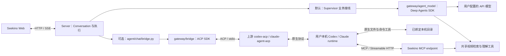

# Seekino 本地 Agent 接入 TRD：Codex / Claude Code 与既有 Supervisor

更新日期：2026-10-21。原方案日期：2026-10-10。
状态：本次明确本地与云端的产品目的，维护设计和源码现状；没有实施云端 Pi Host。

**当前产品决定：本地由用户连接自己安装、认证的 Codex 或 Claude Code，自行使用其原生运行时；云端由 Seekino 提供 Pi harness，并负责多用户资源效率与隔离。** 本地不要求用户安装 Pi。本地原生 runtime 可以按自身机制创建进程，其内存、进程数量和内部调度不属于云端 Pi Host 的优化职责。

Seekino 在本地负责公开协议接入、会话交接、业务工具、界面，以及自身创建连接的关闭。原生模型循环、压缩、内部调度和进程结构由外部 runtime 及其上游维护；集成不以改写或控制这些内部实现为前提。用户已有 CLI 进程不由 Seekino 接管。此边界适用于第三方运行时，不以其全部组件是否开源作为前提。

云端目标是让 4 CPU / 8 GB 等受限服务器通过一个 Node Pi Host 支持多个独立长期对话，用户可配置自己的模型 API；凭据、对话和一次性任务的具体边界统一维护在 [云端 Pi Host TRD](pi-host-trd.md)。本文件只负责本地接入，不能将本地一会话一原生进程的模式直接作为云端方案。

2026-10-21 源码核对：已有 [Deep Agents 接线](../../../gateway/agent_model/deepagents.py)、[Codex Supervisor](../../../gateway/codex/supervisor.py)、[ACP Client](../../../gateway/bridge/client.py) 和 [runtimeSessions 读写](../../../server/service/agent_chat.py)。因此原稿的“两类接入尚未实施”不再准确；这些文件存在也不代表本地完整 Bridge 或真实数据库迁移已通过验收。

下面保留 2026-10-10 的接入设计与历史 check-out，便于追踪既有实现。原“local 默认 Deep Agents”“先执行 D01”和批次进度均是历史记录，**不作为本次产品默认、当前开发顺序或新增实施授权**。当前本地目标以上述决定为准，云端以独立 Pi TRD 为准。

历史 ACP 基线：[5 批阶段图](../../report/gateway/bridge/agent-bridge-stages.svg)、[可编辑场景](../../report/gateway/bridge/agent-bridge-stages.excalidraw)、[批次索引](../../report/gateway/bridge/agent-bridge-stages.md)。原图的 37 文件、P01–P05 和本文后续 44 文件预算均属于历史范围；不用于描述云端 Pi 或判定当前实现进度。本次不重新导出阶段图。

## 1. 历史接入目标与范围（2026-10-10）

localhost 提供三种会话运行方式：默认的 Seekino Supervisor 使用 Deep Agents SDK 和用户配置的模型 API；用户也可选择自己安装、认证的 Codex 或 Claude runtime，经 ACP Bridge 结合视频内容操作本机文件。Seekino 提供会话界面、身份与资源管理及视频工具。

用户已明确选择复用成熟 harness，不再为 Supervisor 维护自研模型/工具循环。Supervisor 保留视频业务规则与结果投影，执行机制交给 Deep Agents。外部接入层保持通用，Codex 与 Claude 使用同一 ACP Client，分别使用上游 codex-acp 与 claude-agent-acp；选择 Bridge 后由对应原生 runtime 担任主 Agent。现有受限模型组件、视频 Chat/解析仍使用的公共循环保持其现有职责。云端新能力、Pi、远程主机与完整文件管理器不属于本次范围。

已确认的用户体验：

1. 新会话默认 Supervisor；选择 Codex/Claude Bridge 时可指定已有绝对目录，默认由 Server 明确解析为 Seekino 项目根目录。
2. 内置 Supervisor 的 thread_id 直接使用 Conversation.id；一个 Bridge Conversation 对应一个 ACP 主 session，每条消息对应一个 prompt。
3. 用户发送“总结当前视频，将知识点补进 notes.md，保留已有内容”，Codex 调用 Seekino 视频工具并修改文件。
4. 网页显示正文、工具进度、计划、审批与问题，并提供停止和刷新恢复。
5. Bridge 绑定后的 Agent 与目录固定；更换时新建 Conversation。内置 Supervisor 首批使用 SDK 虚拟 StateBackend，无需绑定本机 cwd。

执行进程位于用户本机，模型请求沿用实际模型来源。宿主机文件操作要求 Server 和 Agent 运行在宿主机；容器仅能访问挂载路径。

## 2. 层级与复用方案

外部接入归属 **gateway/bridge**，内置 harness 接线归属 **gateway/agent_model**。沿用用户指定的 codex-bridge-trd.md 文件名，在此统一维护两类 SDK 的职责与宿主合同。

| 层级 | 职责 | 实现方式 |
| --- | --- | --- |
| gateway/agent_model | 内置 Supervisor 的模型适配、SDK 执行、上下文与回调接线 | 薄接 create_deep_agent；不重写其 loop、summarizer、ToolNode 或 checkpointer |
| gateway/bridge | 外部 Agent 连接、session 操作、协议回调、生命周期与取消 | 薄接 ACP Python SDK；不拥有 Conversation、用户或视频语义 |
| 上游 codex-acp / claude-agent-acp | ACP 与各家原生 Runtime 的转换 | 使用固定版本依赖，不在 Seekino 重写 provider 适配器 |
| agent/chat | 聊天业务上下文、共享视频工具与已核验结果 | supervisor.py 消费内置 harness；bridge.py 消费通用 ACP Client；不引入 codex.py 或 claude.py 聊天分支 |
| server | local 检查、目录、Conversation 绑定、持久消息、执行快照、HTTP/SSE 和 MCP 权限 | 沿用现有 service/repository/API 层级 |
| web | Agent/目录选择、输出与工具活动、交互回答、停止、重连 | 扩展现有聊天组件，按当前连接查询后端能力 |

AgentModelFactory 新增 Supervisor 的 Deep Agents 装配入口；原 build_structured/build_loop 及 gateway/codex、gateway/claude_code 继续服务尚未迁移的模型子任务。ACP 不塞进模型 factory。两种 SDK 各自接线，在 Server 复用会话、消息和事件合同，不另造通用 harness 框架。

### 2.1 SDK 接入边界

内置路径为 Supervisor → gateway/agent_model 的薄接线 → create_deep_agent → 已配置 API 模型与业务工具。历史消息改为 SDK messages 输入，自动摘要与大结果卸载直接使用 SDK middleware。保留已核验视频答案、来源校验、当次资源范围和视频任务预算；这些由 Seekino 工具与宿主执行。

外部路径为 bridge.py → gateway/bridge → ACP Python SDK → 对应适配器 → 原生 runtime。会话、工具循环、压缩、文件和命令执行由 Codex/Claude 负责。共享视频工具在 Python 内直接调用，外部通过 MCP 调用。

首批 Supervisor 使用 StateBackend 的虚拟文件，不接本机 shell，也不新增文件代理。已有视频 graph 继续作为业务工具；不将 Query/Evaluator/Chat 审核门槛替换为通用 task 分派。SDK 默认工具需按 harness profile 明确配置，传入业务 tools 不是默认工具的白名单。[Deep Agents 定制](https://docs.langchain.com/oss/python/deepagents/customization)、[Backend](https://docs.langchain.com/oss/python/deepagents/backends)

依据：[Gateway 职责](../../../gateway/README.md)、[模型合同](../../../gateway/agent_model/contracts.py)、[受限 Codex 会话](../../../gateway/codex/client.py)、[受限 Claude 模型](../../../gateway/claude_code/agent.py)、[Supervisor](../../../agent/chat/supervisor.py)、[聊天服务](../../../server/service/agent_chat.py)。

## 3. 开源依赖与已核实限制

| 组件 | 建议验证版本 | 用途与状态 |
| --- | --- | --- |
| deepagents | 0.7.23 | 内置 Supervisor harness；发布版已存在，尚未安装或运行验收 |
| agent-client-protocol | 0.12.1 | 支持 Python 3.12；提供异步 Client、stdio、JSON-RPC、schema、会话与交互接口；当前项目尚未引入 |
| @agentclientprotocol/codex-acp | 2.2.2 | 首版外部适配器；通过 CODEX_PATH 使用用户的 Codex；与本机 CLI 的实际兼容性未验收 |
| mcp | 当前锁定的 2.2.0 | 已由 Claude SDK 间接引入；视频 MCP 应声明直接依赖并复用安装版本 API |
| @agentclientprotocol/claude-agent-acp | 0.89.1 | 同一 ACP Client 的 Claude 启动 profile；使用上游 TypeScript Claude Agent SDK，要求 Node ≥22；尚未本机验收 |

版本来源：[Deep Agents 0.7.23](https://pypi.org/project/deepagents/0.7.23/)、[ACP 0.12.1](https://pypi.org/project/agent-client-protocol/0.12.1/)、[codex-acp 2.2.2](https://github.com/agentclientprotocol/codex-acp/releases/tag/v2.2.2)、[Claude adapter 0.89.1](https://github.com/agentclientprotocol/claude-agent-acp/releases/tag/v0.89.1)。本机 Codex 先前核实为 0.162.1，旧模型组件固定 openai-codex==0.156.1；新的 ACP 路径不依赖旧 Python Codex SDK，也不要求升级已有 Python claude-agent-sdk。两家适配器均使用 @agentclientprotocol 包；原 Zed Codex 仓库已归档。[迁移说明](https://github.com/zed-industries/codex-acp)

Deep Agents 0.7.23 的依赖要求 LangChain ≥1.4.4、core ≥1.6.7。当前锁为 1.4.0/1.6.3，因此需要解析并验证新的组合；Python 3.12 符合要求。SDK 同时带来 Anthropic、Google GenAI 等传递依赖，锁文件按实际解析更新。当前 langchain-openai 1.6.2 是否需升级由兼容验证决定，不将上游测试依赖当作生产强制下限。[上游依赖](https://github.com/langchain-ai/deepagents/blob/main/libs/deepagents/pyproject.toml)

Deep Agents 通过 BaseChatModel 接模型。当前 OpenAI/DeepSeek、Ark 来源的 token、reasoning、超时、过滤与 fallback 行为需由薄适配保持；不复用 Query 私有的强制工具/结构化验证类，也不再将本机 coding runtime 包进内置 harness。SDK 的摘要模型调用同样纳入现有 tracing/usage 与预算。

直接复用 SDK 的 spawn_agent_process、initialize、new_session、prompt、load_session/resume_session 和 cancel。请求 ID、JSON-RPC 数据类型、管道读取与写入由 SDK 处理，不再自研 stdio dispatcher。[SDK 示例](https://agentclientprotocol.github.io/python-sdk/quickstart/)

SDK 回调使用异步任务；等待用户回答不会占用唯一读循环。客户端待交互记录、API 归属检查和任务终态仍由 Seekino 管理。[连接实现](https://github.com/agentclientprotocol/python-sdk/blob/0.12.1/src/acp/connection.py)

SessionAccumulator 可以复用消息、工具状态和计划合并；contrib 是实验 API，需锁定版本。它不提供 Seekino 数据库持久化、HTTP 订阅或待审批 registry。PermissionBroker/ToolCallTracker 主要用于 Agent 侧发起请求，不当作客户端审批状态机。[Contrib 说明](https://agentclientprotocol.github.io/python-sdk/contrib/)

## 4. 本机链路与生命周期



内置 SDK 在现有聊天执行线程内运行，保留该线程的 tracing/usage scope；同一 Conversation 串行执行。InMemorySaver 由长期存活的装配资源持有，Agent 配置热更新复用它，不在每次重建 Supervisor 时丢弃。关闭服务释放内存状态。

每个活跃 Bridge Conversation 持有一个 adapter 子进程和一个 session，按需启动。进程释放后保留外部持久 session；后续请求加载它。不同 Conversation 的执行互相隔离，同一 Conversation 串行执行 prompt。

ACP 操作必须由持续存在的 asyncio loop 托管，不能每条消息临时 asyncio.run 后关闭进程。为兼容当前同步 kick/ThreadPoolExecutor 路径，通用 Client 在接入边界维护一个长期 I/O loop，通过 run_coroutine_threadsafe 调度。回调只投递事件、等待交互或提交业务任务，不在 I/O loop 上执行阻塞的视频 graph。

服务关闭先取消活跃 prompt、结束待交互、回收本服务启动的 adapter，最后关闭视频与数据库资源。释放进程不删除用户的 session，不接管用户已有 CLI/桌面会话。

首版 ACP Client 不声明文件与终端执行能力；Codex/Claude 使用自身原生文件与 shell 工具。Seekino 接收执行事件与审批，避免增加文件代理或终端执行器。

## 5. 配置、目录与权限的实际语义

### 5.1 启动配置与环境

ServerSettings 从本机环境解析允许的 Agent 启动 profile，Bridge 接收校验后的 command/args/env。固定适配器包与版本不放 web/package.json。创建 API 只接收 Agent 选择和 cwd；浏览器不能提交任意启动命令、环境变量、外部 session ID 或整个 detail。模型 config.yaml 保持现有职责，不将进程命令加入其 agent_runtime 或网页全局设置白名单。

首版解析用户 Codex 的绝对路径并显式传 CODEX_PATH。适配器未设置此变量时会使用自带 Codex，不能将这种行为描述为用户的安装。[codex-acp 配置](https://github.com/agentclientprotocol/codex-acp)

Claude 使用另一个允许的启动 profile；通过上游 CLAUDE_CODE_EXECUTABLE 选择用户实际 CLI，核对其 SDK 支持的认证和 user/project/local 设置来源。配置目录、模型凭据和代理的继承按实际 SDK/adapter 能力处理，不复制 Codex 的环境名单或假定两者完全相同。[Claude adapter](https://github.com/agentclientprotocol/claude-agent-acp)、[Claude 接线源码](https://github.com/agentclientprotocol/claude-agent-acp/blob/main/src/acp-agent.ts)

ACP SDK 默认只继承精简环境；宿主必须显式保留实际使用的 CODEX_HOME、模型凭据所需环境和代理配置。运行配置只存在于本机进程，不返回网页或写入 Conversation detail。[SDK 环境处理](https://github.com/agentclientprotocol/python-sdk/blob/0.12.1/src/acp/transports.py)

内置 Supervisor 沿用当前主 Agent 的模型来源及 fallback，经 Deep Agents 模型适配执行；不改变视频角色各自的模型配置。Bridge 主 Agent 使用对应原生 runtime 的模型来源，其上下文、压缩和模型循环由外部 runtime 管理。已有模型 factory 与预算继续服务视频子任务；并发、取消和服务资源限制仍由宿主管理。

### 5.2 工作目录

省略 cwd 时从项目位置明确解析 root，不依赖 Server 启动目录。指定目录应存在、是目录、可访问且规范化为真实绝对路径；网页显示 Server 确认值。

目录与 Agent 在创建时写入绑定，后续消息不能改变。新 session、load 和 resume 均显式传保存的 cwd 与当前业务 MCP 配置。路径校验与执行沙箱是不同职责。

### 5.3 各 runtime 权限的边界

当前上游 codex-acp 没有完整的 inherit 权限模式。它按 AgentMode 在 prompt 中设置审批、reviewer 和 sandbox，且将传入 workspace 配置为 trusted。CODEX_CONFIG 不能保证覆盖 turn 级权限预设。

默认 agent 模式的 on-request / auto_review / workspace-write 三项与用户之前选择的 Approve for me 一致，但额外 writable roots、网络设置和项目 trust 可能不同。因此目标表述为：使用用户安装和登录，读取其适用模型/指令配置，同时明确显示并验证适配器实际执行模式；不承诺所有原生设置原样继承。[模式源码](https://github.com/agentclientprotocol/codex-acp/blob/main/src/AgentMode.ts)、[会话与 turn 配置](https://github.com/agentclientprotocol/codex-acp/blob/main/src/CodexAcpClient.ts)

首批先验证这一组合。额外可写目录、网络或受管权限存在不兼容时明确报告，不静默切换 full-access。完整个人权限继承作为上游 TODO；若必须修补适配器，另核对该兼容补丁，不将 provider 逻辑放回 agent/chat。

上述 auto_review/workspace-write 限制只描述 Codex。Claude 单独验收其实际设置来源、permission mode、目录与审批往返；不将 Codex 模式映射套给 Claude。内置 Supervisor 的 StateBackend 是虚拟状态，真实资源访问仍受 Seekino 业务工具检查约束，SDK 文件权限不能代替自定义工具的鉴权。

人工审批显示适配器提供的 optionId 和说明，自动 reviewer 的结果按实际事件呈现。每次回复重新检查执行归属与待交互状态。

<a id="bridge-session"></a>

## 6. Conversation detail 与会话恢复

当前已有可空 JSON ORM、内部 State 和 Repository 读取，创建绑定、更新绑定和网页投影尚未实现。旧库迁移见 [conversation.detail SQL](../../migrations/20261010_agent_conversation_detail.sql)；当前未执行迁移。

字段评审状态：用户要求涉及模型字段的设计先交由其 review。以下 JSON 结构与第 8、9 节的数据合同均为评审稿，尚未定稿；P02/P04 涉及字段的实现以前述 review 为前置。P01 的通用协议验证可以独立进行。既有 detail ORM/SQL 的准备状态不变。

建议内部合同：

```json
{
  "environment": "local",
  "runtime": {
    "type": "bridge",
    "agent": "codex",
    "sessionId": "opaque-id-returned-by-acp",
    "cwd": "/Users/alice/Documents/course-notes"
  }
}
```

type=bridge 表示外部运行方式，agent 表示所选 Agent；旧会话没有此绑定时仍使用 Supervisor。未创建外部 session 时 sessionId 可为空。消息仍是 USER/ASSISTANT，不新增 bridge role 或 is_bridge。

ACP sessionId 是不透明恢复键。Codex 的 thread/session 内部映射由上游适配器拥有；Seekino 不要求所有 Agent 同时提供 threadId，也不依赖两种 ID 相等。

environment 由 Server 在创建时记录；执行时以当前 AuthConfig/AuthIdentity.mode 为权威。cloud 不因 metadata 写了 local 而启动 Bridge。能力查询使用浏览器当前选中的 Server，不能从网页域名判断运行环境。

第一次发送的顺序是：校验身份与目录 → 建立外部 session → 在租户/所有者约束下锁定 Conversation 并合并写入 sessionId → 成功提交绑定 → prompt。绑定写入失败不能开始文件任务。JSON 重新赋值，保留未知元信息；会话幂等比较包含已绑定 Agent 和目录。

已有进程复用同一 session；进程丢失则 initialize 后按能力调用 resume_session，或 load_session。load 会通过 session_update 回放历史，恢复阶段应识别回放，避免再次插入 Seekino 消息或追加到当前回答。恢复后不重新发送全量聊天历史。[ACP 会话设置](https://agentclientprotocol.com/protocol/v1/session-setup)

服务崩溃或进程失联后不自动重发可能已修改文件的 prompt。ACP 恢复并不保证能查询所有 provider 的旧 turn 终态；不能确认时将该消息标记为结果未知/执行中断，保留 session，供用户核对后发新任务。缺失 session 或目录时明确失败，不自动新建并重放。

<a id="bridge-field-review"></a>

### 6.1 模型字段 review 稿：持久绑定

本稿不新增数据库列、表、PK/FK、索引或 SQL 状态枚举。复用已准备的 agent_conversation.detail JSON NULL；AgentMessage 的现有 detail、status、model 和错误字段继续使用。Python DTO/VO 使用 snake_case，HTTP/JSON 沿用现有 ContractModel 的 camelCase；数据库列仍为简洁的 detail。

| JSON 路径 | 类型 / 可空 | 来源与写入方 | 持久性 / 网页可见性 |
| --- | --- | --- | --- |
| detail.environment | local / cloud；新记录非空，旧记录可缺 | Server 的实际运行环境；浏览器不能指定 | 持久；网页可见；不作为执行鉴权依据 |
| detail.runtime.type | supervisor / bridge；新绑定非空，旧记录可缺 | 创建请求选择，Server 校验；缺省沿用 Supervisor | 持久；网页可见 |
| detail.runtime.agent | 字符串；bridge 必填，supervisor 不写 | 创建请求选择允许的 Agent，本次为 codex / claude | 持久；网页可见 |
| detail.runtime.cwd | 绝对目录字符串；bridge 必填，supervisor 不写 | 用户可选输入；Server 校验并规范化，省略时取项目 root | 持久；网页可见；创建后固定 |
| detail.runtime.sessionId | 不透明字符串或 null | ACP 返回，Server 在 prompt 前合并提交；浏览器不能指定 | 持久；仅服务端恢复使用，不返回网页 |

上述是 JSON 合同，sessionId 没有数据库 FK，也不限定为 UUID。type/agent/cwd/sessionId 不是单独 SQL 列。不增加 is_bridge、codex_session_id、threadId 或重复 schemaVersion。更新 JSON 时保留其他元信息。

### 6.2 模型字段 review 稿：创建与查询

创建 DTO 新增可省略的 runtime 对象；bridge 对象只允许 type、agent、cwd。cwd 可省略，由 Server 补默认目录。runtime 省略保持原创建行为；supervisor 不接受 agent/cwd。客户端不传 environment、sessionId、detail 或启动命令。

```json
{
  "tenantId": "local",
  "runtime": {
    "type": "bridge",
    "agent": "codex",
    "cwd": "/Users/alice/Documents/course-notes"
  }
}
```

Conversation 查询 VO 增加可选 environment 和经过白名单过滤的 runtime 视图，仅返回 type/agent/cwd，不公开整个 detail 或 sessionId。旧记录的 environment 无法从缺失元信息可靠推断时返回 null；执行能力由当前 Server 确定，runtime 缺失投影为 supervisor。前端对可选字段保持旧响应兼容。

### 6.3 Deep Agents 会话与存储边界

D01 不新增业务表、列、索引、PK/FK、状态枚举或 DTO/VO 字段。Supervisor 仍是 runtime.type=supervisor，Deep Agents 是内部执行实现；不增加 engine、is_deepagent、deepagent_session_id 或重复 threadId。thread_id 直接取已鉴权 Conversation.id。ACP sessionId 仍只属于 Bridge，第 6.1/6.2、8.1、9.1 节字段稿继续等待用户 review。

首批采用 SDK InMemorySaver，保留同进程多轮状态，不引入持久 checkpoint 数据库。动态 tenant/actor、视频 scope/reference/playback、取消、deadline 与用量归属属于当次 context。每轮 graph 绑定当次业务工具闭包，复用 Saver；不得复用捕获旧资源范围或播放位置的闭包。

冷 thread 才从当前 SQL 中已完成的历史初始化，沿用 history_message_limit 和稳定业务 message ID；已有 thread 只追加当前轮，避免每轮重复回灌最近历史。删除 Conversation 成功后清理对应 SDK thread；配置重载复用 Saver。取消、工具失败、SQL 保存失败时，不直接 resume 半轮或重放工具；用 SDK 状态 API 回到已提交边界，必要时清空 thread 后从 SQL 已完成消息重建。

模型图完成不等于业务消息提交成功。宿主在 SQL 成功提交后确认本轮，并将最终呈现的已核验视频答案与补充内容同步为 thread 的助手消息；不能只留下模型草稿或网页补充。D01 的直接回归必须证明该成功边界、失败清理及历史去重。

服务重启会丢 SDK 摘要、工具轨迹和虚拟文件，只能从已完成业务消息初始化新执行；不承诺恢复旧工具调用或待审批 checkpoint。若后续要求完整跨重启恢复，需先提交上游 durable saver 的存储位置、SDK 表结构、保留/删除策略和恢复语义供用户 review，不自建 checkpoint 引擎。[SDK checkpointer 接口](https://docs.langchain.com/oss/python/deepagents/customization)、[持久恢复与审批](https://docs.langchain.com/oss/python/deepagents/human-in-the-loop)

<a id="bridge-mcp"></a>

## 7. 视频能力通过 MCP 提供

首版挂载本机 Streamable HTTP MCP endpoint，复用当前 MCP SDK。codex-acp 支持 HTTP 和 stdio MCP，不支持旧 SSE MCP；Claude adapter 也通过 ACP 提供的 MCP 配置接入。两家均在创建与恢复时注入当前业务连接配置，各自实测 transport 和认证，不将一种适配器通过当作另一种已验收。

server/api/agent_mcp.py 只负责 MCP 注册与宿主上下文入口；共享视频逻辑由 agent/chat/common/video_tools.py 从现有 Supervisor 提取，保留原缓存、预算、取消、图像与已核验答案行为。使用 api/app.py 组合当前应用与 MCP lifespan，不新起一套视频 Server。

提供 search_video_graph 与 understand_current_video。模型参数只包含业务输入；身份、tenant、source tenant、series 范围、播放上下文、消息归属、deadline 与 cancellation 由 Server 绑定的当前执行提供。

本机 MCP 使用服务端生成的会话凭据关联执行。凭据只在内存和进程连接配置中使用，执行结束后停止授权工具调用；它不写入 detail、消息或日志。请求进入时捕获当前执行，调用前检查身份、资源范围与取消状态；旧执行未结束前不启动同一 session 下一轮。

同步视频任务在工作线程执行并传递 tracing/usage 的 contextvars。MCP 等待不会阻塞 ACP 回调。已核验答案与证据由宿主保存并按原渲染块呈现；主 Agent 的解释作为补充，不能替换已核验答案。

MCPServer 的工具、类型和 transport 直接复用 SDK；当前环境是 MCP 2.x，实施时按安装 API 写，不复制旧 FastMCP 示例。[MCP Python SDK](https://github.com/modelcontextprotocol/python-sdk)

## 8. 流式输出、交互与停止

HTTP 创建和发送入口保留，扩展通用 runtime 选择与事件。conversation 查询返回经过筛选的 environment/runtime 视图，避免将任意内部 detail 或凭据整体公开。

D01 沿用现有 answer.*、消息状态和界面，SDK 原生流在接线层投影，不为内置 Supervisor 再定义一份产品事件合同。工具/计划/交互的通用界面在 ACP 业务接线阶段按以下字段稿实施；本批不新增未经 review 的对外字段。

| 信息 | 接线与呈现 |
| --- | --- |
| 助手文本 | ACP message chunk 转现有 answer.delta，Bridge 路径即时发布；终态以持久消息为准 |
| 工具与计划 | 合并 ACP tool_call/update 与 plan，前端显示动作、进度、状态及适配器提供的结果 |
| 审批 | request_permission 回调生成待处理交互，等待网页提交实际 optionId |
| 用户问题 | 通过 ACP create_elicitation 显示文本/选项等受支持的表单；不伪造空回答 |
| 停止 | 向当前 session 发 cancel，取消视频任务并结束待交互；继续观察实际终态 |

ACP 0.12.1 的 elicitation 能力属于实验接口。必须实现并声明所支持的 form/url 能力；未实现的形式明确拒绝，不宣告全量支持。特别验证 Codex 原生提问是否被完整映射。[适配器问询实现](https://github.com/agentclientprotocol/codex-acp/blob/main/src/CodexElicitationHandler.ts)

待交互记录绑定本服务进程、ACP session、Seekino message 和交互 ID。回复、停止与订阅均重新鉴权；过期、跨用户和重复回复不能产生第二次有效响应。prompt 终态、取消和进程退出均清理等待。人工等待不消耗视频子任务执行预算。

复用原 message 状态与阶段，不扩 SQL 状态枚举。Gateway 不生成产品数据库状态；Server 在完成或失败时持久化实际结果。

### 8.1 模型字段 review 稿：活动与交互

以下是 DTO/VO/SSE 和当前进程内存对象，不新增 SQL 字段。conversationId/messageId/sequence/occurredAt 复用现有事件封套，不引入 executionId 或 runId。工具与交互的 id 仅在当前消息执行内有效，不是数据库 FK。

| 对象 | 提议字段 | 含义与约束 |
| --- | --- | --- |
| tools[] | id、title、status、content | 工具调用标识、显示标题、执行状态、可空展示正文；Server 格式化，不公开原始协议载荷 |
| plan[] | content、status | 计划内容与状态；不为列表项增加无消费需求的 ID/优先级 |
| interactions[] | id、type、title、toolId | 待交互标识、permission/form/url 分类、显示说明、可空关联工具 ID；由服务端绑定当前 message |
| permission interaction | options[]，每项 id/label/kind | id 对应 SDK 实际 optionId；保留原选项的说明与审批范围，不重新创造可选决策 |
| form interaction | schema | 复用 SDK 的已支持表单结构；首批验证实际形式，不自建全量表单协议 |
| url interaction | url | 仅在已实现并声明 URL 问询能力时使用；否则明确返回不支持 |
| permission 回复 DTO | optionId | 路由定位 message/interaction 后，Server 检查实际待处理选项 |
| form/url 回复 DTO | action、content | action 为 accept/decline/cancel；接受表单时 content 是合法答案对象，其他情况不带内容 |

tool/plan 的状态只用于 UI；建议映射为 PENDING/RUNNING/COMPLETED/FAILED 中实际适用项，具体上游映射由 P01 验证后纳入字段定稿。不把这些状态加入 AgentMessage 的 SQL status 或 phase。

审批与问询等待时，持久 message.status 仍为 PROCESSING。显式停止先发出取消请求并继续观察实际终态，不立即写 FAILED；仅在实际取消成立，或进程被终止/结果无法确认时，建议落 FAILED，并使用既有 lastError 分别表达 EXECUTION_CANCELLED / EXECUTION_INTERRUPTED。如果正常完成先发生则保持 COMPLETED。SSE 断线本身不改变任务状态。此终态映射也属于用户 review 内容。modelName 沿用实际可观测的模型名，缺失时 null，不将 codex 这个 Agent 名伪装为模型名。

<a id="bridge-recovery"></a>

## 9. 执行快照与断线恢复

当前 AgentMessageExecution.detach 会清空队列并丢弃后续事件，messages/events 仅能恢复数据库消息，无法恢复工具状态和审批。需要扩展当前执行记录，保留正文、tool/plan、pending interaction 和 sequence，并支持重新订阅。

建议新增三个通用执行操作：

1. 查询/订阅当前消息执行快照与增量事件。
2. 回复某个待处理交互。
3. 停止当前执行。

具体路由沿用 server/router/agent.py 的 action 风格，产品合同沿用 answer.*；浏览器不直接处理 provider 原生消息。建立订阅与快照读取必须具有原子交接或补发机制，避免快照和增量之间丢事件。

断开 SSE 只解除订阅，任务继续。刷新先恢复快照与 lastSequence，再接增量并去重，待审批卡片仍可回答。切换连接/身份隔离旧回调，不能重发 prompt。任务终态从数据库恢复，活跃快照由当前服务内存维护；服务重启按第 6 节处理中断。

停止优先走 ACP cancel；失去响应才终止该会话进程。停止不撤销已完成的文件修改。完成后检查实际文件和 runtime 状态，不能以助手文字作为执行成功证据。

### 9.1 模型字段 review 稿：执行快照

建议快照字段为 assistantMessage、sequence、tools、plan、interactions。assistantMessage 复用现有 AgentMessageView，其 content/status/phase/version/lastError 不另定义一份；sequence 是当前执行事件序号（未发事件时为 0），不等于数据库 sequenceNo。数组无项目时返回 []。

活跃快照与未完成交互只保存在当前服务内存，支持网页刷新和重新订阅。最终正文、视频结果/证据与错误沿用现有 message 持久字段；本稿不承诺服务重启后恢复仍等待的审批回调或完整工具时间线。重启按第 6 节标记无法确认的执行，保留外部 session，不自动重放 prompt。

## 10. 兼容、用量与错误

旧 Supervisor Conversation 继续可用，底层改为 Deep Agents，不保留第二条自研 Supervisor 作为默认回退。受限 Codex/Claude 模型、视频 graph 与历史消息读取继续承担原职责；公共 tool_loop.py 仍被视频 Chat/解析消费，本批不全局删除。共享视频工具的提取必须保持旧测试与已核验结果约束。

Deep Agents 模型调用含摘要/附加调用，均走现有 usage/tracing；实际 fallback provider 如实归因。停止/deadline 在模型与工具边界传递，执行线程内 scope 不因 SDK 接入丢失。ToolNode 可能并发工具调用，须保留当前完整原问题一次执行、缓存复用和 scope 约束；LangChain artifact 不自动成为模型可见原图，薄媒体投影须保持原图与文字 fallback 行为。

主 Agent 可观测 usage 按 session/prompt 归因，缺失值保持未知，不虚构内部模型调用。视频任务沿用现有 usage 路径，两类来源避免重复累计。

未安装适配器或 Codex、未登录、协议不兼容、目录无效、审批拒绝、问询不支持、MCP/工具失败和恢复失败返回可理解的错误。选择 Bridge 后不静默退回 Supervisor。

当前前端支持多个本地/远程连接，新增接口继续走 businessContext、凭据、CSRF 与 scope cancellation。无需重构 AuthProvider、AppShell、main.tsx 或远端代理。

<a id="bridge-checkout"></a>

## 11. 历史 Check-out：职责、方向与当时授权（2026-10-10）

- 主要职责：接入两类成熟 SDK；gateway/agent_model 负责内置 Supervisor，gateway/bridge 负责外部 runtime，并核对 Agent/Server/Web 必需的宿主接线。范围来自用户最新的“直接换成 deepagents”与“两种 sdk 接入维护到 trd 后 check-out”；不重写完整 harness 或 provider 协议适配器。
- 开发方向：local 默认内置 Deep Agents Supervisor，可选 Codex/Claude ACP Bridge。先切内置 Supervisor，再接通用 ACP Client、后端绑定、共享 MCP 与界面。视频搜索审核图、解析调度与尚未迁移的模型消费者继续保持现有职责。
- 下一步：D01 按第 12.1 节 14 文件完成 SDK 装配、默认模型/fallback、线程状态、已有输出、取消和用量回归；通过后进入 ACP 兼容验证。原 ACP 地图当前 P01 未实施，本次新增 D01 不被旧地图的 37 文件预算覆盖。
- 用户边界决策：Deep Agents 替换、local 默认、Codex/Claude 可选、项目 root 和 Conversation/session 绑定已明确，D01 无关键未决项。ACP 第 6.1/6.2、8.1、9.1 节字段仍待用户 review；完整权限继承及各家兼容性是调查/验收项，不要求用户重新选择已确认方向。

本轮按“维护 TRD 后 check-out”交付文档和开发前范围，生产实现尚未开始。D01 已有明确技术方向且无字段阻塞；以下为本次首次展开的实施树，依照项目变更门禁在实施前核对本树授权。ACP 字段依赖只限制对应后端/UI 接线，不阻塞 D01 或独立协议验证。其他并行工作区改动保持原样。

<a id="bridge-first-batch"></a>

## 12. 历史接入批次与第一批修改树

<a id="supervisor-first-batch"></a>

### 12.1 D01：内置 Supervisor 改为 Deep Agents（当时优先）

```text
Seekino/
├── [M] pyproject.toml  ← 引入固定 Deep Agents 与必要 LangChain 约束；影响：SDK 直接依赖
├── [M] uv.lock  ← 解析兼容组合；影响：依赖升级可复现
├── gateway/
│   ├── [M] README.md  ← 内置 harness 使用与恢复边界；影响：说明真实配置
│   └── agent_model/
│       ├── [M] contracts.py  ← Supervisor 执行/成功确认/失败清理合同；影响：原角色合同保持
│       ├── [M] factory.py  ← build_deep_agent 与长期会话资源；影响：只切 Supervisor 装配
│       └── [A] deepagents.py  ← SDK 图、薄模型适配和回调接线；影响：上下文/用量/取消由成熟机制承载
├── agent/
│   └── chat/
│       └── [M] supervisor.py  ← 换 SDK 消息输入与执行；影响：保留业务工具和批准答案投影
├── server/
│   ├── [M] bootstrap.py  ← 默认 Supervisor 装配；影响：复用会话资源及关闭生命周期
│   └── service/
│       └── [M] agent_chat.py  ← SQL 成功确认、失败清理与 thread 删除；影响：上下文与真实消息一致
└── tests/
    ├── gateway/
    │   ├── [A] test_deepagents.py  ← SDK 真图/假模型验证；影响：摘要/隔离/参数/用量/取消受保护
    │   └── [M] test_agent_factory.py  ← 新装配与原角色分离；影响：旧 factory 行为兼容
    ├── agent/
    │   └── chat/
    │       └── [M] test_supervisor.py  ← 原文核验/图片/工具并发回归；影响：视频事实行为保持
    └── server/
        ├── [M] test_bootstrap.py  ← 默认装配/关闭/热更新；影响：会话状态不随配置重建丢失
        └── [M] test_agent_chat_service.py  ← 保存边界/去重/失败/断线；影响：宿主合同保持
```

D01 共 14 文件：生产 6、依赖 2、测试 5、说明 1；A 2、M 12，无删除文件。生产预计新增 500–900 行、删除/替换 120–250 行，测试新增 300–500 行；文档与锁文件另计。新增的是 SDK/模型/宿主接线，不包含自研 agent loop、context compaction 或 checkpoint 存储引擎。无需改产品 API、DTO/VO、数据库 Schema 或前端；已有 config.yaml 模型来源继续有效。

直接验收：当前 DeepSeek/API 与 Ark fallback 参数和实际用量正确；直接问答、视频检索、当前画面、网页补充保留原行为；两会话隔离、连续两轮、摘要后继续、scope 变化、SQL 保存失败、取消、删除与热配置正确。第一批使用 SDK 内存状态，重启只从 SQL 已完成消息重新初始化，不宣称完整恢复。

### 12.2 ACP P01：通用 Client 与两家适配器兼容验证

沿用原 ACP P01 的五文件边界。SDK 客户端不为 Codex/Claude 各写一份；测试参数化两家能力差异。首次接入依次验证 Codex 和 Claude，未安装或未验收的 profile 不在网页宣告可用。

```text
Seekino/
├── [M] pyproject.toml  ← 增加固定 ACP SDK；影响：新的直接依赖
├── [M] uv.lock  ← 锁定依赖解析；影响：可复现安装
├── gateway/
│   └── bridge/
│       ├── [A] __init__.py  ← 通用公开入口；影响：上层不依赖 provider
│       └── [A] client.py  ← SDK 生命周期/回调接线；影响：session、流式、交互与取消
└── tests/
    └── gateway/
        └── [A] test_bridge.py  ← fake ACP 回归；影响：仅验证宿主接线
```

ACP P01 共 5 文件：生产接线 2、依赖 2、测试 1；新增 3、修改 2。接线预计新增 180–320 行，测试新增 180–300 行，锁文件变化以实际解析为准。依赖文件与 D01 重合，合并统计不重复计数；无产品 API 或数据库变更。

ACP P01 完成条件：离线验证回调不阻塞、事件归属、取消与退出清理；按 runtime 分别在本机隔离目录验证两轮同 session、文件修改、进程重建恢复、实际审批模式与问询。替身通过不等于任何一家原生接入通过，P01 通过不等于完整网页接入完成。之后沿用 ACP P02→P03/P04→P05 的业务依赖，启动 profile 配置补入 P02。

<a id="bridge-full-scope"></a>

## 13. 历史两类 SDK 完整预计修改树

以下包含 D01 与 ACP 首版，不额外叠加统计。此前 37 文件只对应 Codex 基线；本次增加内置 harness 必需的 5 个唯一文件与 Server 启动配置/测试 2 个文件，共 44 个唯一文件。Claude 复用已有 ACP、业务、MCP、DTO/UI 和参数化测试文件，不新增 provider 业务文件。实施前若新证据要求扩围则更新 check-out。

```text
Seekino/
├── [M] pyproject.toml  ← Deep Agents/ACP/MCP 直接依赖；影响：固定 SDK 组合
├── [M] uv.lock  ← 依赖锁定；影响：安装可复现
├── gateway/
│   ├── [M] README.md  ← 内置/外部 runtime 接入说明；影响：说明配置/边界
│   ├── agent_model/
│   │   ├── [M] contracts.py  ← 内置 harness 合同；影响：不改变旧模型消费者
│   │   ├── [M] factory.py  ← Deep Agents 装配；影响：共享会话资源
│   │   └── [A] deepagents.py  ← SDK/模型/上下文接线；影响：替换 Supervisor 自研循环
│   └── bridge/
│       ├── [A] __init__.py  ← 通用入口；影响：隔离 SDK 依赖
│       ├── [A] client.py  ← ACP SDK 接线；影响：完整外部 session 操作
│       └── design/
│           └── [M] codex-bridge-trd.md  ← 实施留证；影响：设计与验收同步
├── agent/
│   └── chat/
│       ├── [A] bridge.py  ← 通用业务运行接线；影响：主循环交给外部 Agent
│       ├── [M] supervisor.py  ← Deep Agents/共享视频工具/结果；影响：保留业务并替换执行机制
│       └── common/
│           └── [A] video_tools.py  ← 提取现有视频工具；影响：Supervisor/MCP 共用
├── server/
│   ├── [M] bootstrap.py  ← local 装配与关闭；影响：cloud 无本机执行器
│   ├── config/
│   │   └── [M] settings.py  ← 本机允许的 Codex/Claude 启动 profile；影响：命令与环境不由网页指定
│   ├── repository/
│   │   └── [M] agent.py  ← 受控合并绑定与幂等；影响：session 持久归属
│   ├── service/
│   │   └── [M] agent_chat.py  ← SDK 成功边界/运行选择/快照/交互；影响：消息与上下文一致
│   ├── model/
│   │   ├── dto/
│   │   │   └── [M] agentDTO.py  ← 创建与操作输入；影响：校验 runtime/cwd
│   │   └── vo/
│   │       └── [M] agentVO.py  ← 绑定/活动/交互视图；影响：通用产品合同
│   ├── api/
│   │   ├── [M] agent.py  ← 能力/执行/回复/停止；影响：归属与环境校验
│   │   ├── [A] agent_mcp.py  ← MCP SDK 工具注册；影响：视频工具带业务上下文
│   │   └── [M] app.py  ← 挂载 MCP/组合 lifespan；影响：启动关闭无泄漏
│   └── router/
│       └── [M] agent.py  ← 通用操作路由；影响：复用 action API 风格
├── web/
│   └── src/
│       ├── api/
│       │   ├── [M] contracts.ts  ← 通用绑定/执行合同；影响：界面识别真实能力
│       │   ├── [M] client.ts  ← 新接口与流恢复；影响：沿用当前连接/CSRF
│       │   └── [M] client.test.ts  ← 请求/连接隔离；影响：防止跨来源操作
│       └── features/
│           └── search/
│               ├── [M] useAgentConversation.ts  ← 绑定/快照/回复/停止；影响：刷新继续
│               ├── [M] useAgentConversation.test.ts  ← 恢复/去重回归；影响：不重发任务
│               ├── [M] SearchPage.tsx  ← Agent/cwd 与操作入口；影响：新会话明确选择
│               ├── [M] SearchPage.test.tsx  ← 模式/目录/云端拒绝；影响：用户流程回归
│               ├── [M] AgentProgress.tsx  ← 工具/计划/交互；影响：可观察执行
│               ├── [M] AgentProgress.test.tsx  ← 交互与终态；影响：按实际选项回复
│               └── [M] search.module.css  ← 当前界面样式；影响：活动/交互可读
└── tests/
    ├── gateway/
    │   ├── [A] test_bridge.py  ← 两家 ACP 接线回归；影响：不测试上游协议实现
    │   ├── [A] test_deepagents.py  ← 内置 SDK 回归；影响：上下文/参数/用量/取消
    │   └── [M] test_agent_factory.py  ← harness 工厂回归；影响：原角色装配保持
    ├── agent/
    │   └── chat/
    │       ├── [A] test_bridge.py  ← 业务输入/结果；影响：保留核验约束
    │       └── [M] test_supervisor.py  ← 共享工具回归；影响：旧模式兼容
    └── server/
        ├── [A] test_agent_mcp.py  ← MCP 凭据/范围/取消；影响：工具归属隔离
        ├── [M] test_bootstrap.py  ← local/cloud/清理；影响：资源装配正确
        ├── [M] test_config.py  ← 固定 profile 与环境解析；影响：外部命令不进入公开配置
        ├── [M] test_agent_chat_service.py  ← session/幂等/交互；影响：会话绑定可靠
        ├── [M] test_api.py  ← 能力/操作/越权；影响：HTTP 合同兼容
        ├── [M] test_sse_events.py  ← 即时流/快照交接；影响：断线不丢待审批
        └── [M] test_cloud_agent_runtime.py  ← cloud 拒绝 Bridge；影响：环境边界有效
```

完整两类 SDK 范围共 44 文件：生产 24、依赖 2、测试 16、文档 2；A 10、M 34、D/R 0。D01 的重复文件不再加一遍；本轮维护的 TRD/旧计划索引单独统计，不将旧图列为新实现文件。

粗估生产新增 1,800–3,200 行、删除/搬移 300–600 行，测试新增 1,200–1,800 行；文档和锁文件另计。此预算包含内置 SDK 接线与两家 adapter 的参数化回归，并非已经写入的行数。SDK 省掉循环/上下文/协议/provider 适配实现；MCP、界面、权限、消息事务与恢复仍须宿主接线。

产品接口以可选字段和新增操作扩展，旧调用继续可用。无需新增数据库字段：复用此前准备的 detail 迁移。server/main.py 与 api/schema.py 不在必要范围；MCP 生命周期在 app.py 组合，新 VO 从定义模块导入。

<a id="bridge-validation"></a>

## 14. 验证与外部 TODO

| 编号 | 场景 | 完成证据 |
| --- | --- | --- |
| DA-01 | 默认装配与模型 | local 默认 create_deep_agent；当前主模型/fallback、token/reasoning/timeout 和用量归因正确；旧模型角色不误切 |
| DA-02 | 视频与网页业务 | 原问题、资源范围、批准答案原文、网页来源、原图与文字 fallback 保持；同轮重复工具调用不重复视频任务 |
| DA-03 | 多轮与摘要 | thread_id=Conversation.id；初始化/追加去重，压缩后继续问答，两会话与动态播放上下文隔离 |
| DA-04 | 提交与失败边界 | SQL 成功后记最终回答；保存失败、取消和工具异常不留下可自动重放的半轮状态 |
| DA-05 | 生命周期 | 热配置复用 Saver，删除清理 thread；重启仅从 SQL 已完成消息初始化，不恢复旧工具副作用 |
| DA-06 | 用量与执行控制 | 普通/摘要/fallback 模型调用归因完整；截止时间与取消传入模型和工具；断线保留现有任务语义 |
| AB-01 | 用户自己的 runtime | 按 Codex/Claude 分别指定实际 CLI，核对版本、认证和生效配置；各自记录差异 |
| AB-02 | 文件任务 | 两家分别在隔离目录更新 notes.md 且保留原内容；核对真实文件 |
| AB-03 | 两轮与恢复 | 同 Conversation/session/cwd 连续两轮；释放进程后恢复且不重复写入 |
| AB-04 | 审批与提问 | Auto review/人工选择、拒绝、文本/选项问询正确完成；等待不堵事件 |
| AB-05 | 视频 MCP | 当前资源范围、证据/已核验答案、图像与用量归属保持原行为 |
| AB-06 | 刷新与停止 | 待审批可恢复；显式停止取消 Agent/视频任务，断流仅取消订阅 |
| AB-07 | 归属与幂等 | 重复发送不启动第二任务；跨会话/用户回复无效；cloud 无法启用 |
| AB-08 | 旧路径与连接 | Deep Agents Supervisor/受限子任务模型/视频结果兼容；切换后端隔离旧事件 |

离线测试覆盖 Seekino 接线与行为：Deep Agents 用 SDK 的真实图加替身模型验证，ACP 用替身连接验证宿主；不重写上游循环或协议测试。D01 实施后的直接检查：

```text
.venv/bin/python -m pytest tests/gateway/test_deepagents.py tests/gateway/test_agent_factory.py tests/agent/chat/test_supervisor.py tests/server/test_bootstrap.py tests/server/test_agent_chat_service.py -q
```

依赖升级后追加现有 tests/gateway/test_agent_model.py 验证原结构化/工具模型合同；原视频 Chat/解析循环行为按受影响用例回归。D01 的真实 local 验收使用当前 API 来源与隔离会话，分别记录长对话、工具、图像、fallback、取消和用量；测试构造通过不能替代真实调用证据。完整 ACP 接线后的直接检查：

```text
.venv/bin/python -m pytest tests/gateway/test_bridge.py tests/agent/chat/test_bridge.py tests/agent/chat/test_supervisor.py tests/server/test_agent_mcp.py tests/server/test_config.py tests/server/test_bootstrap.py tests/server/test_agent_chat_service.py tests/server/test_api.py tests/server/test_sse_events.py tests/server/test_cloud_agent_runtime.py -q
npm --prefix web run typecheck
npm --prefix web run test -- src/api/client.test.ts src/features/search/useAgentConversation.test.ts src/features/search/SearchPage.test.tsx src/features/search/AgentProgress.test.tsx
```

外部 TODO：

- SDK/模型兼容：接入 Agent 负责验证固定 Deep Agents 与 LangChain 组合、当前模型/fallback、多模态工具投影和摘要用量；未实测不能标记 D01 运行通过。
- 上游 ACP/适配器：分别验证固定版本与本机 Codex/Claude、实验 elicitation、native 工具及 resume 能力；上游维护者负责协议能力，接入 Agent 负责实测；限制对应 runtime 的真实接入验收，不阻塞文档维护。
- 上游权限继承：目前无完整 inherit 模式。自定义 writable roots/network/trust 的兼容需要上游能力或独立兼容补丁；未完成前不宣称完整继承。
- 本机数据库：detail SQL 尚未执行；接入现有库前需单独执行已准备迁移并验证字段。
- 用户字段 review：ACP 第 6.1/6.2、8.1、9.1 节仍是草案；仅限制对应绑定/API/UI 实现，不阻塞无新增字段的 D01。
- 真实运行：后续按确认的实施树安装依赖并在隔离会话/目录发真实任务；这轮没有发出模型任务。持久 checkpoint、云端新运行方式、Pi 与解析 harness 迁移不计入当前范围。

## 15. 维护记录

2026-10-21：明确本地用户自带 Codex / Claude Code、云端托管 Pi 的目的；补充当前源码已有接线的事实；将原默认和 check-out 标为历史，并链接独立云端设计。本次仅维护文档，未修改 runtime 代码或执行迁移、重启、commit、push。

以下为 2026-10-10 历史维护记录：

此前 TRD/check-out 维护只移动并更新一份 TRD，替换原生 Codex 协议自研方案为 ACP SDK + 上游适配器，视频工具改用 MCP，补齐 generic session、有效权限限制、流恢复与逐文件 check-out。

此前 plan-map 新增阶段 SVG、可编辑场景和轻量索引，共 4 个规划产物；旧 ACP 5 批实现仍未开始，原 5/13/6/11/2 分配仅对应 Codex 的 37 文件基线。

本次维护 2 份既有文档：本 TRD 补齐 Deep Agents Supervisor、两家 ACP profile、线程/成功边界、14 文件 D01、44 文件总量和独立验收；旧阶段索引增加适用范围说明。没有修改或重新导出 SVG/场景，不把旧图当作两类 SDK 的全量计划。

生产实现、测试源码、项目依赖与数据库保持本轮前状态；未安装项目依赖、迁移、重启、commit 或 push。design 目录受现有 **/design/ 忽略规则影响，本 TRD 是本地设计文件；本次不调整忽略或暂存策略。文档完成不等于 SDK 接入运行通过。
