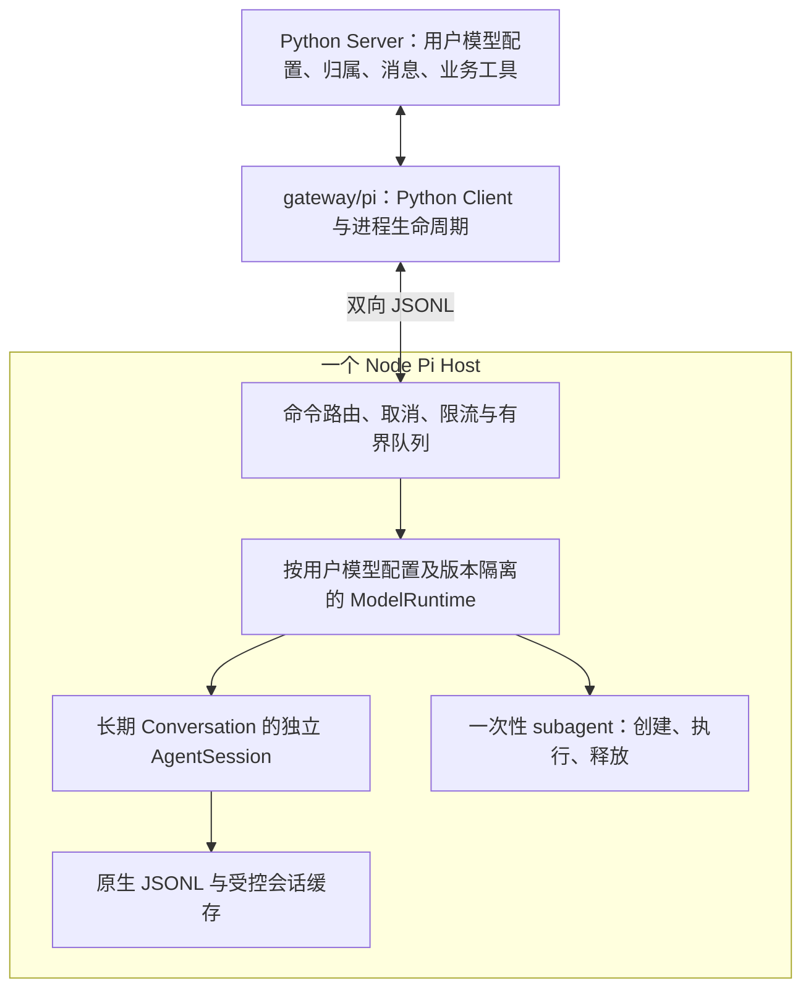

# 云端 Pi Host TRD：多用户共享进程与独立对话

日期：2026-10-21。
状态：**2026-10-24 已退役，仅作历史设计依据。** 当前 Cloud Chat 使用 Deep Agents＋MySQL checkpoint；替代决策与验收见[统一 devlog](../../dev/devlog.md#devlog-cloud-chat-checkpoint-20261024)。本文中的 Host 源码、配置和构建链接指向已删除实现，不再作为当前接入指令。
本次范围：本地实现、依赖构建与测试；没有执行数据库迁移、上线、服务重启或 Git 提交。

## 1. 为什么做 Pi Host

**Seekino 为云端提供统一 Pi harness，让用户通过自己配置的模型 API 完成长对话、长工具调用和复杂任务链，并让多用户共享有限的服务器资源。**

初始部署环境是 4 CPU / 8 GB 的 CPU 服务器。模型推理由用户配置的 API 提供，服务器负责业务、Agent 编排、上下文和工具执行。不能继续按用户或对话创建一个完整 Codex / pi 进程，否则重复加载运行时、依赖和缓存会放大内存占用，存在 OOM 风险。

本项目要交付一个由 Python Gateway 管理的 Node Pi Host。该 Node 进程只加载一份 Pi SDK 代码，异步执行多个独立对话；通过会话淘汰、活跃任务准入、模型请求与工具并发限制，控制真实内存和 CPU 消耗。

本地采用用户自带运行时的产品方式：用户自行安装、认证并连接自己的 Codex 或 Claude Code，使用其原生能力。Seekino 提供连接、会话交接、业务工具和界面；原生 runtime 的进程结构、内部调度和内存优化由其自身及上游维护，资源由用户本机承担。本地不要求用户安装 Pi，不承担本项云端单进程优化目标。

第三方 runtime 通过公开协议和 SDK 集成，不以控制其内部实现为前提。Seekino 仍负责关闭自己创建的连接和适配器，避免自身接入泄漏；用户独立启动的 CLI 进程不由 Seekino 接管。

### 1.1 已确认的产品与工程边界

| 事项 | 决定 |
| --- | --- |
| Pi 的主要用途 | 云端托管的统一 Agent harness |
| 本地运行方式 | 用户连接自己的 Codex / Claude Code；不要求 Pi |
| 云端模型来源 | 支持用户配置自己的 API，模型配置与 harness 分离 |
| 云端进程目标 | 一个加载 Pi SDK 的 Node Host 服务多个用户和 Conversation |
| 长期对话 | 一个 Conversation 固定绑定一个独立 Pi 上下文，可卸载并恢复 |
| subagent | 一次性任务，返回后释放；不建立长期业务 Session |
| 上游修改 | 首版使用公开 SDK 与宿主扩展，不修改 pi 核心 |
| 业务能力 | 复用 Python 工具、资源权限、持久消息、用量与输出校验 |

“一个 Pi”指一个 Node Runtime 进程，不表示共用一个 AgentSession、一个 API Key 或一个模型 HTTP 请求。不同对话通过异步 I/O 并行，不为每个对话创建操作系统线程或 Worker Thread。

本次不要求统一替换全部既有模型适配器，也不把数据库、视频处理等进程计入 Pi 进程数。任何会启动子进程的工具仍须纳入服务器资源预算。云端接入验收必须覆盖实际业务调用路径，不能只替换入口后仍让工具隐式启动无界 Codex / pi 进程。

## 2. 当前代码与研究依据

Seekino 当前 [CodexSession](../../../gateway/codex/client.py) 拥有一个 app-server 进程。[CodexAgentModel](../../../gateway/codex/agent.py) 在 invocation 创建该对象并在结束时关闭；恢复 native thread 不等于复用进程。这是本次优化针对的现有机制，不是对线上 RSS 或 OOM 的实测归因。

现有 [Supervisor 模型合同](../../../gateway/agent_model/contracts.py) 已有 `run_agent`、`confirm_turn`、`discard_turn`、`delete_thread`。[聊天服务](../../../server/service/agent_chat.py) 已读写 `Conversation.detail.runtimeSessions`，并在 SQL 保存最终答案后确认运行时状态。[Repository](../../../server/repository/agent.py) 已校验 runtime 更新属于当前 Conversation 的最新执行。Pi 接入优先复用这些边界。

现有 [BridgeClient](../../../gateway/bridge/client.py) 展示了长期 I/O loop 与同步业务线程的交接方式。它使用 ACP；Pi Host 使用自己的多会话协议。复用宿主生命周期思路即可，不把两种协议强塞成一个通用框架。

最初 pi 调查基于相邻 `../pi`：版本 **0.84.4**，commit **`6aedd1066e540642165aa30fa7b4a1b863778aa7`**。该工作区存在未提交改动，涉及 offline 行为等；它不是发布依赖。Host 的实际依赖由 [package.json](../../../gateway/pi/host/package.json) 和锁文件固定，使用已安装 SDK 的构建、原生测试及 Python 联调验证公开接口；研究 checkout 与实际依赖版本分别记录。

当前实现固定 `@earendil-works/pi-coding-agent` 与 `@earendil-works/pi-ai` **1.3.0**，要求 Node >=22.19.0。所用公开 SDK 接口已在该版本重新构建和测试；没有修改相邻 pi 源码。关闭 SDK cache warming，避免在宿主预算之外产生后台模型调用。

| 源码事实 | 对设计的影响 |
| --- | --- |
| `createAgentSession` 可注入 modelRuntime、sessionManager、settingsManager、resourceLoader、customTools | 可以在一个 Node 进程创建多个独立上下文 |
| 当前 `pi --mode rpc` 持有一个 active session | 不能只给旧 RPC 套 Python 包装来获得并行多会话 |
| experimental session-worker manager 为 session 启动子进程 | 不能直接作为本次单进程 Host |
| ModelRuntime 的 credential 按 provider 标识管理 | 不同用户不能在同一个 Runtime 上轮换设置 Key |
| 原生 SessionManager 支持文件和 in-memory 两种方式 | 长期对话先使用 JSONL，一次性任务使用内存上下文 |
| subagent 示例使用 `--no-session`，但每次 `spawn` 一个 pi | 可沿用任务语义，需替换示例的进程执行部分 |

具体一手源码索引见第 12 节。本轮未执行模型请求和内存压测；另一份初稿提供的“500 个空 Session 占 177–185 MiB”没有在本轮得到复核，不能作为上线容量保证。

## 3. 架构与职责



| 层级 | 职责 |
| --- | --- |
| Server | 用户身份、Conversation 归属、用户模型配置与凭据管理、业务准入、SQL 消息、HTTP/SSE |
| agent/chat | 当次业务上下文、工具定义、视频规则和最终结果校验 |
| gateway/pi 的 Python 接入 | 单例 Host 生命周期、协议路由、现有模型合同适配、Python 工具回调、用量关联 |
| gateway/pi 的 Node Runtime | 调用 Pi SDK、隔离凭据与上下文、会话恢复/淘汰、临时任务、事件和资源调度 |
| Pi SDK | 模型与工具循环、上下文压缩、原生 SessionManager 和扩展机制 |

Host 在应用资源装配时创建，由所有相关适配器借用；不按消息、Conversation、模型角色或每次配置重建重复启动。关闭时先停止接收任务，再取消/收敛执行，最后释放连接和进程。

首版沿用现有同步业务合同，通过长期 I/O loop 访问 Node，不要求把整条 Python 业务链重写为 async。I/O reader 只做解码与分发；阻塞业务工具在受限执行器中运行。

## 4. 用户 API 配置与共享边界

共享粒度为 Pi 代码和进程；ModelRuntime 按**已授权的用户模型配置及版本**隔离。内部可按用户/租户归属、配置 ID、revision 索引；这些是运行时索引语义，不在本文直接定稿新的 SQL 字段。

同一授权配置下的多个对话可以借用同一个 ModelRuntime。不同用户、不同 endpoint 或不同凭据配置不能仅因为 provider 名相同而复用。禁止逐请求修改全局 `process.env`、全局 auth 文件或共享 Runtime 的 Key。

公共 SDK 的注入方式可用于验证：

```typescript
import { InMemoryCredentialStore } from "@earendil-works/pi-ai";
import { ModelRuntime } from "@earendil-works/pi-coding-agent";

const credentials = new InMemoryCredentialStore();
await credentials.modify(providerId, async () => ({ type: "api_key", key: apiKey }));
const runtime = await ModelRuntime.create({
  credentials,
  modelsPath: null,
  allowModelNetwork: false,
});
```

这段代码只说明凭据注入。用户自定义 endpoint、模型能力和 provider 配置同样要绑定当前配置；不能从调用方仅提供的模型名称猜测。具体模型来源适配须在固定 SDK 版本上验证。

Node 使用受控启动环境，避免缺失凭据时回退到宿主机其他账号的环境变量或默认 CLI 登录。Key 按字面值接收，不接受 CLI 的执行命令式密钥配置。密钥不放入 prompt、事件、日志、Conversation detail 或 JSONL 历史。

配置更新生成新 revision；新执行使用新版本，已运行任务固定原引用。撤销配置与轮换的取消策略由 Server 明确执行。旧 Runtime 无会话和任务引用后淘汰；当前 ModelRuntime 没有通用 `dispose()`，不能虚构其释放 API，也不能无限缓存每个历史版本。

现有配置以全局 YAML 和管理员设置为主，不能当作已完成用户级 BYOK。Server 需要提供凭据安全存储、配置归属校验、版本与读取接口；Gateway 不反向读取用户表，也不把密钥写入现有 detail。该交接是完整云端功能的必要工作，Host 的隔离验证可先用注入配置开展。

## 5. 长期 Conversation 与一次性任务

### 5.1 长期对话的固定归属

一个已鉴权 Conversation 绑定一个稳定的 Pi 上下文标识，Host 内唯一。用户 ID 不能单独作为 session key。归属由 Server 校验，客户端不能指定任意内部 session 文件或另一个用户的配置。

Conversation 绑定与当前执行的资源范围分别处理：每条消息更新当次授权的视频范围、播放上下文、工具闭包、预算、deadline 和用量归属；不能让长期缓存的工具继续引用上一条消息的权限。账号归属变化后重新校验配置引用，不把用户 ID 写成无法迁移的文件身份。

每个长期对话独立持有 AgentSession、SessionManager、SettingsManager 和 ResourceLoader/ExtensionRunner。ResourceLoader 的运行时结果会绑定会话动作，不能跨对话直接共享。可复用不可变定义，但运行中的队列、监听器和工具上下文必须独立。

当前实现每轮创建并在结束后释放 AgentSession、SettingsManager 和 ResourceLoader，空闲缓存只保留 SessionManager 与提交绑定。这保留长期对话的固定历史归属，同时避免常驻工具闭包引用上一轮权限；所有 AgentSession 仍在同一个 Node 进程创建，ModelRuntime 按授权配置复用。

同一 Conversation 的普通 prompt 串行，沿用现有 PROCESSING 与幂等规则；不同 Conversation 可以异步并行。固定归属不要求对象永久常驻内存：空闲后可卸载，下次按已保存绑定恢复。

### 5.2 subagent 的一次性生命周期

subagent 是单次任务：接收任务与获授权的模型/工具配置，执行并返回结果，然后释放。它不创建 Conversation，不进入长期 Session Registry，不提供后续恢复、历史查询或 LRU 常驻。

本地 pi 版本的 subagent 是扩展示例，非核心内置调度器。示例使用 `pi --mode json -p --no-session`，随后启动子进程。云端保留需要的 single / parallel / chain 调用语义与 Agent 定义，把其 runner 改为调用同进程 SDK。

临时执行可使用 `SessionManager.inMemory(...)`；SDK 将内部上下文对象命名为 AgentSession，不意味着业务要增加一种 Session。每个临时上下文使用唯一内部 ID，完成或取消后释放；只保留返回结果与必要用量，不持久化临时完整历史。

任务继承本次获授权的配置引用、工具范围、deadline 和取消信号；使用临时任务标识关联事件。单次 parallel 的数量限制不能代替全 Host 资源限制。父调用结束或取消后，未完成临时任务也必须收敛。

### 5.3 云端工具边界

业务工具通过 Pi 的异步 customTools 回调 Python，复用既有实现。Node 只传递调用信息，Server 及业务工具校验当前执行的资源权限。云端模型和文件工具只能访问明确授予的资源。

工具使用显式 allowlist，避免默认启用 read/bash/edit/write 或自动加载用户扩展。按产品能力注入受信任的工具、指令和资源；本地用户运行时的原生工具策略仍由本地接入负责。

同进程隔离是应用内的逻辑隔离，不是任意第三方扩展或 shell 的安全沙箱。若以后提供不受信代码执行，需要独立执行隔离与资源配额，不能仅靠不同 cwd 或不同 AgentSession 宣称隔离完成。

## 6. Python 与 Node 的通信合同

首版使用私有 stdin/stdout JSONL 连接，无需新增对外 HTTP 服务。stdout 专用于协议，诊断信息进入受控 stderr；两路均持续读取，避免管道填满阻塞进程。

| 方向 | 必要能力 | 处理边界 |
| --- | --- | --- |
| Python → Node | prompt、abort、get_state、确认/丢弃本轮、释放上下文 | 复用现有宿主模型合同；会话创建/恢复可在首次 prompt 时按绑定执行 |
| Node → Python | 执行事件、工具请求、运行结果、用量、错误 | 关联到当前持久助手消息及订阅 |
| Python → Node | 工具结果与工具取消 | 不等待普通 prompt 的串行锁 |
| 双向 | 初始化、协议版本、进程退出与关闭 | 失败时收敛所有 pending 操作 |

传输 request ID 与业务身份分开。沿用现有 Conversation ID、assistant message ID 关联执行，不为同一次执行再建立重复 Run 表。工具请求携带 toolCallId；一次性任务需要自己的关联标识。进程代次用于拒绝前一 Host 的迟到结果。

当前 prompt 返回执行事件和单个最终 response，不单独增加 ACK。首次 state 事件用于保存恢复绑定，不能当作业务完成；未来若增加 ACK，须与终态区分。一个请求最多一个终态；事件只路由给所属执行。reader 不能在读到 prompt 后等待完整执行再读取下一条消息，writer 必须保证每行完整且有界。

`abort`、`tool_result`、关闭等控制消息不能排在执行中的 prompt 后面。未来接入 `steer` 时也走控制通道；首版不因 SDK 有此能力就增加没有调用方的 API。手动 compact 的调度必须考虑它会中止当前执行，不能与 prompt 任意并发。

SSE 断线只结束客户端消费，不自动取消已接受的业务执行。慢消费者不能阻塞其他对话，也不能引发无限积压；文本增量可按既有展示语义合并，必要工具结果和最终状态不能静默丢弃。传输失败应使相关执行明确失败，而非伪造完成。

## 7. 长任务的完成、取消与资源控制

### 7.1 真实完成点

Pi 的 `agent_end` 可能后接自动重试或压缩续跑，不能直接映射为 Seekino 消息 COMPLETED。普通 prompt 的 Promise 完成覆盖其后续处理，但 preflight 失败不保证发出 agent_settled；Host 以本次调用收口并检查最终错误/取消状态。

prompt resolve 也不保证模型成功，最终 assistant 可能携带 error/aborted。`getLastAssistantText()` 只能提取文字，不能决定 `success=true`。Pi 执行结束后仍须通过业务输出校验和 SQL 提交，才能发布业务终态。

取消通过目标上下文的 abort 与工具取消信号执行。活跃上下文等待收敛后才释放。裸 `dispose()` 不是等待落盘或确认停止的替代品；一个对话超时不能直接杀掉共享 Node 并影响其他用户。

### 7.2 限额与内存边界

| 资源 | 首版要求 |
| --- | --- |
| 长期对话执行 | Host 有总准入上限，并与 Server 的用户/全局准入协调 |
| 模型请求 | 全局与用户配置级限流，等待名额可取消；覆盖流式完成、异常和自动压缩 |
| 一次性任务 | 限制总数量、活跃数量及并行 fan-out；结束后释放 |
| Python 工具 | 使用有界执行器，按实际任务控制耗时、输出和重操作并发 |
| 会话与凭据缓存 | 同时限制数量、估算大小、TTL；只淘汰空闲且已完成提交协调的对象 |
| 输入与输出 | 限制历史加载、图片、工具结果、JSONL 行、事件队列的体积 |

模型请求名额持有到流实际完成或取消，不能拿到 stream 对象就释放。等待工具或一次性任务时不继续占用“正在请求模型”的名额；否则等待方可能占满名额，使被等待的任务无法运行。长期对话的业务准入与这个名额是不同边界。

Pi Session 的 listener 不自动等待异步 writer。实现必须显式处理背压、队列上限和错误收口，不能无限创建写入 Promise。原生 compact 也不会清除全历史内存，因此 LRU/TTL 与大输出控制属于首个可上线版本，不延后为可选增强。

建议从 2 个活跃长期对话开始压测，再按真实工作负载增加。缓存容量、一次性任务和工具并发随测量确定，不直接采用初稿的 32 并发。目标机器同时运行的 Python、数据库、检索、媒体工具等占用均计入整机预算。

当前默认配置集中在 `PiHostConfig`：2 个活跃长期对话、4 个模型请求、32 个加载历史、64 MiB 单会话历史、256 MiB 总历史缓存、900 秒 TTL。单条 JSONL 16 MiB，收发及排队预算 32 MiB，单工具结果 12 MiB。恢复前检查原生文件大小，过大的原生历史从已完成 SQL 历史重建；SQL 历史也超过预算时明确失败。这些预算约束序列化历史、累计结果和排队载荷，不等同于 Node RSS 上限。

当前 Host 实现全局模型请求限制；用户业务准入沿用 Server。按授权模型配置分别设置的请求配额与公平调度，在 BYOK 管理接入时对齐业务限额，尚未声明为已完成能力。

## 8. 持久化与恢复

首版长期对话使用原生 JSONL；业务 SQL 继续保存用户归属、Conversation、Message 与运行时绑定。无需先重写 Pi SessionManager，但不能因此省掉业务提交协调。

`SessionManager.create(cwd, sessionDir, {id})` 创建新文件；恢复使用 `SessionManager.open(path, ...)`。Host 必须保留稳定绑定与实际文件位置，路径来自受控目录。空闲卸载只释放内存，不删除长期对话文件。

原生 `_persist()` 使用同步文件写；首次 assistant 出现前，新会话可能未创建文件。文件 append 也不是断电级持久化承诺。因此 SQL 保留已接受的业务消息，重启时需区分已完成、未确认和无历史文件的执行。

保留现有 `confirm_turn / discard_turn` 合同：SQL 成功提交后推进已确认状态；失败或取消后，未提交的 Pi 内容不能直接成为下一轮可信业务历史。运行前记录可恢复边界，下一轮根据 SQL 事实协调；无法安全协调时丢弃对应运行时缓存并从已完成业务历史重建，不自动重放可能产生副作用的工具。

文件写入完成与业务 SQL 提交不是一个原子事务，需验证崩溃发生在两者之间的处理。Host 退出时，Python 结束 pending 请求并按现有错误合同回写；整个 Server 退出后遗留 PROCESSING 的处理仍属于 Server 恢复职责，Pi 文件不能替代该机制。

未来若同步文件 I/O 经压测成为瓶颈，再评估内存 Session 加宿主异步存储。完整 snapshot 需要 header、entries 和当前 leaf 等信息；不能只保存模型 messages 或假定 message_end listener 已包含刚发生的持久化。增量持久化与 checkpoint 另行设计，不在本轮伪造通用 Session 变更事件。

## 9. 部署与可观测性

首版以单 Python API 进程创建一个 Node Host；当前 Server 启动结构可承接该生命周期。不能在多个 API worker 中各建一个单例，却称为整机单 Host。多 worker 阶段应改为独立托管 Host，通过本机 Socket 连接并明确会话写入所有权。

Node 异常退出可能影响其全部活跃对话。应拒绝旧代次回包、结束全部 waiter、限速重启，并允许后续请求恢复已确认的长期上下文。不能在未知副作用时自动重发原 prompt。正常关闭则停止准入、通知取消、等待有限时间，再回收自有进程。

监控至少覆盖进程数、Node RSS/heap、Python RSS、事件循环延迟、活跃对话/临时任务/模型请求/工具数量、缓存大小、队列字节数、排队耗时、取消耗时、恢复失败和 Host 重启次数。

当前代码已提供用量归属与有界生命周期；上述完整指标采集和真实负载基线仍属于 H03，不能把测试通过记为容量验收。

usage 沿用现有 Gateway 记录合同；归属绑定当前消息和用户配置，重试、压缩、一次性任务按实际观测边界记录，避免重复累计。缺失 usage 保持 unknown，日志不包含用户密钥或原始敏感载荷。

## 10. 实施顺序与验收

### 当前实现与验证入口

- [PiClient](../../../gateway/pi/client.py) 管理单个子进程、双向 JSONL、请求代次、工具回调和失败收口；默认值来自 Gateway 的 PiHostConfig。
- [PiSupervisorModel](../../../gateway/pi/supervisor.py) 复用聊天模型合同、SQL 历史、用量和确认/丢弃机制，不持有公共 Client 的关闭权。
- [Node Host](../../../gateway/pi/host/src/main.ts) 提供 initialize / prompt / abort / get_state / confirm_turn / discard_turn / delete_thread / shutdown；仅注册显式业务工具及一次性 subagent。
- [Gateway 配置](../../../gateway/config.py) 和 [Server 装配](../../../server/bootstrap.py) 在 cloud 模式要求 Pi，并拒绝所有被选用的 Codex / Claude source 及 fallback；本地配置不自动改写。
- 原生 Node 测试、Python 协议测试与真实 Python → Node → 本机 fake API 集成覆盖凭据隔离、工具回调、取消、字节限制、淘汰与重启恢复。服务层测试覆盖 SQL 成功后确认、提交失败后丢弃。
- 用户级配置保存、撤销/轮换策略、界面以及不同配置的业务工具能力选择仍待接入；尤其 `SupervisorRuntime` 当前按默认模型能力选择视觉工具，BYOK 批次必须同步改为当次授权配置。

本轮验证结果：相关 Python 回归 **520 passed / 1 skipped / 1 deselected**；跳过项缺少 `SEEKINO_TEST_DATABASE_URL`，排除项为既有默认配置测试，它要求 DeepSeek 而当前用户本地配置选择 Codex。另有一项现有 Starlette 弃用警告。Node **24 tests passed**，构建和类型检查通过，生产依赖审计为 0 个已知漏洞。Python 回归包含真实 SDK、两个不同用户凭据、Python 工具、缓存淘汰，以及终止测试 Host 后从原文件恢复的验证；未调用真实外部模型。

H01 当前实现的隔离与协议验收已通过；H02 已完成聊天接线、提交协调与 cloud 校验，用户级配置管理仍待完成；H03 尚未执行目标服务器容量验收。

### H01：Host 与隔离验证

使用固定 Pi SDK 和 fake provider，完成一个 Node Host、多对话路由、独立凭据、Python 工具回调及一次性任务执行。该阶段可使用注入的用户配置，不要求先完成设置页面。

- 两用户使用相同 provider、不同 Key/endpoint，交错运行多个对话，模型请求、历史、事件和工具结果不串线。
- 同对话普通 prompt 串行；其他对话、abort 和 tool_result 能继续处理。
- 长期对话与一次性 subagent 运行期间不增加 pi 子进程；临时任务不创建长期会话记录。
- 取消、provider 错误、慢 reader、输出超限与 Node 退出后，pending 调用有明确终态且资源可回收。

### H02：现有聊天与用户配置接线

接入现有 Supervisor 模型合同、runtimeSessions 绑定、Server 用户模型配置、用量与业务工具。Pi 负责 harness，业务工具和资源授权留在既有层。实际接口、SQL 模型及具体修改树在实施批次核对后确定。

- 两轮同对话保持上下文，空闲淘汰和重启后恢复正确；更换配置不污染旧任务或其他用户。
- SQL 提交失败、确认失败、取消和崩溃后，不把未提交答案作为已完成历史，不重复执行工具副作用。
- 长工具调用、原有视频证据与权限、图片输入、SSE 断连以及迟到回包保持既有业务合同。
- 用户级 BYOK 配置可保存、授权读取和更新；全局 YAML 不冒充用户配置完成。
- 云端实际业务路径不再隐式依赖每会话 Codex 进程；本地用户原生运行方式独立验收。

### H03：4 CPU / 8 GB 容量验收

区分空会话、空闲长历史、同时活跃会话、图片/大工具输出、一次性任务和长时间运行。按 2、4 等逐档增加并发，记录整机资源、延迟、队列与失败率，并验证缓存淘汰和负载下降后的资源回收。

上线以不会无界增长、能够限流、可取消和可恢复为验收条件；实测后确定资源配额及最大支持容量。替身测试不证明模型效果或生产容量，空 Session 的 RSS 不代表真实用户负载。所有生产限额集中配置，不散落在业务工具中。

## 11. 交接与本轮范围

| 交接方 | 待完成工作 | 对交付的影响 |
| --- | --- | --- |
| Gateway 接入 | Node Host、Python Client、现有模型合同适配与资源限制 | H01/H02 核心工作 |
| Server 配置管理 | 用户模型配置、凭据保存、版本和授权注入 | 可先用注入配置做 H01，完整 BYOK 上线依赖此项 |
| Server 会话与部署 | 绑定、业务提交协调、遗留执行恢复、单 Host 生命周期 | 决定长期对话和故障恢复验收 |
| 业务工具 | 当次身份/范围/取消/用量传递，明确会启动的重操作 | 决定实际云端资源与权限边界 |
| 本地 Bridge | 用户 Codex / Claude Code 的连接、权限与原生能力兼容 | 独立本地目标，不承担云端 Pi 进程复用 |

本轮实现范围为 Gateway Pi Host、Python 接入、现有工厂/合同、cloud 启动校验、对应测试与构建说明。新增私有 JSONL 协议及可选 `pi_host` 配置；复用现有对外聊天 API、数据库 Schema、前端与 runtimeSessions。云端必须指向 API 来源的模型配置，本地配置文件不自动改写。

Pi JSONL 会写入受控持久目录；部署需构建独立 Node 包。尚未执行迁移、上线、服务重启、commit 或 push。本文所在 design 目录按仓库现有忽略规则维护，未改变忽略策略。

本次实现没有 fork pi 核心；云端 subagent runner 属于 Seekino 的扩展接入。若后续固定 SDK 的能力不能满足新增合同，再以证据评估最小上游变更。

### 本轮实际修改树

共 30 个文件：16 个新增、14 个修改，无删除或重命名。树内仅记录本轮修改；共享文件已有的其他工作区改动保留。

```text
Seekino/
├── [M] .gitignore
│   影响：忽略 Host 依赖和编译产物。
├── .github/
│   └── workflows/
│       └── [M] ci.yml
│           影响：后端 CI 构建并验证 Node Host。
├── gateway/
│   ├── [M] config.py
│   │   影响：Pi harness、统一资源预算与校验。
│   ├── [M] model_factory.py
│   │   影响：共享一个 PiClient 并由应用关闭。
│   ├── [M] README.md
│   │   影响：记录云端构建、配置和未完成边界。
│   ├── agent_model/
│   │   ├── [M] contracts.py
│   │   │   影响：增加可选的已授权模型配置注入。
│   │   └── [M] factory.py
│   │       影响：通过公共 Client 构造 Pi 聊天适配器。
│   └── pi/
│       ├── [A] __init__.py
│       │   影响：导出 Pi Client 与协议错误。
│       ├── [A] client.py
│       │   影响：进程复用、JSONL、取消、工具及失败收口。
│       ├── [A] supervisor.py
│       │   影响：接入历史、业务提交、用量和工具合同。
│       ├── host/
│       │   ├── [A] package.json
│       │   │   影响：固定 SDK 与独立构建命令。
│       │   ├── [A] package-lock.json
│       │   │   影响：锁定可复现的依赖树。
│       │   ├── [A] tsconfig.json
│       │   │   影响：构建与类型检查。
│       │   ├── src/
│       │   │   ├── [A] main.ts
│       │   │   │   影响：并发命令路由和关闭。
│       │   │   ├── [A] protocol.ts
│       │   │   │   影响：协议、有界输出和可取消并发。
│       │   │   ├── [A] sessions.ts
│       │   │   │   影响：历史恢复、提交协调及缓存预算。
│       │   │   ├── [A] models.ts
│       │   │   │   影响：凭据隔离、模型限流及完整用量。
│       │   │   ├── [A] tools.ts
│       │   │   │   影响：回调 Python 工具并约束结果归属和大小。
│       │   │   └── [A] subagent.ts
│       │   │       影响：同进程一次性任务与资源释放。
│       │   └── test/
│       │       ├── [A] host.test.ts
│       │       │   影响：保护凭据、协议、并发和预算。
│       │       └── [A] sessions.test.ts
│       │           影响：保护恢复、淘汰、临时任务及截断处理。
│       └── design/
│           └── [M] pi-host-trd.md
│               影响：记录实际实现、验证与剩余工作。
├── server/
│   └── [M] bootstrap.py
│       影响：cloud 强制 Pi 和 API 模型绑定。
└── tests/
    ├── gateway/
    │   ├── [A] test_pi_client.py
    │   │   影响：验证进程、回调、失败用量和取消。
    │   ├── [A] test_pi_supervisor.py
    │   │   影响：验证聊天合同及真实 SDK 跨语言恢复。
    │   ├── [M] test_config.py
    │   │   影响：保护配置兼容与资源预算。
    │   ├── [M] test_agent_factory.py
    │   │   影响：保护 Pi 适配器选择与借用关系。
    │   └── [M] test_model_factory.py
    │       影响：保护并发装配只创建一个公共 Client。
    └── server/
        ├── [M] test_bootstrap.py
        │   影响：保护 cloud 选择和本地原有行为。
        └── [M] test_agent_chat_service.py
            影响：保护 SQL 提交后确认与失败后丢弃。
```

## 12. 来源与关联设计

以下链接指向本次检查的相邻 pi 工作区，版本以第 2 节为准；在没有 `../pi` checkout 的环境中，按相同仓库内路径查阅固定版本。

| 依据 | 支持的结论 |
| --- | --- |
| [Pi SDK](../../../../pi/packages/coding-agent/src/core/sdk.ts) | 多实例创建、默认工具、自定义工具与模型运行时注入 |
| [SDK 文档](../../../../pi/packages/coding-agent/docs/sdk.md) | 公开 CredentialStore、模型与认证接入 |
| [ModelRuntime](../../../../pi/packages/coding-agent/src/core/model-runtime.ts)、[CredentialStore](../../../../pi/packages/ai/src/auth/credential-store.ts) | 凭据与 provider 配置的共享边界 |
| [AgentSession](../../../../pi/packages/coding-agent/src/core/agent-session.ts) | 完成、取消、压缩、事件和资源释放 |
| [SessionManager](../../../../pi/packages/coding-agent/src/core/session-manager.ts) | 创建/恢复、同步 JSONL、内存历史和 snapshot 边界 |
| [ResourceLoader](../../../../pi/packages/coding-agent/src/core/resource-loader.ts)、[ExtensionRunner](../../../../pi/packages/coding-agent/src/core/extensions/runner.ts) | 会话绑定的可变扩展上下文 |
| [RPC mode](../../../../pi/packages/coding-agent/src/modes/rpc/rpc-mode.ts) | 单 active session 与管道事件处理 |
| [experimental worker manager](../../../../pi/packages/coding-agent/src/experimental/session-worker-manager.ts) | 按 session 启动 worker 子进程 |
| [subagent 示例](../../../../pi/packages/coding-agent/examples/extensions/subagent/index.ts) | 一次性 `--no-session` 语义及 spawn 实现 |
| [Gateway README](../../../gateway/README.md)、[本地 Bridge TRD](codex-bridge-trd.md) | 本地接入与既有适配器职责 |
| [Local / Cloud TRD](local-cloud-trd.md)、[用户租户 TRD](user-tenant-trd.md) | 云端身份、配置归属和部署边界 |
| [模型调用记录 TRD](gateway-model-observability-trd.md) | 调用归属、观测粒度和 unknown usage 合同 |
