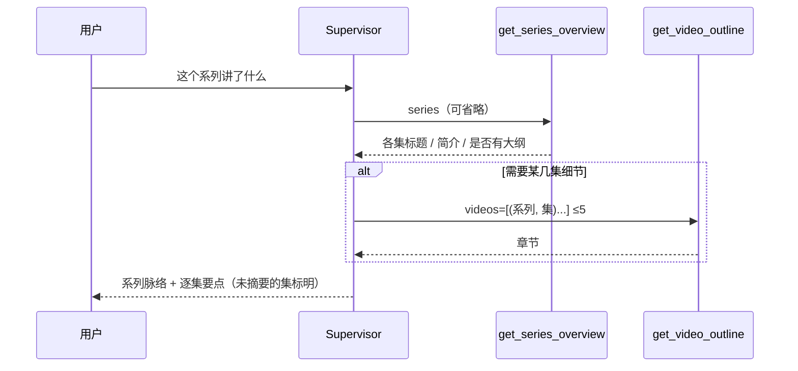

# 1. 问题与现状

**系列概览 TRD。状态：已实现，课程库副本实测达标；演示环境验收待做（2026-11-05）。** 分支 `feat/series-overview`，PR [#44](https://github.com/owariband/Seekino/pull/44)。上游：[video-outline-trd.md](video-outline-trd.md)（PR [#41](https://github.com/owariband/Seekino/pull/41)，视频大纲与按“系列名 + 集数”寻址）。合并顺序：#41 之后合并本需求；本分支自 #41 分支切出。本需求是 2026-11-05 发布验收的阻塞项。

## 背景与触发场景

Chat 的检索范围是系列级：请求携带 `series_ids`，未打开视频时 Supervisor 面对的是整个系列。课程库演示中，用户在系列入口问“这个系列讲了什么”，或在多个系列的范围内提问时，Agent 需要先知道范围里有哪些视频、各讲什么，才能组织回答或决定读哪几集的大纲。

## 实际与期望行为

期望：系列级整体问题在一分钟量级内回答，先给出系列脉络（逐集或按主题），再按需读取相关视频的大纲；多个系列在范围内时分别说明或先确认对象，不把不同系列混为一谈。

实际：

- Supervisor 可见的系列信息只有系列名、简介、`importantExtraData`、`characterBible` 与视频列表（集数、文件名、解析状态），见 `server/service/agent_chat.py:993-1003`；没有各集的标题和简介。
- #41 的 `get_video_outline` 一次只读一集，系列问题需要逐集调用。
- 没有系列级产物；#41 TRD 明确把“跨视频、Series 级大纲”列为不解决（[video-outline-trd.md](video-outline-trd.md) 第 1 节）。

## 负面影响

系列整体问题只能靠检索或逐集读取拼凑，耗时与模型调用随集数增长；用户提供的背景资料（简介、背景材料、人物设定）可能被当作视频事实直接复述。

## 现状证据

- 系列上下文构造：`server/service/agent_chat.py:986-1004`。
- Supervisor 范围描述只有系列名：`agent/chat/supervisor.py:1018-1032`；背景资料不等于视频证据的规则：`agent/chat/supervisor.py:1114-1116`。
- 各集 Summarize 成果（`display.title/description`、`outline.sections`）已持久化在 `video_parse_content`（#40、#41）。
- 基线实测：#41 修复前构建上同一问题 45.5 秒、7 次模型调用，先 `retrieve` 再读大纲（见第 4 节）。

## 本次边界

解决：Supervisor 专用工具读取系列概览；`get_video_outline` 支持一次读取多集（#41 已实现时复用）；Prompt 区分系列问题与视频问题，并区分“用户背景资料”与“视频摘要”两层来源。

不解决：预计算或持久化的系列级摘要（不新增 `series_parse_content`）；系列元数据（`description`、`important_extra_data`、`character_bible`）的归属与编辑入口，另立需求处理；前端改动。

必须保持：Agent 不读写、不输出内部 `video_id`；具体事实主张仍需检索证据；视频级问题仍走 `get_video_outline`，具体问题仍直接走 `search_video_events`。

# 2. 影响因素、假设与评价指标

| 因素 | 证据 | 假设 | 验证方法 | 影响的决策 |
| --- | --- | --- | --- | --- |
| 缺少各集概要 | 系列上下文没有各集标题、简介 | H1：拼接各集 `display` 的标题与简介即足以回答“这个系列讲了什么”，无需预计算系列摘要 | 课程库同一问题对比耗时、调用数与回答覆盖的集数 | 是否需要持久化系列摘要 |
| 逐集读取大纲 | `get_video_outline` 单集 | H2：概览之后最多一次批量大纲读取即可回答比较类或范围类问题 | 统计工具调用次数 | 批量上限 |
| 两层来源混用 | 背景资料与视频摘要都在上下文中 | H3：在工具结果中把两层分开标注，Agent 能区分“设定”与“视频实际内容” | 人工检查回答；构造背景与视频不一致的用例 | Prompt 规则措辞 |
| 多系列范围 | 范围可包含多个系列 | H4：按（系列名, 集数）寻址后，多系列问题不会串集 | 两个系列在范围内的用例 | 是否需要强制澄清 |

**指标：**

| 指标 | 定义与口径 | 基线 | 目标 / 护栏 | 测量方法 | 证据入口 |
| --- | --- | --- | --- | --- | --- |
| 系列整体问题耗时（结果） | “和我说说这个系列都讲了些什么”从提交到回答完成 | 45.5 秒（#41 修复前构建，单次） | ≤ 60 秒（预期） | `chat_turn.py` + api.log | `outputs/verification/video-outline-20261104/chat-runs/` |
| 模型 / 工具调用数（诊断） | 同一回合 Supervisor 与 Query 模型调用、工具调用 | 7 / 5 | 模型调用 ≤ 10（预期） | 同上 | 同上 |
| 回答覆盖（结果） | 回答提到的集数 / 已有 `display` 的集数；不编造未摘要的集 | 待测 | 已摘要集全部提及；未摘要集标为未生成 | 人工核对 | 同上 |
| 视频问题路由（护栏） | 打开视频时“这个视频讲了什么”首个视频工具为 `get_video_outline` | #41 已通过 | 保持 | 同上 | 同上 |
| 具体问题路由（护栏） | 具体台词问题首个视频工具为 `search_video_events` | #41 已通过 | 保持 | 同上 | 同上 |
| 内部 id 泄露（护栏） | 回答与工具参数中出现 `video_id` UUID 的次数 | — | 0 | 检查回答与 trace | 同上 |

# 3. 改造方案与建模

## 方案

新增 Supervisor 专用工具 `get_series_overview(series?)`，按需从已有成果拼接，不持久化：

```text
get_series_overview(series=None)
  → [{ series, displayName,
       background: 由 series_context 提供，工具不重复返回,
       videos: [{ episode, title, description, hasOutline, summarized }] }]
```

- 读源：每集最新非空 `display`（与 #40 读源一致）；没有 `display` 的集标记 `summarized=false`，不补造。
- 寻址：`series` 为系列名，范围只有一个系列时可省略；多系列时省略则返回全部范围内系列，每个系列单独分组。
- 批量大纲：`get_video_outline(videos=[{series, episode}, ...])`，上限 5（由 #41 实现）。
- 规模：课程库每系列数十集以内，结果受 `bounded_json` 字节上限约束；超限时按集数分页（`from_episode`），不做摘要压缩。

## 两层来源

| 层 | 来源 | 谁写入 | 在回答中的用法 |
| --- | --- | --- | --- |
| 用户背景资料 | 系列 `description`、`important_extra_data`、`character_bible`，经 `series_context` 提供 | 用户 | 术语、人物、意图框架；不等于视频实际内容 |
| 视频摘要 | 各集 `display`、`outline` | Summarize（基于视频证据） | 描述系列实际讲了什么；两层冲突时说明差异 |

## 时序



## 实施边界

涉及：`agent/chat/video_search/tools/`（新工具与注册）、`agent/chat/supervisor.py`（Prompt 路由与两层来源规则）、`server/service/library.py` / `server/repository/library.py`（批量读取 `display` 与大纲可用性）、`server/bootstrap.py`、对应测试。不涉及数据库结构、前端、Summarize。

# 4. 对照实验与结果分析

计划（课程库隔离副本 `seekino_display_rehearsal_20261104_test`，实验 API 19642，同一时段、同一配置，`chat_turn.py` 单回合串行）：

| 用例 | 基线（#41 构建） | 本方案 | 判断 |
| --- | --- | --- | --- |
| Q1 “和我说说这个系列都讲了些什么”（单系列范围，未打开视频） | 45.5 秒，7 次模型调用，先 `retrieve` | 45.9 秒，8 次模型调用；`get_series_overview` → `get_video_outline`；SSE 在途中收到 `answer.interrupted`（见 PR #45），服务端正常完成 | 路由达标；中断另行修复 |
| Q2 “和我说说这个视频讲了些什么” | 同时段旧构建中位 49.5 秒 | 中位 44.1 秒（见 [video-outline-trd.md](video-outline-trd.md) 第 4 节） | 达标 |
| Q3 具体问题路由 | `search_video_events` 优先 | 保持 | 达标 |
| Q4 两个系列在范围内问“这个系列讲了什么” | — | 12.8 秒，5 次模型调用；先说明范围内有两个系列且未打开视频，再按系列分别梳理 | 达标 |
| Q5 两个系列在范围内问“这两门课分别讲了什么？” | — | 13.4 秒，4 次模型调用；按课程分节，先给出两课主题差异 | 达标 |

条件：课程库副本 `seekino_display_rehearsal_20261104_test`（两个系列各 1 集，均有 `display` 与大纲），实验 API 19642，代码为 #44 + #33 本地合并 `fefeb66c`，模型配置 `outputs/verification/video-outline-20261104/model-config-summarize-high.yaml`，单次样本。原始记录：`outputs/verification/video-outline-20261104/chat-runs/ov-*.json`。回答中未出现内部 id。

局限：每个系列只有 1 集，“按集组织”“未摘要的集标为尚未生成”在真实多集系列上未验证，仅有单元测试覆盖。

# 5. 试点验证与方案取舍

试点：课程库演示环境（19641，切换到 `dev` 并完成迁移、两部长视频以 `high` 重新 Summarize 后）按 LOOP-08 验收项运行 Q1–Q4。停止条件：Q1 超过 90 秒或回答编造未摘要的集；回退方式为移除工具注册，Prompt 回到 #41 行为。

# 6. 结果验收与闭环

**原问题验收：** 系列整体问题在课程库副本上通过工具直接取得各集概要，多系列问题 13 秒左右分系列回答。演示环境验收与多集系列验证待做。

**最终决定：** 采用，在 #41 之后合并。

**剩余事项：** 演示环境（19641 切换到 `dev`）复测 Q1、Q4；多集系列验证；长回答的流式中断由 PR #45 处理。
