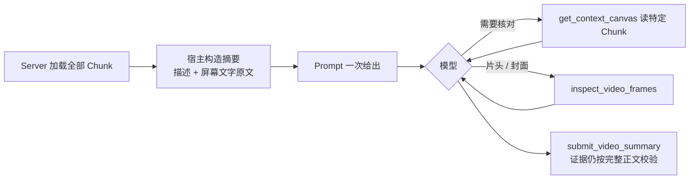

# 1. 问题与现状

**Summarize 压缩输入 TRD。状态：初稿（2026-11-04）。** 分支 `perf/summarize-compact-input`，PR [#39](https://github.com/owariband/Seekino/pull/39)。主设计见 [video-summarize-trd.md](video-summarize-trd.md)；连接抖动重试见 [summarize-timeout-trd.md](summarize-timeout-trd.md)（PR [#38](https://github.com/owariband/Seekino/pull/38)，与本 TRD 无代码依赖）。

## 背景与触发场景

Summarize 在视频解析完成后为单个 Video 生成标题、简介、集数和封面，并发布到资料库。11-04 课程库（v11 隔离库）中两部完整解析的长视频，Summarize 均三次失败，资料库只能显示文件名或“第 N 集”。后续的视频大纲（Chat 快速理解视频整体脉络）也要由 Summarize 产出，当前链路不通则无法实施。

## 实际与期望行为

期望：一次 Summarize 在一两分钟内完成，长度与视频时长基本无关。实际：模型被要求逐页读完每个 Chunk 的完整解析正文，调用次数随视频长度线性增长，长视频在 600 秒总时限内读不完。

## 现状证据

- **读得太多：** Prompt 要求“read EVERY chunk's complete content section”（`agent/video_summarize/prompts.py:14-15`），提交工具在任何 Chunk 未完整读过时拒绝提交（`agent/video_summarize/tools.py`，`INCOMPLETE_REVIEW`）。Let's build GPT 视频 117 个 Chunk 的正文合计 697,537 字符，超过单次调用的 `max_input_chars: 600000`。
- **每页太小、每页一次完整模型调用：** `get_context_canvas` 单次最多返回 12,000 字符（`server/config/video_summarize.py:19`），至少约 58 次读取；每次读取都是一次完整的模型调用并重发累积上下文。任务 `720608b1` 的 lease 2 在约 591 秒内完成约 35 次调用（平均约 17 秒/次），未读完即超时（`outputs/verification/course-loop-dev-20261104/api.log`）。
- **需要的信息其实很少：** 解析已为每个事件保存简短 `description`，并把屏幕文字单独标为 `ON_SCREEN_TEXT` 事件（`engine/parsev2/schemas.py:123-130`），这正是标题和集数的来源。按“时间范围 + 事件类型 + 描述 + 屏幕文字原文”拼成的摘要，实测 GPT 视频 118,640 字符（21 个 `ON_SCREEN_TEXT`），`720608b1` 143,040 字符（11 个），均可一次放入 Prompt。
- **封面需要看帧：** 封面只能取自 `inspect_video_frames` 成功返回的真帧（`tools.py` 的 `_frame_image` 与接收校验），因此看帧工具与提交工具必须保留，不能退化为纯文本单次调用。

## 负面影响

长视频的展示元数据永远为空；每次失败约消耗 10 分钟和数十次 `deepseek-flash` 调用，三次重试约 30 分钟，费用白付；大纲需求被阻塞。

## 本次边界

解决：Summarize 的输入形态与调用次数，使长视频能在一两分钟内完成。不解决：大纲字段（`feat/video-outline` 另立 TRD）；`summary` 列重命名与展示读源切换（`refactor/video-display-source` 另立 TRD）；连接重试（PR #38）。必须保持：提交结构 `VideoSummarySubmission` 不变；证据校验（标题必须引用 `ON_SCREEN_TEXT` 原文、预告排除、集数标记、封面真帧）不变；租约、来源指纹和发布事务不变。

# 2. 影响因素、假设与评价指标

| 因素 | 证据 | 假设 | 验证方法 | 影响的决策 |
| --- | --- | --- | --- | --- |
| 必须读完全部正文 | 697,537 字符，约 58 页 | H1：事件描述 + 屏幕文字原文足以确定标题、集数和简介，无需全文 | 两部视频实测，对比标题是否引用了正确的 `ON_SCREEN_TEXT`，简介是否覆盖主要章节 | 是否保留按需读取全文的工具 |
| 分页读取，每页一次模型调用 | 约 35 次调用 / 591 秒 | H2：摘要直接放进 Prompt 后，调用数降为“看帧若干次 + 提交 + 完成”，与 Chunk 数无关 | 统计模型调用数与墙钟耗时 | 是否需要进一步限制看帧次数 |
| 摘要过长会占满上下文 | 长视频摘要 119k–143k 字符 | H3：在 `max_input_chars` 内留出足够余量；更长视频需要截断规则 | 记录首轮输入字符数；单测覆盖超长时的确定性截断 | 截断策略（按事件类型保留优先级） |

**指标（实验前确定）：**

| 指标 | 定义与口径 | 基线 | 目标 / 护栏 | 测量方法 | 证据入口 |
| --- | --- | --- | --- | --- | --- |
| 成功率（结果） | 两部长视频各排队一次，是否 `COMPLETE` 且发布 | 0/2 | 2/2 | SQL 查 `_worker_runtime_v2.summarize.status` 与 `video.display_name` | 待测 |
| 完整耗时（结果） | 领取租约到发布完成的墙钟秒数 | >600 秒（未完成） | 每部 ≤ 120 秒（预期） | api.log | 待测 |
| 模型调用数（诊断） | 单次执行的 Summarize 模型调用次数 | ≥35（未完成） | ≤ 8（预期） | api.log / model-trace | 待测 |
| 首轮输入字符（诊断） | 第一次调用的输入字符数 | 5,411（仅 Prompt） | < 200,000 | api.log | 待测 |
| 标题与简介质量（护栏） | 人工核对：标题是否来自本视频片头屏幕文字或为有依据的生成标题；简介是否覆盖视频主要内容且无编造 | 无（未产出） | 两部均通过人工核对 | 发布结果 + 引用证据 | 待测 |
| 证据校验不变（护栏） | 现有离线测试 | 通过 | 除阅读覆盖相关用例外全部通过 | `tests/agent/video_summarize`、`tests/server/test_video_summarize_*` | 待测 |

# 3. 改造方案与建模

**已有基础：** Context Canvas、看帧工具、提交校验、租约与发布事务都不变，只改变“模型先看到什么”。

**方案 — 宿主构造视频摘要，直接放入 Prompt：**

1. `agent/video_summarize/state.py` 新增确定性摘要构造：按 `sequence_no` 遍历 Chunk，每个 Chunk 输出引用 ID 与时间范围，每个事件一行 `start-end EVENT_TYPE: description`；`ON_SCREEN_TEXT` 事件附带 `text` 原文。只拼接解析已有字段，不调用模型，不改写文字。
2. 摘要超过上限（新配置 `maximum_digest_chars`，默认 300,000，低于 `max_input_chars` 留出 Prompt 与工具输出余量）时按确定性规则截断：始终保留每个 Chunk 的标题行与全部 `ON_SCREEN_TEXT`，其余事件按时间均匀保留，并在摘要中标明已省略的事件数。
3. Prompt 改为：摘要覆盖了全部 Chunk；标题与集数线索优先看 `ON_SCREEN_TEXT` 与开头若干 Chunk；只有需要核对引用原文时才用 `get_context_canvas` 读取特定 Chunk；用 `inspect_video_frames` 看片头标题卡或挑选封面；然后提交。
4. 提交工具删除“全部 Chunk 已完整阅读”的检查（`INCOMPLETE_REVIEW` 与 `SummaryCanvas.read_ranges` / `unread_chunks`），覆盖由宿主摘要保证。证据仍按完整 Chunk 正文校验：摘要中的描述与屏幕文字是正文的原样子串，引用可直接通过。

**备选（未采用）：**

- 解析时为每个 Chunk 增加 abstract 字段：需要重跑全部历史解析，且当前事件描述已经足够短；若 H1 被证伪再考虑。
- 纯文本单次调用、不带工具：无法取得真帧封面，违背主设计的封面合同。
- 放大时限（PR #38 初版方案 B）：只是让过慢的设计跑得更久，已撤回。

**实施边界：** `agent/video_summarize/`（state、prompts、tools）、`server/config/video_summarize.py`（`maximum_digest_chars`）、`server/service/video_summarize.py`（传入新限制）、对应测试。无数据库、接口或部署配置变更。

# 4. 对照实验与结果分析

**计划：**

- 基线：现有代码在 `720608b1` 的 lease 2 / lease 4 日志（已有，不重跑）。
- 改造：同一 v11 库、同一模型配置（`deepseek-flash`，`reasoning_effort: none`，`stream: true`），对 `93d60de9`、`720608b1` 各执行一次 `mark_summary_ready` 排队。
- 记录：代码提交、首轮输入字符数、调用数、耗时、最终 SQL 状态、发布的标题 / 简介 / 封面与引用证据，以及解析版本快照（应不变）。

| 指标 | 基线实测 | 方案实测 | 变化量 | 验收标准 | 判断与证据 |
| --- | --- | --- | --- | --- | --- |
| 成功率 | 0/2 | 待测 | 待计算 | 2/2 | 未验证 |
| 117 Chunk 耗时 / 调用数 | >600 秒 / ≥35 | 待测 | — | ≤120 秒 / ≤8 | 未验证 |
| 146 Chunk 耗时 / 调用数 | >600 秒 / ≥35 | 待测 | — | ≤120 秒 / ≤8 | 未验证 |
| 标题与简介人工核对 | — | 待测 | — | 通过 | 未验证 |

# 5. 试点验证与方案取舍

试点即上述两部视频的真实发布：确认资料库显示标题、简介和封面，解析版本不变。代价是两次 Summarize 的模型费用（预期各数次 `deepseek-flash` 调用）。若标题质量不达标，先检查是否由摘要缺失的信息导致（H1 证伪），再决定是否引入解析时 abstract。

# 6. 结果验收与闭环

待实验完成后填写：逐项对照第 2 节指标，更新 [video-summarize-trd.md](video-summarize-trd.md) 中“提交前检查所有 Chunk 的完整阅读覆盖”的工具合同，并在 devlog 记录。

## 调整记录

| 日期 | 原判断或方案 | 新证据 | 调整与原因 | 影响 |
| --- | --- | --- | --- | --- |
