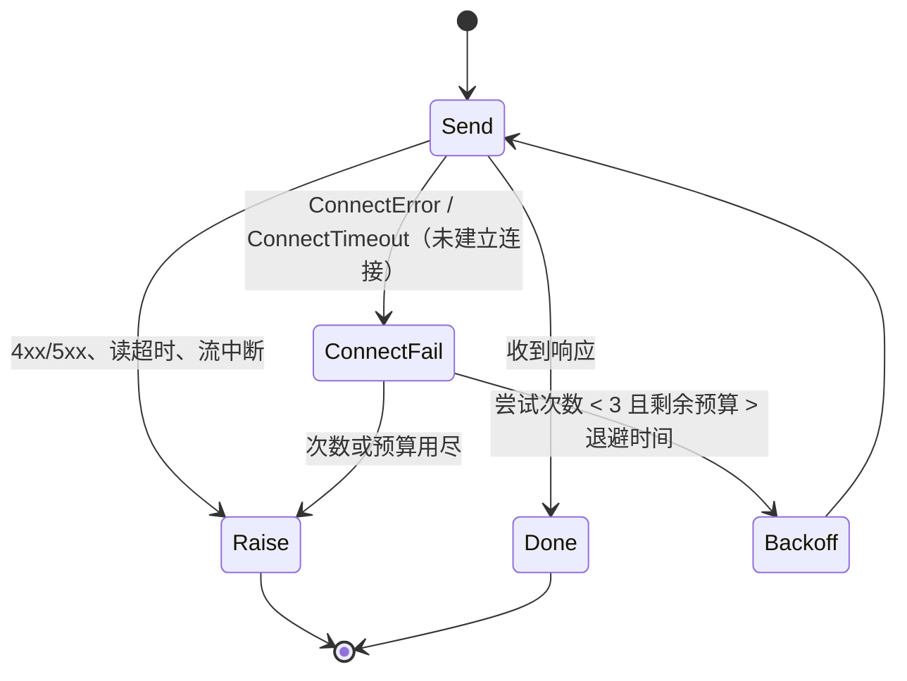

# 1. 问题与现状

**Summarize 长视频超时修复 TRD。状态：初稿（2026-11-04）。** 分支 `fix/summarize-model-timeouts`，PR 待创建后回填。主设计见 [video-summarize-trd.md](video-summarize-trd.md)。

## 背景与触发场景

11-04 课程库（v11 隔离库）中两部完整解析的长视频，Summarize 均失败且重试耗尽，`video.display_name` / `description` / `cover_uri` 与 `video_parse_content.summary` 全部为空。资料库只能显示文件名或“第 N 集”，也没有封面推荐。后续视频大纲需求（TRD 待建）依赖 Summarize 成功产出，当前链路不通则无从实施。

| 解析任务 | 视频时长 | Chunk 数 | Summarize 结果 |
| --- | --- | --- | --- |
| `93d60de9`（Let's build GPT） | 1:56:20 | 117 | `FAILED`，`retry_count=3`，`last_error=QueryModelIncompleteError` |
| `720608b1` | 2:25:52 | 146 | `FAILED`，`retry_count=3`，`last_error=QueryModelIncompleteError` |

## 实际与期望行为

期望：解析完成后 Summarize 读完全部 Chunk，提交标题、简介和封面，并发布到资料库。实际：单次 lease 在读完前被中断，下一次 lease 从头再读，最终三次失败。

## 现状证据（`outputs/verification/course-loop-dev-20261104/api.log`，任务 `720608b1`）

- **lease 2 · 总时限耗尽：** 15:44:07 首次模型调用，15:53:58 `error_type=TimeoutError`（约 591 秒）。来源是 `asyncio.timeout(config.execution_timeout_seconds)`（`server/service/video_summarize.py:140`），默认 600 秒（`server/config/video_summarize.py:15`）。该 lease 内约 35 次模型调用，平均约 17 秒/次；仍未完成全部 Chunk 阅读。
- **lease 4 · 单次网络连接失败即中断整个 lease：** 16:09:12 发出的调用在 7.88 秒后报 `ConnectTimeout [Errno 60] Operation timed out`（`model-trace/184a3f16-…/events.jsonl` 两个 `time_ns` 之差），TCP 连接未建立，请求未到达 DeepSeek。Gateway 客户端 `max_retries=0`（`gateway/openai/multimodal.py:104`），工具循环 `_request_turn` 没有单次重试（`gateway/agent_model/multimodal.py:346-366`），因此一次网络抖动丢弃了该 lease 已经运行约 344 秒的工作。
- **上下文增长：** 每轮输入随阅读累积，lease 2 前 8 轮从 5,411 增至 146,824 字符，之后 compact 到约 26–35k（api.log:8420–8633、9080–9092）。逐次调用 token 未记录，只有字符数。
- **已排除：** 所有约 100 次 Summarize 调用均发往 `https://api.deepseek.com/responses`，`provider=deepseek, model=deepseek-flash`；窗口内仅有的两条 Kimi 记录是 16:08 的 Chat Supervisor 请求。首个 SSE 期限常量为 100 秒（`gateway/streaming/first_sse.py:14`），且不作用于 Summarize 的工具调用路径（`gateway/agent_model/multimodal.py:347` 未传入 `first_sse_deadline`）。`stream: true` 已开启。早先“10 秒首 token 检查”的判断是误读：10 秒是请求日志到失败日志的墙钟间隔。
- **未取得：** lease 1、3 没有失败日志，具体原因不详（推断为进程重启后过期回收）；任务 `93d60de9` 的失败记录不在当前日志中。

## 负面影响

长视频的展示元数据永远为空；每次失败的 lease 约消耗 10 分钟和数十次模型调用（重试三次即约 30 分钟），费用白付；下游大纲需求被阻塞。

## 本次边界

解决：长视频 Summarize 在正常网络抖动下能在时限内完成并发布。不解决：标题/简介/封面的内容质量规则（沿用主设计）；大纲字段（另立 TRD）；`summary` 列重命名（另立）。必须保持：完整阅读覆盖校验、证据校验、租约与来源指纹校验、发布事务不变；Parse/Chat 的既有调用行为除“连接阶段失败可重试”外不变。

# 2. 影响因素、假设与评价指标

| 因素 | 证据 | 假设 | 验证方法 | 影响的决策 |
| --- | --- | --- | --- | --- |
| 总时限固定 600 秒，与 Chunk 数无关 | lease 2 在 591 秒处超时，约 35 轮未读完 | H1：完整读 117–146 个 Chunk 需要的时间明显超过 600 秒，且大致随 Chunk 数线性增长 | 用放宽的时限（3600 秒）实测两部视频的完整耗时与调用数 | 时限改为按 Chunk 数缩放还是只调大常量；系数取值 |
| 单次调用连接失败没有重试 | lease 4 的 `ConnectTimeout`，`max_retries=0` | H2：连接阶段失败（请求未发出）重试是安全且幂等的，可以挽回绝大多数此类中断 | 单元测试注入 `httpx.ConnectError` / `ConnectTimeout`；实测中统计重试触发次数 | 重试只限连接阶段，还是扩展到 5xx / 读超时 |
| 每轮上下文累积 | 输入在 compact 前达到约 147k 字符 | H3：单轮延迟随上下文增长，compact 后回落；不是本次失败的直接原因 | 实验中记录每轮输入字符与耗时的关系 | 是否需要另立需求调整阅读批量或 compact 阈值 |

**指标（实验前确定）：**

| 指标 | 定义与口径 | 基线 | 目标 / 护栏 | 测量方法 | 证据入口 |
| --- | --- | --- | --- | --- | --- |
| Summarize 成功率（结果） | 两部长视频各一次排队后，是否 `COMPLETE` 且发布 | 0/2（各三次 lease 均失败） | 2/2 | SQL 查 `_worker_runtime_v2.summarize.status` 与 `video.display_name` | 待测 |
| 完整耗时（诊断） | 领取 lease 到发布完成的墙钟秒数，以及模型调用数 | 未知（600 秒内未完成） | 记录实测值，用于确定时限系数 | api.log 与模型 trace | 待测 |
| 连接失败挽回（诊断） | 连接阶段失败次数 / 重试后成功次数 | 1 次失败，0 次挽回 | 重试后成功；单次调用最多 2 次重试 | 新增日志事件计数 | 待测 |
| 解析事实不变（护栏） | 解析任务版本、Chunk 版本与来源指纹在 Summarize 前后一致 | — | 完全一致 | 重跑前后 SQL 快照 | 待测 |
| 非连接错误不重试（护栏） | 429、4xx、读超时、流中断等的行为 | 不重试 | 保持不重试，错误原样上抛 | 单元测试 | 待测 |

# 3. 改造方案与建模

**已有基础：** Summarize 已有 lease 级重试（`max_retries=2`，`server/service/video_summarize.py:189-200`）和执行期限；Gateway 已区分连接 / 超时错误类型（`openai.APIConnectionError`、`APITimeoutError`）。本次复用这些，不引入新的调度机制。

**方案 A — 连接阶段单次重试（Gateway 工具循环）：** 在 `gateway/agent_model/multimodal.py` 的 `_request_turn` 外层，对请求发出前的失败（`openai.APIConnectionError` 且根因为 `httpx.ConnectError` / `httpx.ConnectTimeout`）最多重试 2 次，指数退避 1 秒、2 秒，并受剩余执行预算约束。已收到响应头或 SSE 后的失败、HTTP 状态错误、读超时一律不重试。所有经此路径的角色（Summarize、Parse 工具循环）共享这一行为，因为连接未建立时请求未到达服务端，重试不会产生重复计费或重复副作用。

**方案 B — 执行期限按 Chunk 数缩放：** `VideoSummarizeConfig` 新增 `execution_timeout_per_chunk_seconds`，有效期限 = `max(execution_timeout_seconds, chunk_count × per_chunk)`，系数由实验确定（预期 8–15 秒/Chunk，待测）。保留现有 `execution_timeout_seconds` 作为下限和短视频期限，环境变量 `SEEKINO_SUMMARIZE_EXECUTION_TIMEOUT_PER_CHUNK_SECONDS` 可覆盖。备选是只调大常量：实现更少，但短视频卡住时要等更久才能失败重试，因此不推荐。

**不做：** `stream=false` 对照。首个 SSE 期限不在该路径生效，本次失败也与流式无关；如果实验中出现首包慢的证据，再补这一对照。

**实施边界：** `gateway/agent_model/multimodal.py`（重试）、`server/config/video_summarize.py` 与 `server/service/video_summarize.py`（期限）、对应测试。无数据库变更，无接口变更。

**验证顺序：** 先补单元测试并通过（A 的重试 / 不重试矩阵，B 的期限计算），再在 v11 库对两部视频重新排队 Summarize 做实测。若 H1 实测耗时超过 3600 秒，则停止并另行处理阅读效率问题。

# 4. 对照实验与结果分析

**计划：**

- 基线：现有代码，使用 lease 2 / lease 4 的日志记录（已有，不重跑）。
- 改造：方案 A + B，同一 v11 库，同一模型配置（`deepseek-flash`，`reasoning_effort: none`），对 `93d60de9`、`720608b1` 各执行一次 `mark_summary_ready` 排队，实验期间临时设置期限 3600 秒，以测得不受期限截断的真实耗时。
- 记录：代码提交、模型配置快照、每次调用的输入字符数与耗时、重试事件、最终 SQL 状态，以及重跑前后的解析版本快照。

| 指标 | 基线实测 | 方案实测 | 变化量 | 验收标准 | 判断与证据 |
| --- | --- | --- | --- | --- | --- |
| 成功率 | 0/2 | 待测 | 待计算 | 2/2 | 未验证 |
| 117 Chunk 完整耗时 | >600 秒（未完成） | 待测 | — | 记录 | 未验证 |
| 146 Chunk 完整耗时 | >600 秒（未完成） | 待测 | — | 记录 | 未验证 |
| 连接失败挽回 | 0/1 | 待测 | — | 出现即挽回 | 未验证 |

# 5. 试点验证与方案取舍

试点即上述两部视频的真实发布：确认资料库显示生成或正式标题，封面替换关键帧回退，解析版本不变。代价是两次完整 Summarize 的模型费用（预期各数十次 `deepseek-flash` 调用）。发布会写入 v11 库的 `video` 展示字段，这正是期望结果；无需回退。若标题质量不佳，属于主设计的质量问题，另行记录，不影响本次结论。

# 6. 结果验收与闭环

待实验完成后填写：逐项对照第 2 节指标，记录最终期限系数，更新 [video-summarize-trd.md](video-summarize-trd.md) 的“默认并发 1、最多 2 次失败重试、总超时 600 秒”描述，并在 devlog 记录。

## 调整记录

| 日期 | 原判断或方案 | 新证据 | 调整与原因 | 影响 |
| --- | --- | --- | --- | --- |
| 2026-11-04 | 失败来自 10 秒首 token 检查，需比较 `stream` 与放宽 10 秒 | `FIRST_SSE_TIMEOUT_SECONDS=100`，且不作用于工具路径；trace 显示 `ConnectTimeout` | 改为连接重试 + 期限缩放；不做 stream 对照 | 实验只需比较新旧代码 |
