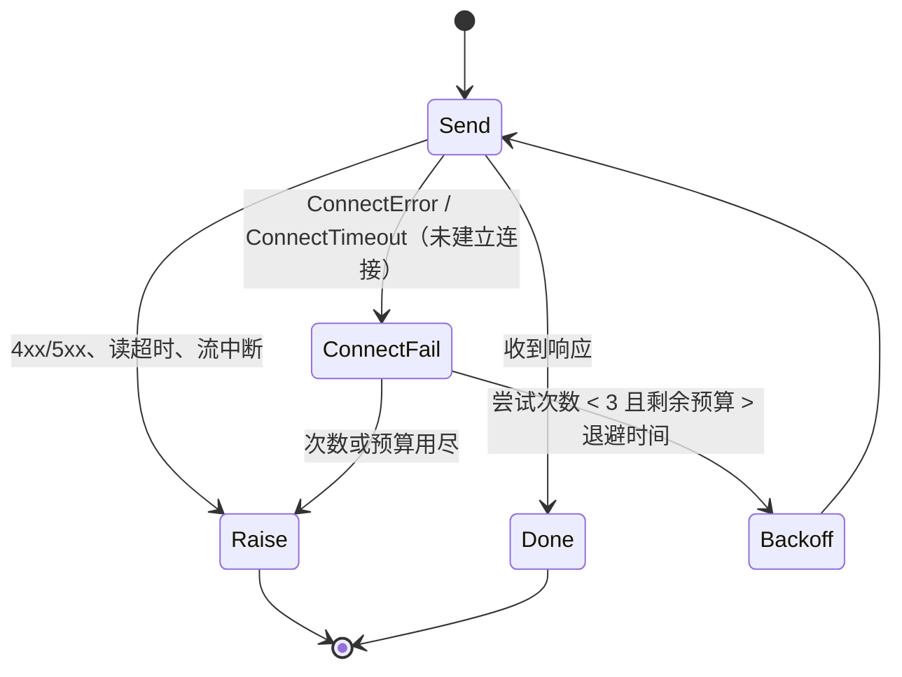

# 1. 问题与现状

**模型调用连接抖动重试 TRD。状态：实现完成，待实测（2026-11-04）。** 分支 `fix/summarize-model-timeouts`，PR [#38](https://github.com/owariband/Seekino/pull/38)。主设计见 [video-summarize-trd.md](video-summarize-trd.md)。

## 背景与触发场景

11-04 课程库（v11 隔离库）中两部完整解析的长视频，Summarize 均失败且重试耗尽，`video.display_name` / `description` / `cover_uri` 与 `video_parse_content.summary` 全部为空。资料库只能显示文件名或“第 N 集”，也没有封面推荐。后续视频大纲需求（TRD 待建）依赖 Summarize 成功产出，当前链路不通则无从实施。

| 解析任务 | 视频时长 | Chunk 数 | Summarize 结果 |
| --- | --- | --- | --- |
| `93d60de9`（Let's build GPT） | 1:56:20 | 117 | `FAILED`，`retry_count=3`，`last_error=QueryModelIncompleteError` |
| `720608b1` | 2:25:52 | 146 | `FAILED`，`retry_count=3`，`last_error=QueryModelIncompleteError` |

## 实际与期望行为

期望：解析完成后 Summarize 读完全部 Chunk，提交标题、简介和封面，并发布到资料库。实际：单次 lease 在读完前被中断，下一次 lease 从头再读，最终三次失败。

## 现状证据（`outputs/verification/course-loop-dev-20261104/api.log`，任务 `720608b1`）

- **lease 2 · 总时限耗尽：** 15:44:07 首次模型调用，15:53:58 `error_type=TimeoutError`（约 591 秒）。来源是 `asyncio.timeout(config.execution_timeout_seconds)`（`server/service/video_summarize.py:140`），默认 600 秒（`server/config/video_summarize.py:15`）。该 lease 内约 35 次模型调用，平均约 17 秒/次；仍未完成全部 Chunk 阅读。
- **lease 4 · 单次网络连接失败即中断整个 lease：** 16:09:12 发出的调用在 7.88 秒后报 `ConnectTimeout [Errno 60] Operation timed out`（`model-trace/184a3f16-…/events.jsonl` 两个 `time_ns` 之差），TCP 连接未建立，请求未到达 DeepSeek。Gateway 客户端 `max_retries=0`（`gateway/openai/multimodal.py:104`），工具循环 `_request_turn` 没有单次重试（`gateway/agent_model/multimodal.py:346-366`），因此一次网络抖动丢弃了该 lease 已经运行约 344 秒的工作。
- **上下文增长：** 每轮输入随阅读累积，lease 2 前 8 轮从 5,411 增至 146,824 字符，之后 compact 到约 26–35k（api.log:8420–8633、9080–9092）。逐次调用 token 未记录，只有字符数。
- **已排除：** 所有约 100 次 Summarize 调用均发往 `https://api.deepseek.com/responses`，`provider=deepseek, model=deepseek-flash`；窗口内仅有的两条 Kimi 记录是 16:08 的 Chat Supervisor 请求。首个 SSE 期限常量为 100 秒（`gateway/streaming/first_sse.py:14`），且不作用于 Summarize 的工具调用路径（`gateway/agent_model/multimodal.py:347` 未传入 `first_sse_deadline`）。`stream: true` 已开启。早先“10 秒首 token 检查”的判断是误读：10 秒是请求日志到失败日志的墙钟间隔。
- **未取得：** lease 1、3 没有失败日志，具体原因不详（推断为进程重启后过期回收）；任务 `93d60de9` 的失败记录不在当前日志中。

## 负面影响

长视频的展示元数据永远为空；每次失败的 lease 约消耗 10 分钟和数十次模型调用（重试三次即约 30 分钟），费用白付；下游大纲需求被阻塞。

## 本次边界

解决：Gateway 工具循环在连接阶段的网络抖动下不再直接中断整次执行。不解决：Summarize 读得太多、太慢导致的总时限耗尽，由 [summarize-single-call-trd.md](summarize-single-call-trd.md) 改造输入与调用形态解决；标题/简介/封面的内容质量规则（沿用主设计）；大纲字段与 `summary` 列重命名（各自另立 TRD）。必须保持：完整阅读覆盖校验、证据校验、租约与来源指纹校验、发布事务不变；Parse/Chat 的既有调用行为除“连接阶段失败可重试”外不变。

# 2. 影响因素、假设与评价指标

| 因素 | 证据 | 假设 | 验证方法 | 影响的决策 |
| --- | --- | --- | --- | --- |
| 总时限固定 600 秒，与 Chunk 数无关 | lease 2 在 591 秒处超时，约 35 轮未读完 | H1：根因是要求逐页读完全部 Chunk 正文（GPT 视频 697,537 字符，单页 12,000 字符），而不是时限偏小 | 移交 [summarize-single-call-trd.md](summarize-single-call-trd.md) | 本 TRD 不调整时限 |
| 单次调用连接失败没有重试 | lease 4 的 `ConnectTimeout`，`max_retries=0` | H2：连接阶段失败（请求未发出）重试是安全且幂等的，可以挽回绝大多数此类中断 | 单元测试注入 `httpx.ConnectError` / `ConnectTimeout`；实测中统计重试触发次数 | 重试只限连接阶段，还是扩展到 5xx / 读超时 |
| 每轮上下文累积 | 输入在 compact 前达到约 147k 字符 | H3：单轮延迟随上下文增长，compact 后回落；不是本次失败的直接原因 | 实验中记录每轮输入字符与耗时的关系 | 是否需要另立需求调整阅读批量或 compact 阈值 |

**指标（实验前确定）：**

| 指标 | 定义与口径 | 基线 | 目标 / 护栏 | 测量方法 | 证据入口 |
| --- | --- | --- | --- | --- | --- |
| 连接失败挽回（诊断） | 连接阶段失败次数 / 重试后成功次数 | 1 次失败，0 次挽回 | 重试后成功；单次调用最多 2 次重试 | 新增日志事件计数 | 待测 |
| 解析事实不变（护栏） | 解析任务版本、Chunk 版本与来源指纹在 Summarize 前后一致 | — | 完全一致 | 重跑前后 SQL 快照 | 待测 |
| 非连接错误不重试（护栏） | 429、4xx、读超时、流中断等的行为 | 不重试 | 保持不重试，错误原样上抛 | 单元测试 | 待测 |

# 3. 改造方案与建模

**已有基础：** Summarize 已有 lease 级重试（`max_retries=2`，`server/service/video_summarize.py:189-200`）和执行期限；Gateway 已区分连接 / 超时错误类型（`openai.APIConnectionError`、`APITimeoutError`）。本次复用这些，不引入新的调度机制。

**方案 A — 连接阶段单次重试（Gateway 工具循环）：** 在 `gateway/agent_model/multimodal.py` 的 `_request_turn` 外层，对请求发出前的失败（`openai.APIConnectionError` 且根因为 `httpx.ConnectError` / `httpx.ConnectTimeout`）最多重试 2 次，指数退避 1 秒、2 秒，并受剩余执行预算约束。已收到响应头或 SSE 后的失败、HTTP 状态错误、读超时一律不重试。所有经此路径的角色（Summarize、Parse 工具循环）共享这一行为，因为连接未建立时请求未到达服务端，重试不会产生重复计费或重复副作用。

**方案 B（已撤回）— 执行期限按 Chunk 数缩放：** 初版曾按 Chunk 数放大执行期限，并把 Summarize binding 的 `request_timeout_seconds` 调到 3600 秒（工具循环总时限取 `min(调用方传入值, binding.request_timeout_seconds)`，`gateway/agent_model/multimodal.py:116-122`）。复核后撤回：它只是让过慢的阅读设计跑得更久，Summarize 改为压缩输入、单次调用后不再需要。

**不做：** `stream=false` 对照。首个 SSE 期限不在该路径生效，本次失败也与流式无关；如果实验中出现首包慢的证据，再补这一对照。

**实施边界：** `gateway/agent_model/multimodal.py`（重试）与 `tests/gateway/test_multimodal_failure_contract.py`。无配置、数据库或接口变更。

**验证顺序：** 单元测试覆盖重试 / 不重试矩阵；真实环境中的触发次数随 Summarize 单次调用改造的实测与 Parse 工具循环日志一并统计（`event=multimodal_connect_retry`）。

# 4. 对照实验与结果分析

连接失败不可稳定复现，因此不做真实环境的对照实验。单元测试注入 `httpx.ConnectError` / `ConnectTimeout`，对照组为 429、读超时与根因不明的连接错误；其他 HTTP 状态错误不属于 `APIConnectionError`，不进入重试分支。

| 指标 | 基线 | 方案实测 | 验收标准 | 判断与证据 |
| --- | --- | --- | --- | --- |
| 连接失败挽回 | 0/1（lease 4） | 单测：连接失败后重试成功即返回结果 | 挽回 | 单测通过（`tests/gateway/test_multimodal_failure_contract.py`） |
| 非连接错误不重试 | 不重试 | 单测：各类错误只调用一次即上抛 | 保持 | 单测通过 |
| 预算约束 | — | 单测：剩余预算不足退避时间时直接上抛 | 不超出总预算 | 单测通过 |
| 真实触发次数 | — | 待统计 | 记录 | 待测 |

# 5. 试点验证与方案取舍

无独立试点；代码路径由 Parse、Summarize 等工具循环共享。代价是连接失败时最多多等 3 秒，不产生重复计费（请求未到达服务端）。

# 6. 结果验收与闭环

单元测试验收完成；真实触发次数在 Summarize 单次调用改造的实测中补记，并在 devlog 记录。

## 调整记录

| 日期 | 原判断或方案 | 新证据 | 调整与原因 | 影响 |
| --- | --- | --- | --- | --- |
| 2026-11-04 | 方案 B 只需改 Summarize 服务期限 | Gateway 以 binding `request_timeout_seconds` 封顶整个工具循环 | 同步调高 Summarize binding 至 3600 秒，Gateway 合同不变 | 部署配置须同步该值，否则长视频仍在 600 秒（云端示例为 180 秒）被截断 |
| 2026-11-04 | 失败来自 10 秒首 token 检查，需比较 `stream` 与放宽 10 秒 | `FIRST_SSE_TIMEOUT_SECONDS=100`，且不作用于工具路径；trace 显示 `ConnectTimeout` | 改为连接重试 + 期限缩放；不做 stream 对照 | 实验只需比较新旧代码 |
| 2026-11-04 | 方案 B 放大执行期限与 binding 时限 | GPT 视频正文 697,537 字符需逐页读完，而事件描述合计仅 58,701 字符 | 撤回方案 B 与 3600 秒配置；本 PR 只保留连接重试，读取效率另立 [summarize-single-call-trd.md](summarize-single-call-trd.md) | 无配置变更；长视频 Summarize 在单次调用改造合并前仍会超时 |
