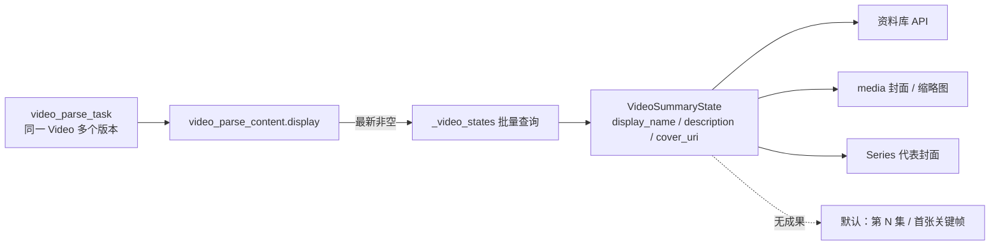

# 1. 问题与现状

**视频展示元数据读源切换 TRD。状态：实现完成，克隆库演练通过；v11 库尚未迁移（2026-11-04）。** 分支 `refactor/video-display-source`，PR [#40](https://github.com/owariband/Seekino/pull/40)。主设计见 [video-summarize-trd.md](video-summarize-trd.md)；成果表来源见 [20261031 成果表迁移](../../migrations/20261031_video_parse_content.md)。

## 背景与触发场景

Summarize 为每个 Video 产出标题、简介和封面，资料库、Series 封面和图片接口据此展示；没有 Summarize 结果时，标题回退为“第 N 集”，封面回退为第一张关键帧，简介为空。

## 实际与期望行为

- **职责不清的 `summary` 列：** `video_parse_content.summary` 保存 `{"submission", "cover_uri", "frame_receipts"}`（`server/service/video_parse_summarize.py:211-214`），名字表达不出它是“展示元数据及其证据”，运行时也没有任何代码读取它；Server 只对 `asr` / `diarization` 调用 `load_result`（`server/service/video_parse_results.py`）。
- **展示读的是 `video` 表副本：** 同一份标题、简介、封面 URI 另外写入 `video.display_name / description / cover_uri`（`video_parse_summarize.py:204-205` → `server/repository/library.py:137-149`），所有展示读取都经 `_video_state` 从 `video` 行取值（`server/repository/library.py:601-603`），再流向 `server/api/library.py`、`server/service/media.py:233-247, 337-338`、`_representative_video`（`library.py:607-615`）。
- **期望：** 解析成果表是展示元数据的唯一事实来源；成果中存在标题、简介或封面时覆盖默认值，不存在时保留既有默认回退。`video` 表不再维护同一份副本。

## 负面影响

两处存同一份事实：成果表那份没人读，`video` 那份脱离了它所属的解析版本和证据，难以判断某个标题来自哪次解析。后续大纲（`feat/video-outline`）也要放在成果表，展示与大纲分居两表会继续加深这种混乱。

## 现状证据

- 写入：仅 Summarize 发布路径写 `video` 的三个展示列；上传不写（`server/repository/upload.py:1153-1168`），没有 Video 级的手动编辑接口（`server/model/dto/libraryDTO.py:43-46` 只有 `episode_order`）。
- 读取：`_video_state` 是唯一组装点（`library.py:572-603`），批量入口 `_video_states`（`library.py:470-529`）。Chat `series_context`、检索结果和 ES 投影不读这三列（只读报告结论，已抽查 `server/service/agent_chat.py:993-1004`）。
- 2026-10-31 迁移说明曾决定“展示值原位置保留在 `video`，与 Summary 成果同一事务更新”（`docs/migrations/20261031_video_parse_content.md` 数据去向表）。本 TRD 修订这一决定。

## 本次边界

解决：重命名成果列并整理其结构；展示读取改为成果表；Summarize 不再写 `video` 的三列。不解决：大纲字段（`feat/video-outline`）；Summarize 输入改造（PR [#39](https://github.com/owariband/Seekino/pull/39)）；删除 `video` 的三列（数据不可逆，另行确认）。必须保持：API 响应字段与前端不变；默认回退不变；`video.episode_order` 仍由 Summarize 在同一事务内更新（它是组织排序，不是展示副本）；租约、来源指纹和发布事务不变。

# 2. 影响因素、假设与评价指标

| 因素 | 证据 | 假设 | 验证方法 | 影响的决策 |
| --- | --- | --- | --- | --- |
| 成果按解析任务存放，一个 Video 可有多个任务 | 每个 `video_parse_task` 至多一条成果行；重新解析会产生新任务 | H1：取该 Video 最新一条“展示成果非空”的任务，即可在重新解析期间继续显示上一版标题封面 | 单测：新任务未完成 Summarize 时仍返回旧任务的展示值；新任务完成后切换 | 选择规则 |
| 列表页批量组装 | `_video_states` 一次读取多个 Video | H2：一次额外的批量查询即可，不需要逐个 Video 查询 | 测试中断言查询次数不随 Video 数增长 | 查询形态 |
| 历史数据可能只在 `video` 上有封面 | 10-31 迁移的旧成果标注 `legacy_cover_uri_unavailable` | H3：迁移时用 `video.cover_uri` 补齐对应成果，不丢封面 | 迁移预览计数 + 迁移后逐行对比 | 迁移步骤 |

**指标：**

| 指标 | 定义与口径 | 基线 | 目标 / 护栏 | 测量方法 | 证据入口 |
| --- | --- | --- | --- | --- | --- |
| 展示一致（结果） | 迁移前后每个 Video 的 API `displayName` / `description` / `thumbnail` | 迁移前快照 | 完全一致 | 迁移前后调用资料库接口对比 | 待测 |
| 重新解析期间不丢展示（结果） | 新解析任务未完成 Summarize 时的展示值 | 当前读 `video` 行，不受影响 | 保持上一版 | 单测 | 待测 |
| 单一写入（护栏） | 发布后 `video` 三列不再被写 | 被写 | 不写 | 单测 + 代码搜索 | 待测 |
| 列表查询次数（护栏） | `_video_states` 的 SQL 次数 | 2 次 | 3 次，与 Video 数无关 | 测试 | 待测 |

# 3. 改造方案与建模

**列与结构：** `video_parse_content.summary` 重命名为 `display`，内容整理为展示字段加证据：

```json
{
  "title": "…", "title_kind": "official|generated", "description": "…",
  "episode_order": 12, "cover_uri": "artifact://…",
  "evidence": [ … VideoSummarySubmission.evidence 原样 … ],
  "frame_receipts": [ … 被引用帧的回执，原样 … ]
}
```

`submission.cover`（仅在单次执行内有效的 `inspection_id` / `frame_index`）不再单独保存，封面由 `cover_uri` 表达，其帧证据仍在 `evidence` 与 `frame_receipts`。`detail.summary` 审计键同步改为 `detail.display`。

**写入：** `complete_summary` 只写成果行的 `display`，不再调用 `library.update_video_metadata` 写三个展示列；`episode_order` 更新路径不变。

**读取：** `_video_states` 增加一次批量查询：对本批 Video，取每个 Video 最新（`video_parse_task.version` 最大、未删除）且 `display` 非空的成果行，把 `title` / `description` / `cover_uri` 交给 `_video_state`。其余读取方（API 投影、`media.py`、`_representative_video`）继续读 `VideoSummaryState`，代码不变。



**迁移：** 沿用 `scripts/migrate_video_parse_content.py` 的“预览 / `--apply --writers-stopped`、DDL 与数据事务分离、可重入”模式，新增迁移入口与 `docs/migrations/` 说明：

1. `ALTER TABLE video_parse_content RENAME COLUMN summary TO display`。
2. 逐行把旧结构 `{"submission", "cover_uri", "frame_receipts"}` 转为新结构；`detail.summary` 改名为 `detail.display`。
3. 对每个 Video 的最新展示成果，若 `cover_uri` 为空而 `video.cover_uri` 非空，则补入；标题、简介不一致时报告并停止，不覆盖。
4. `server/database.py` 的列白名单与 JSON 类型检查改为 `display`；启动时发现旧列名报 `SchemaUpgradeRequiredError`。

**不做：** 删除 `video.display_name / description / cover_uri`。迁移后它们不再被读写，删除属于不可逆的数据操作，在本 PR 验收后另行确认。

**实施边界：** `server/model/parse_content.py`、`server/repository/video_parse_content.py`、`server/repository/library.py`、`server/service/video_parse_summarize.py`、`server/database.py`、新迁移脚本与说明、`docs/migrations/20261031_video_parse_content.md` 的去向表注记、对应测试。API、前端、Gateway、Agent 不变。

# 4. 对照实验与结果分析

本需求是数据归属重构，结果是“展示一致”而非性能变化。对照方式：

- 单测：新旧读取路径在同一数据上产出相同的 `VideoSummaryState`；重新解析期间沿用上一版；发布不写 `video` 三列。
- 迁移演练：在 v11 课程库的克隆上预览并执行迁移，迁移前后导出资料库 API 的展示字段逐项对比。

| 指标 | 基线实测 | 方案实测 | 验收标准 | 判断与证据 |
| --- | --- | --- | --- | --- |
| 展示一致 | 迁移前 `video` 三列 | 新读取路径在迁移后的克隆库上返回相同值（2/2 Video） | 完全一致 | 达标 |
| 重新解析期间展示 | — | 单测：最新任务无展示时返回上一任务的展示 | 沿用上一版 | 达标（单测） |
| 列表查询次数 | 2 | 3（新增一条批量窗口查询，按本批 Video 过滤） | 3 | 达标 |

**验证记录（2026-11-04）：**

- 测试：`tests/server`（`-m "not live_agent"`）2852 passed / 14 failed；同一时刻 `dev`（`07741e35`）为 2846 passed / 14 failed，失败用例列表完全相同（如 `test_refine_video_frames.py` 的 `_refine_subscription`），本 PR 无新增失败。
- 迁移演练：`outputs/verification/summarize-compact-20261104/rehearse_display.py` 将 v11 库 `seekino_video_asr_recovery_20261031_test` 克隆为 `seekino_display_rehearsal_20261104_test`。预览 `{rename_column: true, rows_to_convert: 2, covers_to_fill: 0, conflicts: 0}`；执行后重跑为 `{rename_column: false, rows_to_convert: 0}`（可重入）。两部 Video 经新读取路径的标题、简介、封面与迁移前 `video` 三列一致。
- 启动校验：迁移后的克隆库 `create_schema` 通过；未迁移的 v11 库报 `SchemaUpgradeRequiredError`，提示先执行迁移。

# 5. 试点验证与方案取舍

在 v11 课程库克隆上执行迁移并启动新代码，确认资料库与封面接口正常；随后 PR #39 的 Summarize 实测结果应出现在 `display` 中并显示到资料库。代价是一次停写迁移和每次列表多一条批量查询。

# 6. 结果验收与闭环

待验收后填写：对照第 2 节指标，更新 [video-summarize-trd.md](video-summarize-trd.md) 的发布描述与 [20261031 迁移说明](../../migrations/20261031_video_parse_content.md) 的数据去向表，并在 devlog 记录。删除 `video` 三列作为后续事项单独确认。

## 调整记录

| 日期 | 原判断或方案 | 新证据 | 调整与原因 | 影响 |
| --- | --- | --- | --- | --- |
