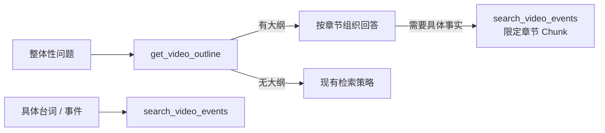

# 1. 问题与现状

**视频大纲 TRD。状态：初稿（2026-11-04）。** 分支 `feat/video-outline`，PR [#41](https://github.com/owariband/Seekino/pull/41)。上游：[summarize-compact-input-trd.md](summarize-compact-input-trd.md)（PR [#39](https://github.com/owariband/Seekino/pull/39)，Summarize 能在长视频上完成）与 [video-display-source-trd.md](video-display-source-trd.md)（PR [#40](https://github.com/owariband/Seekino/pull/40)，成果列改名 `display`、按“最新非空成果”读取）。合并顺序：#39、#40 之后实施本需求。

## 背景与触发场景

11-04 课程库演示中，对一部已完整解析的视频（Let's build GPT，1:56:20，117 个 Chunk）提问“和我说说这个视频讲了些什么”，Chat 用了 5 分 13 秒才回答。

## 实际与期望行为

期望：已解析视频的整体性问题在一分钟内回答，先给出视频脉络，再按需定位关键片段。实际：Chat 没有任何视频级概览可读，只能从事件检索和 Query 子 Agent 拼凑全片内容。

## 现状证据（`outputs/verification/course-loop-dev-20261104/api.log`，会话 `04630ab0…`，消息 `d8263e04…`）

- 16:50:26 → 约 16:55:40。第一次 `query_video` 因 `TOO_MANY_QUERIES` 被拒（5 毫秒）；第二次 `query_video` 45.5 秒后 `VIDEO_MODEL_TIMEOUT`；随后 5 次 `search_video_events`，每次约 2 秒。
- 其余约 70% 时间是 Supervisor 串行生成：模型调用在 16:51:54、16:52:46、16:53:56、16:54:46、16:55:40 依次结束。
- Supervisor Prompt 只给出“最小粒度工具”的贪心策略（`agent/chat/supervisor.py:1087-1088`），没有“整体性问题”的入口；视频级只有标题与简介（且长视频的 Summarize 从未成功）。
- 解析成果中没有大纲：`video_parse_content` 只有 `asr`、`diarization`、`summary`（`server/model/parse_content.py:26-28`）。

## 负面影响

整体性问题是观看问答最常见的入口之一；5 分钟的等待和不稳定的子 Agent 结果让已经完成的解析无法被直接利用，同时浪费多次模型调用。

## 本次边界

解决：Summarize 同时产出带时间范围的章节大纲并持久化；Chat 提供读取大纲的工具，并在整体性问题上先读大纲。不解决：Summarize 输入改造（#39）；展示读源（#40）；跨视频、Series 级大纲。必须保持：标题 / 简介 / 封面的证据校验不变；Chat 对具体台词、事件的检索策略不变；大纲只作为导航，具体事实主张仍需检索证据。

# 2. 影响因素、假设与评价指标

| 因素 | 证据 | 假设 | 验证方法 | 影响的决策 |
| --- | --- | --- | --- | --- |
| 没有视频级概览 | 成果表无大纲；Supervisor 只能检索拼凑 | H1：一次读取大纲即可回答“讲了什么”，无需 Query 子 Agent | 同一问题前后对比耗时与工具调用 | 是否需要 Prompt 路由之外的强制策略 |
| 大纲生成成本 | #39 已把全片摘要放入 Summarize Prompt | H2：大纲在同一次 Summarize 中产出，不增加模型调用 | 对比 #39 实测与本需求实测的调用数和耗时 | 是否拆成独立任务 |
| 大纲质量 | 无基线 | H3：章节时间范围与内容基本对应，能引导到正确片段 | 人工抽查章节；用章节范围检索关键片段 | 章节数与校验规则 |

**指标：**

| 指标 | 定义与口径 | 基线 | 目标 / 护栏 | 测量方法 | 证据入口 |
| --- | --- | --- | --- | --- | --- |
| 整体性问题耗时（结果） | “和我说说这个视频讲了些什么”从提交到回答完成 | 5:13 | ≤ 60 秒（预期） | api.log | 待测 |
| 工具与模型调用数（诊断） | 该轮 Supervisor 模型调用数、工具调用数 | 5 次模型调用、7 次工具调用（2 次 `query_video` + 5 次事件检索） | 记录 | api.log | 待测 |
| 大纲章节合理性（结果） | 人工核对两部长视频的章节标题与时间范围 | 无 | 两部均通过 | 发布结果 | 待测 |
| Summarize 额外成本（护栏） | 相比 #39 实测的调用数与耗时增量 | #39 实测值 | 不增加调用数 | api.log | 待测 |
| 具体问题不退化（护栏） | 台词出处类问题仍直接走事件检索 | 现有行为 | 不先读大纲 | 单测 + 一次真实对话 | 待测 |

# 3. 改造方案与建模

**产出：** `VideoSummarySubmission` 增加 `outline`：按时间排序的章节列表，每节 `start_ms`、`end_ms`（整数毫秒，左闭右开）、`title`、`summary`。提交校验：至少一节；章节有序、不重叠、位于 `[0, duration_ms)` 内、`start_ms < end_ms`；章节数上限可配置（默认 30）。大纲是导航信息，不要求逐节引用原文，但时间范围必须落在视频内。Prompt 要求按 #39 的摘要划分主要章节。

**持久化：** `video_parse_content` 新增可空 JSON 列 `outline`，结构 `{"sections": [...]}`，与 `display` 在同一发布事务写入，`detail.outline` 记录来源指纹与租约版本。迁移沿用 #40 的迁移入口模式（`ADD COLUMN outline JSON NULL`，幂等）。读取规则与 #40 一致：取该 Video 最新且 `outline` 非空的成果，重新解析期间沿用上一版。

**Chat 工具：** Supervisor 新增 `get_video_outline(video_id)`，宿主注入实现（与 `search_video_events` 相同，在 `agent/chat/video_search/tools/registry.py` 注册，Server 在可信授权范围内读取）。返回标题、简介和章节；每节附带覆盖该时间范围的 `video_chunk_id` 列表，便于随后用 `search_video_events(video_chunk_ids=…)` 或 `read_retrieval_evidence` 精读。视频没有大纲时返回明确的“不可用”结果，Supervisor 回到现有检索策略。

**Prompt 路由：** 在 `agent/chat/supervisor.py` 的检索策略中增加一条：用户询问视频整体内容、结构、章节或概要时，先调用 `get_video_outline`，据此组织回答；需要具体事实或片段时再按章节的 Chunk 精读。现有“具体台词、事件优先 `search_video_events`”规则不变。

**实施边界：** `agent/video_summarize/`（提交结构、校验、Prompt）、`server/model/parse_content.py`、`server/service/video_parse_summarize.py`、迁移入口、`agent/chat/supervisor.py` 与 `agent/chat/video_search/tools/`、Server 中注入大纲读取的服务、对应测试。前端不变。

# 4. 对照实验与结果分析

**计划：** 在 #39、#40 合并后的同一 v11 课程库、同一模型配置下：

1. 对两部长视频重新排队 Summarize，记录调用数、耗时，与 #39 实测对比，并人工核对大纲。
2. 新开会话，对 GPT 视频重复提问“和我说说这个视频讲了些什么”，记录耗时、模型与工具调用；再问一个具体问题（例如某段代码在哪里讲到），确认仍走事件检索。

| 指标 | 基线实测 | 方案实测 | 变化量 | 验收标准 | 判断与证据 |
| --- | --- | --- | --- | --- | --- |
| 整体性问题耗时 | 5:13 | 待测 | — | ≤ 60 秒 | 未验证 |
| 模型 / 工具调用数 | 5 / 7 | 待测 | — | 记录 | 未验证 |
| 大纲合理性 | — | 待测 | — | 通过 | 未验证 |
| Summarize 额外调用 | #39 实测 | 待测 | — | 0 | 未验证 |

# 5. 试点验证与方案取舍

试点为课程库两部长视频的真实大纲与一次真实对话。代价：Summarize 输出变长（预期数千 token），以及一次成果表加列迁移。若章节质量不足，优先调整 Prompt 与章节数；若 H2 不成立（输出过长导致失败），再考虑拆为独立任务。

# 6. 结果验收与闭环

待实验完成后填写：对照第 2 节指标，更新 [video-summarize-trd.md](video-summarize-trd.md) 的提交结构，在 devlog 记录 Chat 整体性问题的前后对比。

## 调整记录

| 日期 | 原判断或方案 | 新证据 | 调整与原因 | 影响 |
| --- | --- | --- | --- | --- |
| 2026-11-04 | 大纲随 Summarize 同一调用产出，不增加失败面 | 克隆库实测（`outputs/verification/video-outline-20261104/`）：micrograd 首次排队后成功，13 节大纲覆盖全片；GPT 四次租约失败。失败调用均为 DeepSeek 接受请求后 18 秒内未返回任何字节即断开（`RemoteProtocolError`，共 6 次；正常调用首个 SSE < 1.8 秒），PR #38 的连接重试不覆盖此情形。另外 GPT 某次租约跑了 49 轮，`UNSUPPORTED_EVIDENCE` 拒绝合计 326 次 | Chat 耗时实验暂停；先另立修复“已连接但无任何响应”的重试，再排查证据引用反复被拒的原因 | 第 4 节实验未完成，指标仍为待测 |
| 2026-11-05 | `reasoning_effort: none` 足以完成 Summarize | 同一克隆库、同一代码（#41 + #42 本地合并 `9ea22f39`）、同一 GPT 视频：`none` 五次租约全部失败（18–49 轮，`UNSUPPORTED_EVIDENCE` 合计 326 次，另有 6 次无响应断开），且 trace 中没有任何推理输出；`high` 首个租约即完成，8 次调用、94 秒、0 次证据拒绝、0 次断开，产出 14 节大纲（0–116 分钟连续覆盖）与生成标题“从零构建字符级 GPT” | Summarize 改用 `high` 作为候选默认，需先合并 #42（思考模式下 `tool_choice` 降为 `auto`）；一次运行的样本有限，Chat 耗时实验将在 `high` 下继续 | 逐次 token 用量未记录在日志中，费用对比未测 |
