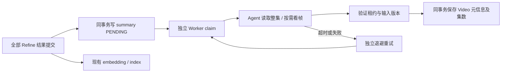

# 1. 问题与现状

**Video Summarize 技术设计，2026-10-29 标题规则与系列封面展示修订。** 用户期望解析后由 Summary Agent 替换素材文件名。当前链路已在全部 Refine 提交后自动触发，授权的 EP04 8–20 秒验收片已实际完成 Kimi 总结、简介与封面发布；但没有本集标题卡时 `title=null`，且资料库仍只显示 `originalFilename`，导致“总结成功”没有带来可读标题。

基线见 [SQL 审计](../../../outputs/verification/native-local-20261029/summary-title-audit.json)。本次只调整标题策略、证据校验和资料库展示，复用已提交解析与现有发布事务；不改变集数证据、解析完成条件、租约及版本校验，也不批量重解析 MyGO。

同日追加的系列封面需求：未观看时，从各集 Summary 已发布的推荐封面中稳定随机选择一张；观看后使用本身份上次观看位置的原片画面。修改前 Repository 仅取第一部有关键帧的视频，Summary 封面没有关键帧时甚至不入候选；观看首页卡片有封面时不读取进度。此次复用已有封面和浏览器观看记录，不修改 Summary 选帧模型、数据库 Schema 或解析任务。

# 2. 影响因素、假设与评价指标

两个因素分别是正式标题缺失时的输出策略与前端字段选择。用户确认采用“优先正式标题，没有时按内容生成简短标题”。假设已有解析内容足以支持简短事实标题；工具可确定性核对引用存在、读取覆盖与长度，但语义是否忠实、正式标题是否确实不存在仍需模型判断及样例复核。

| 指标 | 基线 | 验收标准 | 方法与证据 |
| --- | --- | --- | --- |
| 无标题卡视频的可读标题 | 同一 12 秒片 `title/display_name=null` | 非空、简短、与片段主内容一致，标记 `generated` | 复用相同 Chunk，单次 Kimi summary 后核对 SQL、引用与画面 |
| 资料库标题 | `native-acceptance-ep04-12s.mp4` | 优先显示 `displayName`，缺省保留文件名回退 | 真实浏览器刷新资料库 |
| 事实与发布护栏 | 官方标题和集数需直接证据 | 官方规则保持；生成标题不能无引用、混入预告或推断集数；解析版本/内容不变 | 工具及持久化回归、重跑前后指纹与版本核对 |

系列封面的验收护栏：候选必须来自本 Series 的已发布 `cover_uri`，无候选才回退关键帧/原片预览；同一候选集在刷新和集数排序变化时保持选择稳定；观看后卡片和系列头图使用最新有效记录的整数毫秒位置；删除/不可播放的视频不用于进度封面。封面预览不能写入观看记录。观看记录沿用按身份隔离的本地存储，不宣称跨设备同步。

# 3. 改造方案与建模

复用已有 `title`、`display_name`、提交工具和同事务发布，新增结果字段 `title_kind=official|generated`，默认 `official` 兼容旧结果。正式标题保留原语言和 255 字符上限；没有可靠正式标题时，按片段主要内容生成中文短标题，目标 6–20 字、硬上限 80 字，并保留引用。来源类型存入现有 summary 结果 JSON，无需数据库增列。资料库优先展示 `displayName`，文件名保留在 tooltip 和回退中。

先做工具/持久化回归和前端检查，再在已授权 12 秒范围重跑 summary；不重新执行 ASR、Understand、Refine 或 Index。详细输入、调度、失败、并发与兼容合同见下文。

系列默认封面在现有 Library 数据投影处按 `SHA-256(series_id:video_id)` 稳定抽选 Summary 候选，不写随机状态或增加表；候选新增/删除时允许重新选择。Media 继续核验受管图片并沿用缺片回退。前端首页卡片、大图及系列页优先使用有效观看位置；未观看时静态显示服务返回的封面，不再加载另一个任意时间的视频帧覆盖它。未产出 Summary 时保留现有回退。

# 4. 对照实验与结果分析

本次使用同一验收视频及既有 Chunk，保留 [重跑前状态](../../../outputs/verification/summary-title-20261029/before.json)、[重跑结果](../../../outputs/verification/summary-title-20261029/after.json) 和 [脚本](../../../outputs/verification/summary-title-20261029/rerun_summary.py)。离线回归：Summary Agent / Service / Persistence 共 75 passed；前端 App / format 共 65 passed，typecheck 与 production build 通过。

Kimi `k3.1-pro` 单次重跑 59.591 秒完成，生成 9 字标题「台阶夜谈《春日影》」，`title_kind=generated`，SQL `display_name` 一致；5 次模型请求全部 completed，stage 均为 summarize。标题主旨与引用对白、台阶夜景原帧相符；这是 Assistant 对同一调试样例的复核，不是独立盲评。解析保持版本 4 / COMPLETE，Chunk 版本及来源指纹不变；结果集数为 null，数据库原组织集数 1 保留。基线来自先前真实运行，不是多轮盲测；不据单例推断整季标题质量或延迟分布。

验收脚本首次在写入和模型调用之前因读 DTO 元数据字段失败；改为读取 Video ORM 后执行成功，未增加一次模型试验。

系列封面追加验收：后端 Library/Media/公开访问 74 passed，前端 WatchHome/SeriesPage/PlaybackFrame/观看进度 47 passed，typecheck/build 通过。首次测试失败来自新增用例的重复视频 hash 与 `it.each` 参数形状，修正测试数据后通过。浏览器对同一真实 12 秒视频验证：无历史的 localhost 站点只加载 Summary 静态封面；原 127.0.0.1 页面保留用户进度，卡片视频帧为 8.544 秒。未用清空用户观看记录制造无历史状态。多集候选与排序稳定性由隔离 SQLite 用例验证；当前真实库只有一个已发布的 Summary 视频封面，不能宣称已做多集视觉质量比较。

| 系列封面行为 | 修改前 | 修改后验证 |
|---|---|---|
| Summary 封面无关键帧 | 不入系列候选 | 隔离数据中正常入选并生成可读图片引用 |
| 有观看记录的卡片 | 固定系列封面/代表帧 | 本机实测停在 8.544 秒，旧 Summary 图片作为加载回退 |
| 无观看记录的卡片 | 第一集关键帧 | 本机显示已发布 Summary 图片，未创建预览 video |
| 浏览预览更新进度 | 不应发生 | 前端用例保持无写入，原页面进度不变 |

# 5. 试点验证与推广决策

试点仅为一段 12 秒视频：它没有本集标题卡，能直接验证用户要求的生成回退；正式标题路径以已有及新增离线回归保护，长视频标题卡发现率待测。既有 Summary 自动触发与配置入口继续使用，不增加历史全库补跑机制或专用队列。生成标题增加可读性，同时引入语义误概括风险，因此保留 `title_kind` 与证据供追溯。

系列封面试点复用现有 Summary 成果，无新增模型调用或数据迁移。前端热更新后做真实页面检查，服务通过现有启动脚本加载后端选择规则；持久化任务继续按现有恢复流程推进。没有额外重跑 Summary 来美化验收样本。证据保存于 `outputs/verification/series-artwork-20261029/`。

# 6. 结果验收与闭环

实现、真实 summary 发布及浏览器展示均完成：资料库刷新后由文件名变为生成标题，观看页及选集同步采用该标题，原文件名保留可查。确认无活跃解析/总结/聊天后仅重启 API，新源码已加载，MySQL/ES/Web 进程未变，健康与资料库代理查询通过。证据：[资料库截图](../../../outputs/verification/summary-title-20261029/library-title.jpg)、[观看页截图](../../../outputs/verification/summary-title-20261029/watch-title.jpg)、[API 加载记录](../../../outputs/verification/summary-title-20261029/api-reload.json)。

采用该规则供后续自动 Summary 使用，已有完成结果不自动重跑；正式标题路径通过离线回归，整季真实标题质量仍未验证。状态统一维护于 [F08](../../dev/problems.md#f08summary-标题未落到资料库展示且无正式标题时缺少回退)，决策及比较见 [devlog](../../dev/devlog.md#devlog-summary-title-20261029)。旧 MyGO 数据恢复与整季重解析是独立问题，不能由本次标题验收替代。

2026-10-29 系列封面行为已实现、回归并在本机发布。当前观看页和系列页遵循“未看用 Summary，已看用上次进度”；本机有多集 Summary 候选后的整体审美效果仍待实际产出。状态见 [F09](../../dev/problems.md#f09系列封面未使用-summary-候选及上次观看画面)，过程见 [devlog](../../dev/devlog.md#devlog-series-artwork-20261029)。

# Video Summarize 技术设计：现行合同与历史实施记录

## 目标与边界

在单个 Video 的全部 Refine 结果提交后，独立提取本集的官方标题、无正式标题时生成内容短标题，并生成简短简介、推荐封面和有明确证据的真实集数。它是 `agent/video_summarize/` 下的独立 Agent，与 Parse、Refine、Prefix 并列，不属于 Chat Agent。

Summarize 与 embedding/index 并行，不加入解析完成条件，不等待 Prefix。失败、超时或重试只影响本次摘要；父解析任务 COMPLETE 后摘要仍可执行。现有 Prefix 保留。未取得可靠证据的标题、集数或封面保持原值，不根据文件名、当前排序或剧情推断官方集数。

## 职责分配

| 层 | 位置 | 职责 |
|---|---|---|
| Agent | `agent/video_summarize/` | 输入 Canvas、提示词、三个工具及结果校验，不访问数据库 |
| Host | `server/service/video_summarize.py` | 模型调用、独立预算、真实视频取帧、封面文件发布、取消与用量 |
| Phase service | `server/service/video_parse_summarize.py` | 就绪判断、状态与租约、输入版本校验、发布编排 |
| Persistence service | `server/service/video_parse_persistence.py` | Session/事务边界、Refine 提交后同事务排队 |
| SQL repositories | 现有 `video_parse_task.py`、`video_parse_interval.py`、`video_parse_chunk.py` | 现有表读写与有界候选查询 |
| Library | 现有 `repository/library.py`、`service/library.py` | Video 元信息写入、集数和 Upload 槽位更新、Prefix 兼容处理 |
| Media | 现有 `service/media.py`、`utils/media.py` | 封面图片 ID、权限、丢失时回退关键帧 |
| Worker | `server/mq/video_parse_consumer.py` | 独立 summary 并发槽，不挤占 Parse/Refine/Index 槽位 |

不新增 summarize repository、ORM model 或任务表。事务方法读取最新 DTO，合并 detail 后显式保存，保留 model_calls、Prefix 等并行写入的状态。

## 输入与工具

输入包含 Video ID、毫秒时长、当前组织集数、Series 背景，以及按顺序排列的全部已提交 Chunk 内容。每个 Chunk 带任务 ID、序号和内容版本。当前组织集数仅用于定位，不作为真实集数证据。

| 工具 | 行为 |
|---|---|
| `get_context_canvas` | 只读背景和本 Video 的 Chunk；支持现有批量及字符分段协议，提交前检查所有 Chunk 的完整阅读覆盖 |
| `inspect_video_frames` | 复用 `agent/utils/video_frames.py`，由宿主绑定当前 Video 原始源、合法时间范围及预算；返回真实图片与时间戳/hash 回执 |
| `submit_video_summary` | 验证字段、来源引用、已读覆盖与真实帧回执，提交内存结果；不直接写数据库 |

仅成功调用提交工具才算完成；模型直接输出 `completed=true` 不算完成。封面只能选择已经成功返回给模型的真实帧，不能提交任意 URL、路径或图片 ID。

输出包括：

- `title`：优先明确的本集正式标题，最多 255 字符；无可靠正式标题时按本视频主要内容生成短标题，目标 6–20 个汉字、最多 80 字符；连内容标题也缺少依据时可空。
- `title_kind`：`official` 或 `generated`，缺省为 `official` 兼容原有结果；`generated` 必须有非空短标题。
- `description`：必填，本集的简短事实简介，附 Chunk 或帧证据。
- `episode_order`：可空，明确的正整数编号；引用必须含无歧义的编号标记，支持中文数字及全角数字。
- `cover`：可空，已登记的 `inspection_id + frame_index`。
- `evidence`：每个输出字段的来源引用与原文/画面观察。
- 程序组装的 `frame_receipts` 和实际封面图片字节；回执与模型提交内容分开保存。

正式标题、集数的文本证据只接受正式 `ON_SCREEN_TEXT`；生成标题可引用 Chunk 的场景、对白等确实存在的文本，标题措辞不要求逐字出现。两类标题均检查引用及匹配事件完整内容中的次回/下集预告标记，不能截断 quote 绕过。帧证据必须有真实取帧回执，本集归属仍由视觉模型结合前后时序判断；正式标题候选冲突时可退回有依据的内容短标题，集数冲突仍放弃该字段。

## 调度与状态



执行状态放在现有 `VideoParseTask.detail._worker_runtime_v2.summarize`：

- `status`：PENDING / RUNNING / RETRY_WAIT / COMPLETE / FAILED / CANCELLED。
- `lease_owner`、单调递增的 `lease_version`、`lease_expire_time_ms`。
- `retry_count`、`next_execute_time_ms`、`last_error`。
- `source_fingerprint`：任务版本、Video 源/时长/原集数、背景和全部 Chunk 内容版本及内容的摘要。
- 首次领取冻结的 `config_snapshot`：模型绑定及独立执行预算；不保存凭据。
- 成功后的 `result`、`frame_receipts`、实际应用集数及集数冲突原因。

仅扫描显式排队的摘要，查询有界；不隐式为全部历史视频补跑。最后一个 Refine 提交会检查完整拓扑及所有 Refine 提交凭据，再排队。重解析的新版本会使旧摘要失效；删除或手动重试也会撤销旧租约，不要求等待摘要执行结束。

## 并发与发布

模型和媒体 IO 全部在数据库事务外进行。每次领取、读取和提交都核对当前解析版本与独立租约，最终写回重新核对来源指纹。已删除、已被新 parse 替换、已被人工改号或内容/背景已变化的结果不得覆盖现状。

Summary 独立事务在 MySQL 使用 READ COMMITTED，避免候选扫描或 Library 普通查询提前建立旧读视图。Refine 的同事务排队通过当前读取得子任务及结果。发布锁定 Series 背景以稳定最后一次校验。

自动改号复用 Library 的 Upload → Video 顺序和现有占号检查。其后访问 Prefix/父任务使用非等待锁；索引正在持有父任务时，摘要回滚并稍后重试，不持有 Video 等待索引。现有人工改号调用仍采用原逻辑。

集数变更、Prefix 失效、元信息和摘要完成状态在同一事务内提交。整个发布过程处于同一 savepoint；验证失败时连同临时改号一起回滚。若集数槽被其他 Video/Upload 占用，或活跃 Prefix 不允许改号，回滚该次改号，保留原顺序并保存其余元信息及冲突原因，不覆盖或交换其他视频。

## 数据与展示

`video` 表新增三个可空字段：

| 字段 | 类型 | 用途 |
|---|---|---|
| `display_name` | VARCHAR(255) | 本集展示标题 |
| `description` | LONGTEXT | 本集简介 |
| `cover_uri` | LONGTEXT | 已发布推荐封面的位置 |

迁移脚本：`docs/migrations/20261021_video_metadata.sql`。已有数据保持空值。部署新代码前需要对已有 MySQL 库执行这份增列迁移。初版开发记录为未执行该迁移；2026-10-29 本机库已有这三个字段且真实发布成功，本次标题策略无需新增迁移。

Library API 增加可空 `displayName`、`description`；图片继续走 `thumbnail`，不向前端暴露 `cover_uri`。推荐封面缺失或不可读时回退原关键帧；独立的 `video_cover` 图片 ID 不改变原关键帧序号与权限规则。

观看页消费标题、简介和 thumbnail，缺省时沿用 Episode N 和原关键帧。资料库优先显示 `displayName`，再回退原文件名和集数；原文件名仍保留在 tooltip 中，不重命名媒体文件。Chat 保留请求原始 extra_context 用于幂等重放，在实际构造 Agent 输入时重新读取当前 Video 集数，从而兼容旧页面在自动改号后继续提问。

## 配置与运行

在 `config.yaml` 配置视觉模型角色 `models.summarize`，独立运行参数来自 `VideoSummarizeConfig` 和 `SEEKINO_SUMMARIZE_*` 环境变量。只有角色存在且开关开启时才装配 handler；旧配置缺少该角色时不会执行。

默认并发 1、最多 2 次失败重试、总超时 600 秒。Summarize 不设置模型轮次、工具调用次数或看帧次数上限；保留执行超时、取消、租约及单次读取/媒体大小约束。旧任务快照中的三个次数配置不再生效。`SEEKINO_SUMMARIZE_ENABLED=false` 可关闭自动执行。

标题定位优先追踪前几个 Chunk 的 SCENE、ON_SCREEN_TEXT 中“标题、片头、OP、作品标识”等线索，依据事件时间检查 OP 结束到正片开始的过渡及相邻 Chunk，并在候选窗口局部取帧核验。作品 logo 只提供定位线索；本集正式标题和集数仍需直接画面文字证据，支持 `#N` 集号，排除 ED、下集预告及推断。未命中时缩窄或平移候选窗口，避免反复全片稀疏采样；完整审阅后仍无可靠正式标题则生成有依据的内容短标题。

用量仍归属原 VideoParseTask，通过 `stage=summarize` 区分。取消和超时会取消 provider；后台线程实际退出前保留占用的租约/调用句柄，避免并发重复执行。

第一版不提供历史批量补跑界面或摘要专用管理页面；历史 Video 不自动补跑，已有解析结果可由受控内部调用 `mark_summary_ready` 排队。同一来源指纹已完成时该方法不会重复排队；本次验收先保存旧状态，再在同一事务内显式重置并领取唯一目标的 summary 租约，复用正常执行与发布校验。

## 验证

离线测试覆盖三个工具与完整阅读、非法证据、预告排除、标题长度、真帧与图片字节一致性、独立预算和取消、索引并行、Refine 完成触发、租约回收、配置冻结、旧结果拒绝、占号降级、改号及状态原子写回、Prefix 兼容、Upload 撤销和 Chat 幂等。

```sh
PYTHONDONTWRITEBYTECODE=1 .venv/bin/python -m pytest -q -p no:cacheprovider \
  tests/agent/video_summarize \
  tests/server/test_video_summarize_service.py \
  tests/server/test_video_summarize_persistence.py \
  tests/server/test_video_parse_model_calls.py
```

Web 使用 `format.test.ts`、`WatchPage.test.tsx` 和 TypeScript typecheck。真实 MySQL 并发和真实模型质量需在配置测试数据库/模型后验证；SQLite 回归不能替代 MySQL 锁行为验证。初版开发未对线上/开发服务发起真实摘要调用；2026-10-29 单片真实 Kimi/MySQL 及页面验证见第 4–6 节，不替代真实并发压测。

## 初版实际修改范围（历史记录）

实际涉及 52 个文件：生产 34 个、测试 16 个、文档/迁移 2 个；新增 14 个、修改 38 个，无删除或重命名。

与预计树相比，新增了两个必要的兼容调整：`repository/video_parse_interval.py` 支持 Refine 凭据当前读；`service/video_parse_prefix.py` 支持摘要发布非等待取锁。原计划的 `tests/server/test_parse_usage.py` 无需改动，使用既有测试与摘要宿主测试验证用量归属。

```text
Seekino/
├── agent/
│   └── video_summarize/
│       ├── [A] __init__.py  ← 导出 Agent 合同
│       ├── [A] agent.py  ← Agent 执行及提交完成条件
│       ├── [A] prompts.py  ← 本集总结和证据约束提示词
│       ├── [A] state.py  ← 输入、输出、证据和阅读覆盖状态
│       └── [A] tools.py  ← 三个工具及来源校验
├── docs/
│   ├── migrations/
│   │   └── [A] 20261021_video_metadata.sql  ← 新增 Video 元信息列的受控迁移
│   └── [A] video-summarize-trd.md  ← 职责、合同、调度、验证和交付说明
├── server/
│   ├── api/
│   │   └── [M] library.py  ← 投影标题与简介
│   ├── config/
│   │   ├── [M] settings.py  ← 加载摘要配置
│   │   └── [A] video_summarize.py  ← 独立执行参数与环境变量
│   ├── model/
│   │   ├── dto/
│   │   │   ├── [M] jobDTO.py  ← 摘要执行租约 DTO
│   │   │   └── [M] libraryDTO.py  ← Library 元信息 DTO
│   │   ├── vo/
│   │   │   └── [M] libraryVO.py  ← 公开标题与简介字段
│   │   └── [M] video.py  ← 三个可空元信息字段
│   ├── mq/
│   │   └── [M] video_parse_consumer.py  ← 独立摘要并发与失败隔离
│   ├── repository/
│   │   ├── [M] library.py  ← 同事务写入 Video 元信息
│   │   ├── [M] upload.py  ← 重试、重解析、删除撤销旧摘要
│   │   ├── [M] video_parse_interval.py  ← 读取 Refine 提交凭据时可使用当前读
│   │   └── [M] video_parse_task.py  ← 有界查询待执行摘要
│   ├── service/
│   │   ├── [M] agent_chat.py  ← 保留幂等请求并读取当前集数
│   │   ├── [M] library.py  ← 复用同事务改号及 Prefix 处理
│   │   ├── [M] media.py  ← 推荐封面及旧关键帧回退
│   │   ├── [M] parse_usage.py  ← 接收摘要租约并沿用用量归属
│   │   ├── [M] video_parse_model_calls.py  ← 摘要调用登记与租约校验
│   │   ├── [M] video_parse_persistence.py  ← 事务接口和 Refine 完成排队
│   │   ├── [M] video_parse_prefix.py  ← 摘要发布可非等待获取 Prefix 父锁
│   │   ├── [A] video_parse_summarize.py  ← 摘要租约、状态和发布编排
│   │   ├── [M] video_parse_task.py  ← 复用完整拓扑判断
│   │   └── [A] video_summarize.py  ← 模型、媒体、用量和取消宿主
│   ├── utils/
│   │   └── [M] media.py  ← 独立 video_cover 图片 ID
│   ├── [M] bootstrap.py  ← 装配独立摘要服务
│   └── [M] database.py  ← 校验新增 Video 列
├── tests/
│   ├── agent/
│   │   └── video_summarize/
│   │       ├── [A] test_agent.py  ← 完成条件与输入合同回归
│   │       └── [A] test_tools.py  ← 阅读、证据、预告和真帧校验回归
│   └── server/
│       ├── [M] test_agent_chat_service.py  ← 改号后的 Chat 幂等与上下文回归
│       ├── [M] test_bootstrap.py  ← 有无模型角色的装配回归
│       ├── [M] test_cloud_library_access.py  ← 云端封面权限回归
│       ├── [M] test_config.py  ← 摘要配置加载和预算回归
│       ├── [M] test_database.py  ← 迁移列与兼容性回归
│       ├── [M] test_library_views.py  ← 元信息投影及事务回归
│       ├── [M] test_media_views.py  ← 封面回退及旧图片 ID 回归
│       ├── [M] test_upload_service.py  ← 真实撤销流程回归
│       ├── [M] test_video_parse_model_calls.py  ← 真实摘要租约与调用登记回归
│       ├── [M] test_video_parse_worker.py  ← 摘要不阻塞索引回归
│       ├── [A] test_video_summarize_persistence.py  ← 调度、租约、原子发布及冲突回归
│       └── [A] test_video_summarize_service.py  ← 宿主、取消、预算和端到端回归
├── web/
│   └── src/
│       ├── api/
│       │   └── [M] contracts.ts  ← Video 元信息响应类型
│       ├── features/
│       │   └── player/
│       │       ├── [M] WatchPage.test.tsx  ← 元信息展示与导航测试
│       │       └── [M] WatchPage.tsx  ← 观看页消费标题和简介
│       └── shared/
│           ├── [M] format.test.ts  ← 标题缺省回退测试
│           └── [M] format.ts  ← 优先展示本集标题
└── [M] config.yaml  ← summarize 视觉模型角色
```

工作区同时有其他会话的 OCR、检索和前端改动。上树仅列本功能实际触及路径；共享文件中原有和并行改动均保留，不把整份工作区 diff 归为本次新增。未执行 commit、push、迁移或服务重启。

### 本轮验证记录

- Agent 工具、宿主、持久化专项 **50 passed**，包含完整的离线 Agent → LangChain tools → Host → SQL 用例；Gateway 为假模型，不依赖真实 provider。
- 扩大回归结果：**1312 passed、1 skipped、3 failed**。三项失败均来自并行 OCR 默认配置变化影响的旧 Worker 测试：`test_worker_runs_real_agent_repository_and_stage_commits` 的模型替身不处理 OCR；`test_uploaded_v2_pipeline_recovers_indexing_searches_receipt_and_reconciles_delete` 的两个窗口参数仍断言 OCR 调用为零。
- 为核对归因，仅在独立测试进程通过 `/private/tmp` 插件还原这三个用例原先的 OCR 关闭默认，三项均通过。未修改其生产配置或旧测试断言；常规回归里的三项失败仍待 OCR 变更对应修复。
- Web：`format.test.ts` 和 `WatchPage.test.tsx` 共 **36 passed**，`npm run typecheck` 通过。
- Upload 整份回归 **105 passed**；覆盖摘要运行时重解析、删除、解析重试和索引重试。
- 审查并修复了标题长度、全角数字、下集预告证据、真实整集的模型调用预算、MySQL 旧快照校验、Video/Task 等待锁和 SQLite savepoint 回滚边界。未运行真实 MySQL 并发测试（当前未配置 `SEEKINO_TEST_DATABASE_URL`）或真实模型质量评测。

实际 8 个新增生产文件共 1052 行。上述 38 个既有路径的当前 `git diff --numstat` 汇总为新增 916 行、删除 100 行；这包含共享文件中保留的其他会话改动，不能视为本次净增量。14 个新增文件另行计数；staged 为空，未创建提交。
