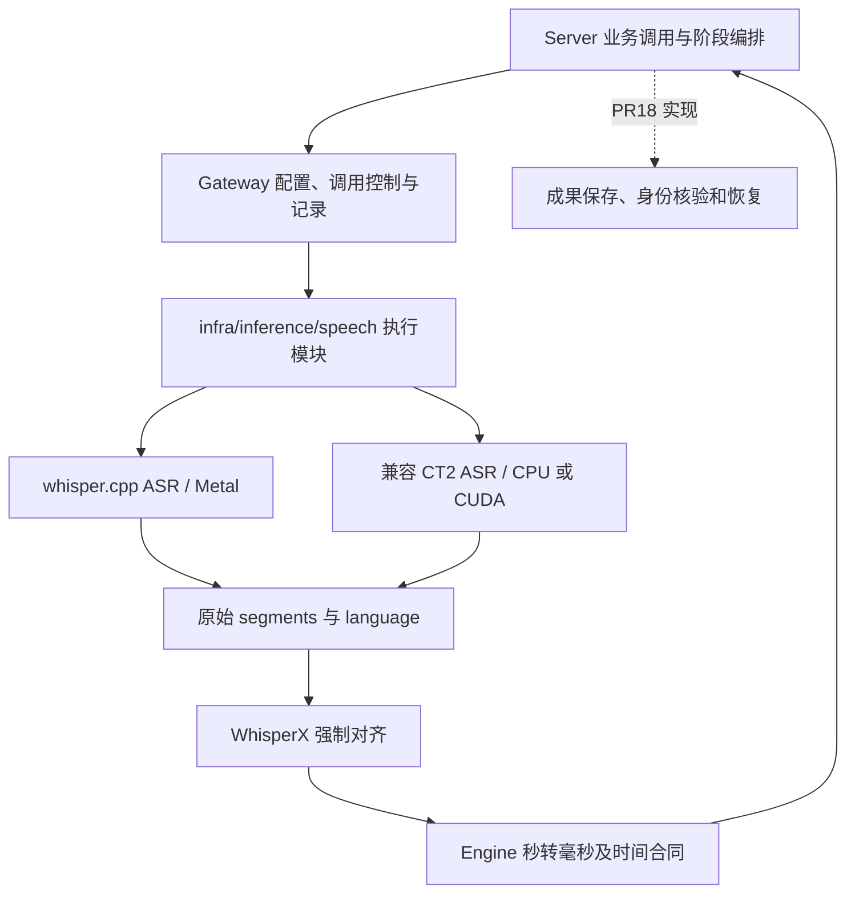

# 1. 问题与现状

主题：Apple GPU ASR 正式接入、WhisperX 强制对齐验证与语音阶段接口。提出日期：2026-10-31（Asia/Shanghai）。本稿记录已选方向、源码依据与待验证计划，不表示功能已经实现或部署。

- 工作分支：`feat/apple-gpu-asr-alignment`；集成目标：`dev`。
- PR：待创建；首个提交只包含本 TRD 初稿，创建后立即回填关联。
- 负责人：本 chat 的 Codex，负责本 feature 的设计、实现与验证。
- 关联修复：[PR #18](https://github.com/owariband/Seekino/pull/18)，分支 `fix/video-asr-recovery`，负责语音成果持久化与失败恢复。
- 基础合同：[本地 WhisperX ASR 主设计](local-whisperx-asr-trd.md)、[Gateway](../../../gateway/README.md)、[Engine 时间约定](../../../engine/README.md#媒体时间单位)。问题状态统一见 [problems](../../dev/problems.md)，实验与取舍记入 [devlog](../../dev/devlog.md)。

## 1.1 触发场景与实际差距

长课程解析需要先取得原片转写和字词时间，才能向后续 Chunk 提供语音证据。当前正式 `adapter: whisperx` 在一个调用内完成 CTranslate2 ASR、VAD 和声学强制对齐；Apple Silicon 上当前配置使用 CPU。原生 Metal 转写已有独立实验，但没有与正式 WhisperX 对齐和阶段调用合同接通。

源码基线为 `dev` 的 `83cc07e8`。已核对的限制包括：

1. [WhisperXSourceConfig](../../../gateway/config.py) 的 `device` 仅允许 CPU/CUDA，ASR 与对齐共用该字段；把枚举直接扩成 MPS 不会使 CTranslate2 ASR 支持 Apple GPU。
2. [WhisperXRuntime](../../../gateway/local/whisperx.py) 强制要求本地 CTranslate2 目录及 tokenizer，再执行 `load_model → transcribe → load_align_model → align`；whisper.cpp 的 GGML 权重不能直接填进这条加载路径。
3. [本地启动脚本](../../../scripts/local_whisper.py) 只读取 `openai_audio` 来源。脚本存在和实验成功不代表新的 ASR＋对齐组合已经进入正式 Gateway。
4. [Gateway 转录入口](../../../gateway/transcription.py) 主要返回最终转录结果。若对齐失败前无法向宿主交付原始转写，#18 就无法做到“保存已完成转写，只重新运行对齐”。
5. [Server 默认配置](../../../server/config/parse_profile.py) 通过 `adapter == "whisperx"` 选择整片 ASR，改来源或适配器名称时必须核对实际接线，避免意外回到逐 Chunk 调用。

历史证据：#18 记录完整 GPT 课程的 CPU full large-v3＋VAD＋对齐耗时 4,591.557 秒；随后下游失败，暴露成果丢失与重复计算问题。2026-10-30 晚同片、同 whisper.cpp、同 Q5_0 的 Metal 纯转写实验中，Turbo 为 182.360 秒，Full 为 495.115 秒。两组实验的模型、阶段和条件不同，不能直接计算“相同质量的整体加速比”。当前用户已选 `large-v3-turbo Q5_0 + whisper.cpp + Metal` 为本机后续 ASR 方向，对齐组合仍待验证。

## 1.2 为什么从 #18 拆出

#18 原计划同时承诺成果持久化、失败恢复、GPU 执行、独立对齐和完整课程闭环，涉及模型执行、Server 编排、数据库与资产生命周期，以及产品验收。2026-10-31 用户决定拆成 feature 与 fix，避免两个不同问题共享模糊的完成条件。

| 需求 | 独立价值 | 本次归属 |
|---|---|---|
| 降低首次语音处理成本，并保留可信的对齐结果 | 即使尚未持久化，也可单独验收模型执行、质量和耗时 | 本 feature |
| 已完成成果在失败、暂停、重启后不再重算 | 即使继续使用 CPU，也可单独验收保存和恢复 | #18 |
| 完整课程解析、索引、检索、回看和追问 | 验证两项能力及其他模块的共同产品效果 | 关联的整体验收；独立故障按根因归属 |

拆分不删除 #18 的历史证据。后端与对齐执行的现行专项设计由本文维护，持久化与恢复由 #18 维护；双方引用同一阶段交接合同，不能分别发明不兼容的结果格式。

## 1.3 本次交付边界

包括：whisper.cpp Metal 正式配置与调用；WhisperX 3.8.6 对齐复用；必要的 `infra/inference/speech/` 执行职责提取；可分阶段调用与组合调用兼容；生产者信息；语言、时间、取消、进度和离线资产合同；真实对齐质量及资源验证。

不包括：`video_parse_content` 表、ArtifactStore 成果发布、缓存命中、任务租约或恢复策略、数据迁移；CAM++ 迁移、通用推理插件系统、全部模型进程统一管理；Kimi/DNS 根因修复、播放器字幕排版、跨语言翻译、人物识别与整个检索/Chat 功能重构。不会为目录整齐搬迁其他模块。

Apple GPU 在本 feature 中首先指 ASR 的 Metal 执行。对齐先以 CPU 建立正确性基线，MPS 是独立验证项；不预设全部对齐计算必须在 GPU 上，也不将未经验证的 MPS 设为默认。

# 2. 影响因素、假设与评价指标

## 2.1 关键因素与可推翻的假设

- **H1：外部 ASR 片段能直接进入 WhisperX 对齐。** 固定版的 `load_align_model/align` 与 ASR 对象独立，源码支持该接缝；真实片段边界是否足以稳定对齐仍需验证。若失败，先排查语言、分段和时间窗口，不能静默丢弃对齐或直接用 token 时间替代。
- **H2：替换 ASR 后能改善本机总体语音处理时间。** Metal 纯转写已存在实测，但总耗时还包括音频准备、模型加载和对齐。对齐可能成为新的主要耗时，必须分阶段测量。
- **H3：模型和 VAD 变化不会导致不可接受的内容退化。** 现有 WhisperX ASR 内含 Pyannote VAD，既有 whisper.cpp 实验未启用 VAD；Turbo/Full、量化和解码配置也会影响内容。不得把组合变化的收益全归因于 GPU。
- **H4：独立阶段不会破坏旧调用及 #18 接入。** 原始转写可不经 ASR 重算而再次交给对齐器；旧 CPU/CUDA 配置与最终结果形状继续兼容。对齐执行模块不持有数据库或任务状态。
- **H5：声明的模型与设备能和实际执行相符。** 外部 whisper-server 在启动时加载模型；请求中的 model 字符串不能证明真实权重。需绑定固定本机部署实例与启动证据，能力或身份无法核实应明确失败，不能悄悄切回 CPU。

## 2.2 指标与验收口径

| 类型 / 指标 | 定义与基线 | 目标或护栏 | 测量条件与证据 |
|---|---|---|---|
| 结果：正式入口接通 | 当前只有独立 cpp 实验；正式 WhisperX 为 CT2 | 配置经 Gateway 到 cpp，再到 WhisperX align；正式 Server hook 消费同合同 | 入口测试、真实样本、实际模型/设备记录；不能只调用新 helper |
| 结果：阶段独立 | 当前单次调用返回最终结果 | 使用已取得 raw 结果调用 align，ASR 新调用数为 0；组合结果语义一致 | 假后端计数、错误注入、序列化往返；本 PR 不声称跨重启恢复已实现 |
| 结果：完整语音耗时 | Metal Turbo 纯转写单次 182.360 s；组合耗时待测 | 对同源长音频分别报告 ASR、align、总墙钟；纯 ASR 暂沿 #18 的 ≤10 min 试点目标，总耗时门槛经短样本探索后冻结 | 固定音频/权重/参数、单路、冷/热区分；单次结果不报 p95 |
| 护栏：识别质量 | 无完整人工真值，模型间文本一致度不等于准确率 | 标注集上测英语 WER、中文/日语 CER；记录专名、数字、否定词和静音幻觉；人工质量阈值待探索后、正式评测前冻结 | 固定代表样本与保留样本；保存参考转录和评分规则，不用 Full 自动当真值 |
| 护栏：对齐质量 | 旧 CPU 路线有短样本可运行证据，系统性边界误差待测 | 已对齐字词必须满足时间合同；无分数不提供插值时间；统计未对齐比例及人工边界误差，阈值待小样本标注后冻结 | 同一 raw transcript 对比 CPU/MPS；按语言分别报告，不混用 ASR 差异 |
| 护栏：兼容与失败 | 既有 CPU/CUDA、可选依赖、超时和关闭合同 | 未选后端不加载模型；缺依赖/权重/语言、超时/取消/服务异常明确失败；旧结果不意外增加新字段 | 既有 Gateway/Engine/Server 定向回归及故障注入 |
| 诊断：资源与生命周期 | 既有纯转写 RSS 峰值 Turbo 2.525 / Full 3.276 GiB，单路 | 记录 Python 与 cpp 进程、系统内存压力、阶段缓存、启动/关闭；不据单路实验承诺并发上限 | 相同采样方法；RSS 不等于全部统一内存或独立显存 |

未冻结的质量与总耗时阈值不作为已达标条件。先做有界探索，再补充阈值、样本清单及依据；不得在看到正式验收结果后倒改标准。

# 3. 改造方案与建模

## 3.1 已有基础与选型取舍

| 方案 | 收益 | 成本与限制 | 本次决定 |
|---|---|---|---|
| 保持 CT2 ASR＋WhisperX 对齐 | 原合同与配置已有实现 | 当前 Apple 配置仍用 CPU | 保留为兼容路线及对照 |
| 仅用 whisper.cpp 结果 | 已有 Metal 部署与实验 | token 时间不提供原声学强制对齐合同 | 不作为要求对齐任务的静默替代 |
| fork 或 monkey patch WhisperX ASR | 可改其内部流程 | 维护第三方分支，现有独立 align API 已能接外部结果 | 本轮不采用 |
| Seekino 组合 cpp ASR＋WhisperX align | 复用 Metal 与对齐能力，阶段边界可服务 #18 | 要维护语言、时间、生产者信息与运行生命周期 | 采用此方向；效果待测 |
| 新 Python C++ binding / 每次 CLI 调用 | 可选择进程内或自有子进程控制 | 新绑定维护或每次加载成本，未沿用当前已测部署 | 本轮先复用本机 whisper-server，必要性有证据后再调整 |

WhisperX 固定为项目现有 `3.8.6`；`whisperx` 包的依赖仍含 faster-whisper/CTranslate2，替换执行路径不会自动减掉这些安装依赖。本轮不同时做上游依赖瘦身。[上游独立入口](https://github.com/m-bain/whisperX/blob/v3.8.6/whisperx/__init__.py)、[对齐源码](https://github.com/m-bain/whisperX/blob/v3.8.6/whisperx/alignment.py)、[依赖声明](https://github.com/m-bain/whisperX/blob/v3.8.6/pyproject.toml)。

## 3.2 职责与依赖方向

- `infra/inference/speech/` 管音频输入、后端调用、对齐模型、串行执行、缓存和释放；不导入 Gateway/Server，不访问业务数据库。可先用 runtime、两个 ASR 适配器和 alignment 几个文件表达真实职责，不预建通用 registry。
- Gateway 持有共享运行时，将配置映射为执行参数，管理调用/预算/取消与日志，提供既有组合入口和新的阶段能力；阶段日志不泄露转写正文。
- Server 提取音频、选择业务范围、保持任务/媒体归属。本 feature 只做必要的调用兼容与接入验证；#18 增加保存和恢复编排。
- Engine 继续将上游秒一次转换为整数毫秒；Server 按既有合同加原视频偏移，整片结果不重复加 Chunk 偏移。
- 本地服务部署属于本 feature 的必要接入；HTTP 请求仍留在语音执行适配内，不为远程 Provider 新建通用 infra 包装层。

## 3.3 与 #18 的阶段交接合同

以下是待由双方实现对齐的语义合同，方法与字段名称为设计示意，不是现有 API。

| 能力 / 数据 | 本 feature 提供 | #18 负责 |
|---|---|---|
| `transcribe_raw(audio)` | 独立执行 ASR，返回原语言、片段文本与音频相对秒；不附伪造的声学对齐分数 | 保存 raw 成果、选择可复用版本 |
| `align(audio, raw)` | 使用同一音频和既有 raw，输出已对齐字词与未知时间；不会隐式重跑 ASR | 选择恢复阶段；保存 aligned 成果；只在所需阶段完成后发准备回执 |
| 生产者信息 | 实际后端、运行库版本、权重标识、语言策略、解码/VAD/对齐配置及结果 Schema 版本；ASR 与对齐分别可辨识 | 联合源媒体、任务与版本计算/校验兼容身份，决定命中，核对 aligned 对 raw 的依赖 |
| 完整 `transcribe(audio)` | 保留已有组合调用语义和最终 payload；metadata 不随意塞进旧业务响应 | 尚未切换恢复编排的调用方可继续使用 |
| 控制与失败 | 阶段开始/结束、取消/超时检查和结构化失败；不把未完成结果返回为完整成功 | 持久状态、租约撤销、有限恢复预算、迟到提交拒绝 |

raw/align 采用可序列化、版本明确的中立数据；对齐调用校验语言、音频时长和片段边界，拒绝不匹配输入。源媒体及任务身份的可信核验留在 Server。分阶段调用不能重置已有业务总预算或重复记同一次模型用量；按实际阶段记录并关联同一次业务调用，具体记录口径随接口落实。

**依赖与合并顺序：** 已合入的原 WhisperX/整片 ASR 与进度能力为基础，本 feature 不依赖 #18 未合入的表和恢复实现。#18 是阶段接口的下游消费者，可先用接口替身开发存储和租约测试。默认本 feature → `dev` → #18 同步并完成真实接线 → #18 → `dev`；均不在此分支合入对方实现或制造循环依赖。整体课程验收关联双方版本，本 feature 的局部通过不代表 #18 恢复已完成。

## 3.4 协议、配置与兼容护栏

1. **HTTP 合同固定版本。** 先核对本地 whisper.cpp `284029c07012d2000941a08d38a31ffb71f4734e`：`verbose_json` 中片段时间已是秒，`language` 为 `english` 等全名，需映射到 `en/zh/ja`；只取文本和粗片段进入 align，`words[].probability` 不映射为 alignment `score`。CLI JSON 的 `offsets` 则是毫秒，若以后支持 CLI 须单独解析。[server 源码](https://github.com/ggml-org/whisper.cpp/blob/284029c07012d2000941a08d38a31ffb71f4734e/examples/server/server.cpp#L1065)。
2. **语言与任务明确。** 已知语种显式传入，未知传 `auto`，不沿用英语实验默认值；关闭翻译并保留片段时间。`detect_language=true` 是检测后退出，不代替正常转写的 auto。缺少对应对齐模型明确报错，不自动下载或静默略过。
3. **保持同一时间轴。** 复用宿主提供的 16 kHz mono PCM16 WAV，并转换为对齐使用的 float32 waveform；校验有限、正向和在音频范围内的时间。若以后启用 VAD 或切片，恢复原音频时间后才允许对齐。本轮先复现现有无 VAD cpp 基线，记录它与旧 Pyannote 路线的区别。[WhisperX ASR](https://github.com/m-bain/whisperX/blob/v3.8.6/whisperx/asr.py)。
4. **对齐依据。** 继续移除无 `score` 词的插值时间，保留文本；单段不可对齐沿用原粗时间与未知词时间语义，整个对齐调用失败不降级为完整成功。强制对齐不能纠正 ASR 漏词或幻觉。
5. **配置分离。** 拟增加 ASR 后端与独立 alignment device，旧字段缺省映射原 CT2 路线；按后端校验模型格式及参数。优先保留 `adapter: whisperx` 的组合入口兼容，新路线用独立 source 名称；实际配置设计必须核对整片 scope、冻结参数与 #18 身份合同，不能只改查询侧或旧任务来源。
6. **设备与资产核实。** GGML、CT2、对齐模型分开管理。绑定实际 whisper-server 二进制/权重/启动参数，不能仅靠请求 model 字符串认定身份；禁止通过共享 server 的动态换模造成身份漂移。Metal 不可用时明确失败，旧 CPU 路线仅显式选择。保留 NLTK 数据预检、本地权重和 `model_cache_only=True`。
7. **生命周期与取消。** 复用模型与客户端，单句柄关闭不卸载共享运行时。外部已有 server 与自有进程的关闭权限必须区分；关闭 HTTP 等待不证明服务端推理终止。等待、加载、ASR、对齐都受同一上层预算控制，取消/超时后的结果不得发布为成功，暂不承诺可抢占原生推理。
8. **MPS 边界。** WhisperX 3.8.6 通过 `.to(device)` 执行声学前向，随后 emission 回 CPU 做对齐计算；源码可传 MPS 不等于实际可用或整体更快。先以 CPU 对齐验收，MPS 单独同 raw 对照，保留失败结果。[对齐设备实现](https://github.com/m-bain/whisperX/blob/v3.8.6/whisperx/alignment.py#L242)。

# 4. 对照实验与结果分析

## 4.1 已有证据及适用范围

| 日期 / 对象 | 已有结果 | 证据入口 | 不支持的结论 |
|---|---|---|---|
| 10-29 原 WhisperX CPU 三语短样本 | 英/日原片与中文合成语音可运行，字词时间可归一化 | [原部署报告](../../report/gateway/local/whisperx-deployment-20261029.md) | 新 cpp 组合或 MPS 已验证 |
| 10-30 GPT 完整课 CPU 与早期 Metal 实验 | CPU 全流程 4,591.557 s；早期 Turbo Metal 纯转写 293.578 s | [#18 实测报告](https://github.com/owariband/Seekino/blob/fix/video-asr-recovery/docs/report/gateway/local/whisper-metal-benchmark-20261030.md) | 同模型同质量的直接加速比；正式成果恢复 |
| 10-30 晚 Full/Turbo 同条件 Metal 实验 | 同 6,979.941625 s 音频；Turbo 182.360 / Full 495.115 s，RSS 2.525 / 3.276 GiB | 本机原始 `outputs/verification/whisper-metal-full-vs-turbo-20261030/protocol.json`、`summary.json`、`REPORT.md`，位于主工作区，未随 worktree 复制 | 对齐总耗时、WER/CER、日语性能、并发容量；先前 293.578 s 与本轮不是同次运行 |
| 10-31 固定源码与 JSON 静态核对 | align API 可独立调用；已有 Turbo/Full JSON 分别 2,476 / 2,550 段，结构检查未发现非法边界 | 本文源码链接及上述 `turbo/raw.json`、`full/raw.json` | 真实 cpp→align 效果已经通过 |

晚间实验为 M5 / 10 GPU 核 / 16 GiB、单路、同 Q5_0、英语、beam/best_of 5、temperature 0、max_context 0、6 CPU 线程；无 VAD/声学对齐，各模型一次，磁盘缓存不冷且有既有系统负载。模型间文本一致度不作为准确率。原音频和转写正文属于本地未跟踪资产，PR 只提交必要的脱敏指标及引用。

## 4.2 分步验证计划

1. **低成本接缝验证。** 复用已有 raw 与同一音频的代表片段，先验证语言归一、片段窗口、CPU 对齐和未知字词语义；独立校验中/日文、静音和跨句边界。失败先定位本阶段，避免反复重新跑整课 ASR。
2. **离线合同与故障。** 覆盖 HTTP schema、无声、缺权重/语言、非法时间、序列化、生产者差异、超时/取消、关闭与共享复用。验证 `align(raw)` 没有 ASR 调用；运行相关 Gateway/Engine/Server 测试，其他外部依赖须核对隔离环境。
3. **正式入口真实验证。** 经配置与 `GatewayClient` 调用 cpp→align，核对实际模型/Metal 与旧 CPU 路线；经现有 Server 语音 hook 验证最终 evidence 和 Chunk 时间，不以直接 helper 调用代替产品接入。
4. **受控对照。** 分别比较同 cpp 配置的直接调用与 Gateway 调用；同 raw 的 CPU 与可选 MPS 对齐；旧 CPU 全流程与新组合仅作产品方案比较，明确模型/VAD差异。短样本每配置至少三次，标注冷/热；整课先一次诊断，不推断尾部统计。
5. **有界长片验证。** 先冻结质量和总耗时验收阈值、资源停止条件，再使用完整 GPT 音频测 ASR/align/总时长和资源。探索先覆盖英/中/日各一个短样本及静音/数字/跨界场景；失败最多两轮有针对性的修正，超过后回到假设与方案评审，不连续无界跑整课。

| 比较项 | 基线 | 新方案 | 验收标准 / 当前判断 |
|---|---|---|---|
| 直接 cpp 与正式 Gateway 的同输入输出 | 既有原始 JSON | 待测 | 同模型参数与时间合同一致，差异须解释 |
| CPU 与 MPS 对齐 | 同 raw 的 CPU 待测 | MPS 待测 | 内容、有效时间、未对齐比例和边界误差；未验证 |
| 组合总耗时与资源 | CPU 历史全流程有记录但非同条件 | 新组合待测 | 以 §2 的冻结口径判断，不能拿纯 ASR 代替总时长 |
| 独立阶段调用 | 当前无公开阶段交接 | 待实现 | 重做 align 时 ASR 计数 0；不等同持久恢复 |

每轮记录代码版本、音频哈希、模型/库/设备、参数、时间窗口、命令、原始结果与失败；报告按实际模块放 `docs/report/`，过程按 devlog 四段结构追加。保存无收益与退化结果。

# 5. 试点验证与方案取舍

首轮由本 feature 负责人在隔离验证入口、单路本地 ASR 下执行，先短样本后完整 GPT；不重排课程任务或切换正在运行的服务。真实推理、部署和任务操作按当次明确授权与预算执行，本设计中的命令或计划本身不扩展授权。

采用门槛：正式 Gateway/Server hook 已接通；CPU 对齐通过已冻结的质量护栏；新路线的模型/设备可追溯；阶段接口与旧合同回归通过；长音频总耗时与资源有证据。MPS 若无收益或不稳定，保留 CPU 对齐并记录决定，不据此宣布 Apple ASR 失败。

停止/回退条件：错误模型或语言、时间轴错位、无分数却输出精确时间、关键内容退化、内存压力持续异常、调用结束后资源无法回收。停止新验证，保留证据，显式选择已知旧配置；不改冻结的历史任务或伪造兼容成果。具体内存压力持续窗口和质量阈值在长片试点前写入实验协议。

推广收益与代价同时报告：本地 ASR 时间、对齐时间、内容/定位质量、双进程资源、启动与资产维护、接口复杂度。只有阶段验收支持时才建议本机默认配置切换；是否扩大日语、其他设备或并发范围单独取得证据。

# 6. 结果验收与闭环

本次建立的是独立 feature 的设计与交付边界。已有实验及固定源码支持继续验证 cpp＋WhisperX 组合；没有新实现、真实组合效果、MPS 稳定性或部署完成结论。

| 原问题 / 交付 | 需要的验收证据 | 与 #18 的边界 |
|---|---|---|
| Apple 正式 ASR 能力缺失 | 配置 → Gateway → 实际 Metal 模型 → 结果 | 不负责成果表和恢复命中 |
| 对齐未接到 cpp 输出 | 代表性语言的真实对齐、时间与质量证据 | 不把 token 时间当对齐，也不静默取消旧强制对齐 |
| 宿主拿不到可恢复的阶段结果 | 独立 raw/align、生产者信息、组合兼容及接口测试 | #18 实现持久保存与重启恢复，并补真实接线验证 |
| 架构与运行合同 | 必要 speech 提取、离线资产、生命周期、旧调用回归 | 不扩展其他 infra 模块或业务调度框架 |

关键验证完成后才能建议 feature 可合并；测试通过、效果通过、部署完成分别报告。完整课程检索/回看/追问仍作为关联产品目标，出现独立下游故障时明确归属，不扩大本 feature 的实现范围，也不宣称整体已闭环。

下一项最小动作：固定阶段数据与生产者信息合同，用既有 cpp 输出验证 CPU 对齐接缝，再据证据实施。当前未完成的指标、阈值与实现由本 feature 负责人继续跟进，状态只在 problems 维护。

| 日期 | 原判断 | 新证据 / 决定 | 调整及影响 |
|---|---|---|---|
| 2026-10-31 | GPU 接入与持久恢复一并归 #18 | 两者可独立交付且风险/层次不同，用户明确拆分 | 本 feature 负责生产能力，#18 负责成果生命周期，阶段接口单向依赖 |
| 2026-10-31 | 可能需要改 WhisperX 内部 ASR | v3.8.6 的 align API 独立，已有 cpp 段输出满足基本结构 | 复用库并在 Seekino 组合；运行和质量仍需验证 |
| 2026-10-31 | 统一 transcribe 返回最终结果即可 | #18 需要保存 raw，align 失败后不能重跑 ASR | 增加阶段能力，保持原组合入口兼容 |

-codex
