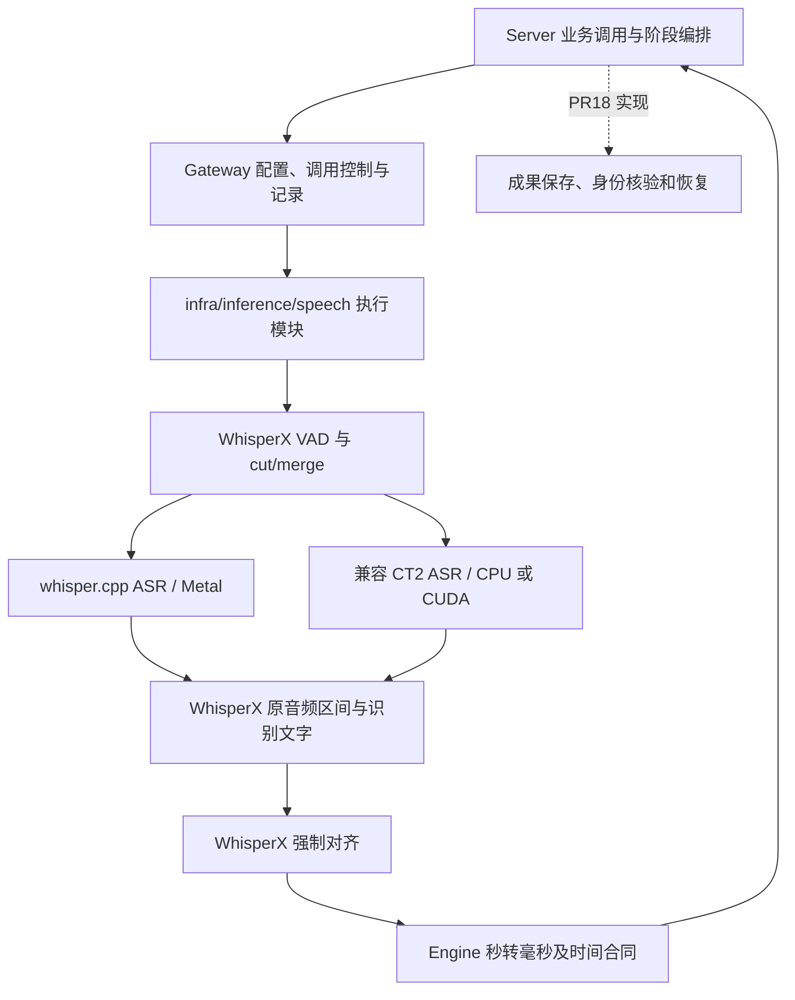

# 1. 问题与现状

主题：Apple GPU ASR 正式接入、WhisperX 强制对齐验证与语音阶段接口。提出日期：2026-10-31（北京时间，UTC+8）。本稿记录已选方向、源码依据与待验证计划，不表示功能已经实现或部署。

- 工作分支：`feat/apple-gpu-asr-alignment`；集成目标：`dev`。
- PR：[PR #21](https://github.com/owariband/Seekino/pull/21)；首个提交 `8c4513a5` 只包含本 TRD 初稿。
- 负责人：本 chat 的 Codex，负责本 feature 的设计、实现与验证。
- 关联修复：[PR #18](https://github.com/owariband/Seekino/pull/18)，分支 `fix/video-asr-recovery`，负责语音成果持久化与失败恢复；[拆分背景与交接留言](https://github.com/owariband/Seekino/pull/18#issuecomment-6538022466)。
- 基础合同：[本地 WhisperX ASR 主设计](local-whisperx-asr-trd.md)、[Gateway](../../../gateway/README.md)、[Engine 时间约定](../../../engine/README.md#媒体时间单位)。问题状态统一见 [B24](../../dev/problems.md#b24-apple-gpu-asr)，实验与取舍记入 [devlog](../../dev/devlog.md#devlog-apple-gpu-asr-split-20261031)。

## 1.1 触发场景与实际差距

### 1.1.1 从产品需求出发：文字需要能回到原片中的发声位置

Hypnos 正在本机把课程和视频建成可检索、可回看、可作为创作来源的素材库。用户找到一句解释或对白后，需要回到原片核对上下文；后续字幕与素材制作还需要知道句子内部各字词在什么时候出现。项目目标见 [README](../../../README.md#为什么是-seekino)，对白时间与剪辑方向见 [整体规划](../../dev/seekino-trd.md)。本需求要解决的是语音内容的时间定位与处理等待共同限制这些使用场景的问题。

| 使用场景 | 只有转写文本或粗句段时间的缺口 | 本次需要提供的基础 |
|---|---|---|
| 按台词/知识点找片段并回看 | 文本能用于召回，但一个较长句段不足以定位其中某个短语的发声起止；用户仍需手动寻找 | 与原音频对应的时间证据，供后续精细回看消费；检索排序和播放器交互仍由各自模块负责 |
| 将长转写重组为可读字幕 | 按标点或字数拆出字幕行后，原整句时间不能直接说明每个新行何时显示、何时结束 | 字词时间可作为分行后聚合边界的依据；本 PR 不实现字幕排版、显示或导出 |
| 按对白准备剪辑素材 | 只知道一句话落在某个大区间，难以决定保留哪些词、如何避免切掉句首句尾 | 为剪辑提供发声边界候选；停顿、呼吸、镜头衔接和艺术留白仍需剪辑层判断 |

字词时间不是所有语义检索的前提；只做粗粒度找片段时，句段时间也有价值。但原 [WhisperX 主设计](local-whisperx-asr-trd.md) 已明确要求为字幕保留字词证据，本次切换 ASR 后端应保留这项能力。现有 `TranscriptWord`、归一化及测试已保留字词时间和未知值，见 [Engine 合同](../../../engine/common/transcription.py) 与 [时间测试](../../../tests/engine/common/test_transcription.py)；字幕实际消费、精细回看及剪辑收益仍待各自产品入口验收，不能写成已经实现。

### 1.1.2 为什么需要强制对齐，为什么选择复用 WhisperX

ASR 主要回答“说了什么”；强制对齐以音频和已有转写为输入，在给定文字顺序约束下寻找字词对应的声学位置，补充“这部分文字何时发声”。Whisper 自带的句段/token 时间与声学强制对齐采用不同机制，不能因为 JSON 有 start/end 就认定时间精度已经满足字幕和剪辑需要。WhisperX 的 [原论文](https://arxiv.org/abs/2303.00747v2) 将词级时间与强制音素对齐作为目标；这是方法依据，不是本项目已经达标的证据。

项目已经有 WhisperX 依赖、英/中/日对齐资产、正式字词合同和短样本运行记录，因此保留其 VAD、切分/合并及强制对齐流程，在 ASR 环节接入 Apple 后端。2026-10-31 用户进一步明确：目标是运行 WhisperX 的完整 pipeline，替换其中的识别后端；整片直接交给 whisper.cpp 后只调用 align 不等价。独立 align 入口可用于接缝实验和阶段恢复，但不能取代正式 pipeline。仍需用**同一份 ASR 文本的有/无强对齐对照**验证时间收益，而非只证明 align 可以运行。

强制对齐不能修正 ASR 错词、漏词和幻觉，也不等于人物识别、翻译或字幕排版。[原部署报告](../../report/gateway/local/whisperx-deployment-20261029.md) 已出现中文“字幕”识别为“字母”但仍产出时间的例子，说明“有对齐结果”不等于“内容正确”。同样，整数毫秒是存储单位，不是毫秒级准确率承诺。对齐失败的词保留文本与未知时间，避免下游把插值结果当作实际发声边界。

### 1.1.3 为什么当前优先在 Apple 本机跑

当前试点的原片、音轨、开发环境和 Seekino 任务在本机，现有设备为 Apple Silicon M5 / 16 GiB，whisper.cpp Metal 的权重、二进制和整片纯转写实验也已有基础，见 §4.1。正式 WhisperX 路线却仍使用 CPU：116 分钟 GPT 课程的转写、VAD 与对齐合计约 76 分 32 秒，后续理解需等待语音准备；下游失败后的重复计算又会放大等待，恢复问题由 #18 独立处理。

优先验证本机 GPU，是希望利用已经持有的算力降低首次语音等待，同时沿用本地素材与调试路径，减少这轮为 ASR 新增一套远端执行环境的工作。这样可以避免为本次语音阶段新增远端音轨传输和 GPU 实例租用，但仍要支付后端适配、模型资产管理、本机内存争用和运行维护成本；本地 ASR 也不意味着使用远端 VLM 的整个 Seekino 链路完全离线。

**租 NVIDIA GPU 服务器是有效备选。** 它可能直接运行既有 WhisperX/CTranslate2 CUDA 与 CUDA 对齐，减少 Apple 专用 ASR 适配，并把计算负载移出开发机；如果需要持续批量处理或本机总耗时/资源不达标，可能更合适。当前暂选 Apple 的依据是已有设备与实验、近期本机单路试点，以及希望缩短从模型实验到正式产品接入的开发路径；尚无同条件远端实测，不能据此断言 Apple 更快、更便宜或云端不值得用。[整体规划](../../dev/seekino-trd.md#7-对-seekino-的采用建议与阅读顺序) 也保留远端 GPU 方向，额外开发与运维代价详见 §3.1.1。

### 1.1.4 当前调用链与已确认的接入差距

现有整片 WhisperX 路径在后续 Chunk 理解之前准备原片转写与字词时间。当前正式 `adapter: whisperx` 在一个调用内完成 CTranslate2 ASR、VAD 和声学强制对齐；Apple Silicon 上当前配置使用 CPU。原生 Metal 转写已有独立实验，但没有与正式 WhisperX 对齐和阶段调用合同接通。

源码基线为 `dev` 的 `83cc07e8`。已核对的限制包括：

1. [WhisperXSourceConfig](../../../gateway/config.py) 的 `device` 仅允许 CPU/CUDA，ASR 与对齐共用该字段；把枚举直接扩成 MPS 不会使 CTranslate2 ASR 支持 Apple GPU。
2. [WhisperXRuntime](../../../gateway/local/whisperx.py) 强制要求本地 CTranslate2 目录及 tokenizer，再执行 `load_model → transcribe → load_align_model → align`；whisper.cpp 的 GGML 权重不能直接填进这条加载路径。
3. [本地启动脚本](../../../scripts/local_whisper.py) 只读取 `openai_audio` 来源。脚本存在和实验成功不代表新的 ASR＋对齐组合已经进入正式 Gateway。
4. [Gateway 转录入口](../../../gateway/transcription.py) 主要返回最终转录结果。若对齐失败前无法向宿主交付原始转写，#18 就无法做到“保存已完成转写，只重新运行对齐”。
5. [Server 默认配置](../../../server/config/parse_profile.py) 通过 `adapter == "whisperx"` 选择整片 ASR，改来源或适配器名称时必须核对实际接线，避免意外回到逐 Chunk 调用。

历史证据：#18 记录完整 GPT 课程的 CPU full large-v3＋VAD＋对齐耗时 4,591.557 秒；随后下游失败，暴露成果丢失与重复计算问题。2026-10-30 晚同片、同 whisper.cpp、同 Q5_0 的 Metal 纯转写实验中，Turbo 为 182.360 秒，Full 为 495.115 秒。两组实验的模型、阶段和条件不同，不能直接计算“相同质量的整体加速比”。当前用户已选 `large-v3-turbo Q5_0 + whisper.cpp + Metal` 为本机后续 ASR 方向，对齐组合仍待验证。

## 1.2 为什么从 #18 拆出

#18 原计划同时承诺成果持久化、失败恢复、GPU 执行、独立对齐和完整课程闭环，涉及模型执行、Server 编排、数据库与资产生命周期，以及产品验收。2026-10-31 用户决定拆成 feature 与 fix，避免两个不同问题共享模糊的完成条件。

| 需求 | 独立价值 | 本次归属 |
|---|---|---|
| 降低首次语音处理成本，并保留可信的对齐结果 | 即使尚未持久化，也可单独验收模型执行、质量和耗时 | 本 feature |
| 已完成成果在失败、暂停、重启后不再重算 | 即使继续使用 CPU，也可单独验收保存和恢复 | #18 |
| 完整课程解析、索引、检索、回看和追问 | 验证两项能力及其他模块的共同产品效果 | 关联的整体验收；独立故障按根因归属 |

拆分不删除 #18 的历史证据。后端与对齐执行的现行专项设计由本文维护，持久化与恢复由 #18 维护；双方引用同一阶段交接合同，不能分别发明不兼容的结果格式。

## 1.3 本次交付边界

包括：保留 WhisperX 的 VAD、切分/合并、原音频时间归属与对齐流程，在 ASR 环节接入 whisper.cpp Metal；必要的 `infra/inference/speech/` 执行职责提取；可分阶段调用与组合调用兼容；生产者信息；语言、时间、取消、进度和离线资产合同；真实完整 pipeline 的质量及资源验证。对第三方库的最小 backend 接口扩展先在隔离环境验证，不能以运行时篡改共享 `.venv` 作为接入方式。

不包括：`video_parse_content` 表、ArtifactStore 成果发布、缓存命中、任务租约或恢复策略、数据迁移；CAM++ 迁移、通用推理插件系统、全部模型进程统一管理；Kimi/DNS 根因修复、播放器字幕排版、跨语言翻译、人物识别与整个检索/Chat 功能重构。不会为目录整齐搬迁其他模块。

Apple GPU 在本 feature 中首先指 ASR 的 Metal 执行。VAD 和对齐先以 CPU 建立正确性基线，MPS 是独立验证项；不预设全部阶段必须在 GPU 上，也不将未经验证的 MPS 设为默认。

# 2. 影响因素、假设与评价指标

## 2.1 关键因素与可推翻的假设

- **H1：WhisperX 可在保留公共流程的同时替换 ASR 后端。** 固定版的 `load_align_model/align` 与 ASR 对象独立，但 `FasterWhisperPipeline` 的 tokenizer、Mel 特征、批处理和语言检测仍绑定 CT2。需要验证最小 backend 接口能消费 WhisperX 的 VAD 音频块、保持输出顺序和原片时间，而不加载 CT2 模型或绕过 VAD；独立 align 可运行不足以证明该假设成立。
- **H2：替换 ASR 后能改善本机总体语音处理时间。** Metal 纯转写已存在实测，但完整 pipeline 的总耗时还包括音频准备、VAD、分段传输、模型加载和对齐。逐片段调用成本和对齐都可能成为瓶颈，必须分阶段测量。
- **H3：保留 VAD 后的新后端不会导致不可接受的内容退化。** 正式路线沿用 WhisperX Pyannote VAD；既有无 VAD 的 cpp 整片实验只作历史参照。Turbo/Full、量化、切片上下文和解码配置会影响内容；尽量固定 VAD 与样本，不能把组合变化的收益全归因于 GPU。
- **H4：独立阶段不会破坏旧调用及 #18 接入。** 原始转写可不经 ASR 重算而再次交给对齐器；旧 CPU/CUDA 配置与最终结果形状继续兼容。对齐执行模块不持有数据库或任务状态。
- **H5：声明的模型与设备能和实际执行相符。** 外部 whisper-server 在启动时加载模型；请求中的 model 字符串不能证明真实权重。需绑定固定本机部署实例与启动证据，能力或身份无法核实应明确失败，不能悄悄切回 CPU。
- **H6：强制对齐的时间收益值得增加一个推理阶段。** 保持 ASR 文本不变，对照原生时间与对齐时间的人工边界误差、未定位比例和短语首尾覆盖；如果没有改善，返回语言、分段或对齐器选型排查，不能用字段齐全替代效果判断。
- **H7：现阶段本机组合的综合交付成本可接受。** 已有本机资源可能减少远端部署与传输工作，但适配、对齐耗时和统一内存占用也可能抵消收益。分别记录开发投入、维护步骤与每小时音频的端到端处理成本；本机不达标或负载需求改变时重评远端 CUDA，不预设成本结论。

## 2.2 指标与验收口径

| 类型 / 指标 | 定义与基线 | 目标或护栏 | 测量条件与证据 |
|---|---|---|---|
| 结果：正式入口接通 | 当前只有独立 cpp 实验；正式 WhisperX 为 CT2 | 配置经 Gateway 进入 WhisperX pipeline：VAD/分段 → cpp ASR → 原片时间归属 → align；正式 Server hook 消费同合同 | 入口测试、真实样本、实际模型/设备记录；须证明 VAD 在实际调用链中，不只调用 align helper |
| 结果：阶段独立 | 当前单次调用返回最终结果 | 使用已取得 raw 结果调用 align，ASR 新调用数为 0；组合结果语义一致 | 假后端计数、错误注入、序列化往返；本 PR 不声称跨重启恢复已实现 |
| 结果：完整语音耗时 | Metal Turbo 纯转写单次 182.360 s；组合耗时待测 | 对同源长音频分别报告 ASR、align、总墙钟；纯 ASR 暂沿 #18 的 ≤10 min 试点目标，总耗时门槛经短样本探索后冻结 | 固定音频/权重/参数、单路、冷/热区分；单次结果不报 p95 |
| 护栏：识别质量 | 无完整人工真值，模型间文本一致度不等于准确率 | 标注集上测英语 WER、中文/日语 CER；记录专名、数字、否定词和静音幻觉；人工质量阈值待探索后、正式评测前冻结 | 固定代表样本与保留样本；保存参考转录和评分规则，不用 Full 自动当真值 |
| 护栏：对齐质量 | 旧 CPU 路线有短样本可运行证据，系统性边界误差待测 | 已对齐字词必须满足时间合同；无分数不提供插值时间；统计未对齐比例及人工边界误差，阈值待小样本标注后冻结 | 同一 raw transcript 对比 CPU/MPS；按语言分别报告，不混用 ASR 差异 |
| 结果：对白时间定位 | 已有字词结构；原生时间与强对齐的人工误差及下游收益待测 | 同文本对照发声起止误差、短语首尾覆盖和无法定位比例；冻结标准后判断是否支持字幕/回看/剪辑消费 | 对照原生与强对齐；相同标注短语分别按各自时间裁片/试听，不以构建新播放器为前提；缺失词级基线单独报告，不伪造插值 |
| 诊断与护栏：执行位置的总成本 | 本机已有设备和纯 ASR 记录；远端尚未部署/计价，工程工时未统计 | 记录本机接入/维护工作、整条语音等待、资源和运行费用；远端若进入试验，以同质量和同负载比较，未测不排名 | 工时与维护操作记录、实例/存储/传输账单（若采用）、失败重算记录；以有效处理音频小时为分母，一次性投入与持续费用分列 |
| 护栏：兼容与失败 | 既有 CPU/CUDA、可选依赖、超时和关闭合同 | 未选后端不加载模型；缺依赖/权重/语言、超时/取消/服务异常明确失败；旧结果不意外增加新字段 | 既有 Gateway/Engine/Server 定向回归及故障注入 |
| 诊断：资源与生命周期 | 既有纯转写 RSS 峰值 Turbo 2.525 / Full 3.276 GiB，单路 | 记录 Python 与 cpp 进程、系统内存压力、阶段缓存、启动/关闭；不据单路实验承诺并发上限 | 相同采样方法；RSS 不等于全部统一内存或独立显存 |

未冻结的质量与总耗时阈值不作为已达标条件。先做有界探索，再补充阈值、样本清单及依据；不得在看到正式验收结果后倒改标准。

# 3. 改造方案与建模

## 3.1 已有基础与选型取舍

| 方案 | 收益 | 成本与限制 | 本次决定 |
|---|---|---|---|
| 保持 CT2 ASR＋WhisperX 对齐 | 原合同与配置已有实现 | 当前 Apple 配置仍用 CPU | 保留为兼容路线及对照 |
| 租 NVIDIA GPU，运行 WhisperX CUDA ASR＋对齐 | 可能直接复用现有 CUDA 路线，减少 Apple 后端适配并释放本机资源 | 增加远端环境、音轨传输、正式调用与运维边界；性能、费用和接入工时尚未实测 | 保留候选；本机质量/总耗时/资源不达标，或需持续批处理时重评 |
| 仅用 whisper.cpp 结果 | 已有 Metal 部署与实验 | token 时间不提供原声学强制对齐合同 | 不作为要求对齐任务的静默替代 |
| 大规模改写或运行时 monkey patch WhisperX | 可改内部流程 | 增加第三方维护与共享环境风险，偏离最小接口改造 | 不采用 |
| 整片 cpp ASR＋独立 WhisperX align | 可快速验证对齐 API 和已有 raw 的适配 | 绕过 WhisperX 的 VAD/cut/merge，改变完整 pipeline，无法满足用户要求的替换边界 | 从正式方案降为接缝/对照实验 |
| 为 WhisperX pipeline 增加最小 ASR backend 接口 | 保留 VAD/切片/时间归属和对齐，CT2 默认路线兼容；可形成独立上游提案 | 要拆开 tokenizer/特征/解码耦合，验证不同后端能力与生命周期 | 当前采用方向；接口与本机效果待实现验证 |
| cpp 常驻服务、进程内绑定或 CLI | 是调用 ASR 引擎的不同方式，不决定是否保留 WhisperX pipeline | 服务需核验权重与进程归属；绑定需维护依赖；逐块 CLI 会重复加载 | 优先评估已有 whisper-server 的固定实例；不按每个 VAD 块启动 CLI，传输方式由模型复用与实际开销决定 |

WhisperX 固定为项目现有 `3.8.6`；`whisperx` 包的依赖仍含 faster-whisper/CTranslate2，替换执行路径不会自动减掉这些安装依赖。本轮不同时做上游依赖瘦身。[上游独立入口](https://github.com/m-bain/whisperX/blob/v3.8.6/whisperx/__init__.py)、[对齐源码](https://github.com/m-bain/whisperX/blob/v3.8.6/whisperx/alignment.py)、[依赖声明](https://github.com/m-bain/whisperX/blob/v3.8.6/pyproject.toml)。

### 3.1.1 租 GPU 的额外开发成本具体在哪里

比较对象是“现有本机音轨与任务，经远端 NVIDIA GPU 返回可用于 Seekino 的转写和对齐结果”。以下是根据当前调用链推导的工程工作项，尚无供应商选定、排期估算或费用实测；不把它们写成已发生的成本，也不把远端 CUDA 推理本身假定为困难。

| 工作项 | 本机选型仍需承担的工作 | 租 GPU 后需要补充或改变的工作 |
|---|---|---|
| 可复现环境与模型 | cpp 二进制/Metal、GGML、WhisperX 与分语言对齐权重的版本管理 | 远端驱动、CUDA/CT2/PyTorch 组合与权重部署、模型预热、实例重建后恢复环境；可以复用镜像与现有 CUDA 配置，不能当作零工作 |
| 音频与结果传输 | 复用本地音轨，校验语言、时间和结果 | 本地文件路径不能直接供远端读取；需上传音轨、校验内容身份、取回结果并管理远端临时副本。断传/重传策略按所选方式补齐，模型权重应复用而非每个请求重传 |
| 正式调用接入 | WhisperX 公共 pipeline 的 cpp 后端接口与旧调用兼容 | 将远端进程接到 Gateway，约定结果/版本、访问凭据、可达性、超时和并发上限；复用现有调用控制，不要求重做模型网关 |
| 长任务失败与恢复 | 本机进程退出、取消与资源释放；成果持久化仍交给 #18 | 处理网络断开时“请求没完成还是仅结果没返回”的不确定性、远端仍在运行的取消、重试去重/成果取回及两端日志关联；具体可选单任务协议或可查询任务，不强制上独立队列 |
| 运行与费用管理 | 本机 CPU/GPU/内存争用、电耗、模型缓存与维护 | 实例启停/健康检查、空闲时段计费、磁盘与传输费用核对、版本更新和故障定位；无人值守程度越高，需要覆盖的生命周期越多 |

以当前 16 kHz、mono、PCM16 输入计算，音轨理论负载为 `16,000 × 2 × 3,600 = 115.2 MB/音频小时`，不含容器与协议开销；压缩可减少传输量，但实际格式兼容、解码和传输耗时另测。这个量只用于提示数据路径的成本，不是网络带宽或上传延迟实测。

**一次远端实验与正式自动化接入分开评估。** 单人验证可以先用受控 SSH/隧道、脚本和一个固定实例上传音频、运行、下载结果，不必预建公网服务、Kubernetes、对象存储、自动扩缩容或多租户调度。即便这种小实验成功，产品仍需解决自动调用、身份/版本核验、进度/失败和成果回收，才能算正式接入。反过来，Apple 路线新增的组合适配也可能比一次简单的远端运行更费开发时间，所以最终比较的是达到同等交付标准的两条路径。

### 3.1.2 当前选择的依据与重新选择的条件

当前先在已有 Apple 本机验证保留 WhisperX 完整 pipeline 的 cpp ASR 后端：复用已测的 Metal 引擎、已有对齐资产及现有本地素材路径，在满足质量的前提下减少首次等待，并控制这轮新增的执行环境。语音接口保持阶段边界，今后选择远端不必改变 Server 的业务持久化职责。该决定是当前试点优先级，不是排除远端 GPU 的产品约束。

比较端到端等待时，本机应计入音频准备、冷/热加载、ASR、align 与结果归一；远端还应计入上传、排队/实例就绪和结果取回，不能只拿 GPU kernel 或 ASR 时长作比较。总成本分开报告一次性接入工时、后续维护投入，以及计算/存储/传输/失败重算的持续成本，不把已有本机算力写成运行零成本。

若本机质量或总耗时达不到冻结目标、16 GiB 统一内存争用影响开发/解析，或实际需求变为长时间无人值守/批量吞吐，应重开执行位置比较。先用同音频、可解释的模型/量化差异和相同质量护栏做一个有界远端试验，再决定是否值得承担正式接入成本；本 TRD 不授权购租资源。两种执行位置都不能替代 #18 的成果持久化与恢复。

### 3.1.3 保留 WhisperX pipeline 的后端接缝

目标流程是 `WhisperX VAD → cut/merge → ASR backend → 原音频区间上的文本 → WhisperX align`。VAD 是语音活动检测，不是去噪；原片时间区间由 pipeline 保存，不能把去掉静音后的片段连续拼接而丢失偏移。cpp 只负责识别送入的音频块，不能用自己的片段时间替换 WhisperX 的区间归属。

官方用法本来就先 `model.transcribe()` 再单独 `whisperx.align()`；分别调用这两个入口符合原流程。问题在于用整片 cpp 调用替掉前半段时绕过了其中的 VAD/cut/merge，不在于 align 是否通过独立函数调用。

WhisperX 3.8.6 的 `FasterWhisperPipeline.transcribe` 同时执行公共 VAD 流程和 CT2 专属 tokenizer；`preprocess/_forward/get_iterator/detect_language` 又依赖 Mel 特征、CT2 encoder 与批量生成。现有 `load_model(model=...)` 参数不是通用 backend 协议，仅增加 `device=mps` 或传一个 cpp 对象不能完成替换。[固定版源码](https://github.com/m-bain/whisperX/blob/v3.8.6/whisperx/asr.py)

拟扩展边界：WhisperX 保有语音块、原音频区间、阶段顺序和回调；ASR backend 负责语言检测、模型专属预处理/解码以及按输入顺序返回每块文字。CT2 backend 保留原批处理；cpp backend 可先串行复用已加载模型，不宣称取得相同 batch 吞吐。不支持的解码选项须明确说明或拒绝，不伪造置信度，也不复制整份上游 pipeline 到 Seekino。

路由须分别表达 ASR 后端及设备、VAD 设备、alignment device；Apple 候选为 cpp/Metal＋CPU VAD＋CPU 对齐，原 CPU/CUDA 路线保持原缺省语义。默认先显式配置，自动探测只能选择已经验证的组合，不能把“检测到 MPS”当作 CT2 ASR 可用证据。具体字段/API 名称在接口原型中确认。

本机可用后，面向 WhisperX 的 issue/PR 应提炼为后端接口与分阶段设备选择的独立问题，附原 CT2 回归、完整 VAD→ASR→align 复现及测量；Seekino 的 Server、持久化和 Gateway 不进入上游补丁。先核对已有提案，本文不表示已向上游发帖或已获维护者接受。

文章中关于 batch、硬件最低要求、原片上传量的事实边界，以及上游 main/3.8.6 的接口差异，见 [选型与上游核查](../../research/2026-10-31-whisperx-apple-backend-review.md)。用户提出的“先让自己的设备好用，再向上游建议”作为实施顺序保留；不把文章中的个人预算和直观感受改写成软件的通用限制。

## 3.2 职责与依赖方向

- `infra/inference/speech/` 管音频输入、WhisperX pipeline 装配、后端调用、模型缓存和释放；不导入 Gateway/Server，不访问业务数据库。WhisperX 的公共 VAD/分段与对齐逻辑由库继续负责，后端接缝以可审查的最小扩展实现，不复制一条删减后的 pipeline。按实际职责拆文件，不预建通用 registry。
- Gateway 持有共享运行时，将配置映射为执行参数，管理调用/预算/取消与日志，提供既有组合入口和新的阶段能力；阶段日志不泄露转写正文。
- Server 提取音频、选择业务范围、保持任务/媒体归属。本 feature 只做必要的调用兼容与接入验证；#18 增加保存和恢复编排。
- Engine 继续将上游秒一次转换为整数毫秒；Server 按既有合同加原视频偏移，整片结果不重复加 Chunk 偏移。
- 本地服务部署属于本 feature 的必要接入；HTTP 请求仍留在语音执行适配内，不为远程 Provider 新建通用 infra 包装层。

## 3.3 与 #18 的阶段交接合同

以下是待由双方实现对齐的语义合同，方法与字段名称为设计示意，不是现有 API。

| 能力 / 数据 | 本 feature 提供 | #18 负责 |
|---|---|---|
| `transcribe_raw(audio)` | 执行 WhisperX 的 VAD/分段及所选 ASR backend，返回原语言、片段文字与原音频相对秒；不附伪造的声学对齐分数 | 保存 raw 成果、选择可复用版本 |
| `align(audio, raw)` | 使用同一音频和既有 raw，输出已对齐字词与未知时间；不会隐式重跑 ASR | 选择恢复阶段；保存 aligned 成果；只在所需阶段完成后发准备回执 |
| 生产者信息 | 实际后端、运行库版本、权重标识、语言策略、解码/VAD/对齐配置及结果 Schema 版本；ASR 与对齐分别可辨识 | 联合源媒体、任务与版本计算/校验兼容身份，决定命中，核对 aligned 对 raw 的依赖 |
| 完整 `transcribe(audio)` | 保留已有组合调用语义和最终 payload；metadata 不随意塞进旧业务响应 | 尚未切换恢复编排的调用方可继续使用 |
| 控制与失败 | 阶段开始/结束、取消/超时检查和结构化失败；不把未完成结果返回为完整成功 | 持久状态、租约撤销、有限恢复预算、迟到提交拒绝 |

raw/align 采用可序列化、版本明确的中立数据；对齐调用校验语言、音频时长和片段边界，拒绝不匹配输入。源媒体及任务身份的可信核验留在 Server。分阶段调用不能重置已有业务总预算或重复记同一次模型用量；按实际阶段记录并关联同一次业务调用，具体记录口径随接口落实。

**依赖与合并顺序：** 已合入的原 WhisperX/整片 ASR 与进度能力为基础，本 feature 不依赖 #18 未合入的表和恢复实现。#18 是阶段接口的下游消费者，可先用接口替身开发存储和租约测试。默认本 feature → `dev` → #18 同步并完成真实接线 → #18 → `dev`；均不在此分支合入对方实现或制造循环依赖。整体课程验收关联双方版本，本 feature 的局部通过不代表 #18 恢复已完成。

## 3.4 协议、配置与兼容护栏

1. **cpp 传输合同固定版本。** 已核对本地 whisper.cpp `284029c07012d2000941a08d38a31ffb71f4734e`：HTTP `verbose_json` 的片段时间为秒，`language` 为 `english` 等全名；CLI JSON 的 `offsets` 为毫秒、`result.language` 为语言代码。若使用对应传输须分别解析。正式后端向 WhisperX 返回当前音频块的文字与语言，由 pipeline 保持原片区间；`words[].probability` 不映射为 alignment `score`。[server 源码](https://github.com/ggml-org/whisper.cpp/blob/284029c07012d2000941a08d38a31ffb71f4734e/examples/server/server.cpp#L1065)。
2. **语言与任务明确。** 已知语种显式传入，未知传 `auto`，不沿用英语实验默认值；关闭翻译并保留片段时间。`detect_language=true` 是检测后退出，不代替正常转写的 auto。缺少对应对齐模型明确报错，不自动下载或静默略过。
3. **保持同一时间轴与 VAD。** 复用宿主提供的 16 kHz mono PCM16 WAV，并转换为 WhisperX 使用的 float32 waveform；VAD/cut/merge 保留原音频窗口，将窗口音频送给 cpp，文字回填原窗口后才进入 align。校验有限、正向和在音频范围内的时间。现有无 VAD cpp 整片结果只作为历史基线，不能作为正式 pipeline 的替代。[WhisperX ASR](https://github.com/m-bain/whisperX/blob/v3.8.6/whisperx/asr.py)。
4. **对齐依据。** 继续移除无 `score` 词的插值时间，保留文本；单段不可对齐沿用原粗时间与未知词时间语义，整个对齐调用失败不降级为完整成功。强制对齐不能纠正 ASR 漏词或幻觉。
5. **配置分离。** 拟分别表达 ASR 后端/设备、VAD 设备和 alignment device，旧字段缺省映射原 CT2 路线；按后端校验模型格式及参数。优先保留 `adapter: whisperx` 的组合入口兼容，新路线用独立 source 名称；实际配置设计必须核对整片 scope、冻结参数与 #18 身份合同，不能只改查询侧或旧任务来源。
6. **设备与资产核实。** GGML、CT2、对齐模型分开管理。绑定实际 whisper-server 二进制/权重/启动参数，不能仅靠请求 model 字符串认定身份；禁止通过共享 server 的动态换模造成身份漂移。Metal 不可用时明确失败，旧 CPU 路线仅显式选择。保留 NLTK 数据预检、本地权重和 `model_cache_only=True`。
7. **生命周期与取消。** 复用模型与客户端，单句柄关闭不卸载共享运行时。外部已有 server 与自有进程的关闭权限必须区分；固定版 cpp server 有检查连接关闭的 abort callback，但关闭 HTTP 等待仍不能代替实际停止/资源回收验证。等待、VAD、加载、ASR、对齐都受同一上层预算控制，取消/超时后的结果不得发布为成功，暂不承诺各阶段都可抢占。
8. **MPS 边界。** WhisperX 3.8.6 通过 `.to(device)` 执行声学前向，随后 emission 回 CPU 做对齐计算；源码可传 MPS 不等于实际可用或整体更快。先以 CPU 对齐验收，MPS 单独同 raw 对照，保留失败结果。[对齐设备实现](https://github.com/m-bain/whisperX/blob/v3.8.6/whisperx/alignment.py#L242)。

# 4. 对照实验与结果分析

## 4.1 已有证据及适用范围

| 日期 / 对象 | 已有结果 | 证据入口 | 不支持的结论 |
|---|---|---|---|
| 10-29 原 WhisperX CPU 三语短样本 | 英/日原片与中文合成语音可运行，字词时间可归一化 | [原部署报告](../../report/gateway/local/whisperx-deployment-20261029.md) | 新 cpp 组合或 MPS 已验证 |
| 10-30 GPT 完整课 CPU 与早期 Metal 实验 | CPU 全流程 4,591.557 s；早期 Turbo Metal 纯转写 293.578 s | [#18 实测报告](https://github.com/owariband/Seekino/blob/fix/video-asr-recovery/docs/report/gateway/local/whisper-metal-benchmark-20261030.md) | 同模型同质量的直接加速比；正式成果恢复 |
| 10-30 晚 Full/Turbo 同条件 Metal 实验 | 同 6,979.941625 s 音频；Turbo 182.360 / Full 495.115 s，RSS 2.525 / 3.276 GiB | 本机原始 `outputs/verification/whisper-metal-full-vs-turbo-20261030/protocol.json`、`summary.json`、`REPORT.md`，位于主工作区，未随 worktree 复制 | 对齐总耗时、WER/CER、日语性能、并发容量；先前 293.578 s 与本轮不是同次运行 |
| 10-31 固定源码与 JSON 静态核对 | align API 可独立调用；已有 Turbo/Full JSON 分别 2,476 / 2,550 段，结构检查未发现非法边界 | 本文源码链接及上述 `turbo/raw.json`、`full/raw.json` | 真实 cpp→align 效果已经通过 |

晚间实验为 M5 / 10 GPU 核 / 16 GiB、单路、同 Q5_0、英语、beam/best_of 5、temperature 0、max_context 0、6 CPU 线程；无 VAD/声学对齐，各模型一次，磁盘缓存不冷且有既有系统负载。模型间文本一致度不作为准确率。原音频和转写正文属于本地未跟踪资产，PR 只提交必要的脱敏指标及引用。

## 4.2 分步验证计划

1. **低成本接缝验证。** 首先用替身验证 WhisperX 公共 pipeline 确实调用 VAD/cut/merge，再向后端传入对应音频窗口、按原时间顺序合并并进入 align；无声样本不能调用 ASR，旧 CT2 路线须回归。已有 cpp raw＋独立 align 可作为辅助实验，但不能通过它宣布完整接入成功。真实短样本覆盖语言归一、中/日文、静音与跨句边界，失败先定位本阶段。
2. **离线合同与故障。** 覆盖 HTTP schema、无声、缺权重/语言、非法时间、序列化、生产者差异、超时/取消、关闭与共享复用。验证 `align(raw)` 没有 ASR 调用；运行相关 Gateway/Engine/Server 测试，其他外部依赖须核对隔离环境。
3. **正式入口真实验证。** 经配置与 `GatewayClient` 调用 WhisperX VAD/cut/merge→cpp ASR→align，记录每阶段和模型/Metal 证据，并验证旧 CPU 路线；经现有 Server 语音 hook 验证最终 evidence 和 Chunk 时间，不以直接 helper 调用代替产品接入。
4. **受控对照。** 固定 ASR 文本，比较 cpp 原生句段/可用词时间与强对齐时间：对两者都存在的边界计算人工起止误差，缺少词时间的基线报告能力缺口，不伪造插值。用相同短语的裁片/试听检查首尾是否完整，确认时间证据对消费任务的价值。再分别比较同 cpp 配置的直接调用与 Gateway 调用、同 raw 的 CPU 与可选 MPS 对齐；旧 CPU 全流程与新组合仅作产品方案比较，明确模型/VAD 差异。短样本每配置至少三次，标注冷/热；整课先一次诊断，不推断尾部统计。
5. **有界长片验证。** 先冻结质量和总耗时验收阈值、资源停止条件，再使用完整 GPT 音频测 ASR/align/总时长和资源。探索先覆盖英/中/日各一个短样本及静音/数字/跨界场景；失败最多两轮有针对性的修正，超过后回到假设与方案评审，不连续无界跑整课。
6. **执行位置重评。** 记录上述接入与维护工作、质量合格前的返工和总等待。触发 §3.1.2 条件且有资源/预算授权时，再比较一个固定远端 CUDA 配置；包含传输、冷启动、对齐与结果回收，同模型无法固定时明确质量和量化差异。当前只定义比较方法，不为补表格而租服务器。

| 比较项 | 基线 | 新方案 | 验收标准 / 当前判断 |
|---|---|---|---|
| 强对齐对发声边界的作用 | 同文本的 cpp 原生时间，人工误差待测 | 同文本的 WhisperX 对齐待测 | 人工边界误差、短语首尾覆盖、未知比例与增加的阶段耗时；未验证 |
| 直接 cpp 与正式 Gateway 的同输入输出 | 既有原始 JSON | 待测 | 同模型参数与时间合同一致，差异须解释 |
| CPU 与 MPS 对齐 | 同 raw 的 CPU 待测 | MPS 待测 | 内容、有效时间、未对齐比例和边界误差；未验证 |
| 组合总耗时与资源 | CPU 历史全流程有记录但非同条件 | 新组合待测 | 以 §2 的冻结口径判断，不能拿纯 ASR 代替总时长 |
| 独立阶段调用 | 当前无公开阶段交接 | 待实现 | 重做 align 时 ASR 计数 0；不等同持久恢复 |
| 本机与远端的总成本 | 本机组合工时/运行成本待记录 | 远端未部署、未计价，条件触发后再测 | 相同质量护栏下的整条语音等待、资源、投入与持续费用；暂不作优劣结论 |

每轮记录代码版本、音频哈希、模型/库/设备、参数、时间窗口、命令、原始结果与失败；报告按实际模块放 `docs/report/`，过程按 devlog 四段结构追加。保存无收益与退化结果。

# 5. 试点验证与方案取舍

首轮由本 feature 负责人在隔离验证入口、单路本地 ASR 下执行，先短样本后完整 GPT；不重排课程任务或切换正在运行的服务。真实推理、部署和任务操作按当次明确授权与预算执行，本设计中的命令或计划本身不扩展授权。

采用门槛：正式 Gateway/Server hook 已接通；CPU 对齐通过已冻结的质量护栏；新路线的模型/设备可追溯；阶段接口与旧合同回归通过；长音频总耗时与资源有证据。MPS 若无收益或不稳定，保留 CPU 对齐并记录决定，不据此宣布 Apple ASR 失败。

试点还须回到两个选择理由：有/无强对齐的对照是否支持所需时间定位质量；本机组合的总等待和维护负担是否可接受。若强对齐没有达到定位目标，回查对齐方案；若本机资源/等待失败，按 §3.1.2 比较远端。没有远端测量时只报告本机是否达标，不宣称已经证明其优于租 GPU。

停止/回退条件：错误模型或语言、时间轴错位、无分数却输出精确时间、关键内容退化、内存压力持续异常、调用结束后资源无法回收。停止新验证，保留证据，显式选择已知旧配置；不改冻结的历史任务或伪造兼容成果。具体内存压力持续窗口和质量阈值在长片试点前写入实验协议。

推广收益与代价同时报告：本地 ASR 时间、对齐时间、内容/定位质量、双进程资源、启动与资产维护、接口复杂度。只有阶段验收支持时才建议本机默认配置切换；是否扩大日语、其他设备或并发范围单独取得证据。

# 6. 结果验收与闭环

本次建立的是独立 feature 的设计与交付边界。已有实验及固定源码支持继续验证 WhisperX pipeline 的 cpp ASR 后端；没有新实现、真实完整 pipeline 效果、MPS 稳定性或部署完成结论。独立 cpp 整片转写或单独 align 成功均不能代替此验收。

| 原问题 / 交付 | 需要的验收证据 | 与 #18 的边界 |
|---|---|---|
| 转写需要支持发声位置定位 | 同文本有/无强对齐、人工边界与裁片试听；字词合同可被消费 | 交付时间证据基础，字幕 UI 和剪辑产品效果单独验收 |
| 本机长片等待与执行位置成本 | 完整语音耗时、内存争用、接入/维护投入及选择依据 | 只有本机证据时不宣称赢过远端；持久复用收益归 #18 |
| Apple 正式 ASR 能力缺失 | 配置 → Gateway → 实际 Metal 模型 → 结果 | 不负责成果表和恢复命中 |
| 对齐未接到 cpp 输出 | 代表性语言的真实对齐、时间与质量证据 | 不把 token 时间当对齐，也不静默取消旧强制对齐 |
| 宿主拿不到可恢复的阶段结果 | 独立 raw/align、生产者信息、组合兼容及接口测试 | #18 实现持久保存与重启恢复，并补真实接线验证 |
| 架构与运行合同 | 必要 speech 提取、离线资产、生命周期、旧调用回归 | 不扩展其他 infra 模块或业务调度框架 |

关键验证完成后才能建议 feature 可合并；测试通过、效果通过、部署完成分别报告。完整课程检索/回看/追问仍作为关联产品目标，出现独立下游故障时明确归属，不扩大本 feature 的实现范围，也不宣称整体已闭环。

下一项最小动作：固定 WhisperX 公共 pipeline 与 ASR backend 的接口，先用替身证明 VAD、切片区间和 CT2 缺省行为保持，再接本机 cpp 并验证完整链路。阶段数据和生产者信息继续服务 #18。当前未完成的指标、阈值与实现由本 feature 负责人继续跟进，状态只在 problems 维护。

| 日期 | 原判断 | 新证据 / 决定 | 调整及影响 |
|---|---|---|---|
| 2026-10-31 | GPU 接入与持久恢复一并归 #18 | 两者可独立交付且风险/层次不同，用户明确拆分 | 本 feature 负责生产能力，#18 负责成果生命周期，阶段接口单向依赖 |
| 2026-10-31 | 可能需要改 WhisperX 内部 ASR | v3.8.6 的 align API 独立，已有 cpp 段输出满足基本结构 | 复用库并在 Seekino 组合；运行和质量仍需验证 |
| 2026-10-31 | 统一 transcribe 返回最终结果即可 | #18 需要保存 raw，align 失败后不能重跑 ASR | 增加阶段能力，保持原组合入口兼容 |
| 2026-10-31 | 初稿从后端接入差距开始，默认了强对齐和本机选型动机 | 用户指出缺少字幕/回看/剪辑需求、Apple 条件和租 GPU 开发成本背景 | 补充产品因果、远端最小实验与正式接入区别，以及双方成本；原架构与 PR 边界保留 |
| 2026-10-31 | 原验证重点是 align 可运行与 CPU/MPS 比较 | 可运行不足以证明强对齐值得引入，纯 ASR 耗时也不能决定执行位置 | 增加同文本有/无对齐的时间定位对照、总成本口径和远端重评条件；没有新增实测结论 |
| 2026-10-31 | 认为整片 cpp 转写＋独立 align 可作为正式第一版，进而提出自有 CLI 子进程 | 用户明确要保留 WhisperX pipeline；源码确认 VAD/cut/merge 位于 `FasterWhisperPipeline`，整片 cpp 会绕过它们 | 收回该正式接入方案，改为最小 ASR backend 接口扩展；保留 VAD/区间/对齐，优先模型复用，不逐块重启 CLI；尚未改生产代码 |

-codex
