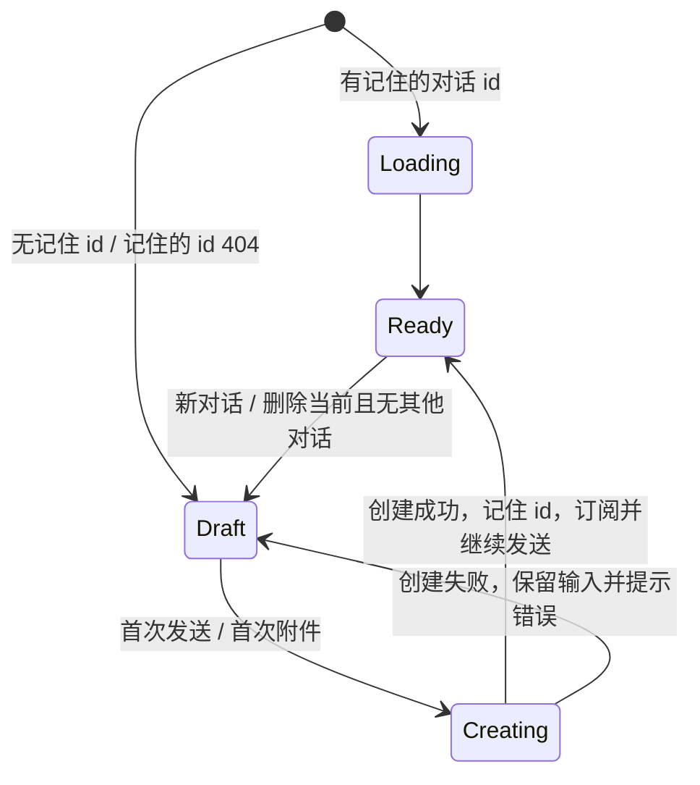

# 1. 问题与现状

- 需求：对话在首次发送时才创建（Fix）
- 状态：实现完成，本机验证通过，待合并 · 2026-11-07
- 分支：`fix/chat-lazy-conversation`；PR：待创建

**背景与触发场景。** 对话页 `/search` 与观看页陪看对话共用 `web/src/features/search/useAgentConversation.ts`。挂载时如果本机没有记住的对话（或记住的对话已 404），`ensureConversation()` 立刻调用 `POST /api/agent/conversations/create`。此外，“新对话”按钮（`SearchPage.tsx` 的 `createConversation`）和删除当前对话后的补位（`deleteConversation`）也会立即创建。

**实际与期望。** 只要打开页面，什么都不问，服务端就多一条空对话；对话记录里随之堆起一串标题为“新对话”、0 条消息的记录。期望：没有发出第一条消息之前只是本地草稿，不在服务端留下记录。

**现状证据（2026-11-07，本机 5188 → 19641）。** 用全新浏览器上下文依次打开 `/search`、`/watch`、`/search`、观看页并打开陪看：共发出 1 次 `conversations/create`，新对话 `d1db9c36` 的 `messageCount = 0`，列在对话记录最上方；列表前两条均为 0 条消息的“新对话”。同一浏览器后续打开会复用记住的对话，所以堆积主要来自新浏览器 / 隐私窗口 / 身份切换，以及“新对话”按钮和删除补位。

**本次边界。**
- 做：草稿态；首次发送（或首次上传附件，附件上传需要 `conversationId`）时才创建并记住对话；“新对话”和删除补位改为进入草稿。
- 不做：清理已存在的空对话；服务端列表过滤。
- 保持：记住并恢复上一次对话；创建的幂等键；消息订阅、发送、取消、恢复；对话记录的切换与删除。

# 2. 影响因素、假设与评价指标

| 因素 | 证据 | 改动 |
| --- | --- | --- |
| 挂载即创建 | `ensureConversation()` 在无记住 id 时调用 `createAgentConversation` | 挂载时只加载已记住的对话，否则进入草稿 |
| “新对话”立即创建 | `createConversation` | 切换到草稿，不发请求 |
| 删除补位立即创建 | `deleteConversation` 中 `remaining` 为空时的创建 | 切换到草稿 |
| 附件依赖 id | `useAgentAttachments(conversationId)` | 草稿中首次上传附件前先创建 |

| 指标 | 口径 | 基线 | 目标 |
| --- | --- | --- | --- |
| 打开页面产生的空对话 | 新浏览器上下文打开 `/search`、观看页后的 `create` 次数 | 1 | 0 |
| 首次发送 | 草稿中发送第一条消息 | — | 创建 1 次并正常收到回答，刷新后恢复该对话 |
| 回归 | web 全量测试、typecheck、build | 通过 | 通过 |

# 3. 改造方案与建模

只修改 `web/src/features/search/` 的对话 hook、`SearchPage.tsx` 与对应测试；API 与服务端不变。

# 4. 对照实验与结果分析

用同一个 Playwright 复现脚本（新浏览器上下文，依次打开 `/search`、`/watch`、`/search`、观看页并打开陪看），基线连 5188（dev），修改后连 5189（本分支），后端均为 19641。

| 指标 | 基线实测 | 修改后实测 | 判断 |
| --- | --- | --- | --- |
| 打开页面产生的 `create` 次数 | 1（`d1db9c36`，0 条消息） | 0 | 达标 |
| 草稿中首次发送 | — | `create` 1 次、`send` 1 次；新对话 `6bd8b26a` 有 2 条消息；刷新后恢复该对话 | 达标 |
| 已发送一条后连按两次“新对话” | 未实测（按代码，当前对话非空时第一次按即创建 1 条，第二次复用该空对话） | 0 次 `create`，对话区为空草稿 | 达标 |
| web 测试 / typecheck / build | 通过 | 30 个文件、593 个测试全部通过；typecheck、build 通过 | 达标 |

`App.test.tsx` 中 10 个测试原先断言“挂载即创建 / 立即创建”，已改为新行为并保留各自对用户可见结果的断言；过程中发现并修复了一处真实缺陷：首次发送创建对话期间，删除按钮仍可点击。

# 5. 试点验证与方案取舍

纯前端改动，以本机开发服务器的集成验证代替独立试点。未覆盖：远端 / 访客来源下的真实账号。

# 6. 结果验收与闭环

- 原问题：打开页面、按“新对话”、删除最后一个对话都不再创建空对话；对话在首次发送或首次附件时创建。
- 已实现、已本机验证；未部署。已存在的空对话不在本次清理范围内。未覆盖：远端 / 访客来源下的真实账号。
