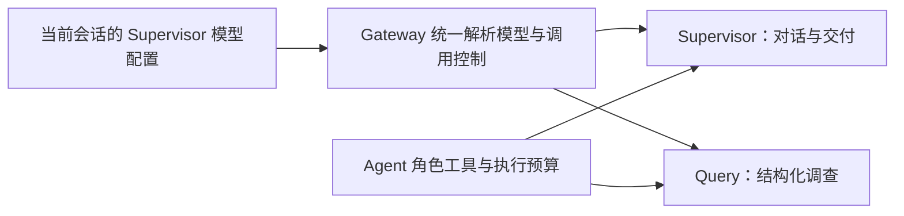

# 1. 问题与现状

2026-11-14，分支 `fix/chat-model-config-inheritance`，目标 `dev`；PR 创建后回填链接。本需求修复 Chat 子 Agent 没有复用当前 Supervisor 有效模型配置的问题。上游动态容量设计见 [chat-model-context-compaction-trd.md](chat-model-context-compaction-trd.md)，原始完整回放与只读诊断见 [PR #166](https://github.com/owariband/Seekino/pull/166)（尚未合并，证据不作为本次运行代码依赖）。

Server 在 `server/bootstrap.py` 分别构造 Query 与 Supervisor：Query 固定使用全局 agent binding/factory，Supervisor 可使用独立 binding 或会话选定模型。即使二者模型名相同，Gateway 的 DeepAgents 构建会解析动态容量，structured Query 构建却只合并旧静态窗口。线上 Supervisor 的实际策略为 1048576／891289／24000，Query 仍为 64000／48000／24000，另受 200000 字符上限约束。T01 两个 Query 子任务共出现 9 次本地上下文替换；是否直接导致分页重读尚未做因果对照。

期望是 Chat 子 Agent 复用当前 Supervisor 已确定的模型来源、模型名、主备及模型调用配置，Gateway 统一解析模型容量与控制值；角色只保留自己的 prompt、工具、结构化结果与执行预算。不能再为 Query 增加一组85%阈值、另一套静态容量或独立模型选择规则。会话切换模型时，子 Agent 必须跟随本轮模型配置。

本次只处理模型配置来源和传递。JEV-only、改写关闭、证据授权和版本校验、检索算法、Query 停止条件、分页恢复、早回应 prompt 及工具次数限制不在本次修改范围；历史回放的耗时与业务质量缺口继续保留。

# 2. 影响因素、假设与评价指标

关键因素是两条 Server 装配入口、Gateway 的动态解析接线、每轮 YAML／个人模型选择以及显式保护值的优先级。模型容量属于 Gateway；Server 消费当前会话配置并装配业务角色，不另外猜测模型能力。原生 harness 拥有的上下文与取消合同须保持。

| 指标／护栏 | 基线 | 验收方法与目标 |
| --- | --- | --- |
| 模型来源一致 | Query 使用全局 agent，Supervisor 可独立选择 | 用不同模型／来源／主备的 fixture，断言 Chat 子 Agent 跟随当前 Supervisor，不能因名字恰好相同通过 |
| 容量与压缩策略一致 | 动态解析只进入 DeepAgents，structured Query 保持静态 | 相同有效模型配置得到相同模型容量／比例与主备安全窗口；能力发现失败按既有明确回退处理 |
| 配置只解析于所属层 | Server 两次重建 policy | 复用既有配置／工厂入口，无 Query 专属容量、比例开关或能力发现实现 |
| 请求／字符保护 | runtime 与 binding 双重限制，动态窗口仍可能先遇到字符上限 | 明确复用规则，覆盖显式保护值及模型切换；不静默删除既有安全保护 |
| 角色与数据合同 | Query 结构化调查，Supervisor 交付，工具额度共享 | 角色工具、结果、授权与执行次数行为不变；相关回归通过 |
| API／原生／会话选择 | 当前存在多个装配分支 | 按实际支持能力验证 YAML API、当前会话选择及原生 harness；兼容边界如实记录，不静默回到无关全局模型 |
| 时延与业务效果 | T01 失败196.567秒，2个子任务、9次压缩 | 本次首先验证配置接线；没有同输入真实回放前不填写改善幅度或正确率 |

# 3. 改造方案与建模

在现有 Server／Gateway 边界内收敛装配。先确定当前请求的 Supervisor 有效 binding／来源，再以该配置构建 Supervisor 和 structured 子 Agent；角色执行参数仍由 Agent runtime 管理。Gateway 复用现有模型容量解析、缓存、主备取小和回退合同，不能把动态阈值算法复制到 Server 或 Query。

最小实现细节在核对个人模型／原生 adapter 与现有测试后确定；保留旧配置读取能力，Chat 路径不再从第二组独立静态模型配置取子 Agent 的模型能力。涉及请求保护的差异须在实现和测试里明确，不仅把数字改大。

先补能在修改前失败的接线测试，再修改实际装配与工厂路径，最后检查会话切换和回退。若发现适配器不支持相同 structured 能力，按现有明确错误语义报告，不引入无提示的另一模型。

# 4. 对照实验与结果分析

先以离线 fixture 重现：全局 agent 与 Supervisor 故意配置成不同来源／模型／主备，声明模型容量和动态比例，再分别捕获父子实际执行配置。使用同一个能力响应替身验证只有正确来源被请求、发现缓存被复用及切换后不复用旧模型窗口。固定网络错误和静态配置 fixture，检查回退与兼容。

| 验证 | 修改前 | 修改后 | 证据 |
| --- | --- | --- | --- |
| Chat 子 Agent 跟随当前 Supervisor | 已知装配分叉，待测试重现 | 待测 | 相关 Bootstrap fixture 与命令待补 |
| structured／DeepAgents 复用动态模型控制 | structured 缺动态接线 | 待测 | Gateway factory 测试待补 |
| 模型切换与主备窗口 | 待测 | 待测 | fixture 与最终控制值待补 |
| 字符／输出／超时及原生兼容 | 待测 | 待测 | 相关回归待补 |

不为证明修复再次无界运行 T01。真实历史回放若执行，沿用已有授权、独立新会话、原数据不变、失败保留及私有材料不入 Git 的边界；明确样本数和成本，不把配置一致等同于延迟、收敛或质量已达标。

# 5. 试点验证与方案取舍

配置来源修复先通过直接覆盖的 Gateway、Bootstrap、个人模型与 Agent 回归，再用受控装配核对当前 Cloud 模型父子最终控制值。真实环境核对只输出模型、窗口、阈值及脱敏哈希，不输出凭据或完整聊天。

正式运行文件与内部文档分开交付。是否部署按会话已有授权与发布边界执行；本 TRD 不新增部署授权。若配置无法解析、当前模型不支持子 Agent 的结构化调用或原生行为退化，保留具体失败，不退回全局旧模型伪装完成。本阶段结论待验证。

# 6. 结果验收与闭环

初稿阶段：已定位配置分叉和 dynamic 解析遗漏，尚未修改实现、运行修复回归或部署。验收须同时确认当前模型跟随、主备与容量一致、角色合同不变，以及模型切换不带入旧预算。实施完成、离线测试通过、真实回放改善和上线分别记录，不能互相替代。

分页重读、Query 无新增进展停止、部分报告、首字回应与 T02／T03 时间锚定继续在原工作台事项及 [PR #166](https://github.com/owariband/Seekino/pull/166) 的诊断边界内跟踪，本次不顺带修改。
