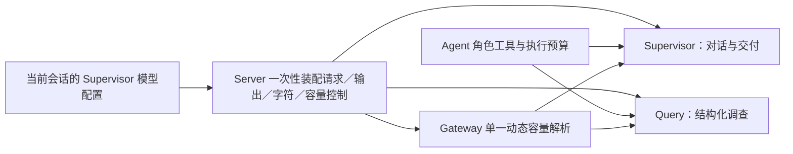

# 1. 问题与现状

2026-11-14 启动，2026-11-15 更新；分支 `fix/chat-model-config-inheritance`，目标 `dev`；[PR #171](https://github.com/owariband/Seekino/pull/171)。本需求修复 Chat 子 Agent 没有复用当前 Supervisor 有效模型配置的问题。上游动态容量设计见 [chat-model-context-compaction-trd.md](chat-model-context-compaction-trd.md)，原始完整回放与只读诊断见 [PR #166](https://github.com/owariband/Seekino/pull/166)（已合入 dev，合并提交 `ff9f8fe555c1bf0f678d5af0617e1076e4d4390f`，证据不作为本次运行代码依赖）。

修改前，Server 在 `server/bootstrap.py` 分别构造 Query 与 Supervisor：Query 固定使用全局 agent binding/factory，Supervisor 可使用独立 binding 或会话选定模型。即使二者模型名相同，Gateway 的 DeepAgents 构建会解析动态容量，structured Query 构建却只合并旧静态窗口。线上 Supervisor 的实际策略为 1048576／891289／24000，Query 仍为 64000／48000／24000，另受 200000 字符上限约束。T01 两个 Query 子任务共出现 9 次本地上下文替换；是否直接导致分页重读尚未做因果对照。

期望是 Chat 子 Agent 复用当前 Supervisor 已确定的模型来源、模型名、主备及模型调用配置，Gateway 统一解析模型容量与控制值；角色只保留自己的 prompt、工具、结构化结果与执行预算。不能再为 Query 增加一组 85% 阈值、另一套静态容量或独立模型选择规则。会话切换模型时，子 Agent 必须跟随本轮模型配置。

本次只处理模型配置来源和传递。JEV-only、改写关闭、证据授权和版本校验、检索算法、Query 停止条件、分页恢复、早回应 prompt 及工具次数限制不在本次修改范围；历史回放的耗时与业务质量缺口继续保留。

# 2. 影响因素、假设与评价指标

关键因素是两条 Server 装配入口、Gateway 的动态解析接线、每轮 YAML／个人模型选择以及显式保护值的优先级。模型容量属于 Gateway；Server 消费当前会话配置并装配业务角色，不另外猜测模型能力。原生 harness 拥有的上下文与取消合同须保持。

| 指标／护栏 | 修改前基线 | 验收方法与目标 | 当前结果 |
| --- | --- | --- | --- |
| 模型来源一致 | Query 使用全局 agent，Supervisor 可独立选择 | 用不同模型／来源／主备的 fixture，断言 Chat 子 Agent 跟随当前 Supervisor，不能因名字恰好相同通过 | 已实现；Bootstrap 与个人目标断言父子同 binding／target |
| 容量与压缩策略一致 | 动态解析只进入 DeepAgents，structured Query 保持静态 | 相同有效模型配置得到相同模型容量／比例与主备安全窗口；能力发现失败按既有明确回退处理 | 已实现；当前 Cloud 预检父子均为 1048576／891289／24000 |
| 配置只解析于所属层 | Server 两次重建 policy，并保留独立 Query 覆盖 | 复用既有配置／工厂入口，无 Query 专属容量、比例开关或能力发现实现 | 已实现；`_controls` 单一入口，无新增策略类 |
| 请求／字符保护 | runtime 与 binding 双重限制，动态窗口仍可能先遇到字符上限 | 明确复用规则，覆盖显式保护值及模型切换；不静默删除既有安全保护 | 已实现；输出／超时／字符取小，200000 字符上限保留 |
| 角色与数据合同 | Query 结构化调查，Supervisor 交付，工具额度共享 | 角色工具、结果、授权与执行次数行为不变；相关回归通过 | 相关回归通过；未做修复后完整回放 |
| API／原生／会话选择 | 当前存在多个装配分支 | 按实际支持能力验证 YAML API、当前会话选择及原生 harness；兼容边界如实记录，不静默回到无关全局模型 | Gateway／Server／个人协议测试覆盖；native 上下文仍归原生 runtime |
| 时延与业务效果 | T01 失败 196.567 秒，2 个子任务、9 次压缩 | 本次首先验证配置接线；没有同输入真实回放前不填写改善幅度或正确率 | 未测；没有修复后 TT／FTT／token／准确率结论 |

# 3. 改造方案与建模

在现有 Server／Gateway 边界内收敛装配。Server 先确定当前请求的 Supervisor 有效 binding／来源，再以该配置一次性构建 Supervisor 和 structured 子 Agent；个人 ChatAPI 则用同一个 target 构建两个角色。角色执行参数仍由 Agent runtime 管理。Gateway 复用现有模型容量解析、缓存、主备取小和回退合同，没有把动态阈值算法复制到 Server 或 Query。



实际实现有四个关键点：

1. **装配只做一次。** `build_chat_runtime` 从当前选择计算 `request_timeout`、`max_output_tokens`、`max_prompt_chars` 和 `ContextWindowPolicy`，父子共用。有独立 Supervisor 时不再创建 Chat 无法消费的全局 agent factory；只有全局 agent 时继续保留 fallback model 覆盖。
2. **个人模型走同一路径。** `PersonalModelTarget` 同时传给 `build_personal_structured` 与 `build_personal_supervisor`，复用目标模型、协议、视觉能力和客户端关闭；个人目标没有 reasoning-effort 能力，因此使用 `none`，不借用全局模型。
3. **Gateway 只保留一个解析入口。** `AgentModelFactory._controls` 为 API builder 统一合并 binding 控制并调用 `_dynamic_context_policy`，复用主备容量、缓存和回退。API builder 不再各自决定是否解析容量；native harness 仍由 runtime 拥有上下文，factory 将字符与窗口控制置空。
4. **旧配置只保留兼容。** Chat 不再读取 `SEEKINO_AGENT_QUERY_MODEL` 或 `query_reasoning_effort` 来选择子 Agent 模型／档位，但这些字段仍能解析，旧 YAML 不会因此报错。`auto_compact_ratio` 未启用，或容量既不能发现也没有声明时，沿用原共享静态策略；发现失败但有声明容量时仍按声明推导。native harness 自行管理上下文，不套 API 窗口。

Query 的 prompt、工具、结构化结果、循环、共享预算与失败语义不变；JEV、独立改写器和检索证据链不变；显式输出、超时、字符保护与原生上下文所有权保留。没有新增容量算法、比例开关或策略类。

# 4. 对照实验与结果分析

先补能在修改前失败的接线测试，再修改装配与工厂路径。实际红证据由受控 worker 运行、主 Agent 复核最终断言：7 项 Gateway 新回归失败，2 项静态控制通过；Bootstrap 捕获到 `configured-query-model != configured-chat-model`。随后在实现提交 `30680fe4` 上运行两个不重叠的测试范围：

```bash
PYTHONPATH="$PWD" /Users/hypnos/workspace/agent/Seekino/.venv/bin/python -m pytest tests/gateway/test_agent_factory.py tests/gateway/test_model_factory.py tests/gateway/test_context_window.py -q --tb=short -m "not live_agent"

PYTHONPATH="$PWD" /Users/hypnos/workspace/agent/Seekino/.venv/bin/python -m pytest tests/server/test_bootstrap.py tests/server/test_personal_models.py tests/gateway/test_user_model_turns.py -q --tb=short -m "not live_agent"
```

| 验证 | 修改前 | 修改后 | 证据 |
| --- | --- | --- | --- |
| Chat 子 Agent 跟随当前 Supervisor | 全局 agent 与 Supervisor 分叉，Bootstrap 捕获模型名不一致 | 父子同 binding／factory／target，模型、来源、effort、fallback、控制值一致 | Gateway 202 通过；Server／个人协议 136 通过 |
| structured／DeepAgents 复用动态模型控制 | structured 缺动态接线，静态窗口仍生效 | 两个 builder 得到同一 policy；模型切换、主备取小、元数据失败和未启用比例均有断言 | `test_structured_and_loop_match_deep_agent_dynamic_capacity` 等 |
| 个人模型与原生兼容 | 个人目标可能回到全局模型；native 上下文边界易被覆盖 | 四种协议完成 mock 结构化工具循环并关闭客户端；Codex native 保留自有上下文 | 个人协议测试；Bootstrap 的 native／alternate YAML 断言 |
| 字符／输出／超时保护 | Server 分两次装配，保护值来源不一 | 父子共用显式保护，旧字段仍解析；200000 字符上限保留 | Bootstrap 配置断言与配置测试 |

两个范围合计 338 项唯一通过，0 失败，用时 2.73／32.76 秒，只有 1 条既有的 Starlette `anyio.abc.BlockingPortal` 弃用警告。两个文件集不重叠，worker 的重复运行未计入总数。详细命令、红证据和覆盖项见[验证报告](../../report/gateway/agent_model/chat-model-config-inheritance-20261115/README.md)。

本轮没有真实 Chat 生成调用，也没有为证明修复再次运行 T01。配置一致不能替代延迟、收敛或回答质量；没有同输入回放，就不能把策略一致写成业务收益。

# 5. 试点验证与方案取舍

配置来源修复先通过直接覆盖的 Gateway、Bootstrap、个人模型与 Agent 回归，再用当前 Cloud 配置做受控预检。预检读取实际生产 YAML，只发一次真实模型元数据 GET；PATCHED Gateway 在同一个容器内、单独的临时进程中导入，未改生产模块文件、未重启服务、未替换在线 Server。输出只保留模型、窗口、阈值和脱敏哈希。

| 项目 | 预检结果 |
| --- | --- |
| 模型／来源／effort／输出 | deepseek-flash／deepseek_api／high／8192 |
| 父子策略 | 均为 1048576／8192／4096／891289／24000 |
| 元数据请求／生成调用 | 1／0 |
| 运行状态 | 容器 ID 与启动状态未变，健康；未调用服务重启 |

该结果支持“当前选择的 binding、factory 与 Gateway 动态解析已接通”。它不覆盖完整在线 Server assembly、HTTP／SSE、工具执行和前端交付，也不能证明修复已在正式环境运行。应用层 200000 字符上限仍在，长上下文可能先于 891289 token 触发压缩。native harness 的上下文也不由这组 API 预检值代表。

方案取舍是复用现有配置和工厂，而不是再给 Query 增加一套 85% 开关。代价是装配逻辑集中到 `build_chat_runtime` 后，任何父子差异都必须显式说明；旧 Query 环境变量保留解析但不再生效，可能让仍在依赖独立 Query 选模的部署失去原来的覆盖能力。项目选择用兼容解析加文档说明处理，没有静默删除字段，也没有保留一条无人使用的第二模型路径。

是否部署按会话已有授权与发布边界执行；本 TRD 不新增部署授权。dev PR #171 已以 `dc9c86fa81952b3ad43d3041d28f151d6d807c82` 合入；正式发布候选 [main PR #172](https://github.com/owariband/Seekino/pull/172) 已通过同范围回归与 release-files、待 main 合并和部署。本阶段结论是“dev 实现已集成、受控配置预检完成，等待正式部署和真实效果验证”。若配置无法解析、当前模型不支持子 Agent 的结构化调用或原生行为退化，保留具体失败，不退回全局旧模型伪装完成。

# 6. 结果验收与闭环

实际集成凭据补充见 [PR #173](https://github.com/owariband/Seekino/pull/173)。

本轮回到原问题，完成的是配置继承和接线，不是 Chat 延迟或质量的最终验收：

- **已实现：** Server 从当前 Supervisor 选择一次性装配父子模型、来源、主备、effort、输出／超时／字符预算和容量策略；个人目标与 API builder 走同一条路径；Gateway 使用单一动态解析入口。
- **已验证：** 修改前红证据成立；Gateway 202 项、Server／个人协议 136 项、共 338 项唯一通过；当前 Cloud 配置预检父子策略一致，元数据请求 1 次、生成调用 0 次，服务未重启。
- **未验证：** main PR #172 尚未合并或部署；没有完整在线 Server assembly；没有修复后的原 T01–T03 回放；TT、FTT、token、压缩次数和准确率收益均未测量。200000 字符上限与 891289 token 阈值的实际先后、主备切换、并发和长期稳定性也未覆盖。
- **明确不宣称：** 修复已上线；9 次 Query 压缩会变为 0；Query 循环、分页重读、`UNKNOWN_ITEM`、早回应、部分报告或取帧精度已经修复。这些仍在原工作台事项和 [PR #166](https://github.com/owariband/Seekino/pull/166) 的诊断边界内跟踪。

下一步是完成 PR #171 的 review 与合并，按发布流程决定 main 和部署；随后在真实 Server 装配中核对父子实际配置，并用相同历史输入做修复后回放，分别记录耗时、token、压缩、工具预算和回答质量。当前状态见[管理工作台](../../dev/workbench.html)的 `CHAT-MODEL-INHERIT-01`；`CHAT-COMPACT-01` 继续 verifying，`CHAT-QUERY-BUDGET-01` 仍为 todo。
