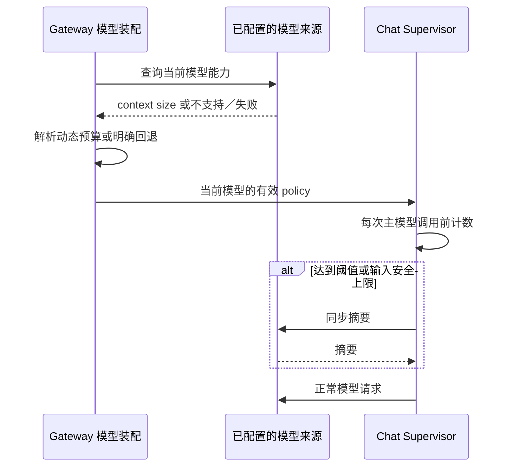

# 1. 问题与现状

需求：本地复现 Chat 同步压缩延迟，并对照当前模型 context size 的 85% 动态触发策略。提出日期：2026-11-13；工作分支：`perf/chat-model-context-compact`；目标分支：`dev`；PR：[#144](https://github.com/owariband/Seekino/pull/144)。

Cloud Chat 在已经找到候选后仍等待数十秒。2026-11-13 的既有诊断中，T01–T03 总用时为 75.659 / 47.880 / 88.877 秒，分别发生 2 / 1 / 2 次同步摘要，摘要合计 45.191 / 30.194 / 51.932 秒。这是既有线上证据，尚不能替代本地复现或修改后的效果验证。

源码中 Supervisor 复用同一模型生成摘要，摘要完成后才继续主模型请求。模型 binding 与 Server runtime 的 policy 取较小值，使 Cloud 实际窗口／触发／尾部保留预算成为 64,000 / 48,000 / 24,000 token。既有模型能力查询却返回 DeepSeek Flash context size 1,048,576；该值须在本轮重新查询，不能把旧快照当作实时值。`compact_target_tokens` 是保留消息尾部预算，不能直接当成完整压缩后请求的 token 数。

本次只改变 Chat Supervisor 上下文容量与触发策略的解析，并执行本地真实模型实验。不修改生产配置、数据库、素材、服务部署、工具并发、reasoning effort 或摘要模型；不实现此前讨论的 50% 后台压缩。保留取消、工具调用配对、证据引用和确认后提交 checkpoint 的契约。

# 2. 影响因素、假设与评价指标

假设 H1：旧窗口导致本来仍处于模型容量内的上下文提前触发同步摘要；摘要耗时直接进入用户等待路径。以本地 `dev` 同一输入和真实模型调用验证，逐次区分摘要与主模型调用。假设 H2：85% 动态阈值能减少本批输入的摘要次数，且没有把耗时转移为更高的主模型输入处理代价或交付错误。

| 指标 | 口径与测量 | 基线 | 目标／护栏 |
| --- | --- | --- | --- |
| 完成耗时 | 本地执行入口至自然完成，包含摘要、工具和框架；失败单列 | 待测 | 同输入配对比较，不用单次值推定 p95/p99 |
| 摘要次数／耗时 | 由摘要中间件实际调用识别，不仅凭无工具请求判断 | 待测 | 确认是否复现同步阻塞，以及变更后是否减少 |
| 压缩前后 token | 完整 system、tools、摘要和消息采用同一计数口径；另列 provider usage | 待测 | 给出净回收量与估算误差，不用配置差代替 |
| 常规模型耗时与用量 | 排除摘要，保留 input/output/reasoning/cache usage | 待测 | 说明保留大上下文的成本，不宣称免费提速 |
| 完成与证据正确性 | 工具调用合法、来源与片段一致、最终回答满足同一问题 | 待测 | 不以跳过必要取证或静默失败换速度 |
| 能力解析 | 当前模型、来源、context size、阈值、输出／安全预留 | 静态合并策略 | 动态值被实际执行链消费；元数据缺失时明确回退 |

# 3. 改造方案与建模

先完成旧策略基线，再修改 Gateway 所属的能力解析与 Supervisor 策略装配。复用既有模型发现连接与出站控制，在模型创建／切换时取得并复用该模型的 context size；不在 Chat 业务工具中硬编码供应商容量，不在每次模型推理前查询模型列表。

当前实现以模型绑定的可选 `auto_compact_ratio: 0.85` 显式启用，省略该字段保留原策略。动态触发值为 `min(floor(context_size * 0.85), context_size - requested_output_tokens - safety_margin_tokens - 1)`。OpenAI 兼容来源查询当前连接的 `context_window`，按 factory／来源／模型缓存；失败或未提供字段时告警并使用绑定声明，声明也缺失时保留原共享策略。Ark 使用绑定声明；主备容量取较小值。此模式不再让旧 runtime 的默认 64k 覆盖已发现容量。字符限制与请求输出不变，尾部 keep 沿用原共享策略且小于新 trigger；不将供应商最大输出能力写入请求预算。

# 4. 对照实验与结果分析

先核对本机数据和服务。优先使用相同真实 Chat 输入／上下文；无法取得同一生产素材时，使用可冻结的真实请求历史和工具结果在本地执行同一 DeepAgents 路径，并明确区分工具回放与全链路业务验收。不得用临时虚构业务数据冒充生产复现。

两组固定模型来源、模型 ID、思考档位、输出预算、system/tools、输入、工具结果与版本。A 为 `dev` 旧策略；B 为动态模型窗口与 85% 阈值。先各一次探索，确认可比性后以至少三对输入相同的运行观察波动；连续失败或超出 30 次真实生成调用时停止扩展，先解释证据。原始请求／响应只保存在私有本地产物；仓库报告保留脱敏指标、版本、运行命令和哈希。

| 指标 | A：旧策略 | B：动态 85% | 差值与边界 |
| --- | --- | --- | --- |
| 真实模型耗时、provider usage、完整交付正确性 | 待测 | 待测 | 尚未生成真实模型结果 |
| 离线 SDK 边界摘要次数（T01/T02/T03） | 1 / 1 / 1 | 0 / 0 / 0 | 同一输入，模型响应为本地替身；仅验证触发路径 |

2026-11-13 已取得所选请求前后必要 checkpoint，在本地重建消息及旧摘要状态，使用当前 Supervisor prompt/tool schema 冻结三个边界。进入摘要前的完整输入估算为 49395 / 48267 / 50152 token，三对 OpenAI 可见消息与工具定义的哈希一致。新增能力函数已通过真实 GET 确认 1M；320 项相关测试通过，3 项配置断言失败在干净 `git archive dev` 中同样复现。详细方法、脚本、数据哈希和边界见[实验报告](../../report/gateway/agent_model/chat-context-compaction-20261113/README.md)。

本地当前没有运行数据库、ES 或 Chat 服务，本轮冻结的是“证据已经返回、下一次模型调用之前”的真实消息边界；不把它当作整轮 Chat 回放。脚本复用生产 DeepAgents/Filesystem/Summarization/Gateway，只执行摘要及一次续推，随后在执行新工具前停止。原 Cloud system prompt 未记录，不能声称与当时请求逐字相同。近 891k 上下文的摘要质量、完整业务交付和生产性能仍未验证。

# 5. 试点验证与方案取舍

本轮为本地受控试点，不自动向 Cloud 部署。直接覆盖 Gateway 能力解析、DeepAgents 实际中间件接线、模型切换和错误回退；再以代表性的真实 Chat 历史验证等待路径。若动态阈值未减少摘要或导致输入超限、交付不完整，保留失败数据并调整方案，不将阈值变大本身当成验收成功。

# 6. 结果验收与闭环

模型容量解析与 85% 策略已实现并完成上述离线验证，尚无真实模型时延对照，不能验收为性能问题已解决。后续以冻结三对输入执行真实模型对照，分别报告旧行为是否复现、同步压缩的实测贡献、85% 策略的时间／token／质量变化，以及未覆盖的完整业务与生产行为。当前状态见[管理工作台](../../dev/workbench.html)的 `CHAT-COMPACT-01`；本轮不部署 Cloud。
