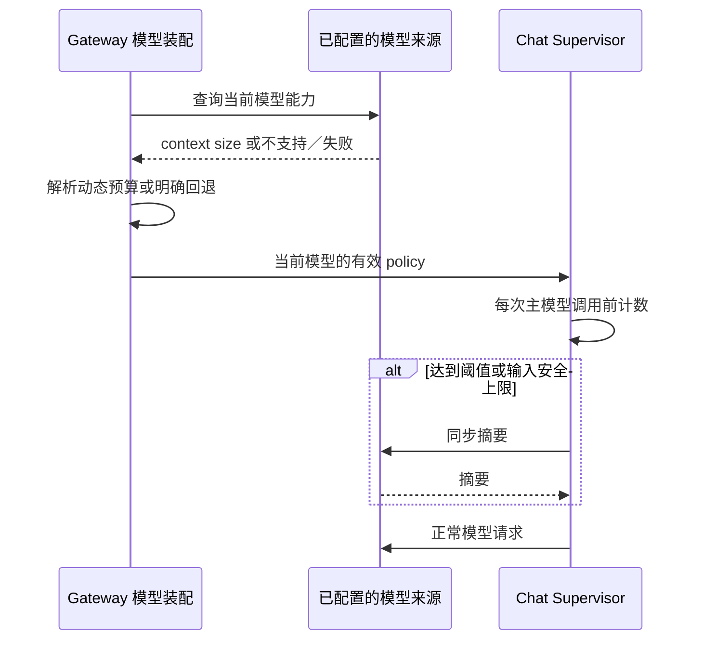

# 1. 问题与现状

需求：本地复现 Chat 同步压缩延迟，并对照当前模型 context size 的 85% 动态触发策略。提出日期：2026-11-13；工作分支：`perf/chat-model-context-compact`；目标分支：`dev`；PR：创建后回填。

Cloud Chat 在已经找到候选后仍等待数十秒。2026-11-13 的既有诊断中，T01–T03 总用时为 75.659 / 47.880 / 88.877 秒，分别发生 2 / 1 / 2 次同步摘要，摘要合计 45.191 / 30.194 / 51.932 秒。这是既有线上证据，尚不能替代本地复现或修改后的效果验证。

源码中 Supervisor 复用同一模型生成摘要，摘要完成后才继续主模型请求。模型 binding 与 Server runtime 的 policy 取较小值，使 Cloud 实际窗口／触发／尾部保留预算成为 64,000 / 48,000 / 24,000 token。既有模型能力查询却返回 DeepSeek Flash context size 1,048,576；该值须在本轮重新查询，不能把旧快照当作实时值。`compact_target_tokens` 是保留消息尾部预算，不能直接当成完整压缩后请求的 token 数。

本次只改变 Chat Supervisor 上下文容量与触发策略的解析，并执行本地真实模型实验。不修改生产配置、数据库、素材、服务部署、工具并发、reasoning effort 或摘要模型；不实现此前讨论的 50% 后台压缩。保留取消、工具调用配对、证据引用和确认后提交 checkpoint 的契约。

# 2. 影响因素、假设与评价指标

假设 H1：旧窗口导致本来仍处于模型容量内的上下文提前触发同步摘要；摘要耗时直接进入用户等待路径。以本地 `dev` 同一输入和真实模型调用验证，逐次区分摘要与主模型调用。假设 H2：85% 动态阈值能减少本批输入的摘要次数，且没有把耗时转移为更高的主模型输入处理代价或交付错误。

| 指标 | 口径与测量 | 基线 | 目标／护栏 |
| --- | --- | --- | --- |
| 完成耗时 | 本地执行入口至自然完成，包含摘要、工具和框架；失败单列 | 待测 | 同输入配对比较，不用单次值推定 p95/p99 |
| 摘要次数／耗时 | 由摘要中间件实际调用识别，不仅凭无工具请求判断 | 待测 | 确认是否复现同步阻塞，以及变更后是否减少 |
| 压缩前后 token | 完整 system、tools、摘要和消息采用同一计数口径；另列 provider usage | 待测 | 给出净回收量与估算误差，不用配置差代替 |
| 常规模型耗时与用量 | 排除摘要，保留 input/output/reasoning/cache usage | 待测 | 说明保留大上下文的成本，不宣称免费提速 |
| 完成与证据正确性 | 工具调用合法、来源与片段一致、最终回答满足同一问题 | 待测 | 不以跳过必要取证或静默失败换速度 |
| 能力解析 | 当前模型、来源、context size、阈值、输出／安全预留 | 静态合并策略 | 动态值被实际执行链消费；元数据缺失时明确回退 |

# 3. 改造方案与建模

先完成旧策略基线，再修改 Gateway 所属的能力解析与 Supervisor 策略装配。复用既有模型发现连接与出站控制，在模型创建／切换时取得并复用该模型的 context size；不在 Chat 业务工具中硬编码供应商容量，不在每次模型推理前查询模型列表。

动态触发值为 `floor(context_size * 0.85)`，并受 `context_size - requested_output_tokens - safety_margin_tokens` 的安全输入预算约束。具体元数据覆盖规则、缺失回退及现有配置兼容方式，在核对实际装配链后补充；未知容量不得猜测或静默放宽。保持现有尾部保留预算，使首轮实验聚焦容量／触发条件；记录其不等于完整压缩后目标的限制。

# 4. 对照实验与结果分析

先核对本机数据和服务。优先使用相同真实 Chat 输入／上下文；无法取得同一生产素材时，使用可冻结的真实请求历史和工具结果在本地执行同一 DeepAgents 路径，并明确区分工具回放与全链路业务验收。不得用临时虚构业务数据冒充生产复现。

两组固定模型来源、模型 ID、思考档位、输出预算、system/tools、输入、工具结果与版本。A 为 `dev` 旧策略；B 为动态模型窗口与 85% 阈值。先各一次探索，确认可比性后以至少三对输入相同的运行观察波动；连续失败或超出 30 次真实生成调用时停止扩展，先解释证据。原始请求／响应只保存在私有本地产物；仓库报告保留脱敏指标、版本、运行命令和哈希。

| 指标 | A：旧策略 | B：动态 85% | 差值与边界 |
| --- | --- | --- | --- |
| 完成耗时、摘要次数／耗时、完整请求 token、provider usage、交付正确性 | 待测 | 待测 | 待测 |

# 5. 试点验证与方案取舍

本轮为本地受控试点，不自动向 Cloud 部署。直接覆盖 Gateway 能力解析、DeepAgents 实际中间件接线、模型切换和错误回退；再以代表性的真实 Chat 历史验证等待路径。若动态阈值未减少摘要或导致输入超限、交付不完整，保留失败数据并调整方案，不将阈值变大本身当成验收成功。

# 6. 结果验收与闭环

初稿尚未实施或验证。闭环时分别报告旧行为是否复现、同步压缩的实测贡献、85% 策略的时间／token／质量变化、代码与测试结果以及未覆盖的生产行为。状态以管理工作台维护；TRD、实验报告与 devlog 互相链接，不另维护任务看板。
