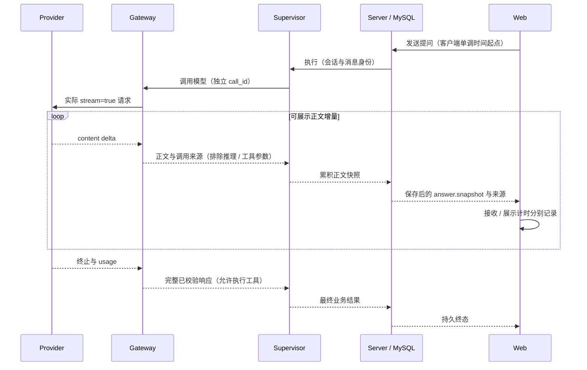

# 1. 问题与现状

需求：Chat 正文真实流式交付与 FTT 可核验计量。建立日期：2026-11-01。业务与实施责任：Codex。当前已完成第一轮实现与隔离验证，真实课程试点、FTT 基线和部署尚未完成。

工作分支：`fix/chat-streaming-ftt`。跟进 [PR #25](https://github.com/owariband/Seekino/pull/25)。上游：[PR #18](https://github.com/owariband/Seekino/pull/18)，本地 worktree `full-video-asr/Seekino` 的已提交版本 `b6f5109d`；建立需求时其正在合并远端 `174160a9`，本需求在独立 worktree 重现该同步，不修改上游暂存区。随后上游发布 `b01afce9`，本分支继续同步该正式版本。先合并 #18，再将本 PR 切回 `dev` 集成；本 PR 不独立交付上游 ASR 成果。

产品要求以 [Chat 流式 PRD](https://github.com/owariband/Seekino/blob/chore/course-qa/docs/design/03-product-reassessment/chat-streaming-prd.md) 为准（已读取本地 `course-qa` 的 `5eca33b5`）。专项 QA 的 C23 是原问题编号；本分支沿用 C23，不另建竞争状态表。课程用例与内容质量仍依赖课程 QA，ASR、解析、索引及 C22 的重复看帧问题不属于本需求。

课程观看追问中，用户必须等待一次完整模型响应才看到正文，无法边生成边阅读；QA 又把完整正文快照的到达耗时误记为 FTT。旧的 9.173 / 29.576 / 27.231 秒不是有效 FTT，不参与首字提速比较；真实 FTT 基线仍为空。TT 和原始时间戳按 PRD 保留。

现状证据：旧运行的 `gateway/openai/agent.py` 使用 `stream=False`；已同步的通用配置虽然默认 `stream=true`，`gateway/streaming/chat.py::request_chat_stream` 仍收齐所有 delta 才返回；`gateway/agent_model/deepagents.py::_HostControlMiddleware.after_model` 才调用正文回调；`agent/chat/supervisor.py::accept_text` 按完整段落拼接，再由 `server/service/agent_chat.py` 保存并发布 `answer.snapshot`。因此仅修改配置或看到 SSE 连接，均不能证明端到端正文流式成立。

# 2. 影响因素、假设与评价指标

关键假设：在供应商接收处转发正文，且 Supervisor 能在单次模型完成前保存和发送累积快照，可以消除本地整包缓冲。模型思考、工具等待和供应商排队仍可能主导 FTT / TT，不能预先承诺性能收益。

| 因素 | 当前证据与拟改变的环节 | 验证方式 |
| --- | --- | --- |
| 实际传输 | stream 配置已可独立控制主模型与 fallback | 检查实际 HTTP 请求，不只检查 YAML |
| Gateway 与 Agent 缓冲 | 收齐响应、after_model 发布正文 | 可控流先给正文并阻塞终止包，要求页面交付链仍能推进 |
| 拼接与业务校验 | accept_text 把每次回调当完整段落 | 保留空格、跨 delta 的 Markdown/URL、工具前后顺序与最终一致性 |
| 异常与重试 | 流式已展示后无法无痕替换整段回复 | 验证断流、取消、fallback、重复事件及持久终态 |
| 指标来源 | 缺少供应商到客户端的同一调用关联 | 保存 call_id、事件序号与进程内单调时间；非流式及缺证必须为 null |

| 指标 | 定义、单位与基线 | 验收目标 | 证据与条件 |
| --- | --- | --- | --- |
| 真实流式 FTT | 浏览器发送到收到供应商实时非空正文，ms；基线未采集 | 只在有真实增量来源、无整包缓冲证据时有效；其他情形为 null 并说明原因 | 独立实例的请求 / provider / Server / client 事件关联 |
| 模型首正文时间 | 实际调用发出到首个非空 content delta，ms；未采集 | 排除 role、空白、工具参数、reasoning 与心跳 | 每次调用独立采证，不能混作用户 FTT |
| 持续交付 | 模型完成前正文实际增长；基线仅整包 | 可控长回复至少两次增长，最终正文逐字一致 | 闸门式流测试、浏览器验证 |
| TT | 浏览器发送到持久完成事件，ms | 如实报告；失败/取消另记，不能据模拟推算真实提速 | Q02/Q03 同条件各至少三次探索样本，暂不报 p95/p99 |
| 正确性护栏 | 工具执行次数、来源校验、最终文本、取消恢复 | 不执行半份参数，不重复正文/工具，不泄漏内部推理，不跨会话 | 相关 Gateway / Agent / Server / Web 回归 |
| 代价 | 请求次数、用量、快照持久化次数 | 不额外发模型请求；观察并控制快照写入压力 | 模拟统计与真实试点分别记录 |

真实速度目标在取得有效探索基线后、正式性能对照前确定。旧 30 秒实质回答、60 秒 TT 探索目标和 120 秒 TT 阻断线保持原意，均不是 FTT 门槛。

# 3. 改造方案与建模

复用共享协议接收器、现有 Supervisor 正文回调及累积 `answer.snapshot` / version / sequence 合同。新增可选正文增量通路和调用来源信息，仅向用户交付 Supervisor 的可展示正文；工具参数与结构化结果仍收齐并校验，内部推理及摘要压缩不发布。保留显式 `stream=false` 兼容路径，但不能计为真实流式 FTT。

异常时保留已经发布的部分正文并明确失败 / 取消，不当作成功完成。已对外发出正文的失败请求不得自动拼接另一个 fallback 回答；尚无正文时保持既有 fallback 行为。事件与快照沿用原来的幂等、权限和恢复边界；不给工具参数或静态进度制造首字。

设计风险：跨 chunk 的空格、链接与引用不可逐片 strip 或误插段落；模型摘要压缩不得冒充回答；高频小片段不得导致无界数据库写入。实施前用确定性测试验证这些因素，再确定最小接口。优先落在实际执行策略的 Gateway、Supervisor、Server、Web 层，不复制协议算法。

2026-11-01 实现细化：

- `observe_chat_text` 只绑定 Deep Agents 的公开 model 调用；通用接收器仅转发 `content`，摘要压缩、内部推理与工具参数不进入正文。完整结果依旧经过原校验。
- `handle_text_delta` 为 Deep Agents 的可选扩展；原 `handle_text` 保留完整轮次合同，结束时核对已流式收到的原文，防止重复拼接。首个可见片段立即保存，后续片段合并为最多每 50 ms 一份快照；工具与终态仍同步提交。跨片段 URL 先拼完再按既有网页来源规则校验。
- `answer.snapshot.textStream` 附调用 ID、delta 序号、模型首正文及进程内单调时间。`answer.model.completed` 标记当前模型调用完成，区别于整轮持久终态 `answer.completed`；非流式与完成后补发不附实时来源。
- 浏览器在实际 fetch 前启动单调计时，通过 `seekino:chat-delivery` 记录接收、可见 DOM 观察及 TT；DOM 观察发生在下一帧，不冒充物理屏幕绘制时间。事件记录不含提问或回答正文，最多保留 64 个消息观察句柄。
- 浏览器单独采样的 `fttMs` 保持 null，候选值保存在 `firstProviderTextReceivedMs`。开启独立的 `SEEKINO_CHAT_TRACE_DIR` 后，用 `scripts/verify_chat_streaming_trace.py` 关联原始 SSE 正文、实际请求、调用身份、服务器完成前转发及浏览器完成前展示；缺证、整包或缓冲反例输出无效及原因，只有证据齐备才给有效 FTT。真实请求与模拟样本必须在报告中分开。

本需求不更换模型、不迁移数据库、不重启共享服务、不重跑课程解析。真实模型与浏览器试点应使用隔离测试配置、独立实例和明确运行版本。

# 4. 对照实验与结果分析

初稿实验计划：先用可暂停的供应商流复现整包缓冲，再接通增量回调；测试必须在允许终止包出现前断言正文已交付，从而避免仅检查最终文本的无效测试。并行覆盖 stream=false、上层故意缓冲、仅 reasoning/心跳、空正文、截断、取消、工具参数分片、fallback 和多次模型调用。模拟只证明链路和合同，不产出真实 FTT 基线。

| 对照项 | 基线 | 改造后 | 判断 |
| --- | --- | --- | --- |
| 完成前可见正文 | 源码与禁用正文观察器反例均只在完成后发布 | 已在真实 SDK 解码 + Supervisor + SQLite 用例中证明供应商阻塞期间可读到持久正文 | 隔离模拟通过；真实模型待试点 |
| 真实 FTT | 未采集 | 未采集 | 不计算提速比例 |
| 最终文本 / 工具 / 终态 | 现有合同与回归用例 | 空格、网页 URL、完整工具参数、断流、fallback、取消与恢复纳入定向验证 | 结果见实施报告 |
| 真实 Q02/Q03 FTT、TT、质量 | 旧 TT 可复核，旧 FTT 已撤回 | 待真实试点 | 条件不一致时不归因于流式 |

原始验证记录保存在 `docs/report/server/` 下，记录代码版本、执行命令、样本、模型配置、运行版本及结果；不保存凭据或无关媒体。

# 5. 试点验证与方案取舍

先通过无外部依赖的 Gateway / Agent / Server / Web 测试和可控 HTTP SSE 集成，再在隔离实例的正常观看页验证长回复增长、原片来源和取消恢复。随后按 PRD 的 Q02/Q03 每组至少三个同条件真实样本建立基线；样本不足不宣称尾延迟达标。QA 需保留失败、fallback、取消与慢请求。

扩大使用的条件是链路真假、指标可复核、最终质量和异常护栏均有证据；如果存在缓冲、错误指标或重复内容，则停止放行并修复。显式关闭 stream 可恢复兼容传输，但此时真实 FTT 必须为空。上线与共享服务操作按任务实际授权执行，设计计划本身不代表已经部署。

# 6. 结果验收与闭环

本需求首个提交 `0dd141b0` 只包含本 TRD 初稿；[PR #25](https://github.com/owariband/Seekino/pull/25) 保持 Draft。增量交付、可选来源字段、浏览器采证与离线证据校验已实现，隔离验证及命令见[实施报告](../../report/server/chat-streaming-20261101.md)。C23 保持 TODO，真实模型 + 正常观看页的完整链路、有效 FTT 基线、正式性能目标及课程试点均未验收。

下一项最小动作：在独立实例加载本 PR 的确定版本与模型配置，开启 Chat trace 并采集浏览器事件，先跑一条足够长的课程解释，执行证据校验器；链路合格后按 PRD 固定 Q02/Q03 问题、历史、播放位置、缓存和负载，各采至少三个真实样本。不得复用旧误标 FTT 数字，也不得用本次模拟毫秒数证明真实模型提速。

最终回到原问题逐项记录：正文是否在模型完成前持续交付；有效 FTT 能否追溯；整包/缺证是否被拒绝计量；最终正文、工具、来源、取消和恢复是否符合合同。实现、测试、真实模型效果、部署分别报告。由 Codex 持续维护本 TRD 与 PR，专项 QA 保留课程用例与原始测量责任；未取得试点证据时不以 PR 创建或测试通过关闭问题。
