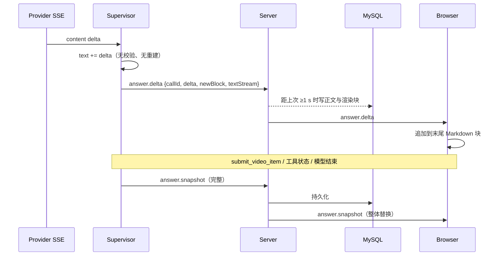

# 1. 问题与现状

**Chat 正文增量交付 TRD。状态：初稿，实验待测（2026-11-05）。** 分支 `perf/chat-text-delta-stream`，PR [#49](https://github.com/owariband/Seekino/pull/49)。关联：[chat-streaming-trd.md](chat-streaming-trd.md)（PR #25，流式交付合同，本需求替换其中“每个 delta 持久化完整快照”的做法）；[chat-stream-snapshot-coalescing-trd.md](chat-stream-snapshot-coalescing-trd.md)（PR #45，缓冲内合并快照，保留）。无代码依赖；与未合并的 #46、#48 同改 `agent/chat/supervisor.py` 的不同位置，建议在其后合并。2026-11-05 发布验收阻塞项：正文流速严重拖慢 Chat 体验。

## 背景与触发场景

LOOP-08 演示中，学习路线类问题（LP01、LP02、SE02）耗时 1–4 分钟，回答文字在页面上逐字缓慢出现。此前把耗时归因于模型思考和逐张提交卡片；逐段核对日志后发现，两次 `submit_video_item` 之间的 13–25 秒全部是模型在流式输出卡片前的那段正文，而正文到达页面的速度只有约每秒 9 个字。

## 实际与期望行为

期望：正文按供应商的生成速度到达页面。直接调用同一模型（`deepseek-flash`，`reasoning_effort: low`）实测：

| 条件 | 首字 | 正文速度 |
| --- | --- | --- |
| 短提示 | 2.6–4.6 秒 | 141–212 字/秒 |
| 约 3.2 万 token 上下文 | 7.2 秒 | 320 字/秒 |

实际：一旦本回合已有检索结果，Chat 内的正文速度降到 8–10 字/秒。

## 现状证据

**实测（2026-11-05，演示环境 19641，集成构建 `3ca4bcfc`，LP02 一次，`outputs/verification/course-loop-dev-20261104/stream/baseline-lp02-3ca4bcfc.json`，脚本 `stream_lag.py`）：** 每个 SSE 快照携带 `textStream.providerReceivedMonotonicMs`（Gateway 读到该 delta）与 `serverPublishedMonotonicMs`（Server 发布该快照）。

| 模型调用 | 已发布快照 / delta | 正文增长 | 正文速度 | 读到→发布中位数 |
| --- | --- | --- | --- | --- |
| 前 3 次（尚无检索结果） | 4–16 / 20–36 | 33–64 字 | 66–253 字/秒 | 6–34 ms |
| 后 4 次（已有检索结果） | 48–426 / 185–426 | 323–739 字 | 8–10 字/秒 | 159–205 ms |

全回合 708 个正文快照，读到→发布 p50 193 ms、p90 263 ms；发布→读到下一个 delta 的 p50 仅 1 ms，说明下一个 delta 早已在缓冲中等待，供应商在等我们。回合总耗时 342 秒，其中约 2,200 字正文按供应商速度只需约 10 秒。

**机制（`dev` `978be570`）：** 每个正文 delta 同步执行以下全部工作，且发生在读取供应商流的同一线程：

1. `accept_text_delta`（`agent/chat/supervisor.py:405`）持有 `tool_lock`，用 `ChatRenderDraft.validate_prefix`（`:402`）对整篇回答重新做最终回答校验（≤20,000 字、≤200 块、卡片不重复）。
2. `publish_snapshot`（`:316`）重建完整检索结果，含 `build_retrieval_trace`（`:325`）对本回合所有检索调用的深拷贝。
3. Server `apply_runtime_event`（`server/service/agent_chat.py:862-892`）再次深拷贝，并以 `SELECT … FOR UPDATE` 事务写入 MySQL（`server/repository/agent.py:473`），每次打印一行 INFO 日志。
4. 完整消息经 SSE 发给浏览器。`ChatSnapshotCoalescer`（`agent_chat.py:845`，50 ms）位于第 2 步之后，只能少发，不能少建。

该回合结束时消息体 873,331 字节，其中 `searchResult` 860,265 字节，`retrievalTrace` 785,709 字节（主要是 `event_trace`，前端只在完成态读取 `resultCount`）。约 700 次快照合计在 Python 复制、MySQL 与 SSE 中搬运约 600 MB（按体积估算，未逐项计时）。

loop08-5 LP02（261.4 秒）日志同样记录 `answer_snapshots=1225`。此前在 #48 TRD 中写的“首次提交前模型思考约 57 秒”“生成回答约 70 秒”实为同一慢速流式，特此更正。

## 负面影响

长回答在页面上以每秒约 9 字出现，路线类问题因此多花 1–3 分钟；工具调用与正文争用同一把锁，彼此阻塞；每个回合上千次数据库事务与日志行。这正是“严重降低 Chat 体验”的发布阻塞问题。

## 本次边界

解决：正文 delta 以增量事件交付，不再逐 delta 校验、重建检索结果和写库；正文按时间间隔持久化以保留恢复能力。

不解决（另立需求）：只读工具并行执行与三层工具锁；卡片按锚点批量提交；`retrievalTrace` / `event_trace` 的体积与存放位置；SSE 读取侧每事件两次来源权限复核。

必须保持：最终持久化正文与渲染块不变；卡片相对正文的位置不变；首字计量（`textStream`）可用；网页刷新与 `answer.interrupted` 后的会话恢复；#45 的慢消费者语义；Web 搜索时未核实链接的屏蔽。

# 2. 影响因素、假设与评价指标

| 因素 | 证据 | 假设 | 验证方法 | 影响的决策 |
| --- | --- | --- | --- | --- |
| 每 delta 的工作量 | 读到→发布 6 ms（无检索结果）→ 193 ms（有检索结果） | H1：成本来自逐 delta 重建与持久化完整快照，与供应商无关 | 方案实施后同一问题复测读到→发布延迟与正文速度 | 若仍慢，继续定位 Gateway 读取侧 |
| 正文是否需要逐 delta 持久化 | 前端渲染来自 SSE；数据库正文只在刷新或断线恢复时读取 | H2：按 1 秒间隔与边界事件持久化，恢复时最多落后约 1 秒，体验可接受 | 回答途中刷新页面，比较恢复正文与流式正文 | 间隔取值 |
| 增量事件的一致性 | `visible_text` 会暂扣未完成的 URL 尾部（`supervisor.py:382`） | H3：可见正文只向后增长，增量可由前一次可见正文的差得到；不满足时发送完整快照即可纠正 | 单元测试覆盖 URL 跨 delta、`[未核实链接]` 替换；真实回合比较拼接正文与持久化正文 | 是否需要更复杂的回退 |
| 慢消费者 | #45 以合并尾部快照避免缓冲溢出 | H4：相邻未发送的同一调用增量可拼接，增量事件不会使 256 缓冲更易溢出 | 单元测试：积压时合并增量；真实回合中断次数 | 是否需要调整缓冲 |

**指标（实验前确定）：**

| 指标 | 定义与口径 | 基线 | 目标 / 护栏 | 测量方法 | 证据入口 |
| --- | --- | --- | --- | --- | --- |
| 正文速度（结果） | 已有检索结果的模型调用内，正文字数 ÷（末个 delta 读到时间 − 首个 delta 读到时间），取各调用 p50 | 8–10 字/秒 | ≥ 100 字/秒 | `stream_lag.py`，LP01 / LP02 / SE02 各 3 次 | `stream/` |
| 读到→发布延迟（诊断） | `serverPublishedMonotonicMs − providerReceivedMonotonicMs`，全部正文事件 p50 / p90 | 193 / 263 ms | p90 ≤ 20 ms | 同上 | 同上 |
| 回合耗时（结果） | 提交到 `answer.completed` | LP01 75–149 s，LP02 56–263 s，SE02 53–78 s（loop08-5…7） | 9 回合全部 ≤ 150 s；同一问题 p50 下降 | `gates.py` | `gates/` |
| 正文一致（护栏） | 客户端由增量与快照重建的正文 = 持久化正文；渲染块顺序一致 | — | 9/9 一致 | `stream_lag.py` 拼接比对 | `stream/` |
| 中断率（护栏） | 持续读取时 `answer.interrupted` 次数 | 0（#45 后） | 0 | 同上 | 同上 |
| 刷新恢复（护栏） | 回答途中刷新，恢复的正文落后流式正文的时长 | 逐 delta 持久化 | ≤ 1.5 秒，且完成后一致 | Playwright 刷新用例 | `browser/` |
| 单回合写库次数（诊断） | `agent_answer_snapshot` 日志行数 | 1,225（loop08-5 LP02） | ≤ 回合秒数 + 边界事件数 | api.log | `gates/` |
| PB01 / PB02 / RE01（护栏） | 浏览器回看与恢复用例 | 通过 | 通过 | 现有 Playwright 脚本 | `browser/` |

样本为每题 3 次，只支持 p50 与范围判断，不做尾部结论。

# 3. 改造方案与建模

**已有基础：** 前端已能处理 `answer.delta`（`web/src/features/search/useAgentConversation.ts:343`，但只追加 `content`，不更新实际渲染用的 `renderBlocks`）；Server 已有 `AgentAnswerDeltaView`（`server/model/vo/agentVO.py:185`），但 `apply_runtime_event` 直接丢弃 `answer.delta`（`agent_chat.py:895`）。参照 `../pi`：OpenAI 兼容流每个 delta 只做 `block.text += delta` 并推送携带该 delta 的事件（`packages/ai/src/api/openai-completions.ts:586-594`），会话在 `message_end` 才持久化（`packages/coding-agent/src/core/agent-session.ts:673`）。

**方案：** 正文走增量，状态变化走快照。

| 事件 | 触发 | Agent 侧工作 | Server 侧工作 | 浏览器 |
| --- | --- | --- | --- | --- |
| `answer.delta`（新语义） | 每个可见正文增量 | 追加正文，更新内存中的末尾 Markdown 块；O(1) 字数上限检查 | 直接发布；距上次持久化 ≥ 1 秒时写入正文与渲染块（不含检索结果） | 追加到末尾 Markdown 块，或按 `newBlock` 新建 |
| `answer.snapshot` | 工具状态、卡片提交 / 撤回、模型调用结束、可见正文非单调 | 同现状：校验并重建完整快照 | 同现状：持久化并发布 | 整体替换 |
| `answer.completed` | 回合结束 | 同现状 | 同现状 | 同现状 |

**关键设计：**

1. **增量计算（Agent）。** 每个模型调用记录已发送的可见正文 `sent`。新可见正文 `value` 以 `sent` 为前缀时，`delta = value[len(sent):]`；为空不发。调用内首个增量的 `newBlock` 表示是否新建 Markdown 块；若前一块是 Markdown，按现有 `text_blocks` 规则以 `"\n\n"` 衔接，衔接符计入增量，浏览器端只做拼接。`value` 不以 `sent` 为前缀时（替换已可见文本），发送完整快照并以其为新的 `sent`。
2. **字数上限。** 维持最终回答 20,000 字限制：Agent 维护已渲染 Markdown 总字数，超限时抛出与现状相同的错误；完成时的完整校验（`supervisor.py:1237`）不变。
3. **持久化（Server）。** `answer.delta` 内部事件附带当前正文与渲染块（Agent 侧缓存的上一快照公开块 + 末尾 Markdown 块，不重建检索结果），仅用于按间隔写库，不进入 SSE。快照、完成与失败事件照常持久化，因此边界前的正文总会落库。
4. **缓冲合并。** 沿用 #45：缓冲尾部为同一 `callId`、尚未取走的 `answer.delta`，且新事件 `newBlock` 为假时，拼接 `delta` 并以新事件的 `textStream` 替换，其余事件顺序不变。
5. **首字计量。** `textStream` 字段随 `answer.delta` 发出；`web/src/api/chatDelivery.ts` 在 `answer.delta` 上识别首个供应商正文。
6. **删除。** `ChatSnapshotCoalescer`（`server/service/agent_chat_stream.py`）在正文不再走快照后没有输入，删除；`accept_text_delta` 中的 `validate_prefix` 与 `publish_snapshot` 调用删除。

**失败路径：** 取消与超时沿用现有检查（`control.check()`）；流中断时 Server 已按间隔持久化的正文可恢复，完成或失败事件照常提交；增量事件丢失（慢消费者断开）走 #45 的 `answer.interrupted` 与会话恢复。

**实施边界：** `agent/chat/supervisor.py`（正文增量路径）、`server/service/agent_chat.py`（增量发布、按间隔持久化、缓冲合并）、`server/service/agent_chat_stream.py`（删除）、`server/model/vo/agentVO.py`（增量事件字段）、`web/src/api/contracts.ts`、`web/src/features/search/useAgentConversation.ts`、`web/src/api/chatDelivery.ts` 及对应测试。不改数据库结构、持久化的最终回答格式、工具与 Prompt。

**验证顺序：** 先单元测试（增量拼接、URL 暂扣、`newBlock` 衔接、缓冲合并、间隔持久化、前端增量渲染）；再在演示环境复测 LP02 一次核对正文速度与读到→发布延迟；达标后跑完整 9 回合与浏览器用例。若读到→发布延迟下降而正文速度未达标，停止扩大并定位 Gateway 读取侧。

# 4. 对照实验与结果分析

计划：同一演示环境（19641，v11 课程库，相同模型配置），基线为集成构建 `3ca4bcfc`（`dev` + #46 + #47 + #48），方案为其上加入本需求。LP01、LP02、SE02 各 3 次，`stream_lag.py` 记录正文事件时间与正文拼接；`gates.py` 记录回合耗时与日志；浏览器跑 PB01、PB02、RE01 和回答途中刷新。

| 指标 | 基线实测 | 方案实测 | 变化量 | 验收标准 | 判断与证据 |
| --- | --- | --- | --- | --- | --- |
| 正文速度 p50 | 8–10 字/秒（1 回合） | 待测 | 待计算 | ≥ 100 字/秒 | 未验证 |
| 读到→发布 p90 | 263 ms | 待测 | 待计算 | ≤ 20 ms | 未验证 |
| 回合耗时（9 回合最大值） | 262.5 s | 待测 | 待计算 | ≤ 150 s | 未验证 |
| 正文一致 | — | 待测 | — | 9/9 | 未验证 |
| 单回合写库次数 | 1,225 | 待测 | 待计算 | ≤ 秒数 + 边界数 | 未验证 |

# 5. 试点验证与方案取舍

演示环境即试点（发布验收环境）。扩大条件：第 2 节全部结果指标达标且护栏无退化。回退：恢复本 PR 前的构建；本需求不改数据结构，无数据迁移。

取舍：恢复时正文最多落后约 1 秒，换取每回合写库从上千次降到数十次；Agent 与 Server 不再逐 delta 校验，最终校验仍在完成时进行。

# 6. 结果验收与闭环

待实验完成后填写：逐项对照第 2 节指标，记录最终决定、实际状态与剩余事项（并行工具、锚点卡片、`retrievalTrace` 体积、SSE 每事件权限复核）。
