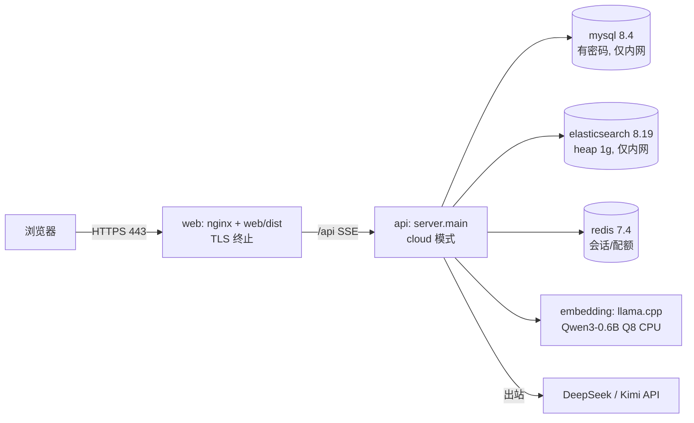
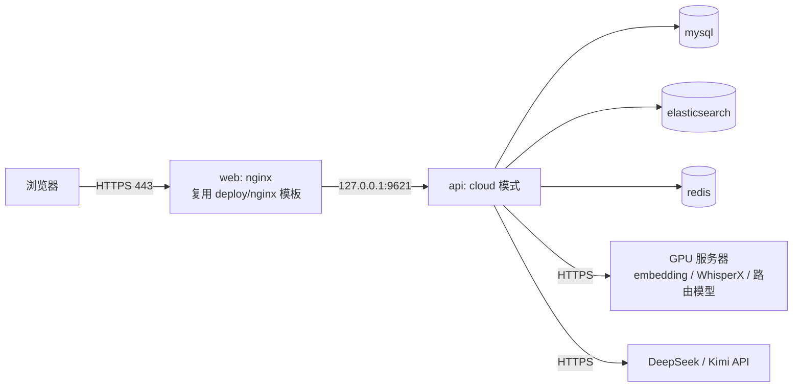

# 1. 问题与现状

需求：用 Docker 将 `main` 的服务部署到云服务器，对公网提供样例库的观看、检索与问答。状态：TRD 初稿，2026-11-06。分支 `chore/cloud-docker-deploy`，[PR #57](https://github.com/owariband/Seekino/pull/57)。2026-11-06 修订：两台服务器拓扑与范围收窄，见 §3。

**背景与触发场景。** Seekino 的第一个对外用途是简历筛选：面试官打开公开链接，自行浏览课程、检索并提问。演示目前只运行在本机——API 19641 从 detached worktree `outputs/worktrees/run-dev` 启动，数据在 v11 隔离库（MySQL 13361、ES 19231、本机媒体）。部署目标为两台服务器：一台 CPU 服务器（4C8G 量级，运行 Seekino Docker 栈）和一台待租用的 GPU 服务器（自托管模型）；两台都尚未交付 SSH。早先检查过的那台服务器已不是部署目标，此前对它的只读检查不再作为现状依据（2026-11-06 用户确认）。

**实际与期望。** 期望：服务器上一条 compose 命令起完整栈，公网 HTTPS 同源提供 Web 与 API，`SEEKINO_AUTH_MODE=cloud` + `SEEKINO_PUBLIC_LIBRARY_ONLY=true`，游客与邮箱用户可观看、检索、问答。实际缺口（源码与模板核对，见 [cloud 首发说明](../../../deploy/cloud/README.md)）：

1. 根 `compose.yaml` 只服务本机：`SEEKINO_AUTH_MODE: local`、MySQL `MYSQL_ALLOW_EMPTY_PASSWORD`、Redis 仅在 `cloud-auth` profile、端口绑 `127.0.0.1`、无 TLS。cloud README 明确写着不能照搬。
2. 云端没有 compose / 编排文件；`deploy/cloud/` 只有 env 与模型模板，且注明“未做真实调用验收”。
3. **模型合同不一致（决定方向）：** 演示索引由本机 llama.cpp 运行的 `Qwen3-Embedding-0.6B-Q8_0`（1024 维，`llama_embedding_local`）编码；`deploy/cloud/models.example.yaml` 绑定的是 Ark `doubao-embedding-vision-250615`。查询端换向量模型会让迁移过去的索引失效（AGENTS.md：向量合同变更需要重建）。演示的 rerank 用 `kimi_coding/k3`，Supervisor / Agent / query_rewriter 用 `deepseek_api/deepseek-flash`。
4. 代码基线：`main` 落后 `dev` 203 个提交，且含只在 main 的 PR #5。按 2026-11-06 决定，由 [PR #56](https://github.com/owariband/Seekino/pull/56) 发布为“dev 树 + main 的 .gitignore”，本需求部署该发布后的 `main`。#56 已于 2026-11-06 合并；main 的 `.gitignore` 屏蔽私有文档，本需求不修改它，部署文件不写入真实主机、IP、库名或本机路径。

**负面影响。** 没有可公开访问的入口，简历筛选阶段就无法展示；临时把本机暴露出去既不安全，也撑不过无人值守的使用。

**本次边界。** 解决：云端 compose 栈、cloud 模型配置、镜像在服务器构建与启动、HTTPS 入口、演示数据（MySQL + ES + 媒体）迁移步骤与验收。2026-11-06 范围收窄：本 PR 只交付 `deploy/cloud/compose.prod.yaml`、合并后的 `deploy/cloud/env.cloud.example` 与拓扑说明；数据迁移脚本和栈内 embedding 服务移出今日范围，服务器操作等用户交付 SSH 后进行。暂不解决：在云端解析视频（4C8G 只做服务；上传入口仅限管理员，首发不在云上跑解析）、系列补全、编辑功能（#50）。必须保持：本机 `compose.yaml` 行为不变；身份与权限校验不放宽；模型密钥不进镜像和 Git。

# 2. 影响因素、假设与评价指标

| 因素 | 证据 / 假设 | 验证方法 | 若不成立 |
|---|---|---|---|
| 查询向量与索引一致 | 已确认：演示索引为 Qwen3-0.6B Q8 / 1024 维 | GPU 服务器用同一 GGUF 与 llama.cpp 起 embedding 服务，同一查询的向量与本机对比余弦 ≈ 1 | 只能重建索引或换回本机 |
| 0.6B 嵌入在 4 核 CPU 上够快 | 已移出：embedding 改在 GPU 服务器运行（2026-11-06）；剩余假设为跨服务器单查询 < 1 秒 | 服务器上实测 p50/p95 | 改用 API 嵌入并重建索引 |
| 8 GB 内存装得下 | 假设：ES heap 1 GiB（RSS 约 1.6 GiB）+ MySQL 约 0.6 GiB + API 约 1.5 GiB + Redis/nginx < 0.2 GiB ≈ 4 GiB（embedding 已移到 GPU 服务器） | `docker stats` 在门禁运行中的峰值 | 降 ES heap、限 API 并发 |
| 本机数据可原样迁移 | 假设：mysqldump + ES snapshot（或 reindex）+ 媒体 rsync 一致 | 行数、文档数、媒体文件数与 sha 抽样对齐；迁移后门禁通过 | 记录差异，回到迁移脚本 |
| 服务器能拉取镜像与模型依赖 | 未知：国内机器访问 Docker Hub / ghcr / npm / PyPI 可能受限 | 首次构建实测 | 配镜像源，或本机 buildx 构建 amd64 后传输 |
| DeepSeek / Kimi 从服务器可达 | 假设可达 | 健康检查后的真实问答 | 配出口代理 |

| 指标 | 类型 | 定义 | 基线 | 目标 | 方法 |
|---|---|---|---|---|---|
| 公网可用 | 结果 | 游客打开 HTTPS 地址、观看、检索、问答全通 | 无入口 | 通过 | 浏览器 + cloud README 验收清单 |
| 权限护栏 | 护栏 | 普通用户直调上传/任务/资料修改接口被拒；管理员可上传、发布、撤回 | 未验 | 全部符合 | 脚本化 API 检查 |
| 数据一致 | 护栏 | 系列/视频/Chunk/Event 行数与 ES 文档数迁移前后一致 | 本机计数 | 相等 | 计数脚本 |
| 问答质量不退化 | 护栏 | LOOP-08 门禁（SE01 SE02 LP01 LP02）在公网地址的结果 | 本机 a78bb6f2 结果 | 不差于本机 | `gates.py` + `score_answers.py` |
| 资源余量 | 护栏 | 门禁期间内存峰值 | 待测 | < 6.5 GiB | `docker stats` |
| 重启恢复 | 护栏 | `docker compose restart` 后对话与数据仍在 | 未验 | 通过 | 重启后复查 |

# 3. 改造方案与建模

**已有基础。** `deploy/docker/Dockerfile`（api / web 多阶段，API 9621，web nginx 80）、`deploy/docker/nginx.conf`（同源反代、SSE 关闭缓冲、1800 s 读超时）、`deploy/cloud/first-release.env.example`（cloud 身份、Redis、SMTP、配额变量）、`deploy/nginx/`（原生 HTTPS 说明）、根 `compose.yaml` 的健康检查与 initialize 模式。复用这些，不另写一套。

**方案。** 新增 `deploy/cloud/compose.yaml`（独立项目名，不改根 compose），服务：

- 只有 web 发布 80/443 到公网；其余服务不发布端口，只在 compose 网络内互通。
- `deploy/cloud/models.cloud.yaml`：与演示一致的服务端绑定——supervisor / agent / query_rewriter 用 `deepseek_api/deepseek-flash`，rerank 用 `kimi_coding/k3`，embedding 用容器内 llama.cpp 的同一 GGUF（1024 维）；不含本机 Codex、whisper、pyannote。解析相关绑定保留 API 模型，但首发不在云上解析。`supervisor_harness: deepagents`。
- 密钥与连接经 `.env.cloud`（服务器私有、Git 忽略）注入；镜像不含密钥。
- TLS：web 容器挂载证书目录，nginx 监听 443 并把 80 重定向到 443；证书来源取决于域名（见 §5 待决）。
- 构建：在服务器上 `docker compose build`（x86_64 原生）；若拉取受限，再改为本机 buildx 构建 amd64 后传输。
- 数据迁移：本机 v11 库 `mysqldump --single-transaction` → 服务器导入；ES 用 snapshot 到文件仓库后 restore（或 `_reindex` 脚本）；媒体目录 rsync 到 `artifacts` 卷；迁移脚本放 `deploy/cloud/migrate/`，只读源库。

**2026-11-06 修订：两台服务器拓扑与收窄后的方案。** 上面的单栈方案（独立 `compose.yaml`、cloud 专用 nginx、栈内 embedding、`migrate/` 脚本）不再实施，保留作历史设计。现行方案：

- **CPU 服务器：** `docker compose --env-file deploy/cloud/.env.cloud -f compose.yaml -f deploy/cloud/compose.prod.yaml`。叠加文件只写生产差异：cloud 身份与 production 环境、MySQL 设密码并改用应用账号、MySQL / ES / Redis 不发布端口并设 `restart: unless-stopped`、Redis 常开、带密码的 MySQL 健康检查、服务器模型 YAML 只读挂载；mailpit 留在 `mock-email` profile 不启用，不用根 `config.yaml` 里的本机模型。web 以 host 网络运行 web 镜像，渲染 `deploy/nginx/nginx.conf.template`（443，代理到 loopback 上的 API），不新增第三份 nginx 模板。
- **GPU 服务器：** 运行与样例索引一致的 Qwen3-Embedding-0.6B Q8 GGUF（llama.cpp）、WhisperX 的 OpenAI 兼容转写服务和替换 Jev 的路由模型。
- **模型 base_url：** 服务器模型 YAML 中 `llama_cpp_embedding` 指向 `https://<GPU 主机>`，`openai_audio` 指向 `https://<GPU 主机>/v1`；非 loopback 地址必须是 HTTPS（`gateway/config.py` `_https_base_url` / `_audio_base_url`），因此 GPU 侧需要 TLS 入口。路由仍为 OpenRouter Jev，替换需改 `gateway/query_hook.py`，不在本 PR。
- **环境模板：** `first-release.env.example` 与新模板合并为唯一的 `deploy/cloud/env.cloud.example`；由叠加文件固定的连接项（数据库、Redis、模型路径、来源）不再出现在模板中。
- 拓扑说明写在 [cloud 首发说明](../../../deploy/cloud/README.md#服务器拓扑)。

**实施边界。** 新增文件均在 `deploy/cloud/`；可能需要小改 `deploy/docker/nginx.conf` 以支持 443（或为 cloud 新建一份）；不改应用代码。如果发现 cloud 模式在容器内需要代码改动，单独开 PR。

**验证顺序。** ① 本机 Docker 起 cloud 栈（空库）→ 健康检查与游客登录；② 服务器构建与起栈（空库）→ 公网 HTTPS 健康检查；③ 迁移数据 → 计数对齐；④ 公网门禁与权限清单。任一步失败先回到对应因素，不跳步。

# 4. 对照实验与结果分析

计划：嵌入一致性——同 10 条查询在本机与云端 embedding 服务的向量余弦（期望 ≥ 0.999）；检索一致性——同查询的 top-10 Chunk ID 重合率（期望 10/10）；问答——LOOP-08 四题在公网与本机的打分对照；性能——云端检索与首字时间 p50/p95（样本少，只作诊断，不宣称尾部）。结果待测。

# 5. 试点验证与方案取舍

试点即首发：先只把链接给自己和少数熟人验证一轮，观察 24 小时内的错误日志、内存与 DeepSeek 失败率，再放进简历。回退：`docker compose down` 后数据卷保留，本机演示仍可用；DNS 或链接撤回即可停止对外访问。

待用户决定（外部操作，需确认；2026-11-06 修订：第 2 项随旧服务器作废，改为等待用户交付两台服务器的 SSH）：
1. 公网入口用哪个域名？公信证书（Let's Encrypt 需要域名指向 CPU 服务器，且 80 端口可达；国内云厂商可能要求域名备案）。没有域名时只能用自签证书或纯 IP + HTTP，后者与 `SEEKINO_AUTH_COOKIE_SECURE=true` 冲突。
2. 是否允许在服务器上用 sudo 将 `ubuntu` 加入 `docker` 组，并开放安全组 80/443。
3. SMTP 账号（邮箱登录）首发是否需要，还是先只开放游客。

# 6. 结果验收与闭环

状态（2026-11-06）：叠加 Compose、合并环境模板与拓扑说明已完成，静态检查通过（本机 `docker compose ... config` 仅渲染配置，不启动容器）；尚未在任何服务器上构建或启动，§2 指标均待测。验收以 §2 指标逐项回填，证据放 `docs/report/deploy/cloud-docker-20261106/`。部署完成、门禁通过与对外稳定分别报告。
