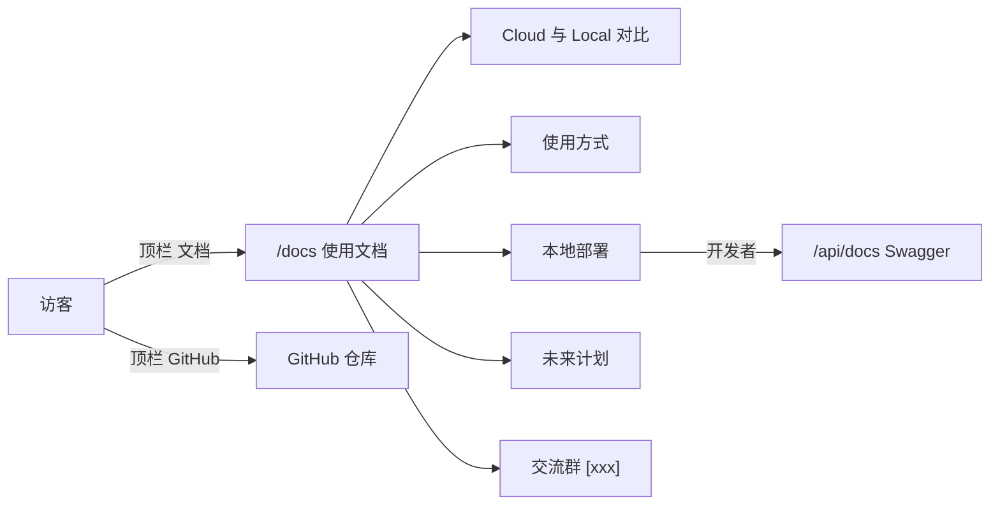

# 1. 问题与现状

需求：Seekino Cloud 站内使用文档与 GitHub 推广入口。提出日期：2026-11-10（Asia/Shanghai）。分支：`feat/cloud-user-docs`；PR：待创建后回填。状态：实现完成、本地验证通过，待合并与 Cloud 发布；交流群链接仍为 `[xxx]` 占位。

**背景与触发场景。** Cloud 首发只开放已解析、已发布的公共样例，游客与普通邮箱用户可以观看、检索和问答，上传与管理仅限管理员（[云端部署说明](../../../deploy/cloud/README.md)）。hypnos 参加的多项比赛要求项目具备真实用户，而目前 Cloud 没有外部用户。第一次打开 Cloud 的访客看不到 Seekino 能做什么、Cloud 与本地版的区别、如何自己部署，也找不到 GitHub 仓库与交流渠道，因此访问难以转化为 Star、部署或反馈。

**实际与期望行为。**

| 方面 | 当前 | 期望 |
| --- | --- | --- |
| 站内说明 | Web 路由只有观看、检索、资料库、任务、消耗与设置（[App.tsx](../../../web/src/app/App.tsx)） | 无需登录即可访问的 `/docs` 使用文档 |
| Cloud / Local 区别 | 只写在仓库 README 与部署文档中 | 文档首屏说明两版在内容、上传、模型、MCP、数据位置上的差异 |
| 推广入口 | 站内没有 GitHub 链接 | 顶栏与文档页提供 GitHub 链接 |
| 交流群 | 无 | 文档末尾提供交流群入口；链接由 hypnos 稍后提供，先用 `[xxx]` 占位 |
| `/docs` 路径 | Docker Web 的 Nginx 将 `/docs`、`/redoc`、`/openapi.json` 转发给 FastAPI Swagger（[nginx.conf](../../../deploy/docker/nginx.conf)） | `/docs` 归用户文档；API 文档迁到 `/api/docs`、`/api/openapi.json` |

**负面影响。** 没有自助说明，访客无法判断 Cloud 只是样例体验，误以为可以上传自己的视频；想要完整能力的开发者也找不到部署入口。比赛材料需要的用户来源因此缺少第一个落点。

**现状证据。**

- FastAPI 使用默认 `docs_url`、`openapi_url`（[server/api/app.py](../../../server/api/app.py)）。Cloud 使用的 [Nginx 模板](../../../deploy/nginx/nginx.conf.template) 只转发 `/api` 与 `/healthz`，所以 Cloud 上 `/docs` 现在会落到 SPA，最终跳转到 `/watch`。
- MCP 只在 `local` 身份模式挂载，并校验客户端为 loopback 地址（[server/api/mcp.py](../../../server/api/mcp.py)）。Docker 端口映射下，客户端地址可能是 bridge 网关而非 loopback（推断，未实测），因此文档只承诺宿主机运行（`./start.sh`）时可以使用 MCP。

**本次边界。** 交付站内 `/docs` 页面（中英双语，跟随现有 i18n 与主题）、顶栏文档与 GitHub 入口，以及 API 文档路径迁移和相关说明同步。2026-11-10 hypnos 追加：公共资料首页为首次访客显示 Kino 欢迎卡片，一句话说明能做什么，引导去检索和文档；不做弹窗或分步引导。不做用户统计、不新增后端接口、不改 Cloud 权限、不开放 Cloud MCP。文档只描述已实现能力；规划项标明“计划中”，不写日期承诺。

# 2. 影响因素、假设与评价指标

| 因素 | 假设 | 验证方式 |
| --- | --- | --- |
| 入口可见性 | 顶栏常驻“文档”与 GitHub 入口，比只在 README 中说明更容易被访客发现 | 游客身份在桌面与手机宽度下都能看到入口（截图） |
| 内容准确性 | 文档能力与源码一致时，访客不会误解 Cloud 能力 | 逐条对照部署说明、MCP 挂载条件与 README 已实现项 |
| 路径冲突 | API 文档迁到 `/api/*` 后，无需新增 Nginx 规则即可在 Docker、Cloud 和 Vite 开发代理下访问 | 测试请求 `/api/docs`、`/api/openapi.json`；SPA 访问 `/docs` |

| 指标 | 类型 | 基线 | 验收标准 | 测量方式 |
| --- | --- | --- | --- | --- |
| `/docs` 游客可访问 | 结果 | 不存在 | 未登录直接打开显示文档，不跳转 `/watch` | 前端路由测试；本地浏览器截图 |
| GitHub 入口 | 结果 | 无 | 顶栏与文档页均链接 `https://github.com/owariband/Seekino` | 组件测试；截图 |
| API 文档 | 护栏 | `/docs`、`/openapi.json` | `/api/docs` 返回 Swagger，`/api/openapi.json` 返回 schema；既有测试改用新路径后通过 | pytest |
| 既有前端行为 | 护栏 | 现有测试通过 | typecheck、test、build 通过 | npm 命令 |
| 真实用户转化 | 诊断 | 0 | 待上线后观察，本 PR 不承诺 | 无统计；后续需求另行决定 |

# 3. 改造方案与建模

- **Web：** 新增 `features/docs/DocsPage`，在 `AppShell` 下注册 `/docs`，对所有身份开放。正文按语言保存为结构化内容对象，不逐句塞进共享翻译表；顶栏增加文档与 GitHub 图标入口，手机抽屉同步。
- **Server：** `FastAPI(docs_url="/api/docs", openapi_url="/api/openapi.json", redoc_url=None)`；旧 `/docs`、`/openapi.json` 不再由 API 提供。
- **Docker Nginx：** 删除 `/docs`、`/redoc`、`/openapi.json` 的转发，由 `/api` 规则覆盖。
- **文档同步：** README、本地配置指南中的 API 文档地址改为 `/api/docs`。
- **欢迎卡片：** `features/player/WelcomeCard` 只在 `activeSource.kind === "public"` 时显示，本机资料不显示。宽屏浮在首页 Hero 右侧空白区，窄屏放在 Hero 下方；没有系列时放在页面顶部。主按钮打开检索并聚焦输入框，次链接到 `/docs`；关闭后写入 `localStorage`，同一浏览器不再显示。示例检索词暂不实现：Cloud 上 MyGO 尚未上传、课程系列正在重新解析，无法验证示例能命中真实片段。内容就绪并实测命中后，再增加示例词及检索框预填。

兼容性：依赖旧 `/openapi.json` 的外部脚本需要改用新路径；仓库内只有测试使用该路径。

# 4. 对照实验与结果分析

计划：修改前确认 `/docs` 在 SPA 下跳转 `/watch`、API 在 `/openapi.json` 提供 schema；修改后运行同一组请求与前端测试，结果以表格补充到本节。

| 检查 | 修改前 | 修改后 | 判断 |
| --- | --- | --- | --- |
| SPA `/docs` | 无路由，回落到 `/watch`（源码确认） | 游客与无管理权限身份直接显示文档 | 通过：`App.test.tsx` “opens the user docs…” |
| API 文档路径 | `/docs`、`/openapi.json` | `/api/docs` 200，`/api/openapi.json` 返回 schema；`/docs`、`/openapi.json` 404 | 通过：`test_api_docs_live_under_api_prefix` |
| 既有 OpenAPI 断言 | 读 `/openapi.json` | 改读 `/api/openapi.json` | 通过：`tests/server/test_api.py`、`test_cloud_access.py` 共 170 项 |
| 前端 typecheck / test / build | — | typecheck 通过；32 个文件 630 项测试通过（含欢迎卡片：公共资料显示、关闭后不再显示、本机资料不显示）；build 通过，`DocsPage` 为独立懒加载 chunk（JS 16.07 kB，gzip 6.97 kB） | 通过 |

测试于 2026-11-10 在 `feat/cloud-user-docs` 工作区执行。

# 5. 试点验证与方案取舍

内容为静态页面，风险低，以本地浏览器在桌面与 390px 宽度、明暗两种主题下的截图替代独立试点。

2026-11-10 用 Vite 开发服务与 Playwright 截图（API 以游客身份 mock，仅用于渲染页面）：桌面 1440px 中文浅色、英文深色，及 390px 中文。检查结果：顶栏文档与 GitHub 入口可见；390px 下页面宽度等于视口、无横向滚动；对比表在手机上改为逐行卡片；抽屉导航包含“使用文档”和“GitHub 仓库”。欢迎卡片另在 1440px、1024px（浅色）、1440px 英文深色、390px 及空资料库下截图：宽屏卡片位于 Hero 右侧且不遮挡标题与按钮，窄屏位于首屏内；关闭并刷新后不再出现。截图属于开发过程材料，未提交仓库。上线到 Cloud 由发布 PR 完成，不属于本 PR；交流群链接替换 `[xxx]` 前不对外推广。

# 6. 结果验收与闭环

| 指标 | 结果 | 证据 |
| --- | --- | --- |
| `/docs` 游客可访问 | 已实现，本地验证通过 | 前端路由测试；截图 |
| GitHub 入口 | 顶栏、手机抽屉、文档首屏与末尾均链接仓库 | 前端测试；截图 |
| API 文档迁移 | `/api/docs`、`/api/openapi.json` 可用，旧路径 404 | pytest |
| 既有行为 | 前端与相关后端测试全部通过 | 第 4 节 |
| 真实用户转化 | 未测，本 PR 不承诺 | — |

剩余事项：

- 欢迎卡片的示例检索词：等 Cloud 课程与 MyGO 内容就绪，逐条实测命中后再加。
- 很长的系列标题在 1024px 左右可能与欢迎卡片靠近，未用真实标题验证。

- 交流群链接由 hypnos 提供后替换 `web/src/features/docs/content.ts` 中的 `[xxx]`。替换前不对外推广。
- 文档页仍在 `AuthProvider` 的身份门槛之后：API 不可用时，文档也无法显示。Cloud 正常运行时不受影响，本次不改。
- Docker 端口映射下 MCP 的 loopback 校验未实测；文档只承诺宿主机运行。
- 依赖旧 `/docs`、`/openapi.json` 的外部脚本需要改用新路径。
- Cloud 部署需要通过 `dev → main` 发布后执行，不属于本 PR。
