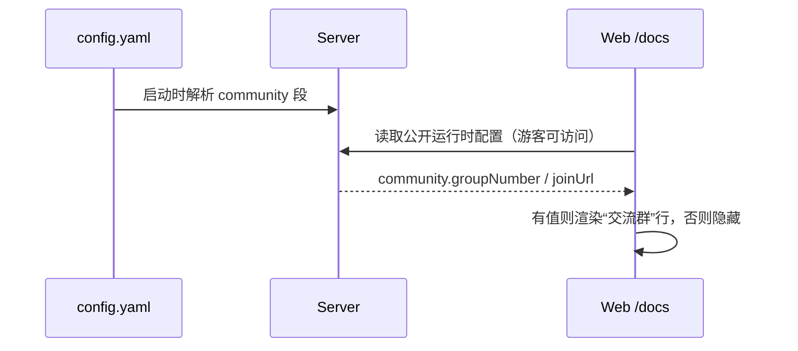

# 1. 问题与现状

需求：交流群入口统一由 `config.yaml` 配置并在运行时加载。提出日期：2026-11-11（Asia/Shanghai）。分支：`feat/community-config`；PR：待创建后回填。状态：初稿。

**背景与触发场景：** 推广阶段要把 Cloud 访客和 GitHub 读者引到交流群。[Cloud 使用文档](cloud-user-docs-trd.md) 的“未来计划”页有“交流群”一行，但值写死在前端：`web/src/features/docs/content.ts` 中 `COMMUNITY_PLACEHOLDER = "[xxx]"`，中英文各一处；`web/src/app/App.test.tsx` 还断言页面显示 `[xxx]`。

**实际与期望行为：** 现在要换群号必须改前端源码、重新构建并发布镜像；群号确定前，线上一直显示 `[xxx]`。期望由运维在 `config.yaml` 填写一次，Server 启动时读取，Web 运行时取得并展示；未配置时不显示这一行，而不是露出占位符。

**负面影响：** 访客在“加入交流”处看到 `[xxx]`，转化入口失效且显得半成品；群号变化需要一次完整发布。

**本次边界：** 只做交流群入口（群号，可选加入链接）。不做二维码图片托管；README 是静态文件，无法运行时加载，README 指向 Cloud 文档页而不重复写群号。不改文档页其他内容与样式。

# 2. 影响因素、假设与评价指标

| 因素 | 现状证据 | 改变 |
| --- | --- | --- |
| 配置来源 | 群号硬编码在前端常量 | 移入 `config.yaml` 的 `community` 段 |
| 传递路径 | Web 已有公开的运行时配置查询（`["runtime-config"]`）；是否适合承载公开字段待核对 | 复用已有公开配置接口，或新增最小只读字段；不新增独立服务 |
| 未配置表现 | 显示 `[xxx]` | 未配置时隐藏该行 |

| 指标 | 口径 | 基线 | 目标 |
| --- | --- | --- | --- |
| 改群号所需动作 | 从修改到线上生效 | 改源码 + 构建 + 发布 | 改 `config.yaml` + 重启 Server |
| 占位符暴露 | `/docs` 未来计划页是否出现 `[xxx]` | 出现 | 不出现 |
| 护栏：游客可见性 | 未登录游客能否看到群号 | 能（静态） | 仍能 |
| 护栏：回归 | `npm --prefix web test`、相关 pytest | 通过 | 通过 |

# 3. 改造方案与建模

`config.yaml` 新增：

```yaml
community:
  group_number: ""   # 交流群号；留空则文档页不显示该行
  join_url: ""       # 可选：加入链接
```



实施边界：Server 配置解析与公开配置响应、Web API 类型与文档页渲染、对应测试。配置段缺失时视为未配置，不影响启动。

# 4. 对照实验与结果分析

修改前后同一用例对照：`/docs` 未来计划页在（a）未配置、（b）配置群号两种情况下的渲染；游客身份下接口返回字段。结果待测。

# 5. 试点验证与方案取舍

低风险展示改动，以本机集成验证代替独立试点：填写群号后重启 Server，浏览器打开 `/docs` 核对显示；Cloud 发布由后续发布 PR 完成。待测。

# 6. 结果验收与闭环

待实施后按第 2 节指标逐项验收。
