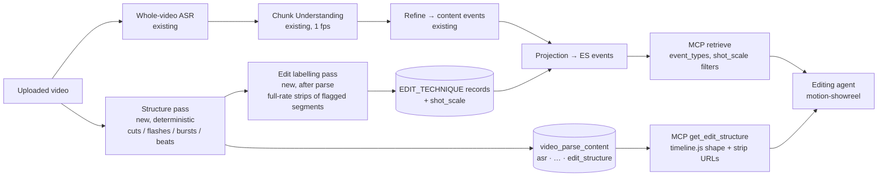

# 1. 问题与现状

| Item | Value |
| --- | --- |
| Requirement | **Editing reference, parsed once and recalled many times.** When Seekino parses a video, it also extracts how the video is edited: shot structure, rhythm, and named techniques at exact ranges. These are stored and indexed like content events, so any later edit, for any user or agent, can retrieve the reference moments it needs without re-reading the video |
| Type | Feature direction + minimal validation. This PR holds the TRD only; each integration step is its own TRD + PR (§3.6) |
| Opened / revised | Opened 2026-11-05. Direction revised 2026-11-05 after owner review (see decision log) |
| Branch / PR | `docs/editing-skill-style-reference` / [PR #50](https://github.com/owariband/Seekino/pull/50) |
| Status | Direction and minimal validation plan written. V0 (deterministic structure on P5R) partly measured; V1–V3 not started |
| Related | [MCP access TRD](mcp-access-trd.md), [Sub-Chunk / Event TRD](../02-agent-harness/sub-chunk-trd.md), [shot composition schema draft](../02-agent-harness/shot-composition-schema.md), [reference-driven research](../../research/2026-10-29-reference-driven-svg-threejs.md), [PR #53](https://github.com/owariband/Seekino/pull/53) (ASR blank-word fix found while parsing MyGO) |

## 1.1 The problem

Owner goal, 2026-11-05: **reduce how often an editing skill has to parse a reference.** A video Seekino has already parsed should yield editing-reference material that is reusable and retrievable, so the agent can quickly locate the reference clips it needs. Two needs follow:

1. **Fill the skill's gap.** `motion-showreel` re-reads the reference on every edit (§1.5). It keeps nothing, and on effect-heavy footage it misreads what it sees (§1.4).
2. **Make possible what the skill cannot do.** Parse once, recall many times, reuse across edits, users and videos. Examples:
   - "Show me every character intro across all the openings I've uploaded."
   - "Give me 爱音 at increasing shot scale for a step-out ladder."
   - "What does P5R do in the two bars before a drop?"

   Each answer is a set of exact ranges that the agent can open as frames or clips.

Product constraints that still hold:
- Precise ranges are the highlight, and ranges are never widened.
- No rendering or editing on the 4C8G server.
- Code-driven effects are described, not parsed for reproduction.
- Cut-out is a client-side skill.
- Copyright: reference and MyGO frames stay internal (§1.6).

## 1.2 Where today's parse stands against this need

| Pipeline stage (today) | What it produces | What editing reference needs | Gap |
| --- | --- | --- | --- |
| Whole-video **ASR** pass (`scope: video`), persisted in `video_parse_content.asr` (`server/model/parse_content.py`) and fed to every chunk | Cues and words with absolute ms | The same shape of pass for **picture structure**: cuts, flashes, strobe bursts, transitions; plus the audio beat grid | No such pass. The column set is `asr`, `diarization`, `display`, `outline` |
| Chunk **Understanding** (60 s chunks), with frames planned uniformly by `plan_frame_timestamps` at `frame_fps` (`engine/common/frame_sampler.py`; ep04 config `fps: 1.0`) | Timeline events: `SCENE`, `ACTION`, `DIALOGUE`, `EMOTION`, `RELATION_CHANGE`, `ON_SCREEN_TEXT`, `OTHER` (`engine/parsev2/schemas.py`) | Labels per shot or shot run: shot scale, subject, camera move, technique name and its parts | At 1 frame/s the model cannot see 2–4-frame shots, and the schema has no field for any of these |
| Post-parse **Summarize** pass with its own lease claim (`server/service/video_parse_summarize.py`) | Video-level summary/outline | A comparable post-parse pass that labels only the segments the structure pass flags, so already-parsed videos need no reparse | Pattern exists, pass does not |
| **Projection** to the ES event index (`engine/rag/indexing/projection.py`): description text + person names per event | Lexical/semantic fields | Technique label, parts, shot scale, beat position, as filterable fields | Not projected |
| **MCP** `list_series`, `retrieve`, `read_evidence` (`server/api/mcp.py`) | Content events with exact ms ranges | Retrieve techniques by name or description across series; return structure for a range in the skill's `timeline.js` shape; return a frame strip for a range | No technique type, no structure tool, no frame tool |

## 1.3 Negative impact

- **The cost repeats on every edit.** Measuring is cheap: the skill's `grid` takes 1.6 s wall / 8.5 s CPU on the 95 s P5R opening. Reading is not: the agent views a contact sheet and up to one 15-frame strip per detected start (255 on P5R) to understand the techniques, and throws them away. The next edit, or the next user, pays again.
- **Effect-heavy references are misread.** The skill's `motion` tool calls a real 7-shot character-intro ladder (P5R 34.2–35.2 s) "flicker" and tells the agent to avoid it (§1.4).
- **Nothing is findable across videos.** The skill reads one reference per brief. There is no way to ask "how do my references do X".
- **Seekino's range precision is unused for "how".** Exact ranges exist only for "what happens", so an editing agent cannot request footage by framing or technique.

## 1.4 Evidence

| Fact | Status | Source |
| --- | --- | --- |
| Naive `ffmpeg select='gt(scene,0.3)'` on the P5R opening reports **266 "cuts"**: 267 segments, median **0.10 s**, p90 1.13 s, max 5.1 s; **188 / 267 segments < 0.2 s** | Measured 2026-11-05, ffmpeg on the local file | Command in §4 E0; output kept in session scratch, re-runnable |
| Most of those are strobe/flash frames or whole-frame regeneration, not edits | **Inference** from the distribution and from watching the opening; not yet labelled | §4 E0 labels it |
| `motion-showreel` already treats runs of ≥3 detections < 0.35 s apart as "picture regenerated, not editing" and keeps 1–2 close detections as cuts (a hit that inverts the frame and back) | Read in `scripts/inspect.mjs` `motionReport()` | Heuristic only; untested on P5R |
| Parse schema has no framing / camera / overlay fields | Read | [schemas.py](../../../engine/parsev2/schemas.py) |
| MCP exposes 3 tools; no clip or frame tool | Read on `origin/dev` 4eb4231b | `server/api/mcp.py` |
| A composition schema (shot_size, vertical_angle, subject cell/scale, …) was drafted for *similar-shot search* and tagged on a MyGO shot gallery | Draft; experiment archived 2026-10-24 into a git-ignored ZIP | [shot-composition-schema.md](../02-agent-harness/shot-composition-schema.md) |
| A 60 s Anon short was made on 2026-10-29 **without** Seekino. The main rework came from the gap between "event nearby" and "usable shot range": a practice clip crossed a cut into another character, and the hand-hold's key second was hard to find. Information it actually consumed: shot boundaries, action phase times, subject/face/hand regions and subtitle band for text placement, short previews plus consecutive keyframes, beat candidates | Single case, one agent, not blind (it had already seen the references). Episode 11 missing | `outputs/anon-baseline-20261029/analysis/research-findings.md` (git-ignored) |
| No MyGO series exists in any database on the running MySQL (13361) | Read-only scan, 2026-11-05: 11 `seekino_*` databases, none with a MyGO series | — |
| MyGO ep04 parsed on an isolated instance (DB `seekino_mygo_ep04_20261105_test`, port 19671): 650 events in ES. MCP `retrieve("爱音")` returns 20 events over 5 chunks; the top 5 are all `DIALOGUE`, 0.66–4.0 s long, carrying `visible_persons` and an exact ms range, with no shot scale or framing. A step-out shot-scale ladder (爱音 extreme close-up → bust → full body) therefore cannot be requested | Measured 2026-11-05 | Run dir `outputs/verification/mygo-ep04-style-ref-20261105/` (git-ignored) |
| Getting there exposed two parse failures. (1) whisper.cpp returns zero-width `' '` words for Japanese audio (13 of 2,676), and the validator rejected the whole ASR result; fixed in PR #53. (2) The understanding repair loop for chunk 1260–1320 s produced an event across the chunk boundary on all 3 attempts (1257 s, 1258.5 s, 1321.5 s), failing the episode; a whole-task retry then succeeded | Measured; (2) is not yet root-caused and may recur near chunk edges | `api.log` in the run dir |
| The skill's `grid` on P5R: 1.6 s wall / 8.5 s CPU (this Mac, 2026-11-05) | Measured once | `/usr/bin/time` on `inspect.mjs grid` |
| P5R 34.2–35.2 s, viewed frame by frame: about 7 framings of one character on a flat red ground, each held 2–4 frames, stepping out from goggles close-up to full body, ending on a mecha reveal. The skill's `motion` tool reports this range as "rapid whole-frame changes … reads as flicker" | By eye, one window; V0 labels confirm | 30-frame tile in session scratch |

**Implication.** The structure must be measured at full frame rate and classified before any number is stored as fact. Labels must come from full-rate strips, not from the 1-fps frames Understanding sees.

## 1.5 How `motion-showreel` references a target video (studied 2026-11-05)

**The process, as written in the skill** (SKILL.md step 1–2, `brief-template.md`, `inspect.mjs`, `lib/frames.mjs`, `audio.mjs`):

| Step | Tool | What the model gets | Where it ends up |
| --- | --- | --- | --- |
| 1. See the whole | `inspect.mjs sheet --cells 30` | One contact-sheet PNG with burned-in timestamps | Looked at, not persisted |
| 2. Find cuts + tempo | `inspect.mjs grid --strips` | Start times (mean gray-diff jump > 2.5× local median, 0.2 s debounce), the largest frame step that holds ≥ 80 % of starts → BPM candidates, **segment lengths in grid steps**, and a 15-frame strip PNG per start "to read the transition mechanism" | Numbers go into `brief.md` `benchmark:`; strips are looked at and discarded |
| 3. Where things move | `inspect.mjs heat` | One cell per segment: last frame in gray, moved pixels in red | `benchmark:` "motion area per segment" |
| 4. Music | `audio.mjs beats` | BPM, beats, downbeats, hits, drops, breaks (`beats.json`) | `timeline.js` BPM / beat grid |
| 5. Write the rules | Model, using `styles/_template.md` | — | Adapted or custom **style card** in `brief.md` `style:`; 2–3 `signals`; which cliché items were flipped; `forbidden:` list |
| 6. Plan on the grid | Model | — | Storyboard table keyed by `小节.拍` (bar.beat) |

**What is reused for the edit afterwards:**

- `brief.md` — the template calls it "a complete structured prompt when reused later with another subject or tool". It carries `benchmark` (learn / don't learn + measured numbers), the style card, signals and forbidden list.
- `timeline.js` — the one clock both picture and sound import. It holds `BPM`, `SHOTS`, `CUES`, `HOLDS`, `DROPS`, and `revealOn(hit, dur, reveal)`, which back-computes a transition's start so the new picture appears on the hit. The QA tools read the same file.
- The segment-length sequence — `craft.md` uses it directly ("shrink steps per segment, 6 → 4 → 4 → 3 → 2 → 1 → 1, to accelerate at constant BPM").
- What is **not** kept: exemplar moments. The model sees the strips once, and no record links "this technique" to "this exact range of the reference". Nothing compares the finished render back to the reference's numbers either. QA checks the render's own technical health, and review is a human-style read.

**What the skill's own tools report on the P5R opening** (run 2026-11-05, skill commit `2b9a8934`, outputs in session scratch):

| Tool | Result |
| --- | --- |
| `grid` | **255 starts; "no regular grid … cut to phrases, or to the voice, not to a fixed beat"** |
| `motion` | 234 "hard cuts"; **26 "rapid whole-frame change" bursts covering 40.1 s of 94.9 s (42 %)**, mostly one change every 0.08–0.11 s; 2 single-frame flashes; black frames at 22.73–22.87 s and 94.67–94.80 s |
| `audio.mjs beats` | ≈ 123.89 BPM, 196 beats, first downbeat 1.753 s, 49 bars, 178 hits |
| Alignment check (own script) | After removing starts inside bursts: 93 starts left. 35 % lie within ±2 frames of a beat, against 27 % for random times. Phase concentration R = 0.09 (0 = random, 1 = locked) |

The skill's reference reading therefore fails on effect-heavy footage. The picture-side detector treats strobe and regeneration as edits, so it finds no grid, and the "segment lengths in steps" it would hand to `craft.md` do not exist. The audio side works. Cuts that line up with the beat cannot be told apart from noise with these detectors. Whether P5R's real cuts are beat-locked is **unknown** until E0 labels them. This is not evidence that they aren't.

**What this means for Seekino.** The parts of the skill's reference reading that break on effect-heavy footage are exactly the parts Seekino can supply as an asset library:

1. **Classification before numbers:** label each event cut / flash / strobe-burst / transition / regen, anchored to the audio beat grid. The rhythm track then holds the segment-length sequence that `grid` could not produce.
2. **Persisted exemplar moments at exact ranges:** each strip the skill views and throws away becomes a searchable record with a range, a label and keyframes (layer c). This is Seekino's precise-range strength, applied to "how" instead of "what".
3. **Output in the skill's own formats:** the style card in `_template.md` sections and the rhythm in `timeline.js` shape (`BPM`, `SHOTS`, `CUES`, `HOLDS`, `DROPS`). The editing agent then reuses them without translation.

Rendering and reproducing a technique stay on the user's machine. The measurement is a 160-px grayscale decode plus an audio beat pass, which is light enough for the 4C8G server. That last point is an **expectation**, not yet measured there.

## 1.6 Scope

**In scope:**
- The direction and data contracts for an editing-reference layer in the existing parse system.
- A minimal validation (§4) on P5R, two more local openings, and MyGO ep04.
- The integration sequence (§3.6).

**Out of scope for this PR:** production code. Each integration step gets its own TRD + PR.

**Must hold:**
- Existing parse, index and MCP contracts are unchanged until their own PRs.
- Ranges stay exact and are never widened.
- Shared v11 data and port 19641 are untouched. Experiments run on the isolated instance (port 19671, DB `seekino_mygo_ep04_20261105_test`).

**Copyright:** P5R, P4, P3R and MyGO frames, strips and renders stay in git-ignored `outputs/` for internal research. The repo holds code, labels as times and words, and numbers. A public demo needs a rights decision by the owner.

# 2. 影响因素、假设与评价指标

## 2.1 Hypotheses

Ordered by how badly each would hurt the direction if wrong.

| # | Hypothesis | If false | Cheapest test |
| --- | --- | --- | --- |
| **H1** | A deterministic full-frame-rate pass separates real cuts from flashes, strobe and in-shot regeneration well enough to be stored as fact (cut P/R ≥ 0.9 against hand labels on effect-heavy windows) | The structure layer cannot be trusted; every technique record would inherit wrong boundaries | V0 |
| **H2** | A vision model, given each candidate segment as a full-rate frame strip, labels technique and shot scale consistently enough to retrieve on (agreement with owner labels ≥ 0.8 on technique name; ±1 step on shot scale) | Stored labels are noise; recall would return wrong moments | V1 |
| **H3** | Stored records answer editing queries: on a query set written **before** labelling, recall@3 ≥ 0.8 for the right technique range, across ≥ 3 references | "Parse once, recall many" does not deliver; fall back to the skill's per-edit reading | V2 |
| **H4** | Recall replaces the skill's reference reading at lower cost per edit: fewer tool calls, tokens and wall time, with the same or better downstream decision | Seekino adds storage but no saving | V3 |
| H5 | Having the record changes a concrete editing decision (e.g. the intro becomes a step-out ladder instead of one held shot) | Records are retrievable but inert | V3 |

## 2.2 Metrics

Fixed before any comparison.

| Metric | Kind | Definition | Baseline | Target | Method |
| --- | --- | --- | --- | --- | --- |
| Cut precision / recall | Diagnostic (H1) | Detected cuts vs hand labels, ±1 frame | Naive ffmpeg 266 detections; skill `grid` 255 starts (to be scored) | ≥ 0.9 / ≥ 0.9 | Two hand-labelled P5R windows (dense 34–39 s, calm window chosen from the contact sheet) |
| Label agreement | Diagnostic (H2) | VLM technique name and shot scale vs owner labels | — | ≥ 0.8 name; shot scale within ±1 step ≥ 0.9 | 30 segments sampled across references |
| **Recall@3** | **Outcome (H3)** | Share of queries whose labelled range overlaps ≥ 50 % with a top-3 result | — | ≥ 0.8 | ≥ 15 queries written before labelling, over P5R + P4 OP + P3R OP |
| Range exactness | Guardrail | Returned record boundaries vs labelled boundaries | — | ≤ 1 frame on cut-bounded records; never wider than the labelled range | Same set |
| Recall latency | Guardrail | MCP call to result, p50 / p95 | `retrieve` on ep04 (to be measured) | p95 ≤ 1 s | 50 calls on the isolated instance |
| **Per-edit reference cost** | **Outcome (H4)** | Agent tool calls, tokens, wall time spent learning the reference in one brief | Skill flow (sheet + grid --strips + heat + beats + strip viewing) | ≥ 50 % lower with Seekino recall, same brief | 3 runs per arm, same model |
| Decision change | Outcome (H5) | On the intro section of the agent's `timeline.js`: shot count, frames per shot, shot-scale order, cuts on 16th notes | Without records | WITH matches ≥ 3 of 4 in ≥ 2 of 3 runs; WITHOUT does not | Mechanical scoring of `timeline.js` |
| Parse cost added | Guardrail | Extra CPU time + model calls per minute of video | 0 | Structure pass ≤ 10 % of video duration on 4C8G; labelling calls stated per minute | Timed on the isolated instance, then on cloud |
| Cross-model carry-over | Diagnostic | H5 score on Claude Code (Opus), Codex, one cheaper model | — | Reported per model; no target | Same records and brief |

Sample sizes are small (3 references, ~15 queries, 3 runs per arm). Results are directional and will be reported that way.

# 3. 改造方案与建模

## 3.1 Direction and why

Add an **editing-reference layer** to the parse pipeline in three parts, each modelled on a part that already exists:

1. **Structure pass**, deterministic and whole-video, modelled on ASR.
   - Reads the video at full frame rate (160-px grayscale diff, like the skill's `lib/frames.mjs`) and the audio beat grid.
   - Classifies every change as `cut`, `flash`, `strobe_burst`, `transition` or `regen`, and derives shots.
   - Stored once in `video_parse_content` next to `asr`, and versioned the same way.
   - No model cost, so it can be **backfilled on already-parsed videos** without touching Understanding.
2. **Edit labelling pass**, a model pass after the parse, modelled on Summarize.
   - Runs only on segments the structure pass flags: shot runs shorter than a threshold, bursts, transitions, and shot-scale changes.
   - Sends each segment to the vision model as a **full-rate frame strip**, not 1-fps samples.
   - Writes `EDIT_TECHNIQUE` records (exact range, name, parts, shot-scale sequence, beat position) and per-shot `shot_scale`.
   - Because it is separate from chunk Understanding, it needs no reparse and its cost is bounded by the number of flagged segments.
3. **Projection and recall**, extending what exists.
   - Records are projected into the ES event index as a new event type, with filterable fields.
   - MCP `retrieve(event_types=["EDIT_TECHNIQUE"])` finds them across series.
   - A new `get_edit_structure(video, start_ms, end_ms)` returns the range in the skill's `timeline.js` shape (`BPM`, `SHOTS`, `CUES`) plus frame-strip URLs.
   - The same `shot_scale` field serves content queries: "爱音, close-up".

**Why this direction:**
- It puts the cheap, exact part (structure) where precision is cheapest.
- It spends model calls only where the structure says something interesting happens.
- It reuses the persistence, versioning, lease and evidence-verification rules Seekino already has, rather than a side store.
- Every recall afterwards is an index lookup.

**Rejected alternatives:**
- **Labels inside chunk Understanding.** This needs a reparse for every existing video, and the 1-fps frame plan would have to change for all content.
- **Pack files outside Seekino** (the earlier draft's style pack). Not retrievable across videos, not versioned with the parse, no evidence checks.
- **Leave reading to the skill.** It fails need 2 by construction, and on P5R it fails need 1 (§1.4).

## 3.2 Architecture



The structure pass runs **in parallel with ASR**. It sits on no critical path for content search: if it fails, content parsing still completes and the gap is reported separately, the same separation Prefix has today. The labelling pass starts when the video's content parse is `COMPLETE` and the structure is stored.

## 3.3 Data contracts (draft; final shapes belong to each integration TRD)

`video_parse_content.edit_structure` (one per video task, versioned with the row):

```json
{
  "detector": {"name": "frame-diff-v1", "width": 160, "params": {}},
  "fps": 30, "duration_ms": 94912,
  "beats": {"bpm": 123.89, "first_downbeat_ms": 1753, "beat_ms": [], "source": "audio-beats-v1"},
  "changes": [{"t_ms": 34333, "kind": "cut"}, {"t_ms": 12833, "kind": "flash"}],
  "shots": [{"start_ms": 34333, "end_ms": 34467}],
  "segments": [{"start_ms": 34200, "end_ms": 35130, "kind": "shot_run", "shots": 7, "flag": "short_shots"}]
}
```

`EDIT_TECHNIQUE` record (a timeline event, so existing range rules, versioning and evidence re-check apply):

```json
{
  "event_type": "EDIT_TECHNIQUE",
  "start_seconds": 34200, "end_seconds": 35130,
  "description": "Step-out cut ladder introducing a character: extreme close-up to full body, then reveal",
  "technique": "shot_scale_ladder",
  "parts": ["extreme_close_up", "close_up", "medium", "full", "reveal"],
  "frames_per_shot": [4, 4, 3, 2, 3, 2, 4],
  "beat_unit": "16th",
  "visible_persons": [],
  "label_source": "vlm+review"
}
```

The numbers above are illustrative, taken from one by-eye reading. V0/V1 replace them with measured values.

`technique` uses a small controlled vocabulary. It is seeded from the skill's `craft.md` and style-card terms and grown only from V1 labels. `description` stays free text, so semantic search still works for techniques outside the vocabulary.

## 3.4 How an already-parsed video gets the layer

| Video state | What runs | Model cost |
| --- | --- | --- |
| Parsed before this feature (e.g. ep04 on 19671) | Structure-only backfill task, then the labelling pass | Labelling calls only. No ASR, Understanding or Refine rerun |
| New upload | Structure pass alongside ASR, then labelling after `COMPLETE` | Labelling calls only |
| Reference video (P5R etc.) | Same pipeline; content events may be sparse, editing records dense | Same |

## 3.5 How the editing agent uses it

The skill's reference step (SKILL.md step 1: `sheet` → `grid --strips` → `heat` → `beats`) is replaced, in a Seekino-backed project skill, by:

1. `retrieve(query="character intro", event_types=["EDIT_TECHNIQUE"])` → ranked records across all uploaded references, with exact ranges.
2. `get_edit_structure(video, start_ms, end_ms)` for the chosen record → `BPM`, `SHOTS`, `CUES` in `timeline.js` shape, plus strip URLs to look at once.
3. `retrieve(query="爱音", shot_scale=[...])` for the matching content shots.

The brief's `benchmark:` line and `timeline.js` are then filled from returned data instead of being re-measured.

## 3.6 Integration sequence after validation

Each step is its own TRD + PR, merged in this order.

| # | Change | Modules | Contract / data impact | Depends on |
| --- | --- | --- | --- | --- |
| 1 | Structure detector + tests | `engine/common` (media) | New pure function, no persistence | V0 pass |
| 2 | Structure pass in the parse task; `edit_structure` column; backfill command | `server/service/video_parse*`, `server/model/parse_content.py`, migration, `server/cli.py` | Additive column; one more parallel stage; failure isolated from content COMPLETE | 1 |
| 3 | `EDIT_TECHNIQUE` event type + `shot_scale`; labelling pass with lease and recovery like Summarize | `engine/parsev2/schemas.py`, `agent/video_parse_v2`, `server/service` | Schema addition; new task type | 2, V1 pass |
| 4 | Projection fields + ES mapping | `engine/rag/indexing/projection.py`, event index | **Mapping change: index rebuild** (AGENTS.md §3) | 3 |
| 5 | MCP `retrieve` filters + `get_edit_structure` + frame strip | `server/api/mcp.py`, `server/service/video_frame_reader.py` | Additive tools | 4 |
| 6 | Seekino-backed reference step in a project skill | `.agents/skills/` | Docs/skill only | 5, V3 pass |

# 4. 对照实验与结果分析

## Minimal validation: the fastest point that can kill the direction

No pipeline change. Offline scripts plus the isolated instance. Each step has a gate, and a failed gate stops the plan.

| Step | Question | Work | Gate |
| --- | --- | --- | --- |
| **V0** Structure | Can a deterministic pass tell cuts from strobe on effect-heavy footage? | Detector script (seeded from the skill's `frames.mjs`, with burst handling changed); hand-label two P5R windows frame by frame; also run on ep04 and P4 OP | Cut P/R ≥ 0.9 / 0.9 on both windows; runtime ≤ 10 % of duration on this Mac (cloud measured later) |
| **V1** Labels | Can a VLM label flagged segments from full-rate strips? | Strips for every flagged segment of P5R, P4 OP, P3R OP; VLM labels; owner reviews 30 | Agreement ≥ 0.8 on technique; shot scale ±1 step ≥ 0.9 |
| **V2** Recall | Do stored records answer editing queries? | Write ≥ 15 queries first; load records into a test index on the isolated instance via the existing projection path as an experimental event type, or a test harness with the same embedding model if the schema blocks it; measure | Recall@3 ≥ 0.8; exact ranges; p95 ≤ 1 s |
| **V3** Reuse | Does recall replace per-edit reading and change the cut? | Same MyGO ep04 teaser brief, `motion-showreel`; arm A = skill's own reference reading, arm B = Seekino recall; 3 fresh-context runs each; then repeat B on Codex and one cheaper model | Per-edit cost ≥ 50 % lower; decision-change score passes (§2.2) |

Measured so far, toward V0 (2026-11-05):
- The skill's `grid` takes 1.6 s wall / 8.5 s CPU on P5R. It finds 255 starts and no grid, so it is unusable as-is.
- Audio beats are clean: 123.89 BPM.
- A by-eye read of 34.2–35.2 s shows a 7-framing step-out ladder that the skill labels as flicker.

## Results

| Metric | Baseline | Measured | Gate | Verdict |
| --- | --- | --- | --- | --- |
| Cut P/R (dense window) | skill `grid` 待测 | 待测 | ≥ 0.9 / 0.9 | 未验证 |
| Cut P/R (calm window) | 待测 | 待测 | ≥ 0.9 / 0.9 | 未验证 |
| Structure runtime / duration | skill 1.7 % (1.6 s / 94.9 s, this Mac) | 待测 | ≤ 10 % | 未验证 |
| Label agreement | — | 待测 | ≥ 0.8 | 未验证 |
| Recall@3 | — | 待测 | ≥ 0.8 | 未验证 |
| Per-edit reference cost | 待测 (arm A) | 待测 (arm B) | ≥ 50 % lower | 未验证 |
| Decision change | 待测 | 待测 | §2.2 | 未验证 |

# 5. 试点验证与方案取舍

Pilot after V3 passes and integration steps 1–5 are merged.

- **Data:** the owner uploads a reference they have not used in V0–V2, plus one more MyGO episode, on a test instance.
- **Use:** the owner runs one real brief in their own Claude Code with the project skill. The pilot passes if the agent finds the moments it needs from records alone and the owner judges the cut usable.
- **Watch:** parse time added on the 4C8G cloud server; labelling calls per minute; recall misses the owner reports.
- **Stop or roll back:** the structure pass is a separate column and pass, so it can be disabled without touching content parsing. Records live under one event type and can be dropped by an index rebuild.

Trade-offs to weigh: labelling cost per minute of reference against the repeated per-edit cost it removes; vocabulary growth against free-text search; the ES rebuild in step 4.

# 6. 结果验收与闭环

The direction is accepted when:

- [ ] V0–V3 gates pass, or the failing gate is recorded with a decision to stop or redesign.
- [ ] **Parse once:** a reference video gets its editing layer in one parse, and an already-parsed video (ep04) gets it by backfill, with no Understanding rerun.
- [ ] **Recall many:** the V2 query set meets recall@3, exactness and latency through MCP.
- [ ] **Reuse:** in V3 the skill's reference step is replaced by recall, with lower per-edit cost and the decision-change score met.
- [ ] **Beyond the skill:** one cross-reference query ("every character intro across my references") returns correct exact ranges from ≥ 2 videos.
- [ ] Integration steps 1–6 each have their own TRD + PR linked here. Merging them is accepted in those TRDs, not here.

## Decision log

| Date | Earlier view | New evidence | Decision | Effect |
| --- | --- | --- | --- | --- |
| 2026-11-05 | Scene detection could feed the rhythm layer directly | Naive detection: 266 detections, median 0.10 s, 188/267 < 0.2 s | Rhythm numbers are gated behind E0 classification | E0 is now the first step |
| 2026-11-05 | Matting, MyGO data source and judge were open | Owner answers | Minimal local matting on the fixed clip set; owner + VLM blind judging; reuse an existing MyGO parse | No MyGO parse found on 13361. E2/E3 are blocked until the owner names the parse location (possibly native `data/mysql/seekino_development`, which is not running). E0/E1 need only the P5R file and can proceed |
| 2026-11-05 | The skill's `grid`/`heat` output could seed the rhythm layer | On P5R, `grid` finds 255 starts and no grid; 42 % of the video is strobe bursts; cleaned cuts show no beat phase-locking (R = 0.09) while audio beats are clean (≈ 123.9 BPM) | Rhythm extraction for effect-heavy references is a Seekino capability to build, gated by E0 hand labels; reuse the skill's output formats (`_template.md`, `timeline.js`) rather than inventing new ones | E0 becomes the first build step; §1.6 records the study |
| 2026-11-05 | MyGO parse location to be named by the owner | Owner: upload and parse any episode, e.g. ep04, without asking | Parse ep04 on a new isolated DB / ES indices / port 19671; v11 and 19641 untouched | Unblocks E2/E3 once the parse finishes |
| 2026-11-05 | Seekino supplies a per-brief style pack and better measurement for one edit; content fields come from a query-gap log | Owner review: the goal is to **reduce how often the skill parses**. A parsed video's editing reference must be reusable and retrievable, parse once, recall many. The draft was not grounded in the parse pipeline | Rewrite around an editing-reference layer in the existing pipeline: a structure pass like ASR, a labelling pass like Summarize, projection and MCP recall. Add a minimal validation V0–V3 and an integration sequence | The pack files, the four-layer card and E0–E3 are replaced by V0–V3. Evidence and the skill study are kept |
