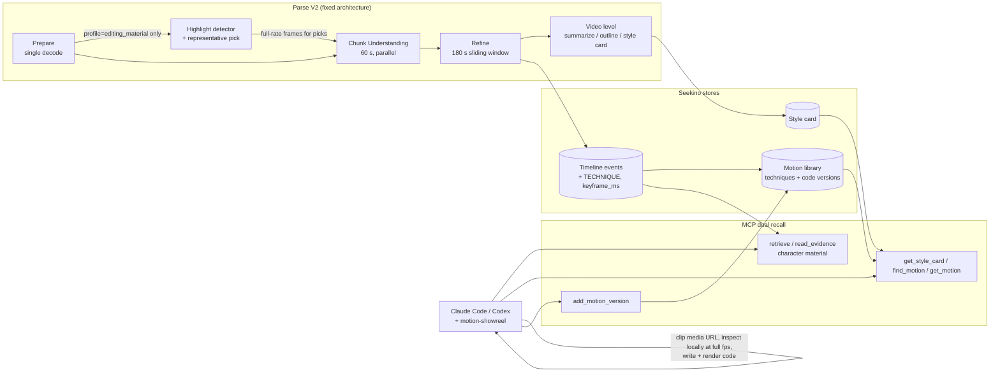

# 1. 问题与现状

| Item | Value |
| --- | --- |
| Requirement | **Dual recall for AI video editing.** Seekino parses a video once and keeps two kinds of editing material recallable at exact ranges: **character material** (for example 爱音 frames ready for cut-out) and **editing-style references** (highlight techniques with their motion spec, plus code versions that grow with every use). An editing agent in Claude Code or Codex recalls both through MCP instead of re-reading references and asking the user to point at frames |
| Type | Feature direction + minimal validation. This PR holds the TRD only; each integration step gets its own TRD + PR (§3.6) |
| Opened / revised | Opened 2026-11-05. Direction rewritten 2026-11-06 after four rounds of owner review (decision log) |
| Branch / PR | `docs/editing-skill-style-reference` / [PR #50](https://github.com/owariband/Seekino/pull/50) |
| Status | Direction settled with the owner. E0 (highlight detector on P5R and ep04) measured in a standalone script; **nothing is wired into Seekino yet**. E1–E4 not started |
| Related | [MCP access TRD](mcp-access-trd.md); [Sub-Chunk / Event TRD](../02-agent-harness/sub-chunk-trd.md); [PR #34](https://github.com/owariband/Seekino/pull/34) (course parse profile, the base for per-type schema config); [PR #53](https://github.com/owariband/Seekino/pull/53) (ASR blank-word fix found while parsing MyGO) |

## 1.1 Why Seekino needs edit analysis

1. **It makes the product interesting and general at first glance.** Search and Q&A over video is useful but quiet. "Give it a reference video and your footage, and an agent cuts a video in that style" is something people understand and want to try in one look, and it works for any series, course or opening a user uploads.
2. **Seekino's own promo needs it.** The owner's brief, 2026-11-05:
   - P5 art style only, minimal sound effects, no music.
   - 爱音 wants to learn deep learning, but the course is too long, she doesn't want to go step by step, and she can't sit through slides.
   - Kino (the Seekino mascot) appears, recalls the course for her and answers her questions.

   What the promo shows Seekino doing is what Seekino must actually do. It is made through MCP + Claude Code with an editing skill, and it is the first acceptance case of this TRD.

## 1.2 Where it comes from: the editing skill's limits

The editing agent uses `motion-showreel` (ConardLi/garden-skills, studied at commit `2b9a8934`). It writes video as code (HTML/JS motion, `timeline.js`, rendered to MP4 locally). Its workflow:

| Step | What it does | Where style comes from today |
| --- | --- | --- |
| 0 Environment check | — | — |
| 1 Requirements | Fills required choices; 🛑 waits | — |
| 2 `brief.md` | Benchmark → format + style → Reel Read → shot list + audio plan | One or two of **45 hand-written style files** in `references/styles/` |
| 3 Style frames | Style given: renders 3 frames; no style: 3 directions × 1 frame; 🛑 waits | The agent renders its own hook / signature / end frames **from the text style description** |
| 4 Create | Timeline → shots → web checks | Style text + `craft.md` technique notes |
| 5 Music / SFX / mix | — | — |
| 6 Workspace preview | 🛑 waits for export approval | — |
| 7 Export / acceptance | Technical checks + final review | Self-review only |
| 8 Delivery | — | — |

Three limits follow, and they are where Seekino matters:

1. **Static.** The skill bundles **0 images or videos** (checked 2026-11-06). Its style library is 45 text files someone wrote once. P5 is not among them; the closest are `comic-pop` and `editorial-collage`. Step 3's "style frames" are frames the agent draws from that text, not frames from a real reference.
2. **Use once, then discard.** When the user does hand over a reference video, the agent reads it with `inspect.mjs` (`sheet`, `grid --strips`, `heat`, `motion`), writes numbers into one `brief.md`, and throws the strips away. The next edit, or the next user, reads the same video again. Nothing links "this technique" to "this exact range of the reference".
3. **No reusable personal effects library.** Motion code written for one film stays in that film's folder. There is no way to say "use the step-out ladder I made last time, adapted for 爱音", or "what do my references do before a drop".

It also misreads effect-heavy footage. On the P5R opening, `grid` finds 255 starts and "no regular grid", and `motion` reports the 34.2–35.2 s character-intro ladder as "rapid whole-frame changes … reads as flicker" (§1.4).

## 1.3 Seekino's combined value

Seekino turns both halves of an edit into recall:

| Recall | What the agent asks | What Seekino returns |
| --- | --- | --- |
| **Character material** | "爱音, worried / excited, clean frame" | Exact ranges plus one `keyframe_ms` per hit where the named person is clearly visible and no subtitle is burned in; the agent clips it from the `read_evidence` media URL and cuts it out locally |
| **Editing-style reference** | "P5R style card", "a character-intro technique" | The style card (look constants + technique list) and techniques with exact ranges, a measured motion spec and the code versions earlier edits wrote back |

Together they remove most of the manual guidance an AI edit needs today: the user no longer has to find reference timestamps, pick usable character frames, or re-explain a style that was already analysed. The differentiator is **back it up and reuse it, instead of use once and throw away**.

## 1.4 Current state (evidence)

| Fact | Status | Source |
| --- | --- | --- |
| Parse V2: whole-video ASR once → fixed 60 s chunks → parallel chunk Understanding → Refine sliding window (`interval_duration` 180 s) → indexing → video-level summarize/outline | Read | [planning.py](../../../engine/parsev2/planning.py), `agent/video_parse_v2/` |
| ep04 Understanding saw **3 fps ordered frames at 720p with 3 s visual overlap** (`visual_input` in the task's `parse_config`), about 198 frames per chunk. An earlier draft of this TRD said 1 fps; that was wrong | Read from the isolated DB, 2026-11-06 | DB `seekino_mygo_ep04_20261105_test`, `video_parse_task.parse_config` |
| Refine commits only `persons` and `timeline` | Read | `server/service/video_parse_content.py` (`commit_interval_refinement`) |
| MCP has `list_series`, `retrieve`, `read_evidence`. `read_evidence` returns **source media URLs with ms bounds** ("use the returned millisecond boundaries when clipping"), so the agent can inspect any range locally at full frame rate | Read | `server/api/mcp.py:163` |
| **Character material today: 1 of 8 hits usable as returned.** Four 爱音 expression queries on ep04 (worried, happy close-up, surprised, bored); frames pulled at each top hit: 6/8 ranges contain a hard cut (confirmed by detector: 475850, 348973, 736235, 642642, 1000833, 545920), 3/8 show another character's face where the description says 爱音, every dialogue frame carries burned-in subtitles (JPSC source). Only `775166–780000` (bath close-up) is one clean 爱音 shot | Measured 2026-11-05 | `mcp_anon.py`, `anon-hits/sheet.jpg` (session scratch) |
| Course recall: `retrieve("backpropagation explained")` on the v11 course library returns dialogue fragments (e.g. "讲师宣布接下来进行反向传播。"); the per-video `outline` exists in `video_parse_content` but has no MCP tool | Read-only on 19641, 2026-11-05 | `mcp_course.py` (session scratch) |
| P5R 34.2–35.2 s at 30 fps, frame by frame: on flat red, ECU 3 f → CU 4 f → MCU 2 f → MS 3 f → full-body pose held ≈ 10 f with slow drift → 2 f insert flash → reveal with cyan glow. Hard steps, no tweens | By eye, 2026-11-05 | `p5r-inspect/burst-34.png` (session scratch) |
| `ffmpeg scdet` finds only 3 cuts in that second (every rung sits on the same red); the skill's gray-diff detector finds the rungs | Measured | `p5r-cuts-ms.txt` |
| Uniform sampling misses short shots on effect-heavy footage: P5R has 241 scdet shots (mean 393 ms); 3 fps leaves 50 % of them with no frame, 6 fps 30 % | Measured 2026-11-05 | `p5r-cuts-ms.txt` |
| P5R palette at 2 fps over 190 frames: red 41 % (`#d00000` 25 %, `#c00000` 22 %), gray 20 %, black 16 %, magenta/pink 8 %; 57 % of frames ≥ 30 % red | Measured 2026-11-05 | `p5r-frames/` |
| A 60 s 爱音 short made on 2026-10-29 without Seekino: the main rework was the gap between "event nearby" and "usable shot range" (a practice clip crossed a cut into another character) | Single case, not blind | `outputs/anon-baseline-20261029/analysis/research-findings.md` (git-ignored) |
| Parse failures met on the way: whisper.cpp zero-width words failed ep04 ASR (fixed, PR #53); chunk 1260–1320 s repair loop wrote a boundary-crossing event 3 times, a whole-task retry succeeded | Measured; the second is not root-caused | run dir `api.log` |

**What the skill's tools report on P5R** (2026-11-05, skill commit `2b9a8934`):

| Tool | Result |
| --- | --- |
| `grid` | 255 starts; no regular grid; 1.6 s wall / 8.5 s CPU |
| `motion` | 234 "hard cuts"; 26 rapid-change bursts covering 42 % of the video, reported as flicker |
| `audio.mjs beats` | ≈ 123.9 BPM, 196 beats |

## 1.5 Scope

In scope:
- An **editing-material parse profile** (opt-in) that detects candidate highlights in code, picks a few representative ones, reads only those at full frame rate, and stores techniques and a style card.
- `keyframe_ms` on visual events for character material recall.
- A motion library (techniques + append-only code versions) and the MCP tools for both recalls.
- The promo as the acceptance case.

Out of scope here:
- The automatic content-type judgment (editing material / scripted animation / course). It gets its own TRD on top of PR #34; until then the profile is chosen explicitly in `parse_config`.
- Rendering or reproducing techniques on the server. Code is written and rendered on the user's machine.
- Rhythm/beat-grid extraction as a goal in itself.

Must stay unchanged:
- **Scripted animation and courses parse exactly as today** unless the profile is switched on. The detector is **off by default**.
- Fixed 60 s chunks, the Refine sliding window and the video-level summarize stage. No new standalone pass.
- Exact ranges, never widened. No rendering on the 4C8G server. Cut-out is client-side.
- Copyright: the owner decided on 2026-11-05 that it is not a concern for this non-commercial promo.

# 2. 影响因素、假设与评价指标

## 2.1 Hypotheses

Ordered by how badly the direction fails if they are false:

| # | Hypothesis | Evidence so far | Cheapest test |
| --- | --- | --- | --- |
| H1 | An editing agent with recalled style references makes a better P5-style beat, at lower cost, than the same skill with its static library | None; this is the core bet | E2: same brief, two fresh agents, A/B |
| H2 | A style is uniform enough across a video that **6–8 representative highlights** carry it; reading the whole video densely adds little | Owner judgement; P5R contact sheet shows a few repeating devices | E1: representative picks on one sheet, owner judges coverage |
| H3 | A cheap code detector (the skill's `diffProfile` + `findStarts`, ported) finds candidate highlights on editing material | E0: port matches the skill's 255 starts on P5R. On ep04 it fires on ordinary dialogue cutting (0/8 random segments were real highlights) | E0 done; it is why the profile is opt-in for editing material only |
| H4 | The existing understanding model, given full-frame-rate frames of a picked segment, writes a technique spec close to a hand-written one | None | E3: one model call per picked segment, compare with the hand index |
| H5 | `keyframe_ms` lifts character material usable-as-returned from 1/8 | 1/8 baseline measured | E4: reparse ep04 with the field, rerun the same 4 queries |
| H6 | A second edit reusing library entries and code versions costs clearly less than the first | None | E2 second beat |

## 2.2 Metrics

| Metric | Kind | Definition | Baseline | Target | Measured how |
| --- | --- | --- | --- | --- | --- |
| Owner blind pick | Outcome | Owner chooses between A and B renders of the same beat, unlabeled | — | B preferred | E2 |
| Tokens and wall time to first render | Outcome | From brief to first rendered beat, per agent | Measured in arm A | B clearly lower | Agent usage logs |
| Reference views | Diagnostic | Frames / strips / clips each agent opened | Arm A | — | Tool-call log |
| Technique fidelity | Outcome | Right technique used; step frame counts within ±1 frame of the reference | — | ≥ 2 of 3 techniques | Frame strips of render vs reference |
| Representative coverage | Outcome | Owner judgement: do the picks cover the style's devices | — | Owner accepts | E1 contact sheet |
| Dense frame budget | Guardrail | Frames read at full rate per reference video | 286 frames (P5R at 3 fps today) | ≤ 2× today | E1 |
| Material usable as returned | Outcome | Hits where the named person is the subject, one shot, clean | **1/8** | ≥ 6/8 | E4, same 4 queries |
| Spec accuracy | Diagnostic | Model spec vs hand spec: technique named, step count, frame counts | — | Recorded | E3 |
| Second-use cost | Outcome | Tokens and time for the second beat vs the first | First beat | Clearly lower | E2 |
| Animation / course regression | Guardrail | Profile off: identical parse config and event counts (ep04 DIALOGUE 346) | 346 | Unchanged | Rerun with profile off |

# 3. 改造方案与建模

## 3.1 From what the skill has to what Seekino parses and stores

| The skill has | Its limit | Seekino parses and stores | Recall |
| --- | --- | --- | --- |
| 45 static text style files | Fixed, no real frames, no P5 | **Style card** per reference video, written in the skill's own `styles/_template.md` sections, each signal pointing at exemplar ranges | `get_style_card` |
| `inspect.mjs grid / heat / motion` per brief | Run on every edit, discarded | **Detector results** stored once per video (change starts, flashes, candidate segments, picked representatives) | Inputs to parse; listed in the card |
| Strips viewed once in step 2 | No link from technique to range | **TECHNIQUE events**: name, exact range, measured motion spec | `find_motion` / `retrieve` |
| Style frames drawn from text (step 3) | Can't be checked against a source | Recalled **reference highlights**; the agent renders ours next to them | `read_evidence` clip |
| Motion code in one film's folder | Lost after delivery | **Motion library**: append-only code versions per technique, with provenance and a check result | `get_motion`, `add_motion_version` |
| AI-generated or hand-found character frames | Manual, error-prone (1/8) | **`keyframe_ms`** on visual events | `retrieve` |
| `timeline.js` `HOLDS` / `DROPS` | Declared by hand | Highlight marks map onto them (a held hero frame → `HOLDS`; an impact → `DROPS`) | In the technique spec |

The goal is a complete loop: references and footage are parsed once; every edit recalls from them; every edit writes its motion back; the next edit starts further ahead. That loop is why the features in §3.3 are needed.

## 3.2 Architecture



## 3.3 Parse changes, inside the fixed architecture

**Per-type profile.** A `parse_config` field selects the profile. Defaults keep today's behaviour.

| Profile | Detector | Events | Notes |
| --- | --- | --- | --- |
| Scripted animation (default for series) | **Off** (can be switched on) | Current schema + `keyframe_ms` | MyGO |
| Editing material (opt-in) | On | Current schema without speaker attribution and `RELATION_CHANGE`, + TECHNIQUE | Openings, PVs, MADs, references like P5R |
| Course | Off | `DIALOGUE` + `ACTION` (what the teacher is doing) + per-chunk abstract | Builds on PR #34 |

The automatic type judgment comes later in its own TRD; the first version sets the profile explicitly at upload.

**Editing-material profile, step by step:**

1. **Prepare: scan the whole video cheaply.** Run a port of the skill's `diffProfile` / `findStarts` (160 px grayscale, native fps, mean gray-diff > 2.5× local median, 0.2 s debounce, flash test) inside the existing single decode. Group starts into candidate segments: at least 3 starts each ≤ 0.5 s apart, or a flash, padded 0.25 s. Store the result per video, as ASR is stored.
2. **Pick representatives.** Score each segment by change density and flashes. Group segments by a cheap visual signature (palette histogram + tiny grayscale thumbnail). Keep the best one per group, **K ≈ 6–8**. Because a video's style is broadly uniform, this is enough even when the whole video is high quality, and it caps the cost.
3. **Chunk Understanding.** Frames as today everywhere, plus **every native frame inside the picked segments** of that chunk. The model also gets the measured starts for those segments. It writes one TECHNIQUE event per picked segment.
4. **Refine.** Merges techniques that cross a chunk boundary, aligns technique names across neighbours, and may also receive the full-rate frames of a picked segment.
5. **Video level.** Writes the style card: look constants (palette from the stored scan, texture, type), the technique list with exemplar ranges, what not to copy, and the cliché version, in `_template.md` sections.

**Data contracts (drafts; each integration TRD fixes the final shape):**

```python
class TechniqueEvent(TimelineEventBase):        # editing-material profile only
    event_type: Literal["TECHNIQUE"]
    name: str                                    # e.g. "阶梯式拉远亮相" (step-out ladder)
    look: dict                                   # ground / subject treatment / texture, short values
    spec: dict                                   # measured: fps, steps [{framing, frames}], easing, accent
    needs: list[str]                             # material it needs, e.g. "full-body cut-out of the subject"

# visual events (SCENE / ACTION / EMOTION), all profiles:
keyframe_ms: int | None    # one supplied frame time inside the event where the named person is clearly visible
clean: bool                # host-computed: keyframe_ms lies outside every ASR cue (no burned-in subtitle)
```

Example entry, hand-written from the 34.2–35.2 s strip:

```yaml
technique: step-out-ladder            # 阶梯式拉远亮相
ref: {video: P5R-opening, range_ms: [34200, 35200]}
look: {ground: "#c00000 flat", subject: "cut-out, black/teal line art", texture: none}
spec:
  fps: 30
  steps: [{framing: ECU, frames: 3}, {framing: CU, frames: 4}, {framing: MCU, frames: 2},
          {framing: MS, frames: 3}, {framing: FULL, frames: 10, drift: slow}]
  easing: none                         # hard steps; the P5 feel comes from this
  accent: {insert_flash: 2f, then: "reveal + glow"}
needs: ["full-body cut-out of the character"]
```

**Motion library** (outside the parse path): one table of techniques (linked to their TECHNIQUE event and range) and an append-only table of versions (code text, params, the edit it was made for, `based_on`, render-vs-reference check result). Parse writes the spec only; the server cannot render, so code written there could not be checked. The first agent that uses a technique writes and checks v1 locally and adds it.

**MCP:**
- `retrieve` gains filters for `TECHNIQUE` and for `keyframe_ms` / `clean`.
- New tools: `get_style_card(video)`, `find_motion(query)`, `get_motion(id, version)`, `add_motion_version(...)`, `get_outline(video)` (the outline already exists).
- No frame-strip tool: `read_evidence` media URLs already let the agent clip and inspect at full frame rate.

## 3.4 Rejected options

| Option | Why not |
| --- | --- |
| A `SHOT` event type (cut-to-cut, framing, expression, pose, camera) | Describes footage, not how to reproduce a look; the style is in the motion. Only `keyframe_ms` survives, for character material |
| Parse every video at 30 fps | ≈ 42,600 frames for ep04 against 4,265 today, for no use outside highlights |
| Dense frames on every detected segment | P5R: 29 segments, 72 % of the video. ep04: 115 segments, 11 %, mostly ordinary cutting. Representatives (§3.3 step 2) replace this |
| Detector on by default | Fires on ordinary anime cutting (0/8 real on ep04); animation keeps today's schema |
| A separate structure or labelling pass | The architecture is fixed: detection lives in Prepare, labels in Understanding / Refine, the card at video level |
| A frame-strip MCP tool | `read_evidence` already serves the source media |
| Parse writes motion code | Unverifiable on a server that cannot render |

## 3.5 Validation first, then development

1. **Validate the idea without touching parse** (§4 E1, E2). The style recall is simulated by a hand-written P5R index served with real media URLs. If B does not win, stop here and record why.
2. **Check the parse can produce what was hand-written** (E3, E4): one model call per picked segment; `keyframe_ms` on ep04.
3. **Develop** in the order of §3.6, each step its own TRD + PR.
4. **Make the promo** through MCP only, log every recall Seekino could not serve, and **come back to this TRD**: adjust the design and architecture for each new problem, with a decision-log row.

## 3.6 Integration sequence (after validation)

| Step | Change | Module | Done when |
| --- | --- | --- | --- |
| 1 | Profile field in `parse_config`; detector + representative pick in Prepare; stored scan result | `server/service/video_parse_media.py`, `agent/video_parse_v2/prepare.py`, engine | Profile off: ep04 parse config and events unchanged; on: P5R scan stored, K picks |
| 2 | TECHNIQUE event + full-rate frames for picks in Understanding / Refine | `engine/parsev2/schemas.py`, prompts | P5R parse yields TECHNIQUE events matching E3 |
| 3 | `keyframe_ms` / `clean` | schemas, prompts, host post-processing | E4 target met |
| 4 | Style card at video level | summarize / outline stage | Card matches the hand card on main signals |
| 5 | Motion library + MCP tools; projection of new fields | server, `server/api/mcp.py`, `engine/rag/indexing/projection.py` | Promo made through MCP only |
| 6 | Content-type judgment | Separate TRD on top of PR #34 | — |

# 4. 对照实验与结果分析

## E0 Highlight detector (done, standalone script)

Python port of `lib/frames.mjs` `diffProfile` + `findStarts`, plus the grouping rule in §3.3. Script: `scripts/highlight_scan.py` (session scratch). Not wired into Seekino.

| | P5R opening (95 s, 30 fps) | MyGO ep04 (24 min, 23.976 fps) |
| --- | --- | --- |
| Scan wall time (this Mac) | 1.7 s | 19.6 s |
| Change starts | **255** (same as the skill's `grid`) | 1055 |
| Candidate segments | 29 | 115 |
| Share of the video | 72 % | 11 % (161 s) |
| Extra frames if all segments went to native fps | ≈ 2,000 (today 286) | ≈ 3,900 (today 4,265) |
| Real highlights in a random sample | Whole opening is effect-heavy | **0 / 8**: head turns, walk-ins, cuts to close-up |

Decisions from E0: the detector belongs to the editing-material profile only, off by default; dense reading goes to representatives, not to all segments. 4C8G cost is **expected** to be small (one 160 px decode) but is not measured there.

## E1 Representative picks (next)

Add scoring + grouping to the scan script, pick K = 6–8 on P5R, show the picks on one contact sheet. Pass: the owner accepts that they cover the style; dense frames ≤ 2× today's 286.

## E2 A/B on one promo beat

- **Brief:** an 8–10 s "爱音's entrance" beat, P5 style, minimal SFX. Same model, same `motion-showreel`, same 爱音 cut-out.
- **A:** the skill as shipped, with its closest static styles (`comic-pop` + `editorial-collage`).
- **B:** the skill plus a hand-written P5R index (the E1 picks written as TECHNIQUE entries + a style card), served with `read_evidence`-style media URLs; 爱音 material from today's ep04 MCP.
- Two **fresh** agents. The author of this TRD has already seen P5R, so running either arm itself would contaminate it.
- Then B makes a second beat, "Kino's arrival", reusing the entries and its own v1 code.
- Metrics: §2.2. Pass: owner prefers B and B is clearly cheaper; otherwise stop and record.

## E3 Model-written spec

One call to the current understanding model per picked segment, with its native frames and measured starts. Compare with the hand index (technique named, step count, frame counts).

## E4 Character material

Reparse ep04 on the isolated instance with `keyframe_ms` / `clean`; rerun the same 4 queries; usable-as-returned against the 1/8 baseline.

## Results

| Metric | Baseline | With change | Status |
| --- | --- | --- | --- |
| Detector starts on P5R | Skill `grid`: 255 | Port: 255 | Matched |
| Detector precision on scripted animation | — | 0/8 | Drove the opt-in decision |
| Material usable as returned | 1/8 | — | E4 pending |
| E1, E2, E3 | — | — | Pending |

# 5. 试点验证与方案取舍

The pilot is the promo itself, made after integration steps 1–5:
- P5R parsed with the editing-material profile.
- MyGO ep04 (later more episodes) parsed with the animation profile + `keyframe_ms`.
- The course library with the course profile (Kino's recall cards cite exact course timestamps from `get_outline`).

The agent makes the full promo through MCP + Claude Code only. Logged: every recall Seekino could not serve, tokens, time, and how many times the owner had to step in.

Go / no-go for wider use:
- Promo accepted by the owner.
- Second-use cost clearly below first use.
- Profile off leaves animation and course parses unchanged.

Rollback: the profile is opt-in; switching it off restores today's parse.

# 6. 结果验收与闭环

Not closed. As of 2026-11-06:
- Settled: direction, profiles, detector placement, the representative approach and the motion library.
- Measured: E0.
- Nothing implemented in Seekino; PR #53 is a separate fix.
- Open: the chunk-boundary repair failure on ep04 (not root-caused); the content-type judgment TRD.

Acceptance returns to §1.1: the promo exists, made through MCP, and the dual recall is what made it.

## Decision log

| Date | Earlier view | New evidence | Decision | Effect |
| --- | --- | --- | --- | --- |
| 2026-11-05 | Scene detection could feed a rhythm layer directly | Naive detection: 266 detections, median 0.10 s | Rhythm numbers gated behind classification | Superseded below |
| 2026-11-05 | Matting, MyGO data source and judge open | Owner answers | Minimal local matting; owner + VLM judging; parse ep04 on an isolated instance (port 19671) | ep04 parsed: 650 events |
| 2026-11-05 | The skill's `grid` / `heat` could seed a rhythm layer | P5R: 255 starts, no grid; 42 % bursts | Reuse the skill's formats (`_template.md`, `timeline.js`) rather than invent new ones | Kept |
| 2026-11-05 | Per-brief style pack for one edit | Owner: the goal is to reduce how often the skill parses; parse once, recall many; ground it in the pipeline | Editing-reference layer in the pipeline | Superseded below |
| 2026-11-05 | Separate structure and labelling passes, rhythm focus | Owner: keep the parallel chunk + Refine window architecture; the deliverable is the P5-style 爱音 × Kino promo; focus on art-style cards | No new passes; promo-driven loop | §3.3 |
| 2026-11-05 | A `SHOT` event (cut-to-cut, framing, expression) carries style | Owner: style comes from motion, and motion is written in code | TECHNIQUE + motion library; SHOT dropped, only `keyframe_ms` kept | §3.3, §3.4 |
| 2026-11-05 | A frame-strip MCP tool for 30 fps inspection | `read_evidence` already serves source media URLs | No frame tool; parse stays at today's rate outside highlights | §3.3 |
| 2026-11-05 | Change parse first | Owner: validate fastest | Hand-written index + A/B with fresh agents before any parse change | §3.5, E2 |
| 2026-11-06 | — | Skill bundles 0 images; 45 static style files; step 3 renders from text | Positioning: Seekino makes the skill dynamic through dual recall (character material + style reference) | §1.2, §1.3 |
| 2026-11-06 | Dense frames on all detected segments | E0: P5R 72 %, ep04 11 % with 0/8 real | Code detects candidates, then K representatives get full-rate frames in Understanding / Refine; detector opt-in for editing material, off by default; animation keeps today's schema; per-type profile planned on top of PR #34 | §3.3, E1 |
