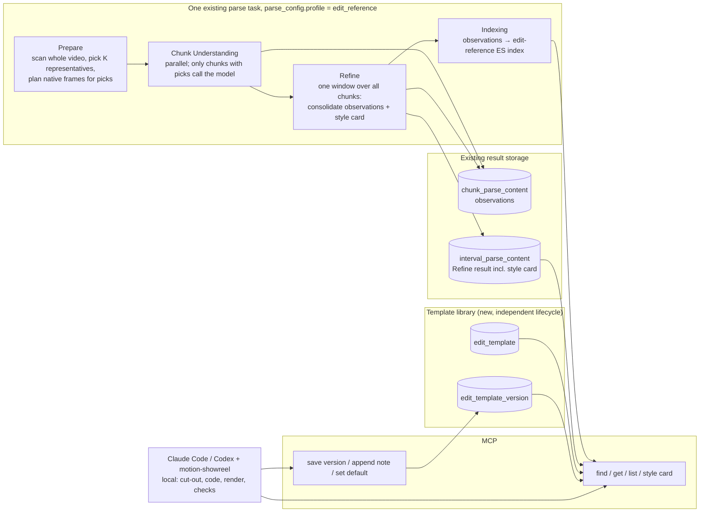

# 1. 问题与现状

| Item | Value |
| --- | --- |
| Requirement | **Dual recall for AI video editing.** Seekino parses a video once and keeps two kinds of editing material recallable at exact ranges: **character material** (for example 爱音 frames ready for cut-out) and **editing-style references** (highlight techniques with their motion spec, plus implementation versions and the experience behind them). An editing agent in Claude Code or Codex recalls both through MCP instead of re-reading references and asking the user to point at frames |
| Type | Feature direction + minimal validation. This PR holds the TRD only; each integration step gets its own branch + PR with a TRD-first commit (§3.8) |
| Opened / revised | Opened 2026-11-05. Direction rewritten 2026-11-06 after four rounds of owner review (decision log) |
| Branch / PR | `docs/editing-skill-style-reference` / [PR #50](https://github.com/owariband/Seekino/pull/50) |
| Status | Final design agreed with the owner 2026-11-07. E0, E1, E3 measured in standalone scripts (pass, with adjustments); E2 running; **nothing is wired into Seekino yet** |
| Related | [MCP access TRD](mcp-access-trd.md); [Sub-Chunk / Event TRD](../02-agent-harness/sub-chunk-trd.md); [PR #34](https://github.com/owariband/Seekino/pull/34) (course parse profile, the base for per-type schema config); [PR #53](https://github.com/owariband/Seekino/pull/53) (ASR blank-word fix found while parsing MyGO) |

## 1.1 Why Seekino needs edit analysis

1. **It makes the product interesting and general at first glance.** Search and Q&A over video is useful but quiet. "Give it a reference video and your footage, and an agent cuts a video in that style" is something people understand and want to try in one look, and it works for any series, course or opening a user uploads.
2. **Seekino's own promo needs it.** The owner's brief, 2026-11-05:
   - P5 art style only, minimal sound effects, no music.
   - 爱音 wants to learn deep learning, but the course is too long, she doesn't want to go step by step, and she can't sit through slides.
   - Kino (the Seekino mascot) appears, recalls the course for her and answers her questions.

   What the promo shows Seekino doing is what Seekino must actually do. It is made through MCP + Claude Code with an editing skill, and it is the first acceptance case of this TRD.

## 1.2 Where it comes from: the editing skill's limits

The editing agent uses `motion-showreel` (ConardLi/garden-skills, studied at commit `2b9a8934`). It writes video as code (HTML/JS motion, `timeline.js`, rendered to MP4 locally). Its workflow:

| Step | What it does | Where style comes from today |
| --- | --- | --- |
| 0 Environment check | — | — |
| 1 Requirements | Fills required choices; 🛑 waits | — |
| 2 `brief.md` | Benchmark → format + style → Reel Read → shot list + audio plan | One or two of **45 hand-written style files** in `references/styles/` |
| 3 Style frames | Style given: renders 3 frames; no style: 3 directions × 1 frame; 🛑 waits | The agent renders its own hook / signature / end frames **from the text style description** |
| 4 Create | Timeline → shots → web checks | Style text + `craft.md` technique notes |
| 5 Music / SFX / mix | — | — |
| 6 Workspace preview | 🛑 waits for export approval | — |
| 7 Export / acceptance | Technical checks + final review | Self-review only |
| 8 Delivery | — | — |

Three limits follow, and they are where Seekino matters:

1. **Static.** The skill bundles **0 images or videos** (checked 2026-11-06). Its style library is 45 text files someone wrote once. P5 is not among them; the closest are `comic-pop` and `editorial-collage`. Step 3's "style frames" are frames the agent draws from that text, not frames from a real reference.
2. **Use once, then discard.** When the user does hand over a reference video, the agent reads it with `inspect.mjs` (`sheet`, `grid --strips`, `heat`, `motion`), writes numbers into one `brief.md`, and throws the strips away. The next edit, or the next user, reads the same video again. Nothing links "this technique" to "this exact range of the reference".
3. **No reusable personal effects library.** Motion code written for one film stays in that film's folder. There is no way to say "use the step-out ladder I made last time, adapted for 爱音", or "what do my references do before a drop".

It also misreads effect-heavy footage. On the P5R opening, `grid` finds 255 starts and "no regular grid", and `motion` reports the 34.2–35.2 s character-intro ladder as "rapid whole-frame changes … reads as flicker" (§1.4).

## 1.3 Seekino's combined value

Seekino turns both halves of an edit into recall:

| Recall | What the agent asks | What Seekino returns |
| --- | --- | --- |
| **Character material** | "爱音, worried / excited, clean frame" | Exact ranges plus one `keyframe_ms` per hit where the named person is clearly visible and no subtitle is burned in; the agent clips it from the `read_evidence` media URL and cuts it out locally |
| **Editing-style reference** | "P5R style card", "a character-intro technique" | The style card (look constants + technique list) and techniques with exact ranges, a measured motion spec and the code versions earlier edits wrote back |

Together they remove most of the manual guidance an AI edit needs today: the user no longer has to find reference timestamps, pick usable character frames, or re-explain a style that was already analysed. The differentiator is **back it up and reuse it, instead of use once and throw away**.

## 1.4 Current state (evidence)

| Fact | Status | Source |
| --- | --- | --- |
| Parse V2: whole-video ASR once → fixed 60 s chunks → parallel chunk Understanding → Refine sliding window (`interval_duration` 180 s) → indexing → video-level summarize/outline | Read | [planning.py](../../../engine/parsev2/planning.py), `agent/video_parse_v2/` |
| ep04 Understanding saw **3 fps ordered frames at 720p with 3 s visual overlap** (`visual_input` in the task's `parse_config`), about 198 frames per chunk. An earlier draft of this TRD said 1 fps; that was wrong | Read from the isolated DB, 2026-11-06 | DB `seekino_mygo_ep04_20261105_test`, `video_parse_task.parse_config` |
| Refine commits only `persons` and `timeline` | Read | `server/service/video_parse_content.py` (`commit_interval_refinement`) |
| MCP has `list_series`, `retrieve`, `read_evidence`. `read_evidence` returns **source media URLs with ms bounds** ("use the returned millisecond boundaries when clipping"), so the agent can inspect any range locally at full frame rate | Read | `server/api/mcp.py:163` |
| **Character material today: 1 of 8 hits usable as returned.** Four 爱音 expression queries on ep04 (worried, happy close-up, surprised, bored); frames pulled at each top hit: 6/8 ranges contain a hard cut (confirmed by detector: 475850, 348973, 736235, 642642, 1000833, 545920), 3/8 show another character's face where the description says 爱音, every dialogue frame carries burned-in subtitles (JPSC source). Only `775166–780000` (bath close-up) is one clean 爱音 shot | Measured 2026-11-05 | `mcp_anon.py`, `anon-hits/sheet.jpg` (session scratch) |
| Course recall: `retrieve("backpropagation explained")` on the v11 course library returns dialogue fragments (e.g. "讲师宣布接下来进行反向传播。"); the per-video `outline` exists in `video_parse_content` but has no MCP tool | Read-only on 19641, 2026-11-05 | `mcp_course.py` (session scratch) |
| P5R 34.2–35.2 s at 30 fps, frame by frame: on flat red, ECU 3 f → CU 4 f → MCU 2 f → MS 3 f → full-body pose held ≈ 10 f with slow drift → 2 f insert flash → reveal with cyan glow. Hard steps, no tweens | By eye, 2026-11-05 | `p5r-inspect/burst-34.png` (session scratch) |
| `ffmpeg scdet` finds only 3 cuts in that second (every rung sits on the same red); the skill's gray-diff detector finds the rungs | Measured | `p5r-cuts-ms.txt` |
| Uniform sampling misses short shots on effect-heavy footage: P5R has 241 scdet shots (mean 393 ms); 3 fps leaves 50 % of them with no frame, 6 fps 30 % | Measured 2026-11-05 | `p5r-cuts-ms.txt` |
| P5R palette at 2 fps over 190 frames: red 41 % (`#d00000` 25 %, `#c00000` 22 %), gray 20 %, black 16 %, magenta/pink 8 %; 57 % of frames ≥ 30 % red | Measured 2026-11-05 | `p5r-frames/` |
| A 60 s 爱音 short made on 2026-10-29 without Seekino: the main rework was the gap between "event nearby" and "usable shot range" (a practice clip crossed a cut into another character) | Single case, not blind | `outputs/anon-baseline-20261029/analysis/research-findings.md` (git-ignored) |
| Parse failures met on the way: whisper.cpp zero-width words failed ep04 ASR (fixed, PR #53); chunk 1260–1320 s repair loop wrote a boundary-crossing event 3 times, a whole-task retry succeeded | Measured; the second is not root-caused | run dir `api.log` |

**What the skill's tools report on P5R** (2026-11-05, skill commit `2b9a8934`):

| Tool | Result |
| --- | --- |
| `grid` | 255 starts; no regular grid; 1.6 s wall / 8.5 s CPU |
| `motion` | 234 "hard cuts"; 26 rapid-change bursts covering 42 % of the video, reported as flicker |
| `audio.mjs beats` | ≈ 123.9 BPM, 196 beats |

## 1.5 Scope

In scope:
- An **`edit_reference` parse profile** inside the existing parse task. A video parsed with it (for example P5R) gets representative highlights picked in Prepare, high-frame-rate visual analysis of those picks in Understanding, consolidation of observations and a style card in one whole-video Refine window, and indexing.
- A template library: reusable templates, immutable versions holding their complete contract and code, append-only evaluations and checks, an explicit default version, and server-side source snapshots.
- MCP tools for finding templates and observations, reading versions, style cards, saving versions and appending notes.
- The promo as the acceptance case.

Out of scope here:
- The automatic content-type judgment (editing material / scripted animation / course). It gets its own TRD on top of PR #34; until then the profile is chosen explicitly in `parse_config`.
- `keyframe_ms` for character material on the `content` profile. It changes the content schema and stays a later step (E4), after this sequence.
- Cut-outs, rendering, previews and running template code. These belong to the user's local workflow through tools and skills. Seekino Server provides materials, reference evidence, template retrieval and persistence only.
- Rhythm/beat-grid extraction as a goal in itself.

Must stay unchanged:
- **One video has one current parse task**, as today. A video is parsed with one profile; switching profile is a reparse. No second task runs alongside it.
- **The `content` profile behaves exactly as today** for scripted animation and courses. The scan runs only under `edit_reference`.
- The existing parse task, scheduling, leases, retries, Consumer, chunk topology, Refine window mechanism, result storage and indexing infrastructure. No new task infrastructure and no new parse-result tables.
- Exact ranges, never widened. No rendering on the 4C8G server.
- Copyright: the owner decided on 2026-11-05 that it is not a concern for this non-commercial promo.

# 2. 影响因素、假设与评价指标

## 2.1 Hypotheses

Ordered by how badly the direction fails if they are false:

| # | Hypothesis | Evidence so far | Cheapest test |
| --- | --- | --- | --- |
| H1 | An editing agent with recalled style references makes a better P5-style beat, at lower cost, than the same skill with its static library | None; this is the core bet | E2: same brief, two fresh agents, A/B |
| H2 | A style is uniform enough across a video that **6–8 representative highlights** carry it; reading the whole video densely adds little | Owner judgement; P5R contact sheet shows a few repeating devices | E1: representative picks on one sheet, owner judges coverage |
| H3 | A cheap code detector (the skill's `diffProfile` + `findStarts`, ported) finds candidate highlights on editing material | E0: port matches the skill's 255 starts on P5R. On ep04 it fires on ordinary dialogue cutting (0/8 random segments were real highlights) | E0 done; it is why the profile is opt-in for editing material only |
| H4 | The existing understanding model, given full-frame-rate frames of a picked segment, writes a technique spec close to a hand-written one | None | E3: one model call per picked segment, compare with the hand index |
| H5 | `keyframe_ms` lifts character material usable-as-returned from 1/8 (later step, content profile) | 1/8 baseline measured | E4: reparse ep04 with the field, rerun the same 4 queries |
| H6 | A second edit reusing library entries and code versions costs clearly less than the first | None | E2 second beat |

## 2.2 Metrics

| Metric | Kind | Definition | Baseline | Target | Measured how |
| --- | --- | --- | --- | --- | --- |
| Owner blind pick | Outcome | Owner chooses between A and B renders of the same beat, unlabeled | — | B preferred | E2 |
| Tokens and wall time to first render | Outcome | From brief to first rendered beat, per agent | Measured in arm A | B clearly lower | Agent usage logs |
| Reference views | Diagnostic | Frames / strips / clips each agent opened | Arm A | — | Tool-call log |
| Technique fidelity | Outcome | Right technique used; step frame counts within ±1 frame of the reference | — | ≥ 2 of 3 techniques | Frame strips of render vs reference |
| Representative coverage | Outcome | Owner judgement: do the picks cover the style's devices | — | Owner accepts | E1 contact sheet |
| Dense frame budget | Guardrail | Frames read at full rate per reference video | 286 frames (P5R at 3 fps today) | ≤ 2× today | E1 |
| Material usable as returned | Outcome | Hits where the named person is the subject, one shot, clean | **1/8** | ≥ 6/8 | E4, same 4 queries |
| Spec accuracy | Diagnostic | Model spec vs hand spec: technique named, step count, frame counts | — | Recorded | E3 |
| Second-use cost | Outcome | Tokens and time for the second beat vs the first | First beat | Clearly lower | E2 |
| Animation / course regression | Guardrail | Profile off: identical parse config and event counts (ep04 DIALOGUE 346) | 346 | Unchanged | Rerun with profile off |

# 3. 改造方案与建模

## 3.1 From what the skill has to what Seekino parses and stores

| The skill has | Its limit | Seekino parses and stores | Recall |
| --- | --- | --- | --- |
| 45 static text style files | Fixed, no real frames, no P5 | **Style card** per reference video, in the skill's own `styles/_template.md` sections, each signal citing exemplar segments | `get_style_card` |
| `inspect.mjs grid / heat / motion` per brief | Run on every edit, discarded | The same measurement, run once in Prepare; its facts (pick ranges, measured starts, palette) are copied into the parse result | Part of each observation and the card |
| Strips viewed once in step 2 | No link from technique to range | **Technique observations**: name, exact range, measured motion spec | `find_edit_templates` (parse-derived side) |
| Style frames drawn from text (step 3) | Can't be checked against a source | Recalled reference segments; the agent renders ours next to them | `read_evidence` clip |
| Motion code in one film's folder | Lost after delivery | **Template library**: immutable versions with complete contract + code, accumulated evaluations and checks | `get_edit_template`, `save_edit_template_version` |
| `timeline.js` `HOLDS` / `DROPS` | Declared by hand | Observation roles (`ACCENT`, holds in the spec) map onto them | In the spec |

The goal is a loop: references are parsed once; every edit recalls from them; every edit saves its implementation and experience back; the next edit starts further ahead.

## 3.2 Architecture



## 3.3 The `edit_reference` profile inside the existing parse task

**Stage responsibilities**

| Stage | Responsibility under `edit_reference` | Existing entry point extended |
| --- | --- | --- |
| Prepare | Scan the whole video (port of the skill's `diffProfile` / `findStarts`: 160 px grayscale, native fps, mean gray-diff > 2.5× local median, 0.2 s debounce, flash test); group starts into candidate segments and split any longer than 3 s at their largest gap; score and group by visual signature; keep **K ≈ 6–8 representatives**; inside each pick run a fine detector (no debounce, threshold max(8, 4 × pick median)) whose starts are the allowed step boundaries; add every native frame inside each pick (capped) plus a few calm frames to the owning chunk's frame list | `VideoParseMediaService.prepare_episode` (`server/service/video_parse_media.py`): the per-chunk `frames` list in `episode.json` and the single `extract_video_frames_batch` call |
| Understanding | High-frame-rate visual analysis of the picks in that chunk; one observation per pick. Chunks with no pick commit `{"observations": []}` without a model call | `agent/video_parse_v2/understanding/` workflow and response gate; `prompts.build_understanding_prompt` |
| Refine | One window over all chunks; input is the chunk observations plus scan facts (text only); consolidates names into `technique_key`s and writes the style card | `IntervalRefine` (`agent/video_parse_v2/refine/`), `prompts.build_refine_prompt`, `commit_interval_refinement` (`server/service/video_parse_content.py`) |
| Indexing | Project observations to a separate derived edit-reference ES index | `engine/rag/indexing/` projection + pipeline |
| Summarize | Not scheduled; the card comes from Refine | Summarize scheduling (`server/service/video_parse_summarize.py`) |

The scan needs no durable storage. It is deterministic and cheap (1.7 s on P5R), so each Prepare lease recomputes it, as the frame plan is rebuilt today. The facts worth keeping are copied into the result by the host.

**Profile selection.** `parse_config.profile: "content" | "edit_reference"`, default `content`, frozen with the task like the rest of `parse_config` and part of the indexing contract fingerprint. Set at upload or on a reparse request. The profile abstraction covers only the actual differences:

| Difference | `content` | `edit_reference` |
| --- | --- | --- |
| Chunk result model | `VideoParseResult` | `EditReferenceChunkResult` |
| Refine result model / fields Refine may change | `IntervalRefinementResult` / `persons`, `timeline` | `EditReferenceRefinement` / model-written observation fields + `technique_key`; plus `style_card` |
| Validation | `validate_result_time_range` | Each observation range equals its host segment; step boundaries are measured starts or segment edges and tile the segment |
| Merge identity | Event refs | Host `segment_id`; Refine may edit, not add or remove |
| Frame plan | Uniform | Scan → picks → native frames for picks |
| Prompts | Today's | New Understanding and Refine prompts |
| Projection | Event index | Edit-reference index |
| Config defaults | Today's | ASR `none`, voiceprint / prefix / Summarize off, OCR optional, `interval_duration = 63 × chunk_duration` |

`content` wraps today's code unchanged.

**Reading by profile.** Videos with different profiles share a library and must never be read as each other's schema. Read paths that turn chunk content into events check the task's profile first: chat, `retrieve`, `read_evidence`, outlines, DTOs. An `edit_reference` video contributes no content events.

**The whole-video Refine window and the 63-chunk limit.** `plan_intervals` already returns one window covering every chunk when `chunk_count ≤ size` (`engine/parsev2/planning.py`). With `interval_duration = 63 × chunk_duration`, every `edit_reference` video up to 63 chunks gets exactly one window. The limit is the **reach of one window**, because Refine readiness is a 63-bit mask (`MAX_INTERVAL_CHUNKS`):

- It does not limit tasks, windows per task, or highlight segments per window. A window holds up to 63 chunks and every observation in them.
- With 60 s chunks one window reaches 63 min. P5R (95 s) is 2 chunks.
- v1 rejects `edit_reference` for longer videos at task creation, because a longer video would need several windows and nothing would merge their cards. A later version can use larger chunks for this profile (120 s → 126 min), since only chunks with picks call the model.
- Refine waits for every chunk, so a failing chunk delays the card until retries succeed, with today's retry semantics.
- Model input does not grow with window span: at most K observations plus scan facts.

**Result schema (draft; the implementation PR fixes the final shape):**

```python
class TechniqueObservation(BaseModel):
    # host-written from the scan; the model cannot change these
    segment_id: str; start_ms: int; end_ms: int
    measured: Measured                  # starts_ms, flashes_ms, palette:[{hex, share}]
    # model-written
    name: str                           # short Chinese, e.g. "阶梯式拉远亮相"
    summary: str                        # one Chinese sentence, in order
    role: Literal["INTRO","TRANSITION","ACCENT","TITLE","LOOP","OUTRO"]
    look: Look                          # ground, subject_treatment, texture, type_treatment
    motion: Motion                      # steps:[{start_ms,end_ms,framing,subject,enter}], frame counts derived by host;
                                        # easing, hold_frames, camera
    slots: list[Slot]                   # declared materials, e.g. {name:"subject_cutout", kind:"image", requirement:"full body, transparent"}
    signals: list[str]
    technique_key: str | None           # assigned by Refine across segments

class EditReferenceChunkResult(BaseModel):
    observations: list[TechniqueObservation]

class EditReferenceRefinement(BaseModel):
    members: list[EditReferenceRefinedMember]   # {sequence_no, observations}
    style_card: StyleCard               # _template.md sections; signals cite segment_ids;
                                        # palette numbers copied from the scan, not model-written
```

Member observations commit to `chunk_parse_content.content` through the existing commit path. The whole Refine result, including `style_card`, is already stored in `interval_parse_content.content`; with one window per task, that row is the video's card.

Example observation, hand-written from P5R 34.2–35.2 s (the target for E3):

```yaml
name: 阶梯式拉远亮相            # step-out ladder
range_ms: [34200, 35200]
look: {ground: "#c00000 flat", subject: "cut-out, black/teal line art", texture: none}
motion:
  fps: 30
  steps: [{framing: ECU, frames: 3}, {framing: CU, frames: 4}, {framing: MCU, frames: 2},
          {framing: MS, frames: 3}, {framing: FULL, frames: 10, drift: slow}]
  easing: none                  # hard steps
  accent: {insert_flash: 2f, then: "reveal + glow"}
slots: ["subject_cutout: full body"]
```

## 3.4 Template library

Its lifecycle is independent of parsing: deleting or reparsing a source video must not delete code an agent created. It is written by agents through MCP, not by parse leases. One template can cite several videos. So it gets its own two tables.

**`edit_template`: stable identity**

| Column | Notes |
| --- | --- |
| `id`, `tenant_id`, `creator_id` | |
| `name`, `description`, `tags` (JSON) | |
| `default_version_id` | Nullable; changed only by an explicit action |
| `revision` | Optimistic lock for changing the default |
| `is_deleted`, standard audit fields | |

**`edit_template_version`: one reproducible revision**

| Column | Mutability | Content |
| --- | --- | --- |
| `id`, `template_id`, `version_no` (unique per template) | Immutable | |
| `parent_version_id` | Immutable | Derivation only; no claim of quality or compatibility |
| `spec`, `visual_requirements`, `slots`, `params_schema` (JSON) | Immutable | The complete contract of this revision |
| `files` (JSON `{path: text}`), `entry` | Immutable | Text only; v1 cap 1 MB, re-measured against the first real templates |
| `runtime` (JSON) | Immutable | Engine and commit, dependencies, fps, canvas |
| `sources` (JSON) | Immutable | Server-built snapshot: `series_id`, `video_id`, `parse_task_id`, chunk content version, `segment_id`, range, `technique_key`, the observation as it was |
| `content_hash` | Immutable | sha256 over all immutable columns, checked on read |
| `author`, `created_at` | Immutable | |
| `check` (JSON list) | Append-only | Checks reported by the local workflow: who, what, method, conditions, result, evidence; marked `reported_by: client` |
| `evaluation` (JSON list) | Append-only | Experience: author, kind (`revision_rationale` / `usage_feedback` / `default_selection`), `about_version_id`, context, and separate `user_feedback`, `agent_judgment`, `changes`, `verified`, `unverified` |

Rules:
- The repository exposes insert-version, append-note and set-default only. Appends run in the Service inside one row-locked transaction; existing entries are never edited or removed.
- Saving never moves the default. A creation pins an exact `version_id` in its local project.
- A complaint never invalidates a version or promotes its successor.
- `sources` store IDs without foreign keys. On read each source reports `current`, `superseded`, `content_changed` or `unavailable`; the saved snapshot is always returned and newer evidence is never substituted.
- Checks are shown as client-reported, never as server-verified quality.

## 3.5 MCP behaviour

| Tool | Behaviour |
| --- | --- |
| `find_edit_templates(query, tags?, series_ids?, include_parse_techniques=true, top_k)` | `templates`: library rows with default-version summary, check summary, latest evaluation highlights. `techniques`: parse-derived observations from the edit-reference index with ranges, `segment_id`, style-card ref. Library search is MySQL in v1 |
| `get_edit_template(template_id, version_id?)` | Full version: contract, files, runtime, sources with status, check, evaluation, lineage. Defaults to `default_version_id`; without one, returns the version list. Includes `successor_notes`: evaluation entries from descendants that explain a revision away from this version or target it, with links |
| `list_edit_template_versions(template_id)` | Version number, id, parent, author, time, `is_default`, latest check / evaluation summary |
| `get_style_card(video_id)` | Card from the video's current `edit_reference` task, with exemplar segment refs and task identity |
| `save_edit_template_version(template_id or new_template, parent_version_id?, spec, visual_requirements, slots, params_schema, files, entry, runtime, source_refs, check?, evaluation)` | Appends a version. The server builds `sources` from the refs. A `revision_rationale` entry is required when a parent is given. Never changes the default |
| `append_edit_template_note(version_id, kind, entry)` | Adds a timestamped, attributed evaluation or check entry |
| `set_default_edit_template_version(template_id, version_id, reason)` | Explicit, guarded by `revision`; records a `default_selection` entry |

Write tools run only under MCP's current local mode (loopback-only `_LocalOnly`, `server/api/mcp.py`). Cloud access belongs to the MCP access TRD.

## 3.6 Rejected options

| Option | Why not |
| --- | --- |
| A `SHOT` / `TECHNIQUE` event inside the content timeline schema | Editing references need their own schema; the profile selects it |
| A separate editing task type with its own tables | The existing parse task, storage and Refine window already fit; a different schema doesn't justify new infrastructure |
| A content task and an edit-reference task current on the same video | Never required; one video, one current task, one profile |
| A global consolidation pass outside Refine | It is a Refine window covering the whole video |
| Parse every video at 30 fps / dense frames on every candidate | ep04 ≈ 42,600 frames; P5R candidates cover 72 %. Representatives replace both |
| Template spec / slots / refs on the template row | An old code version could be served with a newer incompatible contract; the version carries its full contract |
| Latest version as default | A newer version can be tailored to one edit; the default is explicit |
| Server-side cut-out, rendering or code execution | Creative execution is local |

## 3.7 Validation first, then development

1. **E1, E3** (§4): picks on P5R; model-written observation against the hand spec. Gate for building the profile.
2. **E2**: the A/B with two fresh agents. Gate for building at all.
3. If a gate fails, report the evidence and the needed adjustment before building.
4. Then develop in the order of §3.8, each step its own branch and PR with a TRD-first commit.
5. Make the promo through MCP only, log every gap, and return to this TRD.

## 3.8 Integration sequence

| Step | Branch | Change | Gate |
| --- | --- | --- | --- |
| 1 | `refactor/parse-profile` | `parse_config.profile`, a registry sized to §3.3's differences, `content` wrapping today's code, profile check on read paths | Existing tests pass unmodified |
| 2 | `feat/edit-reference-profile` | Scan + picks in Prepare, observation / Refine / card schemas and prompts, whole-video window, empty-chunk commit, Summarize skip, edit-reference index | P5R on the isolated instance matches E3; it never appears as content events |
| 3 | `feat/edit-template-library` | Two tables, Service, seven MCP tools | Append-only enforced; `content_hash` checked; saves never move the default; `successor_notes` shown; stale-source states reported |
| 4 | — | Promo through MCP | §5 |
| Later | own TRD | Content-type judgment on top of PR #34; `keyframe_ms` for content (E4) | — |

# 4. 对照实验与结果分析

## E0 Highlight detector (done, standalone script)

Python port of `lib/frames.mjs` `diffProfile` + `findStarts`, plus a grouping rule (at least 3 starts each ≤ 0.5 s apart, or a flash, padded 0.25 s). Not wired into Seekino.

| | P5R opening (95 s, 30 fps) | MyGO ep04 (24 min, 23.976 fps) |
| --- | --- | --- |
| Scan wall time (this Mac) | 1.7 s | 19.6 s |
| Change starts | **255** (same as the skill's `grid`) | 1055 |
| Candidate segments | 29 | 115 |
| Share of the video | 72 % | 11 % (161 s) |
| Real highlights in a random sample | Whole opening is effect-heavy | **0 / 8**: head turns, walk-ins, cuts to close-up |

Decisions: the scan belongs to `edit_reference` only; dense reading goes to representatives, not all candidates. 4C8G cost is expected to be small but not measured there.

## E1 Representative picks (done, 2026-11-07)

Script and outputs: `outputs/verification/edit-reference-20261107/` (git-ignored): `scripts/scan_pick.py`, `p5r-scan.json`, `e1-picks-sheet.jpg`.

- Selection: score = change density × length fit (0.8–3 s) + 2 × flashes; diversity by greedy farthest-point on palette histogram + 32×18 thumbnail, K = 8.
- **First run missed the 34.2 s ladder**: it sat inside a 5 s merged candidate (33.9–38.97 s, 20 starts) that the length rule penalised. Fix: split candidates longer than 3 s at their largest internal gap. After the split: 31 candidates, and the ladder (`seg-0033900`, 33900–35033) is picked.
- Final picks cover 8 distinct devices: red/black geometric cuts (167–1300), clap → magenta starburst (12200–13133), mask close-up → step-out with comic slogan boxes (13500–14700), yellow halftone silhouettes → red/white strobe (18200–19400), purple slash combo (28367–29500), orange star speed bands → circle wipe (30833–32467), red-ground step-out ladder (33900–35033), glow push-in → burst (82833–84067). Not picked: ransom-note lettering (15000–17233), red/black spiral (≈ 66 s).
- Dense frames: **288** (budget ≤ 572 = 2 × 286). Scan + pick: 4.7 s wall on this Mac.
- Verdict: pass on lead review; owner review of the sheet pending.

## E3 Model-written observation (done, 2026-11-07)

`scripts/e3_observe.py`: one call per pick to the current understanding binding (`vision` = deepseek-flash, via `GatewayClient`), all native frames of the pick at 480p (27–49 frames), draft `TechniqueObservation` schema. Ground truth for the ladder: the 30 fps strip `e3/ladder-strip.jpg` and the per-frame change profile.

| Run | Boundary rule | Ladder steps written | Verdict |
| --- | --- | --- | --- |
| `e3/` | Boundaries ∈ scan starts (0.2 s debounce) | INSERT 7, INSERT 6, "ECU" 7, MS 7, FULL 7; easing `EASE_OUT` | Fail: ECU/CU/MCU merged; easing wrong |
| `e3b/` | Any frame, scan starts as hints; easing defined | Same steps; easing `STEPPED` | Fail on steps |
| `e3c/` | **Fine in-pick starts** (no debounce, threshold max(8, 4 × pick median)) | INSERT 13, **ECU 2, CU 2, MCU 3, MS 2+3, FULL 2+3, WIDE 2+2**, all CUT; `STEPPED`, camera `PULL` | **Pass**: matches the strip frame for frame |

Findings:
- Root cause of the misses was the measurement, not the model: inside a burst the change profile is isolated spikes (13–46 against < 1), and the skill's 0.2 s debounce suppresses every rung after the first. **Prepare therefore keeps a second, fine detector inside picks**, and its starts are the allowed step boundaries.
- Look, summary, signals and slots were accurate on all 8 picks (lead review against the frames).
- Names and roles are unstable across runs (the ladder was "拉镜登场" / INTRO, then "连续推近" / ACCENT, contradicting its own steps). This is Refine's job: consolidate names and roles across observations, helped by a host-derived framing direction (wider → pull, tighter → push).
- Pose changes on twos within one framing are written as separate steps; acceptable, can be merged in Refine.
- Calls took 7.7–27.4 s each.

## E2 A/B on one promo beat

- **Brief:** an 8–10 s "爱音's entrance" beat, P5 style, minimal SFX. Same model, same `motion-showreel`, same 爱音 cut-out prepared locally beforehand.
- **A:** the skill as shipped, given the P5R video and reading it its own way (`sheet`, `grid --strips`, `heat`).
- **B:** the skill plus recall: a hand-built style card and observations for the E1 picks, with the source path and exact ranges in place of `read_evidence` URLs.
- Two fresh agents; the author of this TRD has seen P5R and would contaminate either arm.
- Then B makes a second beat, "Kino's arrival", reusing the entries and its own first-beat code.
- Pass: B clearly cheaper (tokens, time, reference views) with technique fidelity at least as good as A; owner blind pick recorded.

## E4 Character material (later, content profile)

Reparse ep04 with `keyframe_ms` / `clean`; rerun the same 4 queries against the 1/8 baseline.

## Results

| Metric | Baseline | With change | Status |
| --- | --- | --- | --- |
| Detector starts on P5R | Skill `grid`: 255 | Port: 255 | Matched |
| Detector precision on scripted animation | — | 0/8 | Drove the profile-only decision |
| E1 picks cover the style; dense frames | ≤ 572 | 8 devices incl. the ladder; 288 frames | Pass (lead); owner pending |
| E3 ladder steps vs 30 fps truth | Hand / strip | Frame-exact after fine detector | Pass, with Prepare and Refine adjustments |
| E2 | — | — | Running |

# 5. 试点验证与方案取舍

The pilot is the promo, made after steps 1–3:
- P5R parsed with `edit_reference`.
- MyGO episodes and the course library with `content`.

The agent makes the full promo through MCP + Claude Code, with cut-out and rendering local. Logged: every recall Seekino could not serve, tokens, time, and how often the owner had to step in.

Go / no-go: promo accepted by the owner; second-use cost clearly below first use; `content` parses unchanged. Rollback: `edit_reference` is opt-in per task; the library is additive.

# 6. 结果验收与闭环

Not closed. As of 2026-11-07:
- Settled: the `edit_reference` profile inside the existing parse task, stage responsibilities, the whole-video Refine window, and the template library contract.
- Measured: E0.
- Nothing implemented in Seekino; PR #53 is a separate fix.
- Open: E1–E3; the chunk-boundary repair failure on ep04 (not root-caused); the content-type judgment TRD.

Acceptance returns to §1.1: the promo exists, made through MCP, and the dual recall is what made it.

## Decision log

| Date | Earlier view | New evidence | Decision | Effect |
| --- | --- | --- | --- | --- |
| 2026-11-05 | Scene detection could feed a rhythm layer directly | Naive detection: 266 detections, median 0.10 s | Rhythm numbers gated behind classification | Superseded below |
| 2026-11-05 | Matting, MyGO data source and judge open | Owner answers | Minimal local matting; owner + VLM judging; parse ep04 on an isolated instance (port 19671) | ep04 parsed: 650 events |
| 2026-11-05 | The skill's `grid` / `heat` could seed a rhythm layer | P5R: 255 starts, no grid; 42 % bursts | Reuse the skill's formats (`_template.md`, `timeline.js`) rather than invent new ones | Kept |
| 2026-11-05 | Per-brief style pack for one edit | Owner: the goal is to reduce how often the skill parses; parse once, recall many; ground it in the pipeline | Editing-reference layer in the pipeline | Superseded below |
| 2026-11-05 | Separate structure and labelling passes, rhythm focus | Owner: keep the parallel chunk + Refine window architecture; the deliverable is the P5-style 爱音 × Kino promo; focus on art-style cards | No new passes; promo-driven loop | §3.3 |
| 2026-11-05 | A `SHOT` event (cut-to-cut, framing, expression) carries style | Owner: style comes from motion, and motion is written in code | TECHNIQUE + motion library; SHOT dropped, only `keyframe_ms` kept | §3.3, §3.4 |
| 2026-11-05 | A frame-strip MCP tool for 30 fps inspection | `read_evidence` already serves source media URLs | No frame tool; parse stays at today's rate outside highlights | §3.3 |
| 2026-11-05 | Change parse first | Owner: validate fastest | Hand-written index + A/B with fresh agents before any parse change | §3.5, E2 |
| 2026-11-06 | — | Skill bundles 0 images; 45 static style files; step 3 renders from text | Positioning: Seekino makes the skill dynamic through dual recall (character material + style reference) | §1.2, §1.3 |
| 2026-11-06 | Dense frames on all detected segments | E0: P5R 72 %, ep04 11 % with 0/8 real | Code detects candidates, then K representatives get full-rate frames in Understanding / Refine; detector opt-in for editing material, off by default; animation keeps today's schema; per-type profile planned on top of PR #34 | §3.3, E1 |
| 2026-11-06 | `TECHNIQUE` inside the content timeline; dense frames via the content pipeline | Owner: editing references need their own schema and mechanism | First proposal (separate task type and tables) rejected by owner 2026-11-07: reuse the existing parse task, leases, Understanding, Refine and storage; a profile selects schema, prompts, frame strategy, validation, projection | §3.3 |
| 2026-11-07 | Global consolidation as a separate pass | Owner: it is a Refine window covering the whole video; coverage and model input are separate concerns | `interval_duration = 63 × chunk_duration` → one window via existing `plan_intervals`; input is observations + scan facts. 63-chunk reach documented | §3.3 |
| 2026-11-07 | A content task and an edit-reference task current on the same video, needing a `profile` column and per-(video, profile) latest-task selection | Owner: never requested; one video is parsed with one profile in one task | Dual-task coexistence and its column, migration and test withdrawn. Coexistence now means only: read paths check the task's profile so videos of different profiles are not misread | §1.5, §3.3 |
| 2026-11-07 | Template row holds spec / slots / refs; latest version is default; versions fully immutable | Owner review | Version holds the complete contract; explicit `default_version_id`; `evaluation` and `check` append-only with attribution; server-side source snapshots with stale states; client checks shown as client-reported | §3.4, §3.5 |
| 2026-11-07 | Cut-out could be a Seekino capability | Owner: Seekino Server never does cut-out, rendering or code execution | Templates only declare slots; preparation is local | §1.5 |
| 2026-11-07 | E2 arm A uses the static style library | A stronger, realistic baseline is the skill reading the reference itself | Arm A gets the P5R video and reads it its own way | §4 E2 |
| 2026-11-07 | Scan starts (0.2 s debounce) are the step boundaries | E3: rungs 2–3 frames apart are suppressed by the debounce; long merged candidates hide techniques | Prepare splits candidates > 3 s and runs a fine in-pick detector whose starts are the boundaries; Refine consolidates names and roles | §3.3, E1, E3 |
