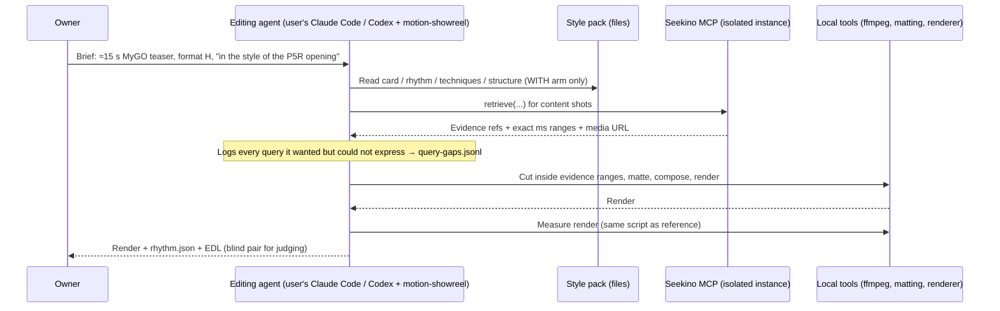

# 1. 问题与现状

| Item | Value |
| --- | --- |
| Requirement | Seekino as asset library + MCP server for an AI video-editing skill: what a **style reference** must contain for an editing agent to learn from it, and which **content-asset** fields the parse is missing |
| Type | Research + bounded prototype experiment. No production code in this PR |
| Opened | 2026-11-05 (Asia/Shanghai) |
| Branch / PR | `docs/editing-skill-style-reference` / [PR #50](https://github.com/owariband/Seekino/pull/50) |
| Status | **Draft.** §1 and the experiment plan (§2–§4) are written; nothing has been built or run except the one baseline measurement in §1.4. Scope needs owner confirmation before any tool is built |
| Related | [MCP access TRD](mcp-access-trd.md) (tool contract this builds on), [shot composition schema draft](../02-agent-harness/shot-composition-schema.md) (2026-10-19, archived experiment), [reference-driven SVG/Three.js research](../../research/2026-10-29-reference-driven-svg-threejs.md), project skill [seekino-short-video](../../../.agents/skills/seekino-short-video/SKILL.md) |

## 1.1 Background and trigger

Owner decisions on 2026-11-05 fix the product shape:

- Seekino's highlight is **precise time-range localization** of moments in footage. Ranges are never widened.
- The cloud server is 4 cores / 8 GB, so it does no rendering and no sandboxed editing. Editing runs in the user's own Claude Code / Codex via MCP. Seekino supplies search, clip and frame tools.
- Cut-out / background removal is not a Seekino service. It ships as a skill with a small runnable example the user's agent runs locally. Anime footage is not green-screen, so chromakey does not work.
- Parsing code-driven video effects is out of scope, because it needs sandboxed trial and error. *Describing* a technique (rules plus timestamps) is in scope. *Reproducing* it is the editing agent's job.
- Anime character recognition already works (owner's prior experience) and is not the open question.

The target editing skill is ConardLi/garden-skills `motion-showreel` (read at commit `2b9a8934`, 2026-10-25). Its format **H** ("绿幕人物 + 代码场景") composites a supplied person layer onto code-rendered scenes. That person-layer slot is where Seekino's real footage would plug in.

Two kinds of asset are involved:

1. **Content assets** — *what* appears. Example: every moment of 爱音 (Anon) in MyGO, with exact ranges.
2. **Style references** — *how* it is shown. The first reference is `assets/女神异闻录5皇家版-开场.mp4` (1920×1080, 30 fps, 94.9 s). Only its grammar is learned. The opening is never recreated and none of its assets are reused.

## 1.2 Actual vs expected behaviour

**Style references — nothing exists today.**

- If the P5R opening were uploaded, Seekino would parse it as *content*: events about what happens (`SCENE`, `ACTION`, `ON_SCREEN_TEXT`, …). Nothing would record how it is cut, coloured, lettered or paced. See [schemas.py](../../../engine/parsev2/schemas.py).
- `motion-showreel` supplies **genre** style cards (`references/styles/*.md`, e.g. `comic-pop`, `editorial-collage`) written to a fixed template ([`_template.md`](#31-existing-foundation)). It also supplies measurement commands for a reference (`inspect.mjs grid` / `heat`, `audio.mjs beats`). What it has no form for is a *specific* reference's rules, numbers and exemplar moments. Today the numbers go as free text into one brief and are lost afterwards.
- Expected: a **style pack** — a reusable, versioned artifact that an editing agent can read. It contains rules it can obey, numbers it can match, and exemplar moments at exact timestamps it can open and look at.

**Content assets — the parse answers "who/what" but not "how it is framed".**

- Event fields today: `start_seconds` / `end_seconds` (integer ms, half-open), `description`, `participants`, `visible_persons`, `speaker` (dialogue only), and `ON_SCREEN_TEXT` events. Nothing covers shot scale, framing, camera motion, whether the subject is fully in frame, or whether subtitles/overlays are burned in.
- MCP on `dev` (`server/api/mcp.py`) exposes three tools: `list_series`, `retrieve`, `read_evidence`. There is no clip-export tool and no frame tool. The agent receives a media URL plus a range and must cut locally.
- Expected: a format-H edit needs queries like "爱音 full body, static camera, ≥2 s, no subtitle overlay". Today such a query can only be matched by luck against free-text `description`. This is an **inference**. §4 E3 turns it into a measured log.

## 1.3 Negative impact

- **The owner is stuck on the core question**: what a style reference must contain for the AI to learn from it. Without an answer, the editing loop falls back to the model's default look. `motion-showreel` lists these defaults itself: dark background, centred big text, everything fading in together, purple-blue glow, static camera. It also falls back to the genre cliché, e.g. comic-pop's "yellow background + red halftone + POW!".
- **Seekino's highlight is invisible in an editing flow.** If the editing agent cannot request footage by framing and duration, it takes whatever text search returns and trims by eye. Precise ranges stop mattering.
- **Parse fields would be guessed.** Adding fields means re-parsing (time and model cost per episode; see [parse cost research](../../research/video-parse-cost-reduction-20261103.md)). New fields should come from logged agent needs, not from a taxonomy written in advance. The 10-19 composition schema was designed taxonomy-first. Its experiment was retired before it reached an editing use.

## 1.4 Evidence

| Fact | Status | Source |
| --- | --- | --- |
| Naive `ffmpeg select='gt(scene,0.3)'` on the P5R opening reports **266 "cuts"**: 267 segments, median **0.10 s**, p90 1.13 s, max 5.1 s; **188 / 267 segments < 0.2 s** | Measured 2026-11-05, ffmpeg on the local file | Command in §4 E0; output kept in session scratch, re-runnable |
| Most of those are strobe/flash frames or whole-frame regeneration, not edits | **Inference** from the distribution and from watching the opening; not yet labelled | §4 E0 labels it |
| `motion-showreel` already treats runs of ≥3 detections < 0.35 s apart as "picture regenerated, not editing" and keeps 1–2 close detections as cuts (a hit that inverts the frame and back) | Read in `scripts/inspect.mjs` `motionReport()` | Heuristic only; untested on P5R |
| Parse schema has no framing / camera / overlay fields | Read | [schemas.py](../../../engine/parsev2/schemas.py) |
| MCP exposes 3 tools; no clip or frame tool | Read on `origin/dev` 4eb4231b | `server/api/mcp.py` |
| A composition schema (shot_size, vertical_angle, subject cell/scale, …) was drafted for *similar-shot search* and tagged on a MyGO shot gallery | Draft; experiment archived 2026-10-24 into a git-ignored ZIP | [shot-composition-schema.md](../02-agent-harness/shot-composition-schema.md) |

**Implication for rhythm.** Feeding the naive numbers to an editing agent tells it to "cut every 0.1 s". That would be a wrong lesson drawn from correct-looking data. The rhythm layer must separate cuts from flashes and transitions before any number is trusted.

## 1.5 Scope

**In scope (this TRD):**

1. A research note on what a style reference must contain (`docs/research/`, written after the experiment).
2. A hand-built (human + vision model) P5R style pack. Every field that had to be invented, i.e. not derivable by a tool, is logged.
3. A transfer experiment: the same ≈15 s MyGO teaser brief, `motion-showreel` format H, **with vs without** the pack, measured against the reference.
4. A query-gap log: every footage query the editing agent wanted but Seekino could not answer.
5. Proposals for parse/MCP schema changes, each written later as **its own TRD + PR**. None are implemented here.

**Out of scope:** production code; parsing code-driven effects; server-side rendering or matting; a public promo; re-litigating character recognition.

**Must not change:** shared v11 data and the demo server on port 19641 (chat acceptance is using it); existing parse/MCP contracts; time-range precision (output clips must stay inside Seekino evidence ranges).

**Copyright.** P5R and MyGO are third-party copyrighted works. Experiment renders, reference frames and keyframes stay in git-ignored `outputs/`, are used internally for research only, and are never committed. The pack in the repo holds rules, numbers and timestamps, not frames. A *public* promo that uses MyGO or P5 material needs a separate rights decision by the owner. This TRD makes no legal judgement.

# 2. 影响因素、假设与评价指标

## 2.1 Factors and hypotheses

Ordered by how badly each would hurt the direction if wrong.

| # | Hypothesis | Why it matters | Cheapest test | Decision it drives |
| --- | --- | --- | --- | --- |
| **H1** | A style pack moves the editing agent's output measurably toward the reference, compared with the same brief that names the reference only in words. | **Direction-breaking.** If WITH ≈ WITHOUT, the pack format is wrong. Stop and rethink before building anything. | E2 transfer test | Continue / redesign the pack |
| H2 | Numbers are only usable after cuts, flashes, transitions and whips are separated; raw scene-detection numbers mislead. | The rhythm layer is useless, or harmful, without it. | E0: hand-label a window and compare detectors | Which detector the pack tooling uses |
| H3 | Exemplar moments at exact ranges (layer c) carry information that the text card (a) and numbers (b) do not, e.g. the mechanics of a specific transition. | Decides whether "technique moment" deserves a Seekino event-like record. | E2 ablation arm (pack without c), if budget allows | Whether to propose a technique-moment TRD |
| H4 | Most style-card fields can be filled from measurement plus a VLM; a minority must be invented by a human. | Decides how far pack building can be automated. | E1 invented-fields log | Scope of any later pack-builder tool |
| H5 | Unanswerable footage queries cluster into a few fields (framing / shot scale, camera motion, overlay text, matting suitability, clean duration). | Decides which parse fields to propose. | E3 query log | Which schema TRDs to open |

## 2.2 Style pack layers under test

These are candidates. E1 records which ones survive contact with the real reference.

| Layer | Contents | Form |
| --- | --- | --- |
| a. Style card | Palette with proportions + derivation rule; texture layers; lettering; how the look is physically made; 8–12 recognisable signals; "what it is not"; the cliché version to avoid | Same sections as `motion-showreel` `_template.md`, so the skill consumes it unchanged |
| b. Rhythm track | Cuts vs flashes vs transitions (classified); shot-length distribution; beat grid and alignment; motion-energy curve; build / drop / resolve arc | JSON with per-event `start_ms`, `end_ms`, `kind`, plus summary stats |
| c. Technique moments | Each signature technique: exact range, label, parts, before/after keyframes | JSONL, one record per moment; keyframes git-ignored |
| d. Structure | Sections, their roles, repeated modules (e.g. character intro: pose → name card → slash out) | JSON with section ranges and module templates |

## 2.3 Metrics

Success criteria and guardrails are fixed **before** any comparison is run.

| Metric | Kind | Definition | Baseline | Target / allowed regression | Method | Evidence |
| --- | --- | --- | --- | --- | --- | --- |
| Blind style pick | Outcome | Share of WITH/WITHOUT pairs where the judge picks WITH as "reads as that style". Order randomized, arm hidden | n/a (pairwise) | WITH picked in ≥ 2/3 of pairs, with no arm-identity leak | Owner judgement first; VLM as secondary, model stated, both orders shown | Judging sheet + raw answers |
| Rhythm distance | Outcome | Distance between output and reference on: median real-cut shot length, flash density per 10 s, share of cuts within ±2 frames of a beat | Reference values from E0 | WITH closer than WITHOUT on ≥ 2 of 3 | Same measurement script on reference and every render | `rhythm.json` per video |
| Cut classifier accuracy | Diagnostic | Precision / recall of `cut` against hand labels on a 20 s P5R window | Naive ffmpeg (to be scored) | ≥ 0.9 / 0.9 before rhythm numbers enter the pack | Frame-stepped hand labels | E0 label file |
| Invented fields | Diagnostic | Count and list of pack fields a human had to invent | — | Recorded, no target | E1 log | `invented-fields.md` |
| Gap queries | Diagnostic | Count of queries the agent wanted but could not answer, grouped by implied field | — | Recorded, no target | E3 log | `query-gaps.jsonl` |
| Range fidelity | **Guardrail** | Every MyGO clip in an output lies inside a Seekino evidence range (start ≥ evidence start, end ≤ evidence end) | — | 100 %; any widening fails the run | Check output EDL against evidence refs | Per-render EDL |
| Reference reuse | **Guardrail** | No P5R frame, audio or asset appears in an output | — | 0 | Manual review + no reference path in the render's inputs | Render input manifest |
| Shared-state isolation | **Guardrail** | No writes to shared v11 data; no restart of port 19641 | — | 0 incidents | Run against an isolated instance | Run log |
| Cost | Guardrail | Model tokens and wall time per arm | — | Stated in the plan below; exceeding it pauses the run for review | Gateway usage records | Run log |

Sample-size caveat: with k = 3 renders per arm, the result is directional, not statistically conclusive. The TRD will report it that way.

# 3. 改造方案与建模

## 3.1 Existing foundation

| Source | What is reused | Gap |
| --- | --- | --- |
| `motion-showreel` `styles/_template.md` + `INDEX.md` | Style-card sections; the "pick 2–3 signals, at least one outside the cliché" rule; "learn grammar, not assets" | Genre cards only; no per-reference numbers or moments |
| `motion-showreel` `inspect.mjs grid / heat`, `audio.mjs beats` | Start detection, beat-grid fit, per-segment motion heatmap, burst/flash detection | Not yet validated on a strobe-heavy reference (E0). Downloaded code: read before running; run on copies only |
| `motion-showreel` format H | The person-layer slot for real footage | Assumes green-screen input; anime needs matting (see §3.4) |
| Seekino MCP `retrieve` / `read_evidence` | Event recall with exact ms ranges and media URLs | No framing filters; no clip/frame tools |
| [Shot composition schema](../02-agent-harness/shot-composition-schema.md) | Field definitions for shot size, angle, subject cell/scale and VLM prompt wording, if E3 shows the need | Designed for similar-shot search, not editing; experiment archived |
| [Reference-driven research](../../research/2026-10-29-reference-driven-svg-threejs.md) | Edit3K's split between content and editing technique; MoVer's checkable temporal constraints; Animation2Code's warning that running code ≠ correct motion | Paper results are not Seekino results |

## 3.2 Loop under test



To isolate the style factor, the **content clip set is fixed** once in a retrieval pass and reused by both arms. Retrieval variance then cannot masquerade as a style effect. The query-gap log comes from that retrieval pass.

## 3.3 Proposed pack layout (v0)

```text
outputs/style-packs/p5r-opening/          # git-ignored: frames, keyframes, raw measurements
docs/research/style-packs/p5r-opening/    # committed: rules and numbers only
  card.md            # layer a, motion-showreel template sections
  rhythm.json        # layer b, classified events + summary
  techniques.jsonl   # layer c, {start_ms, end_ms, label, parts[], keyframe_refs[]}
  structure.json     # layer d
  provenance.md      # source file hash, tools + versions, which fields were invented
```

A technique moment maps naturally onto a Seekino event: an exact ms range, a label and a description. Whether it becomes a new event type, a separate "reference" series kind, or stays as a file is **not decided here**. If H3 holds, that decision gets its own TRD.

## 3.4 Format H on anime footage

Format H needs a matted person layer. MyGO is not green-screen. The experiment needs a minimal local matting step, which is also the seed of the cut-out skill the owner wants to ship. Candidate: an anime-specific segmentation model run locally. Not yet chosen or verified. How much of this the experiment includes is an **open scope question for the owner** (see PR description).

## 3.5 Validation order and budget

1. E0 rhythm ground truth (no model cost). Gate: classifier ≥ 0.9 / 0.9, or the rhythm layer ships without numbers and the TRD says so.
2. E1 pack build. Budget: ≤ 1 working session, VLM calls on ≤ 60 keyframes.
3. Retrieval pass on MyGO plus the query-gap log. Requires MyGO to be parsed on an isolated instance.
4. E2 transfer, k = 3 renders per arm. Budget to be confirmed with the owner before running.
5. Stop rule: if E2 shows no WITH advantage on either outcome metric, stop. Write up the negative result and redesign the pack form before any schema TRD.

# 4. 对照实验与结果分析

Plan only. All results below are **待测** (to be measured).

## E0 — Rhythm ground truth

- Input: P5R opening. Choose one 20 s window with dense strobing and one calmer window, picked from a contact sheet before labelling.
- Hand labels, frame-stepped: `cut`, `flash` (1–2 frames unlike both neighbours), `transition` (multi-frame: wipe, slash, whip, dissolve), `regen` (whole-frame redraw inside a shot).
- Compare: naive `ffmpeg select='gt(scene,0.3)'` (baseline, already 266 detections over the full video); `inspect.mjs grid`; `inspect.mjs` run-collapsing heuristic.
- Baseline command:
  `ffmpeg -i assets/女神异闻录5皇家版-开场.mp4 -an -vf "select='gt(scene,0.3)',metadata=print:file=<out>" -f null -`

## E1 — Build the P5R style pack

- Human + VLM fill layers a–d. Every field is tagged `measured` / `vlm` / `invented`.
- Output: the pack (§3.3) and `invented-fields.md`.

## E2 — Transfer test

| Arm | Brief | Style input | Content |
| --- | --- | --- | --- |
| WITHOUT | ≈15 s MyGO teaser on 爱音, format H, 9:16 | Reference named in words + `motion-showreel` stock library (agent may pick e.g. comic-pop) | Fixed clip set |
| WITH | Same | Same + P5R style pack | Same fixed clip set |
| WITH − c *(optional ablation)* | Same | Pack without technique moments | Same |

Same model, same skill version, same seeds where the renderer allows. k = 3 renders per arm.

| Metric | Reference | WITHOUT | WITH | Δ (WITH − WITHOUT) | Criterion | Verdict |
| --- | --- | --- | --- | --- | --- | --- |
| Median real-cut shot length (s) | 待测 | 待测 | 待测 | 待计算 | closer to reference | 未验证 |
| Flash density (/10 s) | 待测 | 待测 | 待测 | 待计算 | closer to reference | 未验证 |
| Cuts within ±2 frames of beat (%) | 待测 | 待测 | 待测 | 待计算 | closer to reference | 未验证 |
| Blind style pick (WITH share) | — | — | — | 待测 | ≥ 2/3 | 未验证 |
| Range fidelity | — | 待测 | 待测 | — | 100 % | 未验证 |

## E3 — Query-gap log

One JSONL record per wanted-but-unanswerable query:
`{query_wanted, purpose_in_edit, what_retrieve_returned, workaround, implied_field}`.
Example of the expected shape: "爱音 full body, static camera, ≥2 s, no subtitle overlay" → implied fields `shot_scale`, `camera_motion`, `overlay_text`, `clean_duration`.

# 5. 试点验证与方案取舍

The pilot tests whether the pack *form* generalises, not just this one pack:

- Build a second pack from another local reference (`assets/女神异闻录3Reload-开场.mp4` or `assets/女神异闻录4-OP.mp4`) following only the E1 procedure. Record time taken and the invented-fields count.
- Owner runs one brief with it in their own Claude Code, without help from this session.
- Expand if the second pack takes ≤ the first's effort and the owner's brief reads as that style. Stop or redesign if the form needs reference-specific rework.

Trade-offs to weigh: pack-building effort vs gain in output style; repo size (rules only, no frames); copyright exposure (internal only).

# 6. 结果验收与闭环

This TRD is closed when:

- [ ] E0–E3 have results recorded in §4, failures and null results included.
- [ ] A decision on H1 is recorded: the pack form works / needs redesign / abandoned.
- [ ] The research note is committed under `docs/research/`.
- [ ] Schema / MCP change proposals are listed, each with a link to its own TRD + PR. Listing them does not mean they are implemented.

Closing this TRD does **not** mean parse fields, MCP clip/frame tools or the cut-out skill are delivered. Each has its own acceptance.

## Decision log

| Date | Earlier view | New evidence | Decision | Effect |
| --- | --- | --- | --- | --- |
| 2026-11-05 | Scene detection could feed the rhythm layer directly | Naive detection: 266 detections, median 0.10 s, 188/267 < 0.2 s | Rhythm numbers are gated behind E0 classification | E0 is now the first step |
