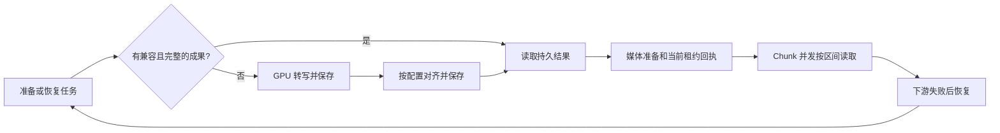

# 1. 问题与现状

日期：2026-10-29。主题：可选本地 WhisperX ASR、强制对齐与字幕时间证据。

**2026-10-30 续版：长视频 ASR 的可恢复成果与本机 GPU 执行。** 本轮沿用本主设计，不另建竞争 TRD；各节新增内容明确标为续版方案，原接入和上线前记录保留历史口径。跟进分支 `fix/video-asr-recovery`，实际状态统一维护在 [B20](../../dev/problems.md#b20本地-whisperx-正式接入与字幕时间证据)。

## 10-30 续版背景：旧 PR 合并不等于需求闭环

产品 P0 是完整课程的“找片段 → 看出处 → 回看 → 追问”。本轮演示目标为完整《Let's build GPT》：原音轨 6,979.873 秒、117 个 Chunk。用户需要可完成、可恢复的长任务，不能在下游失败后重新支付全部 ASR 成本。

| 前置改动 | 已解决什么 | 留下什么边界 |
|---|---|---|
| [PR #12](https://github.com/owariband/Seekino/pull/12)，已合入 dev `029faa34`，替代因命名迁移关闭的 #9 | 整片前置转写、Chunk 按区间复用、租约准备回执、有限准备重试，理解并发与逐块 ASR 解耦 | 只在同一协调器执行内复用，没有持久 checkpoint；完整课程耗时未验收 |
| [PR #15](https://github.com/owariband/Seekino/pull/15)，已合入 dev `3c115377` | 等待/加载/转写/对齐阶段、30 秒心跳和进度日志 | 可观测不等于加速或持久恢复；旧在途调用不自动获得回调 |
| [PR #13](https://github.com/owariband/Seekino/pull/13)，相关网络修复 | SDK 分类、有限节点退避、脱敏异常链 | 无法保证供应商与 DNS 永不失败，也不负责 ASR 持久化 |
| [PR #16](https://github.com/owariband/Seekino/pull/16)、[PR #17](https://github.com/owariband/Seekino/pull/17)，相关暂停控制 | 持久暂停、租约撤销、保留任务和已提交内容 | 暂停/继续不保证复用只存内存的完整 ASR |

真实运行暴露三类不同问题：

- **恢复成本：** `VideoParseRuntimeService.prepare` 的 finally 删除 `_video_transcripts[(task_id, lease)]`。不仅 API 重启，下游失败导致协调器退出也会丢失整片结果。`asr_prepared_lease_version` 只是门禁；8 个已提交 Chunk 的局部 evidence 不能替代完整产物。
- **本机执行路径：** full large-v3 CPU/int8＋VAD＋强制对齐实际耗时 4,591.557 秒（76 分 32 秒）；同机 Metal Turbo Q5 完整转写只需 293.578 秒。两者模型和阶段不同，不能宣称同质量加速相同比例。此前 100 秒音频耗时 331 秒已暴露风险，未先核对 GPU 就扩大到整集，是验证顺序的缺口。
- **下游故障：** 14:49:19 Kimi 返回 504，重试后 14:51:49 异常链落到 DNS `gaierror`，GPT v5 停在 8/117。分类和有限重试已执行；外部故障仍可能耗尽预算。不把它解释为 Whisper 识别质量差，也不通过无限重试掩盖。

新 PR 围绕“**前置 ASR 代价高，且下游失败使已完成成果无法复用**”展开。Kimi 原因分类仍由[网络设计](model-network-failure-trd.md)跟进，这里负责其对 ASR 恢复的影响。证据见[整集实测报告](../../report/gateway/local/whisper-metal-benchmark-20261030.md)。学习画像、创作、10 路小 Whisper 及 TimelineEvent 改写不纳入本次。

整片 ASR 增量关联：[PR #12](https://github.com/owariband/Seekino/pull/12)，工作分支 `feat/full-video-asr`；替代因分支命名迁移的 [PR #9](https://github.com/owariband/Seekino/pull/9)，保留全部实现与验证。依赖 dev 已提交的 WhisperX 接入、直接 JSON 与节点重试修复（截至 `80bb293d`）；本 PR 先向 dev 集成，再随后续发布进入 main，独立发布 PR #10 不含此增量。

用户希望 Seekino 直接提供可选的 WhisperX 接入：用户自行安装依赖和下载模型后，可用正式解析代码完成低 API 调用成本的转写，并取得后续字幕需要的字词时间。推荐 WhisperX 的原因是它同时提供转写和声学强制对齐。

修改前 `gateway/transcription.py` 只有 Ark 视频与 OpenAI Audio 两条通路；本机正式配置选择 Ark。`scripts/local_whisper.py` 是独立 whisper.cpp 服务，`evals/parse_protocol_benchmark.py` 对它的调用属于实验，不能视作正式 WhisperX 接入。仅保留句段文本与时间，不能按字词重组字幕行。`config/local-kimi.yaml` 同时管生成、转写和向量，文件名误导了配置作用域。

本次新增正式 Gateway 适配器、字词时间传递和部署指引；开发配置改为 `local-dev-config.yaml`。不在本次实现播放器字幕开关、排版、SRT/WebVTT、整集 ASR checkpoint 或人物 diarization。保留已有 ASR 来源和任务恢复语义。

2026-10-29 后续增量：用户确认先采用整片转写的内存结果，原 Chunk ASR 节点改为区间读取。此前正式链路逐 Chunk 调 ASR；固定视频切分可能截断语音，整片方案能否改善准确率仍待同模型对照。本次只增加音频 ASR 的视频级准备及结果复用，不修改 TimelineEvent、Refine 或索引合同，也不把内存缓存作为持久完成状态。

# 2. 影响因素、假设与评价指标

## 10-30 续版指标（拟验收）

| 指标 | 基线 | 目标与口径 | 验证 |
|---|---|---|---|
| 完成后的重复 ASR | 协调器失败/重启会重算 | 相同冻结输入下，失败重试、暂停继续和重启后 **0 次新转写** | 新 runtime/进程、调用计数、产物哈希、已提交 Chunk 版本 |
| 产物身份与完整性 | 尚无持久成果 | 媒体、模型/参数、Schema 不同或文件损坏不得命中；旧租约不得发布完成 | 改指纹、跨租户、截断文件、写入中断、迟到完成和重复提交 |
| 转写耗时 | CPU 全流程 4,591.557 s；独立 Metal 转写 293.578 s | 正式 Metal 同原片/配置复测，纯转写暂定 ≤10 min；对齐独立计时，不作为全解析 SLA | 新鲜整集及失败后复用；保留负载、慢调用和冷启动；小样本不报告 p95 |
| 普通详情读取负担 | detail 已较重 | 列表/普通详情不拉完整 ASR；准备时一次读取、Chunk 复用 | SQL/存储读取计数与大正文验证 |
| 来源和时间质量 | 同质量比较未知 | 原始 ASR 不被 VLM 覆写；token 时间不冒充声学对齐；毫秒与窗口合同不变 | 术语、数字、否定词、静音、跨界样本人工回听；试点前冻结质量门槛 |
| 完整课程交付 | GPT v5 8/117，未完成索引 | 至少完整一集完成索引，并通过中文检索、来源、回看、追问 | 冻结任务/内容/索引版本的端到端验收 |

GPU 可用性已有整集实测；正式 GPU＋对齐总时长、质量、持久恢复和长请求稳定性仍待验证。文件落盘不等于正式 checkpoint 可用。

## 原接入与内存复用指标

主要因素是接入是否实际到达正式入口、两套权重是否准备完整、时间单位与原片偏移是否正确、模型是否重复加载，以及真实素材下的识别和对齐效果。

| 指标 | 基线 | 目标/护栏 | 验证方法与证据 |
|---|---|---|---|
| 正式调用路径 | 只有 Ark / openai_audio | 配置选择 whisperx 后执行转写及 align | 工厂、适配器、Server 测试 |
| 字词证据保留 | 仅句段 | 已对齐词带毫秒范围，未对齐词保留文本及 null 时间 | Engine 规范化及偏移测试 |
| 可选性 | 无本地 ML 启动依赖 | 不选不导入/不加载；未安装依赖有明确错误 | 无 ML extra 环境的测试 |
| 重复加载 | 新增方案待测 | 同一 Gateway source/model 只加载一次，各语言 aligner 复用 | 多 Chunk 句柄复用测试 |
| 历史兼容 | 既有冻结配置与 detail JSON | 旧响应不新增空字段，保持租约、提交条件和重试配置 | 相关 Gateway/Engine/Server 回归 |
| 时间精度与转写质量 | 当前素材基线待测 | 先测字/词错误率、人工标注边界误差和未对齐比例 | 同素材、同音频、固定权重的后续试点 |
| 速度与资源 | 本机真实 WhisperX 待测 | 记录冷/热启动耗时、实时率、峰值内存；暂不声称加速比例 | CPU/CUDA 分别测量，不能混用 |
| 整片转写复用 | 每个 Chunk 调一次 ASR | 同一协调器执行内只调用一次，后续 Chunk 读取交集 | 并发 Chunk、重试重建及失败清理测试 |
| 边界与计时 | ASR 按 Chunk 偏移，现有总时长覆盖子任务 | 整片时间不重复偏移；前移后的 ASR 纳入总有效时长 | 跨界 cue、字词副本、租约计时与总时长投影测试 |

本地推理预期避免 ASR API 按次费用，但会增加本地计算和权重维护成本。对齐并不能修正所有识别错误；音乐、重叠说话和混合语言是否适用仍需真实测量。

# 3. 改造方案与建模

## 10-30 续版方案（尚未实现）

保留整片前置、Chunk 区间选择、租约准备回执、MySQL 事实与 ES 派生索引，改变成果生命周期和本机执行后端，不扩展为通用任务平台。

**视频级成果。** 采用用户提出的 `video_parse_content` 作为拟定持久入口，与 `chunk_parse_content` 分工。MySQL 保存轻量元数据及 ArtifactStore 引用，完整正文独立保存并按需读取；不追加到 `video.detail` 或轮询响应。首版只复用同一解析任务、相同冻结输入及模型合同的产物，不自动跨 reparse/跨视频复用。

拟定元数据为任务 ID、产物类型（转写/对齐）、源媒体指纹、生产者指纹、Schema 版本、内容版本、产物 URI/校验和/字节数、完成时间。源指纹包含实际媒体内容与时长，生产者指纹包含权重版本或哈希、语言、解码/VAD/对齐参数和归一化版本；不能只凭模型路径或旧租约号命中。唯一约束覆盖任务、产物类型和兼容指纹；权限沿任务/视频归属校验。最终字段、迁移及备份说明随实现补齐。

**发布与恢复。** 模型返回后校验结构和时间，先写临时文件并校验，再发布不可变产物，在当前租约事务内提交完成元数据。发布失败的孤立文件不代表完成；清理不得删除仍被已提交内容引用的产物。重试先查询并校验已完成成果，命中后加载，再准备媒体和当前租约回执。协调器退出只释放内存，不删除持久产物；文件缺失/损坏在有限准备预算内重建。旧租约迟到不能发布，暂停/取消仍撤销租约。仅有转写时，要求强制对齐的任务不能通过门禁。



**GPU 与对齐。** 优先复用 `openai_audio` 协议及 `scripts/local_whisper.py`，经正式配置接入 whisper.cpp Metal；Gateway 负责通用模型调用、用量、超时和进度，Server 负责持久产物，Engine 保留毫秒转换/区间算法。保留现有 WhisperX/CPU 可选路径，未启用本地后端的用户不新增依赖；跨平台性能分别验证。

转写和强制对齐拟拆为可单独保存的阶段，对齐失败只重做对齐。旧 WhisperX 任务仍保持强制对齐合同，Turbo token 时间和置信值不冒充声学对齐。如果采用仅句段时间，必须显式配置并另验收，不能静默降级。更换 provider/model 需新解析版本，不把 Turbo 实验结果塞入冻结为 full large-v3 的旧任务并声称命中。

**并发和纠错。** ASR 实例/并发与 Understanding 独立限制；当前共享锁使 10 个本地请求排队，不能按 Kimi 的并发经验启动 10 套模型。VLM 没有原音频时只可给有来源的解释或标记清楚的校正建议，不得覆写原始证据。小模型、多模态音频纠错和其吞吐另作候选。

**网络与范围。** 沿用 #13 的分类、有限退避和最终停止，以 504/DNS 故障注入检验“下游失败不重复 ASR”。供应商长请求和 DNS 责任继续归原网络/性能问题，不在本 PR 无界增加重试或调整系统代理。复核 Parse/Refine 总在途，Parse=10 不等于账号总并发=10。

实施顺序：持久成果及恢复测试 → 正式 GPU 与独立对齐接线 → 完整课程中断恢复和检索回看验收。必须覆盖新增表迁移、媒体备份/清理引用及旧任务无产物的兼容路径，保留已提交 Chunk。这里是方案，不代表已迁移、已切换配置或授权重启。

## 原 WhisperX 接入及整片内存复用实现

复用 [WhisperX 3.8.6](https://github.com/m-bain/whisperX/tree/v3.8.6) 的 `load_model → transcribe → load_align_model → align`。WhisperX 内部使用 faster-whisper；使用项目可选 extra，不另建 HTTP 服务。与仅用 whisper.cpp 句段输出相比，多出强制对齐与模型/语言配置，也增加依赖和权重成本。

```text
models.transcription + model_sources.whisperx_local
  → GatewayClient.create_transcription_model
  → Server 已准备的 16 kHz mono PCM16 WAV
  → WhisperX 转写 → 对应语言的强制对齐
  → Engine: 秒转整数毫秒、窗口裁剪
  → Server: 加原视频偏移
  → Canvas 不可变 ASR evidence → Chunk detail
```

- 配置：`adapter: whisperx` 只提供 transcription/audio。绑定 `model` 为本地 CT2 目录；来源配置设备、精度、batch、线程、可选固定语言与语言→对齐模型目录。最初提供未选中的来源模板；2026-10-29 经用户授权及三语实机验证后，本机开发配置已选择完整 large-v3、CPU/int8、batch 1。[部署指引](../../model-config.md#本地-whisperx-asr-与对齐)。
- 下载：可选 extra 固定 WhisperX 3.8.6。模型、tokenizer 和 NLTK 数据由用户准备。ASR 使用 `local_files_only`，对齐使用本地 HF 目录及 `model_cache_only`；预检 tokenizer 和实际 Punkt 语言资源，避免上游缺文件时自行下载。VAD 使用 WhisperX 包内 checkpoint。
- 时间：Gateway 保留上游秒；Engine 转换一次；Server 加偏移一次。旧 `start_seconds/end_seconds` 是毫秒。新增 `language?` 与 `words?`，字词结构为 `text/start_ms/end_ms/score`。未知时间成对为 null，非法/反向时间报错，越窗或零宽词保留文本而时间未知。中文/日文可能是单字。
- 精度：WhisperX 句段回退和插值可保留不可对齐文本，但无分数词的插值时间被移除；失败的整段可能保留原 ASR 粗范围和空词表。分数只是对齐输出，不作为已校准概率。不给 speaker 编造身份。
- 生命周期：Gateway 按 source/model 缓存 runtime，锁串行保护同一模型及 aligner 缓存；调用句柄单独关闭，Gateway 关闭释放引用。沿用 usage、预算、取消；超时包含等待和加载，原生推理只能返回后检查并拒绝过期结果。
- 兼容：新字词随现有 evidence JSON 提交，不改数据库表或旧任务。正常重试继续使用冻结配置；切换已有视频须显式 reparse 并提供新配置。模型目录在任务生命周期内应保持稳定，原地替换权重不会形成新的内容身份。

验证顺序：核对固定上游 API 与依赖兼容 → 离线合同/失败路径 → 正式解析入口与 evidence 保留 → 准备权重后的真实素材试点。真实效果不达标时继续允许原 ASR 来源，不把本地方案强制设为默认。

## 视频级转写与 Chunk 读取

- 新建 WhisperX 任务的默认配置为 `models.asr.scope=video`；其他来源以及缺失该字段的历史任务仍为 `chunk`。显式 `scope=chunk` 可以回退，序列化省略该默认值，保留旧配置形状。整片模式要求音频 Provider 且开启 Understanding；ASR-only 直接事件转换暂不接受跨界 cues。
- Server 在发布该轮整片媒体、调度新 Chunk 前，从原片提取完整 16 kHz mono PCM16 音轨，经既有 Gateway 转写及对齐。归一化为原片绝对毫秒后，在同一个 RuntimeService 内按 `(parse_task_id, video_lease_version)` 缓存结果。沿用视频租约、模型调用预算与取消控制；成功后才发布缓存，失效租约不得发布。
- 原 `transcribe_chunk` 保持返回 `ASRResult`，选择 `cue.start < chunk.end && cue.end > chunk.start` 的完整 cues，保留原始文本、时间和 words。每次深复制，避免 Chunk 修改共享数据；不再加 Chunk 起点。Understanding 的可写区间保持原合同，跨界原句只提供上下文，不扩大事件写入权限。
- 采用现有单 RuntimeService 的进程内 Consumer；不支持将同一视频的协调器和 Chunk 分配给互不共享内存的服务实例。缓存缺失明确失败，不伪装为空转写。协调器退出后释放缓存，服务重启或新协调器重试会重新转写；已提交 Chunk 沿用既有恢复逻辑。没有整片 ASR 的持久 checkpoint。
- Chunk 领取还需当前视频租约下的 `asr_prepared_lease_version` 回执，由 Server 在内存转写与整片媒体均准备成功后写入原任务 detail。新协调器租约天然使旧回执失效；回执不保存转写文本，不是可跨重启恢复的成果。恢复时排队 Chunk 不会提前领取并消耗执行超时。视频准备失败以及准备中租约过期计入既有 Prepare 失败预算，超过冻结的重试次数后停止，避免 PARSING 恢复阶段无限重建。
- 新建的仅供观看问答按需解析任务保持 `scope=chunk`，因为该路径没有整片协调器和视频缓存；已经存在的完整解析任务仍保留原冻结配置。正式全片默认值不改变按需观看的职责。
- 临时整片音频在实际原生推理退出后清理；文本缓存生命周期不延长音频内存生命周期。整片调用超时覆盖整段转写，需按素材长度配置 `request_timeout_seconds`。首个 Chunk 需等待整片 ASR，这是相对逐 Chunk 的延迟代价。
- 2026-10-30 的目标负载是先完成一个视频的 ASR，再让 10 个 Understanding Chunk 读取结果。WhisperX 已由 Gateway 按来源与模型复用 runtime，并在内部串行推理；前置 ASR 解决逐块排队转写与理解槽位的耦合，不额外创建 10 个本地模型。初次部署保持 `SEEKINO_VIDEO_CONCURRENCY=1`，单独调整 `SEEKINO_PARSE_CONCURRENCY=10`；Refine、Summary 可能同时调用 Kimi，因此 Parse 的 10 个槽位不等于账号总在途上限 10。
- `asr` 阶段沿现有 execution_timing 账本在视频租约下采样，任务总时长继续取执行区间并集；排队及停机不计入。普通 release 时长展示已由前置提交开放。本次无需数据库迁移或新队列。

# 4. 对照实验与结果分析

## 10-30 续版实测与待验证项

| 对象 | 实测 | 能证明什么 | 不能证明什么 |
|---|---|---|---|
| 正式 GPT v5：CPU full large-v3＋VAD＋对齐 | 4,591.557 s；后续十路理解启动，最终 8/117 网络失败 | 前置和并发读取已运行，恢复代价真实存在 | 全集闭环和长请求稳定 |
| 同 60 s 音频、同 Turbo Q5 参数 | Metal 3.760/3.474 s，CPU 17.196 s | 该样本 GPU 请求快 4.57–4.95 倍 | 全流程同倍数加速、质量普遍提升 |
| Metal Turbo Q5 全集 6,979.873 s | 转写 293.578 s，含提取/启动 300.253 s；2,476 cues；117/117 分钟窗口有结果；归一化通过 | 全量 GPU 转写可运行，结果已落盘 | 强制对齐、正式 checkpoint、人工逐字准确率和索引已通过 |

待做测试包括：完成 ASR 后理解失败、销毁 runtime/重启进程、暂停继续、指纹变化、产物损坏、写入中断、旧租约迟到和重复发布。验证实际调用计数、哈希、Chunk 版本和门禁，不能只检查文件存在。正式 GPU 与同参数实验对照，对齐单列计时/质量；旧 PR 测试数不计为本增量通过数量。

## 原接入与整片复用验证记录

本轮已完成代码与离线验证，具体命令、数量和边界记录在 [devlog](../../dev/devlog.md#devlog-whisperx-20261029)。对照旧路径：不含字词的响应继续得到同形状结果；新路径从 Gateway 转写与 align 输出保留字词，并在正式 Chunk 入口测试窗口裁剪及原片偏移。失败覆盖缺依赖/权重/语言、无声、错误媒体、超时与缺失句子数据。

第一阶段自动化测试使用替身。随后按用户授权安装 WhisperX 3.8.6 / faster-whisper 1.2.1 / PyTorch 2.8.0，下载完整 large-v3 及英中日对齐权重并逐文件校验 SHA-256。正式 Gateway 在 CPU/int8 上通过三语真实推理与毫秒归一检查；英语/日语来自原片，中文为合成语音。补跑 75 项相关测试通过。CUDA、人工边界误差和系统性识别质量仍未测。

| 单样本 | 音频时长 | 调用耗时 | 有效字词时间数 | 边界 |
|---|---:|---:|---:|---|
| Karpathy 英文原片 | 12 秒 | 28.30 秒 | 42 | 含冷加载 |
| MyGO 日文原片 | 10 秒 | 13.07 秒 | 9 | 复用 ASR，首次加载日语 aligner |
| 中文合成语音 | 9.336 秒 | 26.98 秒 | 38 | 独立进程冷加载；“字幕”误识别为“字母” |

上述各一次调用，不构成 p50/p95 或准确率指标。原片 SHA、模型 revision、原始结果、配置和证据位置见[部署报告](../../report/gateway/local/whisperx-deployment-20261029.md)。

视频级增量使用替身模型和隔离 SQLite 验证；两个并发 Chunk 共用一次整片转写，58–62 秒的跨界 cue 在两者中均保留相同绝对时间，恢复后重建一次缓存。失败、取消、缺证和时长投影的测试记录见 [devlog](../../dev/devlog.md#devlog-full-video-asr-20261029)。这些结果不证明识别准确率或整集速度改善。

2026-10-30 增补：整片 ASR 分支同步 dev 的直接 JSON 与节点内重试实现，回归扩展到 10 个 Chunk 同时进入真实 Understanding 子图；替身模型对一个 Chunk 注入一次暂态超时，最终全部提交，ASR 仍只调用一次。验证同时覆盖协调器退出后重新转写，不能将本次内存复用解释为跨重启复用。组合回归结果记录于同一 devlog。

落地审查另复现三个失败断言：恢复中的 Chunk 被提前领取、ASR Provider 失败未计入 Prepare 预算、重复租约过期仍可继续领取视频。新增租约回执与预算接线后，Queue/整片 ASR **141 项通过**；按需观看兼容 **26 项通过**。两组使用隔离 SQLite/替身模型，不将恢复正确性当成整节课程吞吐证据。

最终组合回归 **1,017 passed**，与上述定向用例重叠。真实本地增量验证采用 Micrograd 原片前 100 秒：正式 ASR hook 调用一次 WhisperX，得到 12 条 cues、334 个带时间的词；10 个并发 Chunk 窗口均能读取，6 条句子跨窗口保留。ASR 用时 331.318 秒、探针进程峰值 RSS 2,565,750,784 bytes；有另一条开发 API/Consumer 同机运行，不能作为隔离性能或整节课程 ETA。探针替代租约/计时持久层及媒体读取准入，不调用 Kimi或写入业务库；原始结果、探针与组合日志见 [devlog](../../dev/devlog.md#devlog-full-video-asr-20261029)。

# 5. 试点验证与推广决策

## 10-30 续版试点计划

先在隔离数据库/ArtifactStore 验证恢复和租约，再对 GPT 完整一集的新版本验证正式 GPU 产物、并发区间读取及一次受控中断恢复。保留旧失败任务和实验结果，不混用，不将 8 集同时重排。先证明 checkpoint 实际可读，再测试暂停/重启；不以 GPU 更快为理由重复计算。

扩大范围的条件是失败/重启后零重复转写、身份与质量护栏通过、整集索引和回放追问有证据。错用旧结果、越界时间、关键内容退化、资源失控或持续网络故障时停止，保留新旧配置/产物身份。沿用 #15 日志，补产物命中/失效原因和各阶段耗时；未知进度不伪造 ETA。旧 provider 保持可回退；真实部署遵循当前运行状态和已有授权。

## 原接入试点记录

试点先在隔离环境准备所选 CT2 权重及实际语言的对齐权重。固定语音清晰、静音、数字/标点、音乐背景、重叠发言、混合语言样本；保存音频 SHA、模型版本、硬件、原始转写、对齐结果及耗时。对同一 WhisperX 转写比较有/无强制对齐的人工边界误差与未对齐比例，再与当前 ASR 比较文本错误和资源成本。阈值需根据首次标注样本确定，探索结果不直接当质量验收。

本轮用户授权的开发试点已启动：等待「课程闭环进行」完成本地 embedding 并独立复核后，8 集 Karpathy 原片通过正式 Upload API 提交，形成 MySQL 持久解析任务；消费者已领取首集。活动向量切到新的 Qwen3 文本索引，旧 Ark 索引保留。完整系列完成率、重启恢复、检索质量及字幕消费仍需后续验证。对齐不会修复识别错误，尚不承诺在所有素材和设备上更快或更准。

# 6. 问题闭环与验收边界

## 10-30 续版结论与下一步

旧 #12/#15 已合入 dev；完整 CPU ASR、十路理解启动、GPU 整集转写已有实测，但完整课程在 Kimi 故障后失败，原产品问题仍未闭环。新 Draft PR 当前交付背景续版、修复方案、故障/性能证据和验收约束，**尚未实现视频级持久表、正式 Metal 接线、独立对齐或恢复验收**。Codex 在新分支继续跟进，首先复现并修复完成 ASR 后新协调器仍重复转写；网络根因继续关联原设计。唯一状态入口为 B20，过程见 devlog，不在本文新增任务看板。

| 日期 | 原方案/判断 | 新证据 | 调整及影响 |
|---|---|---|---|
| 10-29 | 先整片存内存，Chunk 只读区间，改造较小 | 同轮复用与租约门禁测试通过 | 保留这部分机制；当时未实现持久恢复 |
| 10-30 14:42–14:51 | CPU 完成后可以推进十路理解 | ASR 76 分 32 秒；下游 504/DNS 失败；退出清理缓存 | 持久成果成为恢复前置条件，不能靠不重启兜底 |
| 10-30 15:08 | 本机长课程 ASR 可能需接近片长 | Metal Turbo Q5 全集约 5 分钟，尚无强制对齐 | 正式 GPU 与独立对齐纳入续版，保留质量边界 |

## 原阶段验收记录（保留历史口径）

整片增量交付为代码、离线验证及独立 PR；没有启动全量课程解析或切换运行服务。真实同模型准确率、整片峰值内存、首片段等待及整集吞吐仍待测。试点应先选择覆盖跨界句子的短片，比较完整音轨与逐 Chunk 的转写、时间和最终事件，保留无收益结果；不直接用前述三语短样本为整片模式背书。

2026-10-30 核对的本机配置仍为 Video=1、Parse=2、Refine=10，WhisperX 请求超时 1,200 秒；服务处于停止状态。扩大到长课程前，应实测整片转写/对齐时长并设置可覆盖该阶段的超时，再让新解析版本冻结 `scope=video`、30,000 输出预算及目标并发。只改 YAML 或对旧任务执行普通 retry 都不会更新其冻结快照。Kimi 的两轮 10 路短请求测试仅说明当时账号接受能力，不替代多帧长请求、Refine/Index 和课程回看追问的验收。

本次可交付边界是配置改名、正式可选接入、三语本机部署与 Karpathy 系列任务启动；字幕字词时间证据已接通。真实单样本证明可运行，播放器字幕产品效果、系统性识别质量及完整系列完成情况仍未验收。当前状态只维护在 [B20](../../dev/problems.md#b20本地-whisperx-正式接入与字幕时间证据)，过程与指标维护在 [devlog](../../dev/devlog.md#devlog-whisperx-20261029)，不在本 TRD 另建任务看板。
