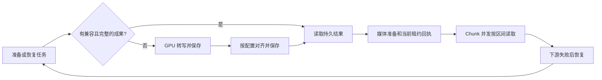

# 1. 问题与现状

日期：2026-10-29。主题：可选本地 WhisperX ASR、强制对齐与字幕时间证据。

**2026-10-30 续版：长视频 ASR 的可恢复成果与本机 GPU 执行。** 本轮沿用本主设计，不另建竞争 TRD；各节新增内容明确标为续版方案，原接入和上线前记录保留历史口径。跟进 [Draft PR #18](https://github.com/owariband/Seekino/pull/18)，分支 `fix/video-asr-recovery`，实际状态统一维护在 [B20](../../dev/problems.md#b20本地-whisperx-正式接入与字幕时间证据)。

**10-30 晚选型决定：** 用户根据同片受控对照，确定本机后续默认 ASR 采用 **`large-v3-turbo Q5_0` + `whisper.cpp` + Apple Metal GPU**。这是 10-30 的选型记录；10-31 本地测试来源已切换，真实课程与独立对齐仍待验。决策、语言配置及边界见[选型记录](#asr-model-selection-20261030)，实验见[Full/Turbo 整集报告](../../report/gateway/local/whisper-metal-full-vs-turbo-20261030.md)。

## 11-01 后续：课程背景与人物归属

用户要求补充 Karpathy 课程背景并向每次 Understanding 注入全片 all_speakers。现已更新当前测试 Series，Prompt 显式传递声源目录/数量和已知讲师，并允许采用清楚的课程人物对应。新版本首块 9/9 对话归属 Andrej Karpathy，原 ASR 与分组均复用、没有新增音频模型调用。人物上下文接入在该首块成立，但请求 311.469 秒，相比缺背景的 260.990 秒没有提速；完整课程归属与吞吐仍待验。[实测报告](../../report/server/speaker-context-20261101.md)。

## 11-01 音频分组能力验证

当前正式 Turbo ASR 的 speaker_id 全为空，不能据“课程里主要一个讲师”替代音频证据。用户完成 Hugging Face 授权后已验证 pyannote 在本机 Apple GPU 可执行；最初为离线实验；随后已接入本工作区的可选正式准备链，隔离 API 在新任务上完成整集分组，并在 SIGKILL 重启后同时命中 ASR/分组成果。Understanding 实际输入与提交已核对，首块 260.990 秒；匿名标签没有消除人物映射判断，未证明下游提速。faster-whisper 的后端限制不能外推到 PyTorch/pyannote。详见[整集实测](../../report/gateway/local/pyannote-mps-20261101.md)。

## 11-01 下游推理耗时与配对输入试点

10-31 已接入合并的 Kimi streaming 文件并在正式测试 API 续跑：140 个新请求均 stream=true，ASR 新增转写 0，暂停时保留 20/117 Understanding 和 1/115 Refine。已确认 600 秒模型预算也控制整段多轮 Refine；另有零 SSE 超时与提交冲突重算。14 个成功 Understanding 的阶段中位数 320.173 秒，输入 198 图且 85.1% 的 output tokens 为 reasoning。该下游性能调查维护在[解析性能主 TRD](video-parse-performance-trd.md#16-2026-11-01-续版kimi-parse-推理耗时调查)，详细证据见[报告](../../report/server/kimi-parse-trace-20261101.md)。

11-01 用户授权的全量图片 timestamp 配对已实现并通过 54 项定向测试；正式 API 续跑约 10 分钟，20 个真实 Understanding 请求均 198 图/198 标签，新增提交 10 个 Understanding、2 个 Refine。原 ASR 行/SHA 不变，新增转写 0。重现 Refine 600 秒总预算后暂停，保留 30/117 Understanding、3/115 Refine、1/117 Indexed；新样本未观察到整体提速，详细诊断归上述主 TRD。没有改变已冻结 ASR 身份或对齐策略，整课产品闭环仍未完成。

## 10-31 存储迁移决定

用户确定采用“模仿 `chunk_parse_content`，新增 `video_parse_content`”的权衡：`video` 作为原片引用和当前展示入口，解析成果按任务独立演进，避免后续成果结构持续侵入原片／上传职责。本决定首先是项目内的职责与变更范围取舍，不以 Spanner 等外部文章证明本项目性能收益；[研究记录](../../research/2026-10-31-video-parse-content-storage.md)仅提供机制与边界。

本轮先迁移整片 ASR 的保存／恢复和现有 Summary 完整成果，正文直接保存 MySQL JSON。当前 Video 标题、简介、封面地址保留为展示投影。完整 Timeline 仍以版本化 Chunk 为事实源，整片物化副本不作为这次恢复修复的前提。该存储阶段曾暂停 Whisper/Metal 接入；同日用户后续恢复了 Turbo＋Metal 纯转写测试，见本地测试切换节，独立对齐仍未接入。单独的 speaker 分组候选见 B12 TODO。

## 10-30 续版背景：旧 PR 合并不等于需求闭环

产品 P0 是完整课程的“找片段 → 看出处 → 回看 → 追问”。本轮演示目标为完整《Let's build GPT》：原音轨 6,979.873 秒、117 个 Chunk。用户需要可完成、可恢复的长任务，不能在下游失败后重新支付全部 ASR 成本。

| 前置改动 | 已解决什么 | 留下什么边界 |
|---|---|---|
| [PR #12](https://github.com/owariband/Seekino/pull/12)，已合入 dev `029faa34`，替代因命名迁移关闭的 #9 | 整片前置转写、Chunk 按区间复用、租约准备回执、有限准备重试，理解并发与逐块 ASR 解耦 | 只在同一协调器执行内复用，没有持久 checkpoint；完整课程耗时未验收 |
| [PR #15](https://github.com/owariband/Seekino/pull/15)，已合入 dev `3c115377` | 等待/加载/转写/对齐阶段、30 秒心跳和进度日志 | 可观测不等于加速或持久恢复；旧在途调用不自动获得回调 |
| [PR #13](https://github.com/owariband/Seekino/pull/13)，相关网络修复 | SDK 分类、有限节点退避、脱敏异常链 | 无法保证供应商与 DNS 永不失败，也不负责 ASR 持久化 |
| [PR #16](https://github.com/owariband/Seekino/pull/16)、[PR #17](https://github.com/owariband/Seekino/pull/17)，相关暂停控制 | 持久暂停、租约撤销、保留任务和已提交内容 | 暂停/继续不保证复用只存内存的完整 ASR |

真实运行暴露三类不同问题：

- **恢复成本：** `VideoParseRuntimeService.prepare` 的 finally 删除 `_video_transcripts[(task_id, lease)]`。不仅 API 重启，下游失败导致协调器退出也会丢失整片结果。`asr_prepared_lease_version` 只是门禁；8 个已提交 Chunk 的局部 evidence 不能替代完整产物。
- **本机执行路径：** full large-v3 CPU/int8＋VAD＋强制对齐实际耗时 4,591.557 秒（76 分 32 秒）；同机 Metal Turbo Q5 完整转写只需 293.578 秒。两者模型和阶段不同，不能宣称同质量加速相同比例。此前 100 秒音频耗时 331 秒已暴露风险，未先核对 GPU 就扩大到整集，是验证顺序的缺口。
- **下游故障：** 14:49:19 Kimi 返回 504，重试后 14:51:49 异常链落到 DNS `gaierror`，GPT v5 停在 8/117。分类和有限重试已执行；外部故障仍可能耗尽预算。不把它解释为 Whisper 识别质量差，也不通过无限重试掩盖。

新 PR 围绕“**前置 ASR 代价高，且下游失败使已完成成果无法复用**”展开。Kimi 原因分类仍由[网络设计](model-network-failure-trd.md)跟进，这里负责其对 ASR 恢复的影响。证据见[整集实测报告](../../report/gateway/local/whisper-metal-benchmark-20261030.md)。学习画像、创作、10 路小 Whisper 及 TimelineEvent 改写不纳入本次。

整片 ASR 增量关联：[PR #12](https://github.com/owariband/Seekino/pull/12)，工作分支 `feat/full-video-asr`；替代因分支命名迁移的 [PR #9](https://github.com/owariband/Seekino/pull/9)，保留全部实现与验证。依赖 dev 已提交的 WhisperX 接入、直接 JSON 与节点重试修复（截至 `80bb293d`）；本 PR 先向 dev 集成，再随后续发布进入 main，独立发布 PR #10 不含此增量。

用户希望 Seekino 直接提供可选的 WhisperX 接入：用户自行安装依赖和下载模型后，可用正式解析代码完成低 API 调用成本的转写，并取得后续字幕需要的字词时间。推荐 WhisperX 的原因是它同时提供转写和声学强制对齐。

修改前 `gateway/transcription.py` 只有 Ark 视频与 OpenAI Audio 两条通路；本机正式配置选择 Ark。`scripts/local_whisper.py` 是独立 whisper.cpp 服务，`evals/parse_protocol_benchmark.py` 对它的调用属于实验，不能视作正式 WhisperX 接入。仅保留句段文本与时间，不能按字词重组字幕行。`config/local-kimi.yaml` 同时管生成、转写和向量，文件名误导了配置作用域。

本次新增正式 Gateway 适配器、字词时间传递和部署指引；开发配置改为 `local-dev-config.yaml`。不在本次实现播放器字幕开关、排版、SRT/WebVTT、整集 ASR checkpoint 或人物 diarization。保留已有 ASR 来源和任务恢复语义。

2026-10-29 后续增量：用户确认先采用整片转写的内存结果，原 Chunk ASR 节点改为区间读取。此前正式链路逐 Chunk 调 ASR；固定视频切分可能截断语音，整片方案能否改善准确率仍待同模型对照。本次只增加音频 ASR 的视频级准备及结果复用，不修改 TimelineEvent、Refine 或索引合同，也不把内存缓存作为持久完成状态。

# 2. 影响因素、假设与评价指标

## 11-01 分组实验口径

正式接入的护栏为：新增配置不改旧冻结任务；同媒体及生产身份的 ASR 新增调用为 0；分组独立提交/损坏重建，旧租约拒绝；新进程恢复时两项命中；真实 Understanding 请求包含全片 scope 和 cue 标签。性能评价分为本地阶段耗时与下游 TTFT/推理/输出耗时，不能只看总时长。减少人物归属反复判断是待证假设，声源稳定不等于姓名已知；单个 Chunk 与历史不同并发/网络的样本不能证明因果提速。

先以同片 120 秒 CPU/MPS 对照验证自动人数及 20 ms 采样区间一致性，再跑完整原音轨；继续阈值为一人且区间差异 ≤0.5%，实测差异 0。整集观察耗时、RSS、MPS 分配、时间/声纹有限性、标签覆盖以及原文/时间不变。此为探索性性能与兼容性验证，未有人工真值，不能当成 DER 或人物身份验收。

## 10-30 续版指标（拟验收）

| 指标 | 基线 | 目标与口径 | 验证 |
|---|---|---|---|
| 完成后的重复 ASR | 协调器失败/重启会重算 | 相同冻结输入下，失败重试、暂停继续和重启后 **0 次新转写** | 新 runtime/进程、调用计数、产物哈希、已提交 Chunk 版本 |
| 产物身份与完整性 | 尚无持久成果 | 媒体、模型/参数、Schema 不同或文件损坏不得命中；旧租约不得发布完成 | 改指纹、跨租户、截断文件、写入中断、迟到完成和重复提交 |
| 转写耗时 | CPU 全流程 4,591.557 s；独立 Metal 转写 293.578 s | 正式 Metal 同原片/配置复测，纯转写暂定 ≤10 min；对齐独立计时，不作为全解析 SLA | 新鲜整集及失败后复用；保留负载、慢调用和冷启动；小样本不报告 p95 |
| 普通详情读取负担 | detail 已较重 | 列表/普通详情不拉完整 ASR；准备时一次读取、Chunk 复用 | SQL/存储读取计数与大正文验证 |
| 来源和时间质量 | 同质量比较未知 | 原始 ASR 不被 VLM 覆写；token 时间不冒充声学对齐；毫秒与窗口合同不变 | 术语、数字、否定词、静音、跨界样本人工回听；试点前冻结质量门槛 |
| 完整课程交付 | GPT v5 8/117，未完成索引 | 至少完整一集完成索引，并通过中文检索、来源、回看、追问 | 冻结任务/内容/索引版本的端到端验收 |

GPU 可用性已有整集实测；正式 GPU＋对齐总时长、质量、持久恢复和长请求稳定性仍待验证。文件落盘不等于正式 checkpoint 可用。

10-30 晚新增控制变量对照：同一 M5、同一完整课程、同为 Q5_0 和纯转写，比较 full large-v3 与 Turbo，消除旧 CPU/Metal 对比同时改变模型和处理阶段的混杂。结果指标为请求耗时与资源采样；Encoder/Decoder 计时用于诊断；术语、数字、否定条件和时间来源作为质量护栏。当前文本 diff 只有模型间一致度与定点画面核对，没有人工参考转录，不能充当 WER/CER 或质量验收；本轮支持默认模型选型，正式试点的质量门槛仍须在评测前冻结。

## 10-31 迁移验收补充

- 结果指标：同一合法输入／模型合同下，ASR 已提交后发生下游失败、暂停继续、进程／runtime 重建，新增转写为 0；ASR 存在但身份或 Schema 不匹配不能命中。
- 正确性护栏：旧租约迟到不得提交；ASR 与 Summary 分阶段更新不得覆盖对方；Summary 正文与当前展示投影保持原子发布。空转写可为合法成果，成果行存在不代表全部解析完成。
- 访问护栏：任务心跳、上传／视频列表不读取完整 ASR；正文不随无变化轮询改写。本文不预设延迟、binlog 或内存改善比例。
- 兼容性：历史 Summary 提交结果、帧回执和任务执行状态保留；无法证明的历史封面 URI 不从当前 Video 值反推。旧任务未持久保存的 ASR 不伪造回填；实验 Turbo 不转成旧 full large-v3 任务成果。

## 原接入与内存复用指标

主要因素是接入是否实际到达正式入口、两套权重是否准备完整、时间单位与原片偏移是否正确、模型是否重复加载，以及真实素材下的识别和对齐效果。

| 指标 | 基线 | 目标/护栏 | 验证方法与证据 |
|---|---|---|---|
| 正式调用路径 | 只有 Ark / openai_audio | 配置选择 whisperx 后执行转写及 align | 工厂、适配器、Server 测试 |
| 字词证据保留 | 仅句段 | 已对齐词带毫秒范围，未对齐词保留文本及 null 时间 | Engine 规范化及偏移测试 |
| 可选性 | 无本地 ML 启动依赖 | 不选不导入/不加载；未安装依赖有明确错误 | 无 ML extra 环境的测试 |
| 重复加载 | 新增方案待测 | 同一 Gateway source/model 只加载一次，各语言 aligner 复用 | 多 Chunk 句柄复用测试 |
| 历史兼容 | 既有冻结配置与 detail JSON | 旧响应不新增空字段，保持租约、提交条件和重试配置 | 相关 Gateway/Engine/Server 回归 |
| 时间精度与转写质量 | 当前素材基线待测 | 先测字/词错误率、人工标注边界误差和未对齐比例 | 同素材、同音频、固定权重的后续试点 |
| 速度与资源 | 本机真实 WhisperX 待测 | 记录冷/热启动耗时、实时率、峰值内存；暂不声称加速比例 | CPU/CUDA 分别测量，不能混用 |
| 整片转写复用 | 每个 Chunk 调一次 ASR | 同一协调器执行内只调用一次，后续 Chunk 读取交集 | 并发 Chunk、重试重建及失败清理测试 |
| 边界与计时 | ASR 按 Chunk 偏移，现有总时长覆盖子任务 | 整片时间不重复偏移；前移后的 ASR 纳入总有效时长 | 跨界 cue、字词副本、租约计时与总时长投影测试 |

本地推理预期避免 ASR API 按次费用，但会增加本地计算和权重维护成本。对齐并不能修正所有识别错误；音乐、重叠说话和混合语言是否适用仍需真实测量。

# 3. 改造方案与建模

## 11-01 课程背景与全片 speaker context（单块试点完成）

上一轮首块已得到 SPEAKER_00，却有 6/6 对话 speaker=null：正式测试 Series 的背景为空，Prompt 又仅允许直接人物对应证据。用户本轮明确要求补充 Karpathy 课程来源、在每次 Understanding 注入 all_speakers，并结合全片主声源归属到讲师。本轮沿用 PR #18，不新增并行声纹识别服务或数据库字段。

方案是在现有 Series description / important_extra_data 中保存官方课程来源与用户提供的讲师背景；Prompt 从原有 ASR 全片 catalog 组装 all_speakers（scope、scope_id、声源编号/数量、背景已知讲师），对未启用全片分组的旧输入明确只代表当前 clip。人物判断允许采用已给定的单讲师背景及匹配的全片声源，不要求每句重新做生物特征验证；有矛盾、多个未对应声源或没有人物背景时保留未知。Refine 采用相同证据口径，防止事后把已支持的人物归属全部撤回。

验证先检查跨 Chunk 完整 catalog、旧 clip 作用域及未知背景，再在同一原片的新解析版本观察首块（单路、其余模型/帧数/流式配置保持），复用已提交 ASR 和分组，保存实际请求、最终 speaker 与计时。主要成功指标为背景/目录实际可见、首块主要讲解对话能依据用户提供背景归属 Andrej Karpathy，且新增转写/分组均为 0。耗时与上一轮 260.990 秒比较，单次结果不证明全课速度收益；若仍 null，记录残留冲突而不程序强制改写结果。首块提交后暂停，保留旧版成果。

## 11-01 分组正式接入（工作区实现与隔离试点）

问题是整片转写没有匿名声源分组，且现有 Prompt 把编号限定在 Chunk 内，无法复用全片一致性。已有 CPU VAD 与 pyannote MPS 整集测量支持接入；本轮复用 whisper.cpp 转写，不再把独立 VAD 串入已完成转写，不声称声学强制对齐已完成。

改动限定为：Gateway 增加本地 pyannote 分组能力与显式模型绑定；Server 在 ASR 已提交之后运行分组，在 video_parse_content 增加独立 diarization JSON 正文及 detail 中的身份/摘要/合法租约审计；Engine 按时间重叠为副本补匿名 speaker_id，原转写正文不修改；Understanding/Refine 接收 video 作用域和 scope_id，只在相同作用域复用声源编号，真实人物映射缺少证据时直接保留 null。分组没有覆盖的 cue 和跨多个主说话人的 cue 保留未知。

配置是任务冻结的可选 models.diarization；旧任务默认关闭。分组身份核对原媒体、冻结绑定、本地权重摘要、设备/参数及 Schema；完成事实仅在当前租约提交，坏结果只撤销分组，重启/失败恢复优先复用转写与分组各自的成果。新解析版本只在同一 video 内查找身份完全匹配且正文摘要验证成功的历史 ASR／分组，在当前合法租约下复制成果并记录来源任务，避免只增加分组就重做转写。新配置不能静默改写旧任务；试点应建立明确的新解析版本或隔离任务，保留已有 30 个 Chunk 的历史结果。

验证先覆盖配置兼容、毫秒/作用域/混合说话人边界、分组失败后零新增转写、损坏结果重建、旧租约拒绝和准备门禁；随后经正式准备入口验证完整原片，在同一 Chunk 对比有无声源输入的耗时及结果。效果目标是减少重复身份判断，实际速度收益待测；网络首片等待和 Refine 多轮工具问题仍由性能 TRD 跟进，不能以声源标签替代整体性能修复。长任务运行期间使用临时防空闲休眠，不修改整机长期设置。推广以前述恢复护栏与真实输入可见性为条件；准确率、声学对齐和完整课程闭环仍未验收。

## 11-01 本地音频组合实验边界

复用已提交的 whisper.cpp 转写；独立运行官方 community-1 Pipeline 的 MPS segmentation/embedding 与 CPU 聚类，再用 WhisperX 的时间重叠分配合并匿名 speaker_id。语音分组不修改文本或 token 时间，独立结果保留原 ASR 及分组模型 revision，未覆盖业务库的冻结输入。原始转写、声学对齐和分组分别判断完成，正式接线与恢复待验证。

## 10-31 当前实施方案：任务对应的 MySQL 成果

一条 `video_parse_task` 对应至多一条 `video_parse_content`。采用 `id`、唯一外键 `video_task_id`、可空 `asr` JSON、可空 `summary` JSON、成果修订 `version`、轻量 `detail` JSON 和既有公共时间字段。独立字段只承接本轮已存在的两类成果，不增加尚无消费者的整片 Schema 副本。

- `asr` 保存现有归一化完整转写及绝对毫秒／词时间合同，不能用 Summary 或 VLM 改写替代。`detail.asr` 记录输入与计算合同、Schema、完整性摘要和提交审计，完成后才可复用。
- `summary` 保存现有 submission、封面 URI 和帧回执；任务 detail 仅保留调度、租约、重试、完成与发布回执。实际封面图片继续由 ArtifactStore 保存。
- 准备时先检查持久成果，身份／正文有效则装入现有进程内区间读取缓存；否则在合法执行中生产并提交。清理缓存不删除成果。提交与当前任务／租约校验位于同一事务，旧租约不能改写；恢复身份不包含当前租约号。
- 复用身份包含媒体 SHA／时长、冻结模型绑定、实际来源计算配置与归一化合同。配置改变不能把另一模型成果当成原成果；本轮不提供跨任务或跨视频缓存。
- 新增受控迁移入口，先预览，再在写入者停止的条件下建表并幂等搬迁历史 Summary。不能通过启动时悄悄补表掩盖旧库未迁移；不删除原片或 Chunk 成果。

新增成本是一张表、一次需停止旧写入者的历史迁移，以及成果与展示投影的原子发布约束。原片上传和读取不依赖这张成果表；常规任务心跳不接触大正文。ASR 与 Summary 仍在同一成果行，`binlog_row_image=FULL` 下阶段更新可能携带另一正文，不能据拆表本身宣称日志或内存下降。接受这些成本，是因为完成成果获得独立生命周期，新增解析结果的修改不再持续侵入上传／原片模型。具体搬迁与历史封面边界见[迁移说明](../../migrations/20261031_video_parse_content.md)。

实施主要跨四个层次：数据库 DDL／启动结构校验、ORM／DTO、Repository、Server Service／runtime。API 展示合同、Agent Prompt、模型实现和检索投影沿用既有路径，测试负责检查兼容。验证先使用隔离数据库与可计数模型替身覆盖失败恢复，再核对真实数据库迁移；不能用模型性能实验替代迁移正确性。

### 本轮实现文件与职责

模型按对象职责组织。现行对象为 `VideoParseTask`、`ChunkTask`、`IntervalParseTask`，由 `task.py` 管理执行状态、租约和任务约束；`parse_content.py` 统一保存 Video／Chunk／Interval 成果。`video_task_id` 只表达成果归属，不构成将成果放入任务文件的理由。用户随后明确删除旧 Job／Checkpoint 模型及其相关测试；旧模型、外键、查询和状态兼容按下述退役续版一并移除。DTO 相应按任务、成果、素材和检索职责组织，现行任务 VO／进度模块同步采用 Task 命名。

10-31 评审记录：最初因已有 Chunk 成果在 `job.py` 就追加 Video 成果；随后仅拆出 Video 独立文件，仍未解决原文件内任务、成果、素材与检索类型混放。用户进一步确定统一按职责整理，并将现行 Job 文件改为 Task 命名；以下目录替代前两次文件归属方案。

```text
server/
├── database.py                          修改：注册拆分后的模型，检查物理 Schema
├── model/
│   ├── task.py                         从 job.py 移入：现行任务、状态与成员校验
│   ├── task_progress.py                从 job_progress.py 改名：任务进度计算
│   ├── parse_content.py                Video／Chunk／Interval 成果 ORM
│   ├── dto/
│   │   ├── taskDTO.py                  任务、租约与调度 DTO
│   │   ├── parseContentDTO.py          成果元数据与内容快照 DTO
│   │   ├── libraryDTO.py               原文件扩展：接收素材 DTO
│   │   └── searchDTO.py                原文件扩展：接收检索 DTO
│   └── vo/taskVO.py                    从 jobVO.py 改名：任务展示合同
├── repository/video_parse_content.py    新增：分列读取和保存成果
└── service/
    ├── video_parse_results.py           新增：ASR 身份校验、恢复及提交
    ├── video_parse.py                   修改：实际 ASR 准备／恢复接线
    ├── video_parse_persistence.py       修改：成果事务入口及准备门禁
    └── video_parse_summarize.py         修改：Summary 与展示值原子发布
scripts/
└── migrate_video_parse_content.py       新增：旧库建表与 Summary 数据搬迁
```

所有调用方直接引用新的模型文件，移除旧模型路径，不增加转发导出；Repository／Service 的业务逻辑保持既有边界。单纯文件整理不重命名物理表、字段、HTTP 路由或返回字段，不引入新的数据库迁移；同日后续退出 V1 兼容的 Schema／接口变化见下一节。重构前保存完整 MySQL DDL／索引基线，重构后逐项对比；以独立进程的模型注册、迁移入口和现有 Server 回归核对兼容，并用隔离 MySQL 检查 ASR／Summary 成果路径。此处是验证计划，实际通过结果在验证节记录。

上述为实现／迁移文件；各层消费者和 `tests/server/` 同步更新 import。职责与部署说明同步本主设计、Server README、迁移说明、devlog 和 B20。

## 10-31 模型整理续版：退出旧 Job／Checkpoint 兼容

本次继续在 PR #18／`fix/video-asr-recovery` 中落实用户对模型整理的明确修正：删除刚归类的旧模型及其专用测试，不把已退役执行链继续包装成长期模块。2026-10-22 已删除 V1 执行链，新上传只创建 V2 Task，但旧模型仍让新库创建旧表、让重复完成请求查询旧 Job，并使删除链与展示合同承担兼容。引用存在只能说明依赖尚未清除，不能证明当前产品仍需要这套行为。

影响因素是旧模型注册、数据库外键、上传／删除分支、API 字段与人为构造旧数据的测试。验收目标为：现行 ORM 不再定义两种旧模型及其专用 `ParseUsageAttempt`；新库注册表由 25 张减为 22 张；V2 上传、幂等完成、Retry、Reparse、删除恢复、ASR 持久恢复及检索回源保持通过。旧模式测试构造与断言删除，混合测试保留 V2 行为。表数变化只说明本轮退出三张表，不宣称其他历史模块已全部清除。

改造覆盖 `model/legacy_parse.py`（删除）、`model/upload.py`、`model/parse_usage.py`、上传与素材 DTO／VO、`repository/upload.py`／`library.py`、`service/upload.py`、API 投影、ArtifactStore 的旧 Job 目录方法及 `database.py` 注册／校验。HTTP 返回移除旧 `jobId`／`latestJobId`，前端类型与测试样例同步；现行 `videoParseTaskId`、任务版本和租约合同保持。无 V2 任务的视频按未解析显示，不通过旧 Job 状态恢复可检索语义。

现行用量记录仅关联 `video_task_id`；旧 `job_id` 列、索引、外键及双模式约束移除。提供 `scripts/migrate_retired_parse_models.py`：默认只读预览，明确停写后才可执行；保留原片、Video、全部 V2 任务／成果和 V2 用量，退出旧表及旧关联。迁移发现无法解释的现行用量身份或额外外键时先报错，不猜测回填。MySQL DDL 隐式提交，执行需备份并支持重入；启动不自动删表或删数据。本轮只在隔离数据库执行验证，不操作真实开发库。

验证先运行模型／上传／API 定向回归，再按影响运行 Server 与前端类型／相关测试；隔离 MySQL 核对空库、原 Schema 升级、重入和 V2 数据保留。模型与服务生产代码中不应再有旧模型的运行引用，迁移脚本中的历史表名只用于退出旧结构。测试通过不代表旧库已迁移；执行结果补入本 TRD 验证节与 devlog，正式 Metal 与整课验收仍保持原边界。

## 10-31 本地测试切换：Turbo＋whisper.cpp Metal

用户明确恢复本地 GPU＋Turbo 的切换，并将当前测试限定为 whisper.cpp 转写，不接 WhisperX。现有主工作区 `.env.local` 仍选择 `whisperx_local` 的 full large-v3／CPU／int8／batch_size=1，且独立 worktree 缺少默认相对路径下的可执行文件与权重；直接改模型名不能完成切换。另一个接线问题是新上传的默认整片 scope 仅对 WhisperX 生效，切成 HTTP 音频源后会退回 Chunk ASR，绕过本轮持久成果恢复。

复用已有 `openai_audio` 和 `scripts/local_whisper.py`，选择 `large-v3-turbo-q5_0`，启动本机现有 whisper-server／权重并使用 Metal。启动脚本支持显式配置、binary、模型目录，固定一套模型／一个 processor；启用已实测的 flash attention 和解码参数。新建 whisper.cpp 任务默认 `scope=video`，既有冻结任务不改写。活动来源不使用 WhisperX 的 batch_size、compute_type、对齐模型字段；CPU threads 仍是主机线程设置，与 GPU 并行度不同。旧 WhisperX 来源仅保留为旧冻结任务的引用，不被当前 transcription 默认选择。

本轮是用户明确选择的纯转写测试：句段／token 时间来自 whisper.cpp，声学强制对齐未执行，不能将其标成 WhisperX 对齐结果，也不将 Turbo 结果填入旧 large-v3 任务。HTTP 侧的持久成果身份继续使用声明的来源／模型配置；实际本地权重、二进制和启动参数另在服务记录中保存并核对，不声称通用 HTTP 接口能独立证明服务内部权重。对服务权重或解码配置的更换需新解析版本。

验证先检查配置解析、新任务 scope 与旧任务兼容，再通过正式 Gateway Audio Transcriptions 调用一个最多 60 秒的课程样本，核对原始响应、归一化毫秒、实际 Metal 后端和 Turbo 权重，记录耗时／内存。初轮只启动已核对端口的 Whisper 服务，不启动 API／Consumer、不迁移业务库、不重排旧任务；整集补验范围见下一段。此前完整课程实验作为选型证据保留；本轮短样本与接线成功不能替代 117 Chunk 全流程验收。

同日用户指出目标应为完整 116 分 20 秒，而不是只验 60 秒。60 秒保留为接线前置检查，随后追加一次同集完整 6,979.941625 秒音频的正式 Gateway 调用，复用已核验的单个 Turbo＋Metal 服务，记录端到端请求耗时、结果覆盖与进程 RSS。此次补验仍只做 ASR，不启动 Kimi／117 个 Chunk 或业务数据库，不将实验结果导入旧任务。整集执行结果补在验证节，短样本和整集分别记录。

## 10-31 实机验收纠偏：通过解析 API 中断和恢复

用户明确要求启动本 worktree 的完整 API／Consumer，从完整原片的上传／解析接口验证，并执行暂停、正常停服、异常终止与重启；独立转写调用不能替代该验收。本轮使用独立测试 MySQL／ES 和媒体目录，保留旧开发库与 GPT v5。成功条件为同一任务恢复后继续使用已提交 ASR，新增转写为 0；记录实际调用、持久正文与租约，而非仅检查进程健康。

真实 SIGINT 发现媒体准备生成器仍在执行时被清理；复用既有 ExecutionCalls 将清理延迟到阻塞调用结束。连续中断又发现准备成功和已有拓扑的用户 Retry 未清旧准备失败预算，导致后续接管立即耗尽预算；准备成功清零连续失败计数，显式 Retry 重置准备预算，自动失败接管的有限重试保持。改动限于 Server 执行清理、成果准备完成与 Retry 边界，不更改模型、Schema 或租约 fencing。

## 10-30 续版历史候选（正文外置方案已由 10-31 决定替代）

保留整片前置、Chunk 区间选择、租约准备回执、MySQL 事实与 ES 派生索引，改变成果生命周期和本机执行后端，不扩展为通用任务平台。

**视频级成果。** 采用用户提出的 `video_parse_content` 作为拟定持久入口，与 `chunk_parse_content` 分工。MySQL 保存轻量元数据及 ArtifactStore 引用，完整正文独立保存并按需读取；不追加到 `video.detail` 或轮询响应。首版只复用同一解析任务、相同冻结输入及模型合同的产物，不自动跨 reparse/跨视频复用。

拟定元数据为任务 ID、产物类型（转写/对齐）、源媒体指纹、生产者指纹、Schema 版本、内容版本、产物 URI/校验和/字节数、完成时间。源指纹包含实际媒体内容与时长，生产者指纹包含权重版本或哈希、语言、解码/VAD/对齐参数和归一化版本；不能只凭模型路径或旧租约号命中。唯一约束覆盖任务、产物类型和兼容指纹；权限沿任务/视频归属校验。最终字段、迁移及备份说明随实现补齐。

**发布与恢复。** 模型返回后校验结构和时间，先写临时文件并校验，再发布不可变产物，在当前租约事务内提交完成元数据。发布失败的孤立文件不代表完成；清理不得删除仍被已提交内容引用的产物。重试先查询并校验已完成成果，命中后加载，再准备媒体和当前租约回执。协调器退出只释放内存，不删除持久产物；文件缺失/损坏在有限准备预算内重建。旧租约迟到不能发布，暂停/取消仍撤销租约。仅有转写时，要求强制对齐的任务不能通过门禁。



**GPU 与对齐。** 优先复用 `openai_audio` 协议及 `scripts/local_whisper.py`，经正式配置接入 whisper.cpp Metal；Gateway 负责通用模型调用、用量、超时和进度，Server 负责持久产物，Engine 保留毫秒转换/区间算法。保留现有 WhisperX/CPU 可选路径，未启用本地后端的用户不新增依赖；跨平台性能分别验证。

转写和强制对齐拟拆为可单独保存的阶段，对齐失败只重做对齐。旧 WhisperX 任务仍保持强制对齐合同，Turbo token 时间和置信值不冒充声学对齐。如果采用仅句段时间，必须显式配置并另验收，不能静默降级。更换 provider/model 需新解析版本，不把 Turbo 实验结果塞入冻结为 full large-v3 的旧任务并声称命中。

**并发和纠错。** ASR 实例/并发与 Understanding 独立限制；当前共享锁使 10 个本地请求排队，不能按 Kimi 的并发经验启动 10 套模型。VLM 没有原音频时只可给有来源的解释或标记清楚的校正建议，不得覆写原始证据。小模型、多模态音频纠错和其吞吐另作候选。

**网络与范围。** 沿用 #13 的分类、有限退避和最终停止，以 504/DNS 故障注入检验“下游失败不重复 ASR”。供应商长请求和 DNS 责任继续归原网络/性能问题，不在本 PR 无界增加重试或调整系统代理。复核 Parse/Refine 总在途，Parse=10 不等于账号总并发=10。

实施顺序：持久成果及恢复测试 → 正式 GPU 与独立对齐接线 → 完整课程中断恢复和检索回看验收。必须覆盖新增表迁移、媒体备份/清理引用及旧任务无产物的兼容路径，保留已提交 Chunk。这里是方案，不代表已迁移、已切换配置或授权重启。

<a id="asr-model-selection-20261030"></a>

## 10-30 续版选型决定：Turbo + Metal 作为本机默认转写方案

用户在本轮实验后明确“我认为turbo性价比最高，我们最应该使用的就是turbo whisper”。据此将本机后续默认方案收敛为 **模型 `large-v3-turbo`、量化 `Q5_0`、推理引擎 `whisper.cpp`、后端 Apple Metal GPU**。WhisperX 的声学对齐职责仍按前述拆分设计保留；不能把推理引擎、转写模型和对齐模型混为同一选型。

- **选择依据：** 在 Apple M5 / 10 核 GPU / 16 GiB 统一内存上，完整 GPT 课程纯转写为 Turbo 182.360 秒、Full 495.115 秒，Turbo 耗时减少约 63.17%；进程 RSS 采样峰值为 2.525 / 3.276 GiB。11 处文本抽查中两边各有错误，暂未取得 Full 的质量收益足以抵消额外耗时的证据，因此不把 Full 设为本机默认。此决定只覆盖当前已测硬件和方案，不声称 Turbo 在所有语言、素材与设备上最优。
- **语言合同：** Turbo 是多语言转写模型，支持日语语音转日文，日语代码为 `ja`（不是 `jp`）；已知语种按素材显式配置，未知时使用 `auto`，不能沿用本轮为了对照固定的 `en`。语言策略与模型/量化/解码配置进入新任务冻结参数及成果身份。官方明确 Turbo 未针对非英语语音翻译到英语任务训练；跨语言字幕翻译不由本次转写选型承诺。[官方模型及日语用法](https://github.com/openai/whisper#command-line-usage)、[官方 Turbo 模型卡](https://huggingface.co/openai/whisper-large-v3-turbo)。
- **资源与失败边界：** 本机默认先按单路 ASR 接入，沿用与 Kimi 独立的并发限制；RSS 不等于独立显存或全部物理占用，设备 GPU 利用率不能当成进程独占计数，未测并发上限和功耗。Metal 不可用时必须明确报告，不能静默退回 CPU 执行长课程；显式选择旧 CPU 路径仍保留兼容。
- **生效边界：** 本条记录已选设计，未修改运行配置或部署服务。后续按既定顺序完成持久成果、正式 Metal 与独立对齐接入；新版本冻结 Turbo 身份，旧 large-v3 任务不换模型、不误用实验文件。日语官方支持与旧 WhisperX 日语短样本，不等于本轮 Turbo + Metal 日语转写或强制对齐已验收。

过程与取舍见 [devlog](../../dev/devlog.md#devlog-asr-turbo-selection-20261030)；完整输入、权重指纹、参数与 diff 位置见[实验报告](../../report/gateway/local/whisper-metal-full-vs-turbo-20261030.md)。

## 原 WhisperX 接入及整片内存复用实现

复用 [WhisperX 3.8.6](https://github.com/m-bain/whisperX/tree/v3.8.6) 的 `load_model → transcribe → load_align_model → align`。WhisperX 内部使用 faster-whisper；使用项目可选 extra，不另建 HTTP 服务。与仅用 whisper.cpp 句段输出相比，多出强制对齐与模型/语言配置，也增加依赖和权重成本。

```text
models.transcription + model_sources.whisperx_local
  → GatewayClient.create_transcription_model
  → Server 已准备的 16 kHz mono PCM16 WAV
  → WhisperX 转写 → 对应语言的强制对齐
  → Engine: 秒转整数毫秒、窗口裁剪
  → Server: 加原视频偏移
  → Canvas 不可变 ASR evidence → Chunk detail
```

- 配置：`adapter: whisperx` 只提供 transcription/audio。绑定 `model` 为本地 CT2 目录；来源配置设备、精度、batch、线程、可选固定语言与语言→对齐模型目录。最初提供未选中的来源模板；2026-10-29 经用户授权及三语实机验证后，本机开发配置已选择完整 large-v3、CPU/int8、batch 1。[部署指引](../../model-config.md#本地-whisperx-asr-与对齐)。
- 下载：可选 extra 固定 WhisperX 3.8.6。模型、tokenizer 和 NLTK 数据由用户准备。ASR 使用 `local_files_only`，对齐使用本地 HF 目录及 `model_cache_only`；预检 tokenizer 和实际 Punkt 语言资源，避免上游缺文件时自行下载。VAD 使用 WhisperX 包内 checkpoint。
- 时间：Gateway 保留上游秒；Engine 转换一次；Server 加偏移一次。旧 `start_seconds/end_seconds` 是毫秒。新增 `language?` 与 `words?`，字词结构为 `text/start_ms/end_ms/score`。未知时间成对为 null，非法/反向时间报错，越窗或零宽词保留文本而时间未知。中文/日文可能是单字。
- 精度：WhisperX 句段回退和插值可保留不可对齐文本，但无分数词的插值时间被移除；失败的整段可能保留原 ASR 粗范围和空词表。分数只是对齐输出，不作为已校准概率。不给 speaker 编造身份。
- 生命周期：Gateway 按 source/model 缓存 runtime，锁串行保护同一模型及 aligner 缓存；调用句柄单独关闭，Gateway 关闭释放引用。沿用 usage、预算、取消；超时包含等待和加载，原生推理只能返回后检查并拒绝过期结果。
- 兼容：新字词随现有 evidence JSON 提交，不改数据库表或旧任务。正常重试继续使用冻结配置；切换已有视频须显式 reparse 并提供新配置。模型目录在任务生命周期内应保持稳定，原地替换权重不会形成新的内容身份。

验证顺序：核对固定上游 API 与依赖兼容 → 离线合同/失败路径 → 正式解析入口与 evidence 保留 → 准备权重后的真实素材试点。真实效果不达标时继续允许原 ASR 来源，不把本地方案强制设为默认。

## 视频级转写与 Chunk 读取

- 新建 WhisperX 任务的默认配置为 `models.asr.scope=video`；其他来源以及缺失该字段的历史任务仍为 `chunk`。显式 `scope=chunk` 可以回退，序列化省略该默认值，保留旧配置形状。整片模式要求音频 Provider 且开启 Understanding；ASR-only 直接事件转换暂不接受跨界 cues。
- Server 在发布该轮整片媒体、调度新 Chunk 前，从原片提取完整 16 kHz mono PCM16 音轨，经既有 Gateway 转写及对齐。归一化为原片绝对毫秒后，在同一个 RuntimeService 内按 `(parse_task_id, video_lease_version)` 缓存结果。沿用视频租约、模型调用预算与取消控制；成功后才发布缓存，失效租约不得发布。
- 原 `transcribe_chunk` 保持返回 `ASRResult`，选择 `cue.start < chunk.end && cue.end > chunk.start` 的完整 cues，保留原始文本、时间和 words。每次深复制，避免 Chunk 修改共享数据；不再加 Chunk 起点。Understanding 的可写区间保持原合同，跨界原句只提供上下文，不扩大事件写入权限。
- 采用现有单 RuntimeService 的进程内 Consumer；不支持将同一视频的协调器和 Chunk 分配给互不共享内存的服务实例。缓存缺失明确失败，不伪装为空转写。协调器退出后释放缓存，服务重启或新协调器重试会重新转写；已提交 Chunk 沿用既有恢复逻辑。没有整片 ASR 的持久 checkpoint。
- Chunk 领取还需当前视频租约下的 `asr_prepared_lease_version` 回执，由 Server 在内存转写与整片媒体均准备成功后写入原任务 detail。新协调器租约天然使旧回执失效；回执不保存转写文本，不是可跨重启恢复的成果。恢复时排队 Chunk 不会提前领取并消耗执行超时。视频准备失败以及准备中租约过期计入既有 Prepare 失败预算，超过冻结的重试次数后停止，避免 PARSING 恢复阶段无限重建。
- 新建的仅供观看问答按需解析任务保持 `scope=chunk`，因为该路径没有整片协调器和视频缓存；已经存在的完整解析任务仍保留原冻结配置。正式全片默认值不改变按需观看的职责。
- 临时整片音频在实际原生推理退出后清理；文本缓存生命周期不延长音频内存生命周期。整片调用超时覆盖整段转写，需按素材长度配置 `request_timeout_seconds`。首个 Chunk 需等待整片 ASR，这是相对逐 Chunk 的延迟代价。
- 2026-10-30 的目标负载是先完成一个视频的 ASR，再让 10 个 Understanding Chunk 读取结果。WhisperX 已由 Gateway 按来源与模型复用 runtime，并在内部串行推理；前置 ASR 解决逐块排队转写与理解槽位的耦合，不额外创建 10 个本地模型。初次部署保持 `SEEKINO_VIDEO_CONCURRENCY=1`，单独调整 `SEEKINO_PARSE_CONCURRENCY=10`；Refine、Summary 可能同时调用 Kimi，因此 Parse 的 10 个槽位不等于账号总在途上限 10。
- `asr` 阶段沿现有 execution_timing 账本在视频租约下采样，任务总时长继续取执行区间并集；排队及停机不计入。普通 release 时长展示已由前置提交开放。本次无需数据库迁移或新队列。

# 4. 对照实验与结果分析

## 11-01 课程背景与人物归属试点结果

v3 `c3970da1-53b7-4cf5-9bb2-15bfa01e9947` 在相同首块/189 图/单路/Kimi/stream 参数下实际消费课程来源和 all_speakers：voice_group_count=1、voice_groups=[SPEAKER_00]、known_speakers=[Andrej Karpathy]。原音频成果全部复用，新增转写/分组均 0。输出 persons=[Andrej Karpathy]，9/9 对话采用该人名；上一轮为 6/6 null，两轮事件拆分不同，不能计算全课人物识别准确率。43 项定向与 157 项 Agent 回归通过，计数重叠。

请求耗时 260.990→311.469 秒，首 SSE 50.781→59.239 秒，reasoning 180.503→220.099 秒；输入 token 只增加 396（约 0.17%）。保留人物背景接入，未证明时长改善；单次试点不足以将时间差归因于新增 context。本轮首块提交后暂停，原版本保留；Refine 采用一致 Prompt 口径但尚未实跑验证。详见[报告](../../report/server/speaker-context-20261101.md)。

## 11-01 正式 API 分组与恢复试点

隔离任务新版本 `6cf69603-6708-4d24-bee3-2dff0e858ad3` 从旧版 `613f40e2-7bcb-4e38-9ae4-9ad1021afb51` 复用身份与摘要一致的完整 ASR。pyannote 实际 segmentation/embedding 设备均为 MPS，单次 Adapter 日历耗时 425.828 秒，包含音频准备的阶段记账 429.425 秒；本次临时防空闲休眠，单调/日历差仅毫秒级。segmentation 19.615 秒、embedding 398.565 秒，主要计算仍在声纹提取。

持久分组包括 1455 个 regular turns / 1446 个 exclusive turns；主簇为 SPEAKER_00，另一簇只有 9 个短重叠区间合计 1266 ms，不能认定第二个人。按 exclusive 主声源映射后 2474/2476 cues 有标签，2 条未知；原文及所有时间逐字段不变。新任务在分组提交后强制 SIGKILL API，重启及暂停继续后同时命中 ASR/diarization。观察脚本一处序号 SQL 写错表导致首次观察暂停，修正后继续同一任务；没有重算音频来重做测试。

226 项定向与 726 项关联后端回归通过。Web 新配置合同的独立严格类型检查通过；工作区没有 web/node_modules，完整 web typecheck 未执行成功。真实 Understanding 第一块请求已包含 speaker_scope=video、任务 scope_id、全片 dominant groups 与 cue 标签；请求仍使用 Kimi stream=true，189 张原时间配对图。首块成功提交 18 个事件，6 个对话 speaker 仍为 null；请求 260.990 秒，其中首 SSE 50.781 秒、reasoning 流 180.503 秒，5358/6949 output tokens 为 reasoning。历史同块 234.166 秒但网络/并发/stream/缓存不同，不能作因果提速结论。首块提交后暂停，新版本 1/117，旧 30/117 保留，新增 ASR 0、分组模型加载 1 次、恢复命中 1 次。详见[正式 API 试点报告](../../report/server/video-diarization-api-20261101.md)。

## 11-01 VAD／pyannote 整集结果

整集 6,979.941625 秒音轨的 pyannote MPS 按排除休眠的单调时钟计，推理 426.240 秒，含初始化共 429.427 秒；机器中途休眠，含休眠日历总耗时约 1718.468 秒。自动得到 2 个匿名声源簇，未强制说话人数；第二簇仅 9 个重叠小段、合计 1.266 秒，exclusive 输出仅一个主簇，未人工回听确认为第二个人。2,476 条原转写中 2474 条按直接时间重叠获得标签，2 条保持未知。 OS 进程峰值 RSS 1.679 GiB；MPS tensor/driver 采样峰值 0.981/3.699 GiB，不相加。独立 CPU VAD 推理 268.170 秒。合并结果通过既有 Schema 与时间范围校验，原文本/时间逐字段一致；短样本有 clustering 数值警告，最终声纹与时间有限。阶段数据、原始证据和质量限制统一见[实测报告](../../report/gateway/local/pyannote-mps-20261101.md)。

## 10-31 存储迁移验证

746 项相关 Server 回归通过，覆盖队列、暂停、上传 Retry、Summary、Schema 与区间读取；另用独立 Python 进程恢复已提交 ASR，禁止进入模型阶段或创建 Provider，检查通过。隔离 MySQL 8.4.13 的 15 项检查通过，覆盖真实 JSON 往返、损坏正文、身份拒绝、旧租约、正式 Retry、迁移重入与冲突回滚、Summary 原子发布及回滚。临时实例禁用 TCP、使用独立目录和随机 `_test` 库，测试后已关闭。

四种恢复路径（协调器失败、Understanding 终态失败后 Retry、租约过期并重建 runtime／连接、暂停继续）的计数模型均为初次转写 1 次、恢复新增 0 次；ASR 与 Summary 不相互覆盖。普通任务读取及心跳 SQL 不访问成果表，命中复用与同结果重提交不发出成果 UPDATE。模拟模型不构成真实识别质量或整课性能验收；未测实际 binlog／RSS 收益。原始 XML 与 MySQL 日志位于 `outputs/verification/video-parse-content-20261031/`，复跑入口和兼容边界见[迁移说明](../../migrations/20261031_video_parse_content.md)。

## 10-31 Task／成果模型整理验证

同日 Task／成果模型整理验证：首轮 194 项定向回归通过；Server 全量运行得到 2,729 passed、121 skipped、2 failed。两个失败均为过期测试预期：未计入新成果表的表计数，以及漏列重构前已存在的暂停／继续路由。修正后两项独立复跑均通过，未修改对应生产行为；其余已通过测试未重复运行。121 项跳过因未配置外部测试数据库／ES／Redis，其中 15 项成果 MySQL 用例已在独立临时实例补跑通过。25 张表的列、约束、索引和表选项与重构前一致（比较时忽略表选项排列顺序）；独立进程的建表注册、迁移预览／执行／重入、旧 Chunk 迁移 CLI 导入均通过。原始基线、XML 与复跑记录见 `outputs/verification/task-model-refactor-20261031/`。

本次模型整理解决文件名与领域职责不一致的问题，保持任务租约、内容版本、恢复和索引发布行为。现行 Python 模块导入路径有变化，仓库内消费者已全部更新；物理表和公开接口无需因此迁移。

## 10-31 旧模型退出验证

旧 `SeriesParseJob`／`VideoChunkCheckpoint`、专用 `ParseUsageAttempt` 及对应枚举、旧上传外键、查询／删除分支、ArtifactStore Job 目录方法和展示兼容已删除。专门构造 V1 数据的测试／辅助函数随之移除；混合用例保留 V2 的 Retry、Reparse、删除恢复、任务／租约与成果断言。新库由 25 张表减至 22 张；除删除三张旧表、调整 `upload_session` 和 `parse_model_call` 外，其余 20 张表 DDL／索引与本轮基线一致。

首轮定向回归为 476 passed／3 failed，三项均为旧表数量或用量字段可空性断言；修正为当前合同后，完整 Server 回归 **2,726 passed／120 skipped**。前端应用类型检查及 7 个受影响文件 **153 项测试通过**。另在禁用 TCP 的临时 MySQL 8.4.13 补跑现行上传、Retry／Reparse、删除和成果恢复等 **36 项通过／2 项不相关用例未选择**，并验证旧 Schema 迁移的只读预览、停写参数门禁、非法 V2 身份拒绝且不写数据、旧库启动拒绝、全部 V2 行保留、DDL 中断后重入、完成后当前 Schema 接受与重复执行无变更。临时实例已关闭；永久测试不重新引入 V1 ORM 或兼容 fixture。

最终引用扫描又删除仅被测试使用的 `derive_parse_job_id` 及 1 项旧参数化用例，保留的 ID 规则 **11 项复跑通过**；清理产生的未用 import 后，上传／API／MySQL 三个文件的 249 项用例正常收集。前述全量 XML 为删除最后一项旧 ID 用例前的计数；最终保留的 Server 通过项为 2,725 项，最后清理仅做上述定向验证，未重复全量运行。

原始证据保存在 `outputs/verification/retired-parse-models-20261031/`，部署顺序与接口影响见[退役迁移说明](../../migrations/20261031_retired_parse_models.md)。真实库及历史 `jobs/` 文件未清理，未重启服务、commit／push 或调用真实模型；测试通过不代表已部署。

## 10-31 Turbo＋Metal 活动配置验证

本机默认已切换为 `whisper_cpp_local`／`large-v3-turbo-q5_0`，模型服务在 loopback 18842 运行。真实日志确认 Apple M5／MTL0，权重 SHA 与前日选型实验一致。通过正式 Gateway 的 60 秒 GPT 样本耗时 **2.856 秒**，22 段、归一化与持久结果校验通过；采样峰值 RSS **838,090,752 字节（约 0.781 GiB）**，这是短样本进程驻留内存，不是整集峰值或独占 GPU 显存。未导入 WhisperX，强制对齐未执行。

381 项直接回归通过，覆盖新任务默认 scope、旧显式 scope、ASR 恢复、音频传输及 Metal 回退拒绝；最后调整 GPU 日志匹配后 3 项启动保护复验通过。额外 Gateway 配置测试为 61 passed／3 failed；三个失败涉及默认 Agent／Supervisor 与旧 fixture 不一致，在未修改的 HEAD `67223c16` 隔离导出中复现，未修改无关默认配置或测试。初次两轮启动探测因等待 C++ stdout 中缓冲的 listening 行超时，均发生在推理前并停止了自建进程；改用 stderr 的实际 Metal 后端记录和 `/health` 后通过。

完整 6,979.941625 秒（约 116 分 20 秒）音频经同一个正式 Gateway 请求完成，耗时 **178.696 秒（约 2 分 59 秒）**，返回 **2,476 段**、24,085 个词／token 条目，117／117 个分钟窗口有文本，归一化和持久成果 Schema 校验通过。采样峰值 RSS 为 **1,647,525,888 字节（约 1.534 GiB）**。 本轮整片 ASR 使用已提取音频与已加载模型；117 分钟覆盖不是 117 Chunk 理解／索引完成。业务 API／Consumer 未启动、真实 MySQL 未迁移、旧 GPT 任务未重试，整课业务闭环仍未验收。命令、哈希、调用与资源证据见[接线报告](../../report/gateway/local/whisper-metal-activation-20261031.md)。

## 10-30 续版实测与待验证项

| 对象 | 实测 | 能证明什么 | 不能证明什么 |
|---|---|---|---|
| 正式 GPT v5：CPU full large-v3＋VAD＋对齐 | 4,591.557 s；后续十路理解启动，最终 8/117 网络失败 | 前置和并发读取已运行，恢复代价真实存在 | 全集闭环和长请求稳定 |
| 同 60 s 音频、同 Turbo Q5 参数 | Metal 3.760/3.474 s，CPU 17.196 s | 该样本 GPU 请求快 4.57–4.95 倍 | 全流程同倍数加速、质量普遍提升 |
| Metal Turbo Q5 全集 6,979.873 s | 转写 293.578 s，含提取/启动 300.253 s；2,476 cues；117/117 分钟窗口有结果；归一化通过 | 全量 GPU 转写可运行，结果已落盘 | 强制对齐、正式 checkpoint、人工逐字准确率和索引已通过 |

待做测试包括：完成 ASR 后理解失败、销毁 runtime/重启进程、暂停继续、指纹变化、产物损坏、写入中断、旧租约迟到和重复发布。验证实际调用计数、哈希、Chunk 版本和门禁，不能只检查文件存在。正式 GPU 与同参数实验对照，对齐单列计时/质量；旧 PR 测试数不计为本增量通过数量。

## 10-30 晚 Full/Turbo 受控对照：选型证据

同一《Let's build GPT》原片重新提取完整 6,979.941625 秒音频（约 116 分 20 秒），两边使用同一 PCM16/16 kHz/单声道 WAV、whisper.cpp `284029c07012d2000941a08d38a31ffb71f4734e`、Metal、Q5_0、英语、beam 5、best_of 5、temperature 0、关闭 temperature fallback、max_context 0、6 CPU 线程。各运行一次，顺序 Turbo → Full，分别新进程，模型已预先哈希，磁盘缓存不冷。音频提取 3.089 秒另计；无 VAD、声学强制对齐和说话人识别。此前 293.578 秒与本轮是不同实验，不能混算速度比。

| 指标与口径 | Full large-v3 Q5_0 | large-v3-turbo Q5_0 | 判断与边界 |
|---|---:|---:|---|
| 整集转写请求耗时 | 495.115 s（8 分 15 秒） | 182.360 s（3 分 02 秒） | Full/Turbo = 2.715；Turbo 减少约 63.17% 耗时，仅为各一次实测 |
| 进程 RSS 采样峰值 | 3.276 GiB | 2.525 GiB | Turbo 少约 0.75 GiB；不是独立 GPU 显存或并发容量 |
| GPU 设备利用率中位数 | 91% | 91% | 约 2 秒采样，设备级口径；不能直接推算多路吞吐 |
| Encoder 内部计时 | 113.825 s | 97.326 s | 两边均 32 层 |
| Decoder 内部计时（decode + batchd） | 356.407 s | 62.294 s | Full 32 层、Turbo 4 层；本轮差距主要在解码 |
| 现有 ASR 归一化 | 通过 | 通过 | 结构/时间校验通过，不等于识别内容准确 |

文本按原有空格拼接跨段词，忽略大小写和标点后，全局词序列一致度 **97.818%**，共 **235 组差异**；数字写法、复合词和口头重复也计入差异。11 处文本检查中 8 处附原片画面：31:58 的 `the targets` / `no targets` 与 53:48 的变量名更支持 Turbo，38:39 的 `bigram` 与 49:41 的矩阵/点积表达更支持 Full。尚未逐字听校、没有人工真值，不能将一致度写成准确率，也不能把 Full 当标准答案或据定点抽样宣布整集质量胜负。

本机已有约 6.8 GiB 系统 swap，实验中 swap 下降、采样内存压力 normal；既有负载、缓存和运行顺序限制结果外推。本轮仅支持本机默认选型；FP16、日语 Turbo、并发上限、对齐和正式完整课程闭环均未由此验证。完整证据见[报告](../../report/gateway/local/whisper-metal-full-vs-turbo-20261030.md)，原始结果已落盘但不是正式 checkpoint。

## 原接入与整片复用验证记录

本轮已完成代码与离线验证，具体命令、数量和边界记录在 [devlog](../../dev/devlog.md#devlog-whisperx-20261029)。对照旧路径：不含字词的响应继续得到同形状结果；新路径从 Gateway 转写与 align 输出保留字词，并在正式 Chunk 入口测试窗口裁剪及原片偏移。失败覆盖缺依赖/权重/语言、无声、错误媒体、超时与缺失句子数据。

第一阶段自动化测试使用替身。随后按用户授权安装 WhisperX 3.8.6 / faster-whisper 1.2.1 / PyTorch 2.8.0，下载完整 large-v3 及英中日对齐权重并逐文件校验 SHA-256。正式 Gateway 在 CPU/int8 上通过三语真实推理与毫秒归一检查；英语/日语来自原片，中文为合成语音。补跑 75 项相关测试通过。CUDA、人工边界误差和系统性识别质量仍未测。

| 单样本 | 音频时长 | 调用耗时 | 有效字词时间数 | 边界 |
|---|---:|---:|---:|---|
| Karpathy 英文原片 | 12 秒 | 28.30 秒 | 42 | 含冷加载 |
| MyGO 日文原片 | 10 秒 | 13.07 秒 | 9 | 复用 ASR，首次加载日语 aligner |
| 中文合成语音 | 9.336 秒 | 26.98 秒 | 38 | 独立进程冷加载；“字幕”误识别为“字母” |

上述各一次调用，不构成 p50/p95 或准确率指标。原片 SHA、模型 revision、原始结果、配置和证据位置见[部署报告](../../report/gateway/local/whisperx-deployment-20261029.md)。

视频级增量使用替身模型和隔离 SQLite 验证；两个并发 Chunk 共用一次整片转写，58–62 秒的跨界 cue 在两者中均保留相同绝对时间，恢复后重建一次缓存。失败、取消、缺证和时长投影的测试记录见 [devlog](../../dev/devlog.md#devlog-full-video-asr-20261029)。这些结果不证明识别准确率或整集速度改善。

2026-10-30 增补：整片 ASR 分支同步 dev 的直接 JSON 与节点内重试实现，回归扩展到 10 个 Chunk 同时进入真实 Understanding 子图；替身模型对一个 Chunk 注入一次暂态超时，最终全部提交，ASR 仍只调用一次。验证同时覆盖协调器退出后重新转写，不能将本次内存复用解释为跨重启复用。组合回归结果记录于同一 devlog。

落地审查另复现三个失败断言：恢复中的 Chunk 被提前领取、ASR Provider 失败未计入 Prepare 预算、重复租约过期仍可继续领取视频。新增租约回执与预算接线后，Queue/整片 ASR **141 项通过**；按需观看兼容 **26 项通过**。两组使用隔离 SQLite/替身模型，不将恢复正确性当成整节课程吞吐证据。

最终组合回归 **1,017 passed**，与上述定向用例重叠。真实本地增量验证采用 Micrograd 原片前 100 秒：正式 ASR hook 调用一次 WhisperX，得到 12 条 cues、334 个带时间的词；10 个并发 Chunk 窗口均能读取，6 条句子跨窗口保留。ASR 用时 331.318 秒、探针进程峰值 RSS 2,565,750,784 bytes；有另一条开发 API/Consumer 同机运行，不能作为隔离性能或整节课程 ETA。探针替代租约/计时持久层及媒体读取准入，不调用 Kimi或写入业务库；原始结果、探针与组合日志见 [devlog](../../dev/devlog.md#devlog-full-video-asr-20261029)。

## 10-31 真实解析 API 恢复验证

任务 `613f40e2-7bcb-4e38-9ae4-9ad1021afb51` 经正式上传接口创建，完整原片 116 分 20 秒、117 Chunk，ASR 由正式 runtime 转写及提交。暂停继续、SIGINT 重启、SIGKILL 重启、Understanding 受控 503 失败后的 Retry，累计 8 次 cache hit，整个任务始终仅 1 次转写；12 个阶段快照的成果行和正文摘要一致。真实进程测试暴露上述取消竞态和预算重置问题，保留修改前失败，修复后相关 442 项回归通过，实际新租约 11 再次恢复并完成媒体准备。

恢复后真实 Kimi 已提交 6／117 个 Chunk；完整 trace 复核为 9 次真实 nginx 504（早期快照为 8 次），44 条 Kimi 请求均为 `stream:false`，失败耗时约 312–356 秒。非流式和大图像输入是待对照因素，不能归因于 ASR，也未证明改成流式即可解决。任务保持暂停；完整解析／索引／检索回看追问尚未验收。

10-31 用户决定删除视频级 `max_model_calls`：此前“100 小于 117，所以必然被预算阻止”的判断经源码核对已纠正，基线已不以累计次数拒绝，但仍有配置／校验／DTO／传参残留。本轮已删除这些残留，旧任务读取忽略该字段，保留调用计数、租约、取消、并发及节点有限重试，不改写 ASR 身份或正文；代价是不能再依赖视频总次数熔断，执行期限和节点重试仍负责终止失败。新 API 默认配置已无该字段，旧任务在加载后成果不变、新增转写 0。回归包含 118 次登记与旧快照恢复，组合 1,043 passed／2 failed／10 skipped；两项并发 Worker 失败单独复验通过，修改前对照未复现，根因待查，不能宣称全量稳定。具体证据见[实机报告](../../report/server/video-asr-api-recovery-20261031.md)。

# 5. 试点验证与推广决策

## 11-01 试点与推广边界

本轮在同一隔离 Video 创建明确的新版本，以 parse_concurrency=1 核对全片分组、恢复和首个 Chunk；原 30 个 Understanding/3 个 Refine 历史成果不覆盖。已确认实际输入、缓存路径及首个 Understanding 提交，任务已暂停。主开发配置与旧开发库未切换；不因新分组能力存在就重排全部课程。完整 117 Chunk、Refine 与检索问答仍分别验收；实际性能收益尚不能从匿名标签推定。Refine 慢推理继续由性能主 TRD 跟进。

## 10-30 续版试点计划

先在隔离数据库/ArtifactStore 验证恢复和租约，再对 GPT 完整一集的新版本验证正式 GPU 产物、并发区间读取及一次受控中断恢复。保留旧失败任务和实验结果，不混用，不将 8 集同时重排。先证明 checkpoint 实际可读，再测试暂停/重启；不以 GPU 更快为理由重复计算。

扩大范围的条件是失败/重启后零重复转写、身份与质量护栏通过、整集索引和回放追问有证据。错用旧结果、越界时间、关键内容退化、资源失控或持续网络故障时停止，保留新旧配置/产物身份。沿用 #15 日志，补产物命中/失效原因和各阶段耗时；未知进度不伪造 ETA。旧 provider 保持可回退；真实部署遵循当前运行状态和已有授权。

已选 Turbo 的首轮正式试点保持单路 ASR，先用英语 GPT 完整课程核对实际模型/Metal 后端、阶段耗时、成果身份及失败恢复。扩展日语时使用 `ja` 或明确冻结的自动识别策略，另验日文转写与对应语言对齐的关键内容、字/词时间和未对齐比例；不能用英语速度与旧 WhisperX 日语样本替代 Turbo 日语验收。发现关键内容退化先保留证据并调整方案，不静默改模型、改语言或取消对齐。

## 10-31 当前迁移验证顺序

先用隔离 SQLite 验证读写、分阶段更新和故障恢复，再用独立 MySQL 测试库验证 DDL、数据回填和事务行为；保留原始调用计数和数据前后对照。真实库迁移前核对当前进程、数据库与控制服务，备份并暂停写入者。2026-10-31 前一轮只读检查发现配置的本机 3306 拒绝连接，不能当成旧库已经迁移或已丢失数据。正式 ASR、Metal 和完整课程闭环仍按各自授权及验证边界推进。

## 原接入试点记录

试点先在隔离环境准备所选 CT2 权重及实际语言的对齐权重。固定语音清晰、静音、数字/标点、音乐背景、重叠发言、混合语言样本；保存音频 SHA、模型版本、硬件、原始转写、对齐结果及耗时。对同一 WhisperX 转写比较有/无强制对齐的人工边界误差与未对齐比例，再与当前 ASR 比较文本错误和资源成本。阈值需根据首次标注样本确定，探索结果不直接当质量验收。

本轮用户授权的开发试点已启动：等待「课程闭环进行」完成本地 embedding 并独立复核后，8 集 Karpathy 原片通过正式 Upload API 提交，形成 MySQL 持久解析任务；消费者已领取首集。活动向量切到新的 Qwen3 文本索引，旧 Ark 索引保留。完整系列完成率、重启恢复、检索质量及字幕消费仍需后续验证。对齐不会修复识别错误，尚不承诺在所有素材和设备上更快或更准。

# 6. 问题闭环与验收边界

## 11-01 课程身份上下文结论

单块验收已证明“Series 课程背景 → 每次 Understanding 全片声源目录与已知讲师 → named speaker”实际接通，采用本方案。得到的是基于用户提供来源背景的人物归属，不是新增声纹认人能力。全课一致性与时长改善仍未验证，B20 保持 TODO；当前只更新隔离 GPT Series 和 PR #18 工作区。

## 11-01 分组实验结论

本机 CPU VAD 和 MPS 整集分组已获实测。工作区已实现组合准备链与独立持久成果，隔离 API 的整集计算、进程恢复与实际 Understanding 输入可见性已验证；主开发部署、人物身份映射效果、声学强制对齐、人工分组准确率及完整课程闭环仍未验收，B20 保持 TODO。

## 10-31 当前执行状态

新增表、ASR 持久恢复、Summary 成果迁出、受控历史迁移、Task／ParseContent 模型归类及旧 Job／Checkpoint 兼容退出已在 `fix/video-asr-recovery` 工作区实现；上述隔离验证通过，尚未 commit／push 或迁移旧开发库。已在独立测试库启动本 worktree 业务 API，完成上述真实中断／恢复验收；未重试 GPT v5。本地 Whisper 服务已启用并由正式任务提交整片 ASR。旧任务原本没有保存的 ASR 无法通过本迁移找回。本机 Turbo＋Metal 纯转写来源已切换，正式 Gateway 的 60 秒及完整 116 分 20 秒调用均已验证；独立对齐未接入，完整课程解析、索引、检索回看追问未验收；B20 继续保留 TODO，不以存储测试通过替代整个需求闭环。

## 10-30 续版结论与下一步

旧 #12/#15 已合入 dev；完整 CPU ASR、十路理解启动、GPU 整集转写已有实测，但完整课程在 Kimi 故障后失败，原产品问题仍未闭环。新 Draft PR 当前交付背景续版、修复方案、故障/性能证据和验收约束，**尚未实现视频级持久表、正式 Metal 接线、独立对齐或恢复验收**。Codex 在新分支继续跟进，首先复现并修复完成 ASR 后新协调器仍重复转写；网络根因继续关联原设计。唯一状态入口为 B20，过程见 devlog，不在本文新增任务看板。

| 日期 | 原方案/判断 | 新证据 | 调整及影响 |
|---|---|---|---|
| 10-29 | 先整片存内存，Chunk 只读区间，改造较小 | 同轮复用与租约门禁测试通过 | 保留这部分机制；当时未实现持久恢复 |
| 10-30 14:42–14:51 | CPU 完成后可以推进十路理解 | ASR 76 分 32 秒；下游 504/DNS 失败；退出清理缓存 | 持久成果成为恢复前置条件，不能靠不重启兜底 |
| 10-30 15:08 | 本机长课程 ASR 可能需接近片长 | Metal Turbo Q5 全集约 5 分钟，尚无强制对齐 | 正式 GPU 与独立对齐纳入续版，保留质量边界 |
| 10-30 晚 | Metal 可用，但 Full/Turbo 尚无同条件选型依据 | 同 Q5_0 纯转写 495.115 / 182.360 s，RSS 3.276 / 2.525 GiB，抽查两边各有错误 | 用户确定 Turbo + whisper.cpp Metal 为本机后续默认；选型已定，持久恢复、正式接入、日语和质量验收仍需完成 |

## 原阶段验收记录（保留历史口径）

整片增量交付为代码、离线验证及独立 PR；没有启动全量课程解析或切换运行服务。真实同模型准确率、整片峰值内存、首片段等待及整集吞吐仍待测。试点应先选择覆盖跨界句子的短片，比较完整音轨与逐 Chunk 的转写、时间和最终事件，保留无收益结果；不直接用前述三语短样本为整片模式背书。

2026-10-30 核对的本机配置仍为 Video=1、Parse=2、Refine=10，WhisperX 请求超时 1,200 秒；服务处于停止状态。扩大到长课程前，应实测整片转写/对齐时长并设置可覆盖该阶段的超时，再让新解析版本冻结 `scope=video`、30,000 输出预算及目标并发。只改 YAML 或对旧任务执行普通 retry 都不会更新其冻结快照。Kimi 的两轮 10 路短请求测试仅说明当时账号接受能力，不替代多帧长请求、Refine/Index 和课程回看追问的验收。

本次可交付边界是配置改名、正式可选接入、三语本机部署与 Karpathy 系列任务启动；字幕字词时间证据已接通。真实单样本证明可运行，播放器字幕产品效果、系统性识别质量及完整系列完成情况仍未验收。当前状态只维护在 [B20](../../dev/problems.md#b20本地-whisperx-正式接入与字幕时间证据)，过程与指标维护在 [devlog](../../dev/devlog.md#devlog-whisperx-20261029)，不在本 TRD 另建任务看板。
