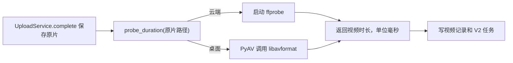

# 1. 问题与现状

**Seekino macOS 桌面后端（PR 1）**

2026-11-23 · 源码基线 `2cc37cc0` · 分支 `feat/macos-desktop-backend` → `dev`

**PR** [#183](https://github.com/owariband/Seekino/pull/183) · **需求** [DESKTOP-BACKEND-01](../../dev/workbench.html) · [问题记录](../../dev/problems.md#desktop-backend-01)

桌面版要让用户装好 `Seekino.app` 后，导入一部片，搜“蓝色杯子”，点一下结果就能从那个镜头开始看。原片、数据库和索引由应用管理。交付时，解析和播放期间都只能有一个 Seekino 应用进程。

现有 Web 版已经能从上传走到回看。但今天直接调用它的启动函数，程序先要求 MySQL 和 Elasticsearch（ES），读视频时长还要启动 `ffprobe`。把 Python 源码放进 `.app` 后，这些依赖依然存在。 [本机部署记录 B18](../../dev/problems.md) · [启动时打开的服务](../../../server/caller/base.py#L47) · [读时长的命令](../../../engine/common/media_probe.py#L10)

**PR 1 保留一份导入、解析和搜索代码。把里面依赖具体数据库或媒体工具的操作拆出来，云端和桌面各提供自己的做法。** 按这部片从导入到回看的顺序，改动落在下面几处。

| 用户这一步在做什么 | 两端共用哪段业务 | 云端怎样做 | 桌面准备怎样做 |
| --- | --- | --- | --- |
| 导入视频 | `UploadService.complete` 校验文件、保存原片、创建解析任务 | `ffprobe` 读时长，素材和任务记入 MySQL | PyAV 从原片读时长，素材和任务记入 SQLite。这个读时长的替换已在真实导入函数上跑过。 [调用点](../../../server/service/upload.py#L588) · [实测记录](#4-对照实验与结果分析) |
| 开始解析 | 同一个 V2 任务执行器领取任务，决定解析哪些时间段、在哪些位置取帧 | 领取时用 MySQL 锁，取帧、切片、抽音频时启动 `ffmpeg` | 领取时由 SQLite 先取得写权。取帧、切片和抽音频交给 PyAV，在应用进程内调用 FFmpeg 动态库。 [领取](../../../server/mq/video_parse_queue.py#L164) · [抽帧](../../../server/service/video_parse_media.py#L606) |
| 让解析出的片段可以搜索 | 从已确认的解析结果生成带版本的片段、文本和向量 | 写入 ES 并确认可查，再到 MySQL 将索引任务记为完成 | 在同一个 SQLite 事务里写片段、全文索引、向量和完成记录。中途退出，下次可重试。 [现有索引提交](../../../server/service/video_parse_index_coordinator.py#L163) |
| 搜“蓝色杯子”，点击结果 | 先限定可查的视频，再找候选、排序，回到正式解析记录核对片段和时间 | ES 找候选。浏览器从 HTTP 地址播放原片 | FTS5 找关键词，本地向量索引找相似画面或描述。核对后取受管原片路径和起止毫秒，交给播放器。 [搜索](../../../server/service/video_event_retrieval.py#L107) · [取原片](../../../server/service/media.py#L199) |

前期比较了独立 Python 服务、嵌入 Python 的 Web 视图和原生界面直调 Python 三种做法。已选定第三种，媒体处理参考 VLC 在进程内调用解码库的方式。 [Local / Cloud 设计](../02-agent-harness/local-cloud-trd.md) · [VLC 解码实现](https://github.com/videolan/vlc/blob/3.0.24/modules/codec/avcodec/video.c#L1246)

**PR 1 的交付物**是一个能由最小 macOS 程序直接调用的 Python 后端。在这个程序里从空资料库走完导入、Parse V2（含 Refine）、关键词和描述搜索，再按命中时间从原片解出画面和音频。同时从 HTTP 入口回归云端的 MySQL / ES 链路。

**PR 2 的交付物**是用户安装的 `Seekino.app`。PR 2 的分支、TRD 和 PR 待建，可在接口确定后接线。PR 1 合入 `dev` 后，PR 2 用同一套后端和媒体库接原生窗口与播放器，在干净的 Mac 上验收安装、签名公证和播放期间的实际进程。原生 UI 框架在 PR 2 选定。桌面 Chat、原生 Agent/MCP、云同步、历史 MySQL 库迁入和高级解析档案留待后续评估。

# 2. 影响因素、假设与评价指标

- **宿主能否嵌入。** CPython 支持隔离初始化。先用最小宿主验证包内 Python 扩展、动态库和资源能否从不同工作目录加载，业务能否调用并正常关闭，以及默认模型调用是否会启动额外命令。 [CPython 初始化配置](https://docs.python.org/3.12/c-api/init_config.html#isolated-configuration)
- **同进程并发。** Consumer、媒体调用和 UI 请求仍可能同时写状态。SQLite WAL 允许读写并行，同一时刻只有一个写事务。用多连接竞争和强退测试，验证短事务领取和租约校验能否保证任务正确执行。 [SQLite WAL](https://sqlite.org/wal.html#concurrency)
- **搜索质量。** ES 支持 CJK 分析和版本过滤。FTS5 的 trigram `MATCH` 会漏掉少于三个 Unicode 字符的检索词。向量检索也要先限定范围，再取 top-k。用短人名、台词、描述和跨视频反例测试。 [FTS5 trigram](https://sqlite.org/fts5.html#the_trigram_tokenizer) · [sqlite-vec KNN](https://alexgarcia.xyz/sqlite-vec/features/knn.html)
- **媒体时间与分发。** PyAV seek 按指定流的 time base 找到附近的关键帧，然后解码到目标位置。现有切片依赖 `libx264`，FFmpeg 将它列为 GPL 外部库。用目标构建实际转码，检查配置、格式、时间和许可材料，确认编码组合能否用于桌面分发和现有模型输入。 [PyAV seek](https://pyav.org/docs/stable/api/container.html#av.container.InputContainer.seek) · [当前转码参数](../../../server/service/video_parse_media.py#L562) · [FFmpeg 许可](https://ffmpeg.org/legal.html)

| 指标 | 基线与对照口径 | 初稿验收线 | 采证 |
| --- | --- | --- | --- |
| 主链与进程（结果） | 当前 HTTP 链路有独立组件，进程数和运行指标待以隔离基线复测 | 最小宿主实际完成导入、解析、索引、搜索及按时间解码原片。Seekino 只有一个 PID，子进程启动和本机业务监听端口均为 0 | 普通目录启动与清理环境启动各复跑一次，保留全程进程事件、调用步骤、实际库加载路径 |
| 证据与任务一致性（护栏） | MySQL / ES 的权限、版本、失租拒绝和重试为行为基线 | 重复完成、旧任务越权发布、过期或跨资料库证据均为 0。故障用例全部从应有阶段恢复或返回可解释失败 | 多连接争抢、提交前后强退、暂停/继续、重解析/删除、破坏派生索引后重建 |
| 搜索命中（结果） | 同一冻结 V2 成果和查询向量，ES 结果与人工标注均待采集 | 人工确认的必过查询均在 top 5 得到正确视频和时间窗。分组对照 Hit@5 与 Recall@10，聚合 Recall@10 相对 ES 的初拟容许差为 5 个百分点 | 预先标注台词/画面文字、语义描述和视觉描述各 20 条，另加短词、越界、无命中用例。逐条记录差异 |
| 媒体等价性（护栏） | 同机、同源文件的现有 CLI 输出为对照，同时用带已知画面/音频标记的样本校验 | 时长差 ≤ 1 ms，帧和切片按既有选取规则对齐原片 PTS，窗口全程使用 `[start_ms, end_ms)`。PCM 音轨、声道、采样率和音频边界符合现有合同，音画对齐落在一帧内 | 比较源 PTS、首尾帧、PCM 样本数和基准标记，逐个格式记录失败行为 |
| 资源与响应（诊断） | Apple Silicon 试验机的冷/暖启动、同库检索和解析资源占用待测 | 记录安装运行时体积、进程内存峰值、索引磁盘、SQLite 锁等待及冷/暖查询 p50/p95。首轮测量用于确定目标规模和性能上限 | 模型耗时和本地 I/O 分别采集，报告设备、事件数、采样次数、失败和超时 |

# 3. 改造方案与建模

## MySQL 和 SQLite 在哪里配置

按桌面版设计，`Seekino.app` 把素材信息和解析任务写入本机 SQLite，搜索使用同一资料库里的全文和向量索引。只有 HTTP 服务端连接 MySQL 和 Elasticsearch。仓库的 `config/storage.yaml` 分别用 `desktop` 和 `server` 记录这两套配置。`SEEKINO_ENVIRONMENT` 管开发、测试和生产数据的隔离。配置草案已提交，两个启动入口读取它的代码属于 PR 1 待实现的部分。 [两套配置](../../../config/storage.yaml) · [现有环境检查](../../../server/caller/mysql.py#L118)

| 启动入口 | 数据库类型和地址分别在哪填 | 首版技术栈与理由 |
| --- | --- | --- |
| HTTP 服务 | `server.database.type: mysql`。地址、端口、库名和凭据来自 `server.database.url_env` 指向的 `SEEKINO_DATABASE_URL`。用 `start.sh` 开发时填项目根目录的 `.env.local`。生产部署时在 `deploy/cloud/.env.cloud` 填 `MYSQL_PASSWORD`，由 `deploy/cloud/compose.prod.yaml` 中的 `SEEKINO_DATABASE_URL` 指定最终的主机、端口和库名。 | 现有部署已经用 MySQL 8.4 管任务和并发写入，用 Elasticsearch 8.19 查文本和向量。Python 继续通过 SQLAlchemy 2.0 和 PyMySQL 访问 MySQL，媒体处理走现有 FFmpeg 命令。 [开发环境示例](../../../.env.example#L18) · [开发启动脚本](../../../start.sh#L54) · [生产连接](../../../deploy/cloud/compose.prod.yaml#L11) · [数据库镜像](../../../compose.yaml#L137) · [ES 镜像](../../../compose.yaml#L162) |
| 原生 macOS 应用 | `desktop.database.type: sqlite`，`desktop.database.file: library.sqlite3`。原生宿主把当前用户的 Application Support 下的 `Seekino` 目录传给 `open_library`。默认文件是 `~/Library/Application Support/Seekino/library.sqlite3`。用户首次打开应用时由后端创建。 | 使用同一版本的 SQLAlchemy，通过随包 Python 的标准 `sqlite3` 驱动打开本地文件。SQLite、FTS5 和 PyAV 都在应用进程内工作。向量检索先试 `sqlite-vec`，用第 2 节的命中率、资料范围过滤和实际包内加载结果决定能否随首版发布。 [项目依赖](../../../pyproject.toml#L33) · [SQLAlchemy 的 SQLite 驱动](https://docs.sqlalchemy.org/en/20/dialects/sqlite.html#module-sqlalchemy.dialects.sqlite.pysqlite) · [SQLite 在桌面应用中的用途](https://www.sqlite.org/whentouse.html) |

两个地址的写法如下。第一行是开发环境示例，第二行是桌面在拿到实际绝对路径后构造的 SQLAlchemy URL 示例，`demo` 代表示例用户。

```text
mysql+pymysql://root@127.0.0.1:3306/seekino_development?charset=utf8mb4
sqlite+pysqlite:////Users/demo/Library/Application Support/Seekino/library.sqlite3
```

**代码在哪做选择。** PR 1 拟在 `server/config/storage.py` 用现有的 PyYAML 读取上面的文件，用 Pydantic 按 `database.type` 校验字段。HTTP 入口让 `ServerSettings` 解析 MySQL 地址，交给现有 MySQL 连接工厂。桌面入口只传资料库目录，按 `desktop.database.file` 拼出库文件的绝对路径，用 `URL.create("sqlite+pysqlite", database=str(db_path))` 打开。两种连接都交给现有的 `create_session_factory(engine)`，导入和任务服务拿到相同类型的 SQLAlchemy 会话。任务锁和索引的不同写法分别见下文。 [现有 MySQL 地址读取](../../../server/config/settings.py#L261) · [连接工厂](../../../server/caller/mysql.py#L46) · [会话工厂](../../../server/database.py#L296) · [SQLAlchemy URL 构造](https://docs.sqlalchemy.org/en/20/core/engines.html#sqlalchemy.engine.URL.create)

桌面入口从 `Seekino.app/Contents/Resources/config/storage.yaml` 取 `desktop`，只打开应用管理的资料库文件。MySQL 和 ES 的连接地址只由服务端入口读取。服务端缺少 MySQL 地址或正式环境的地址类型不匹配时，在创建连接前报错。现有 HTTP 隔离测试继续允许显式的测试 SQLite 配置。 [容器复制配置目录](../../../deploy/docker/Dockerfile#L30) · [数据库隔离用例](../../../tests/server/test_database.py#L49)

## 可被宿主直接调用的入口

今天的 `init_application` 一次创建数据库连接、检索、视频任务和 Chat。PR 1 会从 `server/bootstrap.py` 提出创建视频服务的代码，放进拟新增的 `server/video_services.py`。云端仍由 HTTP 入口打开 MySQL 和 ES，再创建视频服务、Chat 和路由。桌面由拟新增的 `server/desktop/runtime.py::open_library` 打开本机资料库，直接创建同一组视频服务并启动 V2 任务执行器。桌面首次创建自己的新库，已有 MySQL 数据的迁移另行设计。 [现在的启动顺序](../../../server/main.py#L45) · [创建视频服务的代码](../../../server/bootstrap.py#L250) · [启动任务执行器](../../../server/bootstrap.py#L585)

下面的 `mysql_sessions` 和 `sqlite_sessions` 分别由上一节选中的数据库连接创建。函数名和参数名是拟定设计，省略了文件目录、模型连接、并发配置和索引代数等参数。索引代数也由入口传入，公共代码可以直接用它校验版本。 [现有解析配置](../../../server/bootstrap.py#L138)

```python
# 云端启动
cloud = build_video_services(
    sessions=mysql_sessions, write_tx=mysql_write,
    index_writer=es_writer, event_reader=es_events, media=ffmpeg_cli,
)

# 桌面打开资料库
desktop = build_video_services(
    sessions=sqlite_sessions, write_tx=sqlite_write,
    index_writer=sqlite_writer, event_reader=sqlite_events, media=pyav_media,
)
```

以导入为例，桌面按现有分片大小读取本机文件，直接调用 `create_session → upload_segment → complete`。`complete` 先校验并保存原片，接着通过 `self._probe_duration(原片路径)` 取整数毫秒，最后写视频记录和解析任务。这个参数今天就有。建服务时让它指向 `media.probe_duration`，调用方就可以使用两种读法。暂存和拼接仍占用本机磁盘。 [分片入库](../../../server/service/upload.py#L435) · [读取时长、创建任务](../../../server/service/upload.py#L588)



搜索采用 LightRAG 换向量库的做法。LightRAG 启动时按 `LIGHTRAG_VECTOR_STORAGE` 选 `NanoVectorDBStorage` 或 `PGVectorStorage`，检索代码始终调用 `chunks_vdb.query(...)`。Seekino 已经有对应的调用 `self._store.search_lexical(...)` 和 `self._store.search_vector(...)`。要改的是创建这些对象的地方，以及业务代码里还直接引用 ES 的地方。 [LightRAG 启动配置](https://github.com/HKUDS/LightRAG/blob/ce3aa6bfe0982003c0684b408995945582681f05/lightrag/api/config.py#L640-L657) · [LightRAG 查片段](https://github.com/HKUDS/LightRAG/blob/ce3aa6bfe0982003c0684b408995945582681f05/lightrag/operate.py#L5872-L5874) · [Seekino 查候选](../../../server/service/video_event_retrieval.py#L130) · [源码调研](../../research/2026-11-23-lightrag-storage-switching.md)

| 宿主操作 | 由后端保证的合同 |
| --- | --- |
| 打开/关闭资料库 | 宿主传入数据根、资源根及生效模型配置，初始化库和任务执行器。退出时先停止接收和领取新任务，协作取消在途任务或等它完成提交，再关闭 Consumer 和存储。退出超时后，通过回收持久化租约恢复任务。 |
| 导入与任务控制 | 应用流式导入本机文件，沿用入库校验、去重、系列排序和 V2 任务接纳，返回 video/task ID。查询进度、暂停、继续、重试和重解析仍按既有状态与版本规则执行。 |
| 搜索和回看 | 用运行时的本机身份校验资料范围，直接调用检索服务。返回可再次校验的 source ref、video ID 和起止毫秒整数。打开结果时重新核对版本，找到受管原片，把该毫秒位置交给包内 FFmpeg 解码。 |

项目使用 Python 3.12，`pyproject.toml` 目前设置了 `package = false`，依赖清单也包含 HTTP 和数据库客户端。桌面构建要收齐运行时、按模块路径读取的 Prompt 和模型配置，明确区分包内资源与应用可写目录。用省去云端数据库驱动、没有 MySQL / ES 服务的环境打开桌面资料库，检查是否还有公共模块在导入时加载云端依赖。 [项目依赖](../../../pyproject.toml) · [Prompt 读取](../../../agent/video_parse_v2/edit_reference.py#L19) · [配置路径](../../../gateway/config.py#L38)

CPython 3.12 随宿主进程启动和退出。用最小原生可执行文件通过 CPython C API 加载包内解释器，并按指定路径加载资源。UI 主线程只发起调用和接收结果，长任务由现有 Consumer 和线程执行。错误在跨 ABI 传递时转换。 [CPython 嵌入文档](https://docs.python.org/3.12/extending/embedding.html)

模型连接沿用现有配置解析，首条业务链选择进程内 Gateway SDK。解析和向量查询依赖配置的模型服务，已入库视频的播放和关键词搜索只读本地数据。装配时核对外部 Agent CLI、会启动子进程的诊断和本地插件。 [模型配置](../../model-config.md) · [ACP 调用](../../../gateway/bridge/client.py#L129) · [诊断进程](../../../gateway/tracing.py#L169)

## SQLite 任务与资料库

桌面入口创建独立的 SQLite 文件，数据库和 WAL 默认放在 `~/Library/Application Support/Seekino/`，与开发、测试和自部署目录隔离。应用包只读。原片、必要的派生文件和可清理的临时产物按现有 Artifact Store 规则存放。

首版导入时，先在同一磁盘暂存并校验副本，再原子移动到受管库，然后提交 V2 任务。文件落位和数据库分别提交，沿用可重试的完成记录和清理规则，覆盖只完成文件落位、重复导入、中断和磁盘满。桌面从新库起步，维护独立的 Schema 版本，迁移前做一致性备份，升级时保留数据目录。 [现有导入提交](../../../server/service/upload.py#L530) · [Artifact Store 合同](../../../server/README.md#L366)

`UploadRepository` 和解析持久化服务都已经接收 SQLAlchemy 的 `session_factory`。普通的视频记录、任务记录和查询继续用这些类。桌面新增打开本机 SQLite 文件和迁移表的入口。现有 `caller.mysql` 只允许测试使用 SQLite，云端仍走它原有的环境校验。 [现有连接和业务对象](../../../server/bootstrap.py#L250) · [数据库环境校验](../../../server/caller/mysql.py#L118)

**领取任务要改锁的用法。** 今天 `VideoParseConsumer` 直接依赖 `MySqlVideoParseQueue`。让它和解析服务接收共用的 V2 队列，把数据库写事务交给启动入口提供。队列保留挑选任务、续约、重试和拒绝过期结果的规则。MySQL 仍先用命名锁核对容量，再锁定要领取的记录。SQLite 要在读取决定归属的状态前取得写权。两端都向执行器返回原有的 `VideoParseLease`。 [执行器领取任务](../../../server/mq/video_parse_consumer.py#L259) · [领取视频](../../../server/mq/video_parse_queue.py#L164) · [领取 Chunk](../../../server/mq/video_parse_queue.py#L239) · [领取 Refine](../../../server/mq/video_parse_queue.py#L320) · [现有事务实现](../../../server/utils/database.py#L12)

- 在 `server/utils/database.py` 提供由宿主选择的写事务入口。MySQL 领容量时继续用现有命名锁和行锁，普通写入沿用已有事务。SQLite 在同一连接执行 `BEGIN IMMEDIATE` 后才读状态。复用队列的候选顺序、容量判断及租约更新代码。纯读取照常开读事务。
- 以 `claim_video` 为例，取得写事务后重新读取候选任务，核对到期时间、暂停状态、现有租约与剩余容量，成功时一起写入容量占用、新 owner、递增的 lease version 和过期时间。事务提交成功才把 lease 交给 Consumer。有调度通知的入口继续在提交后发送。领 Chunk、Refine 和 INDEX 同样在写事务内复核阶段和父任务条件。
- 这条写事务入口要接到现有的 `UploadRepository.complete_upload/reparse`、`ParseJobRepository.transaction`、`VideoParsePersistenceService.commit_chunk_result/commit_interval_refinement` 及索引提交。以暂停和迟到提交竞争为例，两者在各自的写事务内重新读状态与版本，提交方只有在原 lease 仍有效时才能写入。模型请求、解码和文件 I/O 在事务外完成。 [入库提交](../../../server/repository/upload.py#L1103) · [暂停入口](../../../server/service/job.py#L32) · [Chunk 提交](../../../server/service/video_parse_persistence.py#L870) · [Refine 提交](../../../server/service/video_parse_persistence.py#L922)

每个库由一个宿主取得运行权后再迁移和启动 Consumer。SQLite 开启 WAL 和外键。锁竞争按有界重试处理，应用重启后根据持久状态回收租约。用多个 SQLite 连接跑争抢、暂停、重解析和失租提交测试，覆盖原来的行锁路径。 [V2 runtime 事务合同](../../../agent/video_parse_v2/README.md#runtime-and-transaction-rules) · [SQLite 事务](https://sqlite.org/lang_transaction.html)

## 索引发布、检索和证据

桌面主搜索以 Event 为粒度，SQLite 保存业务事实与可重建的 Chunk / Event 投影。**在生成检索记录之后，把“发布这一版索引”交给一个单独的方法。** 今天解析任务每次执行 INDEX，都由 `VideoParseRuntimeService._build_index_coordinator` 把 `self._elasticsearch_store` 交给 Coordinator。计划把启动时选好的发布对象传到这个调用点。共用代码交出当前任务的租约、Chunk、Event 和版本，拟由 `index_writer.publish(lease, chunk, events)` 接收这一版数据，让它可查，并在成功时把任务记为完成。ES 的 `refresh`、可见性检查和异常重试放进云端实现。 [解析任务真正创建 Coordinator 的位置](../../../server/service/video_parse.py#L2244) · [现有写入与检查](../../../server/service/video_parse_index_coordinator.py#L216)

继续用当前 INDEX lease 加载冻结的 Chunk 快照和 Refine 结果，复用 `_build_document`、`_index_events` 中的生成逻辑以及现有 embedding 缓存。生成阶段在写事务外产出 `VideoChunkIndexDocument`、`EventIndexDocument` 和对应版本，发布阶段负责写入并完成 INDEX。 [现有 Coordinator](../../../server/service/video_parse_index_coordinator.py#L163) · [Event 发布](../../../server/service/video_parse_index_coordinator.py#L389) · [表示缓存](../../../server/service/video_parse_index_coordinator.py#L621)

- **Cloud 发布。** 继续用 ES 的版本检查、`bulk_upsert` 和 `verify_ready`，核对 Event 集合和回执后，再调用 MySQL 中的 `VideoParsePersistenceService.complete_chunk_indexing`。ES 重试和可见性处理留在这一实现内。
- **桌面发布。** 取得 SQLite 写事务后，重新核对 INDEX lease、任务状态、内容版本和索引代数，再写入 Chunk、Event、FTS5 和向量投影。将已写入的 Event 集合与回执核对，在同一 session 调用 `server/service/video_parse_content.py` 现有的 `save_index_embeddings` 和 `complete_chunk_indexing` 写回执、核对租约并推进状态。任一步失败就一起回滚，提交后才通知。这个落点复用已接受 session 的提交逻辑，桌面可以在一个事务里完成发布。 [当前提交入口](../../../server/service/video_parse_persistence.py#L997) · [现有版本、回执与状态校验](../../../server/service/video_parse_content.py#L584)

`UploadService` 校验模型与索引合同，`UploadService` 和 `ParseJobService` 的删除路径会清理投影。接入新实现时，一并使用本地合同校验和按任务删除后的校验。重建沿用落盘的有效 embedding，按任务、Chunk、Event、内容版本及代数写入；切换代数前核对覆盖率和编码合同。需要重算时由任务流程记录计算和模型用量。 [入库合同检查](../../../server/service/upload.py#L677) · [任务删除](../../../server/service/job.py#L102)

**搜索服务接收一个能查候选的对象。** 现在 `VideoEventRetrievalService` 的构造参数和创建它的工厂都写着 `store: ElasticsearchVideoEventStore`，公共错误处理也直接导入了 ES 的异常类。把参数改成 Python `Protocol`，列出业务实际使用的索引名、向量维度、`bind_contract`、`search_lexical` 和 `search_vector`。ES 类实现这些方法，并在内部把 ES 错误转成业务可识别的错误。桌面另写一个实现，用 FTS5 和本地向量表返回同样的 `RawEventHit`。 [构造参数](../../../server/service/video_event_retrieval.py#L31) · [创建搜索服务](../../../server/common/retrieval.py#L85) · [错误处理](../../../server/error/retrieval.py#L6)

例如搜“蓝色杯子”，共用的 `search` 先查清允许搜索的任务和版本，把范围交给相应的索引。索引返回候选 Event、所属片段和版本。随后共用代码合并候选，回到正式的解析时间线，核对这个 Event，再给出原片的起止毫秒。两端可以共用这套权限检查和排序，也能拒绝重解析前留下的旧命中。 [实际搜索入口](../../../server/service/video_event_retrieval.py#L107) · [候选数据结构](../../../engine/rag/retrieval/contracts.py#L409)

1. **关键词。** 比较 FTS5 中文分词与 trigram，按 Event 词法字段建索引，返回命中字段和原文。用两字人名等短词试验分词，或在已授权范围内做受限的精确匹配。验证简繁、混合标点和英文词边界。
2. **相似检索。** 优先试 `sqlite-vec`，保留文本和视觉的编码器身份、维度、输入模式、指令及距离合同。先在 SQL 中限定资料和版本，再取各通道的 top-k。若虚表无法支持动态范围过滤，在同一库上试验带范围条件的精确距离查询，按质量和延迟选型。
3. **核验证据。** 复用 Engine 的融合和核验，用相同的 tenant/series/video、parse task、content version、index generation 和 timeline index 回源。点击结果时再检查版本和影片能否读取。索引或原片缺失、覆盖不足时，按已有错误或部分结果合同反馈。 [Event 核验](../../../server/service/video_event_retrieval.py#L157) · [Engine 证据校验](../../../engine/rag/retrieval/events.py#L53)

## 进程内媒体和包内运行时

以取一帧为例，今天 `_materialize_frame` 在解析服务里拼出 `ffmpeg -ss … -frames:v 1 …`，最后通过 `subprocess.run` 启动程序。准备把这个调用点改成 `self._media.frame_at(video, output, at_ms=at_seconds, max_height=max_height)`（拟定接口）。云端的 `frame_at` 封装现有命令。桌面的 `frame_at` 用 `av.open` 打开同一文件，定位到目标之前的关键帧，再解码到目标画面，缩放并保存 JPEG。PyAV 在 Seekino 进程里调用包内 FFmpeg 的解封装、解码和缩放库。 [现有命令](../../../server/service/video_parse_media.py#L606) · [启动子进程](../../../server/service/video_parse_media.py#L648) · [PyAV 定位与解码](https://pyav.basswood.io/docs/stable/api/container.html#av.container.InputContainer.seek)

同样拆出读时长、批量抽帧、切片和提取 WAV 的操作，拟将桌面实现放在 `engine/common/pyav_media.py`。`VideoParseMediaService` 继续决定读原片还是代理、取哪个时间窗、租约是否有效、产物放到哪里。`prepare_episode` 调用批量抽帧，`prepare_speaker_audio` 调用带起止时间的音频提取，上传和解析共用同一个时长读取函数。 [现有媒体构造参数](../../../server/service/video_parse_media.py#L69) · [入库探测注入](../../../server/service/upload.py#L62) · [PyAV 的 FFmpeg 依赖](https://pyav.basswood.io/docs/stable/overview/installation.html#bring-your-own-ffmpeg)

| 操作 | 现有入口 | 桌面调用及要保留的行为 |
| --- | --- | --- |
| 探测时长 | `UploadService.complete`、`prepare_episode` 调 `probe_video_duration_seconds`，由 ffprobe 取视频流时长 | `av.open(path)` 后读取首个视频流的 `duration × time_base`。缺少流时长时扫描该流首尾帧，用最晚帧结束时间减最早显示时间，沿用帧时长缺失时按平均帧率估算的规则。返回整数毫秒，音频尾巴不计入。 [探测](../../../engine/common/media_probe.py#L10) |
| 批量抽帧 | `prepare_episode → extract_video_frames_batch` 一次解码后按毫秒请求选帧 | 把排好序的请求交给同一个解码迭代器，按现有毫秒舍入和 PTS 顺序，为每个请求匹配首个达到该位置的帧。按原规则回用尾帧和重合帧。缩放并写 JPEG，保留 `(requested_ms, path)`，实际解码 PTS 另行采证。 [批量选帧](../../../engine/common/frame_sampler.py#L28) · [Prepare 入口](../../../server/service/video_parse_media.py#L146) |
| 单帧定位 | `prepare_event_frames` 和单 Chunk 的 `_materialize_frame` 以 `ffmpeg -ss ... -frames:v 1` 取图 | `container.seek(..., stream=video, backward=True)` 定位到关键帧，再用 `decode(video)` 找目标帧。按现有尺寸上限缩放，保留旋转后画面的方向。内容判型和视觉索引共用这条路径。 [单帧调用](../../../server/service/video_parse_media.py#L307) · [判型取帧](../../../server/service/video_parse.py#L294) · [索引取帧](../../../server/service/video_parse_index_coordinator.py#L345) |
| 视频切片 | `_materialize_video` 给 Prepare 和 `prepare_video_segment` 输出 H.264/AAC MP4 | `av.open` 打开输入和输出容器。按源时间戳解码并裁到 `[start_ms, end_ms)`，按现有尺寸限制缩放，将音画时间戳换到同一段内时间轴。`add_stream` 创建编码流，`encode` 后 `mux`，刷新编码器并关闭文件。保留可选首音轨、MP4 的 `faststart`，以及核心窗口与视觉重叠窗口的区别。 [切片及编码参数](../../../server/service/video_parse_media.py#L562) · [窗口准备](../../../server/service/video_parse_media.py#L113) |
| 提取 WAV | `_materialize_audio` 用 FFmpeg 自动选轨，`prepare_speaker_audio` 用 `0:a:0` 从原片取窗口 | 按调用方现用的规则选择音轨，保留从切片取音和从原片取音的差别。按源音频时间取窗口，重采样时按输出采样点校准裁切，用 `AudioResampler(format="s16", layout="mono", rate=16000)` 转为单声道 PCM，用 `pcm_s16le` 写 WAV。全片 ASR 也经过 `prepare_speaker_audio`。 [音频物化](../../../server/service/video_parse_media.py#L591) · [原片选轨](../../../server/service/video_parse_media.py#L242) · [全片 ASR](../../../server/service/video_parse.py#L319) · [FFmpeg 自动选轨](https://ffmpeg.org/ffmpeg.html#Automatic-stream-selection) |
| 回看原片 | `MediaService.get_original` 解析 Artifact URI，Web 另用 `playback_view` 生成 HTTP URL | 桌面宿主拿到经版本校验的原片路径与 `start_ms`，用包内库 seek 并解码视频帧和对应音轨。PR 1 证明从命中毫秒能解到原片，PR 2 的原生播放器负责持续输出画面、音频和播放控制。 [原片与浏览器入口](../../../server/service/media.py#L199) |

PyAV 指定流时，`seek` 的偏移要先将原片毫秒和时间原点换算为该流的 `time_base` 单位。解码后以 `frame.pts × frame.time_base` 换回源时间，再按目标窗口或取帧规则筛选。批量抽帧沿用原片首个显示帧对齐的口径，跨音画流裁切使用同一原片时间原点。逐项核对非零起点、B 帧、VFR、旋转、无音轨、多音轨和长音频尾巴。既有 `*_seconds` 媒体字段仍是整数毫秒，配置字段各用原来的单位。 [PyAV seek 与容器](https://pyav.basswood.io/docs/stable/api/container.html#av.container.InputContainer.seek) · [PyAV 时间基](https://pyav.basswood.io/docs/stable/api/time.html) · [PyAV AudioResampler](https://pyav.basswood.io/docs/stable/api/audio.html#av.audio.resampler.AudioResampler) · [Engine 时间约定](../../../engine/README.md#媒体时间单位)

媒体输出沿用现有租约工作目录。解码和编码循环按批检查取消与租约，文件关闭、产物校验通过后再交给后续阶段。普通 Interval Refine 处理已提交的 Chunk 内容，直接用结构化模型调用。首条桌面链只接入已由 PyAV 覆盖的媒体操作。编辑参考扫描和浏览器片段导出各有独立 CLI 路径，随对应能力另行接入。若桌面启用会看帧的 Summary，给其 `build_inspect_video_frames_tool` 传入同一个抽帧实现。 [工作目录](../../../server/service/video_parse_media.py#L506) · [Interval Refine](../../../server/service/video_parse.py#L1390) · [编辑参考扫描](../../../server/service/video_parse_media.py#L173) · [浏览器片段导出](../../../server/service/media.py#L254) · [Summary 取帧](../../../server/service/video_summarize.py#L149)

**构建时将 PyAV 链接到随包的 FFmpeg。** 首轮锁定兼容版本和 Apple Silicon 架构，构建 FFmpeg 共享库，再用它的头文件和 `pkg-config` 信息构建 PyAV。归档同套 `libavformat`、`libavcodec`、`libavutil`、`libswscale`、`libswresample` 和 PyAV 所需的其余 dylib，连同扩展和 Python 资源放入运行目录。移动目录后核对 `otool -L`、架构、签名与实际加载路径。用清理后的环境实跑上表操作和向量查询，收集进程事件。 [PyAV 自建 FFmpeg](https://pyav.basswood.io/docs/stable/overview/installation.html#bring-your-own-ffmpeg)

代理 MP4 的首轮编码候选是 `h264_videotoolbox`。同一批媒体须完成实际编码、音画时间对照和模型接收验证，再定随包的编解码器与构建选项。若实际变更影响视觉编码输入合同，要更新预处理版本并重建对应投影。将构建选项、ABI、许可材料和产物清单交给 PR 2；读取、编码或包内依赖失败时由桌面后端返回错误。 [FFmpeg VideoToolbox 编码器](https://ffmpeg.org/doxygen/trunk/videotoolboxenc_8c_source.html) · [FFmpeg 许可](https://ffmpeg.org/legal.html)

## 实施次序

| 顺序 | 改哪一步 | 怎样知道可以做下一步 |
| --- | --- | --- |
| 1. 先试包内媒体库 | 在 Apple Silicon 最小宿主中加载包内 CPython、PyAV、SQLite/FTS5 和候选向量扩展。用带时间标记的短片读时长、抽帧、切片和提取 PCM。 | 与同机 CLI 对比时间和音轨，实际编码一次代理视频。动态库加载或时间不对，先在这里处理。 |
| 2. 提取两端共用的视频服务 | 接入 `config/storage.yaml` 的配置读取，从现有启动代码提取 `build_video_services`，给任务队列传入写事务，把索引发布、候选查询和媒体调用改为接收实现。先把现有 MySQL、ES 和 CLI 接回这些位置。 | 从现有 HTTP 入口跑导入、任务、索引和搜索回归，确认拆分后云端仍走通。 |
| 3. 接 SQLite 和 PyAV | 桌面直接导入原片并建立任务，在 SQLite 写事务中领取和提交，解析时使用包内 PyAV。用固定模型响应走 Prepare、Understanding 和 Refine。 | 同一任务由两个连接争抢时只有一方领到。强退出再开能恢复，旧任务不能覆盖新结果。抽帧和音频仍对得上原片。 |
| 4. 用同一搜索服务接本地索引 | 在 SQLite 一次提交片段、FTS5、向量和任务状态。把本地候选交回现有搜索代码，让命中可以定位原片。 | 两端用同一批解析结果对照命中。模拟提交中断、旧版本、索引重建、覆盖不足和原片缺失，逐项核对结果。 |
| 5. 交给原生桌面 | 移动最小宿主目录，在清理过的环境跑完整流程。交付可重复构建入口、锁定的媒体库、资源清单、库路径和升级办法。 | 记录宿主从启动到退出的进程事件及实际加载的库。PR 2 用这套后端接窗口和播放器，在干净 Mac 上安装验收。 |

# 4. 对照实验与结果分析

## 导入服务换用 PyAV 的实测结果

2026-11-23，在 Apple Silicon 开发机（macOS 26.5.1、Python 3.12.16、PyAV 19.0.2、FFmpeg CLI 9.0.2）用 `f556027b` 版本的业务代码做了对照。先生成一段 MP4，画面长 8.008 秒，音轨长 9 秒。把同一个文件分别导入两个隔离的内存 SQLite 测试库。两次都调用 `UploadService.create_session → upload_segment → complete`，给 `probe_duration` 传不同的函数。第二次还把 `PATH` 指向空目录。

| 交给导入服务的方法 | 写入的视频时长 | 原片及任务 | 导入期间观测到的 Python `subprocess.Popen` 调用 |
| --- | ---: | --- | --- |
| 项目现用的 `ffprobe` 读法 | 8008 毫秒 | 原片逐字节一致，1 个待解析任务 | `ffprobe` 1 次 |
| 通过 `av.open` 读视频流时长 | 8008 毫秒 | 原片逐字节一致，1 个待解析任务 | 0 次 |

这次证明在导入函数里换掉读时长的方法，能保住这段 MP4 的时长、原片和任务记录。试验用开发机已安装的库，计数范围是 Python 的 `Popen` 调用。其他格式、切片和音轨，以及整个应用的操作系统进程记录，仍按下表验证。 [可复跑的实验](../../report/server/desktop-backend/test_import_probe.py)

在已装上述 PyAV 和 FFmpeg 的项目 Python 环境中，从仓库根目录可重跑这组对照。

```bash
python -m pytest -q -s docs/report/server/desktop-backend/test_import_probe.py
```

另复跑了两个现有搜索用例和一个现有 CLI 媒体用例，3 个均通过。搜索用例给同一服务传入测试用的索引和模型，检查“蓝色杯子”的多个候选能合并并找到时间，也检查纯关键词查询不会调用向量模型。真实 ES 与本地索引的命中差异仍待测。 [搜索用例](../../../tests/server/test_video_event_retrieval.py#L116) · [纯关键词](../../../tests/server/test_video_event_retrieval.py#L175) · [CLI 样片](../../../tests/server/test_video_parse_media.py#L629)

## 其余对照实验

| 实验 | 固定条件和故障点 | 当前证据 |
| --- | --- | --- |
| 桌面资料库与服务端存储 | 桌面测试只提供一个空的资料库目录，导入样片并搜索。另测目录不可写。服务端单独连接隔离的 MySQL 和 ES，另测缺少 MySQL 地址及正式服务端误填 SQLite 地址。 | 待接入后验证。桌面须在指定目录创建 SQLite 文件并从本地索引返回命中，全程对 MySQL 和 ES 的连接尝试均为 0。服务端须连到指定的测试库。错误配置须在对应入口报错。 |
| 媒体 CLI vs PyAV | 同机和同源文件。样本覆盖常用 MP4/H.264、HEVC、WebM、VFR、非零起点、旋转信息、长 GOP、无/多音轨、长音频尾及损坏文件。保存源 PTS、选帧/切片起止、音轨和落盘格式。比较编码器差异时保留产物供模型输入验收 | 上述 MP4 已完成导入时长对照。包内构建、跨格式、抽帧、切片和音轨待测 |
| 本地索引 vs ES | 固定 V2 产物、embedding 和查询范围，将两端候选输入相同评测。先标注 `video_id + [start_ms, end_ms)`，正确命中要求视频匹配、区间交并比 ≥ 0.5。对短关键词和文本/视觉查询分别记录首个正确命中的名次及 top-k 内的正例覆盖。复查失效版本和跨库干扰 | 待测 |
| 恢复、并发与云端回归 | 在独立文件库同时领取同一任务，注入上传落位后、索引激活前后和业务提交前的进程退出。核对索引可见性、租约、库状态和额外模型计费。云端在隔离 MySQL/ES 运行现有 bootstrap、V2 队列、索引及检索用例 | 待测 |
| 宿主真实调用 | 移动最小运行时目录，清理开发机 `PATH`、`PYTHONPATH` 等环境变量，以宿主从头执行。采集实际 dylib 路径以及从启动到退出的子进程事件，覆盖短命的 ffmpeg/ffprobe 和提供方辅助命令。另测断网后已有原片定位及词法搜索 | 待测 |

媒体对照复用已有的批量选帧、长音频尾和窗口重叠用例，同输入分别走 CLI 和 PyAV。嵌入宿主必须从业务入口触发时长探测、带代理的 Prepare、全片或 Chunk WAV、Event 取帧和索引所需切片，再用命中结果定位原片。在清理 PATH 的环境记录这些调用与进程事件，能覆盖只测 PyAV 能否导入时遗漏的 CLI 路径。 [批量抽帧用例](../../../tests/engine/test_frame_sampler.py#L85) · [实际媒体用例](../../../tests/server/test_video_parse_media.py#L629)

本轮导入对照的复现用例已放在 `docs/report/server/desktop-backend/`。后续实验沿用这一目录。保存 Git 提交、系统和架构、依赖与构建标识、模型和配置指纹、样本清单、命令、原始结果及失败复现。用固定模型响应回放验证任务调度和媒体调用，再用真实模型核对它能否接收转码产物、完整链路的业务效果和实际费用。

# 5. 试点验证与方案取舍

PR 1 在一台 Apple Silicon Mac 上用独立新库试验。选一段台词和画面可核对的短视频，再选一段确实会切成多个 Chunk 的长视频。至少完成一轮新库初始化、搜索、原片定位、暂停恢复、长任务强退重启和派生索引重建。配置进程内 SDK 后，检查实际模型输入和任务完成情况。记录进程、数据库完整性、事务等待、解析与本地查询耗时、检索命中和费用。

通过后把最小宿主、资源清单和调用合同交给 PR 2。出现子进程、旧租约写入、证据越界或原片时间错误时，修复后重新验证再交接。需要回退时，关闭试验宿主，保留隔离试点库或按用户授权处理。

PR 2 在无开发环境的目标 Mac 上安装并首次启动 `Seekino.app`。导入视频，真实解析，分别用关键词和描述搜索，然后点击结果播放原片。记录解析和播放期间的进程。商业安装包的 Developer ID 签名、公证、升级后资料库是否保留和支持的 macOS 版本，以该次验收为准。 [Apple 公证说明](https://developer.apple.com/documentation/security/notarizing-macos-software-before-distribution)

# 6. 结果验收与闭环

已从真实导入函数验证了一个替换点。同一 MP4 分别用 `ffprobe` 和 PyAV 读时长，两次都保存了原片和一个待解析任务。SQLite 生产事务、本地索引读写、其余媒体操作和桌面启动入口仍待实现。下一步在最小 macOS 宿主中从包内加载 PyAV，实际抽帧、切片并提取音轨，按第 2 节口径与 CLI 对照。

- **PR 1 验收**由后端交付方在实际嵌入宿主中执行第 2 节的用例。先用包内 PyAV 处理带时间标记的样片，完成一次实际编码的切片，再确定媒体构建方案。SQLite 并发、FTS5 短词、向量范围、云端回归和性能目标仍待验证。
- **产品验收**由桌面交付方负责，以 PR 2 在干净 Mac 上的实测为准。安装包的单进程行为、真实播放、签名、公证、最低 macOS 版本和 Intel 支持范围待确认。
