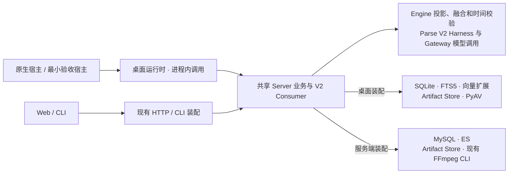

# 1. 问题与现状

**Seekino macOS 桌面后端（PR 1）**

2026-11-23 · 源码基线 `2cc37cc0` · 分支 `feat/macos-desktop-backend` → `dev`

**PR** 待创建后回填 · **需求** [DESKTOP-BACKEND-01](../../dev/workbench.html)

用户安装 `Seekino.app` 后，可以导入视频、解析、搜索，点中一条结果就回到原片的对应时间。应用管理 SQLite、索引和媒体库。桌面界面、Python 后端、媒体解析和播放都在同一个 Seekino 应用进程中执行，FFmpeg 以库的形式随应用分发。

现有 Web / 自部署版已跑通上传到回看，本机部署仍要启动 MySQL、Elasticsearch、API 和 Web。桌面采用原生 UI 直接调 Python 业务库的路线。VLC 的参考点是进程内调用 libavcodec，Seekino 用 PyAV 试验同类媒体调用。基于 Web 视图或 Python 服务进程的两条候选路线已在前期讨论中比较。 [本机部署记录 B18](../../dev/problems.md) · [Local / Cloud 设计](../02-agent-harness/local-cloud-trd.md) · [VLC 解码实现](https://github.com/videolan/vlc/blob/3.0.24/modules/codec/avcodec/video.c#L1246)

| 环节 | 现行源码与桌面接入点 |
| --- | --- |
| 启动与收尾 | `ApplicationRuntime` 已有 start / close。HTTP lifespan 调用它，`caller.init` 要求 ES，`bootstrap` 同时装配 Consumer、检索和 Chat checkpoint。桌面需要一个可独立装配的业务入口。 [运行时](../../../server/main.py#L27) · [Caller](../../../server/caller/base.py#L47) · [服务装配](../../../server/bootstrap.py#L195) |
| 入库与任务 | `UploadService.complete` 校验并持久化媒体，写入 V2 任务。SQLite 现用于隔离测试。生产领取依靠 MySQL 命名锁保持容量竞争的原子性，并用行锁保护任务读改写。关联 Interval Refine 提交后才放行 Chunk INDEX。 [导入完成](../../../server/service/upload.py#L530) · [数据库检查](../../../server/caller/mysql.py#L118) · [命名锁](../../../server/utils/database.py#L12) · [领取](../../../server/mq/video_parse_queue.py#L164) · [索引放行](../../../server/mq/video_parse_queue.py#L939) |
| 索引与搜索 | V2 Coordinator 写入并验证 Chunk 和 Event 投影，再提交 INDEX 完成。Event Search 按 SQL 范围查候选，再按任务、内容版本和代数回源核验。桌面需接管投影的发布、查询与恢复。 [索引发布](../../../server/service/video_parse_index_coordinator.py#L163) · [ES 查询](../../../server/storage/elasticsearch_events.py#L229) · [Event 搜索及回源](../../../server/service/video_event_retrieval.py#L108) |
| 媒体与回看 | 导入的视频时长探测、解析的抽帧/切片/抽音频都会启动媒体命令。浏览器播放视图以 HTTP URL 和浏览器编解码能力为合同，原片可由现有媒体服务通过 Artifact Store 解析。 [时长探测](../../../engine/common/media_probe.py#L10) · [批量抽帧](../../../engine/common/frame_sampler.py#L28) · [代理视频与 PCM](../../../server/service/video_parse_media.py#L562) · [原片与播放视图](../../../server/service/media.py#L199) |
| 打包依赖 | 项目锁定 Python 3.12 并设置 `package = false`，依赖清单包含服务端和可选能力。部分 Prompt 在导入时按模块路径读取，配置也有源码树默认路径。桌面需要可重定位的运行时、资源和依赖清单。 [项目依赖](../../../pyproject.toml) · [Prompt 资源示例](../../../agent/video_parse_v2/edit_reference.py#L19) · [Gateway 配置路径](../../../gateway/config.py#L38) |

**PR 1** 交付可嵌入的 Python 后端、SQLite 库、FTS5 与嵌入式向量检索、PyAV 媒体实现，以及可重复构建的最小 macOS 宿主验收。首条业务链是导入自有视频 → Parse V2（含 Refine）→ 建索引 → 关键词或描述搜索 → 解析证据并定位原片。云端 HTTP / MySQL / ES 继续受现有契约与隔离限制约束。

**PR 2**（分支、TRD、PR 待建）依赖 PR 1 的调用合同、数据与资源布局、媒体库和嵌入验证。接口确定后可先接线，PR 1 先进入 `dev`，PR 2 再在合入版本上完成原生窗口、进程内播放器、签名公证和干净机器安装验收。原生界面框架由 PR 2 决定。桌面 Chat、原生 Agent/MCP、云同步、历史 MySQL 库迁入及高级解析档案适合各自评估。

# 2. 影响因素、假设与评价指标

- **宿主能否嵌入。** CPython 支持宿主用隔离配置初始化。Seekino 的实际风险在于 Python 扩展、动态库和资源被装进同一目录后是否能从任意工作目录加载，以及默认模型路线是否会拉起命令。通过一次最小宿主运行，先验证加载、调用和关闭。 [CPython 初始化配置](https://docs.python.org/3.12/c-api/init_config.html#isolated-configuration)
- **同进程并发。** Consumer、媒体调用和 UI 请求仍可并发写状态。SQLite WAL 允许读写并行，同一时刻只有一个写事务。假设短事务领任务、保留租约栅栏能满足本机可靠执行，用多个连接并发和强退注入验证。 [SQLite WAL](https://sqlite.org/wal.html#concurrency)
- **搜索质量。** ES 有 CJK 分析和版本条件。FTS5 的 trigram `MATCH` 会漏掉少于三个 Unicode 字符的检索词。向量检索的范围过滤也必须发生在取 top-k 之前。先以短人名、台词、描述和跨视频反例验证。 [FTS5 trigram](https://sqlite.org/fts5.html#the_trigram_tokenizer) · [sqlite-vec KNN](https://alexgarcia.xyz/sqlite-vec/features/knn.html)
- **媒体时间与分发。** PyAV 的 seek 按指定流的 time base 定位到附近关键帧，再解码至目标位置。现有切片依赖 FFmpeg 官方列为 GPL 外部库的 `libx264`。假设有符合桌面分发与既有模型输入合同的编码组合，需用目标构建实际转码并核对 FFmpeg 配置、格式、时间和许可材料。 [PyAV seek](https://pyav.org/docs/stable/api/container.html#av.container.InputContainer.seek) · [当前转码参数](../../../server/service/video_parse_media.py#L562) · [FFmpeg 许可](https://ffmpeg.org/legal.html)

| 指标 | 基线与对照口径 | 初稿验收线 | 采证 |
| --- | --- | --- | --- |
| 主链与进程（结果） | 当前 HTTP 链路有独立组件，进程数和运行指标待以隔离基线复测 | 最小宿主实际完成导入、解析、索引、搜索及按时间解码原片。Seekino 只有一个 PID，子进程启动和本机业务监听端口均为 0 | 普通目录启动与清理环境启动各复跑一次，保留全程进程事件、调用步骤、实际库加载路径 |
| 证据与任务一致性（护栏） | MySQL / ES 的权限、版本、失租拒绝和重试为行为基线 | 重复完成、旧任务越权发布、过期或跨资料库证据均为 0。故障用例全部从应有阶段恢复或返回可解释失败 | 多连接争抢、提交前后强退、暂停/继续、重解析/删除、破坏派生索引后重建 |
| 搜索命中（结果） | 同一冻结 V2 成果和查询向量，ES 结果与人工标注均待采集 | 人工确认的必过查询均在 top 5 得到正确视频和时间窗。分组对照 Hit@5 与 Recall@10，聚合 Recall@10 相对 ES 的初拟容许差为 5 个百分点 | 预先标注台词/画面文字、语义描述和视觉描述各 20 条，另加短词、越界、无命中用例。逐条记录差异 |
| 媒体等价性（护栏） | 同机、同源文件的现有 CLI 输出为对照，同时用带已知画面/音频标记的样本校验 | 时长差 ≤ 1 ms，帧和切片按既有选取规则对齐原片 PTS，窗口全程使用 `[start_ms, end_ms)`。PCM 音轨、声道、采样率和音频边界符合现有合同，音画对齐落在一帧内 | 比较源 PTS、首尾帧、PCM 样本数和基准标记，逐个格式记录失败行为 |
| 资源与响应（诊断） | Apple Silicon 试验机的冷/暖启动、同库检索和解析资源占用待测 | 记录安装运行时体积、进程内存峰值、索引磁盘、SQLite 锁等待及冷/暖查询 p50/p95。首轮测量用于确定目标规模和性能上限 | 模型耗时和本地 I/O 分别采集，报告设备、事件数、采样次数、失败和超时 |

# 3. 改造方案与建模

## 可被宿主直接调用的入口

从既有 Runtime / Consumer 生命周期抽出两端共用的业务装配，将事务、索引读写和媒体操作传入实际调用这些能力的 Service。桌面只创建首条业务链所需的服务。以下列的是用例合同，具体方法签名以原型确定。

| 宿主操作 | 由后端保证的合同 |
| --- | --- |
| 打开/关闭资料库 | 宿主传入数据根、资源根及生效模型配置，初始化库和任务执行器。关闭先停止接新任务和领取，协作取消或完成在途提交，再关闭 Consumer 与存储。退出超时以持久租约回收恢复。 |
| 导入与任务控制 | 本机文件由应用流式导入受管库，复用入库校验、去重、系列排序与 V2 任务接纳。返回 video/task ID。读进度、暂停、继续、重试、重解析使用现有状态及版本门禁。 |
| 搜索和回看 | 以运行时本机身份校验资料范围，直接调用检索服务。返回可重校验的 source ref、video ID、整数起止毫秒。取用时核对版本并解析受管原片；支持将该毫秒位置交给包内 FFmpeg 解码。 |

CPython 3.12 解释器的生命周期与宿主进程一致。UI 主线程只提交调用与接收结果，长任务由既有 Consumer 与线程执行，跨 ABI 边界转换错误。验收宿主用 CPython C API 验证一个普通原生可执行文件加载包内解释器，运行时资源由显式路径定位。模型连接复用现有配置解析，首条链选择进程内 Gateway SDK 组合。解析和向量查询依赖配置的模型服务，已入库原片播放和关键词查询只读取本地数据。外部 Agent CLI、启子进程的诊断及本地插件列入装配核对清单。 [CPython 嵌入文档](https://docs.python.org/3.12/extending/embedding.html) · [模型配置](../../model-config.md) · [ACP 调用](../../../gateway/bridge/client.py#L129) · [诊断进程](../../../gateway/tracing.py#L169)

## SQLite 任务与资料库

在桌面入口显式创建独立的文件型 SQLite。数据库及其 WAL 默认放在 `~/Library/Application Support/Seekino/`，与开发、测试及自部署目录隔离。应用包只读，受管原片、必要派生物和可清理临时产物按既有 Artifact Store 的语义保存。首版导入采用受管副本，先在同盘暂存、校验并原子移入库，再提交 V2 任务。文件与数据库是两次提交，沿用可重试的完成记录和清理规则，覆盖文件已落位/数据库未提交、重复导入、中断及磁盘满。应用升级时保留数据目录，桌面从新库起步并维护独立 Schema 版本与迁移前一致性备份。 [现有导入提交](../../../server/service/upload.py#L530) · [Artifact Store 合同](../../../server/README.md#L366)

保留 V2 视频、Chunk、Interval 和 Prefix 的业务状态、版本、重试与租约语义。单个资料库由一个宿主取得运行权后再迁移和启动 Consumer。SQLite 开 WAL 和外键，领任务、容量检查、暂停/删除、接受成果及发布等读改写入口用短写事务，拟用 `BEGIN IMMEDIATE` 在读取条件之前取写锁。事务内核对当前状态、owner、lease version、过期时间及适用的父任务和内容版本。锁竞争按有界重试或返回可重试结果。模型请求、媒体解码与文件 I/O 在事务外，提交时重新核对。显式退出和无通知的重启都从持久事实恢复，在 SQLite 上重新验证原来由 MySQL 行锁保护的每条改写路径。 [V2 runtime 事务合同](../../../agent/video_parse_v2/README.md#runtime-and-transaction-rules) · [SQLite 事务](https://sqlite.org/lang_transaction.html)

## 索引发布、检索和证据

复用现有 Chunk / Event 投影生成器、Refine 就绪条件和 Coordinator 的任务校验。桌面主搜索以 Event 为粒度，保留 V2 完成链路要求的 Chunk 投影和回执。SQLite 保存业务事实和可重建投影。构建文档、媒体和 embedding 在事务外进行。以任务、Chunk、内容版本、Event 及索引代数定位投影，在同一库的短提交中完成写入或激活、发布凭证与 INDEX 状态更新。读取只选当前已完成任务的就绪版本。重建使用已落盘的有效表示，代数切换前核对覆盖率与编码合同。表示合同变更或历史表示缺失时把重算和模型用量显式交给任务流程。 [现有发布流程](../../../server/service/video_parse_index_coordinator.py#L163) · [表示缓存及版本](../../../server/service/video_parse_index_coordinator.py#L621)

1. **关键词。** 先对照 FTS5 中文分词与 trigram，按 Event 的词法字段索引并返回命中字段及原文。对两字人名等短词，试验分词或在已授权范围内走受限的精确匹配。验证简繁、混合标点和英文词边界。
2. **相似检索。** 优先试 `sqlite-vec`。保留文本和视觉的编码器身份、维度、输入模式、指令及距离合同。先在 SQL 侧圈定资料和版本，再取每通道的 top-k。若虚表无法承载动态范围过滤，试验同库带范围条件的精确距离查询，按质量与延迟选择。
3. **核验证据。** 沿用 Engine 的融合和核验，用相同 tenant/series/video、parse task、content version、index generation 和 timeline index 回源。点击结果时再校验该版本和影片是否可读。缺索引、缺原片或有效覆盖不足，通过已有错误或部分结果合同反馈。 [Event 核验](../../../server/service/video_event_retrieval.py#L157) · [Engine 证据校验](../../../engine/rag/retrieval/events.py#L53)

## 进程内媒体和包内运行时

沿 Engine 媒体操作与 Server 的 Artifact/租约边界注入 PyAV，逐个替换桌面可达的调用。清单覆盖导入/转录探测、Prepare 的抽帧与代理切片、抽音频、Refine 与视觉索引抽帧、回看定位及首帧。现有抽样计划、原片时间区间、目标尺寸、音轨选择与模型输入规格继续作为合同。按流的 `pts × time_base`、起始偏移和现有舍入规则还原原片毫秒。seek 到前序关键帧后按 PTS 解码筛选，逐样本验证非零起始、B 帧、VFR、无音轨、多音轨及长音频尾巴。 [流时长规则](../../../engine/common/media_probe.py#L45) · [Engine 时间约定](../../../engine/README.md#媒体时间单位)

首次打包试验须强制走需要代理切片的路径。冻结 Python、PyAV、FFmpeg 和 SQLite/向量扩展的版本、目标架构与库布局，验证 `_sqlite3`、FTS5、加载扩展能力、实际编码器、TLS CA、Prompt/模板和模型配置的包内资源来源。FFmpeg 采用可审查的动态库构建试验。针对现有 `libx264` 用例，先核对包内 `h264_videotoolbox` 候选与 AAC、PCM 的实际输出。记录构建选项、依赖许可与通知/源码材料、实际模型接受的编码输出，交 PR 2 确认最终分发。试验同时核对扩展和所有 dylib 的架构、加载路径及签名兼容性。Python 或向量扩展仅从包内固定位置装载。 [FFmpeg VideoToolbox 编码器](https://ffmpeg.org/doxygen/trunk/videotoolboxenc_8c_source.html)

## 实施次序

| 顺序 | 交付与推进依据 |
| --- | --- |
| 1. 最小嵌入与媒体试验 | 先做 Apple Silicon 最小宿主，从包内加载 CPython、SQLite/FTS5、候选向量扩展和 PyAV。用带标记短片验证 probe、seek、切片及 PCM，触发一次真实编码。留出同条件 CLI 对照；包内加载、编码可用性或时间不合格时优先解决这一层。 |
| 2. 运行时与 SQLite | 冻结桌面直接调用入口，接通受管导入、SQLite Schema、Consumer 与任务恢复。用固定模型响应运行正式 V2 Prepare/Understanding/Refine，先完成并发和强退校验。 |
| 3. 发布、搜索、回看 | 接入本地投影、FTS5、向量召回和回源，使用固定模型响应跑完整主链。加入旧版本、索引重建、低覆盖与文件丢失用例，再做 ES 同数据对照。 |
| 4. 安装前交接 | 交付最小宿主的可重复构建入口、运行时和资源清单、库路径与升级合同、媒体能力和实测记录。清理环境重跑全链，并补云端既有入口回归。PR 2 在此产物上接 UI、播放和安装包。 |

# 4. 对照实验与结果分析

| 实验 | 固定条件和故障点 | 当前证据 |
| --- | --- | --- |
| 媒体 CLI vs PyAV | 同机和同源文件。样本覆盖常用 MP4/H.264、HEVC、WebM、VFR、非零起点、旋转信息、长 GOP、无/多音轨、长音频尾及损坏文件。保存源 PTS、选帧/切片起止、音轨和落盘格式。比较编码器差异时保留产物供模型输入验收 | 待测 |
| 本地索引 vs ES | 固定 V2 产物、embedding 和查询范围，将两端候选输入相同评测。先标注 `video_id + [start_ms, end_ms)`，正确命中要求视频匹配、区间交并比 ≥ 0.5。对短关键词和文本/视觉查询分别记录首个正确命中的名次及 top-k 内的正例覆盖。复查失效版本和跨库干扰 | 待测 |
| 恢复、并发与云端回归 | 在独立文件库同时领取同一任务，注入上传落位后、索引激活前后和业务提交前的进程退出。核对索引可见性、租约、库状态和额外模型计费。云端在隔离 MySQL/ES 运行现有 bootstrap、V2 队列、索引及检索用例 | 待测 |
| 宿主真实调用 | 移动最小运行时目录，清理开发机 `PATH`、`PYTHONPATH` 等环境变量，以宿主从头执行。采集实际 dylib 路径以及从启动到退出的子进程事件，覆盖短命的 ffmpeg/ffprobe 和提供方辅助命令。另测断网后已有原片定位及词法搜索 | 待测 |

报告计划归入 `docs/report/server/desktop-backend/`，保存 Git 提交、系统/架构、依赖与构建标识、模型和配置指纹、样本清单、执行命令、原始结果和失败复现。模型固定响应回放验证任务和媒体接线，真实模型试验核对转码输入、完整业务效果与实际费用。

# 5. 试点验证与方案取舍

PR 1 在一台 Apple Silicon Mac 上用独立新库做试点。选一段带可验证台词和画面的短视频，以及一段实际会切分为多个 Chunk 的长视频。至少完成一轮新库初始化、搜索、回看定位、暂停与恢复、长任务强退与重启、派生索引重建。在配置了一条进程内 SDK 模型路线时复核真实 provider 的输入与任务完成情况。观测进程、数据库完整性、事务等待、解析与本地查询耗时、检索命中和费用。

通过后将最小宿主、资源清单和调用合同交给 PR 2。出现子进程、旧租约写入、越界证据或错误原片时间时，先修复相应验收点再交接。试点数据放在独立资料库，回退通过关闭试验宿主并保留或按用户授权处置该库完成。

PR 2 在无开发环境的目标 Mac 上，从安装并首次启动 `Seekino.app` 走到导入、真实解析、关键词/描述搜索、点结果播放原片；在解析和播放期间一同采集进程。商业安装包的 Developer ID 签名、公证、升级后保留资料库和支持的 macOS 版本以该次证据为准。 [Apple 公证说明](https://developer.apple.com/documentation/security/notarizing-macos-software-before-distribution)

# 6. 结果验收与闭环

本轮已确定原生 UI 直连 Python、媒体进程内执行和两份 PR 的边界，并核对现行 V2 装配、队列、索引和媒体调用。初稿对应的实现与实测均待执行。

- **PR 1 验收**由后端交付方在真实嵌入宿主上对照第 2 节门槛。首项执行是用包内 PyAV 跑可测时间的样片，并完成一次需要编码的切片，随后才冻结媒体构建方案。SQLite 并发、FTS5 短词、向量范围、云端回归与性能目标均待验证。
- **产品验收**由后续桌面交付方承担。安装包的单进程行为、真实播放、签名、公证、最低 macOS 版本和 Intel 支持范围待确认。完整产品结论以 PR 2 在干净机器上的实测为准。
