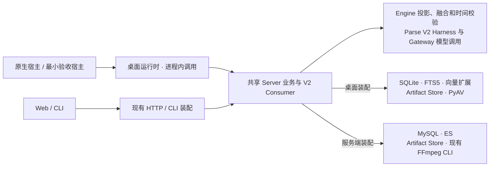

# 1. 问题与现状

**Seekino macOS 桌面后端（PR 1）**

2026-11-23 · 源码基线 `2cc37cc0` · 分支 `feat/macos-desktop-backend` → `dev`

**PR** [#183](https://github.com/owariband/Seekino/pull/183) · **需求** [DESKTOP-BACKEND-01](../../dev/workbench.html) · [问题记录](../../dev/problems.md#desktop-backend-01)

桌面版的目标是让用户装好 `Seekino.app` 就能导入、解析和搜索视频，点击结果就跳到原片的命中位置。应用管理 SQLite、索引和媒体库。原生界面、Python 后端、解析和播放共用一个 Seekino 进程，FFmpeg 以库的形式随应用分发。

现有 Web / 自部署版已跑通上传到回看。本机部署仍要启动 MySQL、Elasticsearch、API 和 Web。前期比较过独立 Python 服务和嵌入 Python 的 Web 视图方案，最终选定原生界面直调 Python。媒体处理参考 VLC 在进程内调用 libavcodec 的做法，先用 PyAV 验证。 [本机部署记录 B18](../../dev/problems.md) · [Local / Cloud 设计](../02-agent-harness/local-cloud-trd.md) · [VLC 解码实现](https://github.com/videolan/vlc/blob/3.0.24/modules/codec/avcodec/video.c#L1246)

| 环节 | 现行源码与桌面接入点 |
| --- | --- |
| 启动与收尾 | HTTP lifespan 调用 `ApplicationRuntime` 的 start / close。`caller.init` 要求 ES，`bootstrap` 同时装配 Consumer、检索和 Chat checkpoint。桌面需要一个能独立装配所需服务的入口。 [运行时](../../../server/main.py#L27) · [Caller](../../../server/caller/base.py#L47) · [服务装配](../../../server/bootstrap.py#L195) |
| 入库与任务 | `UploadService.complete` 校验并保存媒体，写入 V2 任务。SQLite 现用于隔离测试。生产队列用 MySQL 命名锁串行检查并发容量，用行锁保护任务的读取和更新。相关 Interval Refine 提交后才放行 Chunk INDEX。 [导入完成](../../../server/service/upload.py#L530) · [数据库检查](../../../server/caller/mysql.py#L118) · [命名锁](../../../server/utils/database.py#L12) · [领取](../../../server/mq/video_parse_queue.py#L164) · [索引放行](../../../server/mq/video_parse_queue.py#L939) |
| 索引与搜索 | V2 Coordinator 写入并校验 Chunk 和 Event 投影，再提交 INDEX 完成状态。Event Search 在 SQL 指定的范围内找候选，按任务、内容版本和索引代数回源核对。桌面要接管发布、查询和恢复。 [索引发布](../../../server/service/video_parse_index_coordinator.py#L163) · [ES 查询](../../../server/storage/elasticsearch_events.py#L229) · [Event 搜索及回源](../../../server/service/video_event_retrieval.py#L108) |
| 媒体与回看 | 导入时探测时长，解析时抽帧、切片和抽取音频，这些操作都会启动媒体命令。浏览器播放依赖 HTTP URL 和浏览器支持的编解码格式。媒体服务可以通过 Artifact Store 找到原片。 [时长探测](../../../engine/common/media_probe.py#L10) · [批量抽帧](../../../engine/common/frame_sampler.py#L28) · [代理视频与 PCM](../../../server/service/video_parse_media.py#L562) · [原片与播放视图](../../../server/service/media.py#L199) |
| 打包依赖 | 项目锁定 Python 3.12，设置 `package = false`，依赖清单包含服务端和可选能力。部分 Prompt 在导入时按模块路径读取，配置默认路径也指向源码树。桌面打包要明确运行时、资源和依赖，安装到不同目录后也能加载。 [项目依赖](../../../pyproject.toml) · [Prompt 资源示例](../../../agent/video_parse_v2/edit_reference.py#L19) · [Gateway 配置路径](../../../gateway/config.py#L38) |

**PR 1** 提供可嵌入的 Python 后端、SQLite 库、FTS5 和嵌入式向量检索，以及 PyAV 媒体实现。用可重复构建的最小 macOS 宿主验收导入自有视频、Parse V2（含 Refine）、建索引、关键词或描述搜索，最后按证据定位原片。云端 HTTP / MySQL / ES 沿用现有契约和环境隔离规则。

**PR 2**（分支、TRD、PR 待建）使用 PR 1 交付的调用合同、数据与资源布局、媒体库和嵌入验证。接口确定后可以先接线，等 PR 1 合入 `dev` 后，PR 2 再用合入版本完成原生窗口、进程内播放器、签名公证和干净机器安装验收。原生界面框架在 PR 2 选定。桌面 Chat、原生 Agent/MCP、云同步、历史 MySQL 库迁入及高级解析档案可另行评估。

# 2. 影响因素、假设与评价指标

- **宿主能否嵌入。** CPython 支持隔离初始化。先用最小宿主验证包内 Python 扩展、动态库和资源能否从不同工作目录加载，业务能否调用并正常关闭，以及默认模型调用是否会启动额外命令。 [CPython 初始化配置](https://docs.python.org/3.12/c-api/init_config.html#isolated-configuration)
- **同进程并发。** Consumer、媒体调用和 UI 请求仍可能同时写状态。SQLite WAL 允许读写并行，同一时刻只有一个写事务。用多连接竞争和强退测试，验证短事务领取和租约校验能否保证任务正确执行。 [SQLite WAL](https://sqlite.org/wal.html#concurrency)
- **搜索质量。** ES 支持 CJK 分析和版本过滤。FTS5 的 trigram `MATCH` 会漏掉少于三个 Unicode 字符的检索词。向量检索也要先限定范围，再取 top-k。用短人名、台词、描述和跨视频反例测试。 [FTS5 trigram](https://sqlite.org/fts5.html#the_trigram_tokenizer) · [sqlite-vec KNN](https://alexgarcia.xyz/sqlite-vec/features/knn.html)
- **媒体时间与分发。** PyAV seek 按指定流的 time base 找到附近的关键帧，然后解码到目标位置。现有切片依赖 `libx264`，FFmpeg 将它列为 GPL 外部库。用目标构建实际转码，检查配置、格式、时间和许可材料，确认编码组合能否用于桌面分发和现有模型输入。 [PyAV seek](https://pyav.org/docs/stable/api/container.html#av.container.InputContainer.seek) · [当前转码参数](../../../server/service/video_parse_media.py#L562) · [FFmpeg 许可](https://ffmpeg.org/legal.html)

| 指标 | 基线与对照口径 | 初稿验收线 | 采证 |
| --- | --- | --- | --- |
| 主链与进程（结果） | 当前 HTTP 链路有独立组件，进程数和运行指标待以隔离基线复测 | 最小宿主实际完成导入、解析、索引、搜索及按时间解码原片。Seekino 只有一个 PID，子进程启动和本机业务监听端口均为 0 | 普通目录启动与清理环境启动各复跑一次，保留全程进程事件、调用步骤、实际库加载路径 |
| 证据与任务一致性（护栏） | MySQL / ES 的权限、版本、失租拒绝和重试为行为基线 | 重复完成、旧任务越权发布、过期或跨资料库证据均为 0。故障用例全部从应有阶段恢复或返回可解释失败 | 多连接争抢、提交前后强退、暂停/继续、重解析/删除、破坏派生索引后重建 |
| 搜索命中（结果） | 同一冻结 V2 成果和查询向量，ES 结果与人工标注均待采集 | 人工确认的必过查询均在 top 5 得到正确视频和时间窗。分组对照 Hit@5 与 Recall@10，聚合 Recall@10 相对 ES 的初拟容许差为 5 个百分点 | 预先标注台词/画面文字、语义描述和视觉描述各 20 条，另加短词、越界、无命中用例。逐条记录差异 |
| 媒体等价性（护栏） | 同机、同源文件的现有 CLI 输出为对照，同时用带已知画面/音频标记的样本校验 | 时长差 ≤ 1 ms，帧和切片按既有选取规则对齐原片 PTS，窗口全程使用 `[start_ms, end_ms)`。PCM 音轨、声道、采样率和音频边界符合现有合同，音画对齐落在一帧内 | 比较源 PTS、首尾帧、PCM 样本数和基准标记，逐个格式记录失败行为 |
| 资源与响应（诊断） | Apple Silicon 试验机的冷/暖启动、同库检索和解析资源占用待测 | 记录安装运行时体积、进程内存峰值、索引磁盘、SQLite 锁等待及冷/暖查询 p50/p95。首轮测量用于确定目标规模和性能上限 | 模型耗时和本地 I/O 分别采集，报告设备、事件数、采样次数、失败和超时 |

# 3. 改造方案与建模

## 可被宿主直接调用的入口

从现有 Runtime 和 Consumer 的启动、关闭流程中提取两端共用的装配逻辑。由装配入口向对应 Service 提供事务、索引读写和媒体实现。桌面只装配首条业务链需要的服务，接口签名用原型确定。

| 宿主操作 | 由后端保证的合同 |
| --- | --- |
| 打开/关闭资料库 | 宿主传入数据根、资源根及生效模型配置，初始化库和任务执行器。退出时先停止接收和领取新任务，协作取消在途任务或等它完成提交，再关闭 Consumer 和存储。退出超时后，通过回收持久化租约恢复任务。 |
| 导入与任务控制 | 应用流式导入本机文件，沿用入库校验、去重、系列排序和 V2 任务接纳，返回 video/task ID。查询进度、暂停、继续、重试和重解析仍按既有状态与版本规则执行。 |
| 搜索和回看 | 用运行时的本机身份校验资料范围，直接调用检索服务。返回可再次校验的 source ref、video ID 和起止毫秒整数。打开结果时重新核对版本，找到受管原片，把该毫秒位置交给包内 FFmpeg 解码。 |

CPython 3.12 随宿主进程启动和退出。用最小原生可执行文件通过 CPython C API 加载包内解释器，并按指定路径加载资源。UI 主线程只发起调用和接收结果，长任务由现有 Consumer 和线程执行。错误在跨 ABI 传递时转换。 [CPython 嵌入文档](https://docs.python.org/3.12/extending/embedding.html)

模型连接沿用现有配置解析，首条业务链选择进程内 Gateway SDK。解析和向量查询依赖配置的模型服务，已入库视频的播放和关键词搜索只读本地数据。装配时核对外部 Agent CLI、会启动子进程的诊断和本地插件。 [模型配置](../../model-config.md) · [ACP 调用](../../../gateway/bridge/client.py#L129) · [诊断进程](../../../gateway/tracing.py#L169)

## SQLite 任务与资料库

桌面入口创建独立的 SQLite 文件，数据库和 WAL 默认放在 `~/Library/Application Support/Seekino/`，与开发、测试和自部署目录隔离。应用包只读。原片、必要的派生文件和可清理的临时产物按现有 Artifact Store 规则存放。

首版导入时，先在同一磁盘暂存并校验副本，再原子移动到受管库，然后提交 V2 任务。文件落位和数据库分别提交，沿用可重试的完成记录和清理规则，覆盖只完成文件落位、重复导入、中断和磁盘满。桌面从新库起步，维护独立的 Schema 版本，迁移前做一致性备份，升级时保留数据目录。 [现有导入提交](../../../server/service/upload.py#L530) · [Artifact Store 合同](../../../server/README.md#L366)

保留 V2 视频、Chunk、Interval 和 Prefix 的状态、版本、重试与租约规则。每个库由一个宿主取得运行权后再迁移和启动 Consumer。SQLite 开启 WAL 和外键，领取、容量检查、暂停、删除、接收成果和发布都用短写事务。拟用 `BEGIN IMMEDIATE` 在读取条件前取得写锁。

事务内核对当前状态、owner、lease version、有效期，以及适用的父任务和内容版本。遇到锁竞争时有限重试，或返回可重试结果。模型请求、媒体解码和文件 I/O 都在事务外执行，写入前再核对条件。显式退出或意外重启时，按持久化状态恢复。逐项测试原先由 MySQL 行锁保护的写入路径。 [V2 runtime 事务合同](../../../agent/video_parse_v2/README.md#runtime-and-transaction-rules) · [SQLite 事务](https://sqlite.org/lang_transaction.html)

## 索引发布、检索和证据

桌面主搜索以 Event 为粒度，复用现有 Chunk / Event 投影生成器、Refine 就绪条件和 Coordinator 的任务校验，保留 V2 完成链路需要的 Chunk 投影与回执。SQLite 保存业务事实和可重建的投影。

在事务外准备索引文档、媒体和 embedding。以任务、Chunk、内容版本、Event 和索引代数定位投影，用同一个 SQLite 短事务写入或激活投影，记录发布凭证并更新 INDEX 状态。搜索只读当前已完成任务的就绪版本。重建时使用落盘的有效表示，切换代数前检查覆盖率和编码合同。合同变更或有效表示缺失时，由任务流程处理重算和对应的模型用量。 [现有发布流程](../../../server/service/video_parse_index_coordinator.py#L163) · [表示缓存及版本](../../../server/service/video_parse_index_coordinator.py#L621)

1. **关键词。** 比较 FTS5 中文分词与 trigram，按 Event 词法字段建索引，返回命中字段和原文。用两字人名等短词试验分词，或在已授权范围内做受限的精确匹配。验证简繁、混合标点和英文词边界。
2. **相似检索。** 优先试 `sqlite-vec`，保留文本和视觉的编码器身份、维度、输入模式、指令及距离合同。先在 SQL 中限定资料和版本，再取各通道的 top-k。若虚表无法支持动态范围过滤，在同一库上试验带范围条件的精确距离查询，按质量和延迟选型。
3. **核验证据。** 复用 Engine 的融合和核验，用相同的 tenant/series/video、parse task、content version、index generation 和 timeline index 回源。点击结果时再检查版本和影片能否读取。索引或原片缺失、覆盖不足时，按已有错误或部分结果合同反馈。 [Event 核验](../../../server/service/video_event_retrieval.py#L157) · [Engine 证据校验](../../../engine/rag/retrieval/events.py#L53)

## 进程内媒体和包内运行时

在 Engine 的媒体操作边界接入 PyAV，由 Server 管理 Artifact 和租约。逐个替换桌面链路能调用的媒体操作，包括导入和转录探测、Prepare 抽帧、代理切片、抽音频、Refine 与视觉索引抽帧、原片定位及首帧。沿用抽样计划、原片时间区间、目标尺寸、音轨选择和模型输入规格。

用流的 `pts × time_base`、起始偏移和现有舍入规则换算原片时间。既有媒体字段 `*_seconds` 仍是整数毫秒，配置项各用原来的单位。先 seek 到前序关键帧，再按 PTS 解码筛选。逐项验证非零起点、B 帧、VFR、无音轨、多音轨及长音频尾巴。 [流时长规则](../../../engine/common/media_probe.py#L45) · [Engine 时间约定](../../../engine/README.md#媒体时间单位)

从锁定依赖中生成运行清单，列入 CPython 标准库、扩展、TLS CA、Prompt 和配置模板。锁定 PyAV、FFmpeg、SQLite 和向量扩展的版本、架构与布局。移动运行目录后，用 `otool -L` 和实际装载记录检查扩展和 dylib 的依赖、架构、加载路径与签名兼容性。Python 与向量扩展从包内固定位置加载。实际创建 FTS5 表并执行向量查询。

第一次打包试验要实际生成代理切片。用可审查的 FFmpeg 动态库构建，针对现有 `libx264` 用例测试包内 `h264_videotoolbox` 候选，检查 AAC 和 PCM 输出。记录构建选项、依赖许可、通知与源码材料，以及模型能接受的编码输出，交 PR 2 确认最终分发方案。 [FFmpeg VideoToolbox 编码器](https://ffmpeg.org/doxygen/trunk/videotoolboxenc_8c_source.html)

## 实施次序

| 顺序 | 交付与推进依据 |
| --- | --- |
| 1. 最小嵌入与媒体试验 | 先做 Apple Silicon 最小宿主，从包内加载 CPython、SQLite/FTS5、候选向量扩展和 PyAV。用带标记短片验证 probe、seek、切片及 PCM，触发一次真实编码。用同条件的 CLI 输出对照。包内加载、编码可用性或时间不达标时，先解决这一环节。 |
| 2. 运行时与 SQLite | 冻结桌面直接调用入口，接通受管导入、SQLite Schema、Consumer 与任务恢复。用固定模型响应运行正式 V2 Prepare/Understanding/Refine，先完成并发和强退校验。 |
| 3. 发布、搜索、回看 | 接入本地投影、FTS5、向量召回和回源，使用固定模型响应跑完整主链。加入旧版本、索引重建、低覆盖与文件丢失用例，再做 ES 同数据对照。 |
| 4. 安装前交接 | 交付最小宿主的可重复构建入口、运行时和资源清单、库路径与升级合同、媒体能力和实测记录。清理环境重跑全链，并补云端既有入口回归。PR 2 在此产物上接 UI、播放和安装包，优先复用同一套已锁定 ABI 的 libav 库。 |

# 4. 对照实验与结果分析

| 实验 | 固定条件和故障点 | 当前证据 |
| --- | --- | --- |
| 媒体 CLI vs PyAV | 同机和同源文件。样本覆盖常用 MP4/H.264、HEVC、WebM、VFR、非零起点、旋转信息、长 GOP、无/多音轨、长音频尾及损坏文件。保存源 PTS、选帧/切片起止、音轨和落盘格式。比较编码器差异时保留产物供模型输入验收 | 待测 |
| 本地索引 vs ES | 固定 V2 产物、embedding 和查询范围，将两端候选输入相同评测。先标注 `video_id + [start_ms, end_ms)`，正确命中要求视频匹配、区间交并比 ≥ 0.5。对短关键词和文本/视觉查询分别记录首个正确命中的名次及 top-k 内的正例覆盖。复查失效版本和跨库干扰 | 待测 |
| 恢复、并发与云端回归 | 在独立文件库同时领取同一任务，注入上传落位后、索引激活前后和业务提交前的进程退出。核对索引可见性、租约、库状态和额外模型计费。云端在隔离 MySQL/ES 运行现有 bootstrap、V2 队列、索引及检索用例 | 待测 |
| 宿主真实调用 | 移动最小运行时目录，清理开发机 `PATH`、`PYTHONPATH` 等环境变量，以宿主从头执行。采集实际 dylib 路径以及从启动到退出的子进程事件，覆盖短命的 ffmpeg/ffprobe 和提供方辅助命令。另测断网后已有原片定位及词法搜索 | 待测 |

报告计划放在 `docs/report/server/desktop-backend/`。保存 Git 提交、系统和架构、依赖与构建标识、模型和配置指纹、样本清单、命令、原始结果及失败复现。用固定模型响应回放验证任务调度和媒体调用，再用真实模型核对它能否接收转码产物、完整链路的业务效果和实际费用。

# 5. 试点验证与方案取舍

PR 1 在一台 Apple Silicon Mac 上用独立新库试验。选一段台词和画面可核对的短视频，再选一段确实会切成多个 Chunk 的长视频。至少完成一轮新库初始化、搜索、原片定位、暂停恢复、长任务强退重启和派生索引重建。配置进程内 SDK 后，检查实际模型输入和任务完成情况。记录进程、数据库完整性、事务等待、解析与本地查询耗时、检索命中和费用。

通过后把最小宿主、资源清单和调用合同交给 PR 2。出现子进程、旧租约写入、证据越界或原片时间错误时，修复后重新验证再交接。需要回退时，关闭试验宿主，保留隔离试点库或按用户授权处理。

PR 2 在无开发环境的目标 Mac 上安装并首次启动 `Seekino.app`。导入视频，真实解析，分别用关键词和描述搜索，然后点击结果播放原片。记录解析和播放期间的进程。商业安装包的 Developer ID 签名、公证、升级后资料库是否保留和支持的 macOS 版本，以该次验收为准。 [Apple 公证说明](https://developer.apple.com/documentation/security/notarizing-macos-software-before-distribution)

# 6. 结果验收与闭环

已确定原生 UI 直连 Python、进程内媒体处理和两份 PR 的分工，并核对现有 V2 装配、队列、索引和媒体调用。实现和实测待执行。

- **PR 1 验收**由后端交付方在实际嵌入宿主中执行第 2 节的用例。先用包内 PyAV 处理带时间标记的样片，完成一次实际编码的切片，再确定媒体构建方案。SQLite 并发、FTS5 短词、向量范围、云端回归和性能目标仍待验证。
- **产品验收**由桌面交付方负责，以 PR 2 在干净 Mac 上的实测为准。安装包的单进程行为、真实播放、签名、公证、最低 macOS 版本和 Intel 支持范围待确认。
