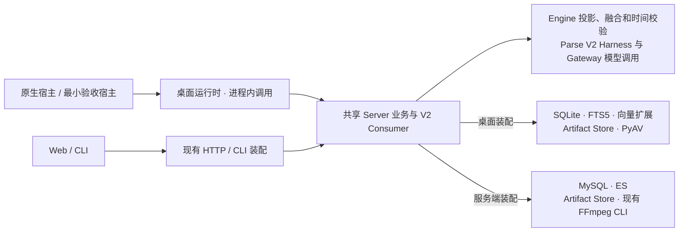

# 1. 问题与现状

**Seekino macOS 桌面后端（PR 1）**

2026-11-23 · 源码基线 `2cc37cc0` · 分支 `feat/macos-desktop-backend` → `dev`

**PR** [#183](https://github.com/owariband/Seekino/pull/183) · **需求** [DESKTOP-BACKEND-01](../../dev/workbench.html) · [问题记录](../../dev/problems.md#desktop-backend-01)

桌面版的目标是让用户装好 `Seekino.app` 就能导入、解析和搜索视频，点击结果就跳到原片的命中位置。应用管理 SQLite、索引和媒体库。原生界面、Python 后端、解析和播放共用一个 Seekino 进程，FFmpeg 以库的形式随应用分发。

现有 Web / 自部署版已跑通上传到回看。本机部署仍要启动 MySQL、Elasticsearch、API 和 Web。前期比较过独立 Python 服务和嵌入 Python 的 Web 视图方案，最终选定原生界面直调 Python。媒体处理参考 VLC 在进程内调用 libavcodec 的做法，先用 PyAV 验证。 [本机部署记录 B18](../../dev/problems.md) · [Local / Cloud 设计](../02-agent-harness/local-cloud-trd.md) · [VLC 解码实现](https://github.com/videolan/vlc/blob/3.0.24/modules/codec/avcodec/video.c#L1246)

| 环节 | 现行源码与桌面接入点 |
| --- | --- |
| 启动与收尾 | HTTP lifespan 调用 `ApplicationRuntime` 的 start / close。`caller.init` 要求 ES，`bootstrap` 同时装配 Consumer、检索和 Chat checkpoint。桌面需要一个能独立装配所需服务的入口。 [运行时](../../../server/main.py#L27) · [Caller](../../../server/caller/base.py#L47) · [服务装配](../../../server/bootstrap.py#L195) |
| 入库与任务 | `UploadService.complete` 校验并保存媒体，写入 V2 任务。SQLite 现用于隔离测试。生产队列用 MySQL 命名锁串行检查并发容量，用行锁保护任务的读取和更新。相关 Interval Refine 提交后才放行 Chunk INDEX。 [导入完成](../../../server/service/upload.py#L530) · [数据库检查](../../../server/caller/mysql.py#L118) · [命名锁](../../../server/utils/database.py#L12) · [领取](../../../server/mq/video_parse_queue.py#L164) · [索引放行](../../../server/mq/video_parse_queue.py#L939) |
| 索引与搜索 | V2 Coordinator 写入并校验 Chunk 和 Event 投影，再提交 INDEX 完成状态。Event Search 在 SQL 指定的范围内找候选，按任务、内容版本和索引代数回源核对。桌面要接管发布、查询和恢复。 [索引发布](../../../server/service/video_parse_index_coordinator.py#L163) · [ES 查询](../../../server/storage/elasticsearch_events.py#L229) · [Event 搜索及回源](../../../server/service/video_event_retrieval.py#L108) |
| 媒体与回看 | 导入时探测时长，解析时抽帧、切片和抽取音频，这些操作都会启动媒体命令。浏览器播放依赖 HTTP URL 和浏览器支持的编解码格式。媒体服务可以通过 Artifact Store 找到原片。 [时长探测](../../../engine/common/media_probe.py#L10) · [批量抽帧](../../../engine/common/frame_sampler.py#L28) · [代理视频与 PCM](../../../server/service/video_parse_media.py#L562) · [原片与播放视图](../../../server/service/media.py#L199) |
| 打包依赖 | 项目锁定 Python 3.12，设置 `package = false`，依赖清单包含服务端和可选能力。部分 Prompt 在导入时按模块路径读取，配置默认路径也指向源码树。桌面打包要明确运行时、资源和依赖，安装到不同目录后也能加载。 [项目依赖](../../../pyproject.toml) · [Prompt 资源示例](../../../agent/video_parse_v2/edit_reference.py#L19) · [Gateway 配置路径](../../../gateway/config.py#L38) |

**PR 1** 提供可嵌入的 Python 后端、SQLite 库、FTS5 和嵌入式向量检索，以及 PyAV 媒体实现。用可重复构建的最小 macOS 宿主验收导入自有视频、Parse V2（含 Refine）、建索引、关键词或描述搜索，最后按证据定位原片。云端 HTTP / MySQL / ES 沿用现有契约和环境隔离规则。

**PR 2**（分支、TRD、PR 待建）使用 PR 1 交付的调用合同、数据与资源布局、媒体库和嵌入验证。接口确定后可以先接线，等 PR 1 合入 `dev` 后，PR 2 再用合入版本完成原生窗口、进程内播放器、签名公证和干净机器安装验收。原生界面框架在 PR 2 选定。桌面 Chat、原生 Agent/MCP、云同步、历史 MySQL 库迁入及高级解析档案可另行评估。

# 2. 影响因素、假设与评价指标

- **宿主能否嵌入。** CPython 支持隔离初始化。先用最小宿主验证包内 Python 扩展、动态库和资源能否从不同工作目录加载，业务能否调用并正常关闭，以及默认模型调用是否会启动额外命令。 [CPython 初始化配置](https://docs.python.org/3.12/c-api/init_config.html#isolated-configuration)
- **同进程并发。** Consumer、媒体调用和 UI 请求仍可能同时写状态。SQLite WAL 允许读写并行，同一时刻只有一个写事务。用多连接竞争和强退测试，验证短事务领取和租约校验能否保证任务正确执行。 [SQLite WAL](https://sqlite.org/wal.html#concurrency)
- **搜索质量。** ES 支持 CJK 分析和版本过滤。FTS5 的 trigram `MATCH` 会漏掉少于三个 Unicode 字符的检索词。向量检索也要先限定范围，再取 top-k。用短人名、台词、描述和跨视频反例测试。 [FTS5 trigram](https://sqlite.org/fts5.html#the_trigram_tokenizer) · [sqlite-vec KNN](https://alexgarcia.xyz/sqlite-vec/features/knn.html)
- **媒体时间与分发。** PyAV seek 按指定流的 time base 找到附近的关键帧，然后解码到目标位置。现有切片依赖 `libx264`，FFmpeg 将它列为 GPL 外部库。用目标构建实际转码，检查配置、格式、时间和许可材料，确认编码组合能否用于桌面分发和现有模型输入。 [PyAV seek](https://pyav.org/docs/stable/api/container.html#av.container.InputContainer.seek) · [当前转码参数](../../../server/service/video_parse_media.py#L562) · [FFmpeg 许可](https://ffmpeg.org/legal.html)

| 指标 | 基线与对照口径 | 初稿验收线 | 采证 |
| --- | --- | --- | --- |
| 主链与进程（结果） | 当前 HTTP 链路有独立组件，进程数和运行指标待以隔离基线复测 | 最小宿主实际完成导入、解析、索引、搜索及按时间解码原片。Seekino 只有一个 PID，子进程启动和本机业务监听端口均为 0 | 普通目录启动与清理环境启动各复跑一次，保留全程进程事件、调用步骤、实际库加载路径 |
| 证据与任务一致性（护栏） | MySQL / ES 的权限、版本、失租拒绝和重试为行为基线 | 重复完成、旧任务越权发布、过期或跨资料库证据均为 0。故障用例全部从应有阶段恢复或返回可解释失败 | 多连接争抢、提交前后强退、暂停/继续、重解析/删除、破坏派生索引后重建 |
| 搜索命中（结果） | 同一冻结 V2 成果和查询向量，ES 结果与人工标注均待采集 | 人工确认的必过查询均在 top 5 得到正确视频和时间窗。分组对照 Hit@5 与 Recall@10，聚合 Recall@10 相对 ES 的初拟容许差为 5 个百分点 | 预先标注台词/画面文字、语义描述和视觉描述各 20 条，另加短词、越界、无命中用例。逐条记录差异 |
| 媒体等价性（护栏） | 同机、同源文件的现有 CLI 输出为对照，同时用带已知画面/音频标记的样本校验 | 时长差 ≤ 1 ms，帧和切片按既有选取规则对齐原片 PTS，窗口全程使用 `[start_ms, end_ms)`。PCM 音轨、声道、采样率和音频边界符合现有合同，音画对齐落在一帧内 | 比较源 PTS、首尾帧、PCM 样本数和基准标记，逐个格式记录失败行为 |
| 资源与响应（诊断） | Apple Silicon 试验机的冷/暖启动、同库检索和解析资源占用待测 | 记录安装运行时体积、进程内存峰值、索引磁盘、SQLite 锁等待及冷/暖查询 p50/p95。首轮测量用于确定目标规模和性能上限 | 模型耗时和本地 I/O 分别采集，报告设备、事件数、采样次数、失败和超时 |

# 3. 改造方案与建模

## 可被宿主直接调用的入口

LightRAG 换向量库时，改的是启动配置 `LIGHTRAG_VECTOR_STORAGE`。填 `NanoVectorDBStorage`，程序就创建本地向量库。填 `PGVectorStorage` 并配好 PostgreSQL，程序就创建 PostgreSQL 的向量实现。无论选哪一个，查片段的代码都调用 `chunks_vdb.query(...)`。Seekino 借用这个做法。一开始选好谁负责存和查，后面的导入、解析和搜索照常调用原有业务方法。 [LightRAG 启动配置](https://github.com/HKUDS/LightRAG/blob/ce3aa6bfe0982003c0684b408995945582681f05/lightrag/api/config.py#L640-L657) · [LightRAG 查片段](https://github.com/HKUDS/LightRAG/blob/ce3aa6bfe0982003c0684b408995945582681f05/lightrag/operate.py#L5872-L5874) · [源码调研](../../research/2026-11-23-lightrag-storage-switching.md)

Seekino 的搜索已经有一个现成的例子。`VideoEventRetrievalService.search` 会调用 `self._store.search_vector(...)` 找候选片段。现在 `self._store` 用的是 ES。给桌面写一个从本地向量索引找候选的实现，也提供 `search_vector`，返回相同格式的片段，后面的排序、核对版本和回看仍走现有代码。 [现有搜索调用](../../../server/service/video_event_retrieval.py#L130)

| 要做的事 | HTTP 版启动时选 | 桌面版启动时选 |
| --- | --- | --- |
| 保存视频信息、解析结果和任务 | MySQL | SQLite，需实现同样的任务领取和提交规则 |
| 按关键词或向量找片段 | Elasticsearch | FTS5 和嵌入式向量索引 |
| 探测时长、抽帧、切片和抽音频 | 现有 FFmpeg 命令 | PyAV，在当前进程调用包内 FFmpeg 库 |

**改代码的地方在启动入口。** 现在 `server/main.py::init_application` 先调用 `caller.init`，创建 MySQL 和 ES，再由 `server/bootstrap.py` 创建视频、HTTP 和 Chat 所需的服务。计划把创建视频服务的代码提到一个共用函数 `build_video_services`（拟名）。HTTP 入口沿用 `caller.init` 打开 MySQL 和 ES，把它们交给共用函数，再挂 HTTP 路由。桌面由拟新增的 `server/desktop/runtime.py::open_library` 打开 SQLite、受管库和本地索引，也交给同一个函数，启动现有 V2 Consumer。数据库连接、索引、媒体函数、文件存放位置和模型连接都在启动时传入。索引代数也由各入口提供。 [现有启动](../../../server/main.py#L45) · [MySQL/ES 初始化](../../../server/caller/base.py#L47) · [视频服务创建](../../../server/bootstrap.py#L250) · [解析配置](../../../server/bootstrap.py#L138) · [Consumer 启动接线](../../../server/bootstrap.py#L585)

例如点击「导入」后，桌面按现有分片大小读本机文件，直接调用 `UploadService.create_session → upload_segment → complete`。哈希去重、保存原片、冻结解析配置和创建任务都复用这一条路。应用仍需为暂存和拼接预留磁盘空间。任务状态、暂停和重试照常调用对应 Service。点击搜索结果时，先核对命中的版本，再用 `MediaService.get_original` 找到原片。 [分片入库](../../../server/service/upload.py#L435) · [完成导入](../../../server/service/upload.py#L530) · [Event 搜索](../../../server/service/video_event_retrieval.py#L77) · [原片读取](../../../server/service/media.py#L199)

首轮桌面打开自己的新库。换用 SQLite 需要先写好并验证 SQLite 的任务和索引实现。已有 MySQL 资料库的迁移另行设计。

| 宿主操作 | 由后端保证的合同 |
| --- | --- |
| 打开/关闭资料库 | 宿主传入数据根、资源根及生效模型配置，初始化库和任务执行器。退出时先停止接收和领取新任务，协作取消在途任务或等它完成提交，再关闭 Consumer 和存储。退出超时后，通过回收持久化租约恢复任务。 |
| 导入与任务控制 | 应用流式导入本机文件，沿用入库校验、去重、系列排序和 V2 任务接纳，返回 video/task ID。查询进度、暂停、继续、重试和重解析仍按既有状态与版本规则执行。 |
| 搜索和回看 | 用运行时的本机身份校验资料范围，直接调用检索服务。返回可再次校验的 source ref、video ID 和起止毫秒整数。打开结果时重新核对版本，找到受管原片，把该毫秒位置交给包内 FFmpeg 解码。 |

CPython 3.12 随宿主进程启动和退出。用最小原生可执行文件通过 CPython C API 加载包内解释器，并按指定路径加载资源。UI 主线程只发起调用和接收结果，长任务由现有 Consumer 和线程执行。错误在跨 ABI 传递时转换。 [CPython 嵌入文档](https://docs.python.org/3.12/extending/embedding.html)

模型连接沿用现有配置解析，首条业务链选择进程内 Gateway SDK。解析和向量查询依赖配置的模型服务，已入库视频的播放和关键词搜索只读本地数据。装配时核对外部 Agent CLI、会启动子进程的诊断和本地插件。 [模型配置](../../model-config.md) · [ACP 调用](../../../gateway/bridge/client.py#L129) · [诊断进程](../../../gateway/tracing.py#L169)

## SQLite 任务与资料库

桌面入口创建独立的 SQLite 文件，数据库和 WAL 默认放在 `~/Library/Application Support/Seekino/`，与开发、测试和自部署目录隔离。应用包只读。原片、必要的派生文件和可清理的临时产物按现有 Artifact Store 规则存放。

首版导入时，先在同一磁盘暂存并校验副本，再原子移动到受管库，然后提交 V2 任务。文件落位和数据库分别提交，沿用可重试的完成记录和清理规则，覆盖只完成文件落位、重复导入、中断和磁盘满。桌面从新库起步，维护独立的 Schema 版本，迁移前做一致性备份，升级时保留数据目录。 [现有导入提交](../../../server/service/upload.py#L530) · [Artifact Store 合同](../../../server/README.md#L366)

**改写事务的取得方式，复用 V2 调度和提交规则。** `MySqlVideoParseQueue.claim_video` 用 `serialized_transaction` 的命名锁保护并发容量，再用行锁领取；Chunk / Refine 的领取也锁定任务行。现有 SQLite 测试分支只开普通事务。生产桌面需要在第一次读取判断条件前取得 SQLite 写事务。 [领取视频](../../../server/mq/video_parse_queue.py#L164) · [领取 Chunk](../../../server/mq/video_parse_queue.py#L239) · [领取 Refine](../../../server/mq/video_parse_queue.py#L320) · [现有事务实现](../../../server/utils/database.py#L12)

- 在 `server/utils/database.py` 提供由宿主选择的写事务入口。MySQL 领容量时继续用现有命名锁和行锁，普通写入沿用已有事务。SQLite 在同一连接执行 `BEGIN IMMEDIATE` 后才读状态。复用队列的候选顺序、容量判断及租约更新代码。纯读取照常开读事务。
- 以 `claim_video` 为例，取得写事务后重新读取候选任务，核对到期时间、暂停状态、现有租约与剩余容量，成功时一起写入容量占用、新 owner、递增的 lease version 和过期时间。事务提交成功才把 lease 交给 Consumer。有调度通知的入口继续在提交后发送。领 Chunk、Refine 和 INDEX 同样在写事务内复核阶段和父任务条件。
- 这条写事务入口要接到现有的 `UploadRepository.complete_upload/reparse`、`ParseJobRepository.transaction`、`VideoParsePersistenceService.commit_chunk_result/commit_interval_refinement` 及索引提交。以暂停和迟到提交竞争为例，两者在各自的写事务内重新读状态与版本，提交方只有在原 lease 仍有效时才能写入。模型请求、解码和文件 I/O 在事务外完成。 [入库提交](../../../server/repository/upload.py#L1103) · [暂停入口](../../../server/service/job.py#L32) · [Chunk 提交](../../../server/service/video_parse_persistence.py#L870) · [Refine 提交](../../../server/service/video_parse_persistence.py#L922)

每个库由一个宿主取得运行权后再迁移和启动 Consumer。SQLite 开启 WAL 和外键。锁竞争按有界重试处理，应用重启后根据持久状态回收租约。用多个 SQLite 连接跑争抢、暂停、重解析和失租提交测试，覆盖原来的行锁路径。 [V2 runtime 事务合同](../../../agent/video_parse_v2/README.md#runtime-and-transaction-rules) · [SQLite 事务](https://sqlite.org/lang_transaction.html)

## 索引发布、检索和证据

桌面主搜索以 Event 为粒度，SQLite 保存业务事实与可重建的 Chunk / Event 投影。**在 `VideoParseIndexCoordinator.index_chunk` 拆开生成投影和发布投影。** 继续用当前 INDEX lease 加载冻结的 Chunk 快照和 Refine 结果，复用 `_build_document`、`_index_events` 中的生成逻辑以及现有 embedding 缓存。生成阶段在写事务外产出 `VideoChunkIndexDocument`、`EventIndexDocument` 和对应版本，发布阶段负责写入并完成 INDEX。 [现有 Coordinator](../../../server/service/video_parse_index_coordinator.py#L163) · [Event 发布](../../../server/service/video_parse_index_coordinator.py#L389) · [表示缓存](../../../server/service/video_parse_index_coordinator.py#L621)

- **Cloud 发布。** 继续用 ES 的版本检查、`bulk_upsert` 和 `verify_ready`，核对 Event 集合和回执后，再调用 MySQL 中的 `VideoParsePersistenceService.complete_chunk_indexing`。ES 重试和可见性处理留在这一实现内。
- **桌面发布。** 取得 SQLite 写事务后，重新核对 INDEX lease、任务状态、内容版本和索引代数，再写入 Chunk、Event、FTS5 和向量投影。将已写入的 Event 集合与回执核对，在同一 session 调用 `server/service/video_parse_content.py` 现有的 `save_index_embeddings` 和 `complete_chunk_indexing` 写回执、核对租约并推进状态。任一步失败就一起回滚，提交后才通知。这个落点复用已接受 session 的提交逻辑，桌面可以在一个事务里完成发布。 [当前提交入口](../../../server/service/video_parse_persistence.py#L997) · [现有版本、回执与状态校验](../../../server/service/video_parse_content.py#L584)

`UploadService` 校验模型与索引合同，`UploadService` 和 `ParseJobService` 的删除路径会清理投影。接入新实现时，一并使用本地合同校验和按任务删除后的校验。重建沿用落盘的有效 embedding，按任务、Chunk、Event、内容版本及代数写入；切换代数前核对覆盖率和编码合同。需要重算时由任务流程记录计算和模型用量。 [入库合同检查](../../../server/service/upload.py#L677) · [任务删除](../../../server/service/job.py#L102)

**搜索只换候选读取。** `VideoEventRetrievalService.search` 已先从 SQL 得到当前已完成任务及就绪版本，再通过 `search_lexical` / `search_vector` 取候选。桌面实现提供本地索引标识和 `bind_contract` 校验，再用 FTS5 和向量索引返回同样的 `RawEventHit`。融合、版本核验和回源继续由现有 Service 执行。 [实际搜索入口](../../../server/service/video_event_retrieval.py#L107) · [候选数据结构](../../../engine/rag/retrieval/contracts.py#L409)

1. **关键词。** 比较 FTS5 中文分词与 trigram，按 Event 词法字段建索引，返回命中字段和原文。用两字人名等短词试验分词，或在已授权范围内做受限的精确匹配。验证简繁、混合标点和英文词边界。
2. **相似检索。** 优先试 `sqlite-vec`，保留文本和视觉的编码器身份、维度、输入模式、指令及距离合同。先在 SQL 中限定资料和版本，再取各通道的 top-k。若虚表无法支持动态范围过滤，在同一库上试验带范围条件的精确距离查询，按质量和延迟选型。
3. **核验证据。** 复用 Engine 的融合和核验，用相同的 tenant/series/video、parse task、content version、index generation 和 timeline index 回源。点击结果时再检查版本和影片能否读取。索引或原片缺失、覆盖不足时，按已有错误或部分结果合同反馈。 [Event 核验](../../../server/service/video_event_retrieval.py#L157) · [Engine 证据校验](../../../engine/rag/retrieval/events.py#L53)

## 进程内媒体和包内运行时

**调用链为 `VideoParseMediaService → PyAV → 包内 FFmpeg 动态库`。** PyAV 的 `av.open`、解码、编码和重采样在宿主进程里运行。Server 继续决定读哪个原片或代理、如何切窗、输出放在哪个租约目录，以及何时校验租约。在 `engine/common/` 统一探测、批量抽帧、单帧、切片和 WAV 提取的签名。桌面将 PyAV 实现放在 `engine/common/pyav_media.py`（拟新增），服务端沿用现有 CLI 实现。装配时选好其中一组，传给 `VideoParseMediaService`。让 `_materialize_video`、`_materialize_audio`、`_materialize_frame` 分别调用切片、PCM 和单帧操作。让 `prepare_episode` 用批量抽帧操作，`prepare_speaker_audio` 用带起止时间的 PCM 操作。入库已有 `probe_duration` 参数，直接传桌面版探测。 [现有媒体构造参数](../../../server/service/video_parse_media.py#L69) · [入库探测注入](../../../server/service/upload.py#L62) · [PyAV 的 FFmpeg 依赖](https://pyav.basswood.io/docs/stable/overview/installation.html#bring-your-own-ffmpeg)

| 操作 | 现有入口 | 桌面调用及要保留的行为 |
| --- | --- | --- |
| 探测时长 | `UploadService.complete`、`prepare_episode` 调 `probe_video_duration_seconds`，由 ffprobe 取视频流时长 | `av.open(path)` 后读取首个视频流的 `duration × time_base`。缺少流时长时扫描该流首尾帧，用最晚帧结束时间减最早显示时间，沿用帧时长缺失时按平均帧率估算的规则。返回整数毫秒，音频尾巴不计入。 [探测](../../../engine/common/media_probe.py#L10) |
| 批量抽帧 | `prepare_episode → extract_video_frames_batch` 一次解码后按毫秒请求选帧 | 把排好序的请求交给同一个解码迭代器，按现有毫秒舍入和 PTS 顺序，为每个请求匹配首个达到该位置的帧。按原规则回用尾帧和重合帧。缩放并写 JPEG，保留 `(requested_ms, path)`，实际解码 PTS 另行采证。 [批量选帧](../../../engine/common/frame_sampler.py#L28) · [Prepare 入口](../../../server/service/video_parse_media.py#L146) |
| 单帧定位 | `prepare_event_frames` 和单 Chunk 的 `_materialize_frame` 以 `ffmpeg -ss ... -frames:v 1` 取图 | `container.seek(..., stream=video, backward=True)` 定位到关键帧，再用 `decode(video)` 找目标帧。按现有尺寸上限缩放，保留旋转后画面的方向。内容判型和视觉索引共用这条路径。 [单帧调用](../../../server/service/video_parse_media.py#L307) · [判型取帧](../../../server/service/video_parse.py#L294) · [索引取帧](../../../server/service/video_parse_index_coordinator.py#L345) |
| 视频切片 | `_materialize_video` 给 Prepare 和 `prepare_video_segment` 输出 H.264/AAC MP4 | `av.open` 打开输入和输出容器。按源时间戳解码并裁到 `[start_ms, end_ms)`，按现有尺寸限制缩放，将音画时间戳换到同一段内时间轴。`add_stream` 创建编码流，`encode` 后 `mux`，刷新编码器并关闭文件。保留可选首音轨、MP4 的 `faststart`，以及核心窗口与视觉重叠窗口的区别。 [切片及编码参数](../../../server/service/video_parse_media.py#L562) · [窗口准备](../../../server/service/video_parse_media.py#L113) |
| 提取 WAV | `_materialize_audio` 用 FFmpeg 自动选轨，`prepare_speaker_audio` 用 `0:a:0` 从原片取窗口 | 按调用方现用的规则选择音轨，保留从切片取音和从原片取音的差别。按源音频时间取窗口，重采样时按输出采样点校准裁切，用 `AudioResampler(format="s16", layout="mono", rate=16000)` 转为单声道 PCM，用 `pcm_s16le` 写 WAV。全片 ASR 也经过 `prepare_speaker_audio`。 [音频物化](../../../server/service/video_parse_media.py#L591) · [原片选轨](../../../server/service/video_parse_media.py#L242) · [全片 ASR](../../../server/service/video_parse.py#L319) · [FFmpeg 自动选轨](https://ffmpeg.org/ffmpeg.html#Automatic-stream-selection) |
| 回看原片 | `MediaService.get_original` 解析 Artifact URI，Web 另用 `playback_view` 生成 HTTP URL | 桌面宿主拿到经版本校验的原片路径与 `start_ms`，用包内库 seek 并解码视频帧和对应音轨。PR 1 证明从命中毫秒能解到原片，PR 2 的原生播放器负责持续输出画面、音频和播放控制。 [原片与浏览器入口](../../../server/service/media.py#L199) |

PyAV 指定流时，`seek` 的偏移要先将原片毫秒和时间原点换算为该流的 `time_base` 单位。解码后以 `frame.pts × frame.time_base` 换回源时间，再按目标窗口或取帧规则筛选。批量抽帧沿用原片首个显示帧对齐的口径，跨音画流裁切使用同一原片时间原点。逐项核对非零起点、B 帧、VFR、旋转、无音轨、多音轨和长音频尾巴。既有 `*_seconds` 媒体字段仍是整数毫秒，配置字段各用原来的单位。 [PyAV seek 与容器](https://pyav.basswood.io/docs/stable/api/container.html#av.container.InputContainer.seek) · [PyAV 时间基](https://pyav.basswood.io/docs/stable/api/time.html) · [PyAV AudioResampler](https://pyav.basswood.io/docs/stable/api/audio.html#av.audio.resampler.AudioResampler) · [Engine 时间约定](../../../engine/README.md#媒体时间单位)

媒体输出沿用现有租约工作目录。解码和编码循环按批检查取消与租约，文件关闭、产物校验通过后再交给后续阶段。普通 Interval Refine 处理已提交的 Chunk 内容，直接用结构化模型调用。首条桌面链只接入已由 PyAV 覆盖的媒体操作。编辑参考扫描和浏览器片段导出各有独立 CLI 路径，随对应能力另行接入。若桌面启用会看帧的 Summary，给其 `build_inspect_video_frames_tool` 传入同一个抽帧实现。 [工作目录](../../../server/service/video_parse_media.py#L506) · [Interval Refine](../../../server/service/video_parse.py#L1390) · [编辑参考扫描](../../../server/service/video_parse_media.py#L173) · [浏览器片段导出](../../../server/service/media.py#L254) · [Summary 取帧](../../../server/service/video_summarize.py#L149)

**构建时将 PyAV 链接到随包的 FFmpeg。** 首轮锁定兼容版本和 Apple Silicon 架构，构建 FFmpeg 共享库，再用它的头文件和 `pkg-config` 信息构建 PyAV。归档同套 `libavformat`、`libavcodec`、`libavutil`、`libswscale`、`libswresample` 和 PyAV 所需的其余 dylib，连同扩展和 Python 资源放入运行目录。移动目录后核对 `otool -L`、架构、签名与实际加载路径。用清理后的环境实跑上表操作和向量查询，收集进程事件。 [PyAV 自建 FFmpeg](https://pyav.basswood.io/docs/stable/overview/installation.html#bring-your-own-ffmpeg)

代理 MP4 的首轮编码候选是 `h264_videotoolbox`。同一批媒体须完成实际编码、音画时间对照和模型接收验证，再定随包的编解码器与构建选项。若实际变更影响视觉编码输入合同，要更新预处理版本并重建对应投影。将构建选项、ABI、许可材料和产物清单交给 PR 2；读取、编码或包内依赖失败时由桌面后端返回错误。 [FFmpeg VideoToolbox 编码器](https://ffmpeg.org/doxygen/trunk/videotoolboxenc_8c_source.html) · [FFmpeg 许可](https://ffmpeg.org/legal.html)

## 实施次序

| 顺序 | 交付与推进依据 |
| --- | --- |
| 1. 最小嵌入与媒体试验 | 先做 Apple Silicon 最小宿主，从包内加载 CPython、SQLite/FTS5、候选向量扩展和 PyAV。用带标记短片验证 probe、seek、切片及 PCM，触发一次真实编码。用同条件的 CLI 输出对照。包内加载、编码可用性或时间不达标时，先解决这一环节。 |
| 2. 运行时与 SQLite | 先提取共用视频装配，用现有 MySQL / ES / CLI 配置跑 HTTP 回归。再接 SQLite Schema、写事务、受管导入和 Consumer 恢复，确定桌面调用入口。用固定模型响应运行正式 V2 Prepare/Understanding/Refine，先完成并发和强退校验。 |
| 3. 发布、搜索、回看 | 接上 SQLite 原子发布与 FTS5、向量召回，将媒体实现切到包内 PyAV，用固定模型响应跑完整主链。加入旧版本、索引重建、低覆盖与文件丢失用例，再做 ES 同数据对照。 |
| 4. 安装前交接 | 交付最小宿主的可重复构建入口、运行时和资源清单、库路径与升级合同、媒体能力和实测记录。清理环境重跑全链，并补云端既有入口回归。PR 2 在此产物上接 UI、播放和安装包，优先复用同一套已锁定 ABI 的 libav 库。 |

# 4. 对照实验与结果分析

| 实验 | 固定条件和故障点 | 当前证据 |
| --- | --- | --- |
| 媒体 CLI vs PyAV | 同机和同源文件。样本覆盖常用 MP4/H.264、HEVC、WebM、VFR、非零起点、旋转信息、长 GOP、无/多音轨、长音频尾及损坏文件。保存源 PTS、选帧/切片起止、音轨和落盘格式。比较编码器差异时保留产物供模型输入验收 | 待测 |
| 本地索引 vs ES | 固定 V2 产物、embedding 和查询范围，将两端候选输入相同评测。先标注 `video_id + [start_ms, end_ms)`，正确命中要求视频匹配、区间交并比 ≥ 0.5。对短关键词和文本/视觉查询分别记录首个正确命中的名次及 top-k 内的正例覆盖。复查失效版本和跨库干扰 | 待测 |
| 恢复、并发与云端回归 | 在独立文件库同时领取同一任务，注入上传落位后、索引激活前后和业务提交前的进程退出。核对索引可见性、租约、库状态和额外模型计费。云端在隔离 MySQL/ES 运行现有 bootstrap、V2 队列、索引及检索用例 | 待测 |
| 宿主真实调用 | 移动最小运行时目录，清理开发机 `PATH`、`PYTHONPATH` 等环境变量，以宿主从头执行。采集实际 dylib 路径以及从启动到退出的子进程事件，覆盖短命的 ffmpeg/ffprobe 和提供方辅助命令。另测断网后已有原片定位及词法搜索 | 待测 |

媒体对照复用已有的批量选帧、长音频尾和窗口重叠用例，同输入分别走 CLI 和 PyAV。嵌入宿主必须从业务入口触发时长探测、带代理的 Prepare、全片或 Chunk WAV、Event 取帧和索引所需切片，再用命中结果定位原片。在清理 PATH 的环境记录这些调用与进程事件，能覆盖只测 PyAV 能否导入时遗漏的 CLI 路径。 [批量抽帧用例](../../../tests/engine/test_frame_sampler.py#L85) · [实际媒体用例](../../../tests/server/test_video_parse_media.py#L629)

报告计划放在 `docs/report/server/desktop-backend/`。保存 Git 提交、系统和架构、依赖与构建标识、模型和配置指纹、样本清单、命令、原始结果及失败复现。用固定模型响应回放验证任务调度和媒体调用，再用真实模型核对它能否接收转码产物、完整链路的业务效果和实际费用。

# 5. 试点验证与方案取舍

PR 1 在一台 Apple Silicon Mac 上用独立新库试验。选一段台词和画面可核对的短视频，再选一段确实会切成多个 Chunk 的长视频。至少完成一轮新库初始化、搜索、原片定位、暂停恢复、长任务强退重启和派生索引重建。配置进程内 SDK 后，检查实际模型输入和任务完成情况。记录进程、数据库完整性、事务等待、解析与本地查询耗时、检索命中和费用。

通过后把最小宿主、资源清单和调用合同交给 PR 2。出现子进程、旧租约写入、证据越界或原片时间错误时，修复后重新验证再交接。需要回退时，关闭试验宿主，保留隔离试点库或按用户授权处理。

PR 2 在无开发环境的目标 Mac 上安装并首次启动 `Seekino.app`。导入视频，真实解析，分别用关键词和描述搜索，然后点击结果播放原片。记录解析和播放期间的进程。商业安装包的 Developer ID 签名、公证、升级后资料库是否保留和支持的 macOS 版本，以该次验收为准。 [Apple 公证说明](https://developer.apple.com/documentation/security/notarizing-macos-software-before-distribution)

# 6. 结果验收与闭环

已核对共用视频装配的提取位置、SQLite 写事务覆盖范围、索引提交函数，以及每项媒体操作的 CLI 入口。上面描述的是 PR 1 的改造设计，代码实现与实测待执行。

- **PR 1 验收**由后端交付方在实际嵌入宿主中执行第 2 节的用例。先用包内 PyAV 处理带时间标记的样片，完成一次实际编码的切片，再确定媒体构建方案。SQLite 并发、FTS5 短词、向量范围、云端回归和性能目标仍待验证。
- **产品验收**由桌面交付方负责，以 PR 2 在干净 Mac 上的实测为准。安装包的单进程行为、真实播放、签名、公证、最低 macOS 版本和 Intel 支持范围待确认。
