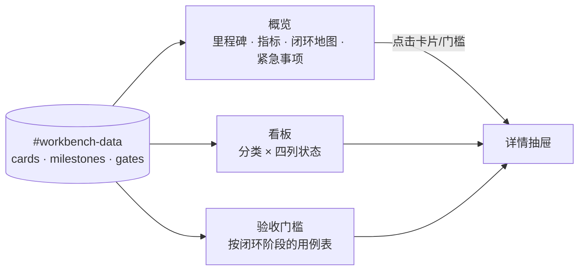

# 1. 问题与现状

## 1.1 2026-11-03 修订：从看板升级为管理工作台

需求：把项目看板升级为 **管理工作台**，看板成为其中一项功能；新增“课程学习闭环最短路径”模块地图、最紧急事项和验收门槛，并把文件改名为 `docs/dev/workbench.html`。日期：2026-11-03。分支：`feat/management-workbench`。PR：[#32](https://github.com/owariband/Seekino/pull/32)，目标 `dev`。本节和下文各节的“2026-11-03 修订”为本次初稿；§1.2 起保留 2026-11-02 看板版本的原始记录。

触发场景：用户要在 2026-11-05（周四）前完成“告诉 Seekino 学习目标和已有基础 → 从课程库组织有来源、可回看的学习路径 → 学习中回答问题”的验收并上线，同时模型预算紧张。看板已经集中了卡片，但回答不了“周四能不能交付、卡在哪里、先做什么”。

已核对的现状：

1. **没有管理维度。** 用户在 Kimi 工作区维护的看板副本为 revision 4，共 76 张卡，`priority` 全部为 `unset`；没有里程碑、截止日期、阻塞关系、验收门槛或预算字段。
2. **状态与证据矛盾。** revision 4 相对仓库 revision 2 改了 50 张卡的状态，均改为 DONE，其中 C21、C22、C23 的卡片正文仍写着“状态：TODO”，PR-18、PR-24、PR-25 等标签仍是“待验收”。三列状态无法表达“已实现、尚未验收”，于是只能在 DONE 和 PROGRESSING 之间二选一。
3. **验收门槛不可见。** [课程 QA](https://github.com/owariband/Seekino/blob/23c888144a2d1885c8d7647d9dc68604abe275f3/docs/design/03-product-reassessment/course-qa-trd.md)（PR #24）定义了 28 条用例，截至 11-03 的检索（SE01–SE04）与学习路径（LP01–LP02）全部待测，观看追问 Q01–Q03 和 RT07 未通过，这些只出现在 QA 分支文档中，看板没有门槛视图。
4. **最短路径分散在对话中。** 课程库就绪、fps 降本、实时 ASR、视频卡失败、参考片段标注与 dev HEAD 验收的先后关系，目前只有会话结论，没有项目内的统一入口。
5. **来源不唯一。** revision 4 位于仓库外的 Kimi 工作区，仓库内是 revision 2；任何 Agent 只读仓库都会看到过时状态。

负面影响：周四前的两天里，决定先做什么、是否放行都要临时翻 QA 报告和 PR，容易把“PR 合并”“DONE”当作验收通过，也无法看到预算与课程就绪这类交付约束。

本次边界：同步 revision 4 进仓库并保留其数据；新增模块地图、门槛、里程碑与指标；状态增加“待验收”；页面改名并同步全部入口。不修改业务代码、服务、数据库与其他 PR；不在页面提供编辑或保存；不替用户改判 revision 4 的状态：本身带“待验收”标签的 DONE 卡迁入新增的“待验收”状态，其余与证据矛盾的卡片保持原状态，只标为一致性警告。

## 1.2 2026-11-02 原始记录：统一 Kanban

需求：Seekino 模块、需求、任务统一 Kanban。日期：2026-11-02（Asia/Shanghai）。分支：`feat/project-kanban`。PR：[#27](https://github.com/owariband/Seekino/pull/27)，目标 `dev`。首提交 `06845112` 只有本 TRD 初稿；本次已完成本地实现和浏览器验收，PR 尚未合并，用户使用反馈待收集。

项目已用 `docs/dev/problems.md` 保存问题状态与详细分析，用 `docs/dev/devlog.md` 保存决策和证据，但缺少统一可视入口。初稿读取的本地文档有 35 条 TODO、20 条已解决；同一 Git 仓库有 20 个本地分支、17 条 worktree 登记（8 条已失效）。初查有六个开放 Draft PR，其中 #21 已搁置，#25/#26 依赖 #18。这是初查时点，不能等同于真实活动任务数或重新验收结果。正式导入改用最新 dev 的 36 条 TODO、20 条已解决，并补入 QA 分支三条；复核时 #26 已关闭未合并，#19 已停止调用，最终按实际证据标记，见 §4。

用户明确采用 category + TODO / PROGRESSING / DONE 三列，以及需求、模块、任务卡片；要求关联 PR/TRD，历史已交付能力无需补造需求和设计。使用 huashu-design，明确「但是只用设计一个版本」。已有三列示意获认可，本次完成一版可离线打开、由 Agent 在仓库统一维护的 HTML。

2026-11-02 交互复核：初版“保存 HTML”暗示每人编辑、导出自己的看板，浏览器草稿还可能优先于仓库内容。项目实际需要全项目共用的状态入口。因此取消浏览器编辑、拖动改状态、保存、导入与本地草稿；页面只展示仓库数据，工作变化由 Agent 更新同一文件并走项目 Git 流程。

边界：只处理项目管理资料和本地 HTML；不修改业务实现、服务、数据库或现有 PR 的状态。保持历史正文、稳定问题编号和证据，不从 commit 数或合并事实推断业务验收。

# 2. 影响因素、假设与评价指标

## 2.1 2026-11-03 修订

| 因素 | 当前证据 | 假设与机制 | 如何验证或否定 |
| --- | --- | --- | --- |
| 缺少优先级与里程碑 | 76 张卡 priority 全为 unset | 给 P0 卡绑定里程碑、截止日和阻塞关系后，一屏就能看出今晚、周三、周四分别要完成什么 | 概览页列出全部 P0 卡并按截止日分组；人工核对与会话中给出的两天安排一致 |
| 状态无法表达“待验收” | 50 张卡改为 DONE 后仍带“待验收”“待核对”标签 | 增加 `verifying` 状态，“实现完成但未验收”有固定位置，DONE 只留给已验收工作 | 带“待验收”标签的 DONE 卡全部迁入；DONE 列中剩余的矛盾卡由一致性检查列出 |
| 门槛分散在 QA 分支 | SE/LP 全部待测只写在 course-qa TRD | 把周四门槛做成数据，按闭环阶段汇总通过/失败/待测，能直接判断“是否可放行” | 门槛数与状态逐条对照 PR #24 的 11-03 报告；页面计数与数据一致 |
| 交付约束不可见 | READY 课程数、已知费用只在报告里 | 课程就绪与费用作为里程碑指标展示，避免只看代码进度 | 指标与 GPT v11 费用审计（¥31.26，69 次调用费用未知）一致，未知值显示“未知”而不是 0 |
| 单一来源 | revision 4 在仓库外 | 同步进仓库后只保留仓库文件一个来源 | 卡片 ID、字段逐张对照 revision 4，除迁入 `verifying` 的卡外数据一致 |

| 指标 | 定义 | 基线 | 目标 / 护栏 | 测量 |
| --- | --- | --- | --- | --- |
| 数据保真 | revision 4 的 76 张卡在新文件中是否完整 | 仓库为 revision 2（73 张） | 76 张全部保留；状态只按上表规则变化，其余字段逐字一致 | 脚本逐卡比较 |
| 管理字段覆盖 | 里程碑 P0 卡中有截止日、关联门槛或阻塞关系的比例 | 0 | 100% | 数据校验 |
| 门槛可判定 | 门槛条目都有状态、日期和证据链接或“待测”说明 | 不在看板中 | 100%；不把待测写成通过 | 数据校验 + 对照 QA 报告 |
| 一致性警告 | DONE 卡仍带待核对/待验收/Draft 等标签的数量 | 未统计 | 页面显示准确计数并可逐张查看；不自动改判 | 脚本计数对照页面 |
| 页面可用性 | 1440×900 / 375×812 下三个视图可用，无 JS 错误、无横向溢出、无网络请求 | 看板版 30 项检查通过 | 新增视图全部通过，原有只读、筛选、详情检查不退化 | Playwright + Chrome |

不测量长期管理效率或节省时间；“一屏看清”只做结构核对，不当作效率收益。

## 2.2 2026-11-02 原始记录

关键因素是条目粒度混杂、文档跨分支分散、PR 开放不代表正在进行，以及浏览器草稿与下载副本造成多个状态来源。假设三列看板、可追溯详情和仓库统一维护能缩短查找路径；本轮不虚构用户效率提升数据。

| 指标 | 基线 | 目标 | 验证 |
|---|---|---|---|
| 状态表达 | 文档两大区，分支/PR 分散 | 仅三列，支持模块/需求/任务及分类 | 浏览器检查、类型/分类筛选 |
| 历史完整性 | problems 正文与 devlog 已存在 | 原有问题编号及正文无丢失 | 导入清单对照、diff |
| 证据可追溯 | Markdown 链接与 PR 正文 | 每个导入条目有来源；TRD/PR 可选且可多条 | URL、锚点和内容核对 |
| 状态来源唯一 | 初版存在浏览器草稿、下载副本与仓库文件 | 页面只读仓库文件，更新后刷新可见，旧草稿不能覆盖 | 注入更高版本旧草稿、临时文件更新→刷新 |
| 响应与交互 | 无正式页面 | 1440/375 宽度可用，键盘可操作，无 JS 错误 | 截图、交互与溢出检查 |
| 状态真实性 | 历史结论有验证边界 | 不把 Draft、搁置、历史已解决写成新验收 | 六个被跟踪 PR 和典型历史条目抽查 |

# 3. 改造方案与建模

## 3.1 2026-11-03 修订：管理工作台

已有基础：沿用 2026-11-02 版的单文件、仓库唯一来源、只读页面、品牌视觉和全部卡片字段；看板交互（分类、类型、搜索、折叠、详情、关联跳转）原样保留。改动集中在数据模型和新增视图，不引入构建、服务或外部依赖。

**文件与命名。** `docs/dev/kanban.html` 改名为 `docs/dev/workbench.html`，数据节点 `#kanban-data` 改为 `#workbench-data`，页面标题为“管理工作台”。AGENTS、README、文档职责、设计与报告索引、problems 及 devlog 中的入口链接同步改到新路径；历史正文中的“看板”措辞保留。

**三个视图。**

1. **概览（默认）**：当前里程碑的产品承诺与倒计时；指标行（门槛通过数、未完成 P0、READY 课程、已知费用、进行中 PR、一致性警告）；闭环地图按用户路径排列阶段，每个阶段显示门槛状态和阻塞它的卡片；紧急事项按截止日分组；最后列出不进入本里程碑的事项。
2. **看板**：原有分类泳道，状态从三列增加为四列 TODO / PROGRESSING / 待验收 / DONE；卡片显示优先级与里程碑标记，可筛选“只看当前里程碑”。
3. **验收门槛**：每条门槛的阶段、状态、证据日期、说明与关联卡片；状态用图标加文字表达，不只靠颜色。

**数据模型（schemaVersion 2）。** 卡片新增可选字段，旧卡无需补造：

| 字段 | 含义 |
| --- | --- |
| `status` | `todo / progressing / verifying / done`；`verifying` 表示实现或交付完成、验收未完成 |
| `priority` | `P0 / P1 / P2 / unset`，沿用原字段 |
| `milestone` | 所属里程碑 ID，可为空 |
| `due` | 截止日期 `YYYY-MM-DD`，可为空 |
| `blockedBy` | 阻塞本卡的卡片 ID 列表 |
| `gates` | 本卡负责推动的门槛 ID 列表 |

顶层新增 `milestones`（承诺、截止日、闭环阶段、课程就绪、费用、范围外事项）和 `gates`（ID、阶段、标题、状态 `pass / fail / untested`、证据日期、说明、证据链接）。门槛状态是人工采集的验收事实，页面只计数，不从卡片状态推导；阶段状态由其门槛汇总（有失败则失败，全部通过才通过，否则待测）。

**一致性检查。** 页面计算并展示两类警告，不修改数据：状态为 DONE 却带“待核对 / 待验收 / Draft / 待合并”等标签的卡片；P0 卡缺少截止日。用户或 Agent 按警告核对后再改数据。

**revision 4 同步规则。** 先原样写入 revision 4，作为单独提交；再按 §1.1 的规则把带“待验收”标签的 DONE 卡迁入 `verifying`，并新增 MOD-LOOP 模块、LOOP 任务与 C25/C28 问题卡。其余卡片字段不改。

**保持不变的合同。** 页面不编辑、不保存、不读写浏览器草稿、不发网络请求；只接受 http(s) 链接；内容按文本渲染；单一浅色主题；正文 ≥14px，可点击控件 ≥44px。

**验证顺序。** 先脚本核对 revision 4 → 新文件的逐卡一致性与新增字段校验，再做浏览器检查（沿用旧检查中仍适用的项，新增三视图、四列、门槛计数、一致性警告与里程碑筛选），最后同步文档入口并检查链接。任一项未通过时不合并。

## 3.2 2026-11-02 原始记录

以 `docs/dev/kanban.html` 为统一日常看板与卡片状态入口，内部 `application/json` 保存规范化数据，HTML/CSS/JS 与品牌 SVG 自包含，不依赖网络或第三方 CDN。卡片类型 `module / requirement / task`，状态仅 `todo / progressing / done`；搁置、阻塞、待核对、待真实验收是标签和详情，不增加状态列。

卡片含稳定 ID、标题、分类、类型、状态、摘要、下一步、更新日期、验证边界、关联卡片及多条来源链接。模块卡描述当前有界能力；需求/任务关联模块，历史完成项保留原问题编号。原始文档摘要只用于卡片浏览，不替换正文。活跃 PR 独立交付任务关联长期问题，避免把一个 PR 与整个长期问题混为同一完成范围。

交互包括分类/类型/文本筛选、折叠、三列展示、详情和关联工作跳转。状态是展示字段，页面不新增、编辑或拖动卡片，不导入/导出文件，不读取或写入浏览器草稿。由 Agent 修改仓库 HTML 的同一数据节点，保留稳定 ID、来源及关联，随需求提交；用户刷新页面查看结果。资料链接只接受 http(s)，内容作为文本渲染。日期使用 Asia/Shanghai。保持单一浅色主题。

| 日期 | 原方案 | 新证据 | 决定与影响 |
|---|---|---|---|
| 2026-11-02 | 浏览器编辑、localStorage 草稿、保存 HTML | 保存按钮与项目共用看板的预期冲突，旧草稿可以覆盖较低 revision 的仓库文件 | 改为仓库单一来源；保留浏览能力，取消页面写入和副本流程，重新验证旧草稿隔离与文件刷新 |

文档职责同步：看板维护当前执行状态，problems 保存问题分析与历史事实，devlog 保存决策实验；过渡时保留原 TODO/已解决历史分区并注明快照边界，不要求两套手工状态同步。更新 AGENTS、文档入口和设计索引，形成一份规则。

视觉：沿用 Seekino 鲸鲨 SVG、灰绿背景与青绿强调色；桌面侧栏选分类，主体固定三列；卡片上直接露出 PR/TRD，详情承载证据和验收。正文 ≥14px，辅助标签 ≥12px，移动端可操作控件 ≥44px。只做用户指定的一个方向，不制作变体。

# 4. 对照实验与结果分析

## 4.1 2026-11-03 修订：实验计划

| 比较项 | 基线（看板 revision 4） | 工作台（待测） | 判断标准 | 证据 |
| --- | --- | --- | --- | --- |
| 卡片保真 | 76 张 | 待测 | 76 张全部保留；只有规则内状态迁移与新增卡 | 逐卡比较脚本输出 |
| 周四 P0 可见性 | 无 P0、无截止日 | 待测 | P0 卡全部有截止日和门槛/阻塞关系，概览按日期分组 | 数据校验、截图 |
| 门槛判定 | 不在看板 | 待测 | 门槛计数与 PR #24 的 11-03 报告逐条一致 | 门槛表 + 报告链接 |
| 一致性警告 | 未统计 | 待测 | 页面计数等于脚本计数 | 浏览器检查 |
| 页面行为 | 30 项检查通过 | 待测 | 原有适用项不退化，新增项全部通过 | Playwright 结果 JSON |

实验没有模型调用，也不重跑业务验收；门槛状态全部引用已有报告。

实际结果（2026-11-03 21:20 前后，提交见 PR #32）：

| 比较项 | 基线（revision 4） | 工作台（revision 5） | 判断 | 证据 |
| --- | --- | --- | --- | --- |
| 卡片保真 | 76 张 | 76 张全部保留，新增 13 张；7 张带“待验收”标签的 DONE 卡迁入 VERIFYING，其余状态不变，正文、来源与链接未改 | 通过 | [迁移脚本](../../report/docs/dev/workbench/build_data.py)、[验收记录](../../report/docs/dev/workbench/README.md) |
| 周四 P0 可见性 | P0 0 张 | P0 任务 14 张，截止日 14/14；除 PR-24（课程 QA 本身）外都关联门槛或阻塞关系；概览按 11-03 / 11-04 / 11-05 分组 | 基本通过；PR-24 无单独门槛，由 LOOP-08 承担 | 同上 |
| 门槛判定 | 不在看板 | 17 条：通过 3、未通过 4、待测 10，均有证据链接或待测说明 | 通过 | 门槛表；PR #24 `23c88814` 报告 |
| 一致性警告 | 未统计 | 37 条（DONE 仍带待核对等标签 37，P0 缺截止日 0），页面计数与脚本一致 | 通过；37 张卡待逐张核对 | [results.json](../../report/docs/dev/workbench/results.json) |
| 页面行为 | 30 项检查 | 36 项检查全部通过（1440×900 / 375×812，离线，无 JS 错误与网络请求） | 通过 | 同上 |

GPT v11 进度改用 12:26 的持久成果核对（理解 117/117、Refine 106/115、索引 96/117，Consumer 已停止），比初稿引用的 11:53 快照更新。

## 4.2 2026-11-02 原始记录

计划以当前 Markdown + PR 列表为基线，验证看板能直接找到 #18、#25、#26 的关系，能区分 #21 搁置，能回看 B07/B20 历史证据；同时抽查三条 DONE 和未明确更新的 TODO，避免扩大历史结论。记录导入数量、来源版本及差异，不自动将未找到的链接替换为无关材料。

当前验证搜索/类型/分类组合、清空结果、详情和关联跳转、只读状态、旧浏览器草稿隔离、仓库文件更新后刷新、浅色主题与移动端。浏览器覆盖 1440×900 和 375×812；不运行无关 Python 业务测试。

实际结果（2026-11-02）：导入 73 张卡，包含 7 模块、19 需求、47 任务。来源为 dev `56e79777` 的 56 条问题、QA `1ce5944b` 的 C21/C22/C23、六张 PR 交付卡、七张模块卡和本需求 PM-01。原问题正文和编号保留；模块与同类工作双向关联，PR-25 / PR-26 关联上游 PR-18。

状态复核：#19 已停止新增调用与实验服务，标为 TODO / 待决策；#21 保留已搁置；#26 已关闭但未合并，标为 TODO / 待核对；旧 TODO 的真实运行状态未重验，保留标签。PM-01 的 DONE 限于本地实现和此次验证，仍标注待合并。交付快照为 TODO 38、PROGRESSING 12、DONE 23，不将不同粒度卡片相加计算 OKR 达成率。

初版 `6bdc6ff0` 的历史验证：Chrome 156 在两种宽度下 36 项检查通过，含拖放、编辑、浏览器草稿恢复、完整 HTML 下载、全新浏览器上下文离线重开、无效输入拒绝与 HTML 导入隔离。原生文件选择器仅以测试替身覆盖。huashu-design 的 Python 浏览器收集入口缺少依赖，改用现有 Node Playwright 执行原始 `COLLECT_JS` 与 `judge()`，字号、对比度和图片检查无红灯。这些结果只描述初版；编辑、保存、导入和草稿功能现已退役，不作为当前功能承诺。

实测清单、设计依据和截图见 [验收报告](../../report/docs/dev/kanban/README.md)。未测量长期管理效率、用户操作耗时或 Token 节省；本次没有模型调用。

仓库统一维护版实际验证：Chrome 156，1440×900 / 375×812，30 项检查通过。更高 revision 的旧浏览器草稿不能覆盖仓库文件；临时文件模拟 Agent 更新后刷新能显示新记录；搜索、三种类型、分类、详情、PR/TRD 与上游跳转保持可用，系统深色偏好不改变浅色主题。无浏览器写入入口、页面水平溢出、JS 页面错误或加载网络请求。结果见 [readonly-results.json](../../report/docs/dev/kanban/readonly-results.json)，不把初版保存能力继续作为当前验收内容。

# 5. 试点验证与方案取舍

## 5.1 2026-11-03 修订

试点就是周四里程碑本身：两天内由 Agent 每完成一项 P0 就更新卡片、门槛与指标，用户只打开页面判断进度和放行。观察“是否还需要翻 PR/报告才能决定下一步”，以及门槛状态是否与实际验收一致；这是定性观察，不报告效率数字。若门槛与报告出现不一致，以报告为准修正数据并记录原因。回退只需 Git 恢复上一版文件，看板数据不受影响。

## 5.2 2026-11-02 原始记录

本地项目管理入口，采用真实项目资料的浏览器验证替代独立生产试点。先整理本次快照并核对，后续由各 Agent 在仓库维护同一份嵌入数据，通过分支/PR 集成；自动同步 GitHub、浏览器在线编辑、OKR 计量、自动删分支不在本次交付内。

风险是分支资料滞后与历史记录尚未重新验收。页面显示数据日期和来源；以仓库文件为准，Agent 合并时按 ID 保留其他工作。浏览器旧草稿不再读取，也不擅自删除。回退可通过 Git 恢复前版，原文证据始终保留。

# 6. 结果验收与闭环

## 6.1 2026-11-03 修订

2026-11-03 实施状态：§4.1 各项已在分支上通过，待合入 dev。初稿要求逐项回到 §1.1：完成时逐项回到 §1.1：revision 4 已进入仓库且来源唯一；周四 P0、门槛、课程就绪与费用在概览一屏可见；“待验收”有独立状态；矛盾状态有警告且未被擅自改判；入口全部改到 `workbench.html`。业务能力仍以门槛证据为准，工作台展示不等于验收通过。

剩余事项：37 张警告卡需用户确认是否回到 TODO / PROGRESSING（尤其 C22，11-03 QA 结论仍未通过）；LOOP-01 的“上线”范围待用户决定；课程进度、费用与 PR 状态需随工作推进手动刷新。长期管理效率未测。

| 日期 | 原判断或方案 | 新证据 | 调整与原因 | 影响 |
| --- | --- | --- | --- | --- |
| 2026-11-03 | 仅三列，搁置、待验收用标签表达 | revision 4 中 50 张卡改为 DONE 但标签仍为待验收/待核对 | 增加 `verifying`，标签为“待验收”的 DONE 卡迁入；其余矛盾只警告 | AGENTS 与文档职责的状态合同从三列改为四列 |
| 2026-11-03 | 文件名 `kanban.html`，定位为看板 | 需要承载里程碑、门槛与地图，看板只是其中一项 | 改名 `workbench.html`，统称管理工作台 | 所有入口链接同步；历史正文措辞保留 |
| 2026-11-03 | 沿用 revision 4 的青绿配色与无衬线标题 | 用户要求废弃原视觉风格，并只保留浅色 | 合入 dev 后直接在 dev 重做视觉：米白纸面、衬线标题、单一陶土色强调、细分隔线，`color-scheme: only light`；数据、视图、交互钩子与门槛口径不变 | 浏览器检查 36 项沿用并新增浅色与衬线 2 项，共 38 项；见[验收记录](../../report/docs/dev/workbench/README.md#视觉重做) |

## 6.2 2026-11-02 原始记录

交付 [单文件看板](../../dev/workbench.html)（2026-11-03 改名），同步 AGENTS、文档职责、设计/报告入口、problems 维护规则与本次 devlog。页面自包含，由 Agent 统一更新仓库文件，用户打开或刷新查看。历史问题正文保留为证据，当前状态只维护嵌入 JSON，不增加外置实时 JSON 主文件或浏览器状态源。

验证范围为看板浏览、仓库数据读取、结构与来源，未重新运行 Seekino 解析、检索、Chat 或模型验收。没有部署线上站点、改动业务代码或数据库、删除分支、合并其他 PR。当前 PR 待评审合入；长期管理效率仍需使用后观察。
