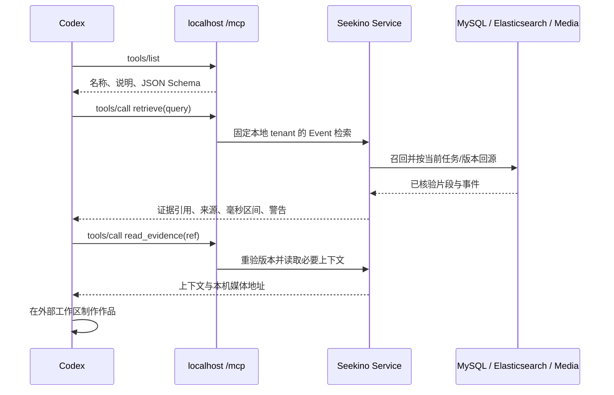

# 1. 问题与现状

需求：localhost MCP 接入。提出日期：2026-10-28；实施与验证：2026-10-28 至 29（Asia/Shanghai）。当前问题状态见 [B15](../../dev/problems.md#b15localhost-mcp-与外部-agent-素材取用闭环)，实施证据见 [devlog](../../dev/devlog.md#devlog-local-mcp-20261028)。

用户需要在 2026-10-30 早上前演示 Codex 实际调用 Seekino 取得视频证据，并在外部 Agent 的工作区完成创作。改造前 Event 检索服务已有词法、语义和视觉通道及 MySQL 回源验证，但只注入内部 Agent；HTTP `/api/search` 使用 Chunk 检索，尚无外部 MCP 工具入口。本轮新增入口的实现与验证范围见第 4、6 节。

本次产品边界：Seekino 提供素材库发现、Event 召回、证据续读与媒体取用；Codex 负责创作规划、文件、执行、修错及作品。Cloud 继续保留 Chat，微型 HTML 作品能力另行实施。历史 FFmpeg 探针不作为当前 MCP 或 Sandbox 的验收证据。

当前 Cloud 身份基于 Cookie/CSRF，尚无外部 PAT/OAuth 接入。本版只允许本机直连且 auth mode 为 local；不提前开放 Cloud。来源：[检索服务](../../../server/service/video_event_retrieval.py)、[HTTP 检索](../../../server/api/search.py)、[身份入口](../../../server/api/context.py)。

# 2. 影响因素、假设与评价指标

关键假设：外部 Agent 已有制作能力，Seekino 只要稳定提供可追溯证据与实际可访问媒体，即可完成素材到作品的协作。协议连接成功只是必要条件，不能代替真实素材验收。

| 指标 | 基线 | 验收标准 | 测量方式 |
|---|---|---|---|
| 工具发现与调用 | 无产品 MCP 入口 | 标准客户端发现三个工具并成功调用 | SDK/HTTP 测试；Codex 连接验证 |
| 证据一致性 | 已有 Service 核验 | 同一输入保留来源、版本与毫秒区间 | 隔离 SQLite/服务测试 |
| 未覆盖与空结果 | Event 服务可区分 | 工具失败明确反馈，不伪装无匹配 | Event 未配置/未覆盖用例 |
| 版本与范围 | 固定 tenant、SQL 回源 | 篡改范围、重解析或旧版本引用被拒绝 | 证据引用回读测试 |
| 媒体取用 | 有受控媒体 HTTP 入口 | 返回可实际访问地址，失踪媒体明确标记 | 本地媒体测试；真实样本待测 |
| 访问边界 | 首版 local | Cloud 不挂载；远端、恶意 Host/Origin/转发头被拒绝 | 传输边界测试 |
| 创作闭环 | 未实测 | Codex 召回、取素材并交付作品 | 后续固定真实素材演示 |

接口耗时和模型费用需在实际数据与配置下测量，本版不由 mock 或单个请求推算 SLA。检索仍可能调用已有 embedding，MCP 不启动内部 Chat 循环。

# 3. 改造方案与建模

参考本地 RAGFlow checkout 的 `internal/handler/mcp_retrieval.go`（本次位置：`/Users/hypnos/workspace/rag/ragflow`）：协议适配复用检索 Service；不复制其 Agent 工作流或索引架构。传输使用已锁定的 Python `mcp==2.2.0` SDK，实际类为 `MCPServer`，不照搬旧 `FastMCP` 示例。

## 工具合同

| 工具 | 参数 | 行为 |
|---|---|---|
| `list_series` | `offset`, `limit` | 分页列出本地 tenant 的系列与可检索状态 |
| `retrieve` | `query`, 可选 `series_ids`, `top_k`, `event_types`, `speaker` | 默认 Event 三通道，沿用服务配置；不静默回退 Chunk |
| `read_evidence` | `evidence_ref` | 重验引用版本，返回所选事件、Chunk 上下文与媒体信息 |

SDK 从函数签名、类型和工具说明生成 JSON Schema，再通过 `tools/list` 发布。Codex 按 Schema 发出 `tools/call`，适配层校验输入并在线程池调用同步服务。不存在“模型自动获知任意后端函数”的步骤。

`top_k` 明确按不同 Chunk 计数。对外视频时间使用 `*_ms`，内部已有 `*_seconds` 毫秒字段不改名。输出不暴露原始 ES trace、服务器绝对路径或数据库配置；可读正文有界，截断明确标记。

`evidence_ref` 携带 Chunk、任务、内容版本和事件定位；它是定位引用，不是授权凭证。回读始终固定服务端 local tenant，并通过现有持久层 hydrate 合同核对任务、版本和事件。索引未覆盖、引用过期和媒体缺失分别反馈。

本机媒体 URL 仍由现有媒体接口读取；MCP 校验本机请求后补全 URL，使外部 Agent 可下载。命中区间是原片事实定位，不保证自然剪辑入出点已完成审核。

## 运行与兼容边界

- `/mcp` 复用现有 API 进程与服务实例，SDK 生命周期随应用启动和关闭；无需新的 Consumer、数据库表或部署服务。
- Cloud 模式不挂载 MCP；本地传输同时校验直接客户端地址、Host、Origin 与转发头，不能仅靠 `mode=local` 声称是 localhost。
- SDK 处理协议版本兼容、工具发现和结构化返回；不手写 JSON-RPC 分发器。
- 浏览器前端、解析、召回权重、索引 Schema、已有 HTTP API 合同均保持。

# 4. 对照实验与结果分析

修改前无 MCP endpoint；修改后先用隔离服务/SQLite 验证调用、返回与拒绝路径，再验证 SDK 客户端与实际 Codex 协议兼容。测试 fixture 必须标为测试数据，不代表真实视频命中。

| 实验 | 条件 | 结果与证据 |
|---|---|---|
| SDK 协议与本机边界 | 不访问真实 DB/ES/模型 | 本机 HTTP SDK 调用及定向测试通过，见 devlog |
| 证据与媒体合同 | 隔离 fixture、固定毫秒值和版本 | 包含真实 SQLite 回源、媒体读取和旧版本拒绝的测试通过 |
| Codex 客户端发现与直接调用 | 实际 app-server、临时 MCP 配置、无模型回合 | 发现三个工具，直接调用 `list_series` 成功；返回唯一 fixture 标识且宿主记录一次调用 |
| Codex 模型自主工具调用 | 独立本机测试端点、临时 MCP 配置 | 模型请求连续超时，未发起业务工具调用；保留失败证据 |
| 真实素材检索与制作 | 正常运行的本地 DB/ES/API 和可检索媒体 | 待测，需恢复/确认演示环境 |

# 5. 试点验证与方案取舍

最小试点固定一个已有可检索系列及一个任务，例如“找到三段演出片段，提供出处并制作 HTML 素材页”。先证明 Codex 发现工具、召回、续读、下载，再完成外部作品。检索无匹配应如实结束，不能改用虚构视频。

试点记录实际源码版本、模型配置、素材/解析版本、工具轨迹、媒体取用结果和作品路径。真实环境不可用时，保留已完成的离线验证，不能用 fixture 替代试点。部署与服务启动按当前任务授权执行，不自动迁移数据、重建索引或重跑解析。

首版不支持远程服务器经本机代理暴露 MCP；若需要 Cloud、公网访问、容器代理或跨机器媒体下载，需另行明确可信身份和媒体授权，不放松 localhost 检查来冒充支持。

# 6. 结果验收与闭环

当前交付分三层记录：实现与离线测试、真实 Codex 连接、真实素材到作品。各层证据独立保留，全部完成前不标记 B15 解决。实施结果集中追加到 devlog，本设计只维护合同和验收依据。

截至 2026-10-29：本机入口、三个工具及版本化读取已实现；53 个定向测试与 260 个相关回归通过；SDK 网络调用和真实 Codex app-server 直接工具调用通过。Codex 模型自主调用因请求超时未完成，真实素材到作品尚待数据恢复。测试端点均已关闭，正式 API 未启动，未更改全局 Codex 连接配置。

后续 HTML 作品能力走 Chat 的受限发布、持久化与隔离预览；Cloud MCP 补外部身份。两者均不阻塞本版 localhost 工具实现，也不包含在本次实现完成的声明中。
