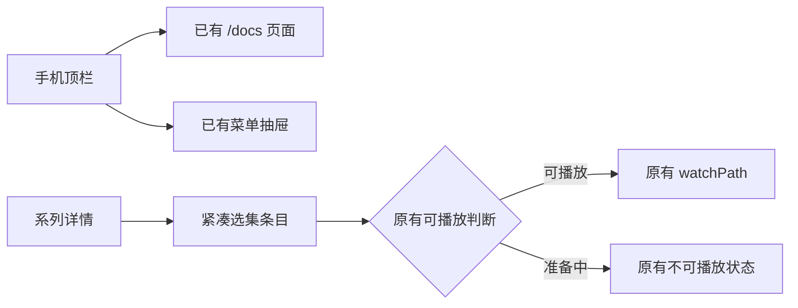

# 1. 问题与现状

需求：移动端文档入口与剧集列表密度修复。提出日期：2026-11-12（Asia/Singapore）。分支：`fix/mobile-docs-episodes`；集成目标：`dev`；PR：[#129](https://github.com/owariband/Seekino/pull/129)。当前执行状态见[工作台](../../dev/workbench.html) `MOBILE-UI-01`。

手机访客首次进入 Seekino 时，需要知道怎样检索、观看与提问。现有顶栏只呈现菜单、字标与搜索，“使用文档”位于菜单抽屉中，访客必须先发现并展开菜单才能了解用法。同一设备浏览系列选集时，整行宽的 16:9 画面与下方标题让每集占用大量纵向空间，选到后续剧集需要反复滑动。

用户提供六张截图：前两张为现状，后四张为流媒体产品参考。参考中可借鉴的是左缩略图、右标题和元信息的紧凑选集，不照搬其黑橙配色、下载按钮或尚未实现的观看状态。

现状证据（基于 `ec17a0fc`）：

- `web/src/app/AppShell.tsx:226` 已有 `/docs` 的 `NavLink`；`web/src/app/app-shell.module.css:186` 的 760px media query 隐藏全部 `.headerActions > .iconButton`。抽屉另有文档入口（`AppShell.tsx:271`），因此是入口层级和响应式隐藏策略问题。
- `web/src/features/player/SeriesPage.tsx:94` 使用同一组剧集链接展示缩略图、集数、时长、标题、观看位置和不可播放状态。`series.module.css` 在 480px 下把外层网格改为单列，但每集依然是缩略图在上的纵向卡片；16:9 预览随全宽增长。
- 顶栏还同时使用 container query，在 580px、360px 下缩小操作按钮。修复须检查最终层叠结果，避免只覆盖 media query 后按钮仍过小或溢出。
- 既有[站内文档设计](cloud-user-docs-trd.md) / [PR #89](https://github.com/owariband/Seekino/pull/89) 已明确手机入口可见的目标；本次是在现有路由和内容上修复，不更改文档职责、权限或 API。

本次仅调整 Web 全站顶栏的文档可发现性与系列页的手机选集布局，保留青瓷视觉、字标、搜索、菜单抽屉、主题、i18n、排序、播放路由、观看位置与身份隔离。不改 Hero、后端、数据模型、时间单位或桌面选集展示，不开放下载或新增产品能力。

# 2. 影响因素、假设与评价指标

| 因素 | 假设 | 验证方法 |
| --- | --- | --- |
| 文档被通用图标隐藏规则命中 | 复用现有入口、增加专门可见样式，即可让手机首屏直接进入文档 | 浏览器在 320/390/430/760px 检查链接可见、文本可辨识、点击到 `/docs` |
| 预览随整行放大 | 手机改为小缩略图 + 右侧标题/元信息，能显著降低每集高度 | 固定 13 集样本，对比同一视口的行高、列表总高与连续可见行数 |
| CSS 层叠与标题伸展 | 在最终响应式层约束尺寸，配合 `min-width: 0` 和两行截断，避免长标题撑宽 | 中文/英文长标题、无标题、无封面、不可播放样本；明暗主题 |
| 元信息挤占缩略图 | 集数、时长、观看进度仍需读清，不能靠极小字号换密度 | 最小字号与 16:9 尺寸实测，检查信息不重叠、状态仍可识别 |

| 指标 | 类型及口径 | 基线 | 目标 | 测量条件与证据 |
| --- | --- | --- | --- | --- |
| 文档入口可见与访问步骤 | 结果；从默认顶栏到文档页 | 截图中隐藏；至少展开菜单再点链接 | 不展开菜单，直接点击带可见文字的文档入口；触控区域至少 44×44 CSS px | 320/390/430/760px；浏览器截图与定位断言 |
| 单集行高与列表总高 | 结果；同一 13 集输入的 DOM 尺寸 | 390px 为227.48–254.33px/集，总高3342.20px | 390px 典型行高不超过 100px，列表总高至少减少 50%；同一 600px 列表窗口完整显示至少 5 集 | 修改前后同一浏览器、字体、内容与窗口 |
| 横向溢出 | 护栏；页面与行边界 | 9场景均无溢出 | 手机宽度下页面 `scrollWidth <= innerWidth + 1`，标题不撑开页面 | 320/390/430/760px、双语、明暗主题 |
| 既有行为 | 护栏；排序、播放与身份历史 | 既有测试 | 可播放仍为原链接；不可播放不跳转；集数、时长、已看位置可访问；桌面仍是网格 | SeriesPage/App 单测与定向浏览器用例 |
| 新增依赖、接口与持久化 | 护栏 | 无 | 无新增运行依赖、接口与迁移 | diff 检查 |

上述尺寸是本次预设验收标准，测量前不写作实测收益。用户主观的舒适程度仍须结合实际截图评审。

# 3. 改造方案与建模

本次委托 DS Flash 只读定位，并由主 Agent 复核关键源码；将用户六张参考图与必要组件源码发送给 OpenRouter `anthropic/claude-opus-5.5`，要求 mini 方案：明确推荐布局、精确到文件与选择器的改法、最小 TSX/CSS 示例及验证点。不让设计咨询修改仓库，不改变本机模型配置；保留实际响应的模型标识与用量，不允许静默换模型。

已采用方案（2026-11-12）：

1. 复用顶栏已有文档 `NavLink`，追加 `docsLink` 类，手机显示“文档”/“Docs”短文字及书本图标。保留原 `aria-label`、抽屉入口；桌面视觉隐藏短标签。两类选择器放在手机隐藏规则之后，覆盖后置 container query 的单类尺寸限制。
2. 复用系列页已有 DOM，通过 CSS grid 实现左侧 `clamp(112px, 32vw, 128px)` 的 16:9 缩略图，右侧两行标题及原有状态。EP 放图左上、时长放右下，字号保留 `.72rem`；播放提示缩为 24px 并放右上，进度条保持底边。删除 480px 后置的冲突规则。
3. 760px 以上继续既有网格；不因布局变化重写 `watchPath`、`readWatchHistory`、播放可用性与毫秒格式化算法。优先使用 CSS，只有表达横向信息层级确有必要时才增加局部容器。

实际生产修改限定 `AppShell.tsx`、`app-shell.module.css`、`series.module.css`、`shared/messages.ts`；`SeriesPage.tsx` 无改动。DS Flash 实施，主 Agent 复核关键源码、diff 和验收；在已有 `mobile-navigation.spec.ts` 增加 6 项直接回归。设计与过程材料保留在 `dev`，本次不创建 `main` 发布分支、不部署或重启现有服务。模型设计、采用后的 mini 源码指导与原始调用元数据见[报告](../../report/web/mobile-docs-episodes-20261112/README.md#claude-mini-源码指导与采用范围)。

# 4. 对照实验与结果分析

已使用隔离的 13 集样本，包含混合长短标题、英文无空格长标题、有/无缩略图、已看位置和不可播放项，所有 API 使用浏览器拦截。图片为测试插图，模拟内容未进入产品。

保留基线构建，修改后用相同数据、浏览器版本、视口和主题再测。记录顶栏文档按钮尺寸、单集高度、13 集列表总高、600px 列表窗口可容纳的完整条目数量、页面溢出、控制台错误、意外 API，以及播放链接与不可播放项行为。测试代码只保护本次布局与入口；不增加镜像实现的 CSS 单测。

| 指标 | 基线实测 | 修改后实测 | 变化量 | 判断与证据 |
| --- | --- | --- | --- | --- |
| 手机顶栏文档 | 隐藏 | 可见文字，390px 中文点击区域 69.52×44px，直接到 `/docs` | 访问减少一次展开菜单 | 通过；[原始记录](../../report/web/mobile-docs-episodes-20261112/fixed.json) |
| 390px 单集行高 | 227.48–254.33px | 70.19px | 典型高度显著降低 | 通过；不超过100px |
| 390px 的13集总高 | 3342.20px | 1080.44px | 减少67.67% | 通过；超过50%目标 |
| 600px列表窗口完整条目 | 2集 | 7集 | 增加5集 | 通过；不含顶栏、Hero和列表标题 |
| 页面横向溢出 | 9场景均无 | 9场景均无 | 无退化 | 通过 |
| 761px / 1280px桌面 | 3列 / 4列 | 列数、总高、各条目尺寸逐项相同 | 无变化 | 通过 |
| 类型 / 相关单测 / 构建 | 基线production build通过 | typecheck、76项相关单测、production build通过 | — | 通过 |
| 定向浏览器回归 | 既有用例 | 6项新增与2项既有导航回归，8 passed | — | 通过 |

原始结果与截图保留 `outputs/verification/mobile-docs-episodes-20261112/`，可审阅设计与验收摘要放 `docs/report/web/mobile-docs-episodes-20261112/`。记录具体构建标识、命令与样本边界，避免把静态 mock 验证写为真实 Cloud 效果。

2026-11-12：同一production构建方式、Chrome版本、844px高视口和字体，对照320/390/430/760/761/1280px中文浅色及390px英深/中深/英浅，共9场景。基线源码为`ec17a0fc`；方案源码为本PR。所有方案场景无JS异常或意外API，播放链接与不可播放状态保留。截图、可复跑脚本和全部尺寸见[验收报告](../../report/web/mobile-docs-episodes-20261112/README.md)。没有据此判断实际播放或真机效果。

# 5. 试点验证与方案取舍

这是可整体回退的前端布局修复，不改数据或服务行为，以 production build 的隔离浏览器对照替代独立线上试点。检查 320/390/430/760px 手机与 1280px 桌面，并覆盖至少中文浅色和英文深色。必要时补 761px 边界与缺图状态。

采用条件：首屏文档能直接识别并打开；紧凑行达到密度目标；长标题、状态、播放入口与桌面布局护栏满足。失败时先调整布局并重新验证相同样本。局部回退是恢复对应 TSX/CSS，不涉及数据迁移。

上述隔离浏览器对照满足采用条件，主 Agent 逐图检查390px中浅、英深和320px中浅，未发现文字、角标与播放提示重叠。采用本方案进入PR评审；没有新增依赖、接口、数据或运行时模型费用。

未覆盖：iOS 内嵌浏览器真机、Android 真机、Cloud 实际访问与访客学习转化；浏览器模拟通过不替代这些结论。最终外观供用户在 PR 与截图中评审。

# 6. 结果验收与闭环

源码实施、相关单测、类型检查、构建及隔离浏览器指标已通过，手机入口和选集密度达到本TRD预设标准。采用本方案，交付[PR #129](https://github.com/owariband/Seekino/pull/129)供评审。当前执行状态只在工作台维护。

交付前已合入最新`dev`（`924415f7`），保留另一需求新增的片内视觉与智能查找和全部文档/卡片；76项单测、类型/构建、8项浏览器回归及9场景尺寸对照重跑通过，本次结果未变化。PR未合入dev，发布与真机边界仍如下。

保留的验证边界：未运行全量前端单测或Playwright；未连接真实Cloud、验证实际媒体播放，未做iOS内嵌浏览器、Safari或Android真机测试；用户对真实素材外观的判断待评审。未合并、未发布或部署。合并与发布后，维护者需在实际手机访问确认顶栏与选集效果，不把本地mock截图当作线上完成事实。

关联入口：[站内文档](cloud-user-docs-trd.md)、[前端 README](../../../web/README.md)、[设计索引](../README.md)、[工作台](../../dev/workbench.html)。
