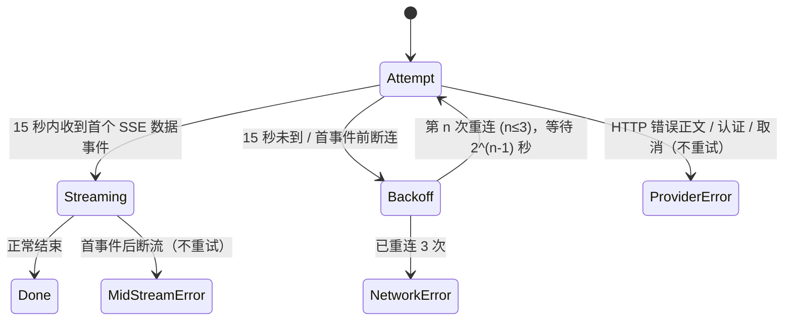

# 1. 问题与现状

需求：模型连接异常分类、有限重试与可诊断日志。2026-10-30，[PR #13](https://github.com/owariband/Seekino/pull/13)。

10-30 15:08 关联续版：#13 已合入 dev，以下原始提交阶段的部署描述保留历史口径。GPT v5 本次先在 14:49:19 收到 504，节点有限重试后于 14:51:49 以 `APIConnectionError → ConnectError → gaierror` 终止，停在 8/117 Chunk。后续 DNS/HTTPS 探测可达，不证明长请求稳定，也没有证据将本次归因于此前 Clash 关闭。分类和重试已执行，供应商/DNS 的剩余不确定性仍由本需求跟进。

10-31 关联复核：PR #18 的独立 GPT 任务 trace 确认 44 条 Kimi 请求均为 `stream:false`，9 次返回 nginx 504，耗时 312.043–355.989 秒；与受控注入的 503 分开。失败请求各含 189–198 张图片，成功理解请求仍为约 23.3 万–24.4 万输入 tokens。确认是上游 HTTP 504，未取得供应商内部超时原因，非流式与大输入的贡献待对照；本轮没有改成流式或重新跑完整课程。ASR 持久恢复新增转写为 0，详见[同轮实机报告](../../report/server/video-asr-api-recovery-20261031.md)。

这一故障同时触发整片 ASR 协调器退出并清理内存，使此前 76 分 32 秒的计算不能在新协调器中复用。该后果由 [ASR 主设计续版](local-whisperx-asr-trd.md)承接：视频级持久成果、正式 GPU 接线及下游失败后的零重复 ASR 验收。新跟进不把持久化当成修复网络，也不把再次可连接当成整集成功。详见[同一实测报告](../../report/gateway/local/whisper-metal-benchmark-20261030.md)。

Karpathy v3 任务在直接 JSON 理解链路失败。OpenAI SDK 的 APIConnectionError、APITimeoutError、HTTP 504 原样穿透 Gateway；节点重试只识别 Python/httpx 异常或 MODEL_TIMEOUT。最终被呈现为“执行异常”，并停止整集派发。正式节点终止日志没有异常链，无法区分网络断连与服务端超时。

2026-10-30 实测：EP1 Chunk 0 的模型请求为 12:01:45–12:06:57（311.88 秒），返回 nginx 504；969 秒是含 ASR 的 Chunk 总耗时。EP4/5 四个不同起点请求均在 12:14:22 连接失败，EP7/8 四个请求在 12:22:44 连接失败，未达到 600 秒请求阈值。共同连接中断是假设，无法由缺失的底层异常链判定责任端。四个已成功请求耗时 183–296 秒，输入 232510–243436 tokens，仍有 reasoning tokens。错误重试不能解决输入规模与服务性能问题。

## 1.1 11-02：Parse 首个 SSE 等待上限（PR #18）

沿用 `fix/video-asr-recovery` / [PR #18](https://github.com/owariband/Seekino/pull/18)。历史完整课程存在 0 SSE 等待至 600 秒、首事件迟至 432–576 秒的请求；当前 `_iter_chat_chunks` 的 deadline 只在 SDK 返回事件后检查，不能及时唤醒阻塞读。新要求：当前 Understanding / 直接 JSON Refine 使用的 OpenAI vision 生成通道，开始请求后 100 秒未收到首个 SDK 解码 SSE 即以 `MODEL_TIMEOUT` 结束本次请求，进入原有有限重试。不得把这种请求超时误作暂停、租约取消或 Refine 内容更新。

同轮账单调查：v7 的 10 个成功 Understanding 实报输入 2,434,057、输出 84,920、其中 reasoning 68,116 tokens；实际模型 `k3.1-pro`，请求未传 `reasoning_effort=low`，冻结值 `none` 在此适配器仅表示省略参数。v7 于五小时额度耗尽后失败，不能把订阅用量百分比当作本任务的费用。本轮不更换模型、图片采样或旧任务冻结配置，也不追加真实模型调用。

## 1.2 11-06：Chat 首个 SSE 15 秒内未到即退避重连（PR #55）

分支 `fix/chat-first-token-retry`，[PR #55](https://github.com/owariband/Seekino/pull/55)。

背景：Seekino 将作为简历筛选阶段的公开演示，面试官会在无人陪同下自行提问。11-05 晚 LOOP-08 门禁 32 个 Chat 回合中约 9 个失败，均发生在本次模型调用还没有任何输出时。Supervisor 走 `gateway/agent_model/deepagents.py` → `OpenAIAgentModel._request_turn` → `request_chat_completion`；这条链路没有首事件期限（§1.1 的 `FirstSSEDeadline` 只接在 Parse vision 通道），唯一上限是 1200 秒调用预算。

已确认事实（`outputs/verification/course-loop-dev-20261104/api.log`、`gates/loop08-interleave-a78bb6f2.log`）：
- 断流 6 次：DeepSeek 返回 200 后在本次调用尚无输出时关闭连接（所在回合耗时 15–131 秒），异常为 `RemoteProtocolError`，`agent_execution_failed` 的 phase 均为 `RETRIEVING`/`QUEUED`，即同一回合的前序模型调用已执行工具。界面显示「模型暂时不可用，错误：无法连接模型服务」，文案与实际不符。
- 静默 4 次：200 后只有 `: keep-alive` 注释，直到本地 1200 秒预算才以超时失败；最后一轮 SE02 卡 1203 秒。keep-alive 会刷新 httpx 读超时，因此读超时不会触发。
- 非限流：DeepSeek 调用没有 HTTP 429（api.log 中唯一的 429 是 11-04 Kimi 解析请求）。DeepSeek 文档说明高负载时请求排队并发送 keep-alive，10 分钟内未开始推理则断开；本地观察到的 20 分钟静默超过该说明，具体机制属推断。两种失败都没有供应商错误正文。

期望（用户 11-06 决定）：Chat 模型调用开始后 15 秒仍未收到首个 SDK 解码的 SSE 数据事件，即中止本次 HTTP 请求并退避重连；连续 3 次重连仍失败，向用户报告网络错误。该决定替代此前“60 秒空窗重试一次”和“只缩短报错时间不重试”两个候选。

本次边界：只处理 Chat 单次模型调用的首事件前失败（静默或断流）。首事件之后的断流不重试——可见文本可能已推送；只修正其文案。HTTP 4xx/5xx 带正文的错误、认证、取消保持现行行为。Parse 的 100 秒期限、节点重试与其他协议不变。

# 2. 影响因素、假设与评价指标

| 指标 | 基线 | 验收 | 方法 |
|---|---|---|---|
| SDK 连接/超时/504 分类 | execution_failed | 分为连接异常、请求超时、服务不可用 | MockTransport 产生真实 SDK 异常 |
| 暂态错误有限重试 | 未命中 | 遵循现有节点次数和执行期限 | 工作流回归 |
| 认证/坏请求/取消 | 不应盲目重试 | 仍不重试 | 负例验证 |
| 失败可诊断性 | 缺少 cause | 脱敏异常链、状态码、请求 ID | 日志测试 |
| 完整视频可检索 | 0 | 至少 1 集 | 正式任务观察，待验收 |

11-02 验收增补：本地真实 HTTP 服务分别阻塞响应头、只返回头、连续发送非事件心跳；缩短测试时钟后都须在首事件预算内退出并关闭旧连接。首事件为 role/reasoning 等合法 SSE 也计入；收到首事件后不得把 100 秒误施加到后续读取。更短的调用总预算优先，用户取消仍保持取消原因，非流式行为保持。既有节点重试次数和 ASR 复用回归继续适用。

11-06 Chat 首事件重连（§1.2）的因素与指标：

| 因素 | 证据 / 假设 | 验证方法 |
|---|---|---|
| 首事件前失败是瞬时排队或断连 | 假设：新连接大概率被调度到可用节点；DeepSeek 文档的排队说明支持但未证实 | 门禁中统计“重连后成功”的比例 |
| 15 秒不会误伤正常调用 | 待测：Chat 日志未记录首事件时延；DeepSeek 首个 role/reasoning 块在推理开始即发送，正常应远小于 15 秒 | 本次新增首事件时延日志，统计成功调用的分布 |
| 重连不重复副作用 | 已确认：`request_chat_stream` 在完整收齐本轮后才执行工具；首事件前无可见文本 | 单测断言重连时无 text delta、无工具执行 |

| 指标 | 类型 | 定义与口径 | 基线 | 目标 | 方法 |
|---|---|---|---|---|---|
| 最坏无响应等待 | 结果 | 单次模型调用开始到获得首事件或最终报错 | 1203 秒（实测） | ≤ 约 70 秒（15×4 + 退避 7 秒） | 单测缩放时钟 + 门禁实测 |
| 门禁回合失败率 | 结果 | LOOP-08 回合以错误结束的比例 | 约 9/32（11-05 晚） | 下降；样本小，不据此宣称 p95 | `gates.py` 复跑 |
| 重连次数 / 成功于第 n 次 | 诊断 | `record_model_event` 每次尝试 | 无 | 记录可查 | 日志 |
| 成功调用首事件时延 p50/p95 | 护栏 | 请求开始到首 SSE 数据事件 | 待测 | p95 明显低于 15 秒；若接近则回到用户调整阈值 | 新增日志 |
| 最终错误文案 | 护栏 | 耗尽后界面显示网络错误；首事件后断流显示“中途断开” | 「无法连接模型服务」 | 文案与真实原因一致 | `_agent_model_failure_message` 单测 |
| 额外费用 | 护栏 | 首事件前中止的请求无输出 token；输入可能计费 | — | 记录重连次数供核算 | 日志 |

# 3. 改造方案与建模

Gateway 将无工具视觉请求的 SDK 暂态错误转换为通用 ModelFailureError，保留 cause。API 超时先于连接错误分类；504 单独标为上游网关超时。429、500、502、503 为暂态服务异常。Agent 按通用 reason 判断重试，不依赖 Provider SDK。直接 JSON 路径接上既有 opt-in model_diagnostics，逐请求保存异常链。Server 显示明确中文错误并复用已有脱敏异常链记录，终止事件不伪装成重试事件。

流程：Provider 异常 → Gateway 分类 → 节点有限退避 → 成功提交或耗尽后终止 → 安全提示与诊断日志。取消优先于连接异常。保留租约、版本、幂等、既有 deadline 与终止后停止派发合同；不迁移数据、不改并发或图像采样。

11-02 方案：在当前 Parse 使用的无工具 OpenAI vision 生成入口建立请求级首事件计时器，借助 HTTPX trace 的连接句柄唤醒 HTTP/1 阻塞读；SDK Chat 接收器在第一个解码事件到来时解除计时。超时前尚无响应头也能关闭独占连接；不采用返回后遗留旧请求线程的方案。HTTPX 连接/写入/读头超时同时受剩余启动预算约束，读正文前恢复既有读预算。只处理传输失败，重试仍由现有 Agent/Server 控制；不修改业务 Gateway 门禁、租约、提交和 Schema 合同。本轮不扩大到 Responses、工具循环或其他供应商协议。

11-06 方案（§1.2）：复用 `gateway/streaming/first_sse.py` 的 `FirstSSEDeadline`，为 Chat 设置 15 秒限值，不另建第二套机制。按 §1.1 的约束，每次尝试使用独占 HTTP/1 客户端（参照 `gateway/openai/multimodal.py` 的 `client_scope`），中止时只关闭该次连接。重试放在 `OpenAIAgentModel` 的单次模型调用层，同时覆盖 deepagents Supervisor 与 `run_agent_loop` 两条入口；不在整回合层重试。退避 1、2、4 秒，共 1 次原始 + 3 次重连。已有的 `fallback=` 备用模型在重连耗尽后才介入，并沿用剩余预算。

最终错误以可区分的 reason 交给 Server，`_agent_model_failure_message` 显示「模型暂时不可用，错误：网络错误（多次重连未收到模型响应）」；首事件后的 `RemoteProtocolError` 改显「模型服务中途断开了响应」。取消、调用总预算更短者优先，保持现行。

# 4. 对照实验与结果分析

先用真实 SDK + MockTransport 复现不同错误，验证单次调用不在 SDK 内暗中重试；再测节点判定、API 提示和终止日志。2026-10-30 隔离回归 233 passed（19.18 秒）：`tests/gateway/test_openai_media.py`、`tests/gateway/test_model_diagnostics.py`、`tests/agent/video_parse_v2/test_framework.py`、`tests/server/test_video_parse_queue.py`。新增 MockTransport 覆盖断连、连接拒绝、读超时、429/500/502/503/504 和 400/401；trace 验证保留 RemoteProtocolError、504 状态码且不包含密钥。节点成功恢复/耗尽验证最多 3 次、ASR 只运行一次。以上真实耗时只用于诊断，不据此估计 p95/p99 或长期成功率。

11-02 实验计划：先真实 SDK + 本地 HTTP 端到端测试上述边界和资源释放，再跑现有视觉/流式/节点重试回归；不请求 Kimi。预期将无首事件的单次等待从原最多 600 秒降至 100 秒；不把这 500 秒的理论上限差当作整课实测收益。实现、测试和部署结果在完成后回填。

11-06 实验计划（§1.2）：缩放时钟的本地 HTTP 故障注入覆盖 (i) 只发 keep-alive、(ii) 首事件前断连、(iii) 第 2 次尝试成功、(iv) 4 次均失败并得到网络错误、(v) 首事件后断流不重试；断言重连期间无 text delta、无工具执行，取消仍优先。随后在隔离演示库复跑 LOOP-08（SE01 SE02 LP01 LP02），与 11-05 基线对比失败率、最坏等待和重连次数。结果待测。

# 5. 试点验证与方案取舍

用户授权重启解析。EP1 已于 12:43:07 通过正式 retry API 恢复，沿用 v3 和已有提交。其余失败任务暂不同时启动。先测试修复，再部署观察；如果连接继续失败，用新异常链定位网络或服务端。重试会增加耗时与模型费用，仍受原有限预算约束。

11-02 试点范围：验证通过后，仅重启本 worktree 控制的隔离 API 装载变更，先核对活动任务和服务 PID；当前 v7 已失败，保留已提交成果，不自动 retry/reparse。该本地传输故障注入替代本轮付费试点；真实供应商表现、额度恢复后的任务重试以及完整课程闭环仍待验证。

11-06 试点（§1.2）：在本机演示 API（19641，v11 隔离库）装载变更后复跑门禁；云端部署后再用同一门禁对公开地址复验。若成功调用首事件 p95 接近 15 秒，或重连明显增加费用而失败率不降，停止推广并回到阈值决策。回退方式为关闭 Chat 首事件期限，恢复现行 1200 秒预算。

# 6. 结果验收与闭环

当前：调查与修复实现完成，233 项相关回归通过；正式部署与整集闭环待验证。不能把模型接口可访问、离线测试通过或一个 Chunk 成功当成整集完成。下一步：创建独立 PR、部署并观察 EP1。

## 6.1 11-02 实施、验证与部署结果（PR #18）

上述首 SSE 期限已在当前 Parse 的无工具 OpenAI vision 生成链路接入：100 秒无首事件返回 `MODEL_TIMEOUT`，交给原有限重试；HTTP 响应头前也可中断独占连接，收到 role/reasoning 等合法 SSE 后解除启动计时。响应心跳不解除期限，取消仍优先。非流式与其他协议范围不变。

本地 HTTP/HTTPS 故障注入 20 项通过，相关回归合并去重 401 项通过。缩放对照中无头/无事件等待从 1.164/1.023 秒降至 0.270/0.271 秒，旧心跳场景不能自然结束，新组 0.273 秒退出；这不是 600→100 秒真实 Kimi 测量。已核对无活动租约，重启本 worktree 隔离 API，健康检查 200，未调用真实 retry/reparse。用量核对同时确认未显式 low，三轮已上报 12,259,858 input / 429,877 output tokens；无 usage 请求和全账号费用仍未知。详见[实施与用量报告](../../report/gateway/first-sse-timeout-20261102.md)。完整课程闭环仍 TODO。

## 6.2 11-02 实际代理出口与大视觉输入复核（PR #18）

K3 low 的新 v8 首轮 30 请求无 SSE、0/117 Understanding，实际等待不能笼统归为推理。单图可完整返回；原 Chunk 0 的 14,548,052 字节 curl 直连请求在 100 秒仅上传 2,489,980 字节。API 的 NO_PROXY 排除 Kimi 域名，且显式本地代理仍被 Clash GeoIP CN 规则转成 DIRECT；控制器连接记录确认了这两层问题。

沿 `fix/video-asr-recovery` 修正隔离 API 的代理环境，并给当前 Clash 订阅添加精确域名规则，使用已有 AI 服务组；保留 localhost 直连、官方 api.kimi.com 端点、原 100 秒首 SSE 与既有重试。相同原始文本/图片/Schema 输入在客户端第 1.958 秒完成发送、42.445 秒收到首 SSE。该探针收到首事件即关闭，只证明本次传输与启动可用，不代表完整模型输出/稳定吞吐或免费调用。自定义分流规则已落盘，运行时已核对，未为持久性验证重启 Clash。

正式 retry 恢复同一 v8 后运行 453.009 秒，提交 9 个 Understanding、2 个 Refine、新 ASR=0；7 次首 SSE 期限、1 次响应前断连仍存在，父任务最终 PARSING_FAILED。不能再把所有失败归因于未走代理，也不能在缺少分段观测时把剩余超时认定为供应商排队。另发现空 timeline 被门禁接收，这是内容质量问题；没有继续重开课程。验证口径与逐请求证据见[代理复核报告](../../report/gateway/kimi3-low-parse-20261102.md#proxy-retry)，问题状态仍为 B07/B20 TODO。

## 6.3 11-02 直连复测与撤回临时分流（PR #18）

同一份 14.55 MB/189 图请求显式设置 `trust_env=False, proxy=None`，TCP 连接 api.kimi.com:443；第 2.577 秒完成发送，54.477 秒收到首 SSE，HTTP 200/返回 k3。SDK 请求体 SHA 与前次代理探针相同；此次也是单次、512 输出上限、到首 SSE 即关闭。它证明当前直连可用，不能证明完整输出、十路稳定性或长期优劣。

据此撤回 §6.2 的临时专用分流，最终保留 Kimi 直连；早先慢上传与路由同时发生，不足以断言直连是必然瓶颈。当前订阅自定义规则和运行时规则均已移除本轮增量，隔离 API19621 已恢复 Kimi 直连并通过健康检查。未再次派发课程，历史 9/117 理解、2/115 Refine 与内容缺口仍保留。[直连实测与恢复证据](../../report/gateway/kimi3-low-parse-20261102.md#direct-retest)。

## 6.4 11-06 Chat 首事件重连（§1.2）

状态：已实现，离线验证通过；真实 DeepSeek 门禁复跑待进行（2026-11-06）。

- 实现：`OpenAIAgentModel._create_completion` 在流式且自持客户端时，每次尝试新建独占 HTTP/1 客户端并挂 15 秒 `FirstSSEDeadline`（新增 `limit_seconds`，Parse 默认 100 秒不变）；首事件前超时或断连按 1/2/4 秒退避重连，共 4 次请求，均受原调用总预算约束；耗尽抛 `MODEL_NETWORK_ERROR`。成功调用记录 `event=chat_first_sse ... first_event_ms`，重连记录 `event=chat_first_sse_retry`。
- 文案：耗尽显示「模型暂时不可用，错误：网络错误（多次重连未收到模型响应）」；`RemoteProtocolError` 显示「模型暂时不可用，错误：模型服务中途断开了响应」。
- 验证：`tests/gateway/test_chat_first_sse_retry.py` 8 项用本地真实 HTTP 服务覆盖只发 keep-alive、首事件前断连、首次静默后恢复、首事件后断流不重试、402 不重试并保留供应商消息、退避中取消、失败尝试无正文增量、deepagents Supervisor 路径。相关回归 647 passed、1 skipped；`test_kimi_streaming` 的 deepagents 用例偶发写入顺序不一致，未改动的 dev 上同样 1/10 失败，属既有问题。
- 未验证：真实 DeepSeek 下的失败率、最坏等待与成功调用首事件 p50/p95（§2 护栏）需在门禁复跑中补测。
