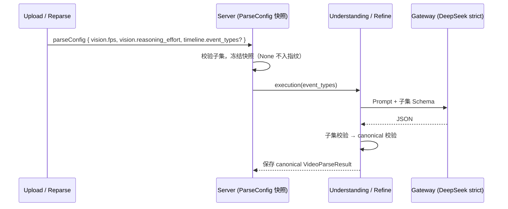

# 1. 问题与现状

- 需求：按视频类型配置解析档案（Parse Profile）——Event 类型子集、抽帧率与推理档位——降低课程解析成本。
- 状态：初稿，2026-11-04。分支 `feat/parse-event-profile`；PR 待创建后回填。工作台卡片 COST-02，上游 COST-01（视频类型识别与动态抽帧）、LOOP-03（0.5 fps 实测）、LOOP-10（medium 与 Refine 档位）。
- 依赖：无代码上游；实验复用 LOOP-03 保存的 chunk 53 与前 30 块请求。本 PR 不改变周四两集（GPT、micrograd）的解析配置，见“本次边界”。

**背景与触发场景。** 课程与动画共用同一份 Timeline 合同：[`engine/parsev2/schemas.py`](../../../engine/parsev2/schemas.py) 的 `TimelineEvent` 判别联合固定 7 类（SCENE、ACTION、DIALOGUE、EMOTION、RELATION_CHANGE、ON_SCREEN_TEXT、OTHER），Understanding Prompt（[`agent/video_parse_v2/prompts.py`](../../../agent/video_parse_v2/prompts.py) 第 93 行）要求“组合对白、场景、动作、可观察情绪与关系变化”，结构化输出 Schema 由 [`understanding/response.py`](../../../agent/video_parse_v2/understanding/response.py) 与 [`refine/response.py`](../../../agent/video_parse_v2/refine/response.py) 直接取完整 `model_json_schema()`。用户的判断是：课程不需要 RELATION_CHANGE、ACTION 这类含糊类型，用普通摘要代替即可，能减少模型的输出与推理，从而省钱。

**实际与期望。** 目前每任务能配置的只有 `vision.fps`（0.2–5.0）与 `vision.reasoning_effort`（none / low / high / max，[`server/config/parse_profile.py`](../../../server/config/parse_profile.py) 第 164–175 行），Event 类型无法按任务收窄。期望是：课程类任务以一份可复现的档案启动，档案写入任务快照，Understanding 与 Refine 只看到并只能输出档案允许的类型。

**负面影响。** 预算紧：GPT v11 单集已知 ¥31.26（3 fps），七集按此不可负担（COST-01）。0.5 fps 已把图片成本压下去，剩余成本的结构变了（见下）。

**现状证据（2026-11-04 只读核对）。**

| 证据 | 数值 | 来源 |
| --- | --- | --- |
| chunk 53，0.5 fps + low 单次费用 | ¥0.0611；输入 24,755 tokens（≈¥0.025），输出 9,083 tokens（≈¥0.036），其中 reasoning 8,299 | LOOP-03 `response-low-05.json`；DeepSeek Flash 非高峰 ¥1 / ¥4 每百万 |
| 前 30 块 0.5 fps + medium | 输入 755,697（≈¥0.76），输出 273,540（≈¥1.09），reasoning 224,895（≈¥0.90） | LOOP-03 前 30 块记录 |
| 前 30 块 Understand + Refine 输出的 Event 类型分布（60 份结果） | DIALOGUE 509、SCENE 126、ACTION 88、ON_SCREEN_TEXT 64；**EMOTION、RELATION_CHANGE、OTHER 均为 0** | `first30-eval/results/` 统计 |
| chunk 53 三档输出 | 同样只出现 DIALOGUE / SCENE / ACTION / ON_SCREEN_TEXT | `output-{low,medium,high}-05.json` |

已确认事实：0.5 fps 下 Understanding 成本约一半来自 reasoning token（chunk 53 low 约 54%，前 30 块 medium 约 49%），图片输入不再是唯一主项；课程输出本来就不使用 EMOTION / RELATION_CHANGE / OTHER。
推断（未验证）：收窄枚举不会减少这三类 Event 的输出（本来就没有），可能的收益只来自“模型少在类型选择上推理”与 ACTION 并入 SCENE 后的少量合并；0.5 fps + none 从未测过，若质量可接受，可能是比收窄枚举大得多的杠杆。

**本次边界。**

- 解决：任务级 Event 类型子集（含课程预设）、档案写入快照、Understanding / Refine 的 Prompt 与 Schema 按子集生成；用对照实验决定课程默认档案（类型子集 × 推理档位）。
- 不解决：视频类型自动识别与 Jev 选择档案（COST-01）、按画面变化补帧、medium 接入（LOOP-10）、新增 SUMMARY 类型。
- 必须保持：Canonical `VideoParseResult` 仍接受全部 7 类，历史内容、索引投影、Web 展示不变；未配置档案的任务行为、请求指纹与 ASR 复用身份不变；周四 GPT 与 micrograd 不等待本需求。

# 2. 影响因素、假设与评价指标

| 因素 | 当前证据 | 假设与机制 | 如何验证 / 否定 | 影响的决定 |
| --- | --- | --- | --- | --- |
| 推理档位 | low 的 reasoning 占输出 91%；none 未在 0.5 fps 测过 | H1：0.5 fps + none 的教学要点覆盖不低于 low，成本再降约 40–50% | 2×2 对照中 none 组质量评分 | 课程默认 reasoning，及 micrograd 后续重解析 |
| 类型枚举 | 课程从不输出 3 个类型 | H2：只允许 DIALOGUE / SCENE / ON_SCREEN_TEXT 时 reasoning token 下降 ≥15% | 2×2 对照中 course 枚举组 reasoning token | 是否值得把子集接入正式链路（**方向性假设**：若 H2 不成立且 H1 成立，本 PR 收缩为“档案只含 fps + reasoning”） |
| ACTION 并入 SCENE | ACTION 88 次，多为“写代码 / 运行 cell” | H3：并入后演示链条（LOOP-03 评分项）不丢失 | 同上质量评分中“演示链条”项 | 课程预设是否保留 ACTION |
| Refine | 前 30 块 Refine 沿用 medium 时 +139% | Refine 使用同一子集，避免改回被禁止的类型 | 单测 + 1 个真实 Refine 区间 | Refine 合同 |

指标（比较前确定）：

| 指标 | 定义与口径 | 基线 | 目标 / 允许退化 | 测量方法 | 证据入口 |
| --- | --- | --- | --- | --- | --- |
| 结果：单块 Understand 费用 | 按 DeepSeek 非高峰费率由 usage 计算，¥/块 | chunk 53 low ¥0.0611；其余 4 块待测 | course 档案相对“全枚举 + 同档位”下降 ≥10% 才接入子集 | 回放同一请求，仅改 Schema、Prompt 第 93 行与 `reasoning` | `docs/report/agent/video_parse_v2/parse-profile-ab-20261104/` |
| 诊断：reasoning / 输出 token | usage 中 reasoning_tokens、output_tokens | chunk 53 low 8,299 / 9,083 | 记录变化量 | 同上 | 同上 |
| 护栏：Schema 通过率 | 结果经 canonical `VideoParseResult` 校验通过的比例 | 30/30 | 100% | 本地校验 | 同上 |
| 护栏：教学质量 | LOOP-03 四项（关键教学点、演示链条、关键事实错误、时间定位），每项 0–2 分 | chunk 53 medium 为参考上限 | 每块总分不低于“全枚举 + low”；关键事实错误为 0 | 人工评分，对照原片与 ASR；评分者不看组别标签 | 同上 |
| 护栏：对白覆盖 | DIALOGUE 覆盖的 ASR cue 比例 | 全枚举组实测 | 下降不超过 5 个百分点 | 程序比对 cue 时间区间 | 同上 |

样本：chunk 53 加前 30 块中写代码、滚动、运行输出最多的 4 块（由实验脚本按 ON_SCREEN_TEXT + ACTION 数量选出，选择规则写入报告）；每组每块 2 次，计 5 块 × 4 组 × 2 = 40 次调用，预估约 ¥1.5（未计高峰费率）。样本小，只支持“方向”判断，不报告 p95。

# 3. 改造方案与建模

**已有基础。** 每任务 `parseConfig` 已能冻结 fps 与 reasoning；DeepSeek 严格 Schema 投影（`gateway/openai/multimodal.py` 的 `_deepseek_response_schema`）把 `oneOf` 判别联合转为 `anyOf`，对子集同样适用；Refine 冲突恢复与校验在 `engine/parsev2/validation.py`。

**方案（推荐，按实验结果裁剪）。**

1. `ParseConfig` 增加可选 `timeline.event_types`（有序、去重、必须含 DIALOGUE）；值为 `None` 时序列化省略，保证旧任务请求指纹不变。课程预设 `["DIALOGUE", "SCENE", "ON_SCREEN_TEXT"]`；上传 / 重新解析显式传入，不自动推断。
2. `engine/parsev2` 提供按子集生成结构化输出 Schema 与校验的函数；canonical `VideoParseResult` 不变，子集校验是额外一层，结果仍以 canonical 形式保存。
3. Understanding / Refine 的 `model_json_schema()` 与 Prompt 中的类型句改为按子集生成；课程预设把 SCENE 描述为“该时段在讲解或演示什么的摘要（含写代码、运行结果）”。
4. 任务快照记录档案；重新解析复用同一视频的 ASR（`server/service/video_parse_results.py` 按输入指纹复用），不重跑音频。

失败路径：模型输出子集外类型 → 走现有修复重试；仍失败按现有 Chunk 失败处理，不静默改写类型。

**备选。** 只改 Prompt 不改 Schema：实现最小，但无法约束输出，排除。新增 SUMMARY 类型：语义最直观，但涉及投影、ES 与 Web 合同，延后。

**验证顺序。** 先做 2×2 回放实验（不改正式代码）→ 若 H2 不成立，本 PR 只记录结论与课程默认 reasoning，不实现子集 → 若成立，实现 1–4 并补单测 → 一块真实正式链路请求核对。实验预算 ¥3，超出即停。

# 4. 对照实验与结果分析

计划：`evals/parse_profile_ab.py` 读取 LOOP-03 保存的请求，生成四组（全枚举 / 课程枚举 × low / none），只改 `text.format.schema`、Prompt 类型句与 `reasoning.effort`，其余输入逐字节相同；记录 usage、费用、耗时、原始输出，并对输出做 canonical 校验与对白覆盖统计。

| 指标 | 全枚举 + low | 课程枚举 + low | 全枚举 + none | 课程枚举 + none | 判断 |
| --- | --- | --- | --- | --- | --- |
| 单块平均费用（¥，非高峰） | 0.04026 | 0.04402（+9.3%） | 0.01820（−54.8%） | 0.01940（−51.8%） | none 达到“下降 ≥10%”；枚举子集在 low 下反而上升 |
| reasoning tokens / 块 | 5,712.8 | 6,621.1（+15.9%） | 0 | 0 | **H2 否定**：课程枚举未减少推理 |
| 输出 tokens / 块 | 7,193.3 | 8,102.6 | 1,745.3 | 1,926.0 | — |
| Schema 通过率（单次、未经修复） | 10/10 | 10/10 | 7/10 | 10/10 | full-none 三次均为事件越出授权时间窗，正式链路有修复重试 |
| 对白覆盖（失败记 0） | 0.995 | 0.995 | 0.700 | 0.980 | full-none 的下降全部来自上述三次校验失败 |
| 教学质量总分 | 待评 | 待评 | 待评 | 待评 | 未验证；仅做了一块探索性对照（见下） |

**2026-11-04 13:30 实测记录。** 样本为前 30 块中 ON_SCREEN_TEXT + ACTION 最多的 5 块（chunk 000 / 028 / 019 / 002 / 023，按数量降序、同数按名称降序），每组每块 2 次，共 40 次调用，全部为非高峰费率，花费 ¥1.219。请求取自 LOOP-03 保存的 0.5 fps 请求；`variant_diff_paths` 记录每次只改动 `reasoning.effort`、timeline `anyOf` 与 Prompt 类型句。原始行与汇总见 [summary.json](../../report/agent/video_parse_v2/parse-profile-ab-20261104/summary.json)、[rows.json](../../report/agent/video_parse_v2/parse-profile-ab-20261104/rows.json)，执行脚本 [profile_ab_run.py](../../report/agent/video_parse_v2/parse-profile-ab-20261104/profile_ab_run.py)。未纳入 chunk 53（请求格式不同）。

**探索性质量观察（非盲评，1 块）。** chunk 019（写 `get_batch` 代码）中，medium 基线 6 条非对白事件里 5 条是 ACTION，内容是讲师“抬手、指向屏幕”等手势；full-low 只剩 1 条手势 ACTION；course-none 的单条 SCENE 写出了 `gpt-dev.ipynb`、`torch.randint` 随机偏移量与输出形状 `[4, 8]`，教学信息最多。这支持“课程里 ACTION 多为噪声”的判断，但不足以作为质量验收。

**结论与行动。** H2 否定：枚举子集本身不省钱，不作为成本手段实现。H1 部分支持：none 费用约为 low 的 45%，Schema 失败可由现有修复处理；质量仍需评分。micrograd 已据此以 0.5 fps + none 解析（任务 `720608b1`），作为第 5 节的试点。课程枚举子集是否仍值得做，改由“内容质量 / 噪声事件”而非成本来论证，暂不实现。

# 5. 试点验证与方案取舍

试点：以实验选出的档案对下一门课程（或 micrograd 重新解析，复用 ASR）跑整集，记录整集费用、耗时、READY 与 SE/LP 检索门槛是否回退。停止条件：任一 Chunk 出现关键事实错误增多，或整集费用不降。回退：不传 `timeline.event_types` 即恢复原行为。

# 6. 结果验收与闭环

待实验与试点后填写：原问题（课程单集成本）是否下降及幅度、采用的课程默认档案、未覆盖范围（动画档案、自动识别仍由 COST-01 负责）。

## 决策记录

| 日期 | 原判断或方案 | 新证据 | 调整与原因 | 影响 |
| --- | --- | --- | --- | --- |
| 2026-11-04 | 收窄 Event 枚举可明显减少课程解析输出 | 60 份课程结果中 3 类为 0 次；reasoning 约占 0.5 fps 成本一半 | 把推理档位纳入同一对照，枚举子集是否实现取决于 H2 | 本 PR 可能收缩为“档案 = fps + reasoning”的结论记录 |
| 2026-11-04 13:30 | 枚举子集可降低 reasoning（H2） | 2×2 回放：课程枚举 + low 的 reasoning +15.9%、费用 +9.3%；none 费用 −54.8% | 否定以枚举子集省钱；micrograd 改用 0.5 fps + none 试点 | 子集实现搁置，仅在质量评分证明其减少噪声事件时再议；需补 none 的教学质量评分 |
