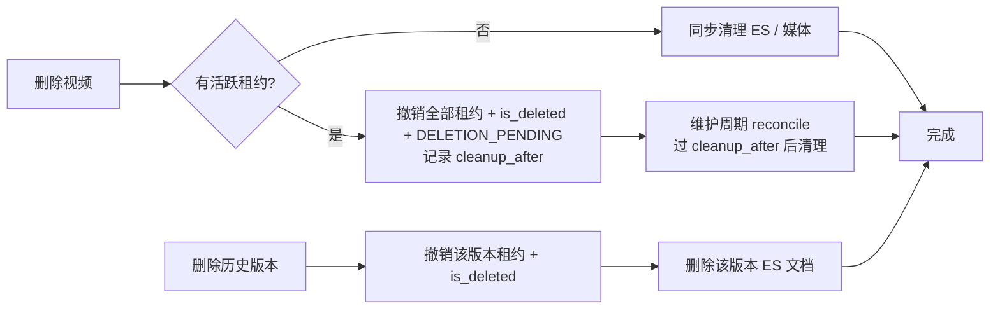

# 1. 问题与现状

- 需求：解析任务页的任务管理——默认只看正在进行的任务；历史版本可以删除；进行中的任务随时可以暂停、随时可以删除。
- 状态：初稿，2026-11-04。分支 `fix/parse-task-control`；PR 待创建。工作台卡片待登记（课程闭环里程碑的验收前置）。
- 关联：[解析暂停与继续](parse-pause-resume-trd.md)（暂停语义沿用）、[任务历史版本筛选](task-history-filter-trd.md)（本需求替换其“版本筛选”交互）、[长任务查询与 Consumer 恢复](parse-task-query-recovery-trd.md)（1038 加固另立 `fix/parse-task-json-sort`，不在本次范围）。

**背景与触发场景。** 课程闭环验收前，用户在任务页管理 GPT 与 micrograd 两个视频：GPT 经历 11 次解析版本，micrograd 因改用 reasoning none 重新解析。用户反馈：历史任务删不掉；页面默认显示全部任务而不是正在跑的；正在跑的任务不能按需删除。用户需要以真实用户身份完成项目验收，当前任务页已妨碍验收本身。

**实际与期望。**

| 场景 | 实际（2026-11-04 14:30 隔离库 API 实测） | 期望 |
| --- | --- | --- |
| 打开任务页 | 默认“全部”状态 × “当前任务”版本两排筛选；13 张卡片中只有 1 张在运行 | 默认“进行中”，一眼看到正在跑的；没有进行中的任务时显示全部 |
| 历史版本 | GPT v1–v10、micrograd v1 共 11 个历史版本：`canDelete=false`，历史卡片不渲染任何操作按钮 | 每个历史版本可单独删除，也可一键清空某视频的全部历史版本；不影响当前版本与检索 |
| 被替代但未结束的版本 | GPT v1–v3、micrograd v1 状态仍为 PARSING + 已暂停，卡片显示“解析已暂停” | 显示“已被新版本替代”，不再像一个待处理的任务 |
| 运行中删除 | micrograd v2（PARSING，75.6%）`canDelete=false`，按钮置灰，提示“任务正在执行，请稍后再删除” | 随时可删：先停止解析，再在后台完成清理；页面立即移除该视频 |
| 运行中暂停 | `canPause=true`；暂停立即撤销租约，进行中的模型调用在下一次心跳（≤ 1 min）被取消 | 保持；页面明确“已暂停，进行中的调用会在 1 分钟内停止” |

**现状证据（2026-11-04 源码核对，基于 dev 152fce8e）。**

| 事实 | 位置 |
| --- | --- |
| 删除只对最新版本开放，删除单位是整个上传会话（视频 + 全部版本） | `server/api/jobs.py` 第 325–330 行；`server/repository/upload.py` `begin_delete_session` 第 688–805 行 |
| 存在未过期的主任务、Chunk、Interval 或 Prefix 租约时拒绝删除 | `server/repository/upload.py` 第 721–760 行 |
| 前端默认筛选 `"all"`，另有一排版本筛选 | `web/src/features/tasks/TasksPage.tsx` 第 114–115 行、第 330–358 行 |
| 历史卡片不渲染操作区（`uploadSessionId && latest`） | `TasksPage.tsx` 第 408 行 |
| 暂停在同一事务中撤销主任务、子任务、Prefix 与 Summarize 租约；Consumer 心跳发现租约失效后取消执行 | `server/service/parse_control.py` 第 22–76 行；`server/mq/video_parse_consumer.py` 第 534–542 行 |
| 租约 5 min、心跳 1 min | `server/config/mq.py` 第 11–12 行 |
| 重新解析把未结束的旧版本标为 `accepted=false, superseded_by=<新任务>`，状态保持原值 | `server/repository/upload.py` 第 634–646 行 |
| 检索只读取每个视频的**最新**版本，且仅当其 COMPLETE；历史版本不参与检索 | `server/service/video_parse_read.py` 第 221–231 行 |
| 待删除会话的后台续删 `reconcile_deletions` 只在进程启动时执行一次 | `server/bootstrap.py` 第 489 行 |

已确认：删除限制源自“外部清理（ES、媒体文件）不能与仍在写入的执行并发”这一正确约束，但实现把它暴露成了用户必须等待的前置条件，而不是由系统先停止、再延后清理。推断：历史版本无删除入口是 PR #11 只做了筛选、未定义删除语义的遗留。

**本次边界。**

- 解决：任务页默认视图与筛选重构；历史版本单独删除与批量删除；运行中删除（停止 + 后台清理）；被替代版本的显示。
- 不解决：1038 / `detail` 增长（另立分支）；重新解析期间视频不可检索（检索只看最新版本）；取消已发出模型请求的费用。
- 必须保持：租约与版本 fencing（被撤销的执行不能再提交成果或写 ES）；历史版本删除后模型用量记录保留，用量统计不变；授权（tenant 写权限）；中文数据逐字保留。

# 2. 影响因素、假设与评价指标

| 因素 | 证据 / 假设 | 验证 | 影响的决定 |
| --- | --- | --- | --- |
| 运行中删除的并发安全 | H1：撤销租约（`lease_version` +1）后，原执行在 ≤ 1 次心跳内取消，且任何提交路径都按租约版本拒绝 | 单测：撤销后旧租约提交被拒；集成：运行中删除后 ES 无残留 | 外部清理延后到被撤销租约全部过期（≤ 5 min）后执行 |
| 后台续删时机 | `reconcile_deletions` 只在启动时运行 | 单测：维护周期触发续删 | 把续删挂到 Consumer 维护周期（每个租约周期一次） |
| 历史版本删除范围 | 历史版本不参与检索（`video_parse_read.py` 第 221–231 行） | 单测：删除历史版本后最新版本检索范围不变 | 历史版本可无条件删除；软删除任务行，删除其 ES 文档，保留用量记录 |
| 用户心智 | 用户关心“视频”而非“版本” | 浏览器走查 | 卡片以视频为单位，历史版本收进卡片内 |

指标与验收标准（比较前确定）：

| 指标 | 定义 | 基线 | 目标 | 测量 |
| --- | --- | --- | --- | --- |
| 结果：可删除覆盖 | 页面上每个任务版本都有可用的删除入口（删除中的除外） | 历史 0/11、运行中 0/1 | 100% | API `canDelete` / `canDeleteVersion` 枚举 + 浏览器走查 |
| 结果：默认视图 | 打开页面默认显示的卡片 = 进行中（含已暂停）的最新版本 | 显示全部 | 一致 | 前端测试 + 走查 |
| 护栏：删除后无残留 | 运行中删除完成后，该视频的 MySQL 任务行（软删）、ES 文档、媒体目录 | — | ES 0 文档，媒体目录不存在，`reconcile` 无失败 | 隔离测试库集成测试 |
| 护栏：并发 fencing | 撤销后旧租约的成果提交、索引写入 | — | 0 次成功 | 单测 |
| 护栏：用量保留 | 删除历史版本前后用量总览金额 | — | 不变 | 单测 |
| 护栏：回归 | 后端 `tests/server` 相关、前端 typecheck / test / build | 现有通过数 | 不新增失败 | 命令输出 |
| 诊断：删除生效时延 | 运行中删除到页面移除 / 到清理完成 | — | 页面立即；清理 ≤ 6 min | 实测 |

# 3. 改造方案与建模

**删除语义（核心决定）。** 删除是用户意图，系统负责让它安全，而不是让用户等待。

1. **删除历史版本** `POST /api/jobs/video-parse/delete?tenantId&videoParseTaskId&expectedJobVersion`：仅限非最新版本。同一事务中撤销该版本的主任务、子任务、Prefix / Summarize 租约（与暂停相同的 fencing），`accepted=false`，`is_deleted=true`；事务后按 `(video_parse_task_id, chunk_id)` 删除其 ES 文档（Chunk 与 Event 两个索引）并核对不可见。模型用量记录保留。最新版本不能经此接口删除——它代表视频本身，走“删除视频”。
2. **批量删除历史版本** 同一接口支持 `scope=history&videoId=…`：删除该视频全部非最新版本。
3. **删除视频（含运行中）** 沿用 `POST /api/uploads/delete`：存在活跃租约时不再拒绝，改为同一事务内撤销所有版本的租约、标记 `is_deleted` 与 `UPLOAD_DELETION_PENDING`，记录清理的最早时间（被撤销租约中最晚的 `lease_expire_time`），立即返回“删除中”；外部清理由 `reconcile_deletions` 在该时间之后完成。无活跃租约时保持现有同步删除。
4. **续删时机**：`reconcile_deletions` 加入 Consumer 维护周期；未到清理时间的会话静默跳过，不记失败日志。

**暂停语义。** 保持现状（立即撤销租约，心跳内取消执行，已提交成果保留）。最新版本处于任何进行中状态且已接受时可暂停；被替代的版本不可暂停、继续。

**视图模型。** `VideoParseTaskView` 增加 `canDeleteVersion`（非最新且未删除）与 `isSuperseded`（非最新且状态非终态）；`canDelete` 对最新版本在非删除中时恒为 true。

**任务页交互。**

- 一行筛选：**进行中**（默认，含已暂停）· **需处理**（最新版本失败）· **已完成** · **全部**，各带数量；首次加载没有进行中的任务时落到“全部”。去掉版本筛选与九档状态筛选。
- 卡片以视频为单位展示最新版本；卡片内折叠区“历史版本（N）”，每行：版本号、状态（被替代的显示“已被新版本替代”）、创建时间、进度、删除；另有“删除全部历史版本”。
- 删除视频：运行中也可用；确认文案说明“将先停止解析，再在后台清理上传文件、解析产物和检索索引；已发生的模型费用不退回”。确认后卡片立即移除，提示“正在后台清理”。
- 暂停：按钮常驻进行中的最新版本；暂停后状态文案“已暂停，进行中的调用会在 1 分钟内停止，已完成的成果保留”。

失败路径：ES 清理失败时会话保持 DELETION_PENDING，下个维护周期重试；页面已隐藏，不回滚。并发：删除与暂停、重试、重新解析按 `expectedJobVersion` / 行锁串行，冲突返回 409 并提示刷新。

# 4. 对照实验与结果分析

修改前后用同一隔离测试库快照对照：

| 检查 | 修改前 | 修改后 | 判断 |
| --- | --- | --- | --- |
| 历史版本可删除数 | 0 / 11 | 待测 | 未验证 |
| 运行中删除 | 拒绝（UploadStateError） | 待测 | 未验证 |
| 运行中删除后 ES 残留 | — | 待测 | 未验证 |
| 默认视图卡片数（1 个进行中） | 13 | 待测（预期 1） | 未验证 |

# 5. 试点验证与方案取舍

试点在独立测试环境（不使用课程库 13361）：上传短视频，解析中执行暂停、继续、删除；对已完成视频重新解析后删除历史版本。浏览器走查默认视图与删除流程，截图入 `docs/report/server/parse-task-control-20261104/`。

取舍：运行中删除放弃“立即清理”，换取不与在途写入竞争；代价是最长约 5 分钟的后台清理窗口，期间页面已不显示该视频。

# 6. 结果验收与闭环

待实施后填写：指标实测、实际接入入口（API、任务页）、未覆盖项。

## 决策记录

| 日期 | 原判断或方案 | 新证据 | 调整与原因 | 影响 |
| --- | --- | --- | --- | --- |
| 2026-11-04 | 删除须等执行结束 | 暂停已能在同一事务撤销全部租约，心跳内取消执行 | 删除复用撤销，外部清理延后到租约过期 | 运行中可删；清理有最长 5 min 延迟 |
| 2026-11-04 | 历史版本只读 | 检索只读最新版本 | 历史版本可无条件删除，保留用量记录 | 用量统计不变 |
