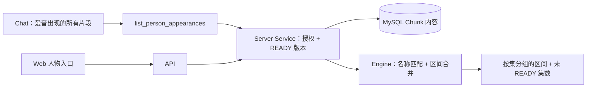

# 1. 问题与现状

- 需求：人物出场全量列举——“给我爱音出现的所有片段”，按集、按时间列出全部有来源、可回看的片段。
- 状态：初稿，2026-11-04。分支 `feat/person-appearance-search`；PR [#35](https://github.com/owariband/Seekino/pull/35)。工作台卡片 PERSON-01，里程碑 M-20261107（课程闭环之后的第一个演示场景）。
- 依赖：不依赖课程闭环的 PR；需要至少一集 MyGO 在当前开发库为 READY（待核对，见“现状证据”）。不改变 Parse Schema、ES 映射与向量合同。

**背景与触发场景。** 动画素材的用户最自然的问题之一是“某个角色出现在哪里”。这是**全量列举**：答案是一个集合，漏一段就是错。现有检索为相关性设计：词法 / 向量多路召回 → RRF → rerank → `top_k` 截断（[`engine/rag/retrieval/rerank.py`](../../../engine/rag/retrieval/rerank.py) 第 168–187 行），Chat 通过 `query_video` 子代理与 `submit_video_item` 提交少量最终片段，后者限定在锚点及相邻两个 Chunk 内（[`agent/chat/supervisor.py`](../../../agent/chat/supervisor.py) 第 946–953 行）。这条链路适合“找最相关的几段”，不适合“全部列出来”。

**实际与期望。** 实际：问“爱音出现的所有片段”，只能得到 top_k 截断后的若干段，且不同名称写法会召回不一致。期望：给定系列（可选集数范围）与人物，确定性地返回全部出场片段，相邻事件合并为可观看的区间，标注“说话 / 出镜 / 参与”，点击跳转原片。

**负面影响。** 这是用户个人优先级最高的动画演示场景；用相关性检索冒充全量列举会漏段，属于正确性问题，不是体验细节。

**现状证据（2026-11-04 只读核对）。**

| 事实 | 位置 |
| --- | --- |
| 每个 Event 已有 `participants`、`visible_persons`，DIALOGUE 另有 `speaker`；时间为整数毫秒、左闭右开 | [`engine/parsev2/schemas.py`](../../../engine/parsev2/schemas.py) 第 31–60、75 行 |
| 索引投影已把 speaker + participants + visible_persons 写成 `person_names` 词法字段（boost 2.0） | [`engine/rag/indexing/projection.py`](../../../engine/rag/indexing/projection.py) 第 20–32、135–143 行 |
| ES 中 `person_names` 位于 nested `lexical_fields.raw_text`，类型 text、cjk analyzer，无 keyword 子字段，精确匹配需另行过滤 | [`server/storage/elasticsearch_events.py`](../../../server/storage/elasticsearch_events.py) 第 363–377 行 |
| 系列 `character_bible` 存有 `name` 与 `aliases` | [`server/model/video.py`](../../../server/model/video.py) 第 109 行；[`server/model/dto/libraryDTO.py`](../../../server/model/dto/libraryDTO.py) 第 16 行 |
| 同一角色在已有评测中出现“千早愛音”“千早爱音”两种写法 | [`evals/benchmark/query_capabilities/cases.json`](../../../evals/benchmark/query_capabilities/cases.json) 第 103、187 行 |
| 本地开发配置的向量是纯文本 Qwen3-Embedding-0.6B（`input_mode: text`），不支持以图搜人；多模态向量只在 `config.yaml` 的 doubao-embedding-vision 配置中 | [`config/local-dev-config.yaml`](../../../config/local-dev-config.yaml) 第 133–138 行 |
| 开发库中 MyGO 各集是否 READY、人物名实际写法 | **待核对**：11-04 12:35 本机 MySQL / ES 未运行 |

已确认：数据已在每个 Event 上，缺的是全量枚举、名称归一、区间合并与展示入口。推断：`visible_persons` 的召回受解析质量上限约束（Prompt 只要求“相关的可见人物”），漏标在本需求中无法补回，只能测量。

**本次边界。**

- 解决：按人物全量列举片段的 Service / API、Chat 工具接入、最小 Web 列表；名称按 character_bible 别名匹配。
- 不解决：以图搜人、人脸识别、视觉向量；重新解析以补 `visible_persons`；跨系列人物合并。
- 必须保持：授权范围（tenant / series 可见性）、只读当前 READY 版本的内容、不修改已存储的人名字符串（中文逐字保留，不做繁简转换写回）。

# 2. 影响因素、假设与评价指标

| 因素 | 证据 / 假设 | 验证 | 影响的决定 |
| --- | --- | --- | --- |
| 数据源 | MySQL 保存业务事实（READY 版本的 Chunk 内容），ES 是派生投影 | 读路径单测；与 ES `person_names` 计数抽查一致 | **采用 MySQL 内容扫描**作为全量真相来源（单系列 12 集 × 约 24 Chunk，规模可忽略）；ES 方案留作规模扩大后的候选 |
| 名称写法 | 繁简与别名并存（愛音 / 爱音、Anon） | 统计 READY 内容中所有人名，对照 bible 别名 | 匹配集合 = bible name + aliases + 用户输入；繁简仅用于**匹配**，返回原文 |
| 解析标注召回 | H1：`visible_persons` ∪ `participants` ∪ `speaker` 覆盖人工标注出场时长的 ≥80% | 一集人工标注对照 | 低于 60% 时，演示须标明“基于解析标注”，并另开解析改进需求 |
| 区间合并 | 相邻 Event 间隔小于 gap 时合并更可看 | gap ∈ {0, 2, 5} s 对照片段数与精确率 | 默认 gap |

指标（比较前确定）：

| 指标 | 定义 | 基线 | 目标 | 测量 | 证据入口 |
| --- | --- | --- | --- | --- | --- |
| 结果：出场时长召回 | 人工标注的“爱音在画面中或在说话”秒数中，被返回区间覆盖的比例 | 现有 `query_video` 同问法实测（待测） | ≥80% | MyGO 第 7 集（已有 [ep07 召回标注](../../../evals/recall/ep07.recall-smoke.md) 的原片与帧采样方法），新增爱音出场区间标注 | `docs/report/server/person-appearance-20261105/` |
| 护栏：区间精确率 | 返回区间秒数中爱音确实出现的比例 | — | ≥85% | 同一标注 | 同上 |
| 护栏：确定性 | 同一输入两次调用结果逐字节相同 | — | 100% | 单测 + 实测 | 同上 |
| 诊断：接口耗时 | API 单次墙钟，单系列 | — | p50 < 1 s（样本 20 次，不报 p95） | 本机 | 同上 |
| 护栏：授权 | 非成员 / 其他 tenant 请求不返回任何片段 | — | 0 泄漏 | 单测 | 同上 |

标注是调试与验收共用的唯一样本，结论只代表第 7 集，报告中明确限制。

# 3. 改造方案与建模

**已有基础。** Event 人物字段、bible 别名、READY 内容读取（`server/service/video_parse_read.py`、`video_parse_content.py`）、回答中时间链接跳转原片（门槛 PB01 已通过）。

**方案。**

1. **Engine（纯函数）**：`engine/rag/retrieval/` 新增人物出场列举：输入 Timeline Events（含视频与 Chunk 身份）、匹配名集合、gap；输出按视频、时间排序的区间，每段带角色标签（speaking / visible / participant）、来源 Event 引用与原文人名。不访问存储。
2. **Server**：Service 在授权范围内取系列下各视频的当前 READY 版本内容，调用 Engine；API `GET /api/library/series/{series_id}/persons/appearances?name=…&episodes=…`（路由按现有 library router 风格定名）；同时返回“未 READY 的集数”，不静默忽略。
3. **Chat**：Supervisor 增加直连工具 `list_person_appearances`（调用同一 Service），返回区间摘要与总数；回答给出总数、按集分组的时间链接，长列表给出 API / 页面入口而不是逐条 `submit_video_item`。
4. **Web**：系列页人物入口（由 bible 人物渲染）→ 出场列表，点击跳转播放。最小实现，复用现有播放跳转。

失败路径：人物不在 bible 且内容中无匹配 → 返回空集合并说明“未找到该人物名”，列出可选人名；部分集未 READY → 结果标注覆盖范围。

**实施顺序。** 先核对开发库 MyGO READY 情况与人名写法（决定是否可演示）→ Engine 纯函数 + 单测 → Service / API + 授权测试 → 标注第 7 集并测召回 → Chat 工具 → Web 列表。

# 4. 对照实验与结果分析

比较对象：现有 `query_video`（同一问法）与新接口，在第 7 集同一标注上比较召回、精确率与片段数；gap 三档对照。初稿全部待测。

| 指标 | query_video | 新接口 gap=0 | gap=2 s | gap=5 s | 判断 |
| --- | --- | --- | --- | --- | --- |
| 出场时长召回 | 待测 | 待测 | 待测 | 待测 | 未验证 |
| 区间精确率 | 待测 | 待测 | 待测 | 待测 | 未验证 |
| 片段数 | 待测 | 待测 | 待测 | 待测 | 未验证 |

# 5. 试点验证与方案取舍

试点：在开发库所有 READY 的 MyGO 集数上，用 Chat 与 Web 各走一次“爱音 / 灯 / 乐奈”三人，记录结果数、耗时与抽查错误。召回低于 60% 时不对外演示“全部片段”，改称“解析标注到的片段”。

# 6. 结果验收与闭环

待实施后填写：召回 / 精确率实测、默认 gap、实际接入入口（API、Chat 工具、Web）及未覆盖范围（以图搜人、未 READY 集）。

## 决策记录

| 日期 | 原判断或方案 | 新证据 | 调整与原因 | 影响 |
| --- | --- | --- | --- | --- |
| 2026-11-04 | 以图搜人需要图片向量 | 本地向量为纯文本；人物字段已在每个 Event 上 | v1 用解析标注做确定性列举，不依赖视觉向量 | 召回上限受解析质量约束，须实测 |
